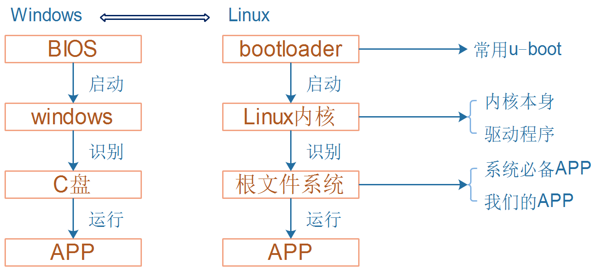
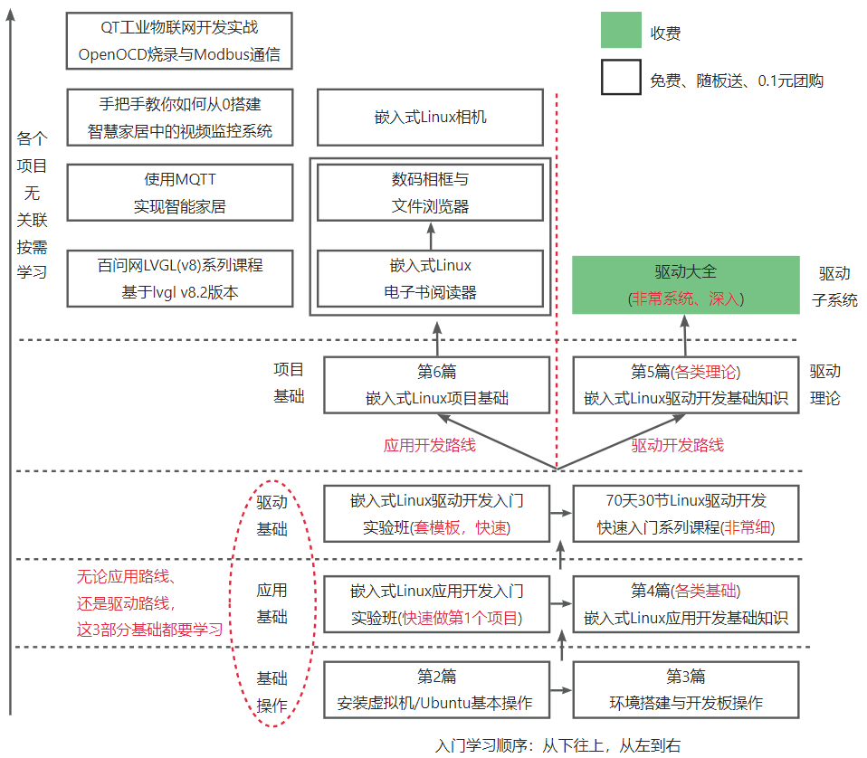
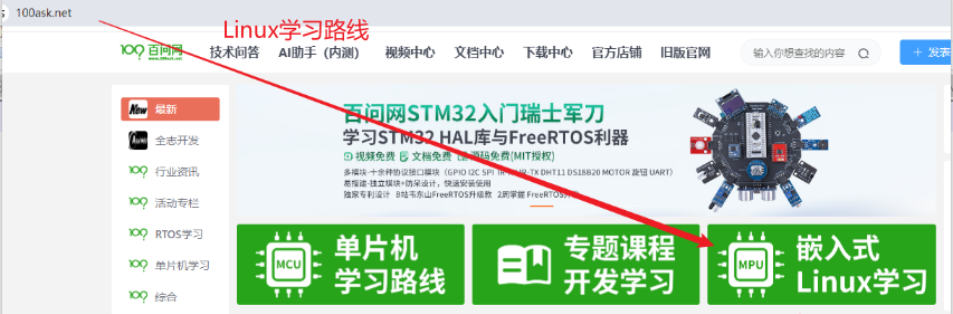

## 1.1 嵌入式Linux的组成

嵌入式Linux系统，就相当于一套完整的PC软件系统。

图 1.1嵌入式Linux和Windows的差别

很多人喜欢从系统启动流程开始学习：先学习裸机，裸机集合起来就是u-boot，再学习内核移植、驱动开发，接下来学习根文件系统，最后学习APP开发。

学习裸机需要2、3个月，学习u-boot也需要2、3个月，结果工作中u-boot基本不用改，并且u-boot比驱动开发还难！

按这套流程下来，学了后面忘了前面，最惨的是：不能快速上手工作，消耗学习热情！

入门讲究的是快速，入门之后再慢慢深入，

特别是对于急着找工作的学生，对于业余时间挑灯夜读的在职工程师，一定要快！

## 1.2 教程内容及学习顺序

本教程目前有如图 1.2所示内容：

图 1.2 教程视频

在官网中，位置如下：

图 1.3 官网中的教程视频

对于初学者，下载好资料、搭建好开发环境后，按照上图顺序学习即可： 先应用，再驱动，最后做项目。应用、驱动、项目这三类课程，都有录播课程(篇理论)、直播课程(重实战)，先学录播课程，再学习直播课程。

## 1.3 其他专题内容

入门之后，如果你想学习某一个专题，我们会陆续推出各类专题视频。目前正在录制《驱动大全》，深入讲解各类驱动子系统。后续规划的专题有：u-boot、buildroot、调试。
