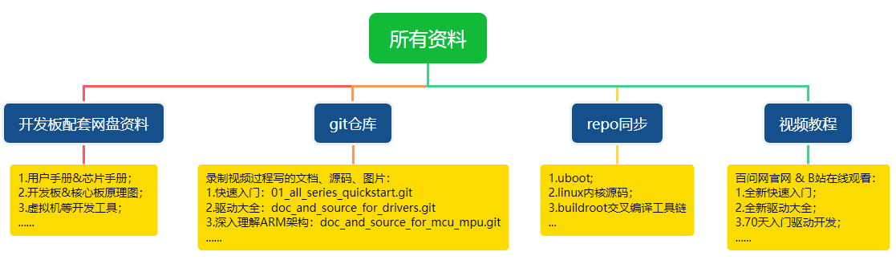
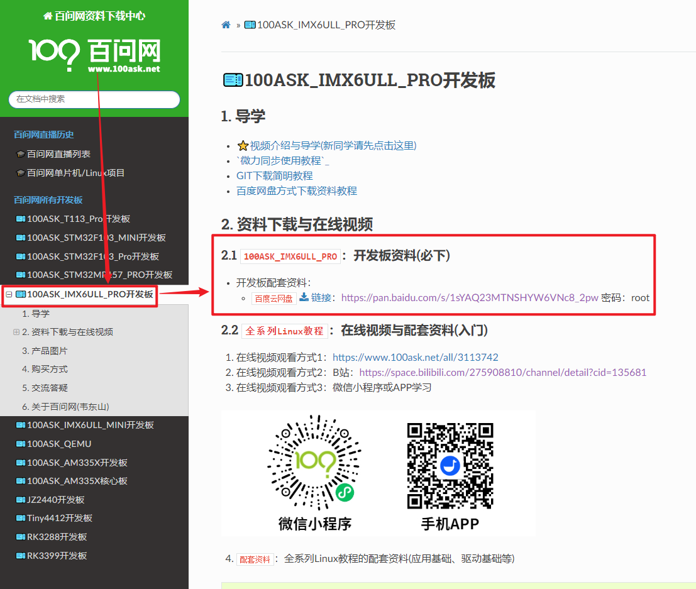
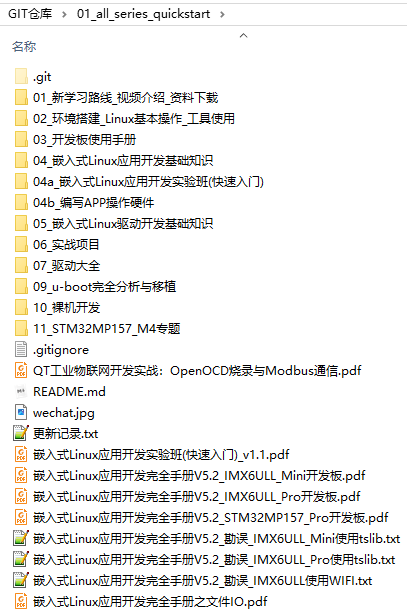
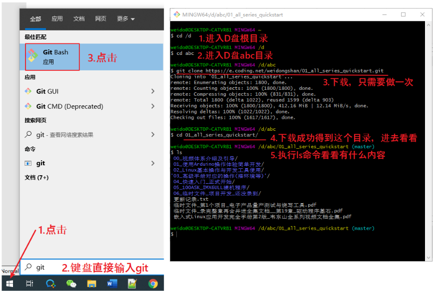
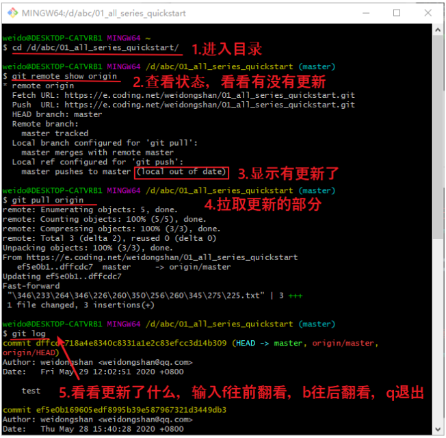
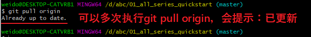

<a id="_Toc35963414"></a>
<a id="_Toc197788535"></a>

<a id="_Toc33603940"></a><a id="_Toc197788536"></a>
## 2.1 有哪些资料

所有资料分4类：

1.  开发板配套资料(原理图、虚拟机、烧写工具等)，放在百度网盘
2.  录制视频过程中编写的文档、源码、图片，放在GIT仓库
3.  u-boot、linux内核、buildroot等比较大的源码，放在GIT仓库
4.  视频，在线观看，放在百问网、B站等网站



图 2.1资料体系

<a id="_Toc197788537"></a>
## 2.2 下载开发板配套资料

打开官网：[https://www.100ask.net/](https://www.100ask.net/)，在首页点击“资料下载” 跳转到下载中心。

在下载中心左侧选择开发板，点击后可以看到这一项，建议使用百度网盘下载，如图 2.2所示



<a id="_Ref108608911"></a>图 2.2 资料下载页

<a id="_Ref108729700"></a><a id="_Toc197788538"></a>
## 2.3 下载GIT仓库的教程配套资料

教程配套的资料放在GIT仓库里，随着视频的不断更新，使用GIT可以很方面地更新配套的资料：

[https://e.coding.net/weidongshan/01\_all\_series\_quickstart.git](https://e.coding.net/weidongshan/01_all_series_quickstart.git)

注意，上述地址无法直接打开，必须使用GIT命令来下载。

下载成功后，内容如下图 2.3所示：



<a id="_Ref108608948"></a>图 2.3 资料Git仓库目录结构

### 2.3.1 安装GIT

在Windows下，GIT名为msysGit，从https://gitforwindows.org/ 上下载安装文件，双击安装即可。

在Ubuntu下，执行以下命令即可，它会从网上下载安装git（在我们发布的Ubuntu虚拟机里，已经安装有git，无需再次安装）：

```bash
sudo apt-get install git
```

无论是Windows还是Linux，GIT命令的用法是相似的，对于Windows，进入Git命令行的方法是在“开始”-&gt;“所有程序”-&gt;“Git”下启动Git Bash。

Git Bash中命令的用法跟Linux完全一样，比如也可以执行cd、ls等命令。

### 2.3.2 GIT常用命令

表 2‑1 Git常用命令表


| GIT命令 | 说明 | 示例 |
| --- | --- | --- |
| clone | 克隆，从远程下载仓库 | git clone https://e.coding.net/weidongshan/01_all_series_quickstart.git |
| pull | 拉取，从远程更新仓库 | git pull origin |
| log | 查看本地仓库的记录 | git log，快捷键：f前翻、b后翻、q退出 |
| status | 查看本地仓库状态，<br />比如有无修改，<br />修改有无提交进仓库里 | git status |
| tag | 查看标签，或是打标签 | git tag // 查看标签<br />git tag v2 // 打标签 |
| checkout | 提取出某个版本 | 使用git log查看版本，可以看到这样的版本号：<br />commit 4eb78f0a27a85957e1d38a23c5b031cc2aa4b93f<br />这时就可以执行以下命令取出这个版本：<br />git checkout 4eb78f0a27a85957e1d38a23c5b031cc2aa4b93f<br />执行上述命令后，当前目录里就是这个版本的源码；<br />要想提取出最新的代码，执行：<br />git checkout master |


如果只是使用GIT来下载资料，看后面的示例就可以了。如果要深入学习GIT，用GIT来管理你的代码、协同开发，这有一个图形化介绍GIT的网站：

[https://learngitbranching.js.org/?demo=&locale=zh\_CN](https://learngitbranching.js.org/?demo=&locale=zh_CN)

### 2.3.3 下载和更新GIT仓库

<a id="_4.1.3_使用示例：获得本文档及源码"></a>要获取视频对应的资料，可以执行以下命令，这称为“克隆”，这会得到一个名为01\_all\_series\_quickstart的目录：

```bash
git clone https://e.coding.net/weidongshan/01_all_series_quickstart.git
```

如果在你“克隆”之后，我们又更新了源码，你可以启动git bash后，使用cd命令进入GIT仓库目录，执行更新命令。

假设要进入D:\\abc\\01\_all\_series\_quickstart目录，可以执行以下命令：

```bash
cd /D
cd abc
cd 01_all_series_quickstart
```

也可以执行一个命令直接进入该目录，注意目录分隔符是“/”而非“\\”。

```bash
cd  /D/abc/01_all_series_quickstart
```

在01\_all\_series\_quickstart目录下，执行以下命令更新GIT仓库：

```bash
git pull origin
```

### 2.3.4 日常使用示例

**注意**：建议下载源码后，复制到其他目录去修改；否则以后更新时可能会和你的本地修改产生冲突。

第1天：下载仓库

假设你要把仓库下载到D盘abc目录，如图 2.4操作：



<a id="_Ref108609084"></a>图 2.4 Git下载仓库

1.  进入D盘根目录:cd /d
2.  进入D盘abc目录:cd abc
3.  下载（只需做一次）：

```bash
git clone https://e.coding.net/weidongshan/01_all_series_quickstart.git
```

1.  下载成功得到这个目录，进入这个目录看看:

```bash
cd 01_all_series_quickstart
```

1.  使用“ls”命令查看内容：

```bash
ls
```

第2天：查看有无更新，如图 2.5所示：



<a id="_Ref108609101"></a>图 2.5 Git仓库无更新

1.  进入之前下载的git本地仓库目录：

```bash
cd /d/abc/01_all_series_quickstart
```

1.  查看有无更新：

```bash
git remote show origin
```

1.  显示有更新：
2.  拉取更新的内容

```bash
git pull origin master
```

1.  查看更新了什么：

```bash
git log
```

注意：不执行“git remote show origin”查看状态，而是直接执行“git pull origin”也是可以的，后面这个命令会自动检查，有更新它就会下载更新部分，没有更新也会提示你，如图 2.6所示：



<a id="_Ref105512544"></a>图 2.6 git pull origin

<a id="_Toc197788539"></a>
## 2.4 BSP

BSP，Board Support Package，指板级支持包，是构建嵌入式操作系统所需的引导程序(Bootload)、内核(Kernel)、根文件系统(Rootfs)和工具链(Toolchain)。

每种开发板的BSP都不一样，并且这些源码都非常庞大。我们把这些源码都放在git仓库里，使用repo来管理、下载。

作为初学者，你甚至都还没有安装Ubuntu、还不会使用Ubuntu，所以先别去下载它们。

<a id="_Toc197788540"></a>
## 2.5 在线视频

视频可以在线观看，百问网、B站上都有：

• 百问网(https://www.100ask.net/)

• B站(https://www.bilibili.com/)：搜“韦东山”。为方便大家使用，这是链接地址：

[https://space.bilibili.com/275908810/channel/seriesdetail?sid=1714177](https://space.bilibili.com/275908810/channel/seriesdetail?sid=1714177)


图 2.7 B站首页

<a id="_Toc197788541"></a><a id="_Hlk111707031"></a>
## 2.6 资料的更新

随着视频的录制，会发布更多的文档、源码，可以使用GIT查看更新信息。可以每天使用“git pull”查看有无更新，一般更新了GIT就表示视频也有了更新。也可以直接登录百问网（[www.100ask.net](http://www.100ask.net)）或是B站，查看视频是否更新了。我们也会在公众号发布视频更新信息，发布其他重大消息，可以关注公众号：


具体操作视频链接：https://www.bilibili.com/video/BV19A411J7ci
