

## 1.1 安装VMware

Windows下有很多虚拟机软件，目前市面上流行的有VMware和VirtualBox。VMware分为收费专业版Workstation Pro和非商用免费版Workstation Player，推荐使用Workstation Player。

首先从VMware官网（www.vmware.com）下载Workstation Player安装包，或者使用我们提供的安装包。

在 &lt;开发板配套资料&gt;02\_开发工具\\ 【Windows】VMwareWorkstation安装包中，VMWare安装软件是：VMware-workstation-full-16.2.3-19376536.exe。下面给出VMWare的安装步骤。

第1步：以管理员身份运行安装软件

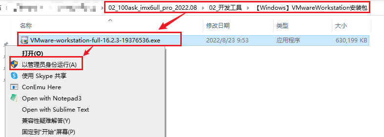

第2步：点击“下一步”

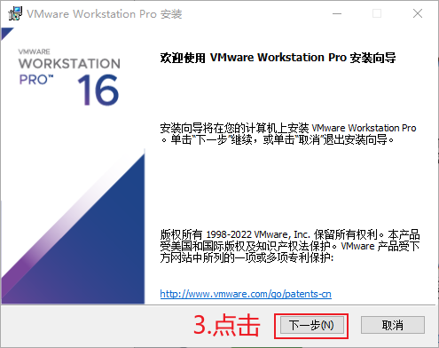

第3步：勾选“我接受”点击“下一步”

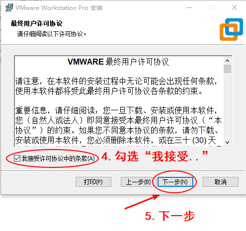

第4步：指定安装目录后点击“下一步”

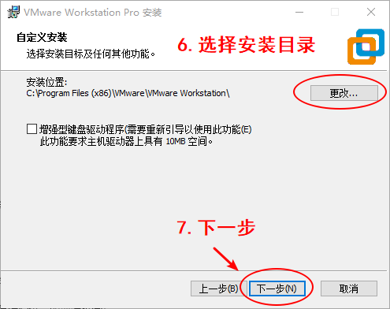

第5步：设置用户体验后点击“下一步”

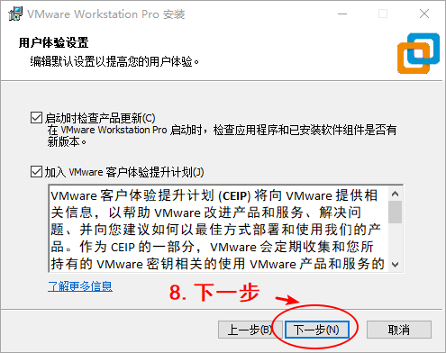

第6步：设置快捷方式后点击“下一步”

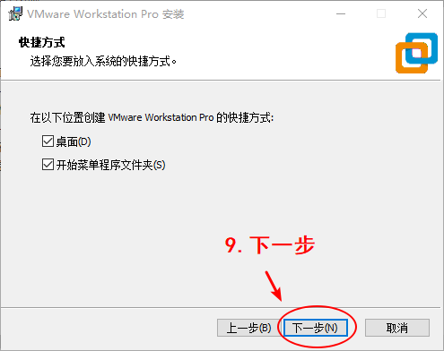

第7步：点击“安装”开始安装

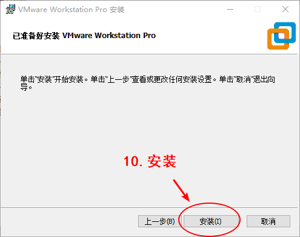

第8步：等待安装完成

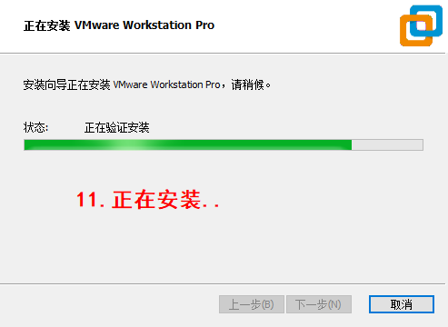

第9步：完成安装

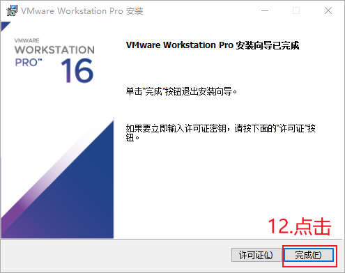

VMWare安装完成后，有两个软件，它们都可以使用，建议使用第2个：

1.  Vmware Workstation Pro：这是收费的，可以试用30天。
2.  Vmware Workstation 16 Player：这是免费的。

**注意：**本文是在Windows 10上安装VMware。

## 1.2 使用VMware打开Ubuntu

### 1.2.1 下载、解压Ubuntu映像文件

在百度网盘的“开发板配套资料”中，有Ubuntu映像文件，如图 1.1所示：

图 1.1 Ubuntu映像文件

在某个磁盘分区里解压文件，这个分区最好有200G的空闲空间。解压后，可以得到如图 1.2所示文件：

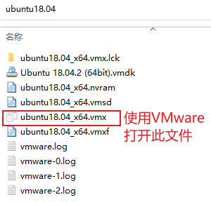

图 1.2 百问网提供的Ubuntu文件

### 1.2.2 在BIOS上启动虚拟化(virtualization)

大部分电脑的BIOS已经启动了虚拟化，可以打开设备管理器确认这点，如图 1.3和图 1.4所示：

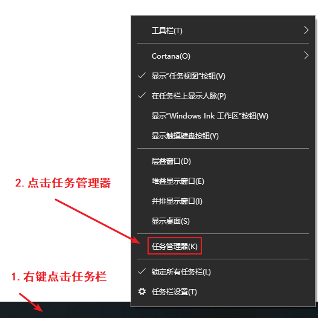

图 1.3 Win10下打开任务管理器

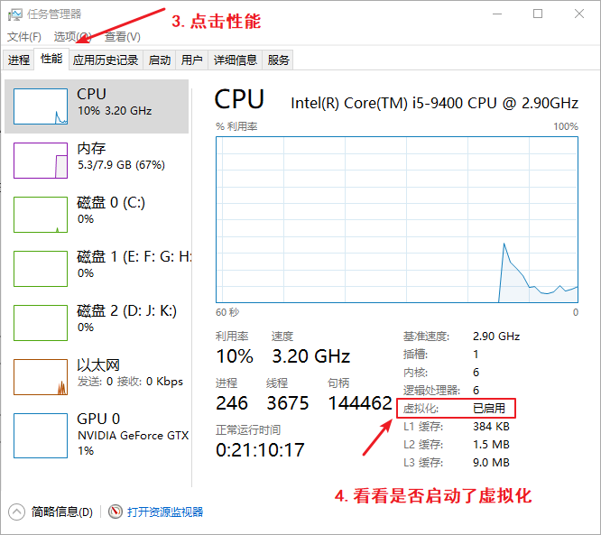

图 1.4 查看虚拟化是否开启

如果上图中虚拟化没有显示为“已启动”，需要重启电脑进入BIOS启动虚拟化。各个电脑的BIOS设置界面可能不一样，下面的步骤只是示例：

第1步：进入BIOS

开机或重启电脑过程中，在自检画面处反复按F2键（注：部分机型使用Fn+F2）进入BIOS Setup设置界面。

第2步：找到虚拟化菜单

用键盘的右方向键选中 “Configuration”菜单，然后使用下方向键选中“Intel Virtual Technology”选项并回车，如图 1.5所示：

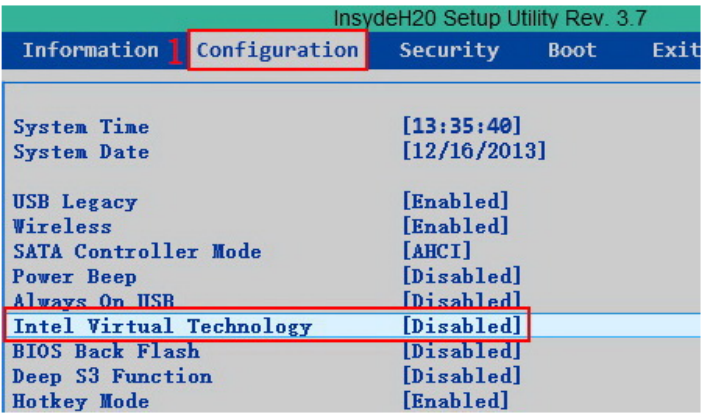

图 1.5 BIOS找到虚拟化

第3步：使能虚拟化

在弹出的菜单中，选择“Enable”并回车，如图 1.6所示：

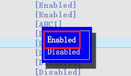

图 1.6 Enable虚拟化

第4步：保存

最后按键盘的F10热键（注：部分机型需要配合Fn+F10）调出保存对话框，选择“Yes”保存退出并自动重启电脑，如图 1.7所示：

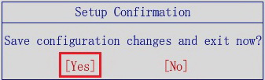

图 1.7 退出BIOS且保存

### 1.2.3 使用VMware运行Ubuntu

第1步：以管理员身份打开Vmware Workstation 16 player，如图 1.8所示：

#### 1.2.3.1 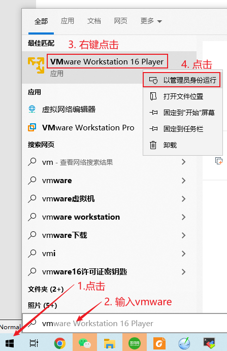

图 1.8 打开Vmware

第2步：打开虚拟机。

使用vmware打开前面解压得到的“Ubuntu 18.04\_x64.vmx”，如图 1.9所示：

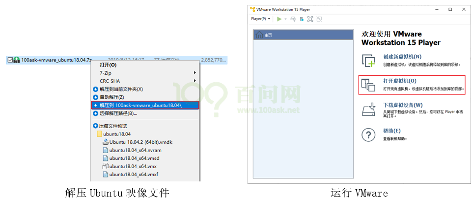

图 1.9 打开虚拟机

第3步：播放虚拟机，如图 1.10所示：

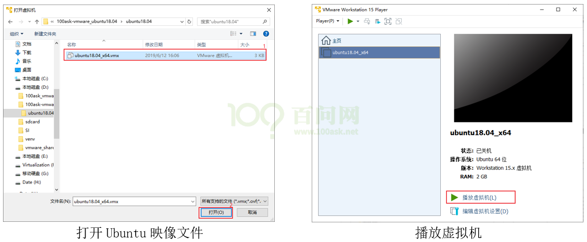

图 1.10 播放虚拟机

第4步：第一次启动Ubuntu时，选择默认的“我已复制该虚拟机”，启动后输入密码“123456”回车即可登录，如图 1.11所示：

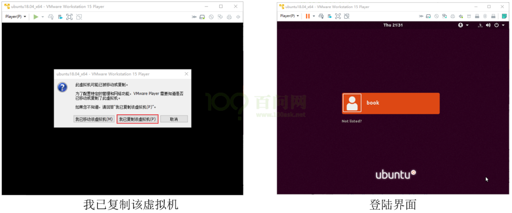

图 1.11 复刻并登录虚拟机

**注意**：虚拟机默认没有开启小键盘，如果使用小键盘输入，请先开启小键盘。如图 1.12所示：

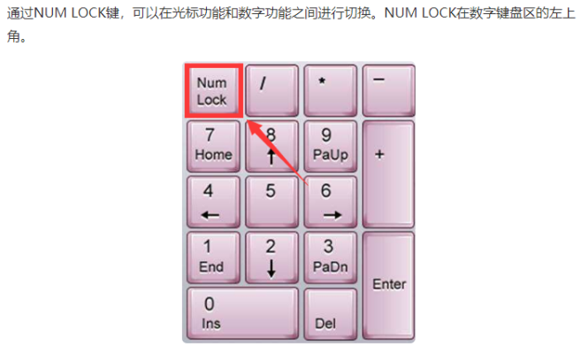

图 1.12 注意开启数字小键盘
