<a id="_第三章_初学者需要知道的Linux概念与命令_1"></a>
<a id="_使用Ubuntu：远程登录、传文件、NFS"></a>
<a id="_第四章_Ubuntu桌面入门指南_1"></a>
<a id="_常见问题"></a>
<a id="_配置网络"></a>
<a id="_配置Ubuntu"></a>
<a id="_安装Docker并运行我们提供的Ubuntu系统"></a>
<a id="_Toc197788546"></a>
<a id="_Ref110617580"></a>
<a id="_Ref110617535"></a>

<a id="_Toc197788547"></a><a id="_Toc33603959"></a><a id="_Toc31817003"></a>
## 2.1 Ubuntu下打开终端

我们安装的Ubuntu是桌面版本，这样我们可以像在windows系统下操作一样，相对于平时所说的Linux命令行下操作来说，这种体验非常舒适。但是一般我们使用Linux都是在命令行下进行操作，所有的操作我们的都可以通过输入命令来完成，绝大多数情况下使用命令行来操作Linux系统比通过在GUI下操作的效率高很多，虽然说我们使用的Ubuntu是包含了GUI的Linux发行版，然而我们可以像在windows下那样唤出Ubuntu的终端，打开Ubuntu的终端非常简单，以我们使用的Ubuntu18.04为例，有种方法可以直接在Ubuntu的用户界面下

### 2.1.1 用搜索框打开终端

我们要输入各种命令，需要先打开终端。

点击Ubuntu桌面左上角图标进入搜索框，输入“term”可以弹出终端“Terminal”程序，运行它，如图 2.1所示：

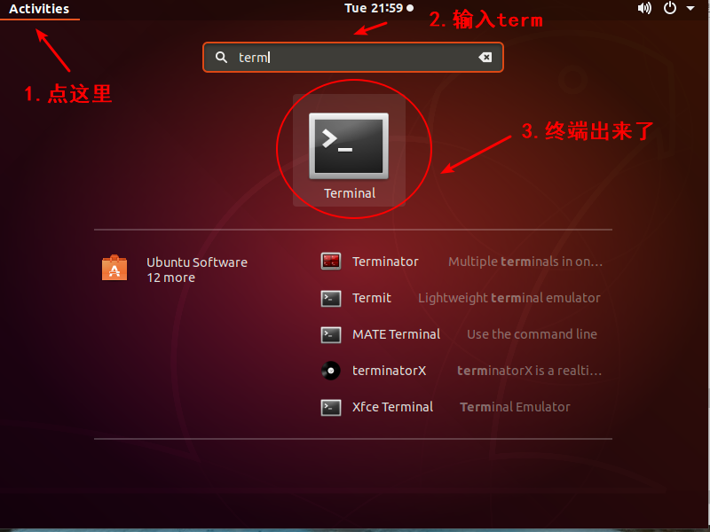

<a id="_Ref105516289"></a>图 2.1 搜索打开终端

然后就可以在里面执行各种命令了。

### 2.1.2 使用右键打开终端

在桌面或者在文件浏览器的任何目录下右键鼠标后在弹出的菜单栏中选择**“Open in Terminal”，**如图 2.2所示：

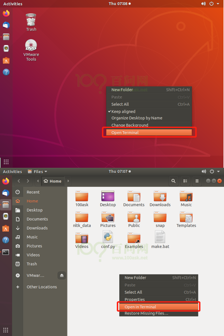

<a id="_Ref108610286"></a>图 2.2 指定位置右键打开终端

### 2.1.3 快捷键打开终端

这是个比较快捷方便的方法：使用快捷方式打开终端，快捷方式为”Ctrl+Alt+T”，使用快捷方式可在绝大多情况下直接唤出Ubuntu的终端（无论你是在浏览器、文件管理器、查看邮件、甚至在一个已经打开的终端下工作，等等都可以直接唤出Ubuntu的终端）。

<a id="_Toc33561501"></a><a id="_Toc31979762"></a><a id="_Toc31978958"></a><a id="_Toc33570582"></a><a id="_Toc33561646"></a><a id="_Toc33603957"></a><a id="_Toc33561367"></a><a id="_Toc33603958"></a><a id="_Toc197788548"></a>
## 2.2 Ubuntu系统初体验

### 2.2.1 Ubuntu和Windows的最大差别：目录

Windows中每一个分区都对应一个盘符，盘符下可以存放目录与文件，如图 2.3所示：


<a id="_Ref108610304"></a>图 2.3 Windows的分区和盘符

**注意**：目录就是文件夹。

Windows下某个文件的绝对路径以盘符开始，比如：

```bash
C:\abc\def\hello.txt
```

这是在C盘的abc目录下，有def子目录；而def中有hello.txt文件。

Ubuntu中，以树状结构表示文件夹与文件，没有盘符的概念。比如：

```bash
/abc/def/hello.txt
```

这表示在根目录下有abc子目录，而abc下又有def目录；def中有hello.txt文件。从名字“/abc/def/hello.txt”中你无法知道hello.txt文件位于磁盘哪一个分区。

**注意**：要想查看某个分区挂载在哪一个目录下，可以执行命令：

```bash
df  -h
```

对于普通用户，在Ubuntu下不再关心分区、盘符。需要关心的是哪个目录存什么，如图 2.4所示：

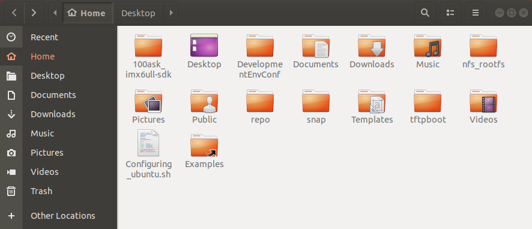

<a id="_Ref108610358"></a>图 2.4 Ubuntu下的文件目录

Ubuntu中的目录遵循FHS标准(Filesystem Hierarchy Standard，文件系统层次标准)。它定义了文件系统中目录、文件分类存放的原则、定义了系统运行所需的最小文件、目录的集合，并列举了不遵循这些原则的例外情况及其原因。FHS并不是一个强制的标准，但是大多的Linux、Unix发行版本遵循FHS。

这些目录简单介绍如图 2.5所示：

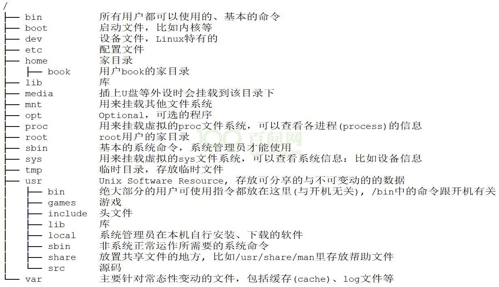

<a id="_Ref108610554"></a>图 2.5 FSH标准

### 2.2.2 Linux文件属性

在终端执行“ls -al”命令显示当前目录下的所有文件及文件夹的详细信息。文件属性示意图如图 2.6所示：

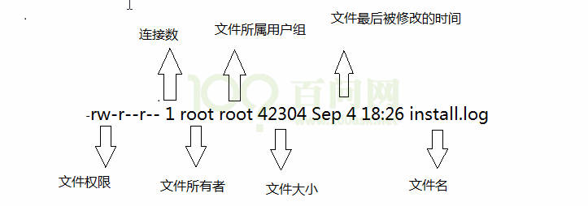

<a id="_Ref108610579"></a>图 2.6 文件属性

第一个字符表示“文件类型”，它是目录、文件或链接文件等。

表 2‑1 文件类型


| d | 目录 |
| --- | --- |
| - | 文件 |
| l | 链接文件 |
| b | 设备文件里的可供存储的接口设备 |
| c | 设备文件里的串行端口设备，如鼠标、键盘等 |


文件类型后面的9个字符以3个为一组，第一组表示“文件所有者的权限”；第二组表示“用户组的权限”；第三组表示“其他非本用户组的权限”。每组都是rwx的组合，其中r代表可读，w代表可写，x代表可执行；如果没有对应的权限，就会出现减号（-）。比如“rw-r--r--”表示：文件的所有者对该文件有读权限、写权限，但是没有执行权限；同一个用户组的其他用户对该文件只有读权限；其他用户对该文件也只有读权限。

-   连接数：表示有多少文件名连接到此节点。
-   文件所有者：表示这个文件的“所有者的账号”。
-   文件所属用户组。
-   文件大小：表示这个文件的大小，默认单位是B(字节)。
-   文件最后被修改的时间：这个文件的创建文件日期或者是最近的修改日期
-   文件名：对应文件的文件名。
-   如果文件名之前多了一个“.”,则说明这个文件为“隐藏文件”，执行“ls -a”命令可以列出隐藏文件。

<a id="_Ref110617510"></a>
### 2.2.3 设置屏幕

在我们的后续学习过程中，很少使用Ubuntu的桌面系统，都是远程登录上去的。但是如果Ubunut的桌面显示太小、太大，总是让人不舒服。这时可以修改屏幕分辨率，方法如图 2.8和图 2.9所示：

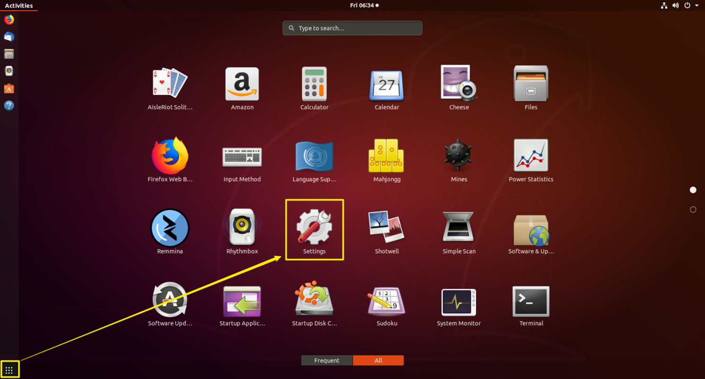

<a id="_Ref110617483"></a>图 2.7 点击“Show Applications”找到“Settings”

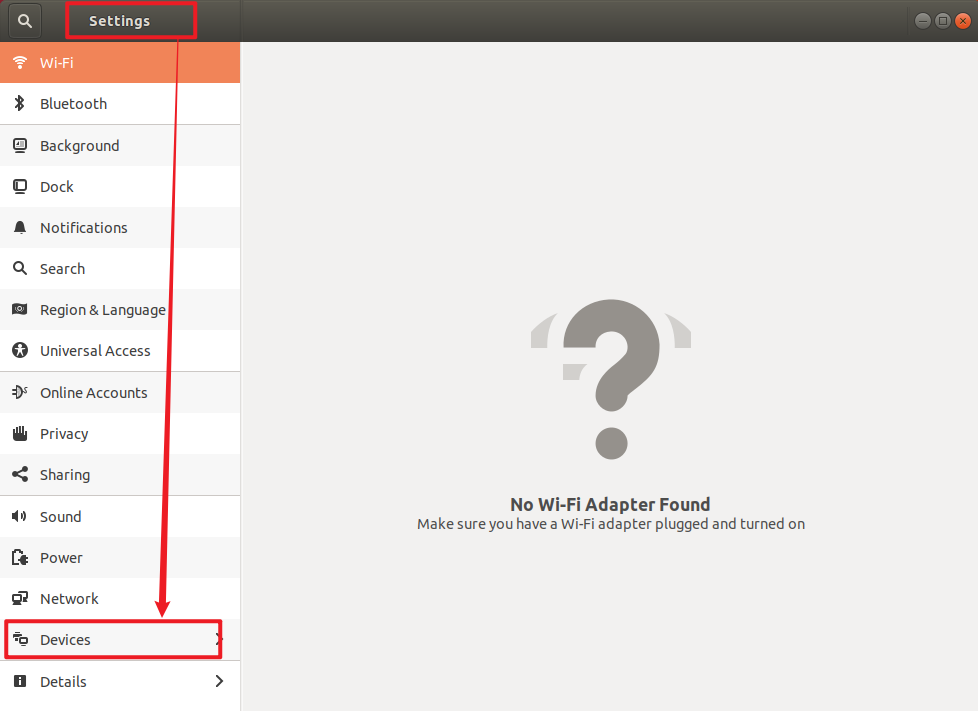

<a id="_Ref110617195"></a>图 2.8 “Settings”中找到“Devices”并点击进入

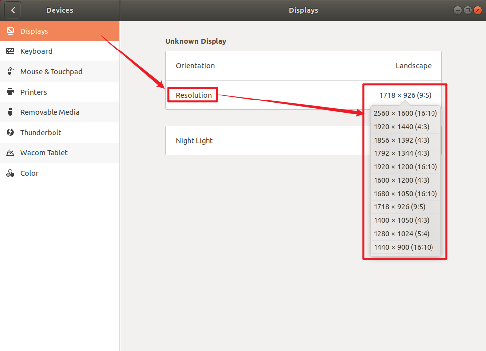

<a id="_Ref110617197"></a>图 2.9 选择合适的分辨率

### 2.2.4 系统关机与重启

和我们使用Windows系统一样，当我们不使用Ubuntu系统以后就需要将其关机或者睡眠，千万不要通过直接退出VMware软件来关机！！一般的步骤是：

1.  在虚拟机系统中关闭系统或在VMware软件上挂起虚拟机
2.  关闭VMware软件
3.  windows系统

Ubuntu的关机与重启很简单，在主界面，点击右上角的图标，然后选项对应的选项即可，如图 2.10所示：

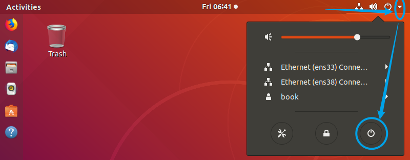

<a id="_Ref105517560"></a>图 2.10 Ubuntu关机

在弹出的对话框中我们可以进行重启或者关机操作，点击取消按钮可退出此对话框，如图 2.11所示：

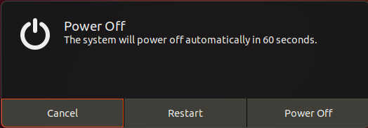

<a id="_Ref105517589"></a>图 2.11 选择重启、关机或者取消

到这里，细心的读者可能会发现，在windows系统下我们还有一个选项就是“睡眠”，在Ubuntu中没有睡眠选项。其实我们可以通过VMware软件来实现虚拟机系统的睡眠操作，那就是挂起操作，将虚拟机系统挂起后，我们下次可以直接将虚拟机恢复到挂起时的状态。将虚拟机挂起非常简单，VMware导航栏上的电源操作图标，或者在虚拟机的选项卡上右键唤出的菜单的电源选项中也有挂起操作，如下所示：

在VMware导航栏上的电源操作图标进行挂起，如图 2.12所示：

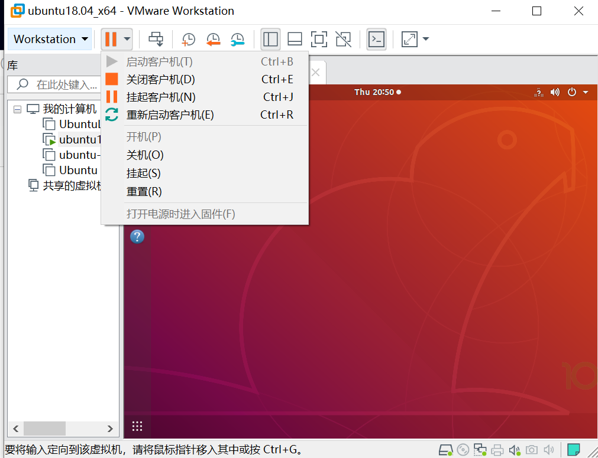

<a id="_Ref105517625"></a>图 2.12 挂起虚拟机

在虚拟机的选项卡上右键唤出的菜单的电源选项中进行挂起，如图 2.13所示：

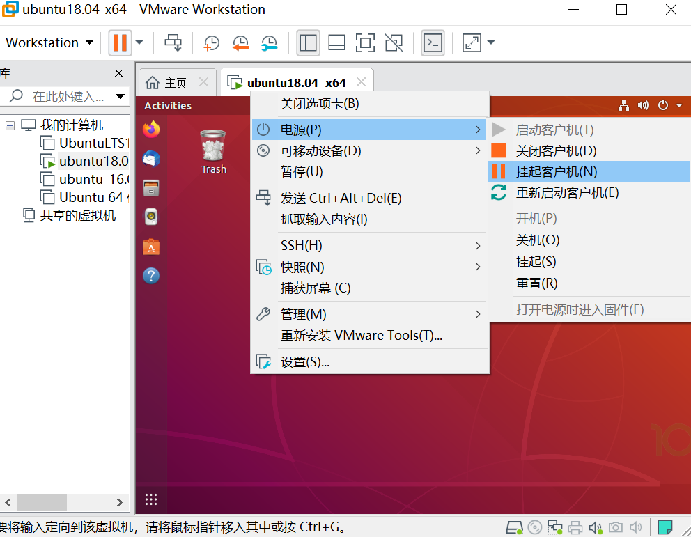

<a id="_Ref105517676"></a>图 2.13 右键虚拟机选择挂起

### 2.2.5 文件浏览器

每个带有GUI的系统都应该有文件浏览器，我们使用的桌面版本的Ubuntu也不例外，那么Ubuntu的文件浏览器怎么打开呢？

其实要打开Ubuntu的文件浏览器非常简单，文件浏览器在Ubuntu默认的左侧导航栏中可以直接打开，如图 2.14所示：

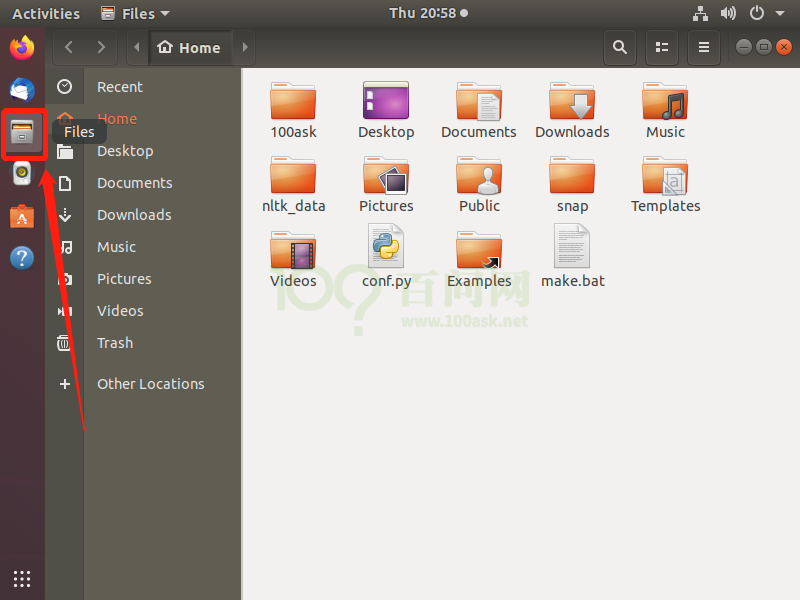

<a id="_Ref105517822"></a>图 2.14 桌面打开文件浏览器

或者我们可以在所有的应用中找到文件浏览器打开，如图 2.15所示：

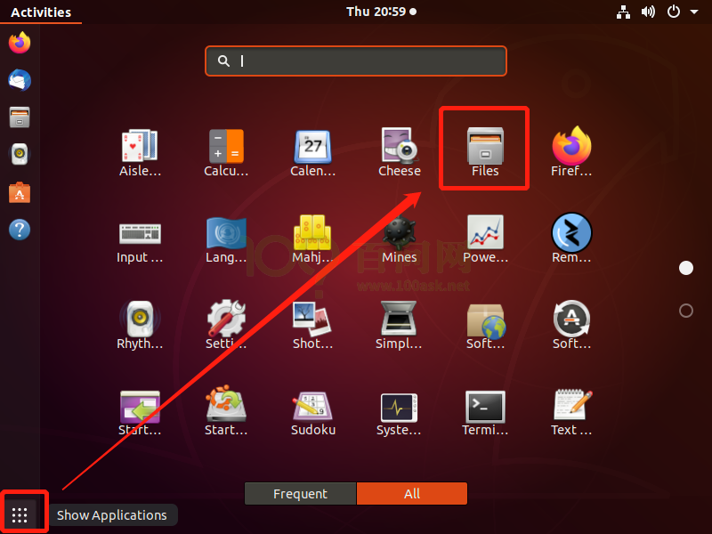

<a id="_Ref105517867"></a>图 2.15 搜索打开文件浏览器

打开文件浏览器之后，我们就可以像在windows系统下利用文件资源管理器那样浏览磁盘中所有的文件。

<a id="_Toc111735009"></a><a id="_Toc197788549"></a>
## 2.3 Linux常用命令

### 2.3.1 Linux命令行介绍

1.  Linux Shell简介

Shell的意思是“外壳”，在Linux中它是一个程序，比如/bin/sh、/bin/bash等。它负责接收用户的输入，根据用户的输入找到其他程序并运行。比如我们输入“ls”并回车时，shell程序找到“ls”程序并运行，把结果打印出来。

Shell有很多种实现，我们常用bash。

1.  Linux命令的提示符

在Ubuntu中打开终端后，即可看到类似下图的提示符：

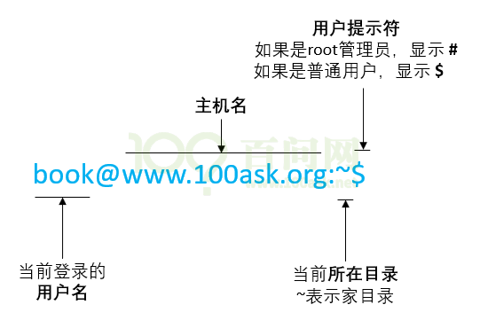

图 2.16 z终端提示符

1.  Linux命令的格式

Linux命令一般由三部分组成：

1.  command命令；
2.  options选项；
3.  parameter参数；

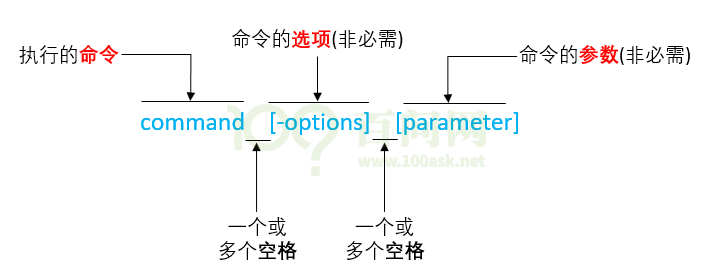

图 2.17 Linux命令格式

说明：

1.  \[ \]中括号表示 该部分可选，可有可无，需要根据命令的实际需要而添加;
2.  命令、选项、参数都以空格分隔，不管几个空格都算一个空格;
3.  命令输入完毕后，按回车“Enter”键启动;

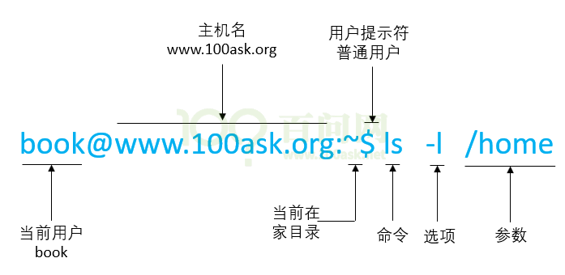

图 2.18 Linux命令示例

1.  记住命令并不难, 先背几个单词

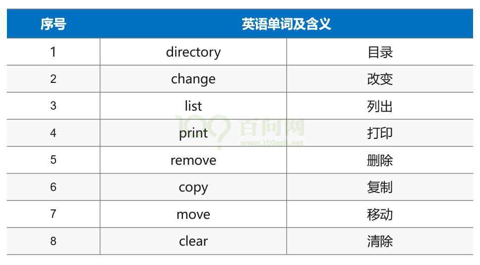

图 2.19 常见命令含义

1.  绝对路径和相对路径

Linux下的根目录为“/”，从根目录下出发可以找到任意目录、任意文件。从根目录开始表示目录或文件的方法称为“绝对路径”。比如：

/home/book

/home/book/1.txt

/bin/pwd

有时候使用绝对路径太过麻烦，可以使用相对路径。假设当前正位于/home/book目录下，那么：

./1.txt 表示当前目录下的1.txt，即 /home/book/1.txt；“.”表示当前目录

../book/1.txt 表示当前目录的上一级目录里，book子目录下的1.txt

“/home/book/..”就是”/home”目录，”..”表示上一级目录


### 2.3.2 目录/文件操作命令

1.  pwd

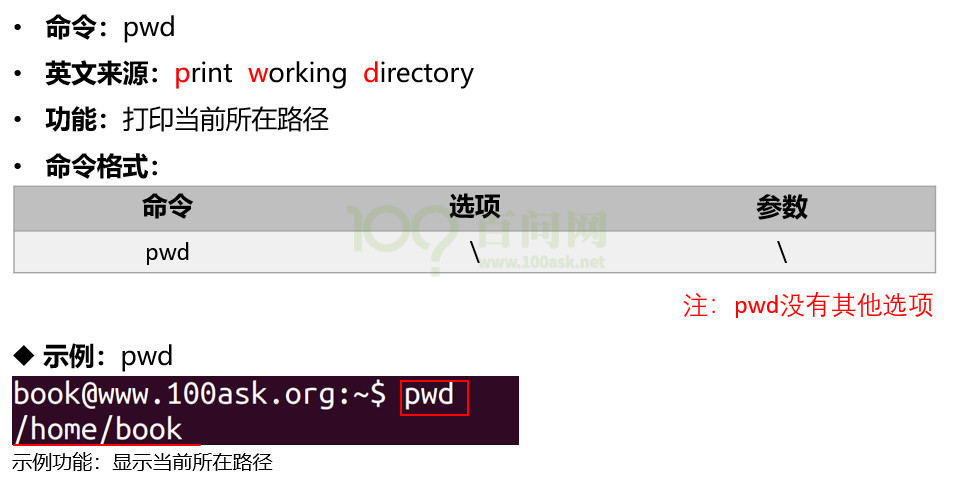

图 2.20 pwd

1.  cd

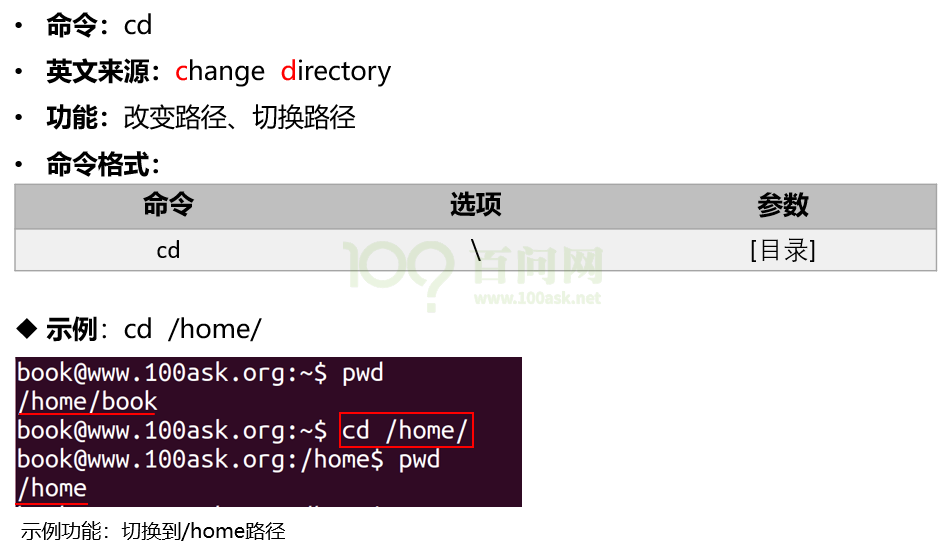

图 2.21 cd

cd命令有些缩略用法：

```bash
$ cd  -   // 进入上次目录, 比如先进入a目录再进入b目录，执行此命令后即回到a目录
$ cd  ~   // 进入家目录
```

1.  mkdir

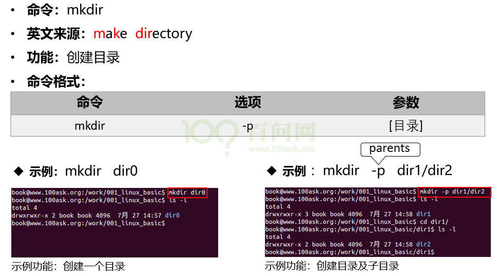

图 2.22 mkdir

1.  rmdir

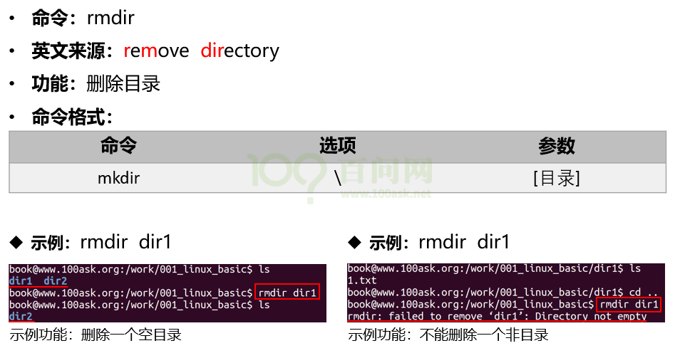

图 2.23 rmdir

1.  ls

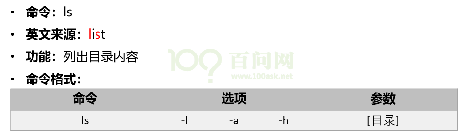

图 2.24 ls

使用示例：

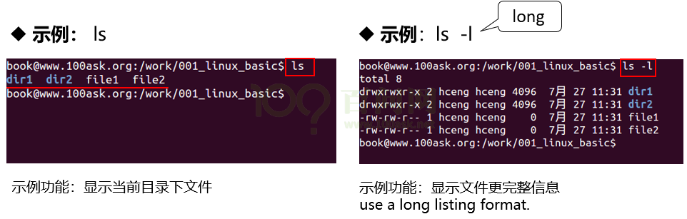

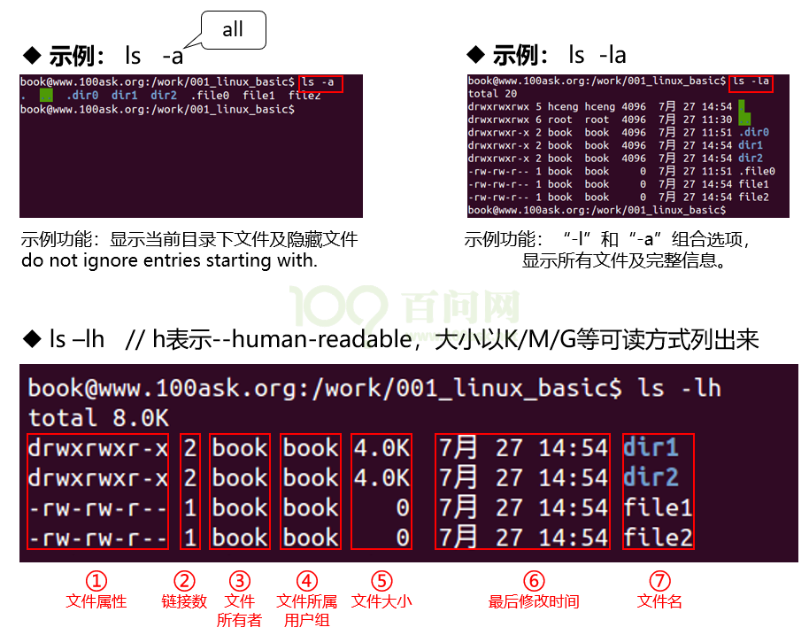

1.  cp


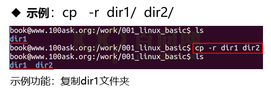

复制目录时，常用如下命令：

```bash
$ cp  -rfd  dir_a  dir_b
```

-   r：recursive，递归地，即复制所有文件
-   f：force，强制覆盖
-   d：如果源文件为链接文件，也只是把它作为链接文件复制过去，而不是复制实际文件

1.  rm

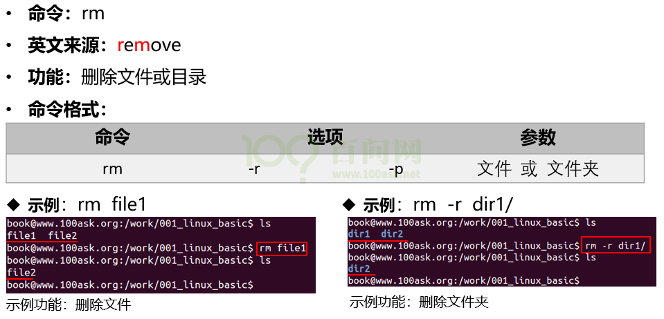

删除目录时，常用如下命令：

```bash
$ rm  -rf  dir_a
```

-   r：recursive，递归地，即删除所有文件
-   f：force，强制删除

1.  cat

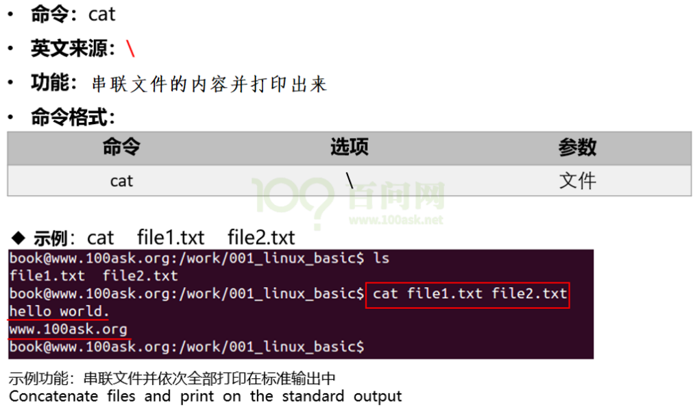

1.  touch

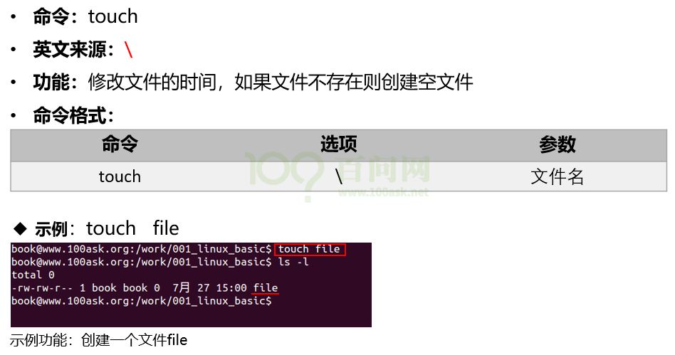

### 2.3.3 改变文件的权限和属性

-   chgrp：改变文件所属用户组
-   chown：改变文件所有者
-   chmod：改变文件的权限

1.  chgrp改变文件所属用户组

```bash
chgrp 【-R】 dirname/filename  ...
```

-   \-R:进行递归的持续更改，也连同子目录下的所有文件、目录都更新成为这个用户组之意。常常用在更改某一目录内所有文件的情况。

范例：

```bash
chgrp  hy  install.log
```

将install.log文件的用户组改为hy用户组。注意hy用户组必须要在/etc/group 文件内存在才可以。

1.  chowm改变文件的所有者

```
chown [-R]  账号名  文件或目录
chown [-R] 账号名:组名  文件或目录
```

-   \-R：也是递归子目录。

范例：

```bash
chown bin install.log
chown  book:book  install.log
```

改变文件所有者和用户组的这两个命令的应用场景：复制文件，由于复制行为会复制执行者的属性和权限，因此复制后需要改变文件所属用户、用户组等。

1.  chmod改变文件的权限

文件权限有两种设置方法：数字类型改变权限和符号改变权限。

首先说明各个权限对应的数字：

-   r: 4或0
-   w: 2或0
-   x: 1或0

这3种权限的取值相加后，就是权限的数字表示。例如：文件a的权限为“-rwxrwx---”，它的数值表示为：

-   owner = rwx = 4+2+1 = 7
-   group = rwx = 4+2+1 = 7
-   others = --- = 0+0 +0 = 0

所以在设置权限时，该文件的权限数字就是770。

1.  数字类型改变权限

使用数值改变文件权限的命令如下：

```
chmod [-R]  xyz  文件或目录
```

-   xyz：代表权限的数值，如770。
-   \-R：以递归方式进行修改，比如修改某个目录下所有文件的属性。

范例：

```bash
chmod 777 .bashrc
```

将文件.bashrc这个文件的所有权限设置都启用。

1.  符号类型改变文件权限方式

使用u、g、o三个字母代表user、group、others 3中身份。此外a代表all，即所有身份。

范例：

```bash
chmod u=rwx,go=rx  .bashrc
```

也可以增加或去除某种权限，“+”表示添加权限，“-”表示去除权限：

```bash
chmod a+w  .bashrc
chmod a-x  .bashrc
```

### 2.3.4 查找/搜索命令

1.  find

在Windows中搜索文件，一般查找文件需要传入两个条件：

1.  在哪些目录中查找；
2.  查找的内容；

在Linux中，查找文件的也需要这两个条件，不同于Windows使用搜索框查找，Linux中使用find命令查找文件。

find命令格式为：

```
find 目录名 选项 查找条件
```

举例1：

```bash
$ find  /home/book/dira/  -name  " test1.txt "
```

说明:

-   /home/book/dira/指明了查找的路径。
-   “-name”表明以名字来查找文件 。
-   “test1.txt”，就指明查找名为“test1.txt”的文件。

举例2：

```bash
$ find  /home/book/dira/ -name  " *.txt "
```

说明:查找指定目录下面所有以“.txt”结尾的文件，其中“\*”是通配符。

举例3：

```bash
find  /home/book/dira/  -name "dira"
```

说明: 查找指定目录下面是否存在“dira”这个目录或文件，“dira”是名称。

**注意：**

1.  如果没有指定查找目录，则为当前目录。

```bash
$ find . -name " *.txt "    //其中.代表当前路径。
$ find -name " *.txt "      //没加路径，默认是当前路径下查找。
```

1.  find还有一些高级的用法，如查找最近几天(几个小时)之内(之前)有变动的文件

```bash
$ find  /home/book  -mtime -2       //查找/home目录下两天内有变动的文件。
```

1.  grep

grep命令的作用是查找文件中符合条件的字符串，其格式如下：

```
grep [选项] [查找模式] [文件名]。
```

假设dira目录的test1.txt和dirb目录的test1.txt都含有如下内容：aaa AAAAAA abc abcabcabc cbacbacba match\_pattern nand-&gt;erase。

通过查找字符串，希望显示如下内容：

1.  所在的文件名----grep查找时默认已经显示目标文件名
2.  所在的行号------使用-n选项。

grep -rn "字符串" 文件名 r(recursive)：递归查找 n(number)：显示目标位置的行号

-   字符串:要查找的字符串
-   文件名:要查找的目标文件，如果是\*则表示查找当前目录下的所有文件和目录。

举例：

```bash
//在test1.txt中查找字符串abc grep -rn "abc" * 在当前目录递归查找字符串abc
$ grep -n "abc" test1.txt
```

**注意：可以加入-w全字匹配。**

可以在grep的结果中再次执行grep搜索，比如搜索包含有ABC的头文件，可执行如下命令：

```bash
$ grep  “ABC”  *  -nR  |  grep “\.h”
```

上述命令把第1个命令“grep “ABC” \* -nR”通过管道传给第2个命令。即第2个命令在第1个命令的结果中搜索。

### 2.3.5 压缩/解压缩命令

1.  gzip

gzip的常用选项：

-   \-l(list) 列出压缩文件的内容。
-   \-k(keep) 在压缩或解压时，保留输入文件。
-   \-d(decompress) 将压缩文件进行解压缩。

举例：

1.  查看压缩文件

```bash
$ gzip -l  pwd.1.gz
```

1.  解压文件

```bash
$ gzip -kd pwd.1.gz   //该压缩文件是以.gz结尾的单个文件
```

1.  压缩文件

```bash
$ gzip -k mypwd.1    /得到了一个.gz结尾的压缩文件
```

**注意：**

-   1.  如果gzip不加任何选项，此时为压缩。压缩完该文件会生成后缀为.gz的压缩文件，并删除原来的文件。所以，推荐使用gzip -k来压缩源文件，这样会保留原来的文件。
    2.  相同的文件内容，如果文件名不同，压缩后的大小也不同。
    3.  gzip只能压缩单个文件，不能压缩目录。

1.  bzip2

bzip2的常用选项：

-   \-k(keep) 在压缩或解压时，保留输入文件；
-   \-d(decompress) 将压缩文件进行解压缩；

1.  压缩文件

```bash
$ bzip2 -k mypwd.1 得到一个.bz2后缀的压缩文。
```

1.  解压文件

```bash
$ bzip2 -kd mypwd.1.bz2
```

**注意：**

-   如果bzip2不加任何选项，此时为压缩
-   压缩完该文件会生成后缀为.bz2的压缩文件， 并删除原来的文件。所以说，推荐使用bzip2 -k 来压缩文件，这样可以保留原来的文件。
-   bzip2只能压缩单个文件，不能压缩目录。
-   单个文件的压缩使用gzip或bzip2，压缩有两个参数：
    1.  压缩时间
    2.  压缩比。

一般情况下，小文件使用gzip来压缩，大文件使用bzip2来压缩。bzip2的的压缩率更高。

1.  tar

tar常用选项：

-   \-c(create)：表示创建用来生成文件包 。
-   \-x：表示提取，从文件包中提取文件。
-   \-t：可以查看压缩的文件。
-   \-z：使用gzip方式进行处理，它与”c“结合就表示压缩，与”x“结合就表示解压缩。
-   \-j：使用bzip2方式进行处理，它与”c“结合就表示压缩，与”x“结合就表示解压缩。
-   \-v(verbose)：详细报告tar处理的信息。
-   \-f(file)：表示文件，后面接着一个文件名。 -C &lt;指定目录&gt; 解压到指定目录。

例1：tar打包、gzip压缩

1.  把目录dira压缩、打包为dira.tar.gz文件：

```bash
$ tar czvf dira.tar.gz dira。
```

**注意：**“tar –czvf”与“tar czvf”是一样的效果，所以说，后面统一取消“-”。

1.  查看压缩文件：

```bash
$ tar tvf  dira.tar.gz
```

1.  解压文件，可以用-C 指定解压到哪个目录：

```bash
$ tar xzvf dira.tar.gz                 //解压到当前目录
$ tar xzvf dira.tar.gz -C /home/book   //解压到/home/book。
```

例2：tar打包、bzip2压缩

1.  把目录dira压缩、打包为dira.tar.bz2文件

```bash
$ tar cjvf dira.tar.bz2 dira
```

1.  查看压缩文件

```bash
$ tar tvf dira.tar.bz2
```

1.  解压文件，可以用-C 指定解压到哪个目录

```bash
$ tar xjvf dira.tar.bz2                   //解压到当前目录:
$ tar xjvf dira.tar.bz2 -C /home/book     //解压到/home/book
```

### 2.3.6 网络命令

**注意：只要你的Ubunut能上网，比如执行"ping www.baidu.com"成功，那么就不要按本章来设置网络。**

**注意：如果你的Ubunut不能上网，请按《**错误!未找到引用源。错误!未找到引用源。**》，也不需要阅读本章。**

**注意：本章只是介绍性的文档，不要执行它的命令。**

1.  ifconfig

查看网络、设置IP。ifconfig常用选项：

-   \-a ：显示所有网卡接口
-   up：激活网卡接口
-   down：关闭网卡接口
-   address：xxx.xxx.xxx.xxx，IP地址

示例：

1.  fconfig：查看当前正在使用的网卡

```bash
$ ifconfig
```

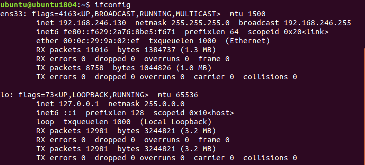

图 2.25

1.  ifconfig -a：查看所有网卡

```bash
$ ifconfig -a
```

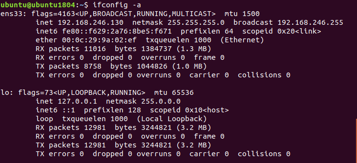

图 2.26

1.  设置网IP：

```bash
$ sudo ifconfig ens160 192.168.1.137
```

1.  route和DNS

确保Windows和Ubuntu的网络能互相ping通之后，如果Ubuntu无法上网，原因通常有2个：路由没设置好，DNS没设置好。

如果执行以下命令不成功，表示路由没设置好：

```bash
$ ping  8.8.8.8
connect: Network is unreachable
```

如果“ping 8.8.8.8”成功，但是“`ping www.baidu.com`”不成功，则是DNS没设置好：

```bash
$ ping www.baidu.com
ping: unknown host www.baidu.com
```

DNS的设置比较简单，8.8.8.8是好记好用的DNS服务器，修改Ubuntu中的/etc/resolv.conf文件，内容如下：

```bash
nameserver  8.8.8.8
```

路由信息使用route命令查看，其输出信息可以参考链接：

https://akaedu.github.io/book/ch36s05.html

摘录如下：

假设某主机上的网络接口配置和路由表如下：

```bash
$ ifconfig
eth0      Link encap:Ethernet  HWaddr 00:0C:29:C2:8D:7E
          inet addr:192.168.10.223  Bcast:192.168.10.255  Mask:255.255.255.0
          UP BROADCAST RUNNING MULTICAST  MTU:1500  Metric:1
          RX packets:0 errors:0 dropped:0 overruns:0 frame:0
          TX packets:10 errors:0 dropped:0 overruns:0 carrier:0
          collisions:0 txqueuelen:100
          RX bytes:0 (0.0 b)  TX bytes:420 (420.0 b)
          Interrupt:10 Base address:0x10a0
eth1      Link encap:Ethernet  HWaddr 00:0C:29:C2:8D:88
          inet addr:192.168.56.136  Bcast:192.168.56.255  Mask:255.255.255.0
          UP BROADCAST RUNNING MULTICAST  MTU:1500  Metric:1
          RX packets:603 errors:0 dropped:0 overruns:0 frame:0
          TX packets:110 errors:0 dropped:0 overruns:0 carrier:0
          collisions:0 txqueuelen:100
          RX bytes:55551 (54.2 Kb)  TX bytes:7601 (7.4 Kb)
          Interrupt:9 Base address:0x10c0
lo        Link encap:Local Loopback
          inet addr:127.0.0.1  Mask:255.0.0.0
          UP LOOPBACK RUNNING  MTU:16436  Metric:1
          RX packets:37 errors:0 dropped:0 overruns:0 frame:0
          TX packets:37 errors:0 dropped:0 overruns:0 carrier:0
          collisions:0 txqueuelen:0
          RX bytes:3020 (2.9 Kb)  TX bytes:3020 (2.9 Kb)
$ route
Kernel IP routing table
Destination     Gateway         Genmask         Flags Metric Ref    Use Iface
192.168.10.0    *               255.255.255.0   U     0      0        0 eth0
192.168.56.0    *               255.255.255.0   U     0      0        0 eth1
127.0.0.0       *               255.0.0.0       U     0      0        0 lo
default         192.168.10.1     0.0.0.0         UG    0      0        0 eth0
```

上述route命令输出信息中各项的含义请看下表：


| Destination | 目标网段或者主机 |
| --- | --- |
| Gateway | 网关地址，”*” 表示目标是本主机所属的网络，不需要路由 |
| Genmask | 网络掩码 |
| Flags | 标记。一些可能的标记如下： |
|  | U - 路由是活动的 |
|  | H - 目标是一个主机 |
|  | G - 路由指向网关 |
|  | R - 恢复动态路由产生的表项 |
|  | D - 由路由的后台程序动态地安装 |
|  | M - 由路由的后台程序修改 |
|  | ! - 拒绝路由 |
| Metric | 路由距离，到达指定网络所需的中转数 |
| Ref | 路由项引用次数 |
| Use | 此路由项被路由软件查找的次数 |
| Iface | 该路由表项对应的输出接口 |


在上面的例子中，这台主机有两个网络接口：

1.  一个网络接口连到192.168.10.0/24网络
2.  另一个网络接口连到192.168.56.0/24网络。

如果要发送的数据包的目的地址是192.168.56.3，跟第一行的子网掩码做与运算得到192.168.56.0，与第一行的目的网络地址不符，再跟第二行的子网掩码做与运算得到192.168.56.0，正是第二行的目的网络地址，因此从eth1接口发送出去，由于192.168.56.0/24正是与eth1接口直接相连的网络，因此可以直接发到目的主机，不需要经路由器转发。

如果要发送的数据包的目的地址是202.10.1.2，跟前三行路由表条目都不匹配，那么就要按缺省路由条目，从eth0接口发出去，首先发往192.168.10.1路由器，再让路由器根据它的路由表决定下一跳地址。

可以使用route命令管理路由。

示例：

-   1.  添加路由：首先得确定网关IP，假设为192.168.1.1

```bash
$ sudo  route  add  default  gw  192.168.1.1
$ ping 8.8.8.8   // 验证
PING 8.8.8.8 (8.8.8.8) 56(84) bytes of data.
64 bytes from 8.8.8.8: icmp_seq=1 ttl=53 time=19.8 ms
64 bytes from 8.8.8.8: icmp_seq=3 ttl=53 time=19.8 ms
```

-   1.  删除路由：

```bash
$ sudo  route  del  default  gw  192.168.1.1
```

### 2.3.7 vi编辑器

vi是一个命令，也是一个命令行下的编辑器，它有如下功能：

-   打开文件、新建文件、保存文件
-   光标移动
-   文本编辑
-   (多行间|多列间)复制、粘贴、删除
-   查找和替换

很多人不习惯在命令行下编辑文件，实际开发中也不会经常在命令行下编辑文件。但是在Linux系统中对文件做些简单修改时，使用vi命令的效率非常高。并且在很多时候，比如现场调试时，并没有GUI形式的编辑工具，vi是唯一选择。

1.  模式

vi编辑器有三种模式,各个模式侧重点不一样：

1.  一般模式（光标移动、复制、粘贴、删除）
2.  编辑模式（编辑文本）
3.  命令行模式（查找和替换）

vi编辑器的三种模式间切换如下图所示:

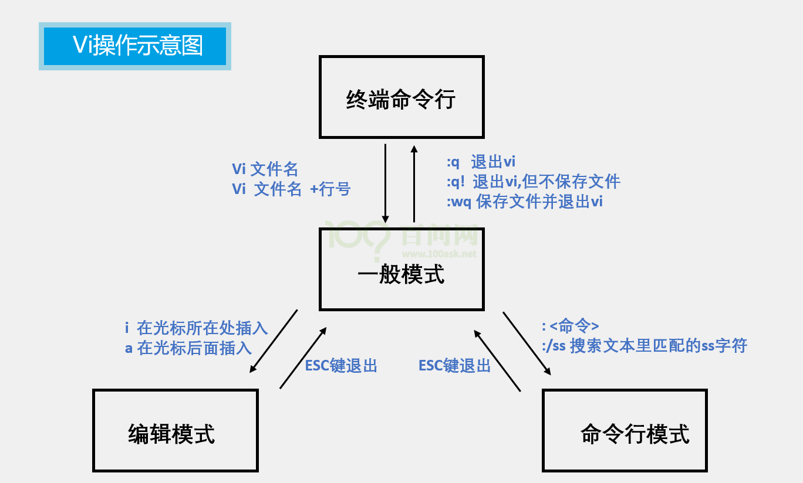

图 2.27

**注意：**

-   当不知道处于何种模式时，按ESC键返回到一般模式。
-   wq(write quit)
-   i(insert)

1.  文件的打开/新建/保存

打开文件、新建文件，命令如下(如果文件存在则打开文件，否则新建文件并打开)：

```bash
$ vi  文件名
```

修改结束之后，输入“:” 进入命令行模式，再输入“wq”保存退出：

```bash
:wq		保存并退出文件
```

**注意：**如果文件不存在，也需要输入“:wq”才可以保存新文件，否则不会新建文件。

在编辑完成时，返回一般模式，方法如下：

1.  输入“:w”则保存文件，如果已经保存文件，输入“:q”则退出文件
2.  直接输入“:wq”保存并退出
3.  如果不想保存被修改的内容，则输入“:q!”强制退出。

这些命令列表如下：


| 命令 | 描述 |
| --- | --- |
| x | 保存当前文档并且退出。 |
| q | 退出。 |
| w | 保存文档 。 |
| q! | 退出 vi/vim，不保存文档。 |


1.  编辑文件

打开文件后，默认处于“一般模式”，这时可以输入以下字母：


| 指令 | 描述 |
| --- | --- |
| i | 在当前光标所在字符的前面，转为编辑模式。 |
| I | 在当前光标所在行的行首转换为编辑模式。 |
| a | 在当前光标所在字符的后面，转为编辑模式。 |
| A | 在光标所在行的行尾，转换为编辑模式。 |
| o | 在当前光标所在行的下方，新建一行，并转为编辑模式。 |
| O | 在当前光标所在行的上方，新建一行，并转为编辑模式。 |


1.  快速移动光标

在一般模式下，可以使用下面快捷键移动光标或是翻页：


| 移动光标 |  |
| --- | --- |
| h (或左方向键) | 光标左移一个字符。 |
| l (或右方向键) | 光标右移一个字符。 |
| j (或下方向键) | 光标下移一行。 |
| k (或上方向键) | 光标上移一行。 |
| nG或ngg | 光标移动到第 n行首。 |
| n+ | 光标下移 n行。 |
| n- | 光标上移 n行。 |
| 屏幕翻滚 |  |
| Ctrl + f | 屏幕向下翻一页，相当于下一页。 |
| Ctrl + b | 屏幕向上翻一页，相当于上一页。 |


详细介绍如下：

1.  快速的定位到某一行：文件头、文件尾、指定某一行

-   ngg：光标移至第n行的行首（n为数字,想要跳转的行），
-   1gg：就跳到第一行的行首，就是文件头
-   2gg：就跳到第二行的行首
-   G：转至文件结尾

1.  在某一行如何快速定位到某一列：

-   0:（数字零）光标移至当前行行首
-   $：光标移至当前行行末
-   fx：搜索当前行中下一个出现字母x的地方

**注意：当你不知道vi当前处于何种模式时，使用esc键返回到一般模式。**

1.  文本复制/粘贴/删除/撤销

在一般模式下，可以执行以下命令：


| 复制、删除和粘贴 |  |
| --- | --- |
| cc | 删除整行，并且修改整行内容。 |
| dd | 删除该行，不提供修改功能。 |
| ndd | 删除当前行向下 n行。 |
| x | 删除光标所在的字符。 |
| X | 删除光标前面的一个字符。 |
| nyy | 复制当前行及其下面 n行。 |
| p | 粘贴最近复制的内容。 |
| s | 删除光标所在字符。 |
| r | 替换光标处字符。 |


-   1.  复制

```bash
yy   //复制当前行(y:yank(复制))
nyy  //复制当前行及其后的n-1行(n是数字)
```

-   1.  粘贴

```bash
p  //粘贴(p:paste)
```

-   1.  删除

```bash
dd   //删除光标所在行(d:delete)
ndd  //删除当前行及其后的n-1行(n是数字)
x    //删除光标所在位置的字符
```

-   1.  撤销

```bash
u  //撤销上一步操作
```

1.  文本查找和替换

在一般模式下，可以执行以下命令。

1.  查找

```bash
/pattern  //从光标开始处向文件尾搜索pattern，后按下n或N
```

**注意：**

-   n：在同一个方向重复上一次搜索命令
-   N：在反方向重复上一次搜索命令
-   在/pattern之前先跳到第一行则进行全文件搜索。

1.  替换

-   :%s/p1/p2/g //将文件中所有的p1均用p2替换
-   :%s/p1/p2/gc //替换时需要确认
-   “s“ 全称：substitute替换；
-   “g“ 全称：global全局；
-   “c“ 全称：confirm，确认

参考

[https://www.runoob.com/linux/linux-command-manual.html](https://www.runoob.com/linux/linux-command-manual.html)

1.  vi编辑器使用示例

本例创建一个名为hello.txt的文件，添加如下2行文件字，再回退去删除第2行的字母“X”：

```
www.100ask.net
wiki.100askX.net
```

首先执行以下命令，如果当前目录下没有hello.txt它就会新建并打开该文件，否则直接打开该文件：

```bash
vi  hello.txt
```

界面如下：

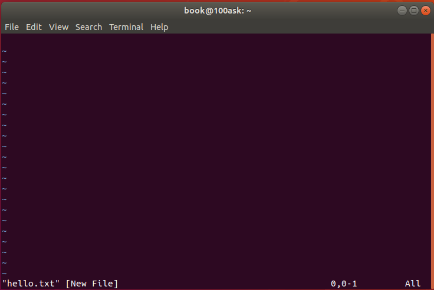

图 2.28

输入字符“i”，它表示“insert”，即在光标前输入字符，界面如下：

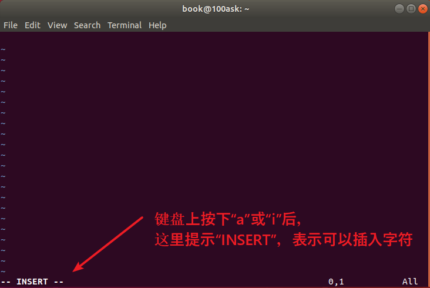

图 2.29

在上述界面中，可以输入字符了，可以使用回车键、删除键、箭头键等等，跟一般得文本工具没什么差别，如下：

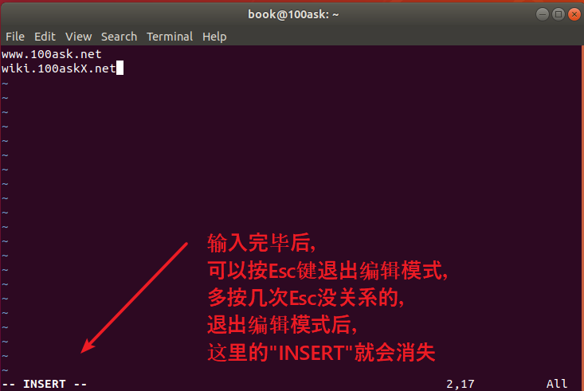

图 2.30

无论当前是否处于编辑模式，都可以使用箭头键移动光标。

-   在编辑模式下，使用删除键(Backspace)删除字符;
-   不在编辑模式下时，使用“x”删除光标所在的字符;

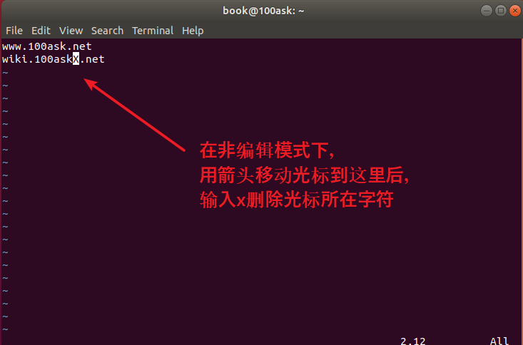

图 2.31

最后输入“:wq”保存并退出，“:”表示进入命令行模式，“wq”表示“write and quit”，即写入并退出。如果不想保存则可以输入“:q!”，它表示“退出、不保存”:


图 2.32

最后执行“cat hello.txt”命令验证一下：

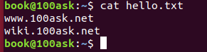

图 2.33

**注意**：本教程没有教你怎么在Ubuntu中安装中文输入法，因为我们是在Windows编辑源码，或是提倡多英文写注释。如果你需要在Ubuntu下使用中文，请自行百度。

### 2.3.8 其他命令

1.  file

查看文件类型。其格式如下：

```
file 文件名
```

使用gcc编译得到的程序是运行于PC的，但是很多初学者经常把这些程序放到ARM板子上去运行，这时一般都会提示：

```bash
xxx  not found
```

它并非“找不到”，而是格式不正确。这时你可以执行“file xxx”查看它的类型，确定它是给PC还是给ARM编译的。

1.  which和whereis

which命令和whereis命令作用是查找命令或应用程序的所在位置，其格式如下：

```
which   命令名/应用程序名
whereis  命令名/应用程序名。
```

示例：

```bash
$ which pwd     //定位到/bin/pwd
$ which gcc     //定位到/usr/bin/gcc
$ whereis pwd   //可得到可执行程序的位置和手册页的位置
```

<a id="_Toc197788550"></a><a id="_Toc111735010"></a>
## 2.4 Ubuntu下包管理

### 2.4.1 软件包管理系统

像我们日常使用的windows提供的应用商店或者手机提供的应用市场那样，大多数现代的类 Unix 操作系统也都提供了一种中心化的机制用来搜索和安装软件。软件通常存放在存储库中，并通过包的形式对外进行分发。处理包的工作称为包管理。包提供了操作系统的基本组件，以及共享的库、应用程序、服务和文档。这个我们称为软件包管理系统，其除了安装软件外，它还提供了工具来更新已经安装的包。

大多数软件包系统都是围绕软件包文件的集合构建的。软件包文件通常是一个存档文件，它包含已编译的二进制文件和软件的其他资源，以及安装脚本。软件包文件同时也包含有价值的元数据，包括它们的依赖项，以及安装和运行它们所需的其他软件包的列表。

虽然这些包管理系统的功能和优点大致相同，但打包格式和工具会因平台（不同的Linux发行版）而异，如下表所示：


| 操作系统 | 格式 | 工具 |
| --- | --- | --- |
| Debian | .deb | apt, apt-cache, apt-get, dpkg |
| Ubuntu | .deb | apt, apt-cache, apt-get, dpkg |
| CentOS | .rpm | yum |
| Fedora | .rpm | dnf |
| FreeBSD | Ports, .txz | make, pkg |


由上表可知，Debian 及其衍生版，如我现在使用的 Ubuntu，它们的包格式为 .deb。APT 这款先进的软件包管理工具提供了大多数常见的命令如：搜索存储库、安装软件包及其依赖项，并管理升级，等等。在系统中，我们还可以使用 dpkg 程序来安装单个的 deb 文件，APT 命令作为底层 dpkg 的前端，有时也会直接调用它。

目前发布的 debian 衍生版大多数都包含了 apt 命令，它提供了一个简洁统一的接口，可用于通常由 apt-get 和 apt-cache 命令处理的常见操作。这个命令是可选的，但使用它可以简化一些任务。

### 2.4.2 apt命令使用

上一小节介绍了软件包管理系统，本小节秉承上小节的内容，介绍软件包管理系统中apt命令。

我们习惯于使用windows系统以及智能手机，这两个下载和安装软件都是非常容易简单的。但是Ubuntu下该如何安装软件呢？Ubuntu安装软件不像Windows下那样，直接双击.exe文件就开始安装了。一般来说Ubuntu下很多软件是需要先自行提供源码，使用源码自行编译，编译完成以后使用命令”install”来安装到系统中。当然 Ubuntu下也有其它的软件安装方法，使用得最多的方法就是自行编译源码后进行安装，尤其是嵌入式 Linux开发。命令 ”install” 格式如下所示：

```
install [选项 ]... [-T] 源文件 目标文件
install [选项 ]... 源文件 ... 目录
install [选项 ]... -t 目录 源文件 ... 或： install [选项 ]... -d 目录 ...
```

“install” 命令是将文件 (通常是编译后的文件 )复制到目的位置，在上面得三种形式中，将源文件复制到目标文件或将多个源文件复制到一个已存在的目录中同时设置其所有权和权限模式。在第四种形式会创建指定的目录。命令“ install”通常和命令 apt-get”组合在一起使用的。

其实Ubuntu中我们可以直接安装很多的软件&游戏，但是对于刚刚接触Linux系统的我们往往会不知如何安装安装软件，其实我们利用软件包管理系统可以直接下载并安装所有通过认证的软件，其中Ubuntu下我们用的最多的下载工具： APT下载工具， APT下载工具可以实现软件自动下载、配置、安装二进制或者源码的功能。

APT下载工具和上面讲解到的 ”install” 命令结合构成了 Ubuntu下最常用的下载和安装软件方法。并且其解决了 Linux平台下一安装软件的一个缺陷：即软件之间相互依赖问题。

### 2.4.3 更换软件源

APT采用 C/S 模式，也就是客户端/服务器模式，一般来说我们的 PC机作为客户端，当需要下载

软件的时候就向服务器请求，因此我们需要知道服务器的地址，也叫做软件源或者更新源，这个一般默认使用的是国外的软件源（服务器）。因为我们是在中国，如果没有选择中国的服务器，可能会导致下载速度非常慢甚至是下载失败。所以我们需要修改软件源为国内的服务器，这里由两种方法可以进行修改：

1.  在桌面环境中修改软件源：

打开系统设置，打开“软件和更新”设置，打开以后如下图所示：

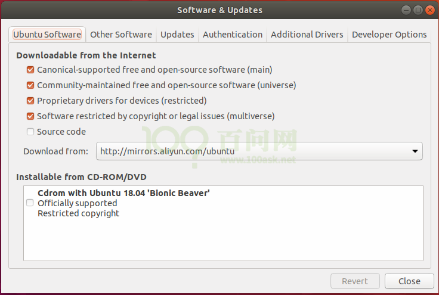

图 2.34

上图中的“Ubuntu软件”选项卡下面的“下载自”就是APT工具的安装源。

1.  修改配置文件

Ubuntu配置的默认源并不是国内的服务器，下载更新软件都比较慢。首先备份源列表文件sources.list：

-   首先备份源列表

```bash
sudo cp /etc/apt/sources.list /etc/apt/sources.list_backup
```

打开sources.list文件修改选择合适的源，替换原文件的内容，保存编辑好的文件, 以阿里云更新服务器为例：

-   打开sources.list文件

```bash
sudo vim /etc/apt/sources.list
```

编辑 /etc/apt/sources.list文件, 在文件最前面添加阿里云镜像源：

```
#  阿里源
deb http://mirrors.aliyun.com/Ubuntu/ bionic main restricted universe multiverse
deb http://mirrors.aliyun.com/Ubuntu/ bionic-security main restricted universe multiverse
deb http://mirrors.aliyun.com/Ubuntu/ bionic-updates main restricted universe multiverse
deb http://mirrors.aliyun.com/Ubuntu/ bionic-proposed main restricted universe multiverse
deb http://mirrors.aliyun.com/Ubuntu/ bionic-backports main restricted universe multiverse
deb-src http://mirrors.aliyun.com/Ubuntu/ bionic main restricted universe multiverse
deb-src http://mirrors.aliyun.com/Ubuntu/ bionic-security main restricted universe multiverse
deb-src http://mirrors.aliyun.com/Ubuntu/ bionic-updates main restricted universe multiverse
deb-src http://mirrors.aliyun.com/Ubuntu/ bionic-proposed main restricted universe multiverse
deb-src http://mirrors.aliyun.com/Ubuntu/ bionic-backports main restricted universe multiverse
```

在我们使用 APT工具下载安装或者更新软件的时候，首先会在下载列表中与本机软件进行对比，看一下需要下载哪些软件，或者升级哪些软件，默认情况下 APT会下载并安装最新的软件包，被安装的软件包所依赖的其它软件也会被下载安装或者更新，非常智能省心。

<a id="_Toc197788551"></a><a id="_Toc111735011"></a>
## 2.5 Ubuntu的gedit编辑器

进行文本编辑是非常常用的操作，在windows系统为我们默认提供了记事本让我们可以进行文本编辑，Ubuntu系统下也为我们提供一些文本编辑工具来让我们使用，如gedit、vi/vim。

gedit是一个窗口式的编辑器，只能在Ubuntu桌面环境下使用。

### 2.5.1 在GUI环境下打开gedit

我们一般在使用Ubuntu的文件管理器时，直接双击文本文件默认使用的就是“Gedit”编辑器。

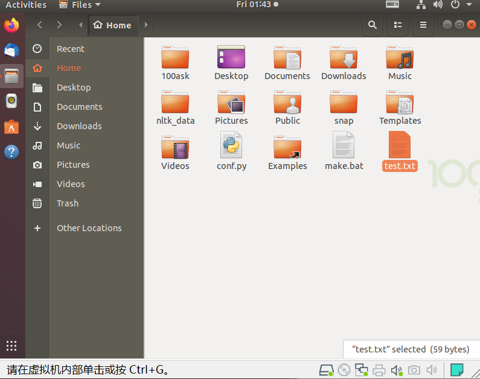

图 2.35

或者单击右键需要编辑的文本文件，选择应用打开：

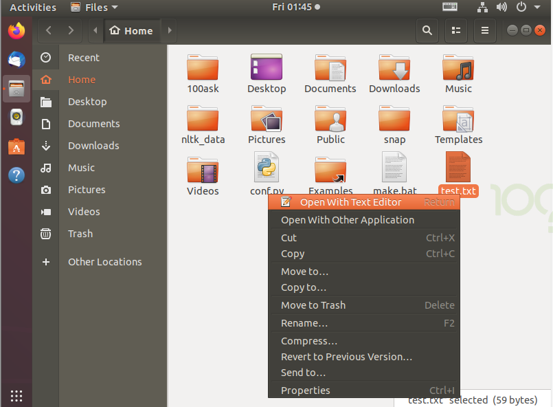

图 2.36

### 2.5.2 在终端里打开gedit

在终端里，可以直接运行gedit命令打开编辑器，也可以运行“gedit 文件名”打开指定文件，比如：

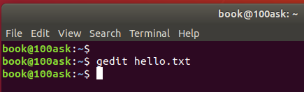

图 2.37

如果要修改其他用户的文件，比如/etc/fstab，如下：

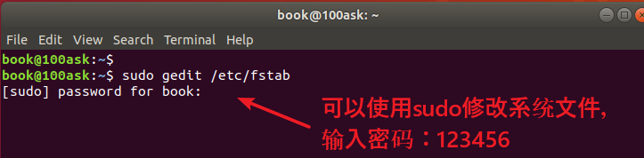

图 2.38

### 2.5.3 gedit的使用

gedit跟Windows下记事本的用法没什么差别。

在编辑器中我们可以点击 ”Open” 按钮浏览最近打开过的文件列表并打开文件；点击 ”Save” 按钮可以保存当前正在编辑的文件；点击右侧的菜单栏进行更多的操作等等。

快捷键也跟windows下一样：

-   保存文件：Ctrl + s
-   另存为：Ctrl + Shift + s
-   搜索文本内容： Ctrl + f

<a id="_Toc111735012"></a><a id="_Toc197788552"></a>
## 2.6 强烈建议使用纯英文的ubuntu

编译程序时，在纯英文环境下错误信息是以英文来描述的，比如：

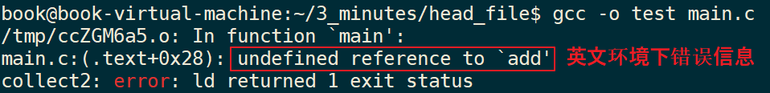

图 2.39

这些错误信息在网上一贴，就有很多答案，百度找不到就用bing，再不行就用google，国内找不到可以找国外。

如果使用中文环境的话，错误信息是以中文来描述的，你只能在百度上搜答案。

<a id="_Toc111735013"></a><a id="_Toc197788553"></a>
## 2.7 默认不能使用root用户登录

在开发过程中很少用root用户，要使用root权限时可以在命令前加上“sudo”，比如“sudo ps -a”。

如果你就是喜欢用root用户，可以按下图操作，先给root用户设置密码，以后就可以用root用户登录了：

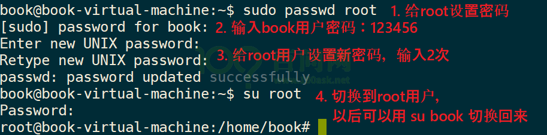

图 2.40


操作视频链接：[https://www.bilibili.com/video/BV1zV411U7H9](https://www.bilibili.com/video/BV1zV411U7H9)
