<a id="_Toc197788555"></a>

<a id="_Toc197788556"></a>
## 1.1 下载网盘资料

打开百问网下载中心，在左侧找到你的开发板，下载网盘资料：

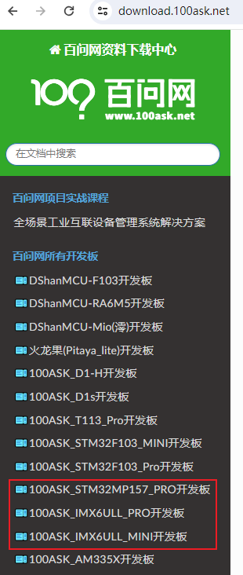

<a id="_Toc197788557"></a>
## 1.2 安装软件

安装如下软件：

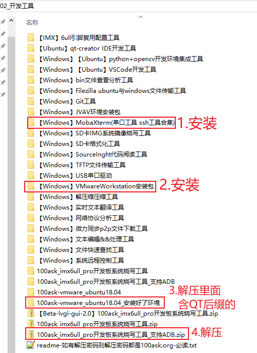

<a id="_Toc197788558"></a>
## 1.3 体验Ubuntu

### 1.3.1 确保使用NAT网卡

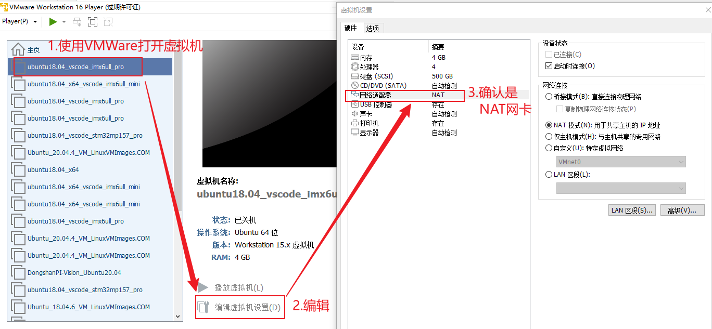

### 1.3.2 验证网络

启动虚拟机后（用户名book，密码123456），在终端里确认可以上网“ping news.qq.com”，如下：

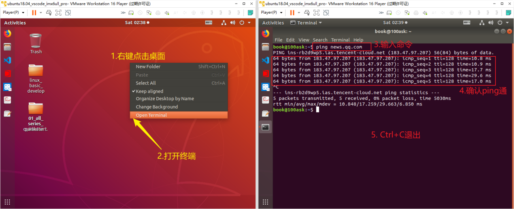

### 1.3.3 更新GIT仓库

在终端里进入“~/Desktop/01\_all\_series\_quickstart”目录，执行“git pull”命令：

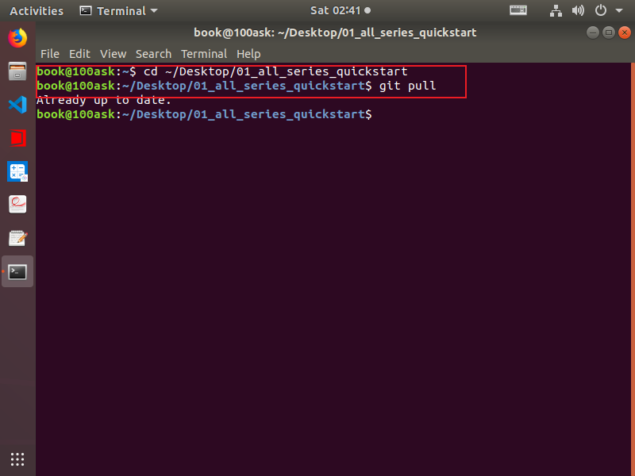

<a id="_Toc197788560"></a>
## 1.4 体验开发板

板子设置为EMMC启动：


连接串口：

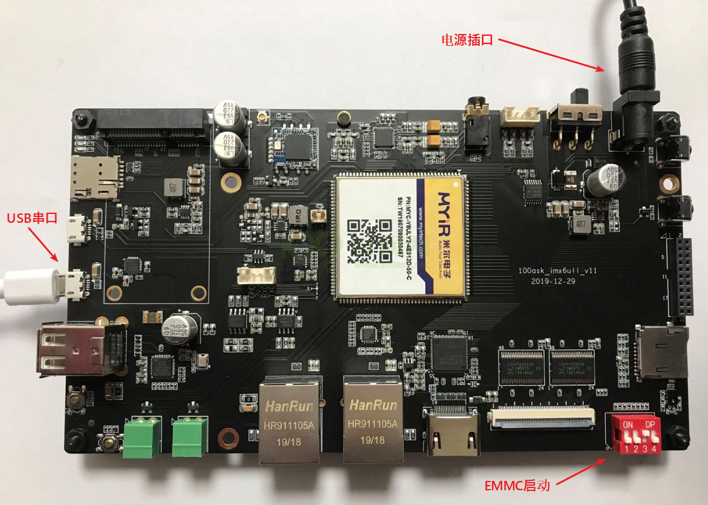

板子上电，即可在串口体验板子的Linux系统（用户名：root，无密码）。

<a id="_Toc197788561"></a>
## 1.5 重烧支持ADB的系统

2025年5月份出厂IMX6ULL开发板，默认已经支持ADB。对于尚未支持ADB的系统，可以按照本节进行烧录。

如何确定板子是否已经支持ADB？在串口执行如下命令：

```
ps  |  grep adbd
```

如果有这个进程，则表明已经支持ADB。

<a id="header-n16"></a><a id="header-n0"></a>
### 1.5.1 接线

<a id="header-n20"></a>板子设置为USB启动：

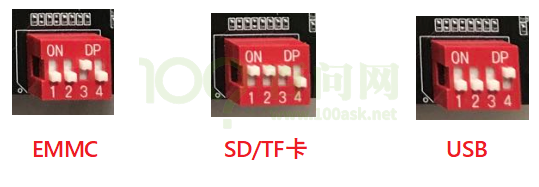

连接USB OTG线：

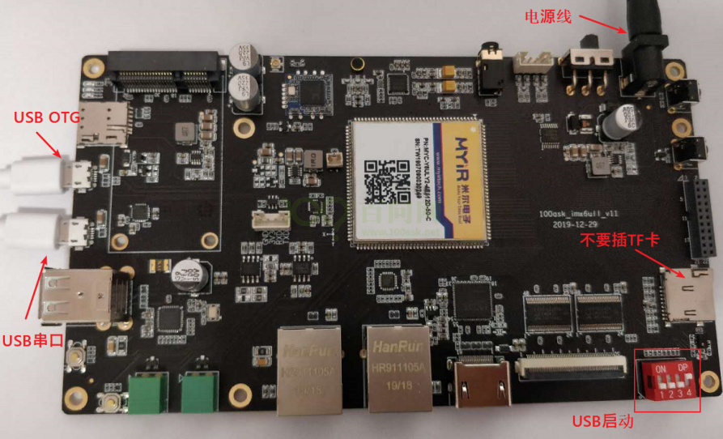

### 1.5.2 安装IMX6ULL的USB驱动程序

通过USB下载或是烧写程序时，需要把开发板的OTG口用USB线连接到电脑。一般都会自动安装驱动，烧写软件的绿灯不亮时，则很有可能是驱动程序没有安装好，这时再来看本节文档。

-   -   -   -   1.  VMWARE可能会截取USB设备导致烧写失败

如果你运行了VMWARE，它会截取USB设备，可能会有下图提示：


要选择“连接到主机”，勾选“记住我的选择，以后不再询问”。也许你不慎点错了“连接到虚拟机”，那也没关系，在VMWARE的菜单中把“Freescale SE Blank 6ULL”或“Netchip USB download gadget”断开连接，如下图所示：

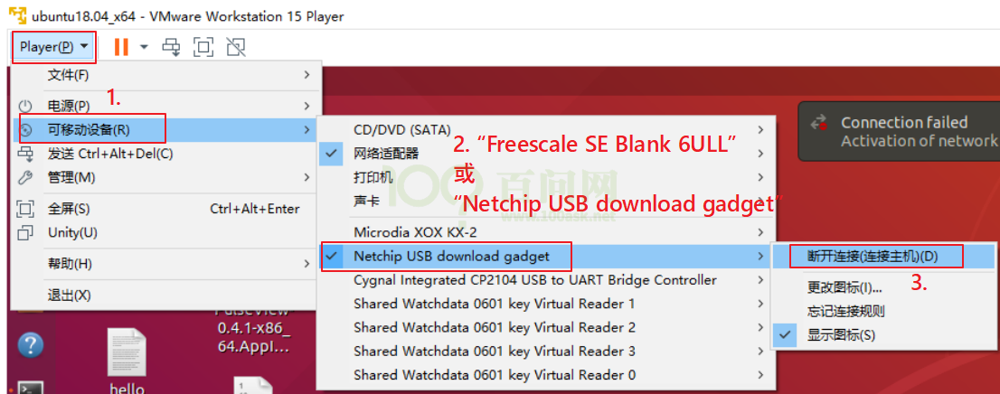

图 1.1 断开USB在虚拟机上的连接

-   -   -   -   1.  USB驱动没有自动安装

通过USB下载或是烧写程序时，需要把开发板的OTG口用USB线连接到电脑。IMX6ULL开发板会通过这一个OTG口，模拟出2个USB设备(先后模拟，不是同时)：“Freescale SE Blank 6ULL”、“USB download gadget”。一般会自动安装好驱动程序，如果驱动程序没安装好，你可以去下载“zadig”来安装驱动。

-   **安装第1个驱动**：只要开发板设为USB启动(不要插SD/TF卡)并上电，电脑就会识别出“Freescale SE Blank 6ULL”设备，一般都会自动给它安装驱动程序。

如果没有自动安装好驱动程序(“设备已连接”绿灯没亮)，要使用zadig安装libusb-win32驱动。

先去[https://zadig.akeo.ie/](https://zadig.akeo.ie/)下载zadig并运行，然后参考下图图 7.9安装驱动程序：


-   **安装第2个驱动**：当烧写工具的“设备已连接”绿灯亮起，就可以在“专业版”点击“运行”按钮，这时电脑会识别出“USB download gadget”设备，一般都会自动给它安装驱动程序，如下图：


如果没有自动安装好驱动程序(“固件已运行”绿灯没亮)，先去[https://zadig.akeo.ie/](https://zadig.akeo.ie/)下载zadig并运行，然后参考图 7.11安装驱动程序：

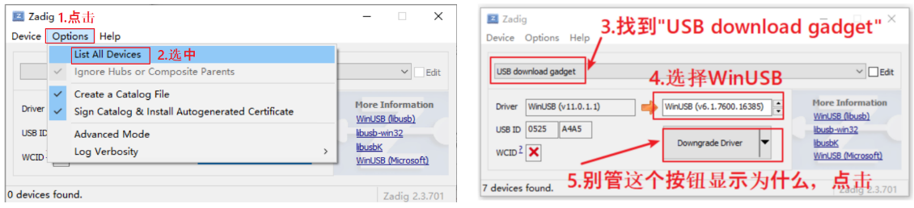

图 1.2 zadig安装驱动

如果一切正常，烧写工具的2个绿灯都会亮，如图 7.12：


图 1.3 驱动正常烧写工具提示

这就表示所有驱动都安装好了，可以重启开发板，使用后面2节的方法来烧写。

### 1.5.3 烧录系统

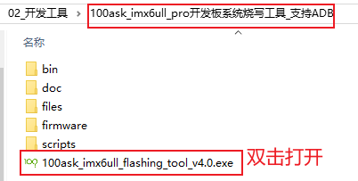

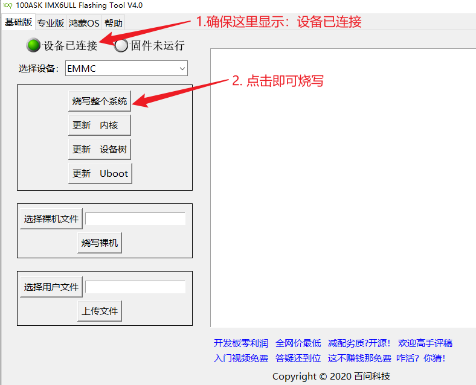

烧写完毕后，板子设置为EMMC启动，重新上电。

<a id="header-n24"></a>
### 1.5.4 使用adb

使用USB线连接开发板的OTG口和PC，在VMWare里选择把新设备连接到Ubuntu，如下：

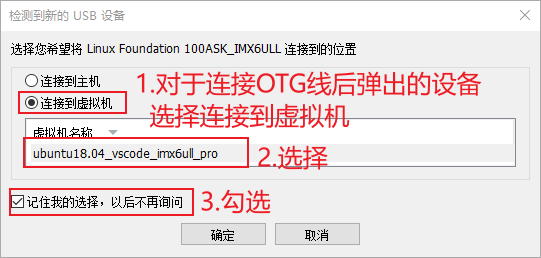

如果没有弹出上述界面，也可以如下操作：

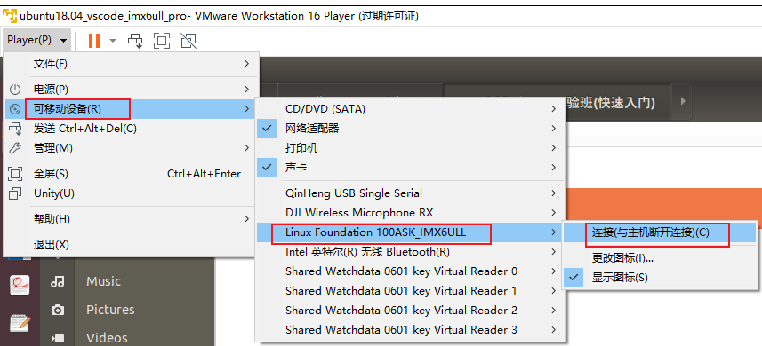

然后就可以在Ubuntu上使用adb操作开发板了：

```
adb devices
adb push 1.txt /root      # 把Ubuntu的文件放到开发板的/root目录
adb pull /root/1.txt 2.tx # 把开发板的/root/1.txt下载并改名为2.txt
adb shell                 # 登录开发板
```

如下图所示：

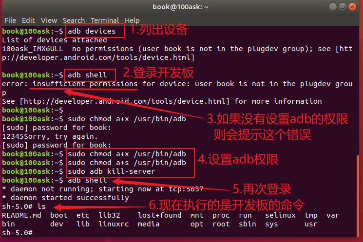

<a id="_Toc197788562"></a>
## 1.6 体验第1个程序

本节源码为：

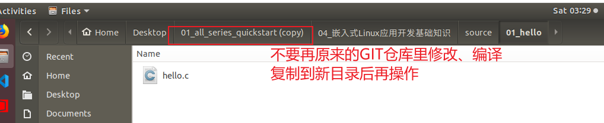

在Ubuntu上编译：

```
$ arm-buildroot-linux-gnueabihf-gcc -o hello hello.c
$ adb push hello  /root
```

然后就可以执行开发板下的“/root/hello”程序了。

如下图所示：

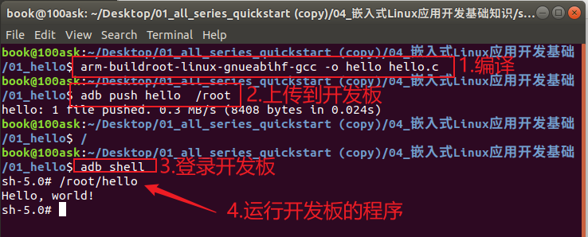
