<a id="_虚拟机和Ubuntu的网络设置"></a>
<a id="_4.6_虚拟机和Ubuntu的网络设置"></a>
<a id="_第五章_安装软件及开发示例"></a>
<a id="_第四章_使用NAT配置Ubuntu网络"></a>
<a id="_Toc197788563"></a>
<a id="_Hlk111712059"></a>

<a id="_Toc197788564"></a><a id="_Hlk111712072"></a>
## 2.1 安装Windows软件

“&lt;开发板配套资料&gt;\\02\_开发工具\\”

在网盘资料包的上述目录中,可以得到一系列的安装软件，建议全部安装。有如下软件：

表 2‑1 Windows中需要安装的软件


| 软件名 | 说明 |
| --- | --- |
| vmware | 虚拟机软件，安装时需要用到管理员权限，前面已经安装过 |
| Source insight | 阅读、编写源码的工具，即装即用；推荐初学者使用 |
| Visual Studio Code | 阅读、编写源码的工具，需要进行很多配置；不推荐初学者使用 |
| MobaXterm | 串口工具、远程登录工具 |
| Filezilla | 文件传输工具，在Windows和Ubuntu之间传输文件 |
| Notepad++ | 文本编辑工具，比记事本好用 |


Visual Studio Code的配置比较麻烦，建议初学者使用Source insight来阅读、编写源码。

<a id="_5.2_安装Ubuntu软件"></a><a id="_Toc197788565"></a>
## 2.2 安装Ubuntu软件

**注意**：如果使用的是下图的虚拟机，则无需安装Ubuntu软件，本节不用看了（作为初学者，不需要把时间浪费在搭建环境上，入门之后再尝试自己搭建环境）。

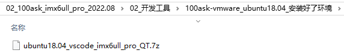

**注意**：如果要自己安装Ubuntu的开发环境，一定要使用Ubutnu 18.04，不要使用其他版本。

确保Ubuntu能上网之后，使用下面命令一键配置/初始化开发环境(其实就是安装tftp，nfs，vim等软件，此脚本只支持Ubuntu-16.04 /Ubuntu-18.04)。

```bash
book@100ask:~$ git clone https://e.coding.net/weidongshan/DevelopmentEnvConf.git
book@100ask:~$ cd DevelopmentEnvConf
book@100ask:~$ sudo ./Configuring_ubuntu.sh
```

上述命令是下载脚本，给它添加可执行权限，运行它。按提示输入book密码123456和选择对应的系统，如图 2.1所示：

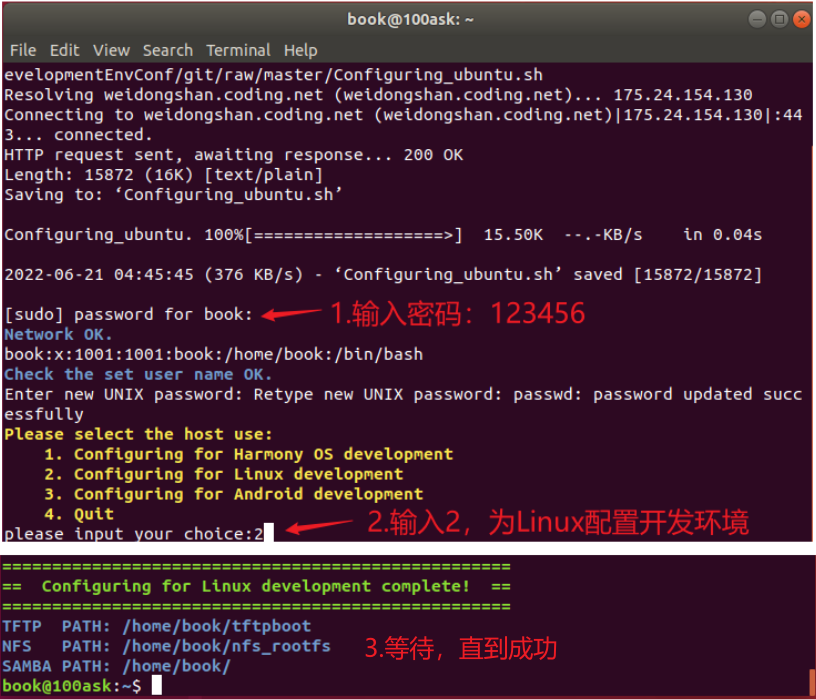

<a id="_Ref105520648"></a>图 2.1 执行配置环境脚本命令

**注意：**如果Ubuntu无法上网，请参考前面[《1.1 添加NAT网卡》](#_10.1_网络问题)进行设置。

如果执行该命令出现如图 2.2所示的错误：

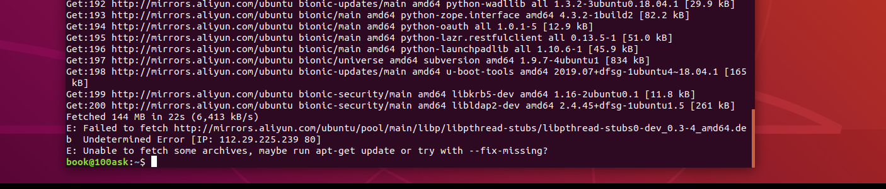

<a id="_Ref105520818"></a>图 2.2 执行脚本错误

可以先执行下面的命令后再重新执行前面的命令：

```bash
sudo apt-get update
```

<a id="_Toc197788566"></a><a id="_Ref105521366"></a><a id="_Hlk111712207"></a>
## 2.3 使用MobaXterm远程登录Ubuntu

在Ubuntu终端执行ifconfig命令确定NAT网卡IP(注意：这个IP过一段时间会发生变化，那就使用新IP重新连接)，如图 2.3所示：

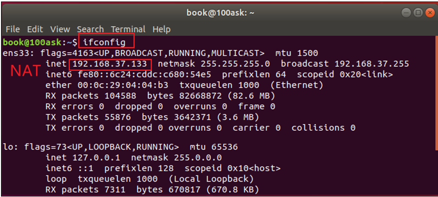

<a id="_Ref108611723"></a>图 2.3 ifconfig查看NAT网卡IP

安装、运行MobaXterm，如下建立Session：

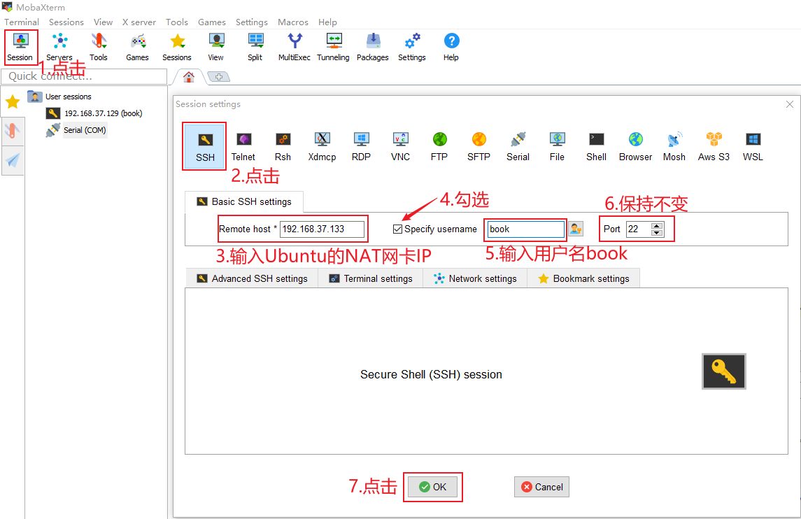

<a id="_Ref105520961"></a>图 2.4 建立ssh

按图 2.4操作后，在MobaXterm左侧就可以看到图 2.5这项，双击它就可以登录Ubuntu(第1次登录时会提示你输入密码，密码是123456)，然后就可以执行各种Linux命令了：

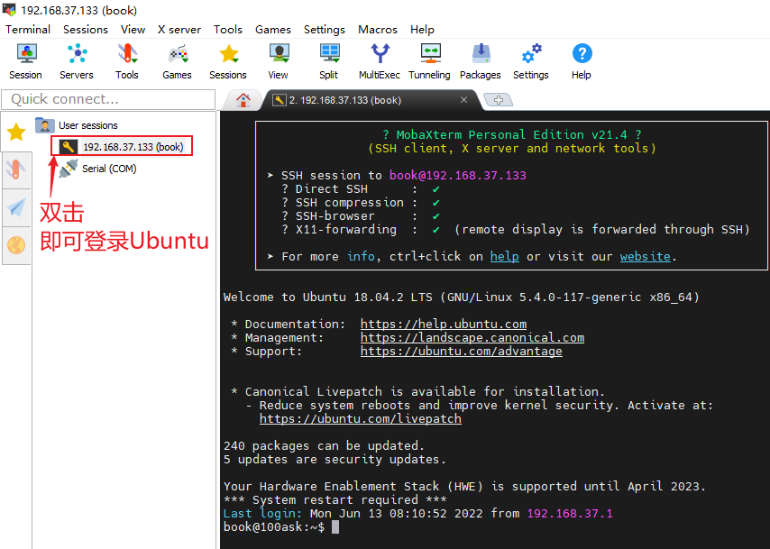

<a id="_Ref108611796"></a>图 2.5 Mobaxterm登陆上了Ubuntu

<a id="_Toc197788567"></a><a id="_Hlk111714998"></a>
## 2.4 使用FileZilla在Windows和Ubuntu之间传文件

使用MobaXterm既可以ssh登录又可以传输文件，不过Mobaxterm在传输文件时使用效率上没有 FileZilla高，所以我们推荐Windows和Ubuntu互相传输文件时使用FileZilla。

双击打开FileZilla后，按图 2.6操作：

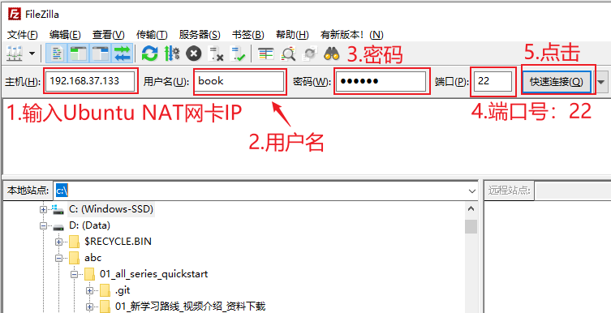

<a id="_Ref105521076"></a>图 2.6 FileZilla连接Windows和Ubuntu

第1次连接时，会有如图 2.7所示的提示，选择“总是信任”：

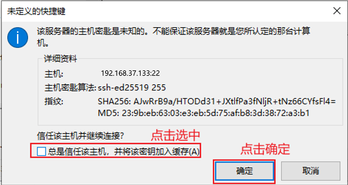

<a id="_Ref105521129"></a>图 2.7 FileZilla建立连接

在Filezilla中，左边是Windows文件，右边是Ubuntu的文件，如图 2.8：


<a id="_Ref108611848"></a>图 2.8 FileZilla下Windows和Ubuntu互传文件

<a id="_Toc197788568"></a><a id="_Hlk111715733"></a>
## 2.5 编程示例：Ubuntu上的Hello程序

本节演示如何在Windows编写程序、上传到Ubuntu，在Ubuntu中编译、执行。只涉及一个简单的Hello程序，使用命令行编译，不涉及Makefile等知识，这些知识在后面的应用基础中讲解。

### 2.5.1 用Source Insight编写hello.c

启动Source Insight，点击“File”-&gt;“New”，新建文件，如图 2.9：

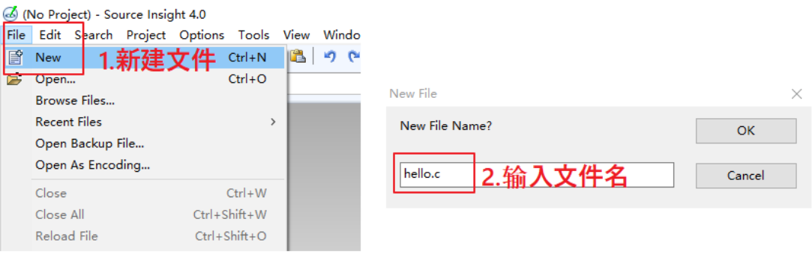

<a id="_Ref108611863"></a>图 2.9 SI新建文件

接下来编写代码，保存文件，如图 2.10所示：

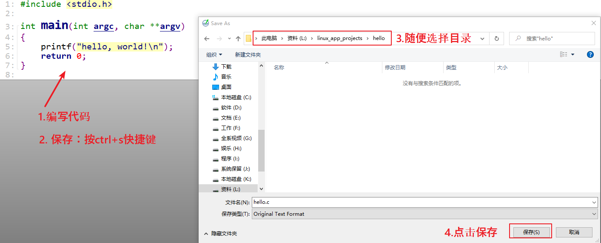

<a id="_Ref108611897"></a>图 2.10 SI编写代码并保存

hello.c的源码如下：

```
#include <stdio.h>
int main(int argc, char **argv)
{
printf("hello, world!\n");
return 0;
}
```

### 2.5.2 使用FileZilla上传源码

如图 2.11操作：

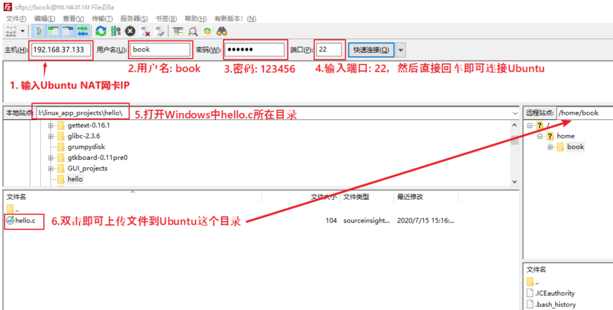

<a id="_Ref105521405"></a>图 2.11 从windows传文件到Ubuntu

### 2.5.3 编译、运行程序

如图 2.12操作，对于gcc命令的用法在后面讲到应用开发基础时再细讲，这里只是体验一下：

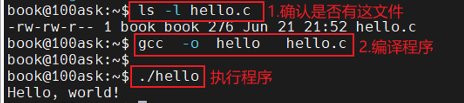

<a id="_Ref105521444"></a>图 2.12 体验Hello World！

<a id="_Toc197788569"></a><a id="_Ref109377426"></a><a id="_Ref109377430"></a>
## 2.6 下载BSP及配置工具链

**注意**：如果使用的是下图的虚拟机，则无需下载BSP及配置工具链（作为初学者，不需要把时间浪费在搭建环境上，入门之后再尝试自己搭建环境）。


100ask\_imx6ull开发板的BSP都保存在Git站点上，通过repo命令进行统一管理。

### 2.6.1 配置repo

下载repo工具前需要设置git的邮箱和用户名，git邮箱和用户名请根据个人情况进行配置。

```bash
book@100ask:~$ git config --global user.email "user@100ask.com"
book@100ask:~$ git config --global user.name "100ask"
```

**注意:**请先配置git邮箱和用户名，否则会导致下载失败(图 2.13为参考示例图)。

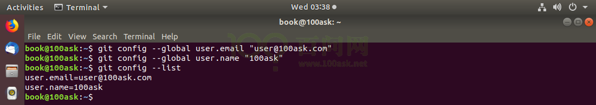

<a id="_Ref108612099"></a>图 2.13 配置本地git信息

### 2.6.2 下载BSP

通过repo管理多个git仓库中的源码，可以及时更新最新代码，以方便开发者学习使用。执行以下4条命令(**注意：repo init那行命令不好复制，**<a id="_Hlk111896629"></a>**需要要认真比对命令，有的pdf阅读器复制出去可能会格式错误导致命令错误**)：

```bash
book@100ask:~$ git clone https://e.coding.net/codebug8/repo.git
book@100ask:~$ mkdir -p 100ask_imx6ull-sdk && cd 100ask_imx6ull-sdk
book@100ask:~/100ask_imx6ull-sdk$ ../repo/repo init -u https://gitee.com/weidongshan/manifests.git -b linux-sdk -m imx6ull/100ask_imx6ull_linux4.9.88_release.xml  --no-repo-verify
book@100ask:~/100ask_imx6ull-sdk$  ../repo/repo sync -j4
```

图 2.14是下载IMX6ULL Pro版源码的过程：

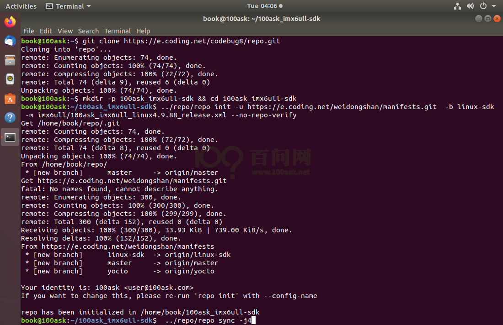

<a id="_Ref108612357"></a>图 2.14 下载源码

**注意**：下载成功后，可以看到名为Linux-4.9.88的目录，可以在Ubuntu压缩它，再传回Windows。在Windows下解压后，用source insight建立工程，这样就可以很方便地阅读源码了。

**注意**：使用source insight阅读Linux源码的方法，请参考章节[《使用Source Insight阅读Linux内核源码》](#_7.4_使用Source_Insight阅读Linux内核源码)。

Ubuntu下压缩命令为(最好是下载之后马上压缩，不要编译内核后再压缩，否则文件太大了)：

```bash
tar  cjf Linux-4.9.88.tar.bz2  Linux-4.9.88
```

首次下载时如果提示

```bash
Testing colorized output (for 'repo diff', 'repo status'):
```

此时输入y即可,继续执行

```bash
../repo/repo sync -j4
```

命令即可开始同步源码(同步代码根据网络情况需要等待数分钟)。

图 2.15为参考示例。


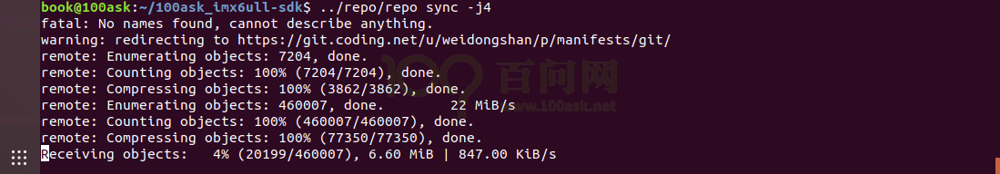

<a id="_Ref108612384"></a>图 2.15 开始同步源码

同步完成后如图 2.16所示

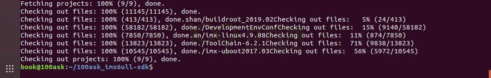

<a id="_Ref108612422"></a>图 2.16 同步完成

**注意：**repo在线下载的代码和网盘配套资料中的代码是一致的，我们会每隔一段时间更新一次源码包，如使用在线方式获取源码可以直接在

```bash
~/100ask_imx6ull-sdk
```

目录下执行

```bash
../repo/repo sync -c
```

进行同步更新最新代码！

<a id="_Ref108618401"></a>
### 2.6.3 配置交叉编译工具链

交叉编译工具链用来在Ubuntu主机上编译应用程序，而这些应用程序是在ARM等其他平台上运行。

设置交叉编译工具主要是设置PATH， ARCH和CROSS\_COMPILE三个环境变量，下面介绍具体设置方法。

在本文档中，源码、交叉编译工具链都是存放于/home/book目录下；如果你的目录不一样，请自行修改本节所讲述的命令。

设置这3个环境变量有多种方法，任意选择其中一种方法即可，建议使用“永久生效”的方法。录制视频时我会使用多种开发板，所以在视频里我总是使用“临时生效”的方法。

-   -   -   -   1.  永久生效

如需永久修改，请修改用户配置文件：

```bash
vim  ~/.bashrc
```

**注意**：如果不会使用vim命令，可以使用图形化的编辑工具，执行：

```bash
gedit ~/.bashrc
```

<a id="_Hlk110850086"></a>在行尾添加或修改，加上下面几行(**请把第3、4行合并为一行，有些PDF工具无法正确复制甚至丢失“-”符号，请仔细对比**)：

```bash
export ARCH=arm
export CROSS_COMPILE=arm-buildroot-linux-gnueabihf-
export PATH=$PATH:/home/book/100ask_imx6ull-sdk/ToolChain/arm-buildroot-linux-gnueabihf_sdk-buildroot/bin
```

设置完毕后，要执行

```bash
source ~/.bashrc
```

命令使其生效，并通过

```bash
arm-buildroot-linux-gnueabihf-gcc -v
```

命令来验证是否配置成功：

```bash
book@100ask:~$ source  ~/.bashrc
book@100ask:~$ arm-buildroot-linux-gnueabihf-gcc -v
```

以上操作是设置IMX6ULL Pro版工具链的过程。

-   -   -   -   1.  临时生效

也可以手工执行“export”命令设置环境变量，该设置**只对当前终端有效(另开一个终端需要再次设置)。**执行以下3个命令：

```bash
book@100ask:~$ export ARCH=arm
book@100ask:~$ export CROSS_COMPILE=arm-buildroot-linux-gnueabihf-
book@100ask:~$ export PATH=$PATH:/home/book/100ask_imx6ull-sdk/ToolChain/arm-buildroot-linux-gnueabihf_sdk-buildroot/bin
```

### 2.6.4 测试交叉编译工具链

执行以下命令测试环境变量：

```bash
book@100ask:~$ echo $ARCH
arm
book@100ask:~$ echo $CROSS_COMPILE
arm-buildroot-linux-gnueabihf-
```

执行以下命令测试工具链，结果见后图 2.17：

```bash
book@100ask:~$ arm-buildroot-linux-gnueabihf-gcc -v
```

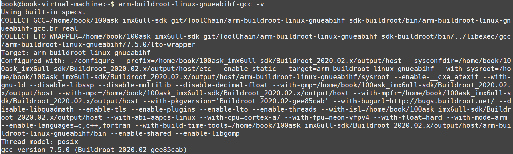

<a id="_Ref108612796"></a>图 2.17 测试编译工具链

<a id="_Toc197788570"></a>
## 2.7 使用Source Insight阅读Linux内核源码

在后面开发驱动程序时，驱动程序中用到的函数都是来自内核，所以可以先在Windows下创建内核的Source Insight工程。

如果你不想学习驱动开发，那么可以不创建内核的工程。但是以后学习大型APP时，也可以使用Source Insight来阅读、编写代码，可以借鉴本节讲解的Source Insight用法。

### 2.7.1 Source Insight简介

Source Insight是Source Dynamics 公司出品的源代码编辑器。Source Insight提供语法突出显示，代码导航和可自定义的键盘快捷键。它不仅仅是一个编辑器，而是一个理解大型源代码库的工具，因此被称为“程序编辑器和分析器”。它灵活轻便，提供有用的功能，如关系，上下文和符号窗口。它在建源码工程时，构建了符号信息的内部数据库，所以还可以显示引用树，类继承图和调用树。它的最大好处是加快了对不熟悉项目的代码理解。

参考网址

 官网主页 [https://www.sourceinsight.com/](https://www.sourceinsight.com/)

 软件下载页面 https://www.sourceinsight.com/trial/

 用户使用教程

[https://www.sourceinsight.com/doc/v4/userguide/index.html](https://www.sourceinsight.com/doc/v4/userguide/index.html)

### 2.7.2 在Windows上解压内核源码

前面章节《2.6.2 下载BSP》里在Ubuntu下压缩了内核，把压缩文件通过FileZilla传回Windows，并解压。

在Windows解压内核时会提示一些错误，会提示是否覆盖文件，选择“覆盖”即可。这是因为Linux下的文件区分大小写，a.c和A.c以不同的文件，但是Windows下不区分大小写，这2个文件是同一个。这些错误不会影响我们阅读源码。

### 2.7.3 建立工程示例

本节新建一个linux kernel的source Insight工程，你也可以为其他APP建立工程，方法是一样的。

-   -   -   -   1.  新建工程

运行source Insight，点击菜单“Project-&gt;New Project”,如图 2.18所示：

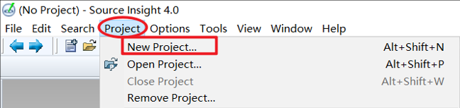

<a id="_Ref108612880"></a>图 2.18 SI新建工程

-   -   -   -   1.  设置工程名及工程数据目录

在弹出的New Project对话框中设置“New project name”(项目的名称)，然后设置Where do you want to store the project data file? (项目文件保存位置)，点击Browse按钮选择源码的目录即可，如图 2.19:

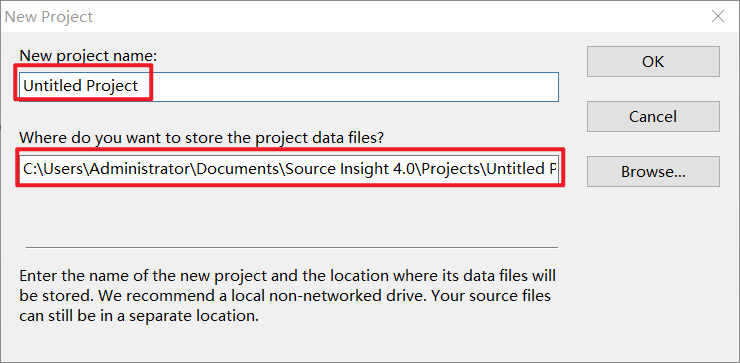

<a id="_Ref108612940"></a>图 2.19 选择工程存储路径

-   -   -   -   1.  指定源码目录

设置源码目录：

**Project Source Directory – the main location of your source files”**()

点击红框左边“…”选择源码目录，点击OK，如图 2.20：

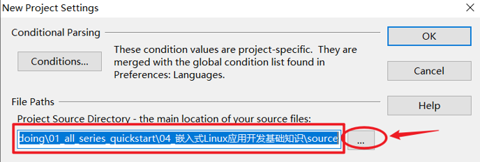

<a id="_Ref108613011"></a>图 2.20 设置源码目录

-   -   -   -   1.  添加源码

在新弹出的对话框中，点击“Add”或“Add All”。“Add”是手动选择需要添加的文件，而“Add All”是添加所有文件。我们使用“Add All”,在弹出的提示框中选中“Recursively add lower sub-directories”(递归添加下级的子目录)并点击OK。同样的Remove File,Remove All是移除单个文件或者移除所有文件，如图 2.21：

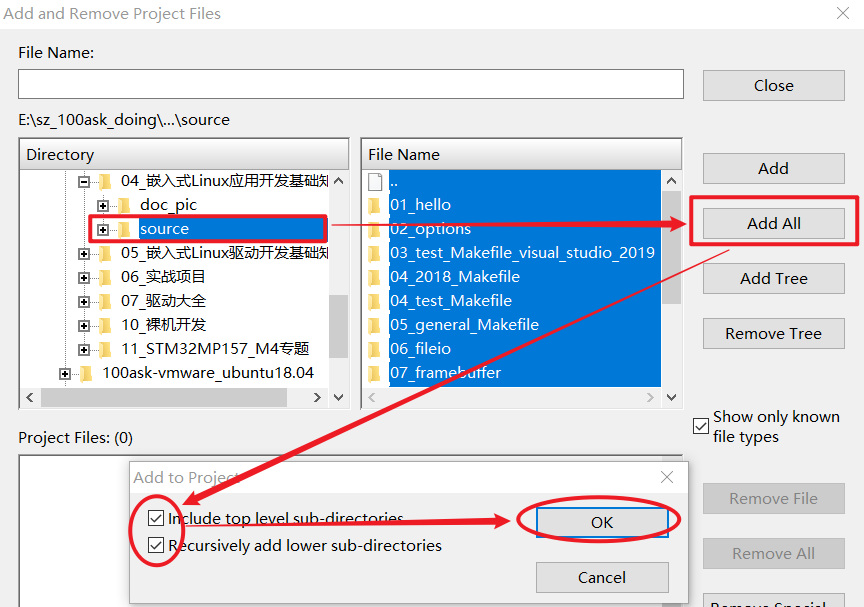

<a id="_Ref108613039"></a>图 2.21 添加源码

添加文件完成后会弹出下面窗口，点击“确定”即可：

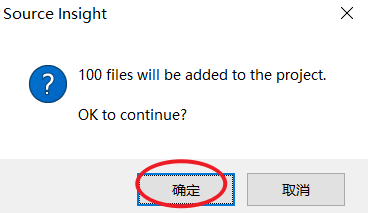

此时界面会返回到主界面，如图 2.22，点击“Close”：

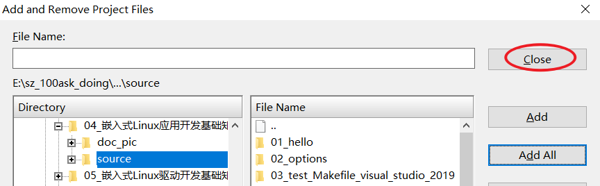

<a id="_Ref108613066"></a>图 2.22 添加完成关闭

-   -   -   -   1.  同步文件

同步文件的意思是让Source Insight去解析源码，生成数据库，这样有助于以后阅读源码。比如点击某个函数时就可以飞快地跳到它定义的地方。

先点击菜单“Project-&gt;Synchronize Files”，如图 2.23所示：

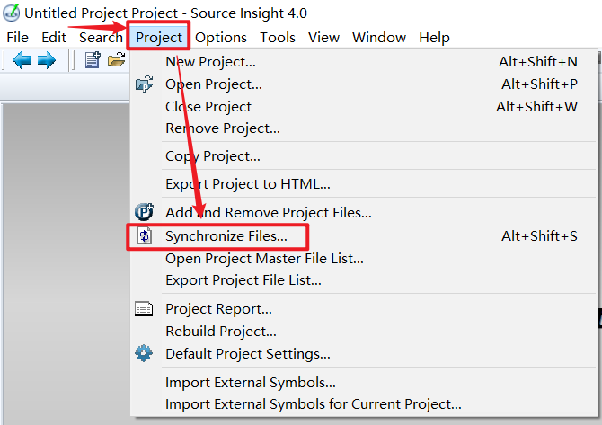

<a id="_Ref108613150"></a>图 2.23 同步文件

在弹出的对话框中 选中“Force all files to be re-parsed”(强制解析所有文件)，并点击“Start”按钮开始同步，如图 2.24所示：

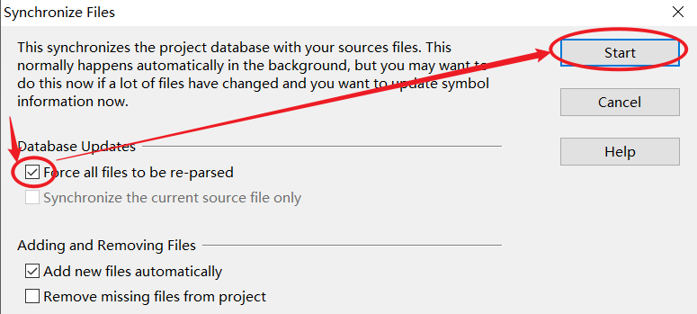

<a id="_Ref108613166"></a>图 2.24 开始同步文件

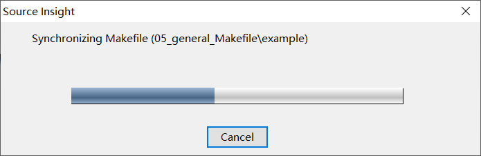

### 2.7.4 操作示例

-   -   -   -   1.  打开工程

前面建议工程后，就会自动打开了工程。如果下次你想打开工程，启动Souce Insight后，点击菜单“Project -&gt; Open Porject”就可以在一个列表中选择以前建立的工程，如图 2.25：

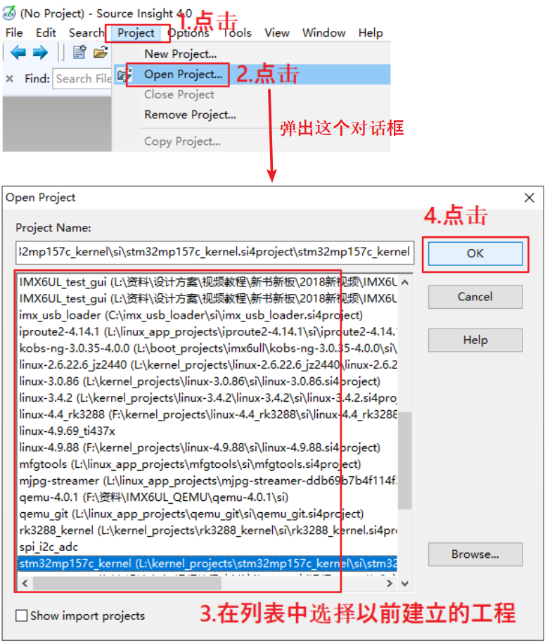

<a id="_Ref108613240"></a>图 2.25 SI打开工程

-   -   -   -   1.  在工程中打开文件

点击"P"图标打开文件列表，双击文件打开文件，也可以输入文件名查找文件，如图 2.26所示：

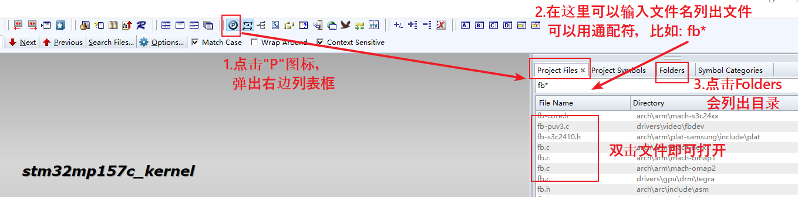

<a id="_Ref108613423"></a>图 2.26 打开文件

-   -   -   -   1.  在文件中查看函数或变量的定义

打开文件后，按住ctrl键的同时，用鼠标点击函数、变量，就会跳到定义它的位置，如图 2.27所示：

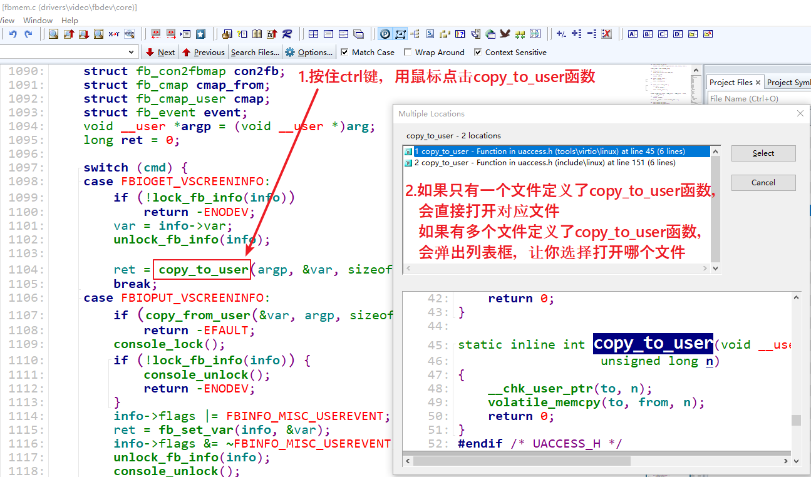

<a id="_Ref108613450"></a>图 2.27 查看函数或变量

-   -   -   -   1.  查找函数或变量的引用

双击函数，右键点击弹出对话框选择“Lookup Reference”；或者双击函数后，使用快捷键"ctrl+/"来查找引用，如图 2.28：

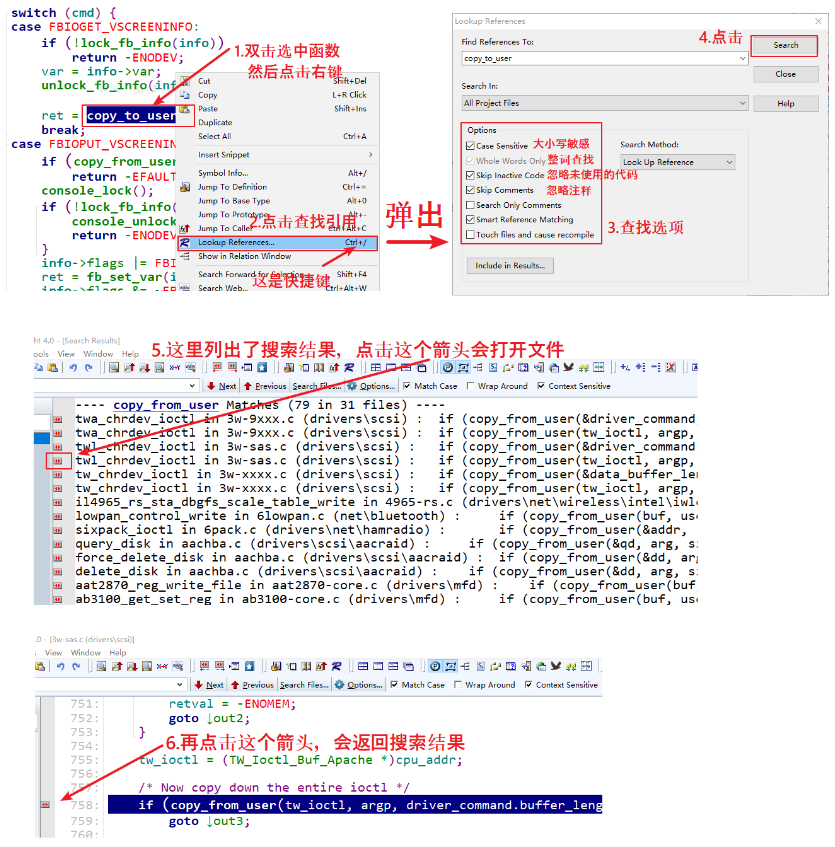

<a id="_Ref108613513"></a>图 2.28 查找函数或变量

-   -   -   -   1.  其他快捷键

表 2‑2 SI其它快捷键


| 快捷键 | 说明 |
| --- | --- |
| Alt + , | 后退 |
| Alt + . | 前进 |
| F8 | 高亮选中的字符 |
| Ctrl+F | 查找 |
| F3或Shift+F3 | 往前查找 |
| F4或Shift+F4 | 往后查找 |


<a id="_Toc33561658"></a><a id="_Toc33603969"></a><a id="_Toc31978902"></a><a id="_Toc33561513"></a><a id="_Toc33570594"></a><a id="_Toc31979706"></a><a id="_Toc33561379"></a>
