

## 3.1 100ask_imx6ull pro开发板硬件资源简介

开发板图片如图 3.1，各个标号对应的硬件在板子背后都写有名字：

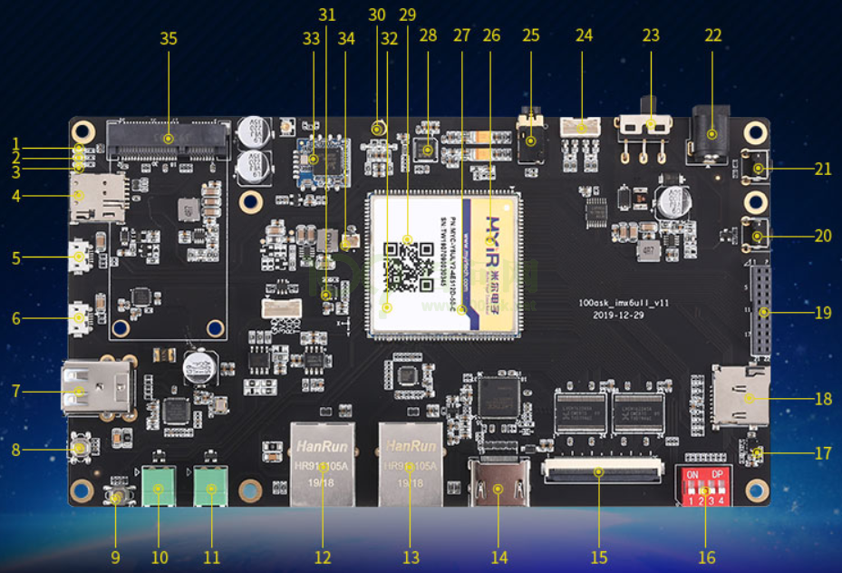

图 3.1 100ASK IMX6ULL pro开发板

上图中，各标号的硬件含义如图 3.2所示：

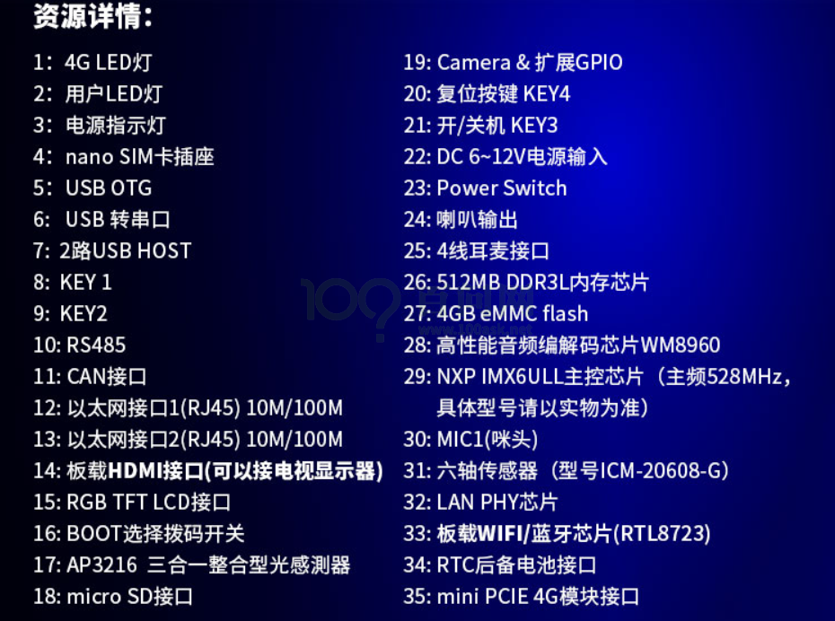

图 3.2 100ASK IMX6ULL pro标号对应硬件

## 3.2 100ask_imx6ull pro开发板软件资源简介

### 3.2.1 开发环境

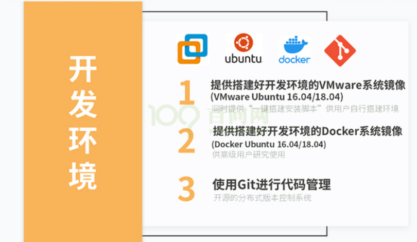

图 3.3 开发板开发环境

### 3.2.2 核心软件

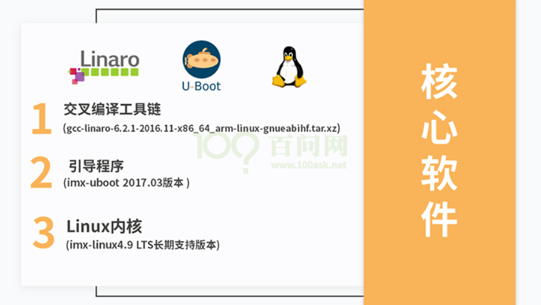

图 3.4核心软件

### 3.2.3 文件系统

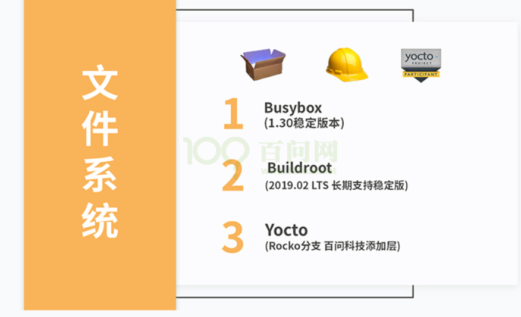

图 3.5 文件系统

### 3.2.4 各模块的详细内容

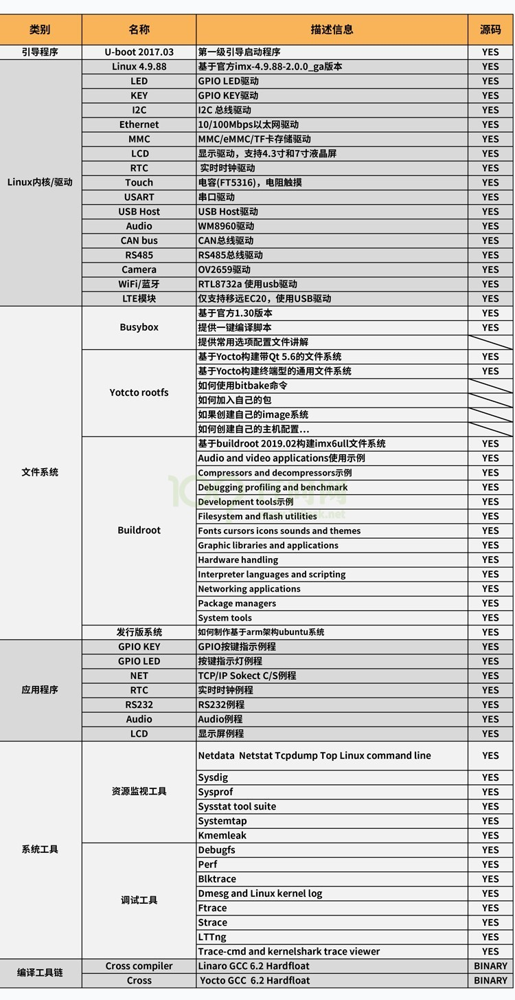

图 3.6 模块细节

## 3.3 启动方式选择

板子上的红色拨码开关用来设置启动方式，支持这3种方式：EMMC启动、SD卡启动、USB烧写。板子背后画有一个表格，表示这3种方式如何设置，如表 3‑1：

表 3‑1 启动方式

| BOOT CFG |  |  |  |  |
| --- | --- | --- | --- | --- |
| BOOT | SW1(LCD_DATA5) | SW2(LCD_DATA11) | SW3(BOOT_MODE0) | SW4(BOOT_MODE1) |
| EMMC | OFF | OFF | ON | OFF |
| SD | ON | ON | ON | OFF |
| USB | X | X | OFF | ON |

这3种启动方式的设置示意图 3.7如下：

图 3.7 拨码开关与启动方式

**注意**：设置为USB启动时，不能插上SD卡、TF卡；上电之后才可以插卡。刚出厂的板子在EMMC上烧写了系统，你可以设置为EMMC启动方式。

## 3.4 串口连接

在后面的操作里，都是通过串口与板子进行“交流”。串口是串行接口的简称，是指数据一位一位地顺序传送，其特点是通信线路简单。

### 3.4.1 连接串口线和电源线、配置串口工具

如图 3.8所示将串口线与电脑、板子连接，开发板插上电源。

图 3.8 连接示意图

其中特别需要注意的几点：

-   板子的启动拨码开关拨到正确的方式，保证该启动方式里面有系统可以运行；
-   板子如图所示插上配套的电源到电源接口，电源开关暂时不用打开；

### 3.4.2 安装USB串口模块驱动

接好micro usb数据线后，Windows会自动安装驱动(安装可能比较慢，等一分钟左右)。打开电脑的“设备管理器”，在“端口(COM和LPT)”项下，可以看到如图 3.9中的“(COM17)”或“(COM19)”。开发板上的USB串口芯片可能是CP210x或CH9102，它们的性能是一样的。你电脑上显示的COM序号可能不一样，记住你电脑显示的数字。

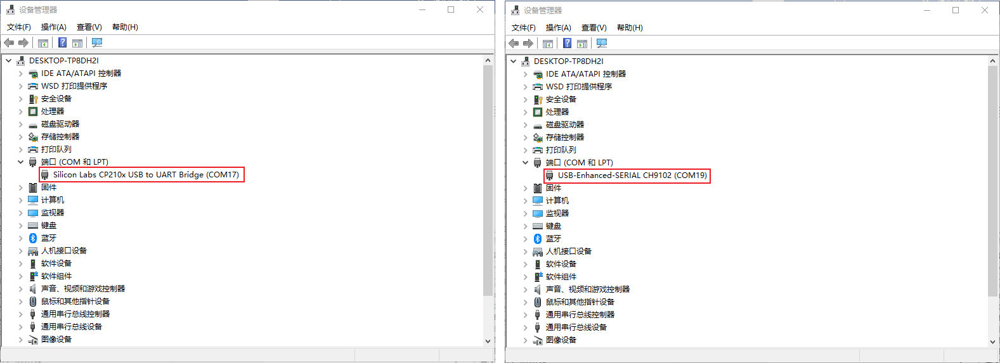

图 3.9 串口在设备管理器中的表示

如果电脑没有显示出端口号，就需要手动安装驱动，已经将驱动安装包放入网盘资料中了：

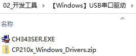

图 3.10 USB串口驱动

如果电脑中没有自动安装驱动，在“设备管理器”会有黄色感叹号提示当前连接的是哪种类型的串口芯片，根据提示选择驱动安装。如果提示中有“CP210x”字样则选择“CP210x\_Windows\_Drivers.zip”，否则就选择另外一个驱动安装。

### 3.4.3 使用MobaXterm软件打开串口

打开MobaXterm，点击左上角的“Session”，在弹出的界面选中“Serial”，如下图所示选择端口号（前面设备管理器显示的端口号COM17或COM19）、波特率（Speed 115200）、流控（Flow Control: none）,最后点击“OK”即可。步骤如图 3.11所示。

**注意**：流控（Flow Control）一定要选择none，否则你将无法在MobaXterm中向串口输入数据。

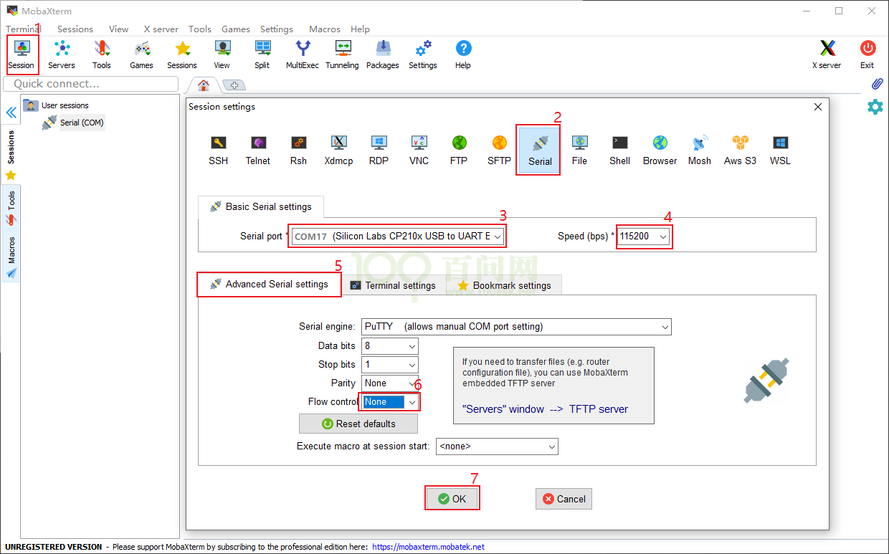

图 3.11 Mobaxterm设置串口

随后显示一个黑色的窗口， 此时打开板子的电源开关，将收到板子串口发过来的数据，如图 3.12所示。

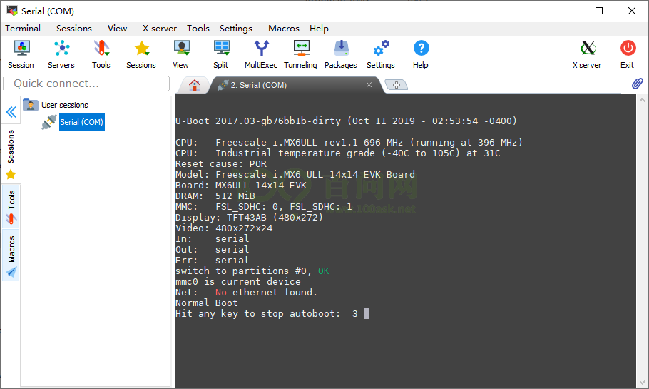

图 3.12 串口数据在Mobaxterm上的显示

### 3.4.4 开发板登录名是root，无需密码

在串口看到“imx6ull login:”时，输入“root”并回车即可，如图 3.13所示：

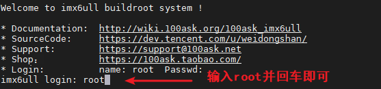

图 3.13 输入root登录开发板

## 3.5 通过串口操作开发板

在串口看到“imx6ull login:”这类登录的提示信息时，输入“root”并回车即可，然后就可以执行各种Linux命令了，如图 3.14所示：

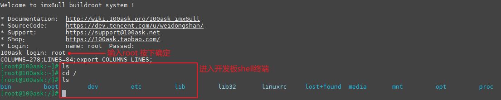

图 3.14 通过串口在开发板上体验Linux命令
