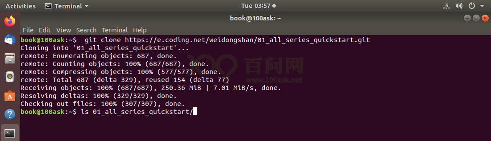
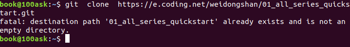

<a id="_第八章_编程前的准备工作"></a>
<a id="_第七章_编程前的准备工作"></a>
<a id="_6.4_验证开发板网络"></a>
<a id="_Ref105540150"></a>
<a id="_Toc197788577"></a>

详细的手把手教学视频请看

[https://www.bilibili.com/video/BV1zV411U7H9?p=6](https://www.bilibili.com/video/BV1zV411U7H9?p=6)

交叉编译运行第一个APP。

<a id="_Toc33561593"></a><a id="_Toc33561738"></a><a id="_Toc33561459"></a><a id="_Toc33570674"></a><a id="_Toc33604049"></a><a id="_Ref110629766"></a><a id="_Ref110629810"></a><a id="_Ref110629818"></a><a id="_Toc197788578"></a><a id="_Ref110629835"></a>
## 4.1 获取程序

Git仓库里含有本教程的所有源码，前面已经在Windwos下载了Git仓库，为了方便编译，也可以在Ubuntu中再次下载它。

在Ubuntu终端上执行如下命令。

```bash
git clone https://e.coding.net/weidongshan/01_all_series_quickstart.git
```

代码获取示意图如图 4.1所示。



<a id="_Ref105539157"></a>图 4.1 使用Git获取资料

使用GIT下载所有源码后，本节源码位于如下目录：

01\_all\_series\_quickstart\\

04\_嵌入式Linux应用开发基础知识\\source\\01\_hello

**注意**：如果已经使用GTI下载过源码，就不需要重复下载了，否则会有如图 4.2提示：



<a id="_Ref105539185"></a>图 4.2 重复clone的提示

hello.c的源码如下：

```
01 #include <stdio.h>
02
03 /* 执行命令: ./hello weidongshan
04 * argc = 2
05 * argv[0] = ./hello
06 * argv[1] = weidongshan
07 */
08
09 int main(int argc, char **argv)
10 {
11    if (argc >= 2)
12          printf("Hello, %s!\n", argv[1]);
13     else
14          printf("Hello, world!\n");
15     return 0;
16 }
```

<a id="_Toc197788579"></a>
## 4.2 编译程序

在Ubuntu中可以执行以下命令编译、执行：

```bash
gcc -o hello hello.c
./hello
Hello, world!
./hello weidongshan
Hello, weidongshan!
```

上述命令编译得到的可执行程序hello可以在Ubuntu中运行，但是如果把它放到ARM板子上去，它是无法执行的。因为它是使用gcc编译的，是给PC机编译的，里面的机器指令是x86的。

我们要想给ARM板编译出hello程序，需要**使用交叉编译工具链**。请参考《2.6.3配置交叉编译工具链》。

执行以下命令编译程序：

```bash
arm-buildroot-linux-gnueabihf-gcc -o hello hello.c
```

这样编译出来的hello程序才可以在ARM板子上运行。

<a id="_Toc197788580"></a>
## 4.3 上传程序到开发板并运行

先在Ubuntu上使用adb命令把hello程序上传到开发板，在Ubuntu上执行如下命令：

```bash
adb   push   hello   /root
```

在开发板上执行以下命令，添加可执行权限，并运行它：

```bash
[root@100ask:~]# chmod +x hello
[root@100ask:~]# ./hello
```
