<a id="_Ref108732029"></a>
<a id="_Toc197788581"></a>

详细的手把手教学视频请看

[https://www.bilibili.com/video/BV1zV411U7H9?p=8](https://www.bilibili.com/video/BV1zV411U7H9?p=8)

[https://www.bilibili.com/video/BV1zV411U7H9?p=9](https://www.bilibili.com/video/BV1zV411U7H9?p=9)

单独编译加载第一个驱动。

<a id="_Toc197788582"></a>
## 5.1 前提

为什么编译驱动程序之前要先编译内核？

-   驱动程序要用到内核文件：

比如驱动程序中这样包含头文件：#include &lt;asm/io.h&gt;，其中的asm是一个链接文件，指向asm-arm或asm-mips，这需要先配置、编译内核才会生成asm这个链接文件。

-   编译驱动时用的内核、开发板上运行到内核，要一致：

开发板上运行到内核是出厂时烧录的，你编译驱动时用的内核是你自己编译的，这两个内核不一致时会导致一些问题。所以我们编译驱动程序前，要把自己编译出来到内核放到板子上去，替代原来的内核。

-   更换板子上的内核后，板子上的其他驱动也要更换：

板子使用新编译出来的内核时，板子上原来的其他驱动也要更换为新编译出来的。所以在编译我们自己的第1个驱动程序之前，要先编译内核、模块，并且放到板子上去。

<a id="_Toc33604052"></a><a id="_Toc33570677"></a><a id="_Toc33561596"></a><a id="_Toc33561462"></a><a id="_Toc33561741"></a><a id="_Ref110630435"></a><a id="_Toc197788583"></a><a id="_Ref110630437"></a>
## 5.2 编译内核

不同的开发板对应不同的配置文件，配置文件位于内核源码arch/arm/configs/目录。kernel的编译过程如下：

```bash
cd /home/book/100ask_imx6ull-sdk/Linux-4.9.88
book@100ask:~/100ask_imx6ull-sdk/Linux-4.9.88$ make mrproper
book@100ask:~/100ask_imx6ull-sdk/Linux-4.9.88$ make 100ask_imx6ull_defconfig
book@100ask:~/100ask_imx6ull-sdk/Linux-4.9.88$ make zImage  -j4
book@100ask:~/100ask_imx6ull-sdk/Linux-4.9.88$ make dtbs
book@100ask:~/100ask_imx6ull-sdk/Linux-4.9.88$ cp arch/arm/boot/zImage ~/nfs_rootfs
```

编译步骤参考如图 5.1，编译完成zImage后才可编译设备树文件。

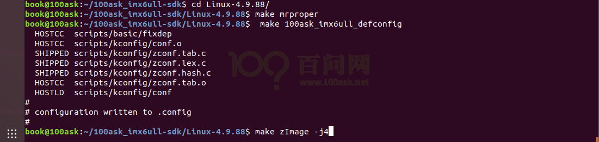

<a id="_Ref105539781"></a>图 5.1 编译zImage

编译完成后生成的文件如图 5.2所示：

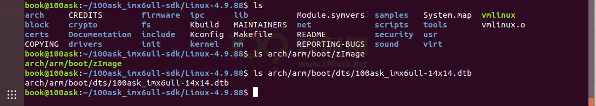

<a id="_Ref105539808"></a>图 5.2 编译zImage完成

编译完成后，在arch/arm/boot目录下生成zImage内核文件, 在arch/arm/boot/dts目录下生成设备树的二进制文件**100ask\_imx6ull-14x14.dtb**。把这2个文件复制到/home/book/nfs\_rootfs目录下备用（后面使用adb命令把文件下载到开发板），如图 5.3：

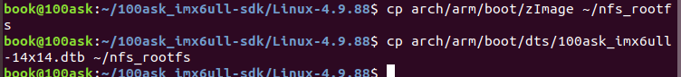

<a id="_Ref105539874"></a>图 5.3 将zImage和dtb复制某个目录备用

<a id="_Ref110630466"></a><a id="_Toc197788584"></a><a id="_Ref110630463"></a>
## 5.3 编译安装内核模块

### 5.3.1 编译内核模块

进入内核源码目录后，就可以编译内核模块了：

```bash
book@100ask: cd ~/100ask_imx6ull-sdk/Linux-4.9.88/
book@100ask:~/100ask_imx6ull-sdk/Linux-4.9.88$ make  modules
```

内核模块编译完成后如图 5.4所示：

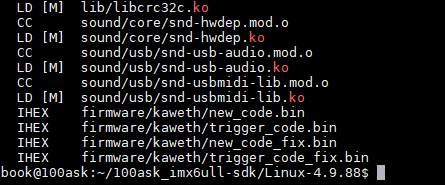

<a id="_Ref105539942"></a>图 5.4 内核模块编译完成

### 5.3.2 安装内核模块到Ubuntu某个目录下备用

可以先把内核模块安装到nfs目录(/home/book/nfs\_rootfs)。

**注意**：后面会使用tree命令查看目录结构，如果提示没有该命令，需要执行以下命令安装tree命令：

```bash
sudo apt install tree
```

执行以下命令安装模块：

```bash
book@100ask:~$ cd ~/100ask_imx6ull-sdk/Linux-4.9.88/
book@100ask:~/100ask_imx6ull-sdk/Linux-4.9.88$ make  ARCH=arm INSTALL_MOD_PATH=/home/book/nfs_rootfs  modules_install
```

如图 5.5，把模块安装在nfs目录“/home/book/nfs\_rootfs/”下：

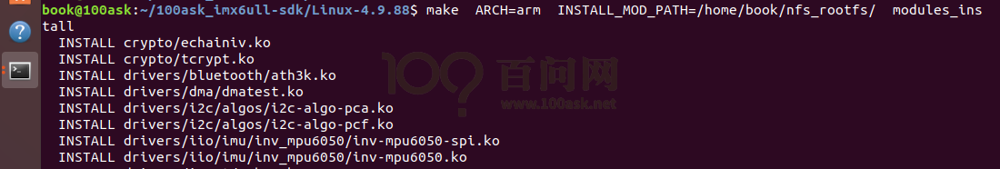

<a id="_Ref105540027"></a>图 5.5 安装模块到nfs\_rootfs

安装好驱动后的/home/book/nfs\_rootfs/目录结构如图 5.6所示：

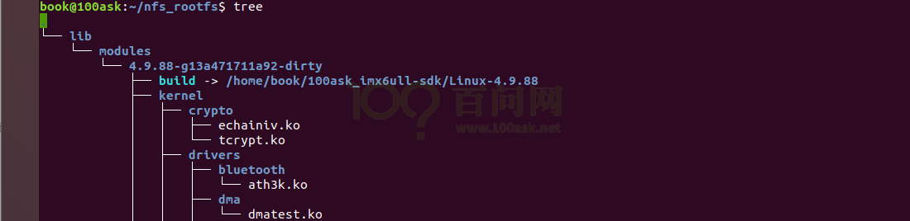

<a id="_Ref105540049"></a>图 5.6 安装模块后的nrf\_rootfs

<a id="_Ref110630480"></a><a id="_Ref110630482"></a><a id="_Toc197788585"></a>
## 5.4 安装内核和模块到开发板上

假设：在Ubuntu的/home/book/nfs\_rootfs目录下，已经有了zImage、dtb文件，并且有lib/modules子目录(里面含有各种模块)。

接下来要把这些文件复制到开发板上，在Ubuntu上使用adb命令：

```bash
cd  /home/book/nfs_rootfs
adb  push  zImage  /boot
adb  push  100ask_imx6ull-14x14.dtb   /boot
adb  push  lib/modules  /lib
```

最后，在开发板上执行“sync”命令，再重启开发板，它就使用新的zImage、dtb、模块了。

<a id="_Toc33604054"></a><a id="_Toc197788586"></a>
## 5.5 编译led驱动


01\_all\_series\_quickstart/

05\_嵌入式Linux驱动开发基础知识/

source/02\_led\_drv/02\_led\_drv\_for\_boards/100ask\_imx6ull\_src\_bin

可以在Ubuntu中下载Git仓库，或者从Windows上通过filezilla把源码传到Ubuntu。

首先，进入100ask\_imx6ull\_src\_bin目录，修改Makefile文件“KERN\_DIR”为自己的内核所在路径。如图 5.7红框所示，如果你的内核源码不在此目录则根据你的实际情况进行修改：

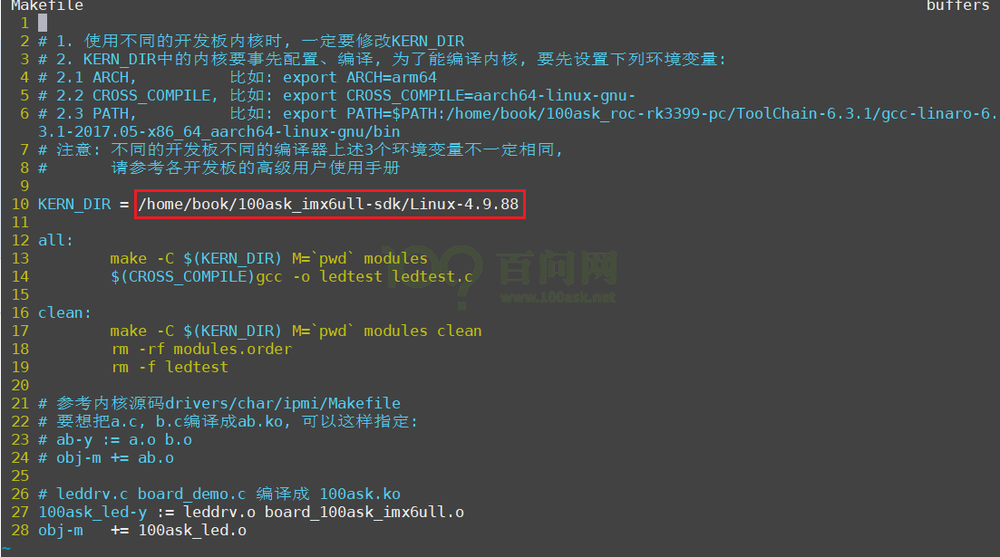

<a id="_Ref105540371"></a>图 5.7 修改源码SDK路径

**注意**：有些学员并不按照前面的文档编译内核，而是使用Buildroot来编译内核，那么led驱动程序的Makefile中要指定KERN\_DIR为如下目录：

```
KERN_DIR = /home/book/100ask_imx6ull-sdk/Buildroot_2020.02.x/output/build/linux-origin_master
```

修改完内核所在目录后，就可以编译led模块驱动了，如图 5.8红框1 所示，执行“make all”命令就可以编译,编译完成后会生成 **100ask\_led.ko ledtest** 两个文件。

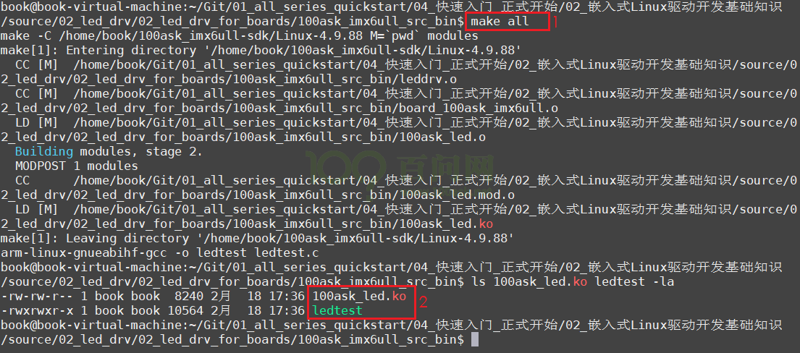

<a id="_Ref105540407"></a>图 5.8 编译模块驱动

此时，使用ADB命令把这两个文件下载到开发板：

```bash
adb  push   100ask_led.ko   /root
adb  push   ledtest   /root
```

<a id="_Toc197788587"></a><a id="_Toc33604055"></a>
## 5.6 在开发板安装驱动模块

### 5.6.1 关闭系统默认cpu状态灯

可能开发板上的led灯已被设置为 CPU状态灯(可以看到绿色LED在闪)，我们需要将其关闭，才可以使用我们的驱动对其进行操作，关闭方法如下所示：

```bash
[root@100ask:~]# echo none >  /sys/class/leds/cpu/trigger
```

我们后面出厂的开发板，已经把CPU状态灯禁止了，所以上述命令可能出错：这没影响。

### 5.6.2 安装驱动模块

在开发板串口终端上执行如下命令，即可安装相应的驱动模块。

```bash
[root@100ask:~]# insmod 100ask_led.ko
```

安装完成后可以执行lsmod 命令来查看是否安装成功，如图 5.9所示：

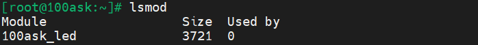

<a id="_Ref105540512"></a>图 5.9 执行lsmod验证

如果你没有更新板子上的内核，会出现类似如图 5.10所示错误：

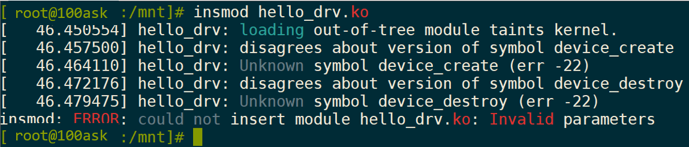

<a id="_Ref105540250"></a>图 5.10 不更新内核时的错误提示

可以强行安装驱动程序，比如使用“insmod -f hello\_drv.ko”这样的命令，它会提示说“内核已经被污染了”，但是不影响学习、不影响使用，如图 5.11所示：

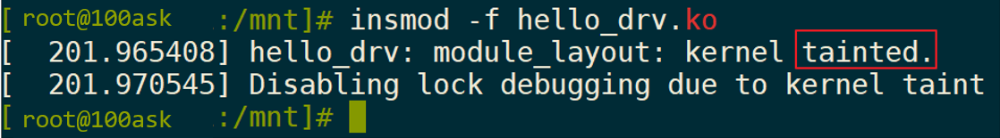

<a id="_Ref105540290"></a>图 5.11 内核污染提示

<a id="_Toc33604056"></a><a id="_Toc197788588"></a>
## 5.7 执行测试程序

驱动模块安装成功后，就可以使用测试程序来控制led灯的状态，如图 5.12所示，操作led灯时可同时观察开发板串口旁的灯是否有亮灭的变化。

```bash
[root@100ask:~]# chmod  +x  ./ledtest
[root@100ask:~]# ./ledtest
Usage: ./ledtest <dev> <on | off>
[root@100ask:~]# ./ledtest /dev/100ask_led0 on    //打开led0灯
[root@100ask:~]# ./ledtest /dev/100ask_led0 off   //关闭led0灯
```

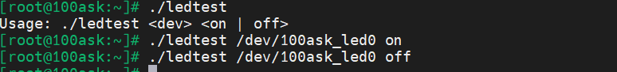

<a id="_Ref105540563"></a>图 5.12 操控LED
