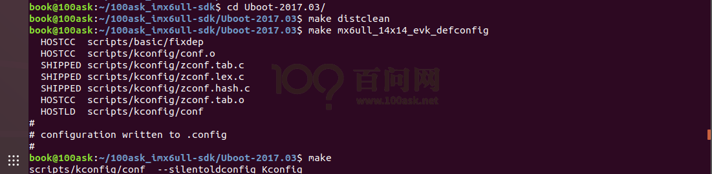
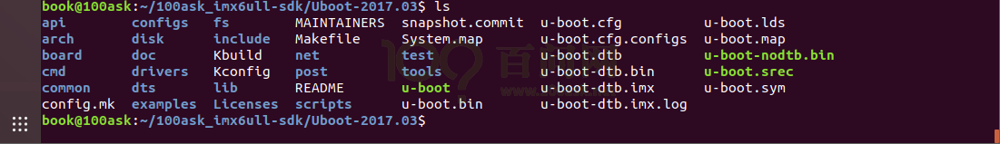
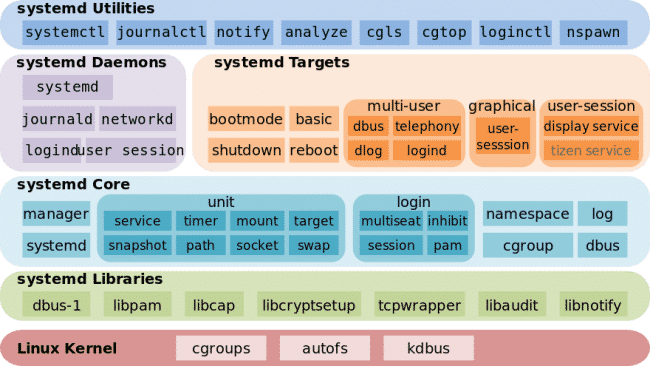
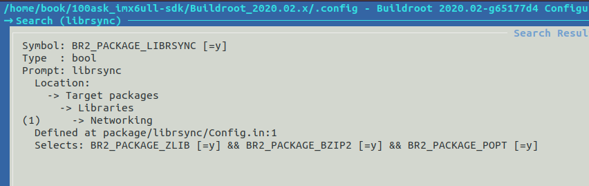
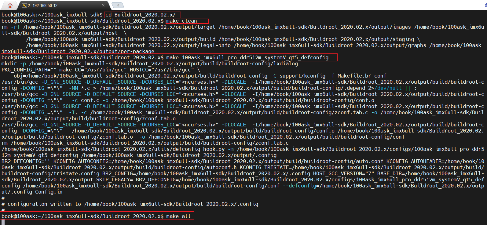
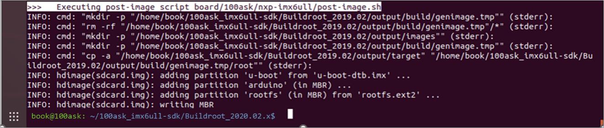

<a id="_Toc33604005"></a>
<a id="_Toc197788589"></a>

<a id="_Toc197788590"></a>
## 6.1 准备

Linux平台上有许多开源的嵌入式linux系统构建框架(框架的意思就是工具)，这些框架极大的方便了开发者进行嵌入式系统的定制化构建，目前比较常见的有OpenWrt, Buildroot, Yocto,等等。其中Buildroot功能强大，使用简单，而且采用了类似于linux kernel的配置和编译框架，所以受到广大嵌入式开发人员的欢迎。

本章重点介绍使用Buildroot\_2019.02LTS版构建文件系统和u-boot, kernel镜像的方法，并从这三个部分入手，描述如何使用Buildroot构建一个适合100ask\_imx6ull系列开发板的嵌入式Linux系统。

在构建文件系统时，还简要介绍了如何通过Buildroot将QT5图形系统集成到文件系统中，方便用户后续开发QT5的应用程序。

确保Ubuntu能ping通外网(比如：ping news.qq.com)，如果无法访问外网请按以下章节配置Ubuntu：

-   《**错误!未找到引用源。错误!未找到引用源。**》

然后参考以下章节下载源码、配置工具链：


<a id="_Toc197788591"></a>
## 6.2 解压编译bootloader

### 6.2.1 Bootloader介绍

Bootloader是在操作系统运行之前运行的一段代码，用于引导操作系统。通常每个操作系统都有一组专属的引导加载程序。引导加载程序通常可以通过多种方式引导操作系统内核，还有各种命令用于调试或修改内核运行环境。

U-Boot是一个开源的主引导加载程序，用于引导设备的操作系统内核，并含有多种命令以便调试系统。它适用于多种计算机体系结构，包括68k，ARM，Blackfin，MicroBlaze，MIPS，Nios，SuperH，PPC，RISC-V和x86。

U-boot官网：

[https://www.denx.de/wiki/U-Boot](https://www.denx.de/wiki/U-Boot)

源码下载页面：

[http://ftp.denx.de/pub/u-boot/](http://ftp.denx.de/pub/u-boot/)

<a id="_Hlk14104514"></a>NXP官方uboot源码Git地址：

[https://source.codeaurora.org/external/imx/uboot-imx](https://source.codeaurora.org/external/imx/uboot-imx)

本开发使用的U-boot位于Git仓库，地址为：

[https://e.coding.net/weidongshan/imx-uboot2017.03.git](https://e.coding.net/weidongshan/imx-uboot2017.03.git)

**注意**：我们使用的版本针对板子进行过修改，u-boot官网下载的源码不能直接使用。

<a id="_Toc12607186"></a><a id="_Toc533069698"></a><a id="_Toc11842173"></a><a id="_Toc533067223"></a><a id="_Toc533067027"></a><a id="_Toc3909026"></a><a id="_Toc532977073"></a><a id="_Toc11842674"></a><a id="_Toc532979561"></a><a id="_Toc532980170"></a><a id="_Toc533069615"></a><a id="_Toc533148301"></a><a id="_Toc11842410"></a><a id="_Toc4428032"></a><a id="_Toc12607098"></a><a id="_Toc12607189"></a>
### 6.2.2 编译u-boot镜像

不同的开发板对应不同的配置文件，配置文件位于u-boot源码的“configs/”目录。对于IMX6ULL Pro版，u-boot的编译过程如下(编译uboot前必须先配置好工具链等开发环境)：

```bash
cd /home/book/100ask_imx6ull-sdk
book@100ask: ~/100ask_imx6ull-sdk$cd  Uboot-2017.03
book@100ask: ~/100ask_imx6ull-sdk/Uboot-2017.03$ make distclean
book@100ask: ~/100ask_imx6ull-sdk/Uboot-2017.03$ make mx6ull_14x14_evk_defconfig
book@100ask: ~/100ask_imx6ull-sdk/Uboot-2017.03$ make
```

图 6.1 编译镜像文件为具体的执行步骤：



<a id="_Ref108619057"></a>图 6.1 编译镜像文件

编译完成后生成的文件如图 6.2所示。



<a id="_Ref108619098"></a>图 6.2 镜像文件编译成功

编译完成之后生成u-boot-dtb.imx，可以烧在TF卡、EMMC上。以下命令是将u-boot-dtb.imx文件烧写到EMMC上：

```bash
[root@100ask:~]# echo 0 > /sys/block/mmcblk1boot0/force_ro
[root@100ask:~]# dd if=u-boot-dtb.imx of=/dev/mmcblk1boot0 bs=512 seek=2
[root@100ask:~]# echo 1 > /sys/block/mmcblk1boot0/force_ro
```

<a id="_编译Linux_Kernel"></a><a id="_Ref109377884"></a><a id="_Ref109377887"></a><a id="_Toc197788592"></a>
## 6.3 编译Linux Kernel和模块

Linux内核（英语：Linux kernel）是一种开源的类Unix操作系统宏内核。整个Linux操作系统家族基于该内核部署在传统计算机平台（如个人计算机和服务器，以Linux发行版的形式）和各种嵌入式平台，如路由器、无线接入点、专用小交换机、机顶盒、FTA接收器、智能电视、数字视频录像机、网络附加存储（NAS）等。工作于平板电脑、智能手机及智能手表的Android操作系统，它的底层操作系统也是Linux。尽管在桌面计算机的占用率较低，但基于Linux的操作系统统治了几乎从移动设备到主机的其他全部领域。实际Linux的发行版Ubuntu，其易用性也逐渐接近Windows。

Linux kernel官网：

[https://www.kernel.org/](https://www.kernel.org/)

linux Kernel维基百科：

[https://www.wiki.kernel.org/](https://www.wiki.kernel.org/)

在线阅读linux kernel源码：

[https://elixir.bootlin.com/](https://elixir.bootlin.com/)

Git仓库地址：

[https://e.coding.net/weidongshan/imx-linux4.9.88.git](https://e.coding.net/weidongshan/imx-linux4.9.88.git)

NXP官方kernel源码Git仓库地址：

https://source.codeaurora.org/external/imx/linux-imx

上述Git仓库是专为100ask\_imx6ull系列开发板制定的Linux内核，它有如表 6‑1特性：

<a id="_Ref108619338"></a>表 6‑1 百问定制内核特征


| 名称 | 是否支持 | 作用 | 是否开源 |
| --- | --- | --- | --- |
| USB HOST | 支持 | USB Host驱动，支持OHCI和EHCI两种传输模式 | Yes |
| USB OTG | 支持 | Usb otg驱动，支持device模式和host模式 | Yes |
| Network | 支持 | RJ-45以太网驱动 | Yes |
| MMC/SD | 支持 | MMC/SD卡驱动 | Yes |
| EMMC | 支持 | EMMC驱动 | Yes |
| I2C | 支持 | I2C驱动 | Yes |
| SPI | 支持 | SPI驱动 | Yes |
| LCD | 支持 | 显示驱动 | Yes |
| RTC | 支持 | 内置RTC时钟驱动 | Yes |
| ADC | 支持 | ADC驱动 | Yes |
| TouchScreen | 支持 | 电容触摸 | Yes |
| UART | 支持 | 串口驱动 | Yes |
| PMU | 支持 | 电源管理驱动 | Yes |
| LED | 支持 | LED驱动，包括GPIO LED和PWM | Yes |
| Button | 支持 | GPIO Button 驱动 | Yes |
| Camera | 支持 | 摄像头驱动 | Yes |


<a id="_编译内核镜像"></a><a id="_9.5.2_编译内核镜像"></a><a id="_Toc12607192"></a>使用内核以及内核模块前需要将其编译，然后安装到ubuntu或开发板，详细步骤已经下面3个章节写明了：


<a id="_Toc197788593"></a>
## 6.4 Buildroot的用法

### 6.4.1 Buildroot简介

制作根文件系统有很多种方法：

1.  使用Busybox手工制作

Busybox本身包含了很了Linux命令，但是要编译其他程序的话需要手工下载、编译，如果它需要某些依赖库，你还需要手工下载、编译这些依赖库。

如果想做一个极简的文件系统，可以使用Busybox手工制作。

1.  使用Buildroot自动制作

它是一个自动化程序很高的系统，可以在里面配置、编译内核，配置编译u-boot、配置编译根文件系统。在编译某些APP时，它会自动去下载源码、下载它的依赖库，自动编译这些程序。

Buildroot的语法跟一般的Makefile语法类似，很容易掌握。

1.  使用Yocto

NXP、ST等公司的官方开发包是使用Yocto，但是Yocto语法复杂，并且Yocto动辄10GB，下载安装都很困难，普通笔记本编译可能需要2-3天甚至更久，非常不适合初学者(我们不推荐使用yocto构建文件系统)。

基于上述特点，我们选择Buildroot。

Buildroot是一组Makefile和补丁，可简化并自动化地为嵌入式系统构建完整的、可启动的Linux环境(包括bootloader、Linux内核、包含各种APP的文件系统)。Buildroot运行于Linux平台，可以使用交叉编译工具为多个目标板构建嵌入式Linux平台。Buildroot可以自动构建所需的交叉编译工具链，创建根文件系统，编译Linux内核映像，并生成引导加载程序用于目标嵌入式系统，或者它可以执行这些步骤的任何独立组合。例如，可以单独使用已安装的交叉编译工具链，而Buildroot仅创建根文件系统。

Buildroot参考网址：

•Buildroot用户手册：

[https://buildroot.org/downloads/manual/manual.html](https://buildroot.org/downloads/manual/manual.html)

• Buildroot源码下载地址：

[https://buildroot.org/downloads/](https://buildroot.org/downloads/)

• 百问网提供的Buildroot现支持如下包：

表 6‑2 百问网buildroot支持包


| busybox | taglib | libopenh264 | qt5_gl_available |
| --- | --- | --- | --- |
| skeleton_init_systemd | tremor | libopusenc | qt5_jscore_available |
| alsa_utils | libarchive | libtheora | qt5 |
| bluez_alsa | zlib | libvpx | qt5_version_latest |
| faad2 | libzlib | libyuv | qt5base |
| ffmpeg | has_zlib | live555 | qt5base_network |
| flac | libassuan | mediastreamer | qt5base_concurrent |
| fluidsynth | libgcrypt | x264 | qt5base_sql |
| gstreamer1 | libgpg_error | x264_cli | qt5base_sqlite_none |
| jack2 | Libgpgme | libcurl | qt5base_test |
| lame | Libksba | libnice | qt5base_xml |
| mjpegtools | Openssl | libnl | qt5base_gui |
| musepack | libopenssl | libpcap | qt5base_widgets |
| pulseaudio | sqlite | libshout | qt5base_opengl |
| twolame | libconfig | libsoup | qt5base_opengl_es2 |
| wavpack | libconfuse | libsrtp | qt5base_opengl_lib |
| bzip2 | libfuse | libtirpc | qt5base_linuxfb |
| lz4 | liblockfile | neon | qt5base_eglfs |
| xz | bayer2rgb_neon | ortp | qt5base_default_qpa="" |
| gdb | bullet | rtmpdump | qt5base_printsupport |
| gdb_server | cairo | bctoolbox | qt5base_fontconfig |
| gdb_debugger | cairo_pdf | elfutils | qt5base_harfbuzz |
| gdb_tui | cairo_png | glibmm | qt5base_gif |
| spidev_test | cairo_svg | libb64 | qt5base_jpeg |
| strace | fontconfg | libbsd | qt5base_png |
| libtool | freetype | libcap | qt5base_dbus |
| cifs_utils | gdk_pixbuf | libcroco | qt5base_icu |
| dosfstools | giflib | libevdev | qt5base_openssl |
| e2fsprogs | harfbuzz | libffi | qt5base_tslib |
| mmc_utils | jasper | libglib2 | qt5canvas3d |
| nfs_utils | jpeg | libical | qt5charts |
| glmark2_flavor_any | kmsxx | libnpth | qt5connectivity |
| libva_utils | libdrm | libsigc | qt5declarative |
| fb_test_app | libmediaart | liburcu | qt5declarative_quick |
| fbdump | libpng | llvm | qt5enginio |
| fbset | libraw | mpdecimal | qt5graphicaleffects |
|  | librsvg | protobuf | qt5imageformats |
| psplash | libsvg | tzdata | qt5location |
| xkeyboard_config | libsvg_cairo | icu | qt5multimedia |
| dbus | libva | libfribidi | qt5quickcontrols |
| evtest | opencv3 | ncurses | qt5quickcontrols2 |
|  | has_libegl | pcre | qt5script |
| gptfdisk | has_libgles | pcre2 | qt5scxml |
| i2c_tools | openjpeg | popt | qt5sensors |
| iostat | pango | readline | qt5serialbus |
| linux_serial_test | pipewire | slang | qt5serialport |
| memtool | pixman | bluez_tools | qt5svg |
| parted | tiff | bluez5_utils | qt5virtualkeyboard |
| spi_tools | wayland | bmon | qt5webchannel |
| sysstat | webp | iperf3 | qt5websockets |
| uboot_tools | dtc | iproute2 | qt5xmlpatterns |
| has_udev | libaio | iw | attr |
| usbmount | libgudev | lrzsz | keyutils |
| usbutils | libinput | mii_diag | kmod |
| luajit | libpciaccess | mjpg_streamer | kmod_tools |
| python3 | libusb | mosquitto | start_stop_daemon |
| alsa_lib | libxkbcommon | net_tools | swupdate |
| fdk_aac | mtdev | openobex | systemd |
| libcodec2 | tslib | openssh | util_linux |
| libcuefile | expat | pppd | myir_hmi_gui |
| libreplaygain | json_glib | rpcbind | rs485read |
| libsamplerate | jsoncpp | tcpdump |  |
| libsndfile | libxml2 | wget |  |
| libvorbis | bitstream | wireless_tools |  |
| mp4v2 | libass | opkg |  |
| opus | libcamera | bash |  |
| portaudio | libmms | gnupg2 |  |
| sbc | libmpeg2 | gnupg2_gpgv |  |
| speex | libogg | lockfile_progs |  |


### 6.4.2 系统特征讲解

-   -   -   -   1.  我们都做了哪些改进？

我们基于buildroot官方 2020.02长期支持版本进行适配imx6ull开发板，在此基础上针对ST yocto发行系统做了大量的裁剪，在保证最小系统的基础上增加对qt5.12 库的支持，同时也支持opencv3编程 mqtt库 swupdate ota升级等等比较常用的应用，我们也会提供如何在buildroot新增自己的软件包教程，同时源码保存在gitee上，链接地址为

[https://gitee.com/weidongshan/Buildroot.git](https://gitee.com/weidongshan/Buildroot.git)

大家可以在上面提交issue 或者pull request。

-   -   -   -   1.  什么是init系统服务？

init（为英语：initialization的简写）是 Unix 和 类Unix 系统中用来产生其它所有进程的程序。它以守护进程的方式存在，其进程号为1。Linux系统在引导时加载Linux内核后，便由Linux内核加载init程序，由init程序完成余下的引导过程，比如加载运行级别，加载服务，引导Shell/图形化界面等等。

-   -   -   -   1.  什么是systemv守护进程？

System V（缩写为SysV）在大多数Linux发行版中使用最广泛,在systemv中，在内核加载后运行的第1个程序被称为init程序。Init做一些事情，其中之一就是加载一系列脚本来启动各种系统服务，例如网络，ssh守护程序等。

System V中的运行级别描述了某些状态，例如：

-   运行级别0：暂停
-   运行级别1：单用户模式
-   运行级别6：重新启动

systemv的问题在于它需要仔细调整。假设您有一个要在启动时运行的网络文件系统（NFS）客户端。在网络正常工作之前运行NFS没有任何意义。因此，您必须等待网络已经正常工作，才能启动systemv。Systemv init这样做的方法是为服务启动设置严格的顺序。每个服务都分配有一个优先级编号，init会按优先级顺序启动服务。如果需要确保网络连接后启动服务，则必须手动为服务分配更高的优先级。这必须由某人（通常是软件包维护者）针对计算机上运行的每项服务来完成。

所有System V初始化脚本都存储在/etc/rc.d/init.d/或/etc/init.d目录中。这些脚本用于控制系统的启动和关闭。通常，您会在这个目录找到启动ssh服务器或网络的脚本，可以手工执行它们。比如使用“/etc/init.d/S50sshd start”开启ssh服务，使用“/etc/init.d/S50sshd stop”关闭ssh服务。

-   -   -   -   1.  什么是systemd守护进程？

systemd这一名字源于Unix中的一个惯例：在Unix中常以“d”作为系统守护进程（英语：daemon，亦称后台进程）的后缀标识。除此以外，systemd亦是指代英文术语D体系，而这一术语即是用于描述一个人具有快速地适应环境并解决困难的能力。

systemd是Linux电脑操作系统之下的一套中央化系统及设置管理程序（init），包括有守护进程、程序库以及应用软件，由Lennart Poettering带头开发。其开发目标是提供更优秀的框架以表示系统服务间的依赖关系，并依此实现系统初始化时服务的并行启动，同时达到降低Shell的系统开销的效果，最终代替现在常用的System V与BSD风格的init程序。目前绝大多数的Linux发行版都已采用systemd代替原来的System V。



图 6.3 systemd

将service（服务）、target（运行模式，类似于运行级别）、mount、timer、snapshot、path、socket、swap等称为Unit。比如，一个auditd服务（就是auditd.service）就是一个Unit，一个multi-user.target运行模式也是一个Unit，其中不同的服务通过 systemctl 来进行统一管理，例如重启一个sshd服务，需要执行 systemctl restart sshd 命令，同样的如果添加一个启动程序需要自己定义一个 service服务才可以。

-   -   -   -   1.  你可以用我们提供的buildroot做些什么？

快速实现自己的想法，增加自己的应用，学习了解busybox以及各种包是如何编译生成，用于调试内核或者应用程序等等。

### 6.4.3 扩展学习

在buildroot下进入menuconfig包选择配置配置界面

```bash
book@100ask: ~/100ask_imx6ull-sdk/Buildroot_2020.02.x$ make menuconfig
```

buildroot下单独编译内核

```bash
book@100ask: ~/100ask_imx6ull-sdk/Buildroot_2020.02.x$ make linux-rebuild
```

buildroot下进入内核make menuconfig配置选项界面

```bash
book@100ask: ~/100ask_imx6ull-sdk/Buildroot_2020.02.x$ make linux-menuconfig
```

buildroot下单独编译u-boot

```bash
book@100ask: ~/100ask_imx6ull-sdk/Buildroot_2020.02.x$ make uboot-rebuild
```

buildroot下单独编译某个软件包

```bash
book@100ask: ~/100ask_imx6ull-sdk/Buildroot_2020.02.x$ make <pkg>-rebuild
```

buildroot下进入busybox配置界面

```bash
book@100ask: ~/100ask_imx6ull-sdk/Buildroot_2020.02.x$ make busybox-menuconfig
```

buildroot下生成系统sdk,最后生成的目录在output/images/目录下

```bash
book@100ask: ~/100ask_imx6ull-sdk/Buildroot_2020.02.x$ make sdk
```

<a id="_Toc532980180"></a><a id="_Toc4428042"></a><a id="_Toc11842684"></a><a id="_Toc532979571"></a><a id="_Toc533069708"></a><a id="_Toc12607196"></a><a id="_Toc11842183"></a><a id="_Toc533148311"></a><a id="_Toc532977083"></a><a id="_Toc11842420"></a><a id="_Toc533067233"></a><a id="_Toc3909036"></a><a id="_Toc533067037"></a><a id="_Toc533069625"></a><a id="_Toc12607108"></a><a id="_Toc197788594"></a><a id="_Toc12607197"></a>
## 6.5 构建IMX6ULL Pro版的根文件系统

### 6.5.1 配置文件说明

表 6‑3 配置文件说明


| 配置文件 | 含义 |
| --- | --- |
| 100ask_imx6ull_pro_ddr512m_systemV_core_defconfig | 使用systemV守护进程的系统(包含基本工具集包) |
| 100ask_imx6ull_pro_ddr512m_systemV_qt5_defconfig | 使用systemV守护进程的系统，包含Qt GUI文件系统版本(出厂系统默认) |


<a id="_Toc12607198"></a>

注意：使用“100ask\_imx6ull\_pro\_ddr512m\_systemV\_core\_defconfig”时，执行“make 100ask\_imx6ull\_pro\_ddr512m\_systemV\_core\_defconfig”后，需要再执行“make menuconfig”如下图选择librsync：



### 6.5.2 编译系统

下面以100ask\_imx6ull\_pro\_ddr512m\_systemV\_qt5\_defconfig配置文件为例，在ubuntu终端上说明 Buildroot 的配置过程：

```bash
cd /home/book/100ask_imx6ull-sdk
book@100ask:~/100ask_imx6ull-sdk$ ../repo/repo sync -j 4
book@100ask:~/100ask_imx6ull-sdk$ cd Buildroot_2020.02.x
book@100ask:~/100ask_imx6ull-sdk/Buildroot_2020.02.x$ make clean
book@100ask:~/100ask_imx6ull-sdk/Buildroot_2020.02.x$ make 100ask_imx6ull_pro_ddr512m_systemV_qt5_defconfig
book@100ask:~/100ask_imx6ull-sdk/Buildroot_2020.02.x$ make all -j4
```



图 6.4 编译系统

**注意：**机器性能不同，编译时间不同。性能差的电脑，有可能需要等待5 ~ 6个小时。

编译完成后如图 6.5示。



<a id="_Ref108620266"></a>图 6.5 系统编译完成

<a id="_Ref533154447"></a><a id="_Ref533154406"></a><a id="_Ref533154397"></a><a id="_Toc12607199"></a>
### 6.5.3 镜像文件

编译成功后文件输出路径为 output/images

buildroot2020.02.x

├── output

├── images

├── 100ask\_imx6ull-14x14.dtb &lt;--设备树文件

├── rootfs.ext2 &lt;--ext2格式根文件系统

├── rootfs.ext4 -&gt; rootfs.ext2 &lt;--ext2格式根文件系统

├── rootfs.tar

├── rootfs.tar.bz2 &lt;--打包并压缩的根文件系统，用于NFSROOT启动

├── 100ask-imx6ull-pro-512d-systemv-v1.img &lt;--完整的系统镜像(可以用来烧写emmc和sd卡)

├── u-boot-dtb.imx &lt;--u-boot镜像

└── zImage &lt;--内核镜像

可以参考章节[《烧写整个系统或更新部分系统》](/docs/Linux-Application-Development-Manual/part-3/chapter-11#_Toc31978937)把上面编译出来的100ask-imx6ull-pro-512d-systemv-v1.img重命名为emmc.img(或sdcard.img)，把emmc.img(或sdcard.img)放到“100ask\_imx6ull烧写工具”的files目录里，就可以使用工具烧写到EMMC(或SD/TF卡)。
