<a id="_Ref111981570"></a>
<a id="_Ref111981572"></a>
<a id="_Ref111981566"></a>
<a id="_Toc197788595"></a>
<a id="_Ref111981567"></a>

详细的手把手教学视频请看

https://www.bilibili.com/video/BV1zV411U7H9?p=7

百问网开发了一款烧写软件：100ask\_imx6ull\_flashing\_tool，它的界面如图 7.1：

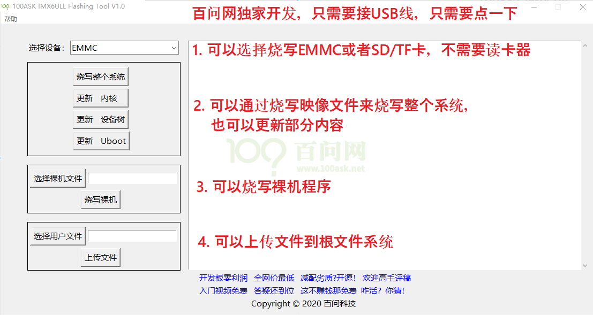

<a id="_Ref108620847"></a>图 7.1 百问网烧写工具

使用这软件，只需要一条USB线连接电脑和开发板USB OTG口，只需要点击一个按钮就可以实现某项烧写功能。

100ask\_imx6ull\_flashing\_tool是一个GUI前端，它调用NXP官方的烧写工具uuu：Universal Update Utility(又名mfgtools 3.0)。

市面上的imx6ull开发板多是使用mfgtools 2.0来烧写，效率不高，脚本复杂；uuu有所改进，但是烧写效率还是不高。

我们做了很多改进，烧写更方便、效率更高。使用mfgtools烧写500M的映象文件到EMMC，耗时5分钟；而使用100ask\_imx6ull\_flashing\_tool只需要1分钟。

本章会首先介绍100ask\_imx6ull\_flashing\_tool的使用，后面也会介绍常规的烧写方法。

<a id="_Toc197788596"></a>
## 7.1 怎么更新整个系统或某些部件

如果你要重新烧写板子的整个系统，请参考：


如果你要单独更新u-boot、内核、设备树，请参考：


其他章节可以忽略，有必要时再看。

<a id="_Toc197788597"></a>
## 7.2 100ASK_IMX6ULL启动开关

100ask\_imx6ull Pro版、mini emmc版，都支持USB、EMMC、SD/TF卡三种启动方式。板子背后都画有一个表格，表示这3种方式如何设置。表格如下：

表 7‑1 启动方式说明


| BOOT CFG |  |  |  |  |
| --- | --- | --- | --- | --- |
| BOOT | SW1(LCD_DATA5) | SW2(LCD_DATA11) | SW3(BOOT_MODE0) | SW4(BOOT_MODE1) |
| EMMC | OFF | OFF | ON | OFF |
| SD | ON | ON | ON | OFF |
| USB | X | X | OFF | ON |


这3种启动方式的设置示意图如图 7.2：


<a id="_Ref108621058"></a>图 7.2 启动拨码开关

其中的USB启动模式主要用来烧写系统。

**注意**：设置为USB启动时，不能先插上SD/TF卡。要在USB启动模式下烧写SD/TF卡时，需要先上电再插卡，先上电再插卡，先上电再插卡，。

**注意**：使用后EMMC、SD/TF卡启动方式之前，需要先在EMMC或SD/TF卡上烧写系统。

<a id="_Toc197788598"></a><a id="_Ref109377647"></a><a id="_Ref109377644"></a>
## 7.3 在Windows使用USB烧写工具

NXP公司给IMX6ULL提供了烧写工具：mfgtools，它的使用界面如图 7.3：

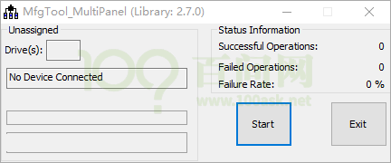

<a id="_Ref108621119"></a>图 7.3 mfgtools

操作很简单，一键烧写整个映象文件。但是，缺点也很多：

1.  不能单独烧写bootloader、内核、设备树或者说，可以实现这些功能，但是需要你去修改xml配置文件，对初学者不友善，对老手也显得麻烦。
2.  烧写速度慢，烧写500M的系统，耗时5分钟(我们的工具可以在1分钟内烧完)。

基于上述缺点，我们开发了新的烧写工具100ask imx6ull flashing tool，并且完全开源。它有如下特点：

-   可以烧写整个系统，也可以分开烧写bootloader、内核、设备树
-   可以上传用户文件到开发板系统中任意目录里
-   烧写速度是原厂工具的5倍
-   支持所有厂家的开发板烧写，注意：不只是支持100ASK\_IMX6ULL，还支持其他厂家的IMX6ULL开发板。

在“网盘的配套的资料/02\_开发工具/100ask\_imx6ull\_pro开发板系统烧写工具\_支持ADB”目录下双击运行“100ask\_imx6ull\_flashing\_tool.exe”。它有“基础版”、“专业版”两个页面，如图 7.4所示

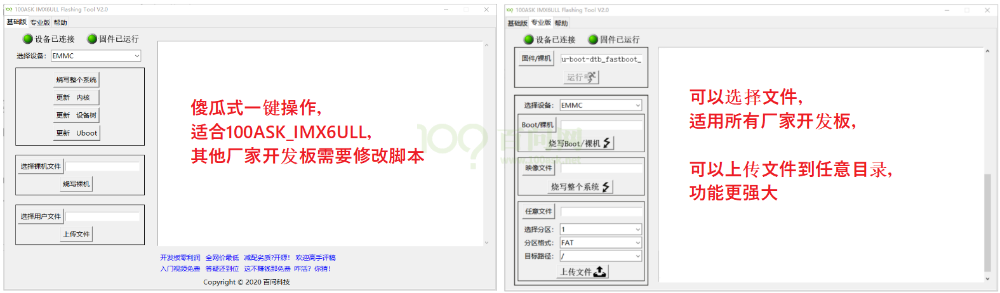

<a id="_Ref108621218"></a>图 7.4 百问烧写工具界面说明

“基础版”是专为100ASK\_IMX6ULL设计的，点击一下即可完成某项烧写。

“专业版”功能更强大，特别是它可以上传文件到某个分区、某个目录。有些厂家的开发板，zImage和设备树是在第1个分区里的，而100ASK\_IMX6ULL的zImage和设备树是在第2个分区里，所以这些厂家的开发板就无法使用基础版来烧写，需要使用专业版，指定分区、指定分区格式、指定路径，然后再上传文件。

**注意**：开发板必须设置为USB模式，如果要用SD/TF卡，必须先上电再插卡；不能先插卡再上电，不能先插卡再上电，不能先插卡再上电！

### 7.3.1 烧写工具目录详解

在100ASK\_IMX6ULL的配套资料中，有文件：“02\_开发工具/ 100ask\_imx6ull\_pro开发板系统烧写工具\_支持ADB.zip”，把它解压后可得如图 7.5所示目录：

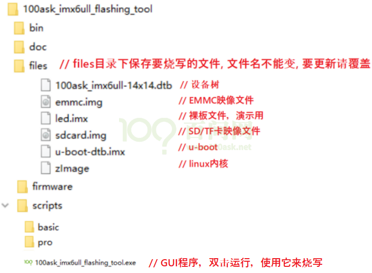

<a id="_Ref108621286"></a>图 7.5 烧写工具目录

要留意的是files目录下的文件，各文件的作用在上图中列出来了，文件名不能改变，要更新某文件时需要覆盖旧文件。

这个烧写工具不断更新，上述截图中files目录下内容可能会增加，更多文件内容请看表 7‑2

<a id="_Ref108621314"></a>表 7‑2 烧写工具其他文件说明


| 目录 | 文件 | 说明 |
| --- | --- | --- |
| file | u-boot-dtb.imx | IMX6ULL Pro版的u-boot，烧到EMMC或SD/TF卡 |
|  | u-boot-dtb_nand.imx | IMX6ULL mini nand版的u-boot，烧到Nand |
|  | u-boot-dtb_nandsd.imx | IMX6ULL mini nand版的u-boot，烧到SD/TF卡 |
|  | zImage | 内核，适用于多个板子 |
|  | 100ask_imx6ull-14x14.dtb | IMX6ULL Pro版的设备树文件 |
|  | 100ask_myir_imx6ull_mini.dtb | IMX6ULL mini nand版的设备树文件 |
|  | emmc.img | IMX6ULL Pro版的EMMC映像文件 |
|  | sdcard.img | IMX6ULL Pro版的SD/TF卡映像文件 |
|  | rootfs.ubi | IMX6ULL mini nand版的Nand Flash映像文件 |


### 7.3.2 连接USB OTG线

100ASK\_IMX6ULL\_PRO接线、设置USB启动的方式如图 7.6：


<a id="_Ref108621676"></a>图 7.6 100ASK\_IMX6ULL\_PRO接线

**注意**：USB串口线可接可不接，接上只是为了观察烧写过程。

**注意**：设置为USB启动时，先不要接TF卡

### 7.3.3 安装IMX6ULL的USB驱动程序

通过USB下载或是烧写程序时，需要把开发板的OTG口用USB线连接到电脑。一般都会自动安装驱动，烧写软件的绿灯不亮时，则很有可能是驱动程序没有安装好，这时再来看本节文档。

-   -   -   -   1.  VMWARE可能会截取USB设备导致烧写失败

如果你运行了VMWARE，它会截取USB设备，可能会有如图 7.7提示：

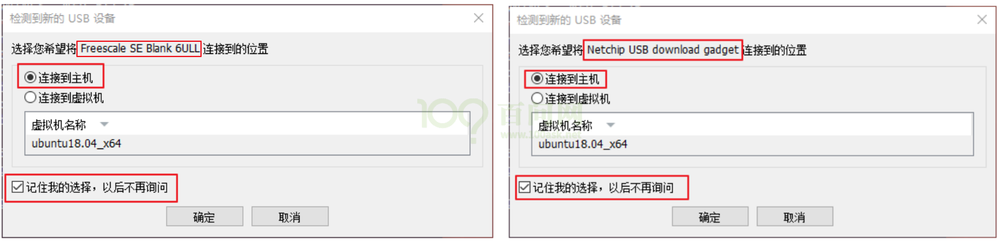

<a id="_Ref108621728"></a>图 7.7 连接USB到主机

要选择“连接到主机”，勾选“记住我的选择，以后不再询问”。也许你不慎点错了“连接到虚拟机”，那也没关系，在VMWARE的菜单中把“Freescale SE Blank 6ULL”或“Netchip USB download gadget”断开连接，如下图所示：


<a id="_Ref108621827"></a>图 7.8 断开USB在虚拟机上的连接

-   -   -   -   1.  USB驱动没有自动安装

通过USB下载或是烧写程序时，需要把开发板的OTG口用USB线连接到电脑。IMX6ULL开发板会通过这一个OTG口，模拟出2个USB设备(先后模拟，不是同时)：“Freescale SE Blank 6ULL”、“USB download gadget”。一般会自动安装好驱动程序，如果驱动程序没安装好，你可以去下载“zadig”来安装驱动。

-   **安装第1个驱动**：只要开发板设为USB启动(不要插SD/TF卡)并上电，电脑就会识别出“Freescale SE Blank 6ULL”设备，一般都会自动给它安装驱动程序。

如果没有自动安装好驱动程序(“设备已连接”绿灯没亮)，要使用zadig安装libusb-win32驱动。

先去[https://zadig.akeo.ie/](https://zadig.akeo.ie/)下载zadig并运行，然后参考图 7.9安装驱动程序：

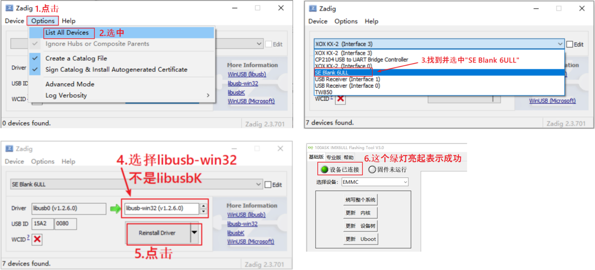

<a id="_Ref108621893"></a>图 7.9 zadig安装驱动

-   **安装第2个驱动**：当烧写工具的“设备已连接”绿灯亮起，就可以在“专业版”点击“运行”按钮，这时电脑会识别出“USB download gadget”设备，一般都会自动给它安装驱动程序，如图 7.10：

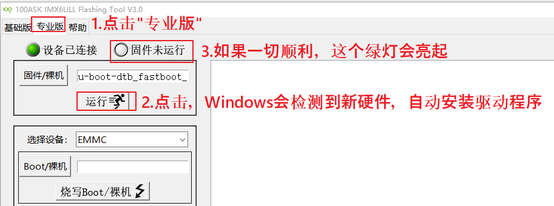

<a id="_Ref108621874"></a>图 7.10 烧写工具烧写程序

如果没有自动安装好驱动程序(“固件已运行”绿灯没亮)，先去[https://zadig.akeo.ie/](https://zadig.akeo.ie/)下载zadig并运行，然后参考图 7.11安装驱动程序：


<a id="_Ref108621936"></a>图 7.11 zadig安装驱动

如果一切正常，烧写工具的2个绿灯都会亮，如图 7.12：

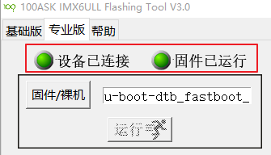

<a id="_Ref108621960"></a>图 7.12 驱动正常烧写工具提示

这就表示所有驱动都安装好了，可以重启开发板，使用后面2节的方法来烧写。

### 7.3.4 基础版烧写方法

要更新某个文件，就把它复制到烧写工具的files目录，比如zImage、100ask\_imx6ull-14x14.dtb。

**举例**：要更新内核，先把新的zImage覆盖files目录下的zImage，然后接线，上电，选择设备，点击“更新内核”即可。

板子复位或重新上电后，在APP里操作即可，一个图就可以列清楚所有步骤：

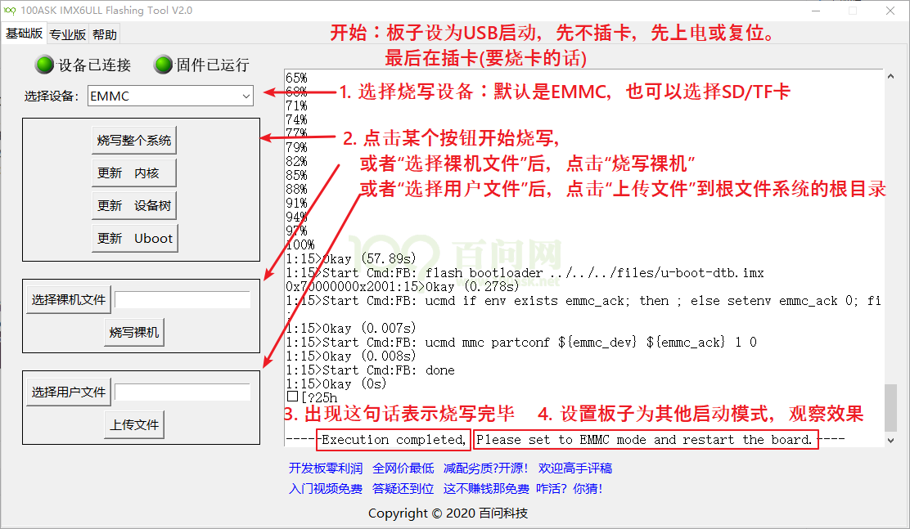

图 7.13 烧写工具烧基础版写程序示意

当开发板设为USB模式，上图的烧写工具中“设备已连接”的绿灯亮起，就可以通过按钮一键烧写了，各按钮作用如表 7‑3：

<a id="_Ref108622081"></a>表 7‑3 烧写工具按钮作用说明


| 按钮 | 作用 |
| --- | --- |
| 烧写整个系统 | “选择设备”为EMMC时，把emmc.img烧到EMMC上；“选择设备”为SD/TF时，把sdcard.img烧到SD/TF卡上；“选择设备”为NAND时，把rootfs.ubi烧到Nand Flash上；<br />并且会烧写对应的U-Boot，请看下面的“更新Uboot”按钮说明。 |
| 更新内核 | 把zImage上传到根文件系统的/boot目录(对于Nand，是直接烧到内核分区) |
| 更新设备树 | 把100ask_imx6ull-14x14.dtb上传到根文件系统的/boot目录(对于Nand，是直接烧到设备树分区) |
| 更新Uboot | 对于IMX6ULL Pro版：<br />“选择设备”为EMMC时，把u-boot-dtb.imx烧写到EMMC“选择设备”为SD/TF时，把u-boot-dtb.imx烧写到SD/TF卡<br />对于IMX6ULL mini nand版：<br />“选择设备”为NAND时，把u-boot-dtb_nand.imx烧写到Nand Flash“选择设备”为SD/TF时，把u-boot-dtb_nandsd.imx烧写到SD/TF卡 |
| 烧写裸机 | 把所选裸机文件，烧写到EMMC、SD/TF卡或Nand Flash |
| 上传文件 | 把所选用户文件，上传到根文件系统的/目录<br />对于imx6ull mini nand版，无法上传文件(只支持ext4文件系统，而它不是) |


### 7.3.5 专业版烧写方法

专业版的强大在于烧写文件时可以选择任意文件，上传文件时可以指定分区、分区格式、目标路径。用法也很简单，一图足以说明：

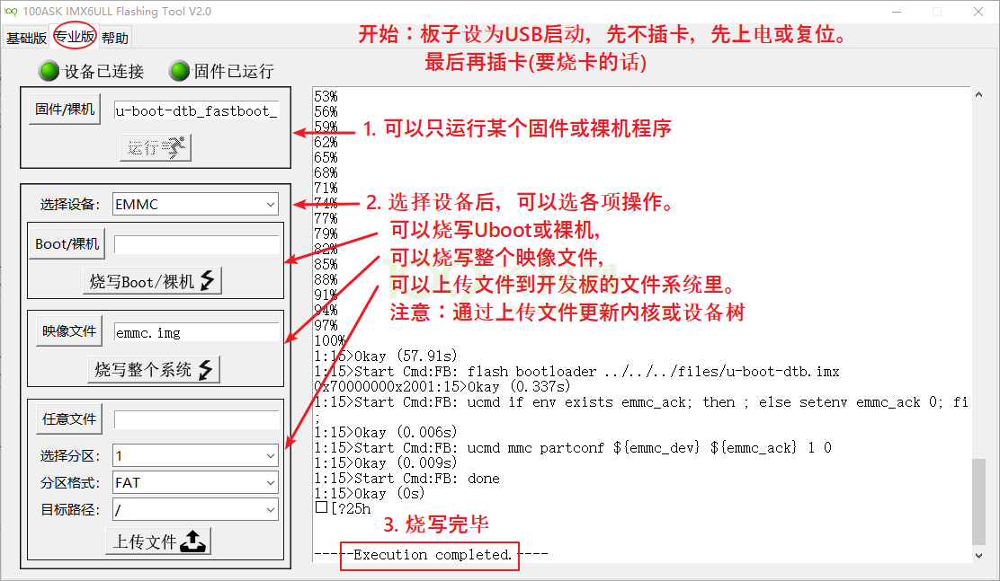

图 7.14 烧写工具专业版烧写示意

百问网把内核zImage、设备树放在第2个分区的boot目录里，这个分区是EXT4格式。那么可以使用专业版来更新内核、更新设备树。比如：

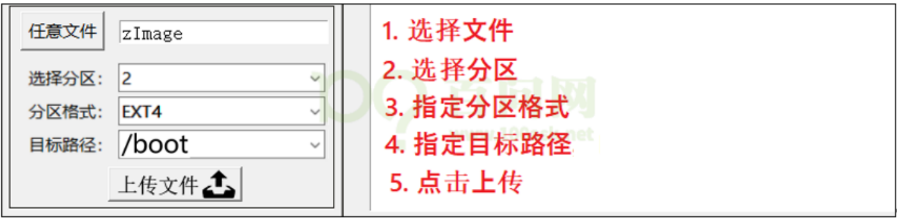

图 7.15 更新内核、设备树

几乎所有的开发板的第2个分区都是EXT4格式，我们可以上传文件到它的任意目录下，比如：

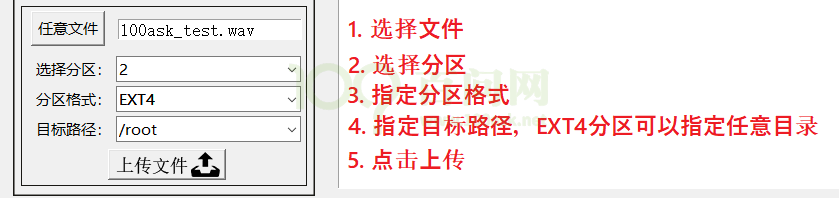

图 7.16 更新内核、设备树示意

<a id="_Toc197788599"></a>
## 7.4 在Ubuntu下使用USB来烧写

Windows下的100ask\_imx6ull\_flashing\_tool实际上只是一个GUI前端，它通过调用命令行工具uuu来烧写系统。

我们没有给Ubuntu编写GUI，只能使用命令行来操作；这个方法同样适用于Windows。

解压“100ask\_imx6ull烧写工具.tar.bz2”后，可得如下文件：

100ask\_imx6ull烧写工具

├── bin // 烧写用的程序

│   ├── uuu // Linux下的烧写工具

│   └── uuu.exe // Windows下的烧写工具

├── doc

│   └── UUU.pdf

├── files // 在files目录下保存要烧写的文件，文件名不能改，要更新请覆盖旧文件

│   ├── 100ask\_imx6ull-14x14.dtb // 设备树

│   ├── emmc.img // emmc映象文件

│   ├── led.imx // 裸板文件，示例

│   ├── sdcard.img // sd/tf卡映象文件

│   ├── u-boot-dtb.imx // u-boot

│   └── zImage // 内核

├── firmware // 固件，uuu要借助这个目录下的u-boot来烧写，这是我们特制的

│   └── u-boot-dtb\_fastboot\_100ask.imx

└── scripts/basic // 基础版脚本

├── emmc // 烧写emmc的脚本

│   ├── write\_all.clst // 烧写EMMC的整个映象文件：files/emmc.img

│   ├── write\_boot.clst // 烧写u-boot：files/u-boot-dtb.imx

│   ├── write\_dtb.clst // 烧写设备树：files/100ask\_imx6ull-14x14.dtb

│   └── write\_kernel.clst // 烧写内核：files/zImage

├── nand // 烧写nand的脚本，我们还没实现，我们的板子没有nand

└── sd // 烧写sd/tf卡的脚本

├── write\_all.clst // 烧写sd/tf卡的整个映象文件：files/sdcard.img

├── write\_boot.clst // 烧写u-boot：files/u-boot-dtb.imx

├── write\_dtb.clst // 烧写设备树：files/100ask\_imx6ull-14x14.dtb

└── write\_kernel.clst // 烧写内核：files/zImage

**注意事项**：

1.  用USB线连接电脑和开发板的USB OTG接口，USB串口可接可不接，建议接上观察效果。
2.  要烧写SD/TF卡，设置好USB启动方式后，必须先上电再插卡，绝对不能先插卡再上电。
3.  上电一次，只能点一次按钮烧写；要再次烧写，需要重新上电。
4.  在Ubuntu下执行命令时前面要加**sudo**。

使用uuu烧写的步骤很简单，简单地说就是：

1.  设置USB启动模式，
2.  接线，
3.  复位(或重新上电)，
4.  插卡(要用卡的话)，
5.  执行uuu命令。

如果要再次执行uuu命令来烧写，必须重来一次：

1.  拔卡(有的话)
2.  复位(或重新上电)
3.  插卡(要用卡的话)
4.  执行uuu命令。

uuu命令用法：在100ask\_imx6ull烧写工具目录下，执行命令：

```bash
# Ubuntu下才需要加sudo，Windows下不用加
sudo  ./bin/uuu    scripts目录下的某个脚本
```

比如要烧写EMMC的整个系统，即把files/emmc.img烧写到EMMC上，执行如下命令：

```bash
sudo  ./bin/uuu    scripts/basic/emmc/wirte_all.clst
```

对于裸机程序，因为裸机程序的名字各有不同，我们没有提供固定的脚本。命令解析如下：

```bash
# 借助u-boot把led.imx烧到EMMC
sudo  ./bin/uuu  -b  emmc  firmware/u-boot-dtb_fastboot_100ask.imx  files/led.imx
```

或

```bash
# 借助u-boot把led.imx烧到sd/tf卡
sudo  ./bin/uuu  -b   sd    firmware/u-boot-dtb_fastboot_100ask.imx   files/led.imx
```

<a id="_Toc197788600"></a>
## 7.5 更新根文件系统

并不需要单独去更新根文件系统，使用我们提供的Buildroot系统可以制作出emmc.img、sdcard.img，把它们烧写到EMMC或SD/TF卡上去就可以了。可以先把emmc.img或sdcard.img复制到烧工具的files目录，然后用烧写工具的“基础版”来更新系统。

<a id="_Toc197788601"></a><a id="_Ref109377695"></a><a id="_Ref109377698"></a>
## 7.6 使用板子的Linux系统来烧写

Linux系统功能强大，IMX6ULL启动Linux后，当然也可以烧写EMMC、SD/TF卡，当然就可以更新u-boot、内核、设备树等等。这种方法在开发驱动程序时经常使用。

### 7.6.1 烧写u-boot到EMMC或SD/TF卡

首先将编译好的uboot镜像文件下载到开发板，可以在Ubuntu执行以下命令：

```bash
adb  push   u-boot-dtb.imx   /root
```

如果要烧写EMMC，执行如下命令：

```bash
[root@100ask:~]# echo 0 > /sys/block/mmcblk1boot0/force_ro		//取消此分区的只读保护
[root@100ask:~]# dd if=u-boot-dtb.imx of=/dev/mmcblk1boot0 bs=512 seek=2 //实际烧写命令
[root@100ask:~]# echo 1 > /sys/block/mmcblk1boot0/force_ro		//打开此分区的只读保护
```

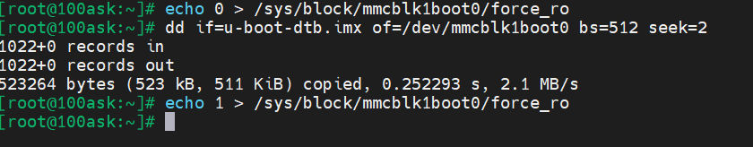

图 7.17 烧写emmc

烧写完成后，确保开发板设置为EMMC启动，可以观察到刚烧写的U-boot的启动信息。

如果要烧写SD/TF卡，执行如下命令：

```bash
[root@100ask:~]# dd if=u-boot-dtb.imx  of=/dev/mmcblk0 bs=512 seek=2
```

烧写完成后，确保开发板设置为SD/TF卡启动，可以观察到刚烧写的U-boot的启动信息。

### 7.6.2 更新内核或设备树

开发板使用的内核名为zImage，设备树名为100ask\_imx6ull-14x14.dtb。它们保存在开发板的/boot目录中。

更新它们很简单：只要替换/boot目录下的文件即可。在Ubuntu上执行如下命令：

```bash
adb  push   zImage   /boot
adb  push   100ask_imx6ull-14x14.dtb   /boot
```

<a id="_Ref111981569"></a><a id="_Ref109377669"></a><a id="_Ref109377674"></a><a id="_Toc197788602"></a><a id="_Ref111981568"></a><a id="_Hlk113027461"></a>
## 7.7 在Windows下烧写SD/TF卡

### 7.7.1 格式化SD/TF卡

-   -   -   -   1.  安装sd卡格式化工具

在网盘资料目录：\\02\_开发工具\\【Windows】SD卡格式化工具下双击运行图 7.18所示的安装程序：

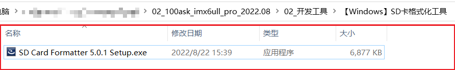

<a id="_Ref113019202"></a>图 7.18 SD卡格式化工具安装程序

安装步骤就省略了，都是傻瓜式的安装流程，下面开始格式化SD/TF卡。

-   -   -   -   1.  格式化SD卡

将SD卡插到读卡器中，再将读卡器插到电脑的任意USB口，建议不要使用USB扩展坞或类似的USB扩展工具，容易检测不到SD卡。

电脑成功检测到SD卡后，类似如图所示：

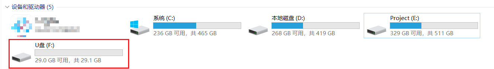

图 7.19 电脑读取到SD卡

不同的电脑对于U盘的读取显示可能不同，但是自己还是能很容易的区分它是不是插入的U盘或SD卡的。检测到之后就打开上一步安装好的SD卡格式化工具“SD Card Formatter”：

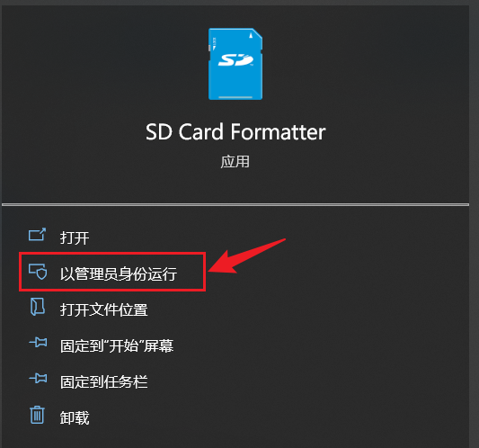

图 7.20 管理员身份运行程序

运行后可能会提示升级：

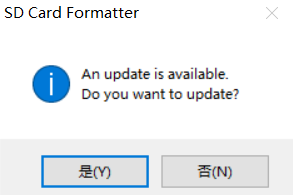

图 7.21 提示升级

选择否即可，然后就弹出了程序主体界面：

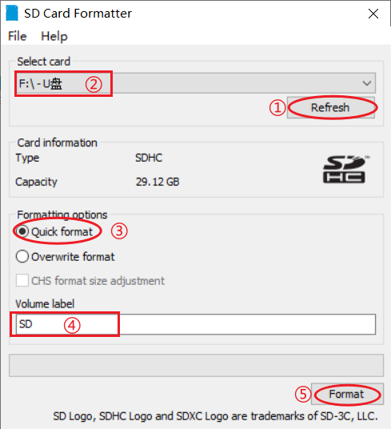

图 7.22 SD Card Formatter界面

根据图中步骤操即可：

1.  刷新SD卡/U盘；
2.  找到要格式化的目标盘；
3.  选择“Quick format”；
4.  自定义格式化后的名称，不能有中文！
5.  点击“Format”开始格式化；

随后会弹出警告，警示我们会将此盘的内容全部清除，是否继续等等，如图所示：

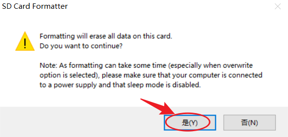

图 7.23 警示提示

点击“是”后开始格式化：

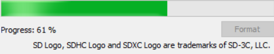

图 7.24 正在格式化

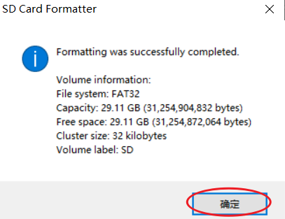

图 7.25 格式化成功

提示格式化成功后点击“确定”关掉提示，然后再关闭格式化工具，至此SD卡格式化完成，接下来开始烧写镜像到SD卡将其设置为开发板的启动盘。

### 7.7.2 烧写镜像到SD/TF卡

-   -   -   -   1.  安装SD卡IMG系统镜像烧写工具

在网盘资料：\\02\_开发工具\\【Windows】SD卡IMG系统镜像烧写工具目录下有如图 7.26所示的安装程序：

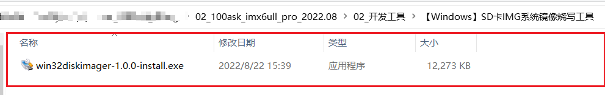

<a id="_Ref113020741"></a>图 7.26 SD镜像烧写工具安装程序

双击运行此安装程序即可，安装步骤很简单，同样也省略跳过，安装完成后打开该软件：

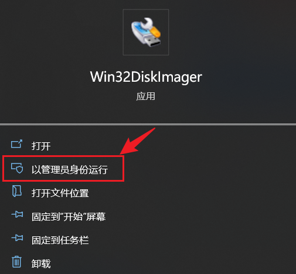

图 7.27 管理员身份运行win32diskimager

-   -   -   -   1.  烧录镜像到SD卡

在上一步已经打开了win32diskimager软件，图所示是其主界面：

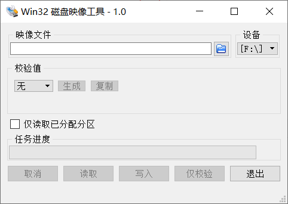

图 7.28 win32diskimager主界面

我们需要先选择要烧写的img映像，然后选择要烧录的目标SD卡：

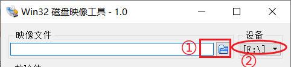

图 7.29 选择镜像和设备

百问网提供的默认SD镜像在网盘资料目录：

\\03\_开发板系统固件\\Sdcard

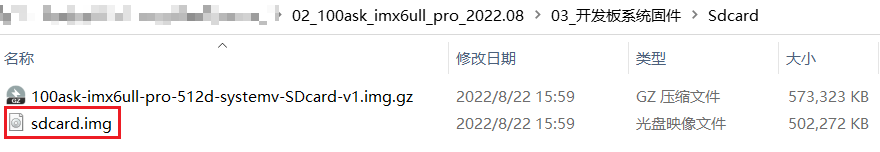

图 7.30 百问网官方提供SD镜像

这里就以此镜像为例，实际开发移植中就选择自己配置编译好的SD镜像：

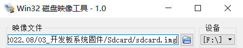

图 7.31 选择好镜像

选择好镜像和要烧写的目标SD卡后，就选择“写入”开始烧写：

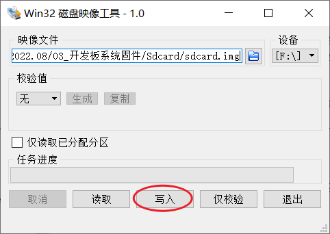

图 7.32 选择“写入”

随后会弹出如图所示的提示，选择“Yes”即可：

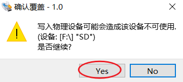

图 7.33

然后就等待烧写完成：

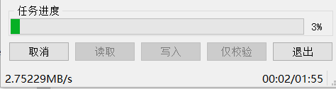

图 7.34 等待烧写完成

直到提示“写入成功”点击“OK”即完成烧写镜像到SD卡：

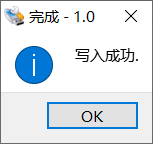

图 7.35 写入成功

烧写完成后会弹出下图的提示：

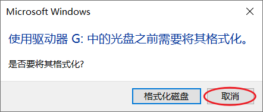

图 7.36 烧写镜像到SD卡后的提示

一律选择“取消”，千万不要“格式化磁盘”。

至此，镜像就成功的烧写到SD卡内了，接下来就是将SD卡插入到开发板上的SD/TF卡槽内，开发板的启动方式选择SD启动，再上电即可。

### 7.7.3 SD启动验证烧写结果


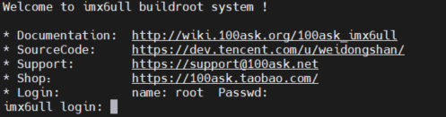

图 7.37 验证成功

<a id="_Toc197788603"></a>
## 7.8 在Ubuntu下烧写SD/TF卡

在Ubuntu下可以更精细地操作SD/TF卡：可以把sdcoard.img整个烧写到卡上，也可以单独烧写u-boot到卡上，甚至挂接卡上的文件系统后单独更新里面的文件。

### 7.8.1 识别SD/TF卡

首先TF卡插入读卡器，再把读卡器插入电脑。VMWare有时候会自动弹出对话框，选择“连接到虚拟机”即可；如果没有对话框，可以通过菜单“可移动设备”找到SD卡，点击“连接”。

然后使用dmesg命令获取设备挂载的设备节点，根据log信息获得该磁盘设备有两个分区，分别是 /dev/sdb1、/dev/sdb2。/dev/sdb表示整个卡。如图 7.38所示：

```bash
book@100ask: ~/100ask_imx6ull-sdk/Uboot-2017.03$ dmesg
```

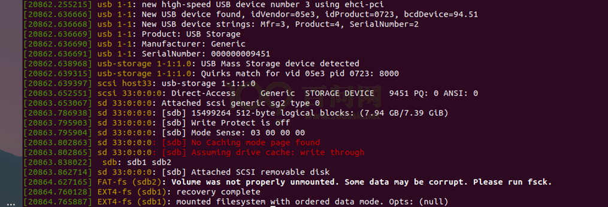

<a id="_Ref108622989"></a>图 7.38 获取sdb

### 7.8.2 烧写整个SD/TF卡

使用dd命令烧写sdcard.img镜像文件到 /dev/sdb设备：

```bash
sudo  dd if=sdcard.img  of=/dev/sdb
```

烧写成功后，把SD/TF卡插到开发板上，设置在SD/TF卡启动，上电即可看到启动信息。

### 7.8.3 烧写u-boot到SD/TF卡

可以只更新卡上的u-boot，使用dd命令烧写imx镜像文件到 /dev/sdb设备：

```bash
book@100ask: ~/100ask_imx6ull-sdk/uboot2017.03$ sudo  dd if=u-boot-dtb.imx of=/dev/sdb bs=1k seek=1 conv=fsync
```

**注意**：是烧写到1K偏移处。烧写成功后，把SD/TF卡插到开发板上，设置在SD/TF卡启动，上电即可看到u-boot信息。

### 7.8.4 更新SD/TF卡中的内核和设备树

对于曾经烧写过的SD/TF卡，上面已经有分区。使用vmware连接TF卡设备后，Ubuntu系统系统会自动挂载tf卡内的分区文件系统，如图 7.39所示，本示例的TF卡第二个分区被挂载到了**/media/book/fa14c024-8350-4efb-bf5b-14b72728ee32 (每个人的挂载目录可能会不一样)**目录下，此时可以进入此目录进行操作。

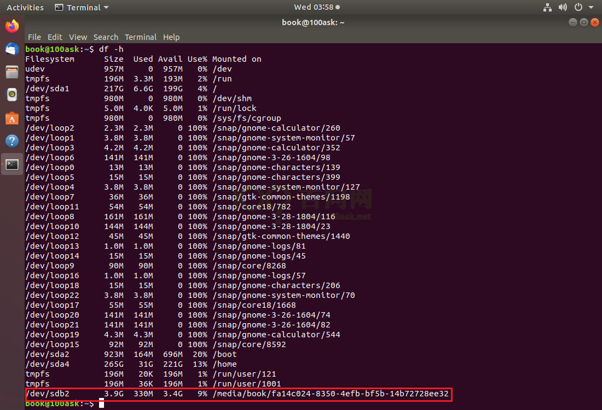

<a id="_Ref108623121"></a>图 7.39 SD卡已有分区

我们进入这个已经挂载的TF卡第二个分区目录，通过ls命令查看一下目录下都有哪些文件：

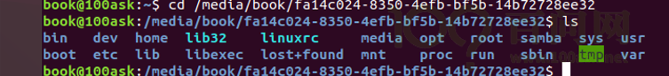

图 7.40 查看分区文件

之后我们需要拷贝之前编译好的zImage文件到TF卡的boot目录下，替换已有的，执行步骤如下：

1.  进入**boot**目录
2.  使用**sudo**命令拷贝之前编译好的目录到TF卡文件系统的 boot 目录下。此时会提示你输入Ubuntu用户密码，输入后确认，此时开始拷贝文件。
3.  拷贝完成后使用 **sync** 命令同步数据缓存，
4.  最后切换到另一个目录，使用**sudo umount**命令卸载TF

最后就可以取出TF卡，插入开发板等待启动系统。

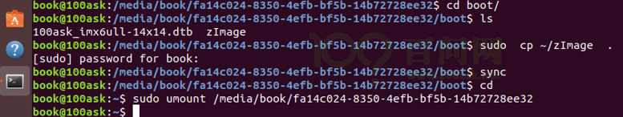

图 7.41 卸载SD卡

<a id="_Toc197788604"></a>
## 7.9 老方法：使用mfgtool烧写整个系统到EMMC上

解压缩网盘配套资料目录下

**02\_100ask\_imx6ull\_pro\_2022.08\\03\_开发板系统固件\\Emmc\\100ask\_imx6ull-mfgtools.zip**

到任意文件夹。然后就可以开始烧写了，步骤如下：

1.  设置开发板为USB启动，接线，上电，如图 7.42所示，

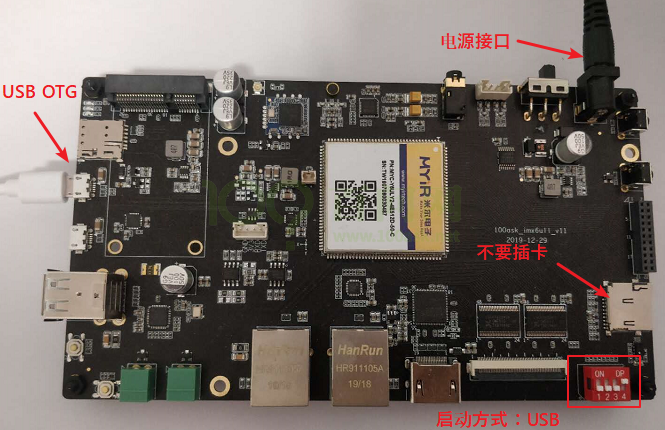

<a id="_Ref108623643"></a>图 7.42 接线

**注意**：设置为USB启动时，不要接TF卡；图 7.42中USB OTG线是连接到电脑的。

**注意**：USB OTG线不要接入USB扩展坞或扩展设备的接口，要直接接入电脑的USB接口！

1.  双击运行mfgtools。进入解压后的100ask\_imx6ull-mfgtools文件夹下，双击**buildroot-image-100ask\_100ask-ddr512m-emmc4g.vbs**打开烧写程序，烧写过程中保持usb连接。

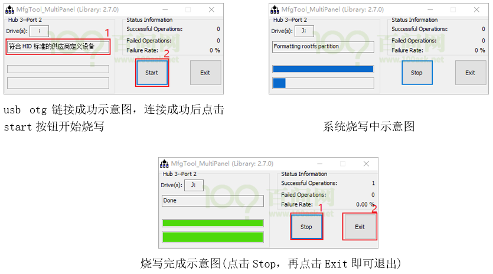

<a id="_Ref108623649"></a>图 7.43 mfgtools烧写

1.  设置开发板启动方式为Emmc，重新上电即可观察到效果(启动方式设置在开发板背面印有丝印说明)。

操作视频链接：https://www.bilibili.com/video/BV1kk4y117Tu

对于应用开发基础，有录播、直播两部分教程。录播视频的配套文档，就是本编文档，写得比较详细。直播视频对应的文档，并没有整理成word，而是放在GIT仓库里。录播视频、直播视频配套的源码，都放在GIT仓库里。

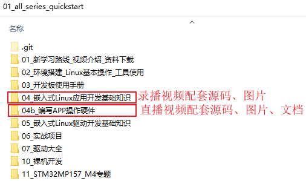

图 7.44 资料git仓库目录
