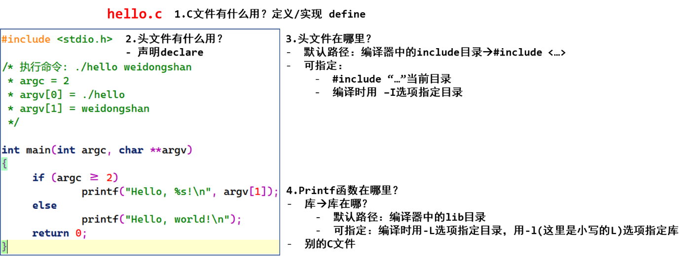

<a id="_Toc197788606"></a>

<a id="_Toc197788607"></a>
## 1.1 交叉编译hello.c

使用GIT下载所有源码后，本节源码位于如下目录：

01\_all\_series\_quickstart\\

04\_嵌入式Linux应用开发基础知识\\source\\01\_hello

hello.c的源码如下：

```
01 #include <stdio.h>
02
03 /* 执行命令: ./hello weidongshan
04  * argc = 2
05  * argv[0] = ./hello
06  * argv[1] = weidongshan
07  */
08
09 int main(int argc, char **argv)
10 {
11      if (argc >= 2)
12              printf("Hello, %s!\n", argv[1]);
13      else
14              printf("Hello, world!\n");
15      return 0;
16 }
```

在Ubuntu中可以执行以下命令编译、执行：

```bash
gcc -o hello hello.c
./hello
Hello, world!
./hello weidongshan
Hello, weidongshan!
```

上述命令编译得到的可执行程序hello可以在Ubuntu中运行，但是如果把它放到ARM板子上去，它是无法执行的。因为它是使用gcc编译的，是给PC机编译的，里面的机器指令是x86的。

<a id="_Hlk26429333"></a>我们要想给ARM板编译出hello程序，需要使用交叉编译工具链，比如：

```bash
arm-buildroot-linux-gnueabihf-gcc -o hello hello.c
```

这样编译出来的hello程序才可以在ARM板子上运行。

<a id="_Toc197788608"></a>
## 1.2 请回答这几个问题



图 1.1 hello.c中的几个问题

1.  怎么确定交叉编译器中头文件的默认路径？

进入交叉编译器的目录里，执行：find -name “stdio.h”，它位于一个“include”目录下的根目录里。这个“include”目录，就是要找的路径。

1.  怎么自己指定头文件目录？

编译时，加上“-I &lt;头文件目录&gt;”这样的选项。

1.  怎么确定交叉编译器中库文件的默认路径？

进入交叉编译器的目录里，执行：find -name lib，可以得到xxxx/lib、xxxx/usr/lib，一般来说这2个目录就是要找的路径。如果有很多类似的lib，进去看看，有很多so文件的目录一般就是要找的路径。

1.  怎么自己指定库文件目录、指定要用的库文件？

编译时，加上“-L &lt;库文件目录&gt;”这样的选项，用来指定库目录；

编译时，加上“-labc”这样的选项，用来指定库文件libabc.so。
