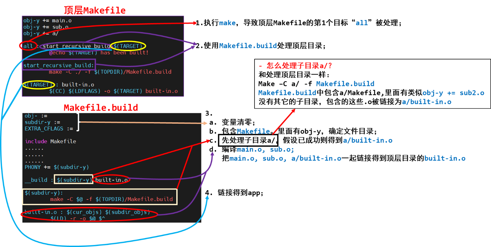

<a id="_Toc197788619"></a>

在Linux中使用make命令来编译程序，特别是大程序；而make命令所执行的动作依赖于Makefile文件。最简单的Makefile文件如下：

```bash
hello: hello.c
gcc -o hello hello.c
clean:
rm -f  hello
```

将上述4行存为Makefile文件(注意必须以Tab键缩进第2、4行，不能以空格键缩进)，放入01\_hello目录下，然后直接执行make命令即可编译程序，执行“make clean”即可清除编译出来的结果。

make命令根据文件更新的时间戳来决定哪些文件需要重新编译，这使得可以避免编译已经编译过的、没有变化的程序，可以大大提高编译效率。

要想完整地了解Makefile的规则，请参考《GNU Make 使用手册》，以下仅粗略介绍。

<a id="_Toc197788620"></a>
## 3.1 配套视频内容大纲

### 3.1.1 Makefile规则与示例

参考文档：[https://www.gnu.org/software/make/manual/make.html](https://www.gnu.org/software/make/manual/make.html)

-   -   -   -   1.  为什么需要Makefile

怎么高效地编译程序？想达到什么样的效果？请参考Visual Studio：修改源文件或头文件，只需要重新编译牵涉到的文件，就可以重新生成APP

-   -   -   -   1.  Makefile其实挺简单

一个简单的Makefile文件包含一系列的“规则”，其样式如下：

```
目标(target)…: 依赖(prerequiries)…
<tab>命令(command)
```

如果“依赖文件”比“目标文件”更加新，那么执行“命令”来重新生成“目标文件”。

命令被执行的2个条件：依赖文件比目标文件新，或是 目标文件还没生成。

-   -   -   -   1.  先介绍Makefile的2个函数
-   $(foreach var,list,text)

简单地说，就是 for each var in list, change it to text。

对list中的每一个元素，取出来赋给var，然后把var改为text所描述的形式。

例子：

```
objs := a.o b.o
dep_files := $(foreach  f,  $(objs),  .$(f).d)  // 最终 dep_files := .a.o.d .b.o.d
```

-   $(wildcard pattern)

pattern所列出的文件是否存在，把存在的文件都列出来。

例子：

```
src_files := $( wildcard  *.c)  // 最终 src_files中列出了当前目录下的所有.c文件
```

-   -   -   -   1.  一步一步完善Makefile

1.  第1个Makefile，简单粗暴，效率低：

```
test : main.c sub.c sub.h
gcc -o test main.c sub.c
```

1.  第2个Makefile，效率高，相似规则太多太啰嗦，不支持检测头文件：

```
test : main.o sub.o
gcc -o test main.o sub.o
main.o : main.c
gcc -c -o main.o  main.c
sub.o : sub.c
gcc -c -o sub.o  sub.c
clean:
rm *.o test -f
```

1.  第3个Makefile，效率高，精炼，不支持检测头文件：

```
test : main.o sub.o
gcc -o test main.o sub.o
%.o : %.c
gcc -c -o $@  $<
clean:
rm *.o test -f
```

1.  第4个Makefile，效率高，精炼，支持检测头文件(但是需要手工添加头文件规则)：

```
test : main.o sub.o
gcc -o test main.o sub.o
%.o : %.c
gcc -c -o $@  $<
sub.o : sub.h
clean:
rm *.o test -f
```

1.  第5个Makefile，效率高，精炼，支持自动检测头文件：

```
objs := main.o sub.o
test : $(objs)
	gcc -o test $^
# 需要判断是否存在依赖文件
# .main.o.d .sub.o.d
dep_files := $(foreach f, $(objs), .$(f).d)
dep_files := $(wildcard $(dep_files))
# 把依赖文件包含进来
ifneq ($(dep_files),)
  include $(dep_files)
endif
%.o : %.c
	gcc -Wp,-MD,.$@.d  -c -o $@  $<

clean:
	rm *.o test -f
distclean:
	rm  $(dep_files) *.o test -f
```

### 3.1.2 通用Makefile的使用

我参考Linux内核的Makefile编写了一个通用的Makefile，它可以用来编译应用程序：

1.  支持多个目录、多层目录、多个文件；
2.  支持给所有文件设置编译选项；
3.  支持给某个目录设置编译选项；
4.  支持给某个文件单独设置编译选项；
5.  简单、好用。

使用git下载本教程的文档后，下列目录中就有说明和示例：

01\_all\_series\_quickstart\\

04\_嵌入式Linux应用开发基础知识\\source\\05\_general\_Makefile

### 3.1.3 通用Makefile的解析

-   make命令的使用：

执行make命令时，它会去当前目录下查找名为“Makefile”的文件，并根据它的指示去执行操作，生成第一个目标。

我们可以使用“-f”选项指定文件，不再使用名为“Makefile”的文件，比如：

```bash
make  -f  Makefile.build
```

我们可以使用“-C”选项指定目录，切换到其他目录里去，比如：

```bash
make -C  a/  -f  Makefile.build
```

我们可以指定目标，不再默认生成第一个目标：

```bash
make -C  a/  -f  Makefile.build   other_target
```

-   即时变量、延时变量：

变量的定义语法形式如下：

```
A  =  xxx    // 延时变量
B  ?= xxx    // 延时变量，只有第一次定义时赋值才成功；如果曾定义过，此赋值无效
C  := xxx    // 立即变量
D  += yyy    // 如果D在前面是延时变量，那么现在它还是延时变量；
// 如果D在前面是立即变量，那么现在它还是立即变量
```

在GNU make中对变量的赋值有两种方式：延时变量、立即变量。上面语句中，变量A是延时变量，它的值在使用时才展开、才确定。比如：

```
A  =  $@
test:
	@echo $A
```

上述Makefile中，变量A的值在执行时才确定，它等于test，是延时变量。如果使用“A := $@”，这是立即变量，这时$@为空，所以A的值就是空。

-   变量的导出(export)：

在编译程序时，我们会不断地使用“make -C dir”切换到其他目录，执行其他目录里的Makefile。如果想让某个变量的值在所有目录中都可见，要把它export出来。

比如“CC = $(CROSS\_COMPILE)gcc”，这个CC变量表示编译器，在整个过程中都是一样的。定义它之后，要使用“export CC”把它导出来。

-   Makefile中可以使用shell命令：

比如：

```
TOPDIR := $(shell pwd)
```

这是个立即变量，TOPDIR等于shell命令pwd的结果。

-   在Makefile中怎么放置第1个目标：

执行make命令时如果不指定目标，那么它默认是去生成第1个目标。

所以“第1个目标”，位置很重要。有时候不太方便把第1个目标完整地放在文件前面，这时可以在文件的前面直接放置目标，在后面再完善它的依赖与命令。比如：

```
First_target:   // 这句话放在前面
．．．．        // 其他代码，比如include其他文件得到后面的xxx变量
First_target : $(xxx)   $(yyy)   // 在文件的后面再来完善
	command
```

-   假想目标：

我们的Makefile中有这样的目标：

```
clean:
	rm -f $(shell find -name "*.o")
	rm -f $(TARGET)
```

如果当前目录下恰好有名为“clean”的文件，那么执行“make clean”时它就不会执行那些删除命令。这时我们需要把“clean”这个目标，设置为“假想目标”，这样可以确保执行“make clean”时那些删除命令肯定可以得到执行。

使用下面的语句把“clean”设置为假想目标：

```
.PHONY : clean
```

-   常用的函数：

1.  $(foreach var,list,text)

简单地说，就是for each var in list, change it to text。对list中的每一个元素，取出来赋给var，然后把var改为text所描述的形式。

例子：

```
objs := a.o b.o
dep_files := $(foreach  f,  $(objs),  .$(f).d)  // 最终 dep_files := .a.o.d .b.o.d
```

1.  $(wildcard pattern)

pattern所列出的文件是否存在，把存在的文件都列出来。

例子：

```
src_files := $( wildcard  *.c)  // 最终 src_files中列出了当前目录下的所有.c文件
```

1.  $(filter pattern...,text)

把text中符合pattern格式的内容，filter(过滤)出来、留下来。

例子：

```
obj-y := a.o b.o c/ d/
DIR :=  $(filter  %/,  $(obj-y))   //结果为：c/ d/
```

1.  $(filter-out pattern...,text)

把text中符合pattern格式的内容，filter-out(过滤)出来、扔掉。

例子：

```
obj-y := a.o b.o c/ d/
DIR :=  $(filter-out  %/,  $(obj-y))   //结果为：a.o  b.o
```

1.  $(patsubst pattern,replacement,text)

寻找\`text’中符合格式\`pattern’的字，用\`replacement’替换它们。\`pattern’和\`replacement’中可以使用通配符。

比如：

```
subdir-y    :=  c/  d/
subdir-y	:= $(patsubst  %/,  %,  $(subdir-y))   // 结果为：c  d
```

### 3.1.4 通用Makefile的设计思想

-   在Makefile文件中确定要编译的文件、目录，比如：

```
obj-y += main.o
obj-y += a/
```

“Makefile”文件总是被“Makefile.build”包含的。

-   在Makefile.build中设置编译规则，有3条编译规则：

1.  怎么编译子目录？ 进入子目录编译：

```
$(subdir-y):
	make -C $@ -f $(TOPDIR)/Makefile.build
```

1.  怎么编译当前目录中的文件？

```
%.o : %.c
	$(CC) $(CFLAGS) $(EXTRA_CFLAGS) $(CFLAGS_$@) -Wp,-MD,$(dep_file) -c -o $@ $<
```

1.  当前目录下的.o和子目录下的built-in.o要打包起来：

```
built-in.o : $(cur_objs) $(subdir_objs)
	$(LD) -r -o $@ $^
```

-   顶层Makefile中把顶层目录的built-in.o链接成APP：

```
$(TARGET) : built-in.o
	$(CC) $(LDFLAGS) -o $(TARGET) built-in.o
```

-   情景演绎



图 3.1 Makefile情景演绎

<a id="_Toc197788621"></a>
## 3.2 Makefile规则

一个简单的Makefile文件包含一系列的“规则”，其样式如下：

```
目标(target)…: 依赖(prerequiries)…
<tab>命令(command)
```

目标(target)通常是要生成的文件的名称，可以是可执行文件或OBJ文件，也可以是一个执行的动作名称，诸如\`clean’。

依赖是用来产生目标的材料(比如源文件)，一个目标经常有几个依赖。

命令是生成目标时执行的动作，一个规则可以含有几个命令，每个命令占一行。

**注意**：每个命令行前面必须是一个Tab字符，即命令行第一个字符是Tab。这是容易出错的地方。

通常，如果一个依赖发生了变化，就需要规则调用命令以更新或创建目标。但是并非所有的目标都有依赖，例如，目标“clean”的作用是清除文件，它没有依赖。

规则一般是用于解释怎样和何时重建目标。make首先调用命令处理依赖，进而才能创建或更新目标。当然，一个规则也可以是用于解释怎样和何时执行一个动作，即打印提示信息。

一个Makefile文件可以包含规则以外的其他文本，但一个简单的Makefile文件仅仅需要包含规则。虽然真正的规则比这里展示的例子复杂，但格式是完全一样的。

对于上面的Makefile，执行“make”命令时，仅当hello.c文件比hello文件新，才会执行命令“arm-linux-gcc –o hello hello.c”生成可执行文件hello；如果还没有hello文件，这个命令也会执行。

运行“make clean”时，由于目标clean没有依赖，它的命令“rm -f hello”将被强制执行。

<a id="_Toc197788622"></a>
## 3.3 Makefile文件里的赋值方法

变量的定义语法形式如下：

```
immediate = deferred
immediate ?= deferred
immediate := immediate
immediate += deferred or immediate
define immediate
deferred
endef
```

在GNU make中对变量的赋值有两种方式：延时变量、立即变量。区别在于它们的定义方式和扩展时的方式不同，前者在这个变量使用时才扩展开，意即当真正使用时这个变量的值才确定；后者在定义时它的值就已经确定了。使用\`=’，\`?=’定义或使用define指令定义的变量是延时变量；使用\`:=’定义的变量是立即变量。需要注意的一点是，\`?=’仅仅在变量还没有定义的情况下有效，即\`?=’被用来定义第一次出现的延时变量。

对于附加操作符\`+=’，右边变量如果在前面使用（:=）定义为立即变量则它也是立即变量，否则均为延时变量。

<a id="_Toc197788623"></a>
## 3.4 Makefile常用函数

函数调用的格式如下：

```
$(function arguments)
```

这里\`function’是函数名，\`arguments’是该函数的参数。参数和函数名之间是用空格或Tab隔开，如果有多个参数，它们之间用逗号隔开。这些空格和逗号不是参数值的一部分。内核的Makefile中用到大量的函数，现在介绍一些常用的。

### 3.4.1 字符串替换和分析函数

-   -   -   -   1.  $(subst from,to,text)

在文本\`text’中使用\`to’替换每一处\`from’。

比如：$(subst ee,EE,feet on the street)

结果为‘fEEt on the strEEt’。

-   -   -   -   1.  $(patsubst pattern,replacement,text)

寻找\`text’中符合格式\`pattern’的字，用\`replacement’替换它们。\`pattern’和\`replacement’中可以使用通配符。

比如：$(patsubst %.c,%.o,x.c.c bar.c)

结果为：\`x.c.o bar.o’。

-   -   -   -   1.  $(strip string)

去掉前导和结尾空格，并将中间的多个空格压缩为单个空格。

比如：$(strip a b c )

结果为\`a b c’。

-   -   -   -   1.  $(findstring find,in)

在字符串\`in’中搜寻\`find’，如果找到，则返回值是\`find’，否则返回值为空。

比如：

```bash
$(findstring a,a b c)
$(findstring a,b c)
```

将分别产生值\`a’和\`’(空字符串)。

-   -   -   -   1.  $(filter pattern...,text)

返回在\`text’中由空格隔开且匹配格式\`pattern...’的字，去除不符合格式\`pattern...’的字。

比如：$(filter %.c %.s,foo.c bar.c baz.s ugh.h)

结果为\`foo.c bar.c baz.s’。

-   -   -   -   1.  $(filter-out pattern...,text)

返回在\`text’中由空格隔开且不匹配格式\`pattern...’的字，去除符合格式\`pattern...’的字。它是函数filter的反函数。

比如：$(filter %.c %.s,foo.c bar.c baz.s ugh.h)

结果为\`ugh.h’。

-   -   -   -   1.  $(sort list)

将‘list’中的字按字母顺序排序，并去掉重复的字。输出由单个空格隔开的字的列表。

比如：$(sort foo bar lose)

返回值是‘bar foo lose’。

### 3.4.2 文件名函数

-   -   -   -   1.  $(dir names...)

抽取‘names...’中每一个文件名的路径部分，文件名的路径部分包括从文件名的首字符到最后一个斜杠(含斜杠)之前的一切字符。

比如：$(dir src/foo.c hacks)

结果为‘src/ ./’。

-   -   -   -   1.  $(notdir names...)

抽取‘names...’中每一个文件名中除路径部分外一切字符（真正的文件名）。

比如：$(notdir src/foo.c hacks)

结果为‘foo.c hacks’。

-   -   -   -   1.  $(suffix names...)

抽取‘names...’中每一个文件名的后缀。

比如：$(suffix src/foo.c src-1.0/bar.c hacks)

结果为‘.c .c’。

-   -   -   -   1.  $(basename names...)

抽取‘names...’中每一个文件名中除后缀外一切字符。

比如：$(basename src/foo.c src-1.0/bar hacks)

结果为‘src/foo src-1.0/bar hacks’。

-   -   -   -   1.  $(addsuffix suffix,names...)

参数‘names...’是一系列的文件名，文件名之间用空格隔开；suffix是一个后缀名。将suffix(后缀)的值附加在每一个独立文件名的后面，完成后将文件名串联起来，它们之间用单个空格隔开。

比如：$(addsuffix .c,foo bar)

结果为‘foo.c bar.c’。

-   -   -   -   1.  $(addprefix prefix,names...)

参数‘names’是一系列的文件名，文件名之间用空格隔开；prefix是一个前缀名。将preffix(前缀)的值附加在每一个独立文件名的前面，完成后将文件名串联起来，它们之间用单个空格隔开。

比如：$(addprefix src/,foo bar)

结果为‘src/foo src/bar’。

-   -   -   -   1.  $(wildcard pattern)

参数‘pattern’是一个文件名格式，包含有通配符(通配符和shell中的用法一样)。函数wildcard的结果是一列和格式匹配的且真实存在的文件的名称，文件名之间用一个空格隔开。

比如若当前目录下有文件1.c、2.c、1.h、2.h，则：

```
c_src := $(wildcard *.c)
```

结果为‘1.c 2.c’。

### 3.4.3 其他函数

-   -   -   -   1.  $(foreach var,list,text)

前两个参数，‘var’和‘list’将首先扩展，注意最后一个参数‘text’此时不扩展；接着，‘list’扩展所得的每个字，都赋给‘var’变量；然后‘text’引用该变量进行扩展，因此‘text’每次扩展都不相同。

函数的结果是由空格隔开的‘text’ 在‘list’中多次扩展后，得到的新‘list’，就是说：‘text’多次扩展的字串联起来，字与字之间由空格隔开，如此就产生了函数foreach的返回值。

下面是一个简单的例子，将变量‘files’的值设置为 ‘dirs’中的所有目录下的所有文件的列表：

```
dirs := a b c d
files := $(foreach dir,$(dirs),$(wildcard $(dir)/*))
```

这里‘text’是‘$(wildcard $(dir)/\*)’，它的扩展过程如下：

1.  第一个赋给变量dir的值是\`a’，扩展结果为‘$(wildcard a/\*)’；
2.  第二个赋给变量dir的值是\`b’，扩展结果为‘$(wildcard b/\*)’；
3.  第三个赋给变量dir的值是\`c’，扩展结果为‘$(wildcard c/\*)’；
4.  如此继续扩展。

这个例子和下面的例有共同的结果：

```
files := $(wildcard a/* b/* c/* d/*)
```

-   -   -   -   1.  $(if condition,then-part\[,else-part\])

首先把第一个参数‘condition’的前导空格、结尾空格去掉，然后扩展。如果扩展为非空字符串，则条件‘condition’为‘真’；如果扩展为空字符串，则条件‘condition’为‘假’。

如果条件‘condition’为‘真’,那么计算第二个参数‘then-part’的值，并将该值作为整个函数if的值。

如果条件‘condition’为‘假’,并且第三个参数存在，则计算第三个参数‘else-part’的值，并将该值作为整个函数if的值；如果第三个参数不存在，函数if将什么也不计算，返回空值。

**注意：**仅能计算‘then-part’和‘else-part’二者之一，不能同时计算。这样有可能产生副作用（例如函数shell的调用）。

-   -   -   -   1.  $(origin variable)

变量‘variable’是一个查询变量的名称，不是对该变量的引用。所以，不能采用‘$’和圆括号的格式书写该变量，当然，如果需要使用非常量的文件名，可以在文件名中使用变量引用。

函数origin的结果是一个字符串，该字符串变量是这样定义的：

```
‘undefined'				：如果变量‘variable’从没有定义；
‘default'				：变量‘variable’是缺省定义；
‘environment'			：变量‘variable’作为环境变量定义，选项‘-e’没有打开；
‘environment override'	：变量‘variable’作为环境变量定义，选项‘-e’已打开；
‘file' 					：变量‘variable’在Makefile中定义；
‘command line' 			：变量‘variable’在命令行中定义；
‘override' 				：变量‘variable’在Makefile中用override指令定义；
‘automatic' 			：变量‘variable’是自动变量
```

-   -   -   -   1.  $(shell command arguments)

函数shell是make与外部环境的通讯工具。函数shell的执行结果和在控制台上执行‘command arguments’的结果相似。不过如果‘command arguments’的结果含有换行符（和回车符），则在函数shell的返回结果中将把它们处理为单个空格，若返回结果最后是换行符（和回车符）则被去掉。

比如当前目录下有文件1.c、2.c、1.h、2.h，则：

```
c_src := $(shell ls *.c)
```

结果为‘1.c 2.c’。

《Makefile介绍》这小节可以在阅读内核、bootloader、应用程序的Makefile文件时，作为手册来查询。下面以options程序的Makefile作为例子进行演示，Makefile的内容如下：

```
File: Makefile
01 src  := $(shell ls *.c)
02 objs := $(patsubst %.c,%.o,$(src))
03
04 test: $(objs)
05 		gcc -o $@ $^
06
07 %.o:%.c
08		gcc -c -o $@ $<
09
10 clean:
11		rm -f test *.o
```

上述Makefile中$@、$^、$&lt;称为自动变量。$@表示规则的目标文件名；$^表示所有依赖的名字，名字之间用空格隔开；$&lt;表示第一个依赖的文件名。‘%’是通配符，它和一个字符串中任意个数的字符相匹配。

options目录下所有的文件为main.c，Makefile，sub.c和sub.h，下面一行行地分析：

1.  第1行src变量的值为‘main.c sub.c’。
2.  第2行objs变量的值为‘main.o sub.o’，是src变量经过patsubst函数处理后得到的。
3.  第4行实际上就是：

```
test : main.o sub.o
```

目标test的依赖有二：main.o和sub.o。开始时这两个文件还没有生成，在执行生成test的命令之前先将main.o、sub.o作为目标查找到合适的规则，以生成main.o、sub.o。

1.  第7、8行就是用来生成main.o、sub.o的规则：

对于main.o这个规则就是：

```
main.o:main.c
	gcc -c -o main.o main.c
```

对于sub.o这个规则就是：

```
sub.o:sub.c
	gcc -c -o sub.o sub.c
```

这样，test的依赖main.o和sub.o就生成了。

1.  第5行的命令在生成main.o、sub.o后得以执行。

在options目录下第一次执行make命令可以看到如下信息：

```
gcc -c -o main.o main.c
gcc -c -o sub.o sub.c
gcc -o test main.o sub.o
```

然后修改sub.c文件，再次执行make命令，可以看到如下信息：

```
gcc -c -o sub.o sub.c
gcc -o test main.o sub.o
```

可见，只编译了更新过的sub.c文件，对main.c文件不用再次编译，节省了编译的时间。
