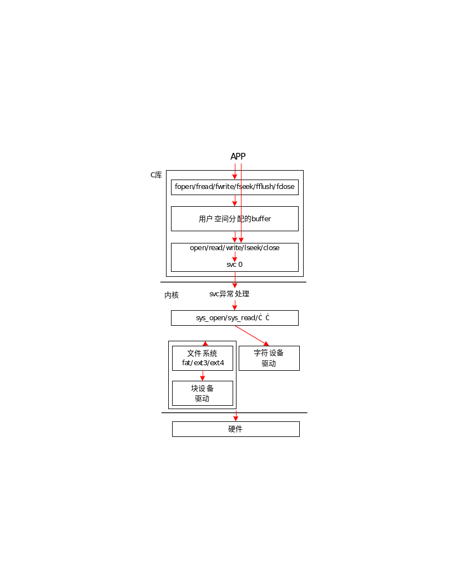
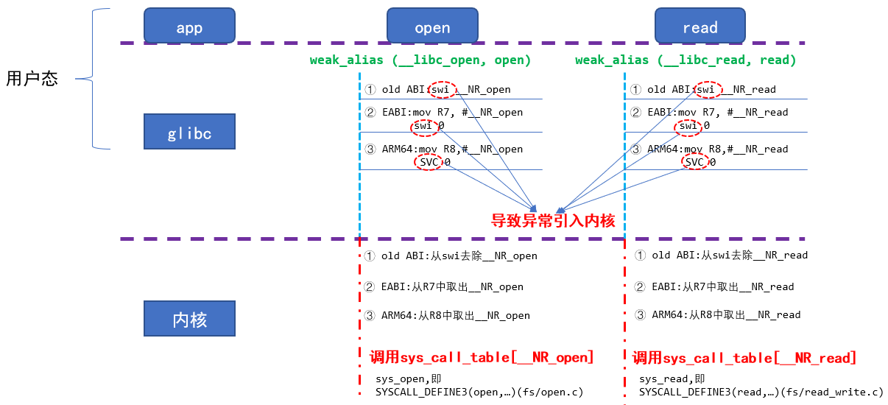
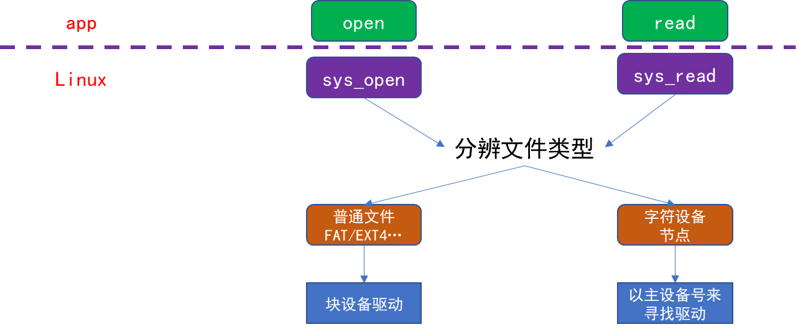
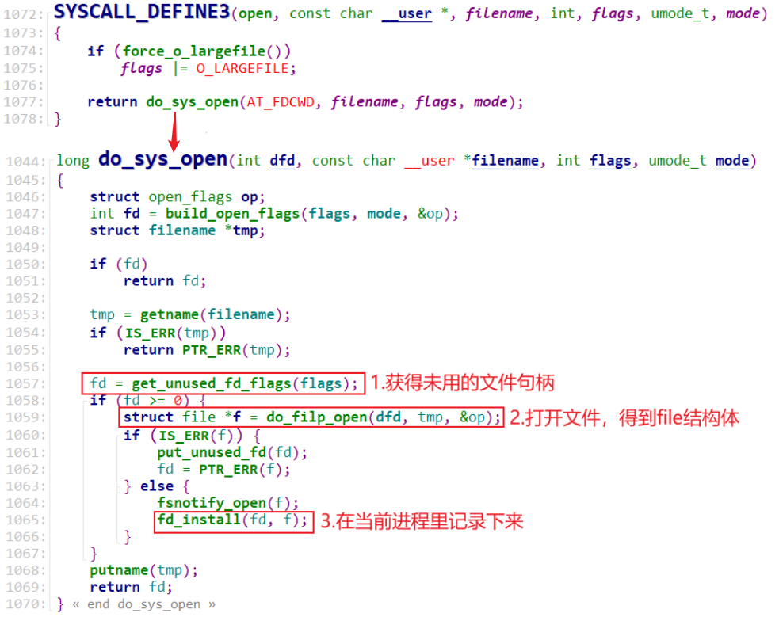
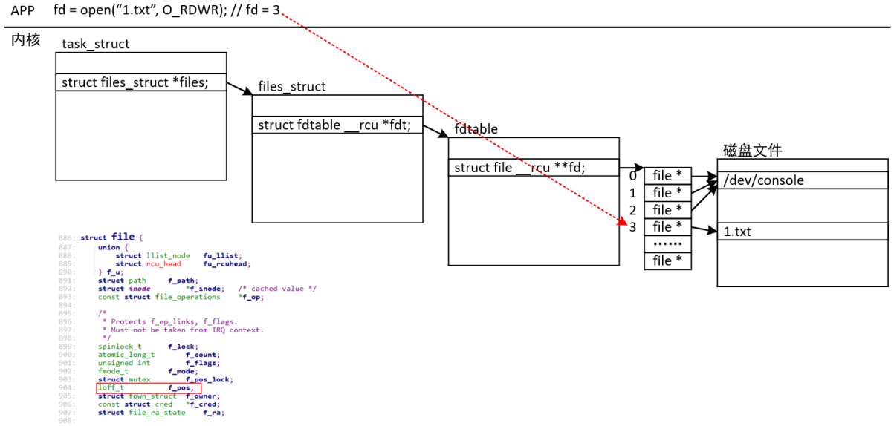
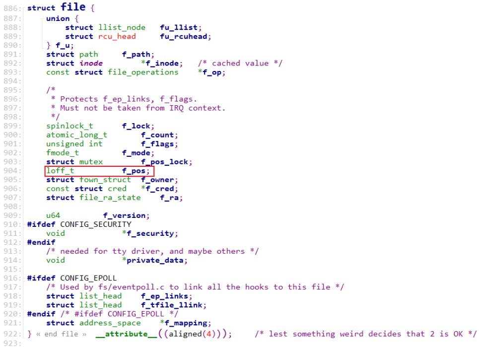

<a id="_Toc197788624"></a>

<a id="_Toc197788625"></a>
## 4.1 文件IO函数分类

在Linux上操作文件时，有两套函数：标准IO、系统调用IO。标准IO的相关函数是：fopen/fread/fwrite/fseek/fflush/fclose等。系统调用IO的相关函数是：open/read/write/lseek/fsync/close。

这2种IO函数的差别如下图所示：



标准IO的内部，会分配一个用户空间的buffer，读写操作先经过这个buffer。在有必要时，才会调用底下的系统调用IO向内核发起操作。

所以：标准IO效率更高；但是要访问驱动程序时就不能使用标准IO，而是使用系统调用IO。

<a id="_Toc197788626"></a>
## 4.2 函数原型

### 4.2.1 系统调用接口

下表列出了open/read/write/lseek/fsync/close这几个函数的用法。


| 函数名 | 函数原型 | 描述 |
| --- | --- | --- |
| open | #include &lt;sys/types.h&gt;<br />#include &lt;sys/stat.h&gt;<br />#include &lt;fcntl.h&gt;<br />int open(const char *pathname, int flags);<br />int open(const char *pathname, int flags, mode_t mode); | 作用：打开或者创建一个文件<br />pathname: 文件路径名，或者文件名<br />flags：表示打开文件所采用的操作<br />O_RDONLY：只读模式<br />O_WRONLY：只写模式<br />O_RDWR：可读可写<br />O_APPEND 表示追加，如果原来文件里面有内容，则这次写入会写在文件的最末尾。<br />O_CREAT 表示如果指定文件不存在，则创建这个文件<br />O_EXCL 表示如果要创建的文件已存在，则出错，同时返回 -1，并且修改 errno 的值。<br />O_TRUNC 表示截断，如果文件存在，并且以只写、读写方式打开，则将其长度截断为0。<br />O_NOCTTY 如果路径名指向终端设备，不要把这个设备用作控制终端。<br />O_NONBLOCK 如果路径名指向 FIFO/块文件/字符文件，则把文件的打开和后继 I/O设置为非阻塞模式（nonblocking mode）<br />O_DSYNC 等待物理 I/O 结束后再 write。在不影响读取新写入的数据的前提下，不等待文件属性更新。<br />O_RSYNC read 等待所有写入同一区域的写操作完成后再进行<br />O_SYNC 等待物理 I/O 结束后再 write，包括更新文件属性的 I/O<br />mode: 文件访问权限的初始值 |
| read | #include &lt;unistd.h&gt;<br />ssize_t read(int fd, void *buf, size_t count); | 作用：从给定的文件描述符指定的文件中，读取 count 个字节的数据，存放至 buf中。<br />fd：指定要读写的文件描述符<br />buf：缓冲区，一般是一个数组，用于存放读取的内容<br />count：一次要读取的最大字节数 |
| write | #include &lt;unistd.h&gt;<br />ssize_t write(int fd, const void *buf, size_t count); | 作用：将buf 中的 count 字节数据写入指定文件描述符的文件中。<br />fd：指定要写入的文件描述符<br />buf：缓冲区，一般是一个数组，读取存放于该数组的内容存放于文件中<br />count：要写入的实际字节数 |
| dup<br />dup2<br />dup3 | #include &lt;unistd.h&gt;<br />int dup(int oldfd);<br />int dup2(int oldfd, int newfd);<br />#define _GNU_SOURCE<br />#include &lt;fcntl.h&gt;<br />#include &lt;unistd.h&gt;<br />int dup3(int oldfd, int newfd, int flags); | 作用：复制文件描述符，就是两个文件句柄指向同一个文件描述符，这两个文件句柄共享文件偏移地址、状态<br />oldfd：被复制的文件句柄<br />newfd：复制得到的文件句柄<br />注意：dup函数返回的文件句柄是“未使用的最小文件句柄”，<br />dup2可以指定复制得到的文件句柄为newfd，<br />dup3跟dup2类似，flags参数必要么是0，要么是O_CLOEXEC |
| lseek | #include &lt;sys/types.h&gt;<br />#include &lt;unistd.h&gt;<br />off_t lseek(int fd, off_t offset, int whence); | 作用：重新定位读/写文件偏移<br />fd：指定要偏移的文件描述符<br />offset：文件偏移量<br />whence：开始添加偏移 offset 的位置<br />SEEK_SET，offset相对于文件开头进行偏移<br />SEEK_CUR，offset相对文件当前位置进行偏移<br />SEEK_END，offset相对于文件末尾进行偏移 |
| fsync | #include &lt;unistd.h&gt;<br />int fsync(int fd); | 作用：同步内存中所有已修改的文件数据到储存设备<br />fd：指定要同步的文件描述符 |
| close | #include &lt;sys/types.h&gt;<br />#include &lt;sys/stat.h&gt;<br />#include &lt;fcntl.h&gt;<br />int close(int fd); | 作用：关闭已打开的文件 |


### 4.2.2 标准IO接口

列出fopen/fread/fwrite/fseek/fflush/fclose这几个函数的用法。


| 函数名 | 函数原型 | 描述 |
| --- | --- | --- |
| fopen | #include&lt;stdio.h&gt;<br />FILE *fopen(const char *filename, const char *mode); | 作用：打开或者创建一个文件<br />filename: 文件路径名，或者文件名<br />mode: 文件的访问模式<br />r 打开一个用于读取的文件。该文件必须存在。<br />w 创建一个用于写入的空文件。如果文件名称与已存在的文件相同，则会删除已有文件的内容，文件被视为一个新的空文件。<br />a 追加到一个文件。写操作向文件末尾追加数据。如果文件不存在，则创建文件。<br />r+ 打开一个用于更新的文件，可读取也可写入。该文件必须存在。<br />w+ 创建一个用于读写的空文件。<br />a+ 打开一个用于读取和追加的文件。 |
| fread | #include&lt;stdio.h&gt;<br />size_t fread(void *ptr, size_t size, size_t nmemb, FILE *stream); | 作用：从给定流 stream 读取数据到 ptr 所指向的数组中<br />ptr：指向带有最小尺寸 size*nmemb 字节的内存块的指针<br />size：这是要读取的每个元素的大小，以字节为单位<br />nmemb：元素的个数，每个元素的大小为 size 字节<br />stream：这是指向 FILE 对象的指针，该 FILE 对象指定了一个输入流 |
| fwrite | #include &lt;stdio.h&gt;<br />size_t fwrite(const void *ptr, size_t size, size_t nmemb, FILE *stream); | 作用：把 ptr 所指向的数组中的数据写入到给定流 stream 中<br />ptr：这是指向要被写入的元素数组的指针<br />size：这是要被写入的每个元素的大小，以字节为单位<br />nmemb：这是元素的个数，每个元素的大小为 size 字节<br />stream：这是指向 FILE 对象的指针，该 FILE 对象指定了一个输出流 |
| fseek | #include &lt;stdio.h&gt;<br />int fseek(FILE *stream, long int offset, int whence); | 作用：设置流 stream 的文件位置为给定的偏移 offset<br />stream：这是指向 FILE 对象的指针，该 FILE 对象标识了流<br />offset：这是相对 whence 的偏移量，以字节为单位<br />whence：表示开始添加偏移 offset 的位置<br />SEEK_SET，offset相对于文件开头进行偏移<br />SEEK_CUR，offset相对文件当前位置进行偏移<br />SEEK_END，offset相对于文件末尾进行偏移 |
| fflush | #include &lt;stdio.h&gt;<br />int fflush(FILE *stream); | 作用：刷新流 stream 的输出缓冲区<br />stream：这是指向 FILE 对象的指针，该 FILE 对象指定了一个缓冲流 |
| fclose | #include &lt;stdio.h&gt;<br />int fclose(FILE *stream); | 作用：关闭流 stream,且刷新其缓冲区<br />stream：这是指向 FILE 对象的指针，该 FILE 对象指定了要被关闭的流 |


<a id="_Toc197788627"></a>
## 4.3 现场编程

### 4.3.1 系统调用接口

### 4.3.2 标准IO接口

<a id="_Toc197788628"></a>
## 4.4 内部机制

### 4.4.1 系统调用接口内部流程

系统调用的内部流程：



以open/read为例，从用户态调用API触发异常进入内核的过程如上图所示，最后调用的sys\_call\_table的函数指针数组如下：

```
/* 0 */ CALL(sys_restart_syscall)
         CALL(sys_exit)
         CALL(sys_fork)
         CALL(sys_read)
         CALL(sys_write)
/* 5 */ CALL(sys_open)
         CALL(sys_close)
         CALL(sys_ni_syscall)
         CALL(sys_creat)
         CALL(sys_link)
/* 10 */CALL(sys_unlink)
         CALL(sys_execve)
         CALL(sys_chdir)
         CALL(OBSULETE(sys_time))
```

<a id="_Toc113956062"></a>
### 4.4.2 内核的sys_open、sys_read会做什么？



进入内核后，sys\_read/open会首先判断文件的类型，进而通过文件系统的代码读写普通文件，或者通过设备驱动程序访问硬件。

对于sys\_open，它的实质如下：



先获得未使用的文件句柄，然后打开文件得到一个file结构体，最后在当前进程记录下这个文件：记录“文件句柄、file结构体”的对应关系。以后，APP使用文件句柄操作文件时，在内核里面就是根据对应的file结构体去操作文件。open文件后遗留的结果如下：



file结构体内部结构如下：



里面记录了很多信息，比如“当前读写位置”f\_pos：当我们执行lseek、read、write函数时，内核都会更新file结构体的f\_pos。

<a id="_Toc197788629"></a>
## 4.5 怎么知道这些函数的用法？

Linux下有3大帮助方法：help、man、info。

想查看某个命令的用法时，比如查看ls命令的用法，可以执行：

```bash
ls  --help
```

help只能用于查看某个命令的用法，而man手册既可以查看命令的用法，还可以查看函数的详细介绍等等。它含有9大分类，如下：

```bash
1   Executable programs or shell commands       // 命令
2   System calls (functions provided by the kernel)  // 系统调用，比如 man 2 open
3   Library calls (functions within program libraries)  // 函数库调用
4   Special files (usually found in /dev)             // 特殊文件, 比如 man 4 tty
5   File formats and conventions eg /etc/passwd  // 文件格式和约定, 比如man 5 passwd
6   Games  // 游戏
7   Miscellaneous (including macro packages and conventions), e.g. man(7), groff(7) //杂项
8   System administration commands (usually only for root) // 系统管理命令
9   Kernel routines [Non standard]  // 内核例程
```

比如想查看open函数的用法时，可以直接执行“man open”，发现这不是想要内容时再执行“man 2 open”。

在man命令中可以及时按“h”查看帮助信息了解快捷键。常用的快捷键是：

```bash
f  往前翻一页
b  往后翻一页
/patten 往前搜
?patten 往后搜
```

就内容来说，info手册比man手册编写得要更全面，但man手册使用起来更容易些。

以书来形容info手册和man手册的话，info手册相当于一章，里面含有若干节，阅读时你需要掌握如果从这一节跳到下一节；而man手册只相当于一节，阅读起来当然更容易。

就个人而言，我很少使用info命令。

可以直接执行“info”命令后，输入“H”查看它的快捷键，在info手册中，某一节被称为“node”，常用的快捷键如下：

```bash
Up          Move up one line.
Down        Move down one line.
PgUp        Scroll backward one screenful.
PgDn        Scroll forward one screenful.
Home        Go to the beginning of this node.
End         Go to the end of this node.
TAB         Skip to the next hypertext link.
RET         Follow the hypertext link under the cursor.
l           Go back to the last node seen in this window.
[           Go to the previous node in the document.
]           Go to the next node in the document.
p           Go to the previous node on this level.
n           Go to the next node on this level.
u           Go up one level.
t           Go to the top node of this document.
d           Go to the main 'directory' node.
```
