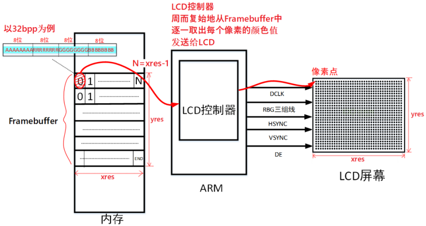
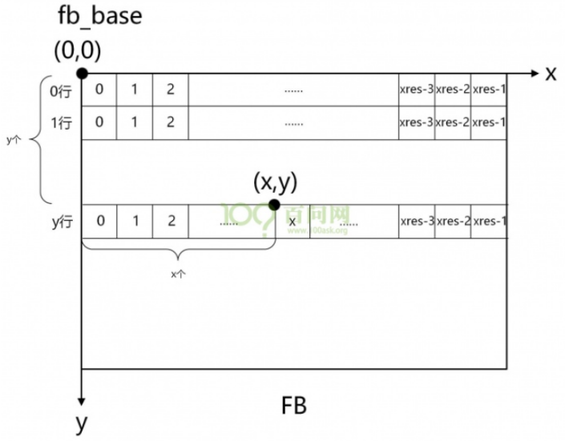
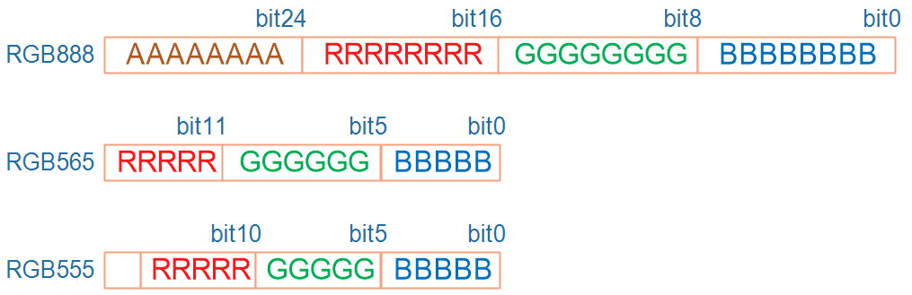
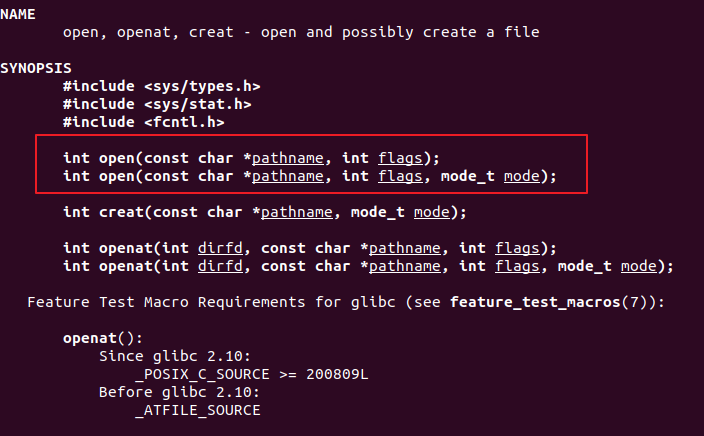
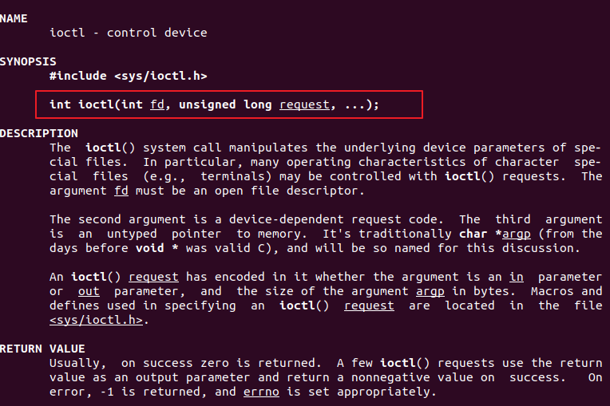
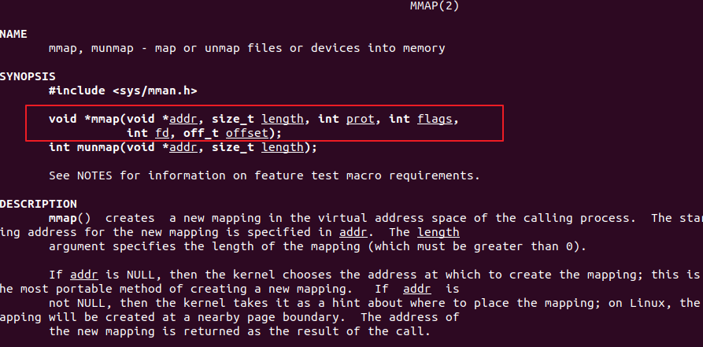
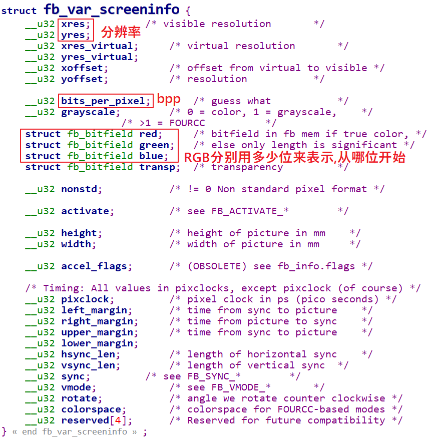
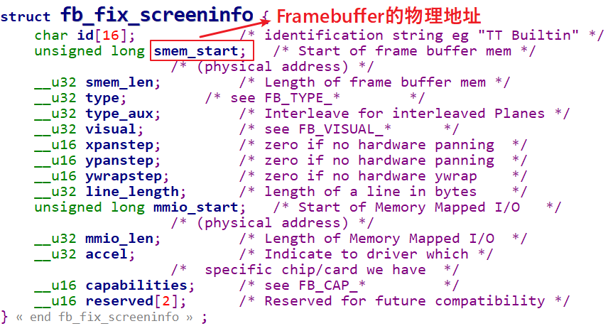

<a id="_Toc197788630"></a>

<a id="_Toc197788631"></a>
## 5.1 LCD操作原理

在Linux系统中通过Framebuffer驱动程序来控制LCD。Frame是帧的意思，buffer是缓冲的意思，这意味着Framebuffer就是一块内存，里面保存着一帧图像。Framebuffer中保存着一帧图像的每一个像素颜色值，假设LCD的分辨率是1024x768，每一个像素的颜色用32位来表示，那么Framebuffer的大小就是：1024x768x32/8=3145728字节。

简单介绍LCD的操作原理：

1.  驱动程序设置好LCD控制器：

根据LCD的参数设置LCD控制器的时序、信号极性；

根据LCD分辨率、BPP分配Framebuffer。

1.  APP使用ioctl获得LCD分辨率、BPP
2.  APP通过mmap映射Framebuffer，在Framebuffer中写入数据



图 5.1 LCD操作原理示意图

假设需要设置LCD中坐标(x,y)处像素的颜色，首要要找到这个像素对应的内存，然后根据它的BPP值设置颜色。假设fb\_base是APP执行mmap后得到的Framebuffer地址，如图 5.2所示：



<a id="_Ref108704480"></a>图 5.2 framebuffer映射地址

可以用以下公式算出(x,y)坐标处像素对应的Framebuffer地址：

```
(x，y)像素起始地址=fb_base+(xres*bpp/8)*y + x*bpp/8
```

最后一个要解决的问题就是像素的颜色怎么表示？它是用RGB三原色(红、绿、蓝)来表示的，在不同的BPP格式中，用不同的位来分别表示R、G、B，如图 5.3所示：



<a id="_Ref108704540"></a>图 5.3 RGB三种格式

对于32BPP，一般只设置其中的低24位，高8位表示透明度，一般的LCD都不支持。

对于24BPP，硬件上为了方便处理，在Framebuffer中也是用32位来表示，效果跟32BPP是一样的。

对于16BPP，常用的是RGB565；很少的场合会用到RGB555，这可以通过ioctl读取驱动程序中的RGB位偏移来确定使用哪一种格式。

<a id="_Toc197788632"></a>
## 5.2 涉及的API函数

本节程序的目的是：打开LCD设备节点，获取分辨率等参数，映射Framebuffer，最后实现描点函数。

### 5.2.1 open函数

在Ubuntu中执行“man 2 open”，可以看到open函数的说明：



图 5.4 man查看open函数

头文件：

```
#include <sys/types.h>
#include <sys/stat.h>
#include <fcntl.h>
```

函数原型：

```
int open(const char *pathname, int flags);
int open(const char *pathname, int flags, mode_t mode);
```

函数说明：

1.  pathname 表示打开文件的路径；
2.  Flags表示打开文件的方式，常用的有以下6种，
    -   O\_RDWR表示可读可写方式打开;
    -   O\_RDONLY表示只读方式打开;
    -   O\_WRONLY表示只写方式打开;
    -   O\_APPEND 表示如果这个文件中本来是有内容的，则新写入的内容会接续到原来内容的后面;
    -   O\_TRUNC表示如果这个文件中本来是有内容的，则原来的内容会被丢弃，截断；
    -   O\_CREAT表示当前打开文件不存在，我们创建它并打开它，通常与O\_EXCL结合使用，当没有文件时创建文件，有这个文件时会报错提醒我们；
3.  Mode表示创建文件的权限，只有在flags中使用了O\_CREAT时才有效，否则忽略。
4.  返回值：打开成功返回文件描述符，失败将返回-1。

### 5.2.2 ioctl函数

在Ubuntu中执行“man ioctl”，可以看到ioctl函数的说明：



图 5.5 man查看ioctl函数

头文件：

```
#include <sys/ioctl.h>
```

函数原型：

```
int ioctl(int fd, unsigned long request, ...);
```

函数说明：

1.  fd 表示文件描述符；
2.  request表示与驱动程序交互的命令，用不同的命令控制驱动程序输出我们需要的数据；
3.  … 表示可变参数arg，根据request命令，设备驱动程序返回输出的数据。
4.  返回值：打开成功返回文件描述符，失败将返回-1。

ioctl的作用非常强大、灵活。不同的驱动程序内部会实现不同的ioctl，APP可以使用各种ioctl跟驱动程序交互：可以传数据给驱动程序，也可以从驱动程序中读出数据。

#### 5.2.2.1 5.2.3 mmap函数(待后续修正)

在Ubuntu中执行“man mmap”，可以看到mmap函数的说明：



图 5.6 man查看mmap函数

想更深刻地理解mmap的内部机制，可以看《嵌入式Linux驱动开发基础知识》中关于mmap的介绍。作为APP开发，只需要知道它的用法就可以了。

头文件：

```
#include <sys/mman.h>
```

函数原型：

```
void *mmap(void *addr, size_t length, int prot, int flags,int fd, off_t offset);
```

函数说明：

1.  addr表示指定映射的內存起始地址，通常设为 NULL表示让系统自动选定地址，并在成功映射后返回该地址；
2.  length表示将文件中多大的内容映射到内存中；
3.  prot 表示映射区域的保护方式，可以为以下4种方式的组合
    -   PROT\_EXEC 映射区域可被执行
    -   PROT\_READ 映射区域可被读出
    -   PROT\_WRITE 映射区域可被写入
    -   PROT\_NONE 映射区域不能存取
4.  Flags 表示影响映射区域的不同特性，常用的有以下两种
    -   MAP\_SHARED 表示对映射区域写入的数据会复制回文件内，原来的文件会改变。
    -   MAP\_PRIVATE 表示对映射区域的操作会产生一个映射文件的复制，对此区域的任何修改都不会写回原来的文件内容中。
5.  返回值：若成功映射，将返回指向映射的区域的指针，失败将返回-1。

<a id="_Toc197788633"></a>
## 5.3 Framebuffer程序分析

使用GIT下载所有源码后，本节源码位于如下目录：

01\_all\_series\_quickstart\\

04\_嵌入式Linux应用开发基础知识\\source\\07\_framebuffer\\show\_pixel.c

### 5.3.1 打开设备

首先打开设备节点：

```
73      fd_fb = open("/dev/fb0", O_RDWR);
74      if (fd_fb < 0)
75      {
76              printf("can't open /dev/fb0\n");
77              return -1;
78      }
```

### 5.3.2 获取LCD参数

LCD驱动程序给APP提供2类参数：可变的参数fb\_var\_screeninfo、固定的参数fb\_fix\_screeninfo。编写应用程序时主要关心可变参数，它的结构体定义如下(#include &lt;linux/fb.h&gt;)：



图 5.7 fb\_var\_screeninfo

可以使用以下代码获取fb\_var\_screeninfo：

```
12 static struct fb_var_screeninfo var; /* Current var */
……
79      if (ioctl(fd_fb, FBIOGET_VSCREENINFO, &var))
80      {
81              printf("can't get var\n");
82              return -1;
83      }
```

注意到ioctl里用的参数是：FBIOGET\_VSCREENINFO，它表示get var screen info，获得屏幕的可变信息；当然也可以使用FBIOPUT\_VSCREENINFO来调整这些参数，但是很少用到。

对于固定的参数fb\_fix\_screeninfo，在应用编程中很少用到。它的结构体定义如下：



图 5.8 fb\_fix\_screeninfo

可以使用ioctl FBIOGET\_FSCREENINFO来读出这些信息，但是很少用到。

### 5.3.3 映射Framebuffer

要映射一块内存，需要知道它的地址──这由驱动程序来设置，需要知道它的大小──这由应用程序决定。代码如下：

```
85      line_width  = var.xres * var.bits_per_pixel / 8;
86      pixel_width = var.bits_per_pixel / 8;
87      screen_size = var.xres * var.yres * var.bits_per_pixel / 8;
88      fb_base = (unsigned char *)mmap(NULL , screen_size, PROT_READ | PROT_WRITE, MAP_SHARED, fd_fb, 0);
89      if (fb_base == (unsigned char *)-1)
90      {
91              printf("can't mmap\n");
92              return -1;
93      }
```

第88行中，screen\_size是整个Framebuffer的大小；PROT\_READ | PROT\_WRITE表示该区域可读、可写；MAP\_SHARED表示该区域是共享的，APP写入数据时，会直达驱动程序，这个参数的更深刻理解可以参考后面驱动基础中讲到的mmap知识。

### 5.3.4 描点函数

能够在LCD上描绘指定像素后，就可以写字、画图，描点函数是基础。代码如下：

```
28 void lcd_put_pixel(int x, int y, unsigned int color)
29 {
30      unsigned char *pen_8 = fb_base+y*line_width+x*pixel_width;
31      unsigned short *pen_16;
32      unsigned int *pen_32;
33
34      unsigned int red, green, blue;
35
36      pen_16 = (unsigned short *)pen_8;
37      pen_32 = (unsigned int *)pen_8;
38
39      switch (var.bits_per_pixel)
40      {
41              case 8:
42              {
43                      *pen_8 = color;
44                      break;
45              }
46              case 16:
47              {
48                      /* 565 */
49                      red   = (color >> 16) & 0xff;
50                      green = (color >> 8) & 0xff;
51                      blue  = (color >> 0) & 0xff;
52                      color = ((red >> 3) << 11) | ((green >> 2) << 5) | (blue >> 3);
53                      *pen_16 = color;
54                      break;
55              }
56              case 32:
57              {
58                      *pen_32 = color;
59                      break;
60              }
61              default:
62              {
63                      printf("can't surport %dbpp\n",var.bits_per_pixel);
64                      break;
65              }
66      }
67 }
```

第28行中传入的color表示颜色，它的格式永远是0x00RRGGBB，即RGB888。当LCD是16bpp时，要把color变量中的R、G、B抽出来再合并成RGB565格式。

第30行计算(x,y)坐标上像素对应的Framebuffer地址。

第43行，对于8bpp，color就不再表示RBG三原色了，这涉及调色板的概念，color是调色板的值。

第49～51行，先从color变量中把R、G、B抽出来。

第52行，把red、green、blue这三种8位颜色值，根据RGB565的格式，只保留red中的高5位、green中的高6位、blue中的高5位，组合成一个新的16位颜色值。

第53行，把新的16位颜色值写入Framebuffer。

第58行，对于32bpp，颜色格式跟color参数一致，可以直接写入Framebuffer。

### 5.3.5 随便画几个点

本程序的main函数，在最后只是简单地画了几个点：

```
95      /* 清屏: 全部设为白色 */
96      memset(fbmem, 0xff, screen_size);
97
98      /* 随便设置出100个为红色 */
99      for (i = 0; i < 100; i++)
100             lcd_put_pixel(var.xres/2+i, var.yres/2, 0xFF0000);
```

<a id="_Toc197788634"></a>
## 5.4 上机实验

在Ubuntu中编译程序，先设置交叉编译工具链，再执行以下命令：

```bash
arm-buildroot-linux-gnueabihf-gcc -o show_pixel show_pixel.c
```

然后在开发板上执行show\_pixel程序。

**注意**：板子的出厂程序中一般都有GUI，所以可能需要把GUI程序禁止掉。具体方法请看本文档，以后会补充禁止GUI的方法。你可以先不禁止GUI，直接执行show\_pixel看看LCD有无现象。
