<a id="_Toc197788635"></a>

<a id="_Toc197788636"></a>
## 6.1 字符的编码方式

### 6.1.1 编码与字体

在计算机上，我们看到的字符“A”可能长这样：


也可能长这样：


对于同一个TXT文件中的内容，你在Notepad上选择不同字体时，字符显示的形状不一样。

所以TXT文件中保存的是字符的核心：它的编码值。而Notepad上显示时，这些字符对应什么样的形状态，这是由字符文件决定的。编码值，字体是两个不一样的东西，比如A的编码值是0x41，但是在屏幕上显示出来时可以使用不同的形状。

什么叫编码？就是一个字符用什么数字来表示。在计算机里一切都是用数字来表示，比如字符A，用0x01还是0x02来表示它？我们使用0x41来表示它。当你去打开一个TXT文件时，发现里面含有数值0x41，你就知道了：哦，这里有一个字符A。

一个字符用哪个数字来表示？有很多标准，举例讲解。

-   -   -   -   1.  ASCII

是“American Standard Code for Information Interchange”的缩写，美国信息交换标准代码。

电脑毕竟是西方人发明的，他们常用字母就26个，区分大小写、加上标点符号也没超过127个，每个字符用一个字节来表示就足够了。一个字节的7位就可以表示128个数值，在ASCII码中最高位永远是0。

字符和数值的对应关系可以参考：

[https://baike.baidu.com/item/ASCII](https://baike.baidu.com/item/ASCII)

下面摘录部分给大家一个印象：

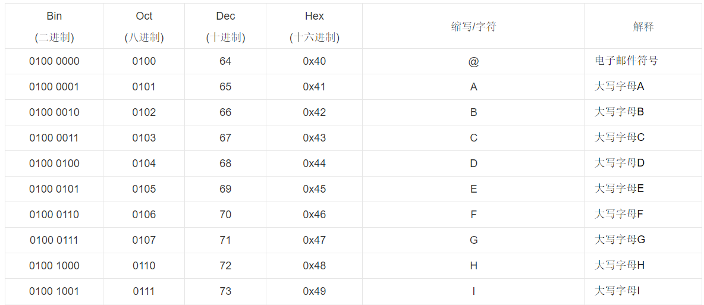

图 6.1 ASCII表

-   -   -   -   1.  ANSI

强烈建议阅读：[https://www.cnblogs.com/malecrab/p/5300486.html](https://www.cnblogs.com/malecrab/p/5300486.html)

使用记事本保存文件时，可以选择“ANSI”编码，却没有“ASCII”，如图 6.2所示，怎么回事？

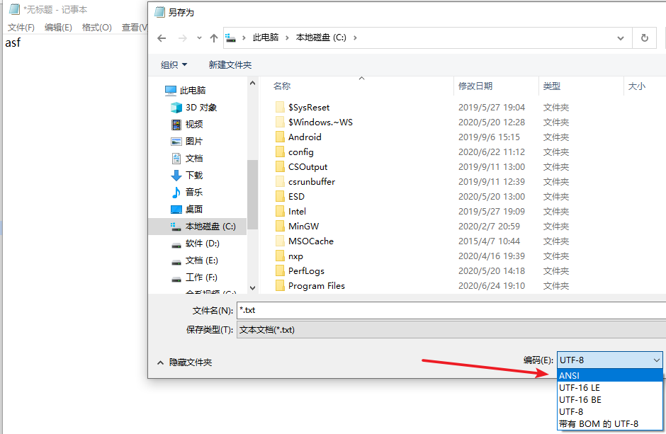

<a id="_Ref108705180"></a>图 6.2 不能保存为ASCII

ASNI是ASCII的扩展，向下包含ASCII。对于ASCII字符仍以一个字节来表示，对于非ASCII字符则使用2字节来表示。并没有固定的ASNI编码，它跟“本地化”(locale)密切相关。比如在中国大陆地区，ANSI的默认编码是GB2312；在港澳台地区默认编码是BIG5。以数值“0xd0d6”为例，对于GB2312编码它表示“中”；对于BIG5编码它表示“笢”。所以对于ANSI编码的TXT文件，如果你打开它发现乱码，那么还得再次细分它的具体编码。

比如对于一个TXT文件，里面的数值如下：

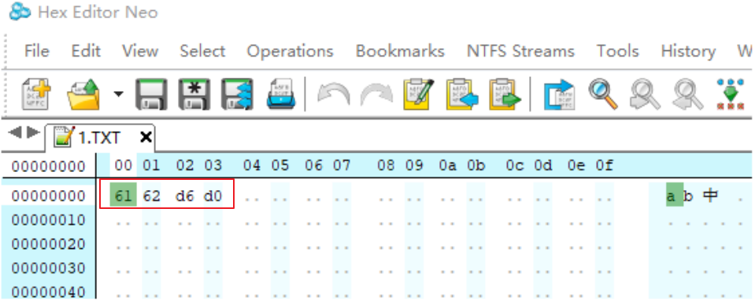

图 6.3 txt编码

使用Notepad打开后，选择不同的编码(或称为字符集)，有不一样的显示，如下：

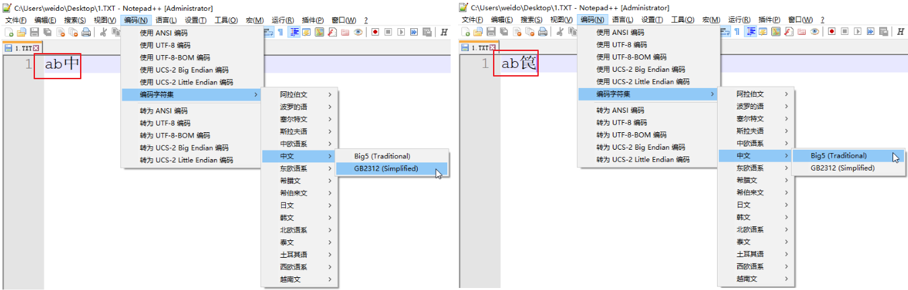

图 6.4 选择不同编码打开txt

这仅仅是在中国地区就出现这些不兼容的问题。对于不同国家，它们默认的ANSI编码各不相同，所以同一个TXT文件在不同国家就很有可能出现乱码。

根本的原理在于没有“统一的编码”，那解决方法自然就是使用“统一的编码”：UNICODE。

-   -   -   -   1.  UNICODE

在ANSI标准中，很多种文字都有自己的编码标准，汉字简体字有GB2312、繁体字有BIG5，这难免同一个数值对应不同字符。比如数值“0xd0d6”，对于GB2312编码它表示“中”；对于BIG5编码它表示“笢”。这造成了使用ANSI编码保存的文件，不适合跨地区交流。

UNICODE编码就是解决这类问题：对于地球上任意一个字符，都给它一个唯一的数值。

UNICODE仍然向下兼容ASCII，但是对于其他字符会有对应的数值，比如对于“中”、“笢”，它们的数值分别是：0x4e2d、0x7b22

UNICODE中的数值范围是0x0000至0x10FFFF，有1,114,111即100多万个数值，可以表示100多万个字符，足够地球人使用了。

### 6.1.2 UNICODE编码实现

所谓编码实现，就是对于一个数值，怎么表示它。这很奇怪，数值还能怎么表示？比如“中”的UNICODE值是0x4e2d，在TXT文件中怎么表示0x4e2d？直接写入0x4e2d？不行！

比如在TXT文件中写入2字节数据“0x2d 0x4e”，它可以用来表示“中”字吗？不能！它们对应ASCII字符“-N”。

问题的关键在于：怎么断字。在TXT文件中，2字节数据“0x2d 0x4e”是作为一个整体看待，还是拆成2部分看待？

所以，需要用一定的技巧来表示数值，这就对应不同的编码实现。

现在我们知道：

1.  ASCII编码中使用一个字节来表示一个字符，只用到其中的7位，最高位恒为0；
2.  ANSI编码中，对于ASCII字符仍使用一个字节来表示(BIT7是0)，对于非ASCII字符一般使用2个字节来表示，非ASCII字符的数值BIT7都是1。
3.  UNICODE：这就有点复杂了，下面一一讲解。

先用记事本新建3个文件：utf-16\_le.txt、utf-16\_be.txt、utf-8.txt、bom\_utf-8.txt，里面的内容都是“ab中”，保存时编码分别选择“UTF-16 LE”、“UTF-16 BE”、“UTF-8”、“带有BOM的UTF-8”，图 6.5是其中一个例子：

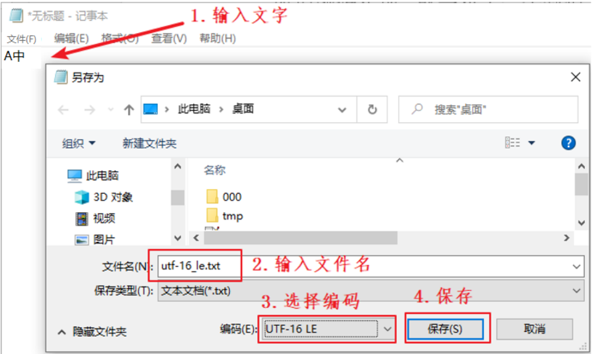

<a id="_Ref108705431"></a>图 6.5 选择编码保存文件

怎么表示一个UNICODE数值？

-   -   -   -   1.  使用3个字节表示一个UNICODE

不，太浪费。

UNICODE的最大值是0x10FFFF，那使用3个字节来表示一个UNICODE数值？这当然是很省事的方法，但是会造成浪费，比如字符A的UNICOCDE值是0x41，难道也用“0x41 0x00 0x00”这3个字节来表示？

-   -   -   -   1.  UCS-2 Little endian/UTF-16 LE

每个UNICODE值用3字节来表示有点浪费，那只用2字节呢？它可以表示2^16=65536个字符，全世界常用的字符都可以表示了。

Little endian表示小字节序，数值中权重低的字节放在前面，比如字符“A中”在TXT文件中的数值如下，其中的“A”使用“0x41 0x00”两字节表示；“中”使用“0x2d 0x4e”两字节表示。文件开头的“0xff 0xfe”表示“UTF-16 LE”。

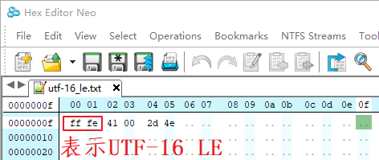

图 6.6 UTF-16 LE

-   -   -   -   1.  UCS-2 Big endian/UTF-16 BE

Big endian表示大字节序，数值中权重低的字节放在后面，比如字符“ab中”在TXT文件中的数值如下，其中的“A”使用“0x00 0x41”两字节表示；“中”使用“0x4e 0x2d”两字节表示。文件开头的“0xfe 0xff”表示“UTF-16 BE”。

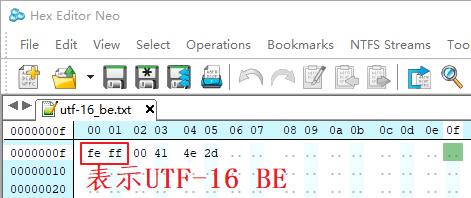

图 6.7 UTF-16 BE

-   -   -   -   1.  UTF8

在上面2种方法中，每一个UNICODE使用2字节来表示，这有3个缺点：表示的字符数量有限、对于ASCII字符有空间浪费、如果文件中有某个字节丢失，这会使得后面所有字符都因为错位而无法显示。

使用UTF8可以解决上述所有问题。UTF8是变长的编码方法，有2种UTF8格式的文件：带有头部、不带头部。先举例，看图 6.8：

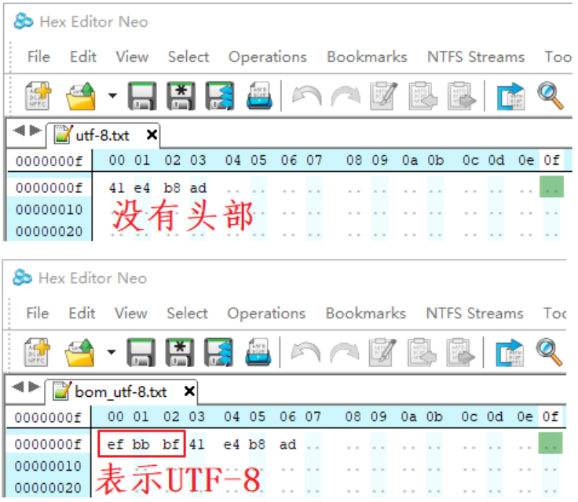

<a id="_Ref108705543"></a>图 6.8 UTF-8

对于其中的ASCII字符，在UTF8文件中直接用其ASCII码来表示，比如上图中的0x61表示字符a、0x62表示字符b。上图中的3个字节“0xe4 0xb8 0xad”表示的数值是0x4e2d，对应“中”的UNICODE码。

对于非ASCII字符，使用变长的编码：每一个字节的高位都自带长度信息。请看图 6.9：

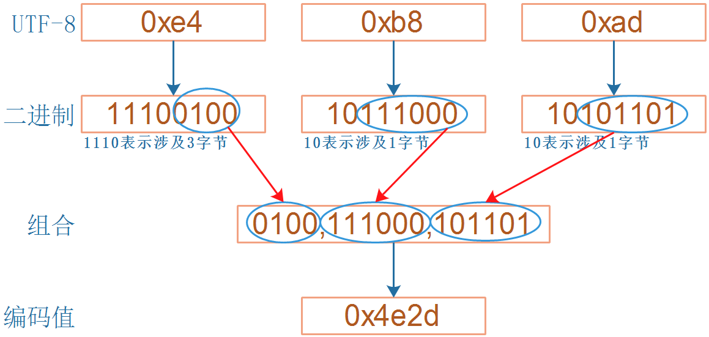

<a id="_Ref108705583"></a>图 6.9 变长编码

上图中，0xe4的二进制是“11100100”，高位有3个1，表示从当前字节起有3字节参与表示UNICODE；

0xb8的二进制是“10111000”，高位有1个1，表示从当前字节起有1字节参与表示UNICODE；

0xad的二进制是“10101101”，高位有1个1，表示从当前字节起有1字节参与表示UNICODE；

除去高位的“1110”、“10”、“10”后，剩下的二进制数组合起来得到“01001110001101”，它就是0x4e2d，即“中”的UNICODE值。

使用UTF8编码时，即使TXT文件中丢失了某些数据，也只会影响到当前字符的显示，后面的字符不受影响。

<a id="_Toc197788637"></a>
## 6.2 ASCII字符的点阵显示

要在LCD中显示一个ASCII字符，即英文字母这些字符，首先是要找到字符对应的点阵。在Linux内核源码中有这个文件：lib\\fonts\\font\_8x16.c，里面以数组形式保存各个字符的点阵，比如：

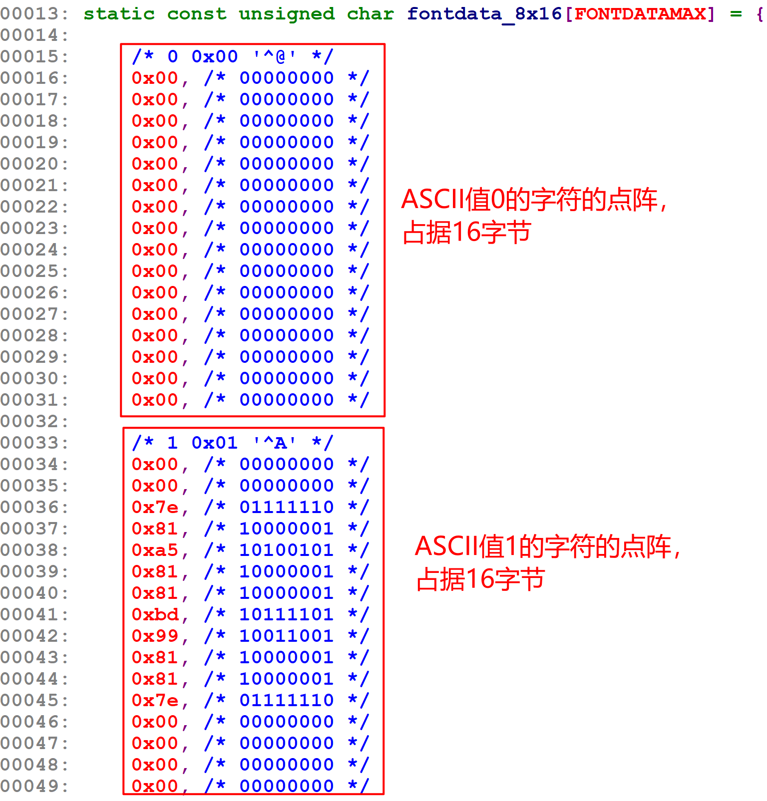

图 6.10 LCD的ASCII点阵

数组里的数字是如何表示点阵的？以字符A为例，如图 6.11所示：

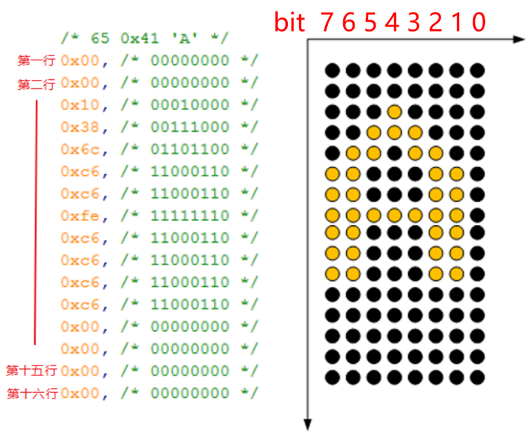

<a id="_Ref108705723"></a><a id="_Ref108705893"></a>图 6.11 字符A的点阵

上图左侧有16行数值，每行1个字节。每一个节对应右侧一行中8个像素：像素从右边数起，bit0对应第0个像素，bit1对应第1个像素，……，bit7对应第7个像素。某位的值为1时，表示对应的像素要被点亮；值为0时表示对应的像素要熄灭。

所以要显示某个字符时，根据它的ASCII码在fontdata\_8x16数组中找到它的点阵，然后取出这16个字节去描画16行像素。

比如字符A的ASCII值是0x41，那么从fontdata\_8x16\[0x41\*16\]开始取其点阵数据。

使用GIT下载所有源码后，本节源码位于如下目录：

01\_all\_series\_quickstart\\

04\_嵌入式Linux应用开发基础知识\\source\\08\_show\_ascii\\show\_ascii.c

核心函数是void lcd\_put\_ascii(int x, int y, unsigned char c)，它在LCD的(x,y)位置处显示字符c，代码如下图所示：

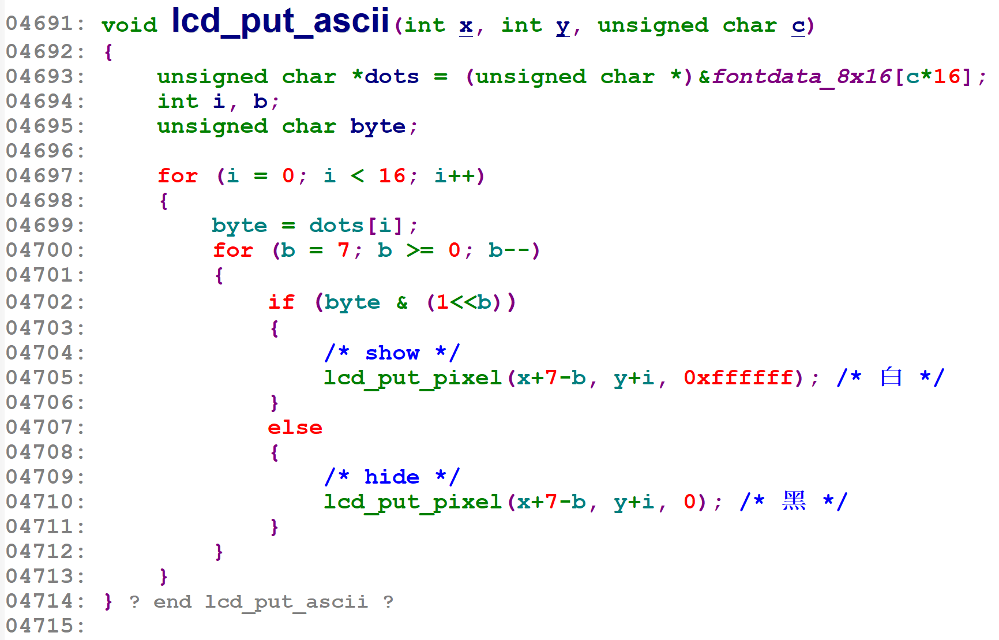

图 6.12 显示字符函数

### 6.2.1 获取点阵

对于字符c，char c，它的点阵获取方法如下：

```
4693		unsigned char *dots = (unsigned char *)&fontdata_8x16[c*16];
```

### 6.2.2 描点

根据“图 6.11 字符A的点阵”，我们分析下如何利用点阵在LCD上显示一个英文字母。

因为有十六行，所以首先要有一个循环16次的大循环，然后每一行里有8位，那么在每一个大循环里也需要一个循环8次的小循环。小循环里的判断单行的描点情况，如果是1，就填充白色，如果是0就填充黑色，如此一来，就可以显示出黑色底，白色轮廓的英文字母。

```
4697		for (i = 0; i < 16; i++)
4698		{
4699			byte = dots[i];
4700			for (b = 7; b >= 0; b--)
4701			{
4702				if (byte & (1<<b))
4703				{
4704					/* show */
4705					lcd_put_pixel(x+7-b, y+i, 0xffffff); /* 白 */
4706				}
4707				else
4708				{
4709					/* hide */
4710					lcd_put_pixel(x+7-b, y+i, 0); /* 黑 */
4711				}
4712			}
4713 }
```

### 6.2.3 main函数

main函数中首先要打开LCD设备，获取Framebuffer参数，实现lcd\_put\_pixel函数；然后调用lcd\_put\_ascii即可绘制字符。

代码如下：

```
4716 int main(int argc, char **argv)
4717 {
4718    fd_fb = open("/dev/fb0", O_RDWR);
4719    if (fd_fb < 0)
4720    {
4721            printf("can't open /dev/fb0\n");
4722            return -1;
4723    }
4724    if (ioctl(fd_fb, FBIOGET_VSCREENINFO, &var))
4725    {
4726            printf("can't get var\n");
4727            return -1;
4728    }
4729
4730    line_width  = var.xres * var.bits_per_pixel / 8;
4731    pixel_width = var.bits_per_pixel / 8;
4732    screen_size = var.xres * var.yres * var.bits_per_pixel / 8;
4733    fbmem = (unsigned char *)mmap(NULL , screen_size, PROT_READ | PROT_WRITE, MAP_SHARED, fd_fb, 0);
4734    if (fbmem == (unsigned char *)-1)
4735    {
4736            printf("can't mmap\n");
4737            return -1;
4738    }
4739
4740    /* 清屏: 全部设为黑色 */
4741    memset(fbmem, 0, screen_size);
4742
4743    lcd_put_ascii(var.xres/2, var.yres/2, 'A'); /*在屏幕中间显示8*16的字母A*/
4744
4745    munmap(fbmem , screen_size);
4746    close(fd_fb);
4747
4748    return 0;
4749 }
4750
```

### 6.2.4 编译c文件show_ascii.c

编译命令：arm-buildroot-linux-gnueabihf-gcc -o show\_ascii show\_ascii.c

**注意**：不同的板子，编译工具的前缀可能不一样。

### 6.2.5 机实验

把show\_ascii程序放到板子上，执行命令：./show\_ascii。如果实验成功，我们将看到屏幕中间会显示出一个白色的字母‘A’。

### 6.2.6 课后作业

修改lcd\_put\_ascii函数，可以指定字符颜色。实现lcd\_put\_str函数，输出字符串，可以换行。

在show\_ascii.c的基础上实现汉字的显示：要找到汉字字库、了解像素排列顺序、得到汉字编码。

<a id="_Toc197788638"></a>
## 6.3 中文字符的点阵显示

使用GIT下载所有源码后，本节源码位于如下目录：

01\_all\_series\_quickstart\\

04\_嵌入式Linux应用开发基础知识\\source\\09\_show\_chinese\\

test\_charset\_ansi.c

test\_charset\_utf8.c

show\_chinese.c

### 6.3.1 指定编码格式

使用点阵字库时，中文字符的显示原理跟ASCII字符是一样的。要注意的地方在于中文的编码：在C源文件中它的编码方式是GB2312还是UTF-8？编译出的可执行程序，其中的汉字编码方式是GB2312还是UTF-8？

**注意**：一般不会使用UTF-16的编码方式，在这种方式下ASCII字符也是用2字节来表示，而其中一个字节是0，但是在C语言中0表示字符串的结束符，会引起误会。

我们编写C程序时，可以使用ANSI编码，或是UTF-8编码；在编译程序时，可以使用以下的选项告诉编译器：

```bash
-finput-charset=GB2312
-finput-charset=UTF-8
```

如果不指定“-finput-charset”，GCC就会默认C程序的编码方式为UTF-8，即使你是以ANSI格式保存，也会被当作UTF-8来对待。

对于编译出来的可执行程序，可以指定它里面的字符是以什么方式编码，可以使用以下的选项编译器：

```bash
-fexec-charset=GB2312
-fexec-charset=UTF-8
```

如果不指定“-fexec-charset”，GCC就会默认编译出的可执行程序中字符的编码方式为UTF-8。

如果“-finput-charset”与“-fexec-charset”不一样，编译器会进行格式转换。

### 6.3.2 编码格式实验

下面做实验。

test\_charset\_ansi.c、test\_charset\_utf8.c的编码格式分别为ANSI、UTF-8，它们的程序代码是一样的，如下：

```
01 #include <stdio.h>
02 #include <string.h>
03
04 int main(int argc, char **argv)
05 {
06      char *str = "A中";
07      int i;
08
09      printf("str's len = %d\n", (int)strlen(str));
10      printf("Hex code: ");
11      for (i = 0; i < strlen(str); i++)
12      {
13              printf("%02x ", (unsigned char)str[i]);
14      }
15      printf("\n");
16      return 0;
17 }
```

-   -   -   -   1.  默认编码

实验如下：

```bash
book@100ask:~/09_show_chinese$ gcc -o test_charset_ansi test_charset_ansi.c
book@100ask:~/09_show_chinese$ ./test_charset_ansi
str's len = 3
Hex code: 41 d6 d0
book@100ask:~/09_show_chinese$ gcc -o test_charset_utf8 test_charset_utf8.c
book@100ask:~/09_show_chinese$ ./test_charset_utf8
str's len = 4
Hex code: 41 e4 b8 ad
```

不指定“-finput-charset”与“-fexec-charset”时，input-charset和exec-charset默认都是UTF-8，不会进行编码转换。即使C文件是ANSI，也会被认为是UTF-8，所以不会导致编码转换。

-   -   -   -   1.  GB2312转为UTF-8

实验如下：

```bash
book@100ask:~/09_show_chinese$ gcc -finput-charset=GB2312 -fexec-charset=UTF-8 -o test_charset_ansi test_charset_ansi.c
book@100ask:~/09_show_chinese$ ./test_charset_ansi str's len = 4 Hex code: 41 e4 b8 ad
book@100ask:~/09_show_chinese$ gcc -finput-charset=GB2312 -fexec-charset=UTF-8 -o test_charset_utf8 test_charset_utf8.c cc1: error: failure to convert GB2312 to UTF-8
```

从上面的输出信息可以看出来，GB2312的“0xd6 0xd0”可以转换为UTF-8的“0xe4 0xb8 0xad”。而如果把原本就是UTF-8格式的test\_charset\_utf8.c当作GB2312格式，会引起错误。

-   -   -   -   1.  UTF-8转为GB2312

实验如下：

```bash
book@100ask:~/09_show_chinese$ gcc -finput-charset=UTF-8 -fexec-charset=GB2312 -o test_charset_ansi test_charset_ansi.c
test_charset_ansi.c: In function ‘main’:
test_charset_ansi.c:6:14: error: converting to execution character set: Invalid or incomplete multibyte or wide character
  char *str = "A▒▒";
              ^~~~~
book@100ask:~/09_show_chinese$ gcc -finput-charset=UTF-8 -fexec-charset=GB2312 -o test_charset_utf8 test_charset_utf8.c
book@100ask:~/09_show_chinese$ ./test_charset_utf8
str's len = 3
Hex code: 41 d6 d0
```

从上面的输出信息可以看出来，如果把原本就是GB2312格式的test\_charset\_ansi.c当作UTF-8格式，会引起错误。而UTF-8格式的“中”编码值为“0xe4 0xb8 0xad”，可以转换为GB2312的“0xd6 0xd0”。

在代码中使用汉字这类非ASCII码时，要特别留意编码格式。

### 6.3.3 汉字区位码

我们从网上搜到HZK16这个文件，它是常用汉字的16\*16点阵字库。HZK16里每个汉字使用32字节来描述，如图 6.13所示：

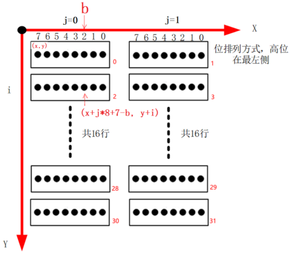

<a id="_Ref108706218"></a><a id="_Ref108706210"></a>图 6.13 汉字区位码

跟ASCII字库一样，每个字节中每一位用来表示一个像素，位值等于1时表示对应像素被点亮，位值等于0时表示对应像素被熄灭。

HZK16中是以GB2312编码值来查找点阵的，以“中”字为例，它的编码值是“0xd6 0xd0”，其中的0xd6表示“区码”，表示在哪一个区：第“0xd6 - 0xa1”区；其中的0xd0表示“位码”，表示它是这个区里的哪一个字符：第“0xd0 - 0xa1”个。每一个区有94个汉字。区位码从0xa1而不是从0开始，是为了兼容ASCII码。

所以，我们要显示的“中”字，它的GB2312编码是d6d0，它是HZK16里第“(0xd6-0xa1)\*94+(0xd0-0xa1)”个字符。

### 6.3.4 汉字点阵显示实验

-   -   -   -   1.  打开汉字库文件

```
4787    fd_hzk16 = open("HZK16", O_RDONLY);
4788    if (fd_hzk16 < 0)
4789    {
4790            printf("can't open HZK16\n");
4791            return -1;
4792    }
4793    if(fstat(fd_hzk16, &hzk_stat))
4794    {
4795            printf("can't get fstat\n");
4796            return -1;
4797    }
4798    hzkmem = (unsigned char *)mmap(NULL , hzk_stat.st_size, PROT_READ, MAP_SHARED, fd_hzk16, 0);
4799    if (hzkmem == (unsigned char *)-1)
4800    {
4801            printf("can't mmap for hzk16\n");
4802            return -1;
4803    }
```

第4787行打开当前目录的字库文件：HZK16。

第4793行获得文件的状态信息，里面含有文件长度，这在后面的mmap中用到。

第4798行使用mmap映射文件，以后就可以像访问内存一样读取文件内容；mmap的返回结果保存在hzkmem中，它将作为字库的基地址。

-   -   -   -   1.  编写显示汉字的函数

核心函数是void lcd\_put\_chinese(int x, int y, unsigned char \*str)，它在LCD的(x,y)位置处显示汉字字符str，str\[0\]中保存区码、str\[1\]中保存位码。

代码如下图所示：

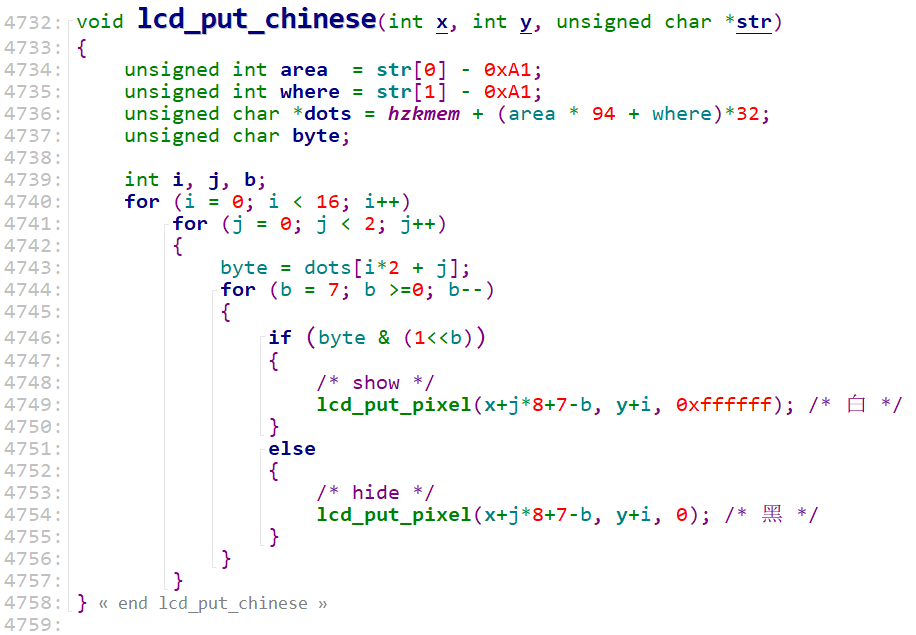

<a id="_Ref108706306"></a>图 6.14 显示汉字函数

代码分解如下：

第4734行确定该汉字属于哪个区；第4735行确实它是该区中哪一个汉字。

第4736行确实它的字库地址：每个区中有94个汉字，每个汉字在字库中占据32字节。

需要根据图 6.15来理解第4740行开始的循环：


<a id="_Ref108706312"></a>图 6.15 汉字点阵排布

图 6.15是汉字点阵排布的示意图，总共有十六行，因此需要一个循环16次的大循环(第4740行)。

考虑到一行有两个字节，在大循环中加入一个2次的循环用于区分是哪个字节(第4741行)。

最后使用第3个循环来处理一个字节中的8位(第4744行)。对于每一位，它等于1时对应的像素被设置为白色，它等于0时对应的像素被设置为黑色。需要注意的是根据x、y、i、j、b来计算像素坐标。

-   -   -   -   1.  使用lcd\_put\_chinese函数

程序文件：show\_font.c

```
4762    unsigned char str[] = "中";
……
4810    printf("chinese code: %02x %02x\n", str[0], str[1]);
4811    lcd_put_chinese(var.xres/2 + 8,  var.yres/2, str);
```

-   -   -   -   1.  编译程序

编译命令：

```bash
arm-buildroot-linux-gnueabihf-gcc -o  show_chinese  show_chinese.c
```

**注意**：不同的板子，编译工具的前缀可能不一样。

**注意**：使用上述命令时show\_chinese.c的编码格式必须是ANSI(GB2312)，否则编译时需要指定“-fexec-charset=GB2312”。

-   -   -   -   1.  上机实验

把show\_chinese程序放到板子上，执行命令：./show\_chinese。如果实验成功，我们将看到屏幕中间会显示出一个白色的字母“A”和“中”。

-   -   -   -   1.  课后作业

修改lcd\_put\_chinese函数，可以指定字符颜色。

实现lcd\_put\_str函数，可以输出混合的中英文字符，比如“中国china”，支持自动换行。

<a id="_Ref109640792"></a><a id="_Ref109640794"></a><a id="_Toc197788639"></a>
## 6.4 交叉编译程序：以freetype为例

使用buildroot来给ARM板编译程序、编译库会很简单，以后系统讲解buildroot时再使用buildroot。

现在我们还是手工交叉编译freetype，这种方法在编译、安装一些小程序时很有用。

### 6.4.1 程序运行的一些基础知识

-   -   -   -   1.  编译程序时去哪找头文件？

系统目录：就是交叉编译工具链里的某个include目录；也可以自己指定：编译时用 “ -I dir ”选项指定。

-   -   -   -   1.  链接时去哪找库文件？

系统目录：就是交叉编译工具链里的某个lib目录；也可以自己指定：链接时用 “ -L dir ”选项指定。

-   -   -   -   1.  运行时去哪找库文件？

系统目录：就是板子上的/lib、/usr/lib目录；也可以自己指定：运行程序用环境变量LD\_LIBRARY\_PATH指定。

-   -   -   -   1.  运行时不需要头文件，所以头文件不用放到板子上

### 6.4.2 常见错误的解决方法

-   -   -   -   1.  头文件问题

编译时找不到头文件。在程序中这样包含头文件：#include &lt;xxx.h&gt;

对于尖括号里的头文件，去哪里找它？

系统目录：就是交叉编译工具链里的某个include目录；

也可以自己指定：编译时用 “ -I dir ”选项指定。

怎么确定“系统目录”？

执行下面命令确定目录：

```bash
echo 'main(){}'| arm-buildroot-linux-gnueabihf-gcc -E -v -
```

它会列出头文件目录、库目录(LIBRARY\_PATH)。

你需要在头文件目录中确定有没有这个文件，或是自己指定头文件目录。

-   -   -   -   1.  库文件问题

链接程序时如果有这样的提示：undefined reference to \`xxx'，它表示xxx函数未定义。

那么解决方法有2：

1.  去写出这个函数
2.  或是使用库函数，那需要在链接时指定库

怎么指定库？想链接libabc.so，那链接时加上：-labc。

库在哪里？

-   -   系统目录：就是交叉编译工具链里的某个lib目录
    -   也可以自己指定：链接时用 “ -L dir ”选项指定

怎么确定“系统目录”？执行下面命令确定目录：

```bash
echo 'main(){}'| arm-buildroot-linux-gnueabihf-gcc -E -v –
```

它会列出头文件目录、库目录(LIBRARY\_PATH)，你编译出库文件时，可以把它放入系统库目录。

-   -   -   -   1.  运行问题

运行程序时找不到库：

```bash
error while loading shared libraries: libxxx.so:
cannot open shared object file: No such file or directory
```

找不到库，库在哪？

-   -   系统目录：就是板子上的/lib、/usr/lib目录
    -   也可以自己指定：

运行程序用环境变量LD\_LIBRARY\_PATH指定，执行以下的命令：

```bash
export  LD_LIBRARY_PATH=/xxx_dir  ;  ./test
```

或

```bash
LD_LIBRARY_PATH=/xxx_dir   ./test
```

### 6.4.3 交叉编译程序的万能命令

如果交叉编辑工具链的前缀是arm-buildroot-linux-gnueabihf-，比如arm-buildroot-linux-gnueabihf-gcc，交叉编译开源软件时，如果它里面有configure，万能命令如下：

```bash
./configure  --host=arm-buildroot-linux-gnueabihf   --prefix=$PWD/tmp
make
make install
```

就可以在当前目录的tmp目录下看见bin, lib, include等目录，里面存有可执行程序、库、头文件。

-   -   -   -   1.  把头文件、库文件放到工具链目录里

如果你编译的是一个库，请把得到的头文件、库文件放入工具链的include、lib目录里。别的程序要使用这些头文件、库时，会很方便。

工具链里可能有多个include、lib目录，放到哪里去？

执行下面命令来确定目录：

```bash
echo 'main(){}'| arm-buildroot-linux-gnueabihf-gcc -E -v –
```

它会列出头文件目录、库目录(LIBRARY\_PATH)。

-   -   -   -   1.  把库文件放到板子上的/lib或/usr/lib目录里

程序在板子上运行时，需要用到板子上/lib或/usr/lib下的库文件；程序运行时不需要头文件。

### 6.4.4 给IMX6ULL交叉编译freetype

使用GIT下载所有源码后，本节源码位于如下目录：

01\_all\_series\_quickstart\\

04\_嵌入式Linux应用开发基础知识\\source\\10\_freetype\\

freetype-2.10.2.tar.xz

libpng-1.6.37.tar.xz

zlib-1.2.11.tar.gz

freetype依赖于libpng，libpng又依赖于zlib，所以我们应该：先编译安装zlib，再编译安装libpng，最后编译安装freetype。但是，有些工具链里有zlib, 那就不用编译安装zlib，比如STM32MP157。

本节文档以IMX6ULL开发板中arm-buildroot-linux-gnueabihf-gcc工具链为例，对于其他开发板：工具链可能不一样，请灵活变通。

1.  确定头文件、库文件在工具链中的目录

先设置交叉编译工具链：

```bash
export ARCH=arm
export CROSS_COMPILE=arm-buildroot-linux-gnueabihf-
export PATH=$PATH:/home/book/100ask_imx6ull-sdk/ToolChain/arm-buildroot-linux-gnueabihf_sdk-buildroot/bin
```

它里面有zlib，跟着视频操作即可

以IMX6ULL开发板为例，它的工具链是arm-buildroot-linux-gnueabihf-gcc，可以执行以下命令：

```bash
echo 'main(){}'| arm-buildroot-linux-gnueabihf-gcc -E -v -
```

可以确定头文件的系统目录为：

```bash
/home/book/100ask_imx6ull-sdk/ToolChain/arm-buildroot-linux-gnueabihf_sdk-buildroot/bin/../lib/gcc/arm-buildroot-linux-gnueabihf/7.5.0/include
```

库文件的系统目录为：

```bash
/home/book/100ask_imx6ull-sdk/ToolChain/arm-buildroot-linux-gnueabihf_sdk-buildroot/bin/../lib/gcc/arm-buildroot-linux-gnueabihf/7.5.0/../../../../arm-buildroot-linux-gnueabihf/lib
```

1.  交叉编译、安装libpng

freetype依赖于libpng，所以需要先编译、安装libpng。命令如下：

```bash
book@100ask$ cp /home/book/01_all_series_quickstart/04_嵌入式Linux应用开发基础知识/source/10_freetype/libpng-1.6.37.tar.xz ./
book@100ask$ tar  xJf  libpng-1.6.37.tar.xz
book@100ask$ cd  libpng-1.6.37
book@100ask:~/libpng-1.6.37$ ./configure  --host=arm-buildroot-linux-gnueabihf  --prefix=$PWD/tmp
book@100ask:~/libpng-1.6.37$ make
book@100ask:~/libpng-1.6.37$ make install
book@100ask:~/libpng-1.6.37$ cd  tmp
book@100ask:~/libpng-1.6.37/tmp$ cp  include/*  -rf  /home/book/100ask_imx6ull-sdk/ToolChain/arm-buildroot-linux-gnueabihf_sdk-buildroot/bin/../lib/gcc/arm-buildroot-linux-gnueabihf/7.5.0/include
book@100ask:~/libpng-1.6.37/tmp$ cp  lib/*  -rfd   /home/book/100ask_imx6ull-sdk/ToolChain/arm-buildroot-linux-gnueabihf_sdk-buildroot/bin/../lib/gcc/arm-buildroot-linux-gnueabihf/7.5.0/../../../../arm-buildroot-linux-gnueabihf/lib
```

1.  交叉编译、安装freetype

命令如下：

```bash
book@100ask$ cp /home/book/01_all_series_quickstart/04_嵌入式Linux应用开发基础知识/source/10_freetype/freetype-2.10.2.tar.xz ./
book@100ask$ tar  xJf  freetype-2.10.2.tar.xz
book@100ask$ cd  freetype-2.10.2
book@100ask:~/freetype-2.10.2$  ./configure  --host=arm-buildroot-linux-gnueabihf   --prefix=$PWD/tmp
book@100ask:~/freetype-2.10.2$ make
book@100ask:~/freetype-2.10.2$ make install
book@100ask:~/freetype-2.10.2$ cd  tmp
book@100ask:~/freetype-2.10.2/tmp$ cp include/freetype2/* -rfd /home/book/100ask_imx6ull-sdk/ToolChain/arm-buildroot-linux-gnueabihf_sdk-buildroot/bin/../lib/gcc/arm-buildroot-linux-gnueabihf/7.5.0/include
book@100ask:~/freetype-2.10.2/tmp$ cp lib/* -rfd  /home/book/100ask_imx6ull-sdk/ToolChain/arm-buildroot-linux-gnueabihf_sdk-buildroot/bin/../lib/gcc/arm-buildroot-linux-gnueabihf/7.5.0/../../../../arm-buildroot-linux-gnueabihf/lib
```

<a id="_Toc197788640"></a>
## 6.5 使用freetype显示单个文字

使用GIT下载所有源码后，本节源码位于如下目录：

01\_all\_series\_quickstart\\

04\_嵌入式Linux应用开发基础知识\\source\\10\_freetype\\

01\_wchar\\test\_wchar.c

02\_freetype\_show\_font\\freetype\_show\_font.c

03\_freetype\_show\_font\_angle\\freetype\_show\_font\_angle.c

### 6.5.1 矢量字体引入

使用点阵字库显示英文字母、汉字时，大小固定，如果放大缩小则会模糊甚至有锯齿出现，为了解决这个问题，引用矢量字体。

矢量字体形成分三步：

1.  确定关键点，
2.  使用数学曲线（贝塞尔曲线）连接头键点，
3.  填充闭合区线内部空间。

什么是关键点？以字母“A”为例，它的的关键点如图 6.16中的黄色所示。

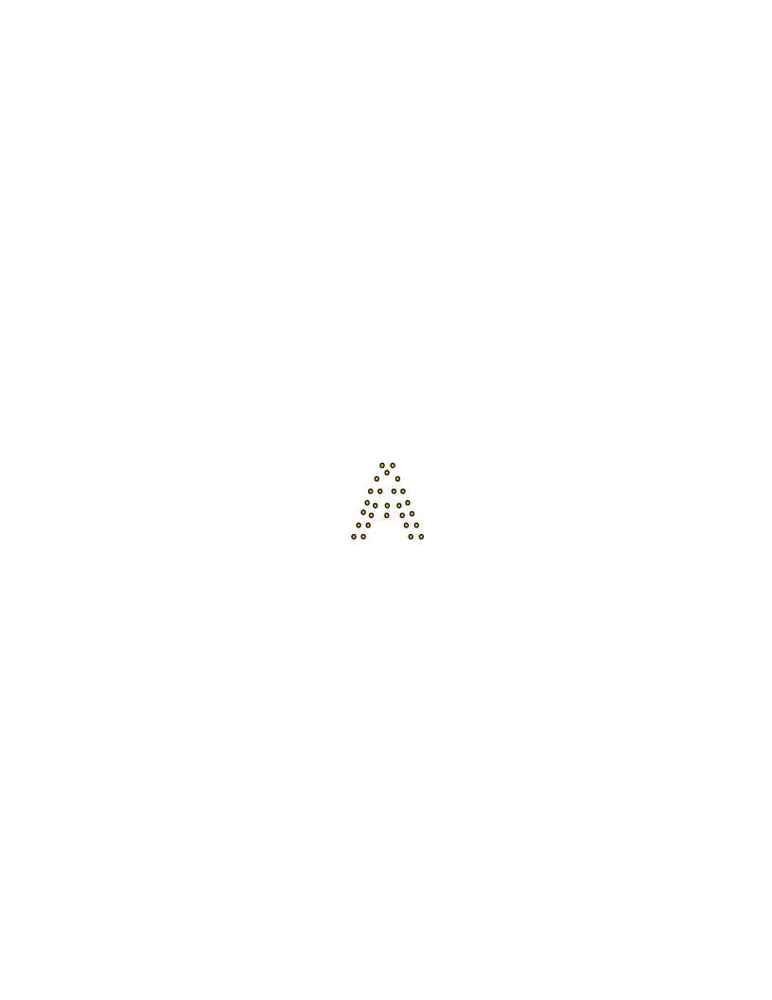

<a id="_Ref108706869"></a>图 6.16 字符A的关键点

再用数学曲线(比如贝塞尔曲线)将关键点都连接起来，得到一系列的封闭的曲线，如图 6.17所示：


<a id="_Ref108706889"></a>图 6.17 封闭关键点

最后把封闭空间填满颜色，就显示出一个A字母，如图 6.18所示：


<a id="_Ref108706971"></a>图 6.18 填充封闭曲线

如果需要放大或者缩小字体，关键点的相对位置是不变的，只要数学曲线平滑，字体就不会变形。

### 6.5.2 Freetype介绍

Freetype是开源的字体引擎库，它提供统一的接口来访问多种字体格式文件，从而实现矢量字体显示。我们只需要移植这个字体引擎，调用对应的API接口，提供字体文件，就可以让freetype库帮我们取出关键点、实现闭合曲线，填充颜色，达到显示矢量字体的目的。

关键点(glyph)存在字体文件中，Windows使用的字体文件在c:\\Windows\\Fonts目录下，扩展名为TTF的都是矢量字库，本次使用实验使用的是新宋字体simsun.ttc。

给定一个字符，怎么在字体文件中找到它的关键点？

首先要确定该字符的编码值：比如ASCII码、GB2312码、UNICODE码。如果字体文件支持某种编码格式(charset)，就可以使用这类编码值去找到该字符的关键点(glyph)。有些字体文件支持多种编码格式(charset)，这在文件中被称为charmaps(注意：这个单词是复数，意味着可能支持多种charset)。

以simsun.ttc为例，该字体文件的格如下：头部含有charmaps，可以使用某种编码值去charmaps中找到它对应的关键点。下图中的“A、B、中、国、韦”等只是glyph的示意图，表示关键点。

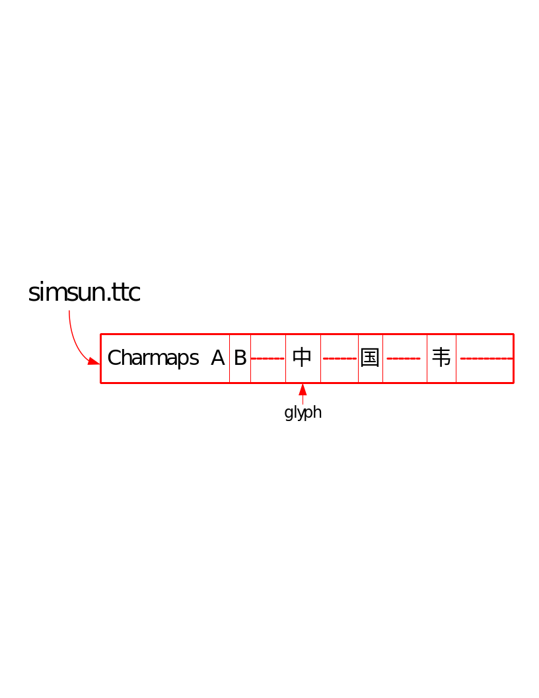

图 6.19 glyph

Charmaps表示字符映射表，字体文件可能支持哪一些编码，GB2312、UNICODE、BIG5或其他。如果字体文件支持该编码，使用编码值通过charmap就可以找到对应的glyph，一般而言都支持UNICODE码。

有了以上基础，一个文字的显示过程可以概括如下：

-   给定一个字符可以确定它的编码值(ASCII、UNICODE、GB2312)；
-   设置字体大小；
-   根据编码值，从文件头部中通过charmap找到对应的关键点(glyph)，它会根据字体大小调整关键点；
-   把关键点转换为位图点阵；
-   在LCD上显示出来

从[https://www.freetype.org/](https://www.freetype.org/)可以下载到“freetype-doc-2.10.2.tar.xz”，下图中的文件就是官方文档：

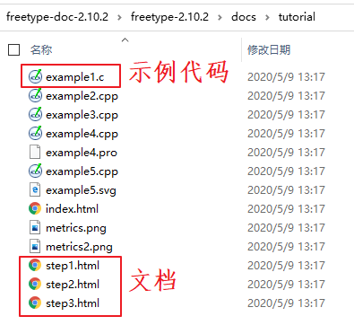

图 6.20 freetype文件目录

参照上图中step1，step2，step3里的内容，可以学习如何使用freetype库，总结出下列步骤：

1.  初始化：FT\_InitFreetype
2.  加载(打开)字体Face：FT\_New\_Face
3.  设置字体大小：FT\_Set\_Char\_Sizes 或 FT\_Set\_Pixel\_Sizes
4.  选择charmap：FT\_Select\_Charmap
5.  根据编码值charcode找到glyph\_index：glyph\_index = FT\_Get\_Char\_Index（face，charcode）
6.  根据glyph\_index取出glyph：FT\_Load\_Glyph（face，glyph\_index）
7.  转为位图：FT\_Render\_Glyph
8.  移动或旋转:FT\_Set\_Transform
9.  最后显示出来。

上面的⑤⑥⑦可以使用一个函数代替：FT\_Load\_Char(face, charcode, FT\_LOAD\_RENDER)，它就可以得到位图。

### 6.5.3 在LCD上显示一个矢量字体

-   -   -   -   1.  使用wchar\_t获得字符的UNICODE值

要显示一个字符，首先要确定它的编码值。常用的是UNICODE编码，在程序里使用这样的语句定义字符串时，str中保存的要么是GB2312编码值，要么是UTF-8格式的编码值，即使编译时使用“-fexec-charset=UTF-8”，str中保存的也不是直接能使用的UNICODE值：

```
char  *str = “中”;
```

如果想在代码中能直接使用UNICODE值，需要使用wchar\_t，宽字符，示例代码如下：

```
01 #include <stdio.h>
02 #include <string.h>
03 #include <wchar.h>
04
05 int main( int argc, char** argv)
06 {
07      wchar_t *chinese_str = L"中gif";
08      unsigned int *p = (wchar_t *)chinese_str;
09      int i;
10
11      printf("sizeof(wchar_t) = %d, str's Uniocde: \n", (int)sizeof(wchar_t));
12      for (i = 0; i < wcslen(chinese_str); i++)
13      {
14              printf("0x%x ", p[i]);
15      }
16      printf("\n");
17
18      return 0;
19 }}
```

UTF-8格式保存test\_wchar.c，编译、测试命令如下：

```bash
book@100ask:~/10_freetype/01_wchar$ gcc -o test_wchar test_wchar.c
book@100ask:~/10_freetype/01_wchar$ ./test_wchar
sizeof(wchar_t) = 4, str's Uniocde:
0x4e2d 0x67 0x69 0x66
```

每个wchar\_t占据4字节，可执行程序里wchar\_t中保存的就是字符的UNICODE值。

**注意**：如果test\_wchar.c是以ANSI(GB2312)格式保存，那么需要使用以下命令来编译：

```bash
gcc -finput-charset=GB2312  -fexec-charset=UTF-8  -o test_wchar test_wchar.c
```

-   -   -   -   1.  使用freetype得到位图

参考

freetype-doc-2.10.2\\freetype-2.10.2\\docs\\tutorial\\image.c

使用freetype显示一个字符并不难。

使用GIT下载所有源码后，本节源码位于如下目录：

01\_all\_series\_quickstart\\

04\_嵌入式Linux应用开发基础知识\\

source\\10\_freetype\\02\_freetype\_show\_font\\freetype\_show\_font.c

要使用freetype得到一个字符的位图，只需要4个步骤，代码先贴出来再分析：

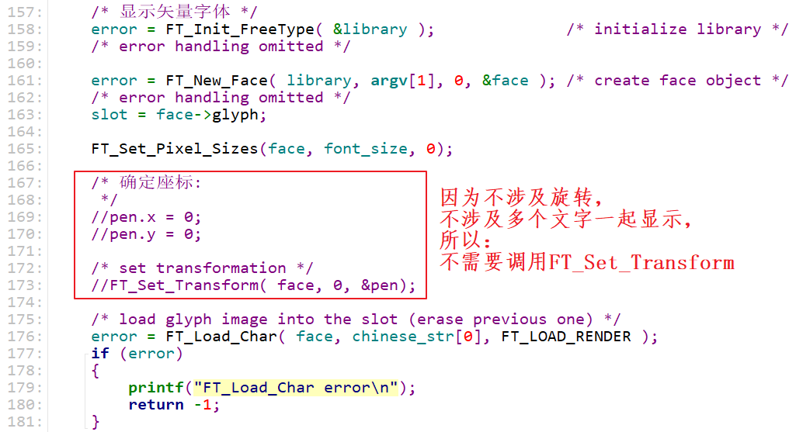

图 6.21 使用freetype获取字符位图

1.  初始化freetype库

```
158  error = FT_Init_FreeType( &library ); /* initialize library */
```

1.  加载字体文件，保存在&face中：

```
161 error = FT_New_Face( library, argv[1], 0, &face ); /* create face object */
162 /* error handling omitted */
163 slot = face->glyph;
```

第163行是从face中获得FT\_GlyphSlot，后面的代码中文字的位图就是保存在FT\_GlyphSlot里。

1.  设置字体大小

```
165     FT_Set_Pixel_Sizes(face, font_size, 0);
```

1.  根据编码值得到位图

使用FT\_Load\_Char函数，就可以实现这3个功能：

-   根据编码值获得glyph\_index：FT\_Get\_Char\_Index
-   根据glyph\_idex取出glyph：FT\_Load\_Glyph
-   渲染出位图：FT\_Render\_Glyph

代码如下：

```
175     /* load glyph image into the slot (erase previous one) */
176     error = FT_Load_Char( face, chinese_str[0], FT_LOAD_RENDER );
```

执行FT\_Load\_Char之后，字符的位图被存在slot-&gt;bitmap里，即face-&gt;glyph-&gt;bitmap。

-   -   -   -   1.  在屏幕上显示位图

位图里的数据格式是怎样的？参考example1.c的代码，可以得到图 6.22：

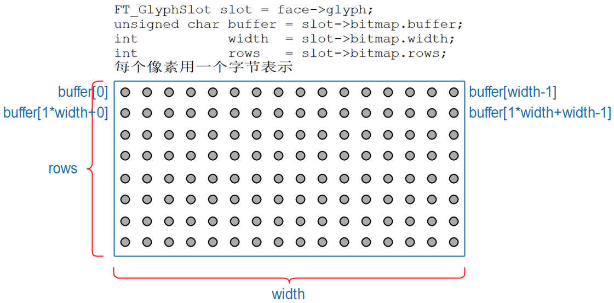

<a id="_Ref108707453"></a>图 6.22 位图数据格式

要在屏幕上显示出这些位图，并不复杂：

```
183     draw_bitmap( &slot->bitmap,
184                  var.xres/2,
185                  var.yres/2);
```

draw\_bitmap函数代码如下，由于位图中每一个像素用一个字节来表示，在0x00RRGGBB的颜色格式中它只能表示蓝色，所以在LCD上显示出来的文字是蓝色的：

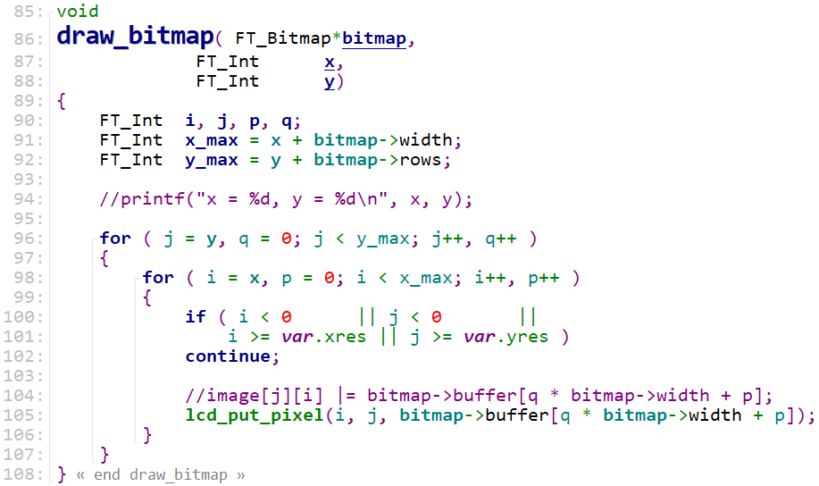

图 6.23 LCD 显示位图函数

-   -   -   -   1.  编译

编译命令(如果你使用的交叉编译链前缀不是arm-buildroot-linux-gnueabihf，请自行修改命令)：

```bash
arm-buildroot-linux-gnueabihf-gcc -o freetype_show_font freetype_show_font.c  -lfreetype
```

它会提示如下错误：

```bash
freetype_show_font.c:12:10: fatal error: ft2build.h: No such file or directory
 #include <ft2build.h>
          ^~~~~~~~~~~~
compilation terminated.
```

我们不是已经编译过freetype并且把头文件复制进工具链里了吗？怎么还有这个错误？

我们编译出freetype后，得到的ft2build.h是位于freetype2目录里，我们把整个freetype2目录复制进了工具链里。

但是包括头文件时，用的是“#include &lt;ft2build.h&gt;”，要么改成：

```
#include <freetype2/ft2build.h>
```

要么把工具链里incldue/freetype2/\*.h 复制到上一级目录，我们使用这种方法：跟freetype文档保持一致。执行以下命令：

```bash
book@100ask$ cd   /home/book/100ask_imx6ull-sdk/ToolChain/arm-buildroot-linux-gnueabihf_sdk-buildroot/bin/../lib/gcc/arm-buildroot-linux-gnueabihf/7.5.0/include
book@100ask$ mv  freetype2/*   ./
```

然后再次执行以下命令：

```bash
arm-buildroot-linux-gnueabihf-gcc -o freetype_show_font freetype_show_font.c  -lfreetype
```

-   -   -   -   1.  上机

将编译好的freetype\_show\_font文件与simsun.ttc字体文件拷贝至开发板，这2个文件放在同一个目录下，然后执行以下命令。

```bash
[root@100ask:~]# ./freetype_show_font  ./simsun.ttc
```

或

```bash
[root@100ask:~]# ./freetype_show_font  ./simsun.ttc   300
```

如果实验成功，我们将在屏幕中间看到一个蓝色的“繁”字。

### 6.5.4 在LCD上令矢量字体旋转某个角度

使用GIT下载所有源码后，本节源码位于如下目录：

01\_all\_series\_quickstart\\

04\_嵌入式Linux应用开发基础知识\\

source\\10\_freetype\\03\_freetype\_show\_font\_angle\\freetype\_show\_font\_angle.c

在实现显示一个矢量字体后，我们可以添加让该字旋转某个角度的功能，主要代码还是参照example1.c。

-   -   -   -   1.  关键代码

1.  定义2个变量：角度、矩阵，如图 6.24：

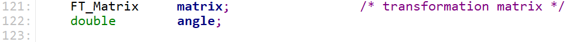

<a id="_Ref108707662"></a>图 6.24 定义角度、矩阵变量

1.  设置角度值：


图 6.25 设置角度值

1.  设置矩阵、变形、加载位图：

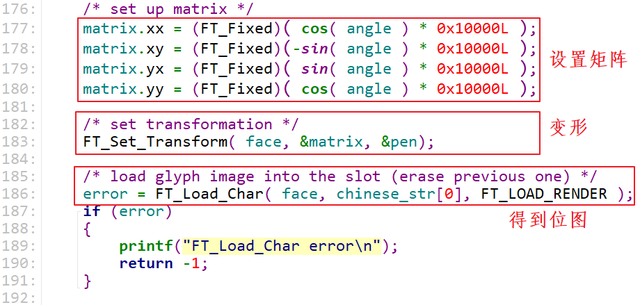

图 6.26 设置矩阵、变形、加载位图

-   -   -   -   1.  编译

编译命令(如果你使用的交叉编译链前缀不是arm-buildroot-linux-gnueabihf，请自行修改命令)：

```bash
arm-buildroot-linux-gnueabihf-gcc -o freetype_show_font_angle freetype_show_font_angle.c  -lfreetype -lm
```

-   -   -   -   1.  上机

将编译好的freetype\_show\_font\_angle文件与simsun.ttc字体文件拷贝至开发板，这2个文件放在同一个目录下，然后执行以下命令。

```bash
[root@100ask:~]# ./freetype_show_font_angle  ./simsun.ttc   90  200
```

如果实验成功，我们将在屏幕中间看到一个蓝色的、旋转了90度的“繁”字。

<a id="_Toc197788641"></a>
## 6.6 使用freetype显示一行文字

使用GIT下载所有源码后，本节源码位于如下目录：

01\_all\_series\_quickstart\\

04\_嵌入式Linux应用开发基础知识\\

source\\10\_freetype\\04\_show\_line\\show\_line.c

本节的目的：在LCD上指定一个左上角坐标(x, y)，把一行文字显示出来。下图中，文字的外框用虚线表示，外框的左上角坐标就是(x, y)。

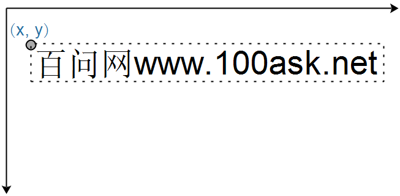

图 6.27 显示一行文字

### 6.6.1 笛卡尔坐标系

在LCD的坐标系中，原点在屏幕的左上角。对于笛卡尔坐标系，原点在左下角。freetype使用笛卡尔坐标系，在显示时需要转换为LCD坐标系。

从图 6.28可知，X方向坐标值是一样的。

在Y方向坐标值需要换算，假设LCD的高度是V。

在LCD坐标系中坐标是(x, y)，那么它在笛卡尔坐标系中的坐标值为(x, V-y)。

反过来也是一样的，在笛卡尔坐标系中坐标是(x, y)，那么它在LCD坐标系中坐标值为(x, V-y)。

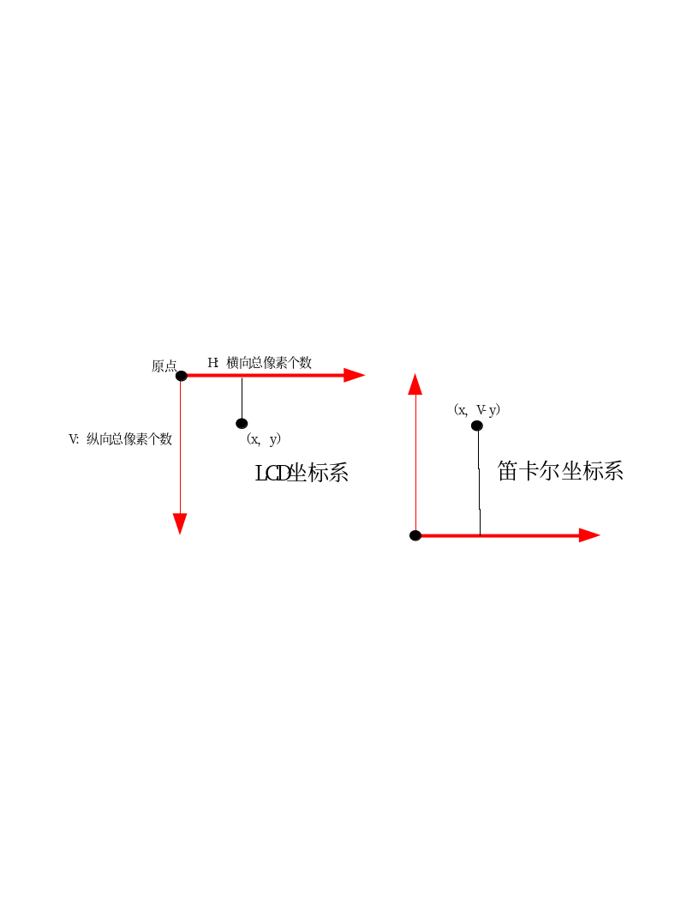

<a id="_Ref108707833"></a>图 6.28 LCD坐标体系与笛卡尔坐标体系

### 6.6.2 每个字符的大小可能不同

在使用FT\_Set\_Pixel\_Sizes函数设置字体大小时，这只是“期望值”。比如“百问网www.100ask.net”，如果把“.”显示得跟其他汉字一样大，不好看。

所以在显示一行文字时，后面文字的位置会受到前面文字的影响。

幸好，freetype帮我们考虑到了这些影响。

对于freetype字体的尺寸(freetype Metrics)，需要参考图 6.29这个文档：

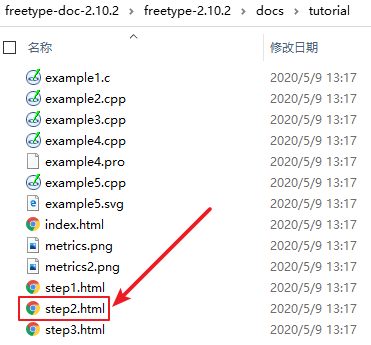

<a id="_Ref108707892"></a>图 6.29 freetype参考文档

上述文档中列出了一个图，摘录如下：

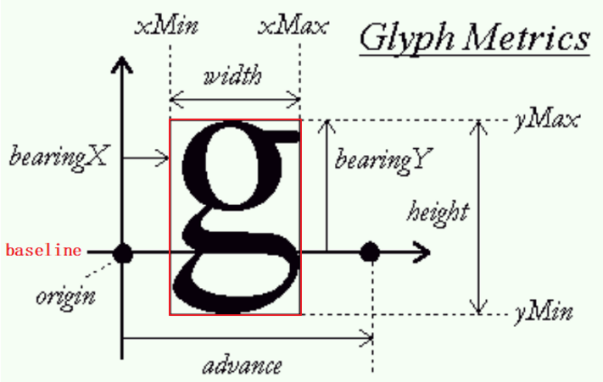

图 6.30 字符大小示意图

在显示一行文字时，这些文字会基于同一个基线来绘制位图：baseline。

在baseline上，每一个字符都有它的原点(origin)，比如上图中baseline左边的黑色圆点就是字母“g”的原点。当前origin加上advance就可以得到下一个字符的origin，比如上图中baseline右边的黑色圆点。在显示一行中多个文件字时，后一个文字的原点依赖于前一个文字的原点及advance。

字符的位图是有可能越过baseline的，比如上图中字母“g”在baseline下方还有图像。

上图中红色方框内就是字母“g”所点据的位图，它的四个角落不一定与原点重合。

上图中那些xMin、xMax、yMin、yMax如何获得？可以使用FT\_Glyph\_Get\_CBox函数获得一个字体的这些参数，将会保存在一个FT\_BBox结构体中，以后想计算一行文字的外框时要用到图 6.31这些信息：

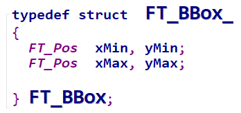

<a id="_Ref108707970"></a>图 6.31 字符外框信息

### 6.6.3 怎么在指定位置显示一行文字

要显示一行文字时，每一个字符都有自己外框：xMin、xMax、yMin、yMax。把这些字符的xMin、yMin中的最小值取出来，把这些字符的xMax、yMax中的最大值取出来，就可以确定这行文字的外框了。

要想在指定位置(x, y)显示一行文字，步骤如图 6.32所示：

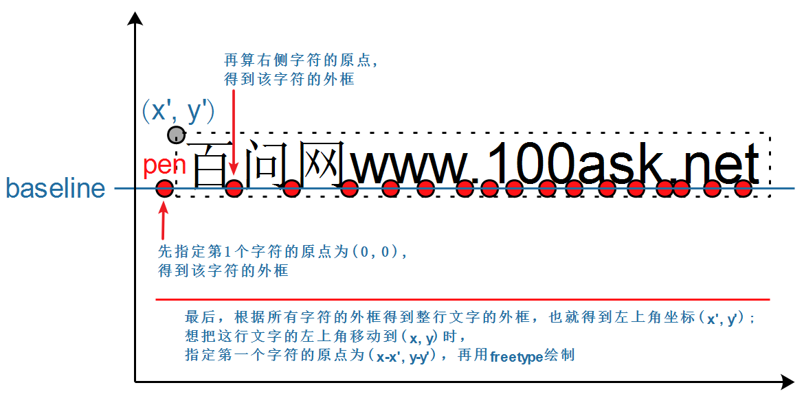

<a id="_Ref108708017"></a>图 6.32 显示一行文字步骤

1.  先指定第1个字符的原点pen坐标为(0, 0)，计算出它的外框
2.  再计算右边字符的原点，也计算出它的外框

把所有字符都处理完后就可以得到一行文字的整体外框：假设外框左上角坐标为(x', y')。

1.  想在(x, y)处显示这行文字，调整一下pen坐标即可。怎么调整？

pen为(0, 0)时对应左上角(x', y')；那么左上角为(x, y)时就可以算出pen为(x-x', y-y')。

### 6.6.4 freetype的几个重要数据结构

要想形象地理解程序，需要先介绍一下freetype中几个数据结构：

-   -   -   -   1.  FT\_Library

对应freetype库，使用freetype之前要先调用以下代码：

```
FT_Library  library; /* 对应freetype库 */
error = FT_Init_FreeType( &library ); /* 初始化freetype库 */
```

-   -   -   -   1.  FT\_Face

它对应一个矢量字体文件，在源码中使用FT\_New\_Face函数打开字体文件后，就可以得到一个face。

为什么称之为face？

估计是文字都是写在二维平面上的吧，正对着人脸？不用管原因了，总之认为它对应一个字体文件就可以。

代码如下：

```
error = FT_New_Face(library, font_file, 0, &face ); /* 加载字体文件 */
```

-   -   -   -   1.  FT\_GlyphSlot

插槽？用来保存字符的处理结果：比如转换后的glyph、位图，如图 6.33：

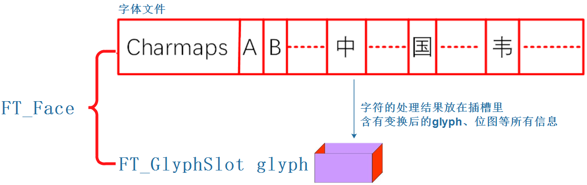

<a id="_Ref108708118"></a>图 6.33 转换后的字符

一个face中有很多字符，生成一个字符的点阵位图时，位图保存在哪里？保存在插槽中：face-&gt;glyph。

生成第1个字符位图时，它保存在face-&gt;glyph中；生成第2个字符位图时，也会保存在face-&gt;glyph中，会覆盖第1个字符的位图。

代码如下：

```
FT_GlyphSlot  slot = face->glyph; /* 插槽: 字体的处理结果保存在这里 */
```

-   -   -   -   1.  FT\_Glyph

字体文件中保存有字符的原始关键点信息，使用freetype的函数可以放大、缩小、旋转，这些新的关键点保存在插槽中(注意：位图也是保存在插槽中)。

新的关键点使用FT\_Glyph来表示，可以使用这样的代码从slot中获得glyph：

```
error = FT_Get_Glyph(slot , &glyph);
```

-   -   -   -   1.  FT\_BBox

FT\_BBox结构体定义如下，它表示一个字符的外框，即新glyph的外框：


图 6.34 新的glyph外框

可以使用以下代码从glyph中获得这些信息：

```
FT_Glyph_Get_CBox(glyph, FT_GLYPH_BBOX_TRUNCATE, &bbox );
```

针对上述流程，示例代码如下：

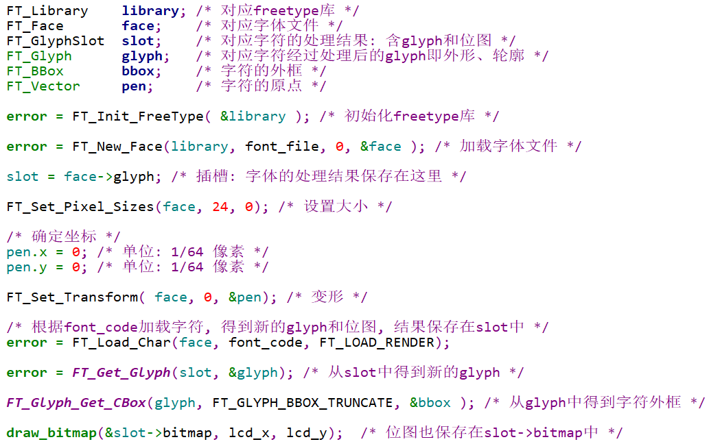

图 6.35 流程代码

### 6.6.5 计算一行文字的外框

前面提到过，一行文字中：后一个字符的原点=前一个字符的原点+advance。所以要计算一行文字的外框，需要按照排列顺序处理其中的每一个字符。

代码如下，注释写得很清楚了：

```
102 int compute_string_bbox(FT_Face       face, wchar_t *wstr, FT_BBox  *abbox)
103 {
104     int i;
105     int error;
106     FT_BBox bbox;
107     FT_BBox glyph_bbox;
108     FT_Vector pen;
109     FT_Glyph  glyph;
110     FT_GlyphSlot slot = face->glyph;
111
112     /* 初始化 */
113     bbox.xMin = bbox.yMin = 32000;
114     bbox.xMax = bbox.yMax = -32000;
115
116     /* 指定原点为(0, 0) */
117     pen.x = 0;
118     pen.y = 0;
119
120     /* 计算每个字符的bounding box */
121     /* 先translate, 再load char, 就可以得到它的外框了 */
122     for (i = 0; i < wcslen(wstr); i++)
123     {
124         /* 转换：transformation */
125         FT_Set_Transform(face, 0, &pen);
126
127         /* 加载位图: load glyph image into the slot (erase previous one) */
128         error = FT_Load_Char(face, wstr[i], FT_LOAD_RENDER);
129         if (error)
130         {
131             printf("FT_Load_Char error\n");
132             return -1;
133         }
134
135         /* 取出glyph */
136         error = FT_Get_Glyph(face->glyph, &glyph);
137         if (error)
138         {
139             printf("FT_Get_Glyph error!\n");
140             return -1;
141         }
142
143         /* 从glyph得到外框: bbox */
144         FT_Glyph_Get_CBox(glyph, FT_GLYPH_BBOX_TRUNCATE, &glyph_bbox);
145
146         /* 更新外框 */
147         if ( glyph_bbox.xMin < bbox.xMin )
148             bbox.xMin = glyph_bbox.xMin;
149
150         if ( glyph_bbox.yMin < bbox.yMin )
151             bbox.yMin = glyph_bbox.yMin;
152
153         if ( glyph_bbox.xMax > bbox.xMax )
154             bbox.xMax = glyph_bbox.xMax;
155
156         if ( glyph_bbox.yMax > bbox.yMax )
157             bbox.yMax = glyph_bbox.yMax;
158
159         /* 计算下一个字符的原点: increment pen position */
160         pen.x += slot->advance.x;
161         pen.y += slot->advance.y;
162     }
163
164     /* return string bbox */
165     *abbox = bbox;
166 }
```

### 6.6.6 调整原点并绘制

代码如下，也不复杂：

```
169 int display_string(FT_Face     face, wchar_t *wstr, int lcd_x, int lcd_y)
170 {
171     int i;
172     int error;
173     FT_BBox bbox;
174     FT_Vector pen;
175     FT_Glyph  glyph;
176     FT_GlyphSlot slot = face->glyph;
177
178     /* 把LCD坐标转换为笛卡尔坐标 */
179     int x = lcd_x;
180     int y = var.yres - lcd_y;
181
182     /* 计算外框 */
183     compute_string_bbox(face, wstr, &bbox);
184
185     /* 反推原点 */
186     pen.x = (x - bbox.xMin) * 64; /* 单位: 1/64像素 */
187     pen.y = (y - bbox.yMax) * 64; /* 单位: 1/64像素 */
188
189     /* 处理每个字符 */
190     for (i = 0; i < wcslen(wstr); i++)
191     {
192         /* 转换：transformation */
193         FT_Set_Transform(face, 0, &pen);
194
195         /* 加载位图: load glyph image into the slot (erase previous one) */
196         error = FT_Load_Char(face, wstr[i], FT_LOAD_RENDER);
197         if (error)
198         {
199             printf("FT_Load_Char error\n");
200             return -1;
201         }
202
203         /* 在LCD上绘制: 使用LCD坐标 */
204         draw_bitmap( &slot->bitmap,
205                         slot->bitmap_left,
206                         var.yres - slot->bitmap_top);
207
208         /* 计算下一个字符的原点: increment pen position */
209         pen.x += slot->advance.x;
210         pen.y += slot->advance.y;
211     }
212
213     return 0;
214 }
```

### 6.6.7 上机实验

编译命令(如果你使用的交叉编译链前缀不是arm-buildroot-linux-gnueabihf，请自行修改命令)：

```bash
arm-buildroot-linux-gnueabihf-gcc  -o  show_line  show_line.c   -lfreetype
```

将编译好的show\_line文件与simsun.ttc字体文件拷贝至开发板，这2个文件放在同一个目录下，然后执行以下命令(其中的3个数字分别表示LCD的X坐标、Y坐标、字体大小)：

```bash
[root@100ask:~]# ./show_line ./simsun.ttc 10 200 80
```

如果实验成功，可以在LCD上看到一行文字“百问网[www.100ask.net](http://www.100ask.net)”。

### 6.6.8 课后作业

1.  修改程序，支持倾斜角度显示一行文字。
2.  修改程序，支持显示多行文字。
