<a id="_Toc197788642"></a>

<a id="_Toc197788643"></a>
## 7.1 什么是输入系统

-   先来了解什么是输入设备？

常见的输入设备有键盘、鼠标、遥控杆、书写板、触摸屏等等,用户通过这些输入设备与Linux系统进行数据交换。

-   什么是输入系统？

输入设备种类繁多，能否统一它们的接口？既在驱动层面统一，也在应用程序层面统一？可以的。

Linux系统为了统一管理这些输入设备，实现了一套能兼容所有输入设备的框架：输入系统。驱动开发人员基于这套框架开发出程序，应用开发人员就可以使用统一的API去使用设备。

<a id="_Toc197788644"></a>
## 7.2 输入系统框架及调试

### 7.2.1 框架概述

作为应用开发人员，可以只基于API使用输入子系统。但是了解内核中输入子系统的框架、了解数据流程，有助于解决开发过程中碰到的硬件问题、驱动问题。

输入系统框架如图 7.1所示：

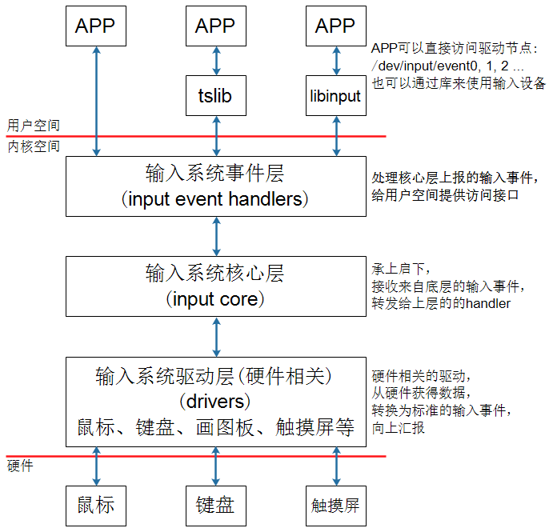

<a id="_Ref108708430"></a>图 7.1 输入系统框架

假设用户程序直接访问/dev/input/event0设备节点，或者使用tslib访问设备节点，数据的流程如下：

1.  APP发起读操作，若无数据则休眠；
2.  用户操作设备，硬件上产生中断；
3.  输入系统驱动层对应的驱动程序处理中断：

读取到数据，转换为标准的输入事件，向核心层汇报。

所谓输入事件就是一个“struct input\_event”结构体。

1.  核心层可以决定把输入事件转发给上面哪个handler来处理：

从handler的名字来看，它就是用来处输入操作的。有多种handler，比如：evdev\_handler、kbd\_handler、joydev\_handler等等。

最常用的是evdev\_handler：它只是把input\_event结构体保存在内核buffer等，APP来读取时就原原本本地返回。它支持多个APP同时访问输入设备，每个APP都可以获得同一份输入事件。

当APP正在等待数据时，evdev\_handler会把它唤醒，这样APP就可以返回数据。

1.  APP对输入事件的处理：

APP获得数据的方法有2种：直接访问设备节点(比如/dev/input/event0,1,2,...)，或者通过tslib、libinput这类库来间接访问设备节点。这些库简化了对数据的处理。

要想深入理解整个输入系统，就必须研究内核的输入系统，这在后续的“驱动大全”中会讲解。

### 7.2.2 编写APP需要掌握的知识

基于编写应用程序的角度，只需要理解这些内容：

-   -   -   -   1.  内核中怎么表示一个输入设备？

使用input\_dev结构体来表示输入设备，它的内容如图 7.2：

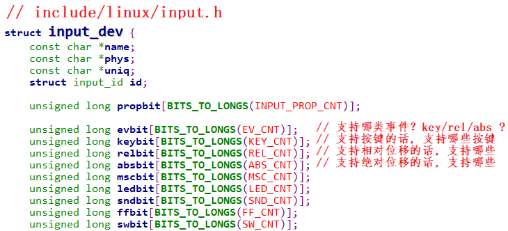

<a id="_Ref108708501"></a>图 7.2 输入设备结构体

-   -   -   -   1.  APP可以得到什么数据？

可以得到一系列的输入事件，就是一个一个“struct input\_event”，它定义如图 7.3：

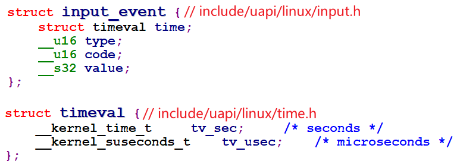

<a id="_Ref108708550"></a>图 7.3 输入事件结构体

每个输入事件input\_event中都含有发生时间：timeval表示的是“自系统启动以来过了多少时间”，它是一个结构体，含有“tv\_sec、tv\_usec”两项(即秒、微秒)。

输入事件input\_event中更重要的是：type(哪类事件)、code(哪个事件)、value(事件值)，细讲如下：

1.  type：表示哪类事件

比如EV\_KEY表示按键类、EV\_REL表示相对位移(比如鼠标)，EV\_ABS表示绝对位置(比如触摸屏)。有图 7.4这几类事件(参考Linux内核头文件)：

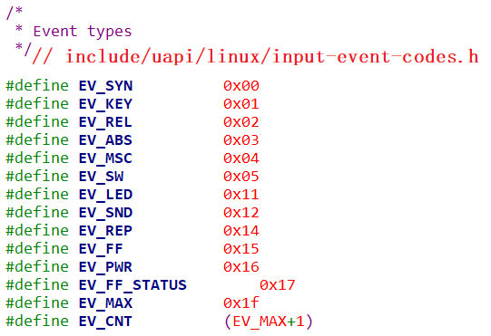

<a id="_Ref108708671"></a>图 7.4 EV\_TYPE

1.  code：表示该类事件下的哪一个事件

比如对于EV\_KEY(按键)类事件，它表示键盘。键盘上有很多按键，比如数字键1、2、3，字母键A、B、C里等。所以可以有图 7.5这些事件：

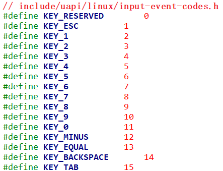

<a id="_Ref108708662"></a>图 7.5 按键事件

对于触摸屏，它提供的是绝对位置信息，有X方向、Y方向，还有压力值。所以code值有图 7.6这些：

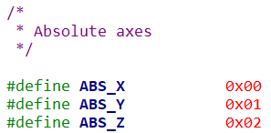

<a id="_Ref108708691"></a>图 7.6 绝对位置信息

1.  value：表示事件值

对于按键，它的value可以是0(表示按键被按下)、1(表示按键被松开)、2(表示长按)；

对于触摸屏，它的value就是坐标值、压力值。

1.  事件之间的界线

APP读取数据时，可以得到一个或多个数据，比如一个触摸屏的一个触点会上报X、Y位置信息，也可能会上报压力值。

-   -   APP怎么知道它已经读到了完整的数据？

驱动程序上报完一系列的数据后，会上报一个“同步事件”，表示数据上报完毕。APP读到“同步事件”时，就知道已经读完了当前的数据。

同步事件也是一个input\_event结构体，它的type、code、value三项都是0。

-   -   -   -   1.  输入子系统支持完整的API操作

支持这些机制：阻塞、非阻塞、POLL/SELECT、异步通知。

注意：如果你想深入理解上述机制，需要学习以下内容：

-   《第5篇 嵌入式Linux驱动开发基础知识 [第十九章 驱动程序基石》](/docs/Linux-Application-Development-Manual/part-5/chapter-41#_第十九章_驱动程序基石)

### 7.2.3 调试技巧

-   -   -   -   1.  确定设备信息

输入设备的设备节点名为/dev/input/eventX(也可能是/dev/eventX，X表示0、1、2等数字)。查看设备节点，可以执行以下命令：

```bash
ls /dev/input/* -l
```

或

```bash
ls /dev/event* -l
```

可以看到图 7.7类似下面的信息：

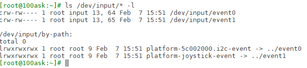

<a id="_Ref108708862"></a>图 7.7 查找设备节点

怎么知道这些设备节点对应什么硬件呢？可以在板子上执行以下命令：

```bash
cat /proc/bus/input/devices
```

这条指令的含义就是获取与event对应的相关设备信息，可以看到类似以下的结果：

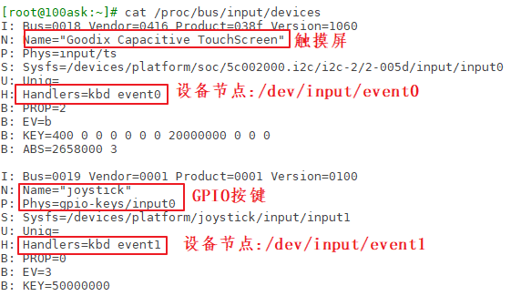

图 7.8 查看设备信息

那么这里的I、N、P、S、U、H、B对应的每一行是什么含义呢？

1.  I:id of the device(设备ID)

该参数由结构体struct input\_id来进行描述，驱动程序中会定义这样的结构体：

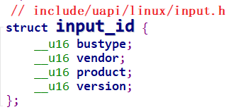

图 7.9 设备ID

1.  N:name of the device

设备名称

1.  P:physical path to the device in the system hierarchy

系统层次结构中设备的物理路径。

1.  S:sysfs path

位于sys文件系统的路径

1.  U:unique identification code for the device(if device has it)

设备的唯一标识码

1.  H:list of input handles associated with the device.

与设备关联的输入句柄列表。

1.  B:bitmaps(位图)

```
PROP:device properties and quirks(设备属性)
EV:types of events supported by the device(设备支持的事件类型)
KEY:keys/buttons this device has(此设备具有的键/按钮)
MSC:miscellaneous events supported by the device(设备支持的其他事件)
LED:leds present on the device(设备上的指示灯)
```

值得注意的是B位图，比如上图中“B: EV=b”用来表示该设备支持哪类输入事件。b的二进制是1011，bit0、1、3为1，表示该设备支持0、1、3这三类事件，即EV\_SYN、EV\_KEY、EV\_ABS。

再举一个例子，“B: ABS=2658000 3”如何理解？

它表示该设备支持EV\_ABS这一类事件中的哪一些事件。这是2个32位的数字：0x2658000、0x3，高位在前低位在后，组成一个64位的数字：“0x2658000,00000003”，数值为1的位有：0、1、47、48、50、53、54，即：0、1、0x2f、0x30、0x32、0x35、0x36，对应以下这些宏：

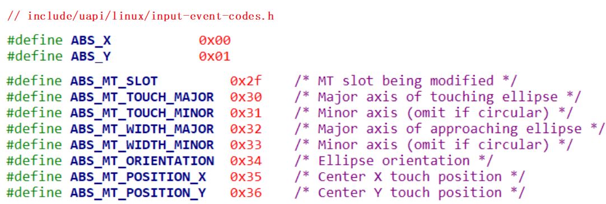

图 7.10 绝对信息宏定义

即这款输入设备支持上述的ABS\_X、ABS\_Y、ABS\_MT\_SLOT、ABS\_MT\_TOUCH\_MAJOR、ABS\_MT\_WIDTH\_MAJOR、ABS\_MT\_POSITION\_X、ABS\_MT\_POSITION\_Y这些绝对位置事件(它们的含义在后面讲解电容屏时再细讲)。

-   -   -   -   1.  使用命令读取数据

调试输入系统时，直接执行类似下面的命令，然后操作对应的输入设备即可读出数据：

```bash
hexdump /dev/input/event0
```

在开发板上执行上述命令之后，点击按键或是点击触摸屏，就会打印图 7.11信息：

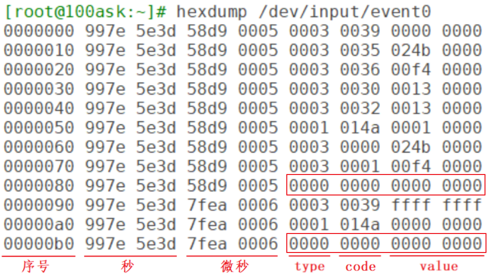

<a id="_Ref108709071"></a>图 7.11 按键或触摸打印信息

图 7.11中的type为3，对应EV\_ABS；code为0x35对应ABS\_MT\_POSITION\_X；code为0x36对应ABS\_MT\_POSITION\_Y。

上图中还发现有2个同步事件：它的type、code、value都为0。表示电容屏上报了2次完整的数据。

<a id="_Toc197788645"></a>
## 7.3 不使用库的应用程序示例

使用GIT下载所有源码后，本节源码位于如下目录：

01\_all\_series\_quickstart\\

04\_嵌入式Linux应用开发基础知识\\

source\\11\_input\\01\_app\_demo\\

有些同学反馈：老师，你不从0写代码，我都不知道怎么写程序了。基础好的同学直接看这个文档，我录完这个视频后会补齐这个文档，你能看到这部分手册时肯定已经齐全了。

### 7.3.1 输入系统支持完整的API操作

支持这些机制：阻塞、非阻塞、POLL/SELECT、异步通知。

注意：如果你想深入理解上述机制，需要学习以下内容：


作为APP开发人员，即使没有深入理解这些机制，也是可以编写出程序的。

### 7.3.2 APP访问硬件的4种方式：妈妈怎么知道孩子醒了


图 7.12 举例示意图

妈妈怎么知道卧室里小孩醒了？

1.  时不时进房间看一下：查询方式

简单，但是累

1.  进去房间陪小孩一起睡觉，小孩醒了会吵醒她：休眠-唤醒

不累，但是妈妈干不了活了

1.  妈妈要干很多活，但是可以陪小孩睡一会，定个闹钟：poll方式

要浪费点时间，但是可以继续干活。

妈妈要么是被小孩吵醒，要么是被闹钟吵醒。

1.  妈妈在客厅干活，小孩醒了他会自己走出房门告诉妈妈：异步通知

妈妈、小孩互不耽误。

这4种方法没有优劣之分，在不同的场合使用不同的方法。

### 7.3.3 获取设备信息

通过ioctl获取设备信息，ioctl的参数如下：

```
int ioctl(int fd, unsigned long request, ...);
```

有些驱动程序对request的格式有要求，它的格式如下：

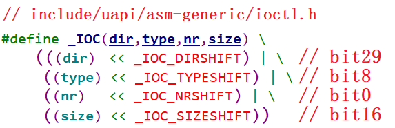

图 7.13 request格式要求

比如dir为\_IOC\_READ(即2)时，表示APP要读数据；为\_IOC\_WRITE(即4)时，表示APP要写数据。

-   size表示这个ioctl能传输数据的最大字节数。
-   type、nr的含义由具体的驱动程序决定。

比如要读取输入设备的evbit时，ioctl的request要写为“EVIOCGBIT(0, size)”，size的大小可以由你决定：你想读多少字节就设置为多少。这个宏的定义如下：


图 7.14 size宏定义

### 7.3.4 查询方式

APP调用open函数时，传入“O\_NONBLOCK”表示“非阻塞”。

APP调用read函数读取数据时，如果驱动程序中有数据，那么APP的read函数会返回数据，否则也会立刻返回错误。

### 7.3.5 休眠-唤醒方式

APP调用open函数时，不要传入“O\_NONBLOCK”。

APP调用read函数读取数据时，如果驱动程序中有数据，那么APP的read函数会返回数据；否则APP就会在内核态休眠，当有数据时驱动程序会把APP唤醒，read函数恢复执行并返回数据给APP。

### 7.3.6 POLL/SELECT方式

-   -   -   -   1.  功能介绍

POLL机制、SELECT机制是完全一样的，只是APP接口函数不一样。

简单地说，它们就是“定个闹钟”：在调用poll、select函数时可以传入“超时时间”。在这段时间内，条件合适时(比如有数据可读、有空间可写)就会立刻返回，否则等到“超时时间”结束时返回错误。

用法如下。

-   APP先调用open函数时。
-   APP不是直接调用read函数，而是先调用poll或select函数，这2个函数中可以传入“超时时间”。它们的作用是：如果驱动程序中有数据，则立刻返回；否则就休眠。在休眠期间，如果有人操作了硬件，驱动程序获得数据后就会把APP唤醒，导致poll或select立刻返回；如果在“超时时间”内无人操作硬件，则时间到后poll或select函数也会返回。APP可以根据函数的返回值判断返回原因：有数据？无数据超时返回？
-   APP根据poll或select的返回值判断有数据之后，就调用read函数读取数据时，这时就会立刻获得数据。
-   poll/select函数可以监测多个文件，可以监测多种事件：

表 7‑1 poll/select监测事件


| 事件类型 | 说明 |
| --- | --- |
| POLLIN | 有数据可读 |
| POLLRDNORM | 等同于POLLIN |
| POLLRDBAND | Priority band data can be read，有优先级较较高的“band data”可读<br />Linux系统中很少使用这个事件 |
| POLLPRI | 高优先级数据可读 |
| POLLOUT | 可以写数据 |
| POLLWRNORM | 等同于POLLOUT |
| POLLWRBAND | Priority data may be written |
| POLLERR | 发生了错误 |
| POLLHUP | 挂起 |
| POLLNVAL | 无效的请求，一般是fd未open |


在调用poll函数时，要指明：

-   你要监测哪一个文件：哪一个fd
-   你想监测这个文件的哪种事件：是POLLIN、还是POLLOUT

最后，在poll函数返回时，要判断状态。

应用程序代码如下：

```
struct pollfd fds[1];
int timeout_ms = 5000;
int ret;
fds[0].fd = fd;
fds[0].events = POLLIN;
ret = poll(fds, 1, timeout_ms);
if ((ret == 1) && (fds[0].revents & POLLIN))
{
	read(fd, &val, 4);
	printf("get button : 0x%x\n", val);
}
```

-   -   -   -   1.  现在编程：使用POLL

使用GIT下载所有源码后，本节源码位于如下目录：

01\_all\_series\_quickstart\\

04\_嵌入式Linux应用开发基础知识\\

source\\11\_input\\01\_app\_demo\\03\_input\_read\_poll.c

精简过的核心源码如下：

```
14 int main(int argc, char **argv)
15 {
16      int fd;
26      struct pollfd fds[1];
……
61      fd = open(argv[1], O_RDWR | O_NONBLOCK);
……
94      while (1)
95      {
96              fds[0].fd = fd;
97              fds[0].events  = POLLIN;
98              fds[0].revents = 0;
99              ret = poll(fds, nfds, 5000);
100             if (ret > 0)
101             {
102                     if (fds[0].revents == POLLIN)
103                     {
104                             while (read(fd, &event, sizeof(event)) == sizeof(event))
105                             {
106                                     printf("get event: type = 0x%x, code = 0x%x, value = 0x%x\n", event.type, event.code, event.value);
107                             }
108                     }
109             }
110             else if (ret == 0)
111             {
112                     printf("time out\n");
113             }
114             else
115             {
116                     printf("poll err\n");
117             }
118     }
119
120     return 0;
121 }
122
```

第61行：打开设备文件。

第96~98行：设置pollfd结构体。

第96行：想查询哪个文件(fd)？

第97行：想查询什么事件(POLLIN)？

第98行：先清除“返回的事件”(revents)。

第99行：使用poll函数查询事件，指定超时时间为5000(ms)。

第100、110行判断返回值：大于0表示期待的事件发生了，等于0表示超时。

-   -   -   -   1.  课后作业
-   使用poll函数监测多个输入设备。
-   使用select函数实现同样的功能。

### 7.3.7 异步通知方式

-   -   -   -   1.  功能介绍

所谓同步，就是“你慢我等你”。

那么异步就是：你慢那你就自己玩，我做自己的事去了，有情况再通知我。

所谓异步通知，就是APP可以忙自己的事，当驱动程序用数据时它会主动给APP发信号，这会导致APP执行信号处理函数。

仔细想想“发信号”，这只有3个字，却可以引发很多问题：

-   谁发：驱动程序发
-   发什么：信号
-   发什么信号：SIGIO
-   怎么发：内核里提供有函数
-   发给谁：APP，APP要把自己告诉驱动
-   APP收到后做什么：执行信号处理函数
-   信号处理函数和信号，之间怎么挂钩：APP注册信号处理函数

小孩通知妈妈的事情有很多：饿了、渴了、想找人玩。

Linux系统中也有很多信号，在Linux内核源文件include\\uapi\\asm-generic\\signal.h中，有很多信号的宏定义：


图 7.15信号宏定义

驱动程序通知APP时，它会发出“SIGIO”这个信号，表示有“IO事件”要处理。

就APP而言，你想处理SIGIO信息，那么需要提供信号处理函数，并且要跟SIGIO挂钩。这可以通过一个signal函数来“给某个信号注册处理函数”，用法如下：

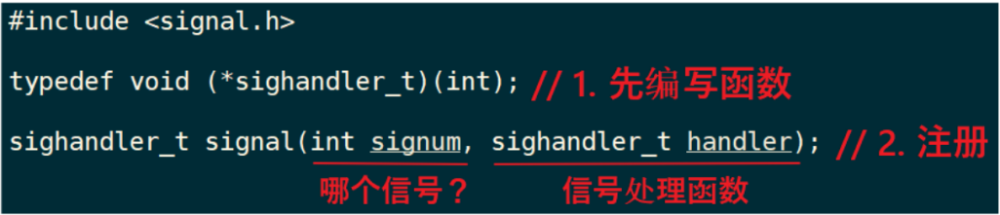

图 7.16信号函数用法

除了注册SIGIO的处理函数，APP还要做什么事？想想这几个问题：

-   内核里有那么多驱动，你想让哪一个驱动给你发SIGIO信号？

APP要打开驱动程序的设备节点。

-   驱动程序怎么知道要发信号给你而不是别人？APP要把自己的进程ID告诉驱动程序。
-   APP有时候想收到信号，有时候又不想收到信号：应该可以把APP的意愿告诉驱动：设置Flag里面的FASYNC位为1，使能“异步通知”。
    -   -   -   1.  应用编程

应用程序要做的事情有这几件：

1.  编写信号处理函数：

```
static void sig_func(int sig)
{
	int val;
	read(fd, &val, 4);
	printf("get button : 0x%x\n", val);
}
```

1.  注册信号处理函数：

```
signal(SIGIO, sig_func);
```

1.  打开驱动：

```
fd = open(argv[1], O_RDWR);
```

1.  把进程ID告诉驱动：

```
fcntl(fd, F_SETOWN, getpid());
```

1.  使能驱动的FASYNC功能：

```
flags = fcntl(fd, F_GETFL);
fcntl(fd, F_SETFL, flags | FASYNC);
```

<a id="_Toc197788646"></a>
## 7.4 电阻屏和电容屏

触摸屏分为电阻屏、电容屏。电阻屏结构简单，在以前很流行；电容屏支持多点触摸，现在的手机基本都是使用电容屏。

**注意**：LCD、触摸屏不是一回事，LCD是输出设备，触摸屏是输入设备。制作触摸屏时特意把它的尺寸做得跟LCD一模一样，并且把触摸屏覆盖在LCD上。

### 7.4.1 电阻屏

-   -   -   -   1.  复习一下欧姆定律

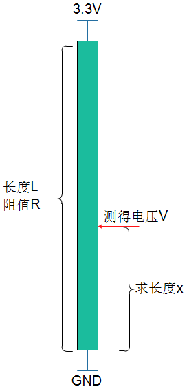

<a id="_Ref108709777"></a>图 7.17 欧姆定律

图 7.17中的电阻假设是均匀的，就是长度和阻值成正比关系。电阻长度为L，阻值为R，在两端施加3.3V电压。在某点测得电阻为V，求上图中长度X。

根据欧姆定律：3.3/R = V/Rx，

因为长度和阻值成正比关系，上述公式转换为：3.3∕L = V/X，所以X=LV/3.3。

-   -   -   -   1.  电阻屏原理

电阻屏就是基于欧姆定律制作的，它有上下两层薄膜，这两层薄膜就是两个电阻，如下图所示：

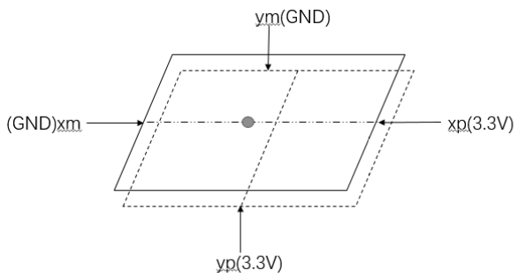

图 7.18 电阻屏原理

平时上下两层薄膜无触触，当点击触摸屏时，上下两层薄膜接触：这时就可以测量触点电压。过程如下：

1.  测量X坐标：

在xp、xm两端施加3.3V电压，yp和ym不施加电压(yp就相当于探针)，测量yp电压值。该电压值就跟X坐标成正比关系，假设：

X = 3.3\*Vyp/Xmax

1.  测量Y坐标：

在yp、ym两端施加3.3V电压，xp和xm不施加电压(xp就相当于探针)，测量xp电压值。该电压值就跟Y坐标成正比关系，假设：

Y = 3.3\*Vxp/Ymax

在实际使用时，电阻屏的Xmax、Ymax无从得知，所以使用之前要先较准：依次点击触摸屏的四个角和中心点，推算出X、Y坐标的公式：

X = func(Vyp)

Y = func(Vxp)

-   -   -   -   1.  电阻屏数据

Linux驱动程序中，会上报触点的X、Y数据，注意：这不是LCD的坐标值，需要APP再次处理才能转换为LCD坐标值。

对应的input\_event结构体中，“type、code、value”如下：

**按下时：**

```
EV_KEY   BTN_TOUCH     1        /* 按下 */
EV_ABS   ABS_PRESSURE  1        /* 压力值，可以上报，也可以不报，可以是其他压力值 */
EV_ABS   ABS_X         x_value  /* X坐标 */
EV_ABS   ABS_Y         y_value  /* Y坐标 */
EV_SYNC  0             0        /* 同步事件 */
```

**松开时：**

```
EV_KEY   BTN_TOUCH     0        /* 松开 */
EV_ABS   ABS_PRESSURE  0        /* 压力值，可以上报，也可以不报 */
EV_SYNC  0             0        /* 同步事件 */
```

### 7.4.2 电容屏

-   -   -   -   1.  原理

原理如图 7.19所示：

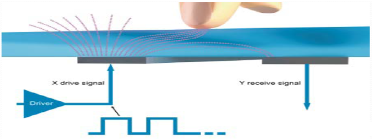

<a id="_Ref108710102"></a>图 7.19 电容屏

电容屏中有一个控制芯片，它会周期性产生驱动信号，接收电极接收到信号，并可测量电荷大小。当电容屏被按下时，相当于引入了新的电容，从而影响了接收电极接收到的电荷大小。主控芯片根据电荷大小即可计算出触点位置。

怎么通过电荷计算出触点位置？这由控制芯片实现，这类芯片一般是I2C接口。

我们只需要编写程序，通过I2C读取芯片寄存器即可得到这些数据。

-   -   -   -   1.  电容屏数据

参考文档：Linux内核Documentation\\input\\multi-touch-protocol.rst。

电容屏可以支持多点触摸(Multi touch)，驱动程序上报的数据中怎么分辨触点？

这有两种方法：Type A、Type B，这也对应两种类型的触摸屏：

1.  Type A

该类型的触摸屏不能分辨是哪一个触点，它只是把所有触点的坐标一股脑地上报，由软件来分辨这些数据分别属于哪一个触点。

Type A已经过时，Linux内核中都没有Type A的源码了。

1.  Type B

该类型的触摸屏能分辨是哪一个触点，上报数据时会先上报触点ID，再上报它的数据。

具体例子如下，这是最简单的示例，使用场景分析来看看它上报的数据。

当有2个触点时(type, code, value)：

```
EV_ABS   ABS_MT_SLOT 0   // 这表示“我要上报一个触点信息了”，用来分隔触点信息
EV_ABS   ABS_MT_TRACKING_ID 45          // 这个触点的ID是45
EV_ABS   ABS_MT_POSITION_X x[0]         // 触点X坐标
EV_ABS   ABS_MT_POSITION_Y y[0]         // 触点Y坐标
EV_ABS   ABS_MT_SLOT 1 // 这表示“我要上报一个触点信息了”，用来分隔触点信息
EV_ABS   ABS_MT_TRACKING_ID 46          // 这个触点的ID是46
EV_ABS   ABS_MT_POSITION_X x[1]         // 触点X坐标
EV_ABS   ABS_MT_POSITION_Y y[1]         // 触点Y坐标
EV_SYNC  SYN_REPORT        0            // 全部数据上报完毕
```

当ID为45的触点正在移动时：

```
EV_ABS   ABS_MT_SLOT 0   // 这表示“我要上报一个触点信息了”，之前上报过ID，就不用再上报ID了
EV_ABS   ABS_MT_POSITION_X x[0]   // 触点X坐标
EV_SYNC  SYN_REPORT         0     // 全部数据上报完毕
```

松开ID为45的触点时(在前面slot已经被设置为0，这里这需要再重新设置slot，slot就像一个全局变量一样：如果它没变化的话，就无需再次设置)：

```
// 刚刚设置了ABS_MT_SLOT为0，它对应ID为45，这里设置ID为-1就表示ID为45的触点被松开了
EV_ABS   ABS_MT_TRACKING_ID -1
EV_SYNC  SYN_REPORT         0    // 全部数据上报完毕
```

最后，松开ID为46的触点：

```
EV_ABS   ABS_MT_SLOT 1       // 这表示“我要上报一个触点信息了”，在前面设置过slot 1的ID为46
EV_ABS   ABS_MT_TRACKING_ID -1  // ID为-1，表示slot 1被松开，即ID为46的触点被松开
EV_SYNC  SYN_REPORT             // 全部数据上报完毕
```

-   -   -   -   1.  电容屏的实验数据

假设你的开发板上电容屏对应的设备节点是/dev/input/event0，执行以下命令：

```bash
hexdump /dev/input/event0
```

然后用一个手指点击触摸屏，得到类似图 7.20的数据：

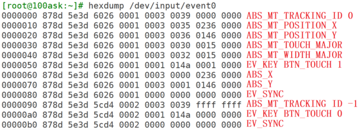

<a id="_Ref108710128"></a>图 7.20 触摸屏打印信息

在上面的数据中，为了兼容老程序，它也上报了ABS\_X、ABS\_Y数据，电阻触摸屏就是使用这类型的数据。所以基于电阻屏的程序，也可以用在电容屏上。

使用两个手指点击触摸屏时，得到类似如下的数据：


图 7.21 双指触摸时打印信息

为了兼容老程序，它也上报了ABS\_X、ABS\_Y数据，但是只上报第1个触点的数据。

<a id="_Toc197788647"></a>
## 7.5 tslib

tslib是一个触摸屏的开源库，可以使用它来访问触摸屏设备，可以给输入设备添加各种“filter”(过滤器，就是各种处理)，地址是：[http://www.tslib.org/](http://www.tslib.org/)。

编译tslib后，可以得到libts库，还可以得到各种工具：较准工具、测试工具。

使用GIT下载所有源码后，本节源码位于如下目录：

01\_all\_series\_quickstart\\

04\_嵌入式Linux应用开发基础知识\\source\\11\_input\\02\_tslib\\

### 7.5.1 tslib框架分析

tslib的主要代码如图 7.22：

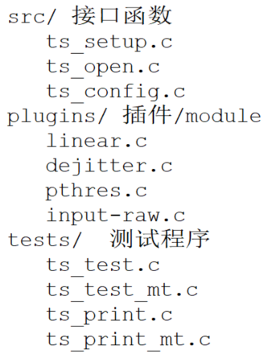

<a id="_Ref108710213"></a>图 7.22 tslib主要代码

核心在于“plugins”目录里的“插件”，或称为“module”。这个目录下的每个文件都是一个module，每个module都提供2个函数：read、read\_mt，前者用于读取单点触摸屏的数据，后者用于读取多点触摸屏的数据。

要分析tslib的框架，先看看示例程序怎么使用，我们参考ts\_test.c和ts\_test\_mt.c，前者用于一般触摸屏(比如电阻屏、单点电容屏)，后者用于多点触摸屏。

一个图就可以弄清楚tslib的框架：

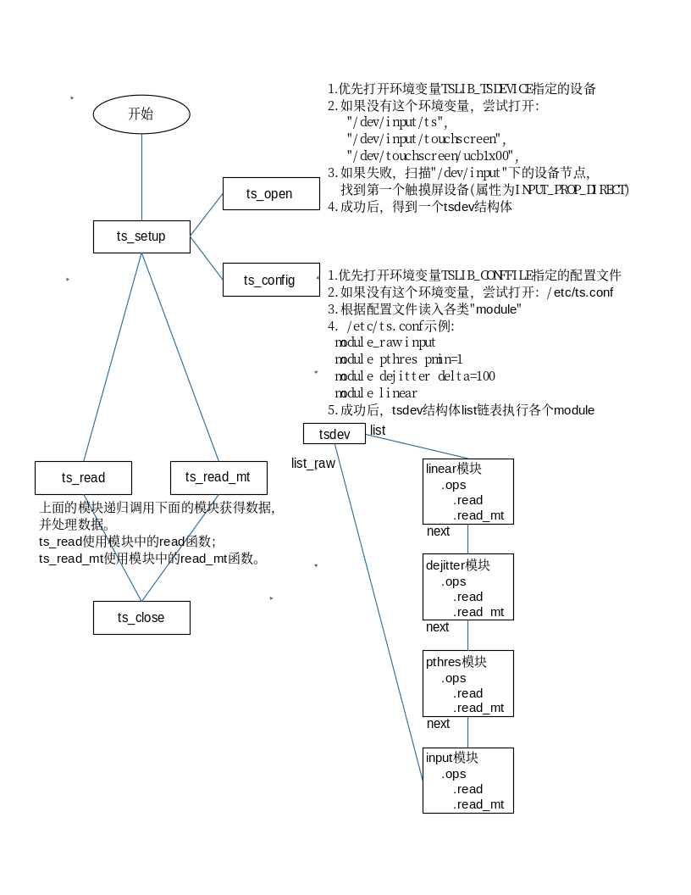

图 7.23 tslib框架

调用ts\_open后，可以打开某个设备节点，构造出一个tsdev结构体。然后调用ts\_config读取配置文件的处理，假设/etc/ts.conf内容如下：

```
 module_raw input
 module pthres pmin=1
 module dejitter delta=100
 module linear
```

每行表示一个“module”或“moduel\_raw”。

对于所有的“module”，都会插入tsdev.list链表头，也就是tsdev.list执行配置文件中最后一个“module”，配置文件中第一个“module”位于链表的尾部。

对于所有的“module\_raw”，都会插入tsdev.list\_raw链表头，一般只有一个“module\_raw”。

注意：tsdev.list中最后一个“module”会指向ts\_dev.list\_raw的头部。

无论是调用ts\_read还是ts\_read\_mt，都是通过tsdev.list中的模块来处理数据的。这写模块是递归调用的，比如linear模块的read函数如图 7.24：

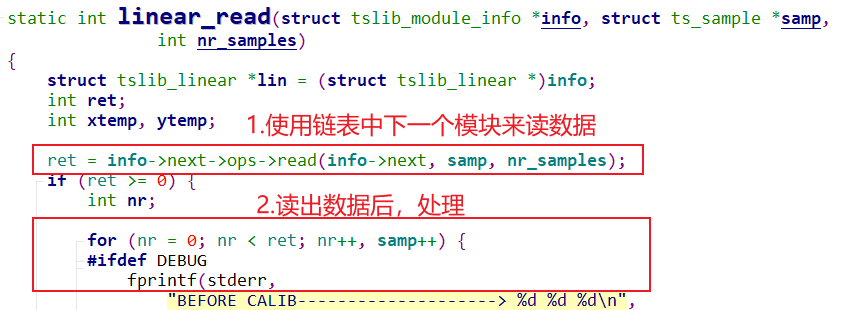

<a id="_Ref108710303"></a>图 7.24 linear的read

linear模块的read\_raw函数如图 7.25：

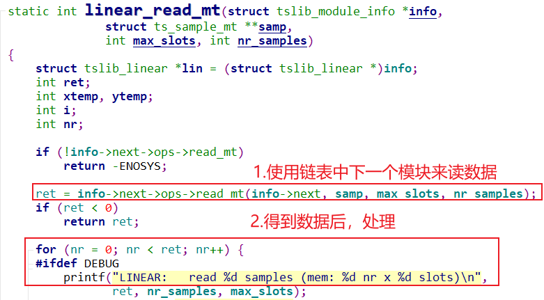

<a id="_Ref108710330"></a>图 7.25 linear的read\_raw

因为是递归调用，所有最先使用input模块读取设备节点得到原始数据，再依次经过pthres模块、dejitter模块、linear模块处理后，才返回最终数据。

### 7.5.2 交叉编译、测试tslib

使用GIT下载所有源码后，本节源码位于如下目录：

01\_all\_series\_quickstart\\

04\_嵌入式Linux应用开发基础知识\\

source\\11\_input\\02\_tslib\\tslib-1.21.tar.xz

本节会涉及这些内容：交叉编译tslib，运行自带的测试程序，后面会自己写一个简单的测试程序。

-   -   -   -   1.  交叉编译tslib

```bash
// 对于IMX6ULL，命令如下
tar xJf tslib-1.21.tar.xz
cd tslib-1.21
./configure  --host=arm-buildroot-linux-gnueabihf  --prefix=/
make
make install DESTDIR=$PWD/tmp
```

确定工具链中头文件、库文件目录：

```bash
// 对于IMX6ULL，命令如下
echo 'main(){}'|  arm-buildroot-linux-gnueabihf-gcc  -E -v -
```

把头文件、库文件放到工具链目录下：

```bash
// 对于IMX6ULL，命令如下
cd tslib-1.21/tmp/
cp include/* /home/book/100ask_imx6ull-sdk/ToolChain/arm-buildroot-linux-gnueabihf_sdk-buildroot/bin/../lib/gcc/arm-buildroot-linux-gnueabihf/7.5.0/include
cp -d lib/*so*  /home/book/100ask_imx6ull-sdk/ToolChain/arm-buildroot-linux-gnueabihf_sdk-buildroot/bin/../lib/gcc/arm-buildroot-linux-gnueabihf/7.5.0/../../../../arm-buildroot-linux-gnueabihf/lib
```

-   -   -   -   1.  测试tslib

把库文件放到单板上：运行程序要用，命令如下：

```bash
cd   tslib-1.21/tmp
adb  push  lib/ts       /lib
adb  push  lib/*so*     /lib
adb  push  bin/*        /bin
adb  push  etc/ts.conf  /etc
```

对于IMX6ULL，首先需要关闭默认的qt gui程序，才可以执行ts\_test\_mt测试命令，关闭qt命令如下所示：

```bash
mv  /etc/init.d/*hmi*  /root
mv  /etc/init.d/*lvgl*  /root
sync
reboot
```

在单板上执行测试程序：

```bash
export  TSLIB_PLUGINDIR=/lib/ts
ts_test_mt
```

### 7.5.3 自己写一个测试程序

使用GIT下载所有源码后，本节源码位于如下目录：

01\_all\_series\_quickstart\\

04\_嵌入式Linux应用开发基础知识\\source\\11\_input\\02\_tslib\\mt\_cal\_distance.c

-   -   -   -   1.  接口函数深入分析

前面演示过，用两个手指点击屏幕时，可以得到类似图 7.26的数据：

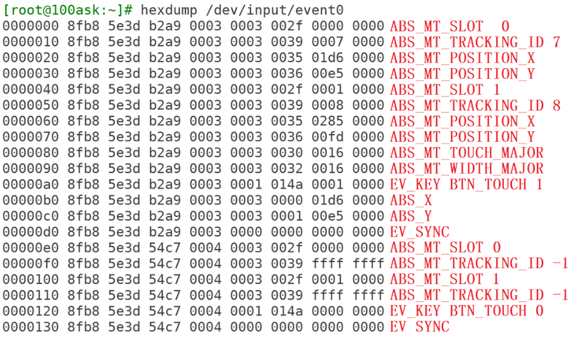

<a id="_Ref108710499"></a>图 7.26 双指触摸屏幕的打印信息

驱动程序使用slot、tracking\_id来标识一个触点；当tracking\_id等于-1时，标识这个触点被松开了。

触摸屏可能支持多个触点，比如5个：tslib为了简化处理，即使只有2个触点，ts\_read\_mt函数也会返回5个触点数据，可以根据标志位判断数据是否有效。

ts\_read\_mt函数原型如图 7.27：

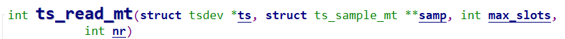

<a id="_Ref108710522"></a>图 7.27 ts\_read\_mt函数原型

假设nr设置为1，max\_slots设置为5，那么读到的数据保存在：samp\[0\]\[0\]、samp\[0\]\[1\]、samp\[0\]\[2\]、samp\[0\]\[3\]、samp\[0\]\[4\]中。

假设nr设置为2，max\_slots设置为5，那么读到的数据保存在：samp\[0\]\[0\]、samp\[0\]\[1\]、samp\[0\]\[2\]、samp\[0\]\[3\]、samp\[0\]\[4\]和samp\[1\]\[0\]、samp\[1\]\[1\]、samp\[1\]\[2\]、samp\[1\]\[3\]、samp\[1\]\[4\]中。

ts\_sample\_mt结构体如图 7.28：

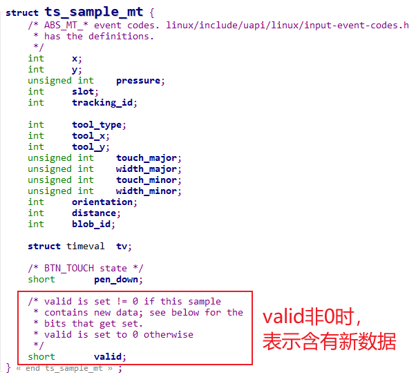

<a id="_Ref108710576"></a>图 7.28 ts\_sample\_mt结构体

-   -   -   -   1.  编写代码

实现一个程序，不断打印2个触点的距离。

思路：假设是5点触摸屏，调用一次ts\_read\_mt可以得到5个新数据；使用新旧数据进行判断，如果有2个触点，就打印出距离。
