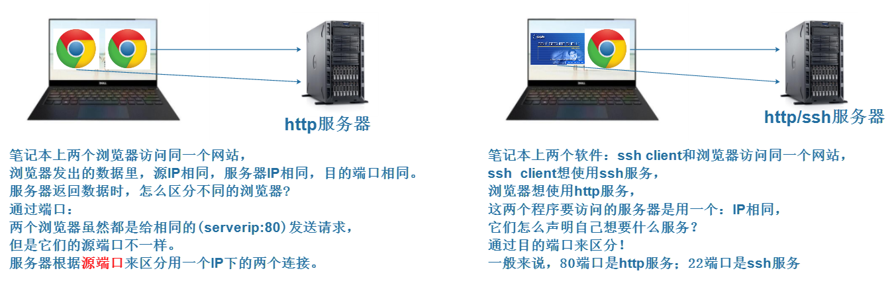
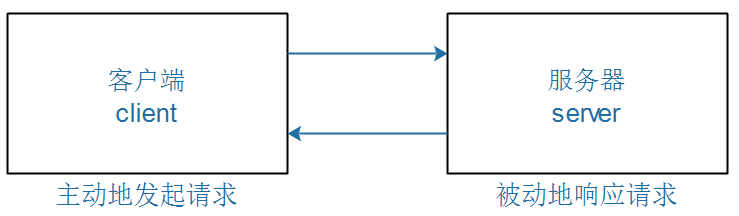
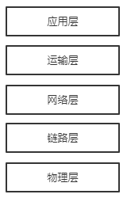
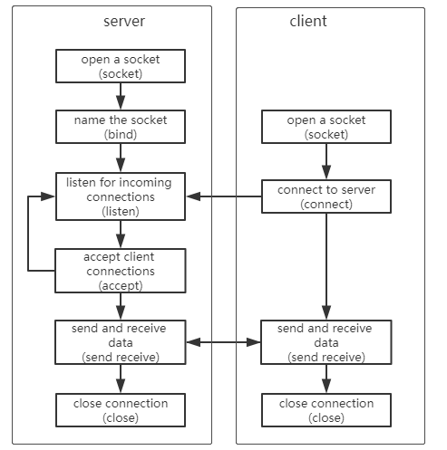
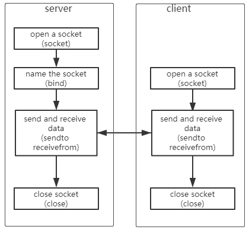

<a id="_Toc197788648"></a>

<a id="_Toc197788649"></a>
## 8.1 网络通信概述

本章配套的视频，我没有重新录制，而是修改这个视频得来：2012年录制的“第3期项目视频”中的“第1课第6.1节\_一小时学会网络编程\_两个简单例子\_tcp\_udp”。

在2012年录制的视频，质量一点都不比现在的差。

悦己之作，方能悦人。很高兴，我从来没降低要求。

使用GIT下载资料后，视频中涉及的文档和图片，位于如下目录：

01\_all\_series\_quickstart\\

04\_嵌入式Linux应用开发基础知识\\doc\_pic\\08.网络编程source\\12\_socket\\

### 8.1.1 IP和端口

所有的数据传输，都有三个要素 ：源、目的、长度。

怎么表示源或者目的呢？请看图 8.1：



<a id="_Ref108710712"></a>图 8.1 网络源和目的

所以，在网络传输中需要使用“IP和端口”来表示源或目的。

### 8.1.2 网络传输中的2个对象：server和client

我们经常访问网站，这涉及2个对象：网站服务器，浏览器。网站服务器平时安静地呆着，浏览器主动发起数据请求。网站服务器、浏览器可以抽象成2个软件的概念：server程序、client程序。



图 8.2 网络客户端和服务器

### 8.1.3 两种传输方式：TCP/UDP

在一般的网络书籍中，网络协议被分为5层，如图 8.3所示：



<a id="_Ref108710802"></a>图 8.3 网络协议层

应用层：它是体系结构中的最高层，直接为用户的应用进程（例如电子邮件、文件传输和终端仿真）提供服务。在因特网中的应用层协议很多，如支持万维网应用的HTTP协议，支持电子邮件的SMTP协议，支持文件传送的FTP协议，DNS，POP3，SNMP，Telnet等等。

运输层：负责向两个主机中进程之间的通信提供服务。

运输层主要使用以下两种协议：

1.  传输控制协议TCP(Transmission Control Protocol)：面向连接的，数据传输的单位是报文段，能够提供可靠的交付。
2.  用户数据包协议UDP(User Datagram Protocol)：无连接的，数据传输的单位是用户数据报，不保证提供可靠的交付，只能提供“尽最大努力交付”。

-   网络层：负责将被称为数据包（datagram）的网络层分组从一台主机移动到另一台主机。
-   链路层：因特网的网络层通过源和目的地之间的一系列路由器路由数据报。
-   物理层：在物理层上所传数据的单位是比特。物理层的任务就是透明地传送比特流。

这些层对于初学者来说很难理解，我们只需要知道：我们需要使用“运输层”编写应用程序，我们的应用程序位于“应用层”。

使用“运输层”时，可以选择TCP协议，也可以选择UDP协议。

-   -   -   -   1.  <a id="_Toc5259"></a><a id="_Toc13874"></a><a id="_Toc3956"></a><a id="_Toc24781"></a>TCP和UDP 原理上的区别

TCP向它的应用程序提供了面向连接的服务。这种服务有2个特点：可靠传输、流量控制（即发送方/接收方速率匹配）。它包括了应用层报文划分为短报文，并提供拥塞控制机制。

UDP协议向它的应用程序提供无连接服务。它没有可靠性，没有流量控制，也没有拥塞控制。

-   -   -   -   1.  <a id="_Toc18997"></a><a id="_Toc16143"></a><a id="_Toc20640"></a><a id="_Toc31158"></a>为何存在UDP协议

既然TCP提供了可靠数据传输服务，而UDP不能提供，那么TCP是否总是首选呢？

答案是否定的，因为有许多应用更适合用UDP，举个例子：视频通话时，使用UDP，偶尔的丢包、偶尔的花屏时可以忍受的；如果使用TCP，每个数据包都要确保可靠传输，当它出错时就重传，这会导致后续的数据包被阻滞，视频效果反而不好。

使用UDP时，有如下特点：

1.  关于何时发送什么数据控制的更为精细

采用UDP时只要应用进程将数据传递给UDP，UDP就会立即将其传递给网络层。而TCP有重传机制，而不管可靠交付需要多长时间。但是实时应用通常不希望过分的延迟报文段的传送，且能容忍一部分数据丢失。

1.  无需建立连接，不会引入建立连接时的延迟。
2.  无连接状态，能支持更多的活跃客户。
3.  分组首部开销较小。
    -   -   -   1.  <a id="_Toc29300"></a><a id="_Toc1190"></a><a id="_Toc19794"></a><a id="_Toc18120"></a>TCP/UDP网络通信大概交互图

下面我们分别画出运用TCP协议和运用UDP协议的客户端和服务器大概交互图。



图 8.4面向连接的TCP流模式



图 8.5UDP用户数据包模式

<a id="_Toc4336"></a><a id="_Toc197788650"></a><a id="_Toc4811"></a><a id="_Toc14731"></a><a id="_Toc19735"></a><a id="_Toc30563"></a>
## 8.2 网络编程主要函数介绍

<a id="_Toc21697"></a><a id="_Toc3951"></a><a id="_Toc4842"></a><a id="_Toc9505"></a>
### 8.2.1 socket函数

```
int socket(int domain, int type,int protocol);
```

此函数用于创建一个套接字。

-   **domain**是网络程序所在的主机采用的通讯协族(AF\_UNIX和AF\_INET等)。
    -   AF\_UNIX只能够用于单一的Unix 系统进程间通信，而AF\_INET是针对Internet的，因而可以允许远程通信使用。
-   **type**是网络程序所采用的通讯协议(SOCK\_STREAM,SOCK\_DGRAM等)。
    -   SOCK\_STREAM表明用的是TCP 协议，这样会提供按顺序的，可靠，双向，面向连接的比特流。
    -   SOCK\_DGRAM 表明用的是UDP协议，这样只会提不可靠，无连接的通信。
-   关于**protocol**，由于指定了type，所以这个地方一般只要用0来代替就可以了。

此函数执行成功时返回文件描述符，失败时返回-1,看errno可知道出错的详细情况。

<a id="_Toc25504"></a><a id="_Toc24267"></a><a id="_Toc5265"></a><a id="_Toc7640"></a>
### 8.2.2 bind函数

```
int bind(int sockfd, struct sockaddr *my_addr, int addrlen);
```

从函数用于将地址绑定到一个套接字。

-   **sockfd**是由socket函数调用返回的文件描述符。
-   **my\_addr**是一个指向sockaddr的指针。
-   **addrlen**是sockaddr结构的长度。

sockaddr的定义：

```
struct sockaddr{
unisgned short  as_family;
char sa_data[14];
};
```

不过由于系统的兼容性,我们一般使用另外一个结构(struct sockaddr\_in) 来代替。

sockaddr\_in的定义：

```
struct sockaddr_in{
unsigned short   sin_family;    
unsigned short     sin_port;
struct in_addr   sin_addr;
unsigned char   sin_zero[8];
}
```

如果使用Internet所以sin\_family一般为AF\_INET。

-   sin\_addr设置为INADDR\_ANY表示可以和任何的主机通信。
-   sin\_port是要监听的端口号。
-   bind将本地的端口同socket返回的文件描述符捆绑在一起.成功是返回0,失败的情况和socket一样。

<a id="_Toc17825"></a><a id="_Toc21757"></a><a id="_Toc827"></a><a id="_Toc28123"></a>
### 8.2.3 listen函数

```
int listen(int sockfd,int backlog);
```

此函数宣告服务器可以接受连接请求。

-   **sockfd**是bind后的文件描述符。
-   **backlog**设置请求排队的最大长度。当有多个客户端程序和服务端相连时，使用这个表示可以介绍的排队长度。
-   listen函数将bind的文件描述符变为监听套接字，返回的情况和bind一样。

<a id="_Toc32652"></a><a id="_Toc32055"></a><a id="_Toc13164"></a><a id="_Toc13091"></a>
### 8.2.4 accept函数

```
int accept(int sockfd, struct sockaddr *addr,int *addrlen);
```

服务器使用此函数获得连接请求，并且建立连接。

-   **sockfd**是listen后的文件描述符。
-   **addr，addrlen**是用来给客户端的程序填写的,服务器端只要传递指针就可以了， bind,listen和accept是服务器端用的函数。
-   accept调用时，服务器端的程序会一直阻塞到有一个客户程序发出了连接。 accept成功时返回最后的服务器端的文件描述符，这个时候服务器端可以向该描述符写信息了，失败时返回-1 。

<a id="_Toc13403"></a><a id="_Toc15559"></a><a id="_Toc23451"></a><a id="_Toc16444"></a>
### 8.2.5 connect函数

```
int connect(int sockfd, struct sockaddr * serv_addr,int addrlen);
```

可以用connect建立一个连接，在connect中所指定的地址是想与之通信的服务器的地址。

-   **sockfd**是socket函数返回的文件描述符。
-   **serv\_addr**储存了服务器端的连接信息，其中sin\_add是服务端的地址。
-   **addrlen**是serv\_addr的长度
-   connect函数是客户端用来同服务端连接的.成功时返回0，sockfd是同服务端通讯的文件描述符，失败时返回-1。

<a id="_Toc9383"></a><a id="_Toc10120"></a><a id="_Toc27486"></a><a id="_Toc14138"></a>
### 8.2.6 send函数

```
ssize_t send(int sockfd, const void *buf, size_t len, int flags);
```

-   **sockfd** 指定发送端套接字描述符；
-   **buf** 指明一个存放应用程序要发送数据的缓冲区；
-   **len** 指明实际要发送的数据的字节数；
-   **flags** 一般置0。
-   客户或者服务器应用程序都用send函数来向TCP连接的另一端发送数据

<a id="_Toc5994"></a><a id="_Toc25355"></a><a id="_Toc2644"></a><a id="_Toc22410"></a>
### 8.2.7 recv函数

```
ssize_t recv(int sockfd, void *buf, size_t len, int flags);
```

-   **sockfd** 指定接收端套接字描述符；
-   **buf** 指明一个缓冲区，该缓冲区用来存放recv函数接收到的数据；
-   **len** 指明buf的长度；
-   **flags** 一般置0。
-   客户或者服务器应用程序都用recv函数从TCP连接的另一端接收数据。

<a id="_Toc19748"></a><a id="_Toc1976"></a><a id="_Toc22380"></a><a id="_Toc8386"></a>
### 8.2.8 recvfrom函数

```
ssize_t recvfrom(int sockfd, void *buf, size_t len, int flags,
                        struct sockaddr *src_addr, socklen_t *addrlen);
```

-   recvfrom通常用于无连接套接字，因为此函数可以获得发送者的地址。
-   **src\_addr** 是一个struct sockaddr类型的变量，该变量保存源机的IP地址及端口号。
-   **addrlen** 常置为sizeof （struct sockaddr）。

<a id="_Toc18464"></a><a id="_Toc18002"></a><a id="_Toc22674"></a><a id="_Toc4373"></a>
### 8.2.9 sendto函数

```
ssize_t sendto(int sockfd, const void *buf, size_t len, int flags,
                      const struct sockaddr *dest_addr, socklen_t addrlen);
```

-   sendto和send相似，区别在于sendto允许在无连接的套接字上指定一个目标地址。
-   **dest\_addr** 表示目地机的IP地址和端口号信息，
-   **addrlen** 常常被赋值为sizeof （struct sockaddr）。
-   **sendto** 函数也返回实际发送的数据字节长度或在出现发送错误时返回-1。

<a id="_Toc197788651"></a>
## 8.3 TCP编程

本章配套的视频，我没有重新录制，而是修改这个视频得来：2012年录制的“第3期项目视频”中的“第1课第6.1节\_一小时学会网络编程\_两个简单例子\_tcp\_udp”。

在2012年录制的视频，质量一点都不比现在的差。

悦己之作，方能悦人。很高兴，我从来没降低要求。

使用GIT下载所有源码后，本节源码位于如下目录：

01\_all\_series\_quickstart\\

04\_嵌入式Linux应用开发基础知识\\source\\12\_socket\\tcp\\

<a id="_Toc197788652"></a>
## 8.4 UDP编程

本章配套的视频，我没有重新录制，而是修改这个视频得来：2012年录制的“第3期项目视频”中的“第1课第6.1节\_一小时学会网络编程\_两个简单例子\_tcp\_udp”。

使用GIT下载所有源码后，本节源码位于如下目录：

01\_all\_series\_quickstart\\

04\_嵌入式Linux应用开发基础知识\\source\\12\_socket\\udp\\udp2\\
