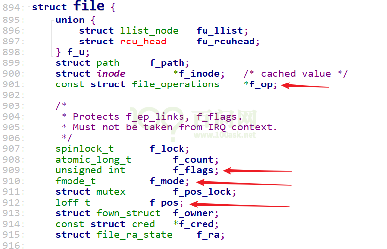
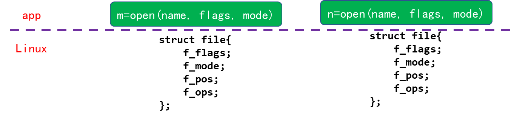
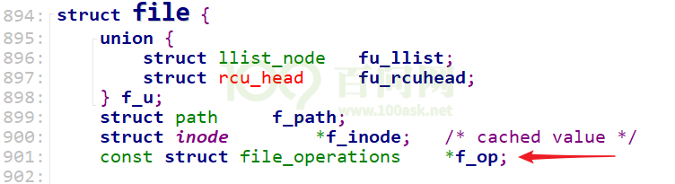
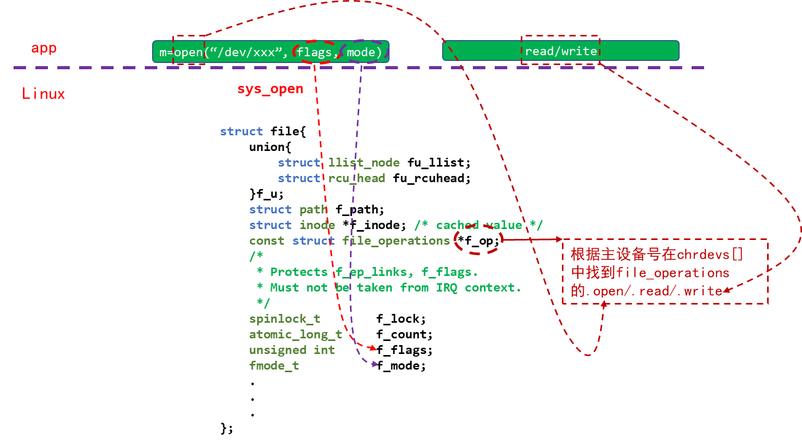
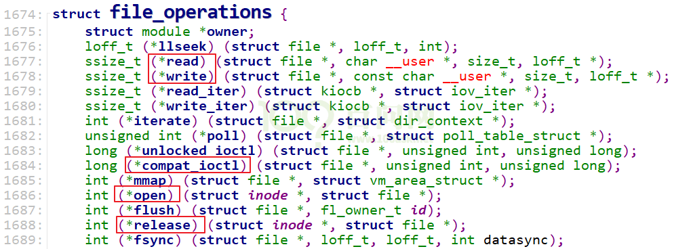
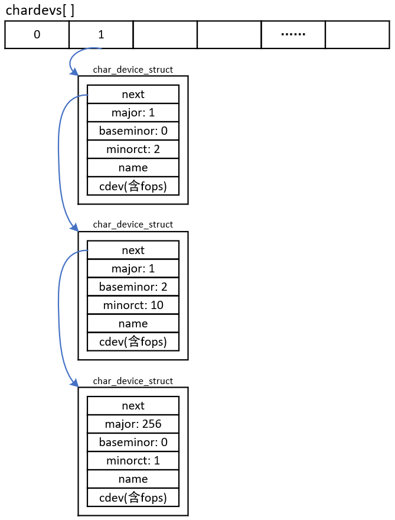
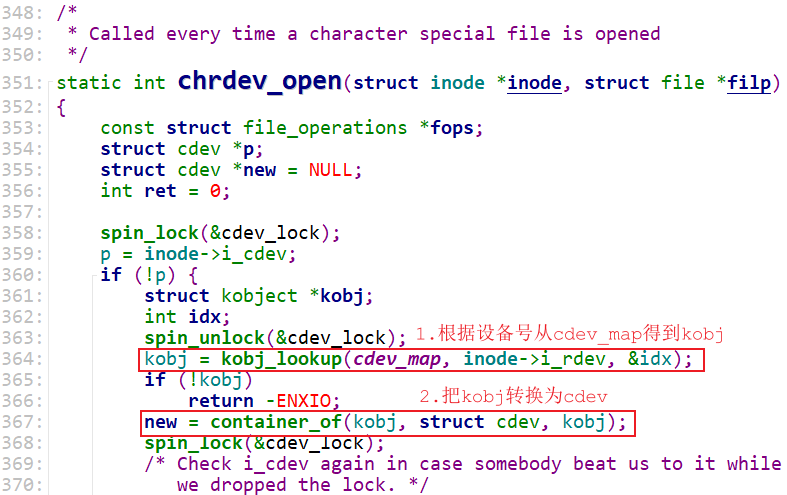
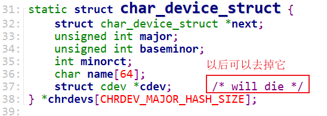
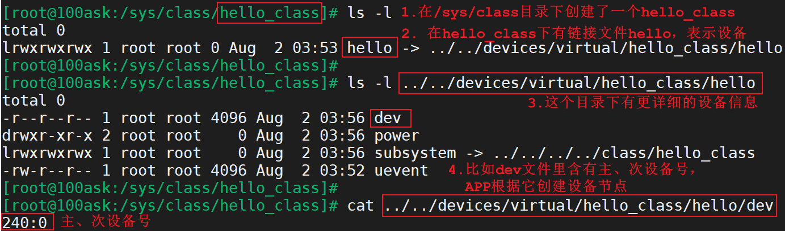

<a id="_Toc197788668"></a>

我们选用的内核都是4.x版本，操作都是类似的：

-   rk3399 linux 4.4.154
-   rk3288 linux 4.4.154
-   imx6ul linux 4.9.88
-   am3358 linux 4.9.168

<a id="_Toc197788669"></a>
## 1.1 APP打开的文件在内核中如何表示

APP打开文件时，可以得到一个整数，这个整数被称为文件句柄。对于APP的每一个文件句柄，在内核里面都有一个“struct file”与之对应。



图 1.1 struct file

可以猜测，我们使用open打开文件时，传入的flags、mode等参数会被记录在内核中对应的struct file结构体里(f\_flags、f\_mode)：

```
int open(const char *pathname, int flags, mode_t mode);
```

去读写文件时，文件的当前偏移地址也会保存在struct file结构体的f\_pos成员里。



图 1.2 open-&gt;struct file

<a id="_Toc197788670"></a>
## 1.2 打开字符设备节点时，内核中也有对应的struct file

注意这个结构体中的结构体：struct file\_operations \*f\_op，这是由驱动程序提供的。



图 1.3 驱动程序的struct file



图 1.4 驱动程序的open/read/write

结构体struct file\_operations的定义如下：



图 1.5 struct file\_operations的定义

<a id="_Toc197788671"></a>
## 1.3 请猜猜怎么编写驱动程序

1.  确定主设备号，也可以让内核分配
2.  定义自己的file\_operations结构体
3.  实现对应的drv\_open/drv\_read/drv\_write等函数，填入file\_operations结构体
4.  把file\_operations结构体告诉内核：register\_chrdev
5.  谁来注册驱动程序啊？得有一个入口函数：安装驱动程序时，就会去调用这个入口函数
6.  有入口函数就应该有出口函数：卸载驱动程序时，出口函数调用unregister\_chrdev
7.  其他完善：提供设备信息，自动创建设备节点：class\_create, device\_create

<a id="_Toc197788672"></a>
## 1.4 编写代码

### 1.4.1 写驱动程序

参考driver/char中的程序，包含头文件，写框架，传输数据：

-   驱动中实现open, read, write, release，APP调用这些函数时，都打印内核信息
-   APP调用write函数时，传入的数据保存在驱动中
-   APP调用read函数时，把驱动中保存的数据返回给APP

使用GIT下载所有源码后，本节源码位于如下目录：

01\_all\_series\_quickstart\\

05\_嵌入式Linux驱动开发基础知识\\source\\01\_hello\_drv\\hello\_drv.c

hello\_drv.c源码如下：

```
01 #include <linux/module.h>
02
03 #include <linux/fs.h>
04 #include <linux/errno.h>
05 #include <linux/miscdevice.h>
06 #include <linux/kernel.h>
07 #include <linux/major.h>
08 #include <linux/mutex.h>
09 #include <linux/proc_fs.h>
10 #include <linux/seq_file.h>
11 #include <linux/stat.h>
12 #include <linux/init.h>
13 #include <linux/device.h>
14 #include <linux/tty.h>
15 #include <linux/kmod.h>
16 #include <linux/gfp.h>
17
18 /* 1. 确定主设备号 */
19 static int major = 0;
20 static char kernel_buf[1024];
21 static struct class *hello_class;
22
23
24 #define MIN(a, b) (a < b ? a : b)
25
26 /* 3. 实现对应的open/read/write等函数，填入file_operations结构体 */
27 static ssize_t hello_drv_read (struct file *file, char __user *buf, size_t size, loff_t *offset)
28 {
29      int err;
30      printk("%s %s line %d\n", __FILE__, __FUNCTION__, __LINE__);
31      err = copy_to_user(buf, kernel_buf, MIN(1024, size));
32      return MIN(1024, size);
33 }
34
35 static ssize_t hello_drv_write (struct file *file, const char __user *buf, size_t size, loff_t *offset)
36 {
37      int err;
38      printk("%s %s line %d\n", __FILE__, __FUNCTION__, __LINE__);
39      err = copy_from_user(kernel_buf, buf, MIN(1024, size));
40      return MIN(1024, size);
41 }
42
43 static int hello_drv_open (struct inode *node, struct file *file)
44 {
45      printk("%s %s line %d\n", __FILE__, __FUNCTION__, __LINE__);
46      return 0;
47 }
48
49 static int hello_drv_close (struct inode *node, struct file *file)
50 {
51      printk("%s %s line %d\n", __FILE__, __FUNCTION__, __LINE__);
52      return 0;
53 }
54
55 /* 2. 定义自己的file_operations结构体 */
56 static struct file_operations hello_drv = {
57      .owner   = THIS_MODULE,
58      .open    = hello_drv_open,
59      .read    = hello_drv_read,
60      .write   = hello_drv_write,
61      .release = hello_drv_close,
62 };
63
64 /* 4. 把file_operations结构体告诉内核：注册驱动程序 */
65 /* 5. 谁来注册驱动程序啊？得有一个入口函数：安装驱动程序时，就会去调用这个入口函数 */
66 static int __init hello_init(void)
67 {
68      int err;
69
70      printk("%s %s line %d\n", __FILE__, __FUNCTION__, __LINE__);
71      major = register_chrdev(0, "hello", &hello_drv);  /* /dev/hello */
72
73
74      hello_class = class_create(THIS_MODULE, "hello_class");
75      err = PTR_ERR(hello_class);
76      if (IS_ERR(hello_class)) {
77              printk("%s %s line %d\n", __FILE__, __FUNCTION__, __LINE__);
78              unregister_chrdev(major, "hello");
79              return -1;
80      }
81
82      device_create(hello_class, NULL, MKDEV(major, 0), NULL, "hello"); /* /dev/hello */
83
84      return 0;
85 }
86
87 /* 6. 有入口函数就有出口函数：卸载驱动程序时就会去调用这个出口函数 */
88 static void __exit hello_exit(void)
89 {
90      printk("%s %s line %d\n", __FILE__, __FUNCTION__, __LINE__);
91      device_destroy(hello_class, MKDEV(major, 0));
92      class_destroy(hello_class);
93      unregister_chrdev(major, "hello");
94 }
95
96
97 /* 7. 其他完善：提供设备信息，自动创建设备节点 */
98
99 module_init(hello_init);
100 module_exit(hello_exit);
101
102 MODULE_LICENSE("GPL");
103
```

阅读一个驱动程序，从它的入口函数开始，第66行就是入口函数。它的主要工作就是第71行，向内核注册一个file\_operations结构体：hello\_drv，这就是字符设备驱动程序的核心。

file\_operations结构体hello\_drv在第56行定义，里面提供了open/read/write/release成员，应用程序调用open/read/write/close时就会导致这些成员函数被调用。

file\_operations结构体hello\_drv中的成员函数都比较简单，大多数只是打印而已。要注意的是，驱动程序和应用程序之间传递数据要使用copy\_from\_user/copy\_to\_user函数。

### 1.4.2 写测试程序

测试程序要实现写、读功能：

```bash
./hello_drv_test  -w  www.100ask.net  // 把字符串“www.100ask.net”发给驱动程序
./hello_drv_test  -r                  // 把驱动中保存的字符串读回来
```

使用GIT下载所有源码后，本节源码位于如下目录：

01\_all\_series\_quickstart\\

05\_嵌入式Linux驱动开发基础知识\\source\\01\_hello\_drv\\hello\_drv\_test.c

hello\_drv\_test.c源码如下：

```
02 #include <sys/types.h>
03 #include <sys/stat.h>
04 #include <fcntl.h>
05 #include <unistd.h>
06 #include <stdio.h>
07 #include <string.h>
08
09 /*
10  * ./hello_drv_test -w abc
11  * ./hello_drv_test -r
12  */
13 int main(int argc, char **argv)
14 {
15      int fd;
16      char buf[1024];
17      int len;
18
19      /* 1. 判断参数 */
20      if (argc < 2)
21      {
22              printf("Usage: %s -w <string>\n", argv[0]);
23              printf("       %s -r\n", argv[0]);
24              return -1;
25      }
26
27      /* 2. 打开文件 */
28      fd = open("/dev/hello", O_RDWR);
29      if (fd == -1)
30      {
31              printf("can not open file /dev/hello\n");
32              return -1;
33      }
34
35      /* 3. 写文件或读文件 */
36      if ((0 == strcmp(argv[1], "-w")) && (argc == 3))
37      {
38              len = strlen(argv[2]) + 1;
39              len = len < 1024 ? len : 1024;
40              write(fd, argv[2], len);
41      }
42      else
43      {
44              len = read(fd, buf, 1024);
45              buf[1023] = '\0';
46              printf("APP read : %s\n", buf);
47      }
48
49      close(fd);
50
51      return 0;
52 }
```

### 1.4.3 测试

-   编写驱动程序的Makefile

驱动程序中包含了很多头文件，这些头文件来自内核，不同的ARM板它的某些头文件可能不同。所以编译驱动程序时，需要指定板子所用的内核的源码路径。

要编译哪个文件？这也需要指定，设置obj-m变量即可

怎么把.c文件编译为驱动程序.ko？这要借助内核的顶层Makefile。

本驱动程序的Makefile内容如下：

```
02 # 1. 使用不同的开发板内核时, 一定要修改KERN_DIR
03 # 2. KERN_DIR中的内核要事先配置、编译, 为了能编译内核, 要先设置下列环境变量:
04 # 2.1 ARCH,          比如: export ARCH=arm64
05 # 2.2 CROSS_COMPILE, 比如: export CROSS_COMPILE=aarch64-linux-gnu-
06 # 2.3 PATH,          比如: export PATH=$PATH:/home/book/100ask_roc-rk3399-pc/ToolChain-6.3.1/gcc-linaro-6.3.1-2017.05-x86_64_aarch64-linux-gnu/bin
07 # 注意: 不同的开发板不同的编译器上述3个环境变量不一定相同,
08 #       请参考各开发板的高级用户使用手册
09
10 KERN_DIR = /home/book/100ask_roc-rk3399-pc/linux-4.4
11
12 all:
13      make -C $(KERN_DIR) M=`pwd` modules
14      $(CROSS_COMPILE)gcc -o hello_drv_test hello_drv_test.c
15
16 clean:
17      make -C $(KERN_DIR) M=`pwd` modules clean
18      rm -rf modules.order
19      rm -f hello_drv_test
20
21 obj-m        += hello_drv.o
```

先设置好交叉编译工具链，编译好你的板子所用的内核，然后修改Makefile指定内核源码路径，最后即可执行make命令编译驱动程序和测试程序。

-   上机实验

**注意**：我们是在Ubuntu中编译程序，但是需要在ARM板子上测试。所以需要把程序放到ARM板子上。

启动单板后，在Ubuntu上使用adb命令下载程序到开发板，执行如下命令：

```bash
adb  push  *.ko   /root
adb  push  hello_drv_test   /root
```

在ARM板上测试：

```bash
[root@100ask:~]# echo "7 4 1 7" > /proc/sys/kernel/printk  // 打开内核的打印信息，有些板子默认打开了
[root@100ask:~]# cd  /root
[root@100ask:~]# insmod hello_drv.ko    // 安装驱动程序
[  293.594910] hello_drv: loading out-of-tree module taints kernel.
[  293.616051] /home/book/source/01_hello_drv/hello_drv.c hello_init line 70
[root@100ask:~]# ls /dev/hello -l        // 驱动程序会生成设备节点
crw-------    1 root     root      236,   0 Jan 18 08:55 /dev/hello
[root@100ask:~]#./hello_drv_test        // 查看测试程序的用法
Usage: ./hello_drv_test -w <string>
       ./hello_drv_test -r
[root@100ask:~]#./hello_drv_test -w www.100ask.net    // 往驱动程序中写入字符串
[  318.360800] /home/book/source/01_hello_drv/hello_drv.c hello_drv_open line 45
[  318.372570] /home/book/source/01_hello_drv/hello_drv.c hello_drv_write line 38
[  318.382854] /home/book/source/01_hello_drv/hello_drv.c hello_drv_close line 51
[root@100ask:~]#./hello_drv_test -r                  // 从驱动程序中读出字符串
[  326.177890] /home/book/source/01_hello_drv/hello_drv.c hello_drv_open line 45
[  326.198304] /home/book/source/01_hello_drv/hello_drv.c hello_drv_read line 30
[root@100ask:~]# APP read : www.100ask.net
[  326.214782] /home/book/source/01_hello_drv/hello_drv.c hello_drv_close line 51
```


<a id="_Toc197788673"></a>
## 1.5 Hello驱动中的一些补充知识

### 1.5.1 module_init/module_exit的实现

一个驱动程序有入口函数、出口函数，代码如下：

```
module_init(hello_init);
module_exit(hello_exit);
```

驱动程序可以被编进内核里，也可以被编译为ko文件后手工加载。对于这两种形式，“module\_init/module\_exit”这2个宏是不一样的。在内核文件“include\\linux\\module.h”中可以看到这2个宏：

```
01 #ifndef MODULE
02
03 #define module_init(x)    __initcall(x);
04 #define module_exit(x)    __exitcall(x);
05
06 #else /* MODULE */
07
08 #define module_init(initfn)                 \
09
10 /* Each module must use one module_init(). */
11     static inline initcall_t __inittest(void)       \
12     { return initfn; }                  \
13     int init_module(void) __attribute__((alias(#initfn)));
14
15 /* This is only required if you want to be unloadable. */
16 #define module_exit(exitfn)                 \
17     static inline exitcall_t __exittest(void)       \
18     { return exitfn; }                  \
19     void cleanup_module(void) __attribute__((alias(#exitfn)));
20
21 #endif
```

编译驱动程序时，我们执行“make modules”这样的命令，它在编译c文件时会定义宏MODULE，比如：

```bash
arm-buildroot-linux-gnueabihf-gcc  -DMODULE  -c -o hello_drv.o hello_drv.c
```

在编译内核时，并不会定义宏MODULE。所以，“module\_init/module\_exit”这2个宏在驱动程序被编进内核时，如上面代码中第3、4行那样定义；在驱动程序被编译为ko文件时，如上面代码中第11~19行那样定义。

把上述代码里的宏全部展开后，得到如下代码：

```
01 #ifndef MODULE
01
01 #define module_init(fn)
02     static initcall_t __initcall_##fn##id __used \
03 __attribute__((__section__(".initcall" #6 ".init"))) = fn;
04
05 #define module_exit(x)    static exitcall_t __exitcall_##x __used __section(.exitcall.exit) = x;
06
07 #else /* MODULE */
08
09 #define module_init(initfn)                 \
10
11 /* Each module must use one module_init(). */
12     static inline initcall_t __inittest(void)       \
13     { return initfn; }                  \
14     int init_module(void) __attribute__((alias(#initfn)));
15
16 /* This is only required if you want to be unloadable. */
17 #define module_exit(exitfn)                 \
18     static inline exitcall_t __exittest(void)       \
19     { return exitfn; }                  \
20     void cleanup_module(void) __attribute__((alias(#exitfn)));
21
22 #endif
```

驱动程序被编进内核时，把“module\_init(hello\_init)”、“module\_exit(hello\_exit)”展开，得到如下代码：

```
static initcall_t __initcall_hello_init6 __used \
__attribute__((__section__(".initcall6.init"))) = hello_init;
static exitcall_t __exitcall_hello_exit  __used __section(.exitcall.exit) = hello_exit;
```

其中的“initcall\_t”、“exitcall\_t”就是函数指针类型，所以上述代码就是定义了两个函数指针：第1个函数指针名为\_\_initcall\_hello\_init6，放在段".initcall6.init"里；第2个函数指针名为\_\_exitcall\_hello\_exit，放在段“.exitcall.exit”里。

内核启动时，会去段".initcall6.init"里取出这些函数指针来执行，所以驱动程序的入口函数就被执行了。

一个驱动被编进内核后，它是不会被卸载的，所以段“.exitcall.exit”不会被用到，内核启动后会释放这块段空间。

驱动程序被编译为ko文件时，把“module\_init(hello\_init)”、“module\_exit(hello\_exit)”展开，得到如下代码：

```
static inline initcall_t __inittest(void)       \
{ return hello_init; }                  \
int init_module(void) __attribute__((alias("hello_init")));
static inline exitcall_t __exittest(void)       \
{ return hello_exit; }                  \
void cleanup_module(void) __attribute__((alias("hello_exit")));
```

分别定义了2个函数：第1个函数名为init\_module，它是hello\_init函数的别名；第2个函数名为cleanup\_module，它是hello\_exit函数的别名。

以后我们使用insmod命令加载驱动时，内核都是调用init\_module函数，实际上就是调用hello\_init函数；使用rmmod命令卸载驱动时，内核都是调用cleanup\_module函数，实际上就是调用hello\_exit函数。

### 1.5.2 register_chrdev的内部实现

register\_chrdev函数源码如下：

```
static inline int register_chrdev(unsigned int major, const char *name,
                  const struct file_operations *fops)
{
    return __register_chrdev(major, 0, 256, name, fops);
}
```

它调用\_\_register\_chrdev函数，这个函数的代码精简如下：

```
01 int __register_chrdev(unsigned int major, unsigned int baseminor,
02               unsigned int count, const char *name,
03               const struct file_operations *fops)
04 {
05     struct char_device_struct *cd;
06     struct cdev *cdev;
07     int err = -ENOMEM;
08
09     cd = __register_chrdev_region(major, baseminor, count, name);
10
11     cdev = cdev_alloc();
12
13     cdev->owner = fops->owner;
14     cdev->ops = fops;
15     kobject_set_name(&cdev->kobj, "%s", name);
16
17     err = cdev_add(cdev, MKDEV(cd->major, baseminor), count);
18 }
```

这个函数主要的代码是第09行、第11~15行、第17行。

第09行，调用\_\_register\_chrdev\_region函数来“注册字符设备的区域”，它仅仅是查看设备号(major, baseminor)到(major, baseminor+count-1)有没有被占用，如果未被占用的话，就使用这块区域。

在前面的课程里，在引入驱动程序时为了便于理解，我们说内核里有一个chrdevs数组，根据主设备号major在chrdevs\[major\]中放入file\_operations结构体，以后open/read/write某个设备文件时，就是根据主设备号从chrdevs\[major\]中取出file\_operations结构体，调用里面的open/read/write函数指针。

上述说法并不准确，内核中确实有一个chrdevs数组：

```
static struct char_device_struct {
    struct char_device_struct *next;
    unsigned int major;
    unsigned int baseminor;
    int minorct;
    char name[64];
    struct cdev *cdev;      /* will die */
} *chrdevs[CHRDEV_MAJOR_HASH_SIZE];
```

去访问它的时候，并不是直接使用主设备号major来确定数组项，而是使用如下函数来确定数组项：

```
/* index in the above */
static inline int major_to_index(unsigned major)
{
    return major % CHRDEV_MAJOR_HASH_SIZE;
}
```

上述代码中，CHRDEV\_MAJOR\_HASH\_SIZE等于255。比如主设备号1、256，都会使用chardevs\[1\]。chardevs\[1\]是一个链表，链表里有多个char\_device\_struct结构体，某个结构体表示主设备号为1的设备，某个结构体表示主设备号为256的设备。

chardevs的结构图如图2.6所示：



图 1.6 chardevs结构图

从图2.6可以得出如下结论：

① chrdevs\[i\]数组项是一个链表头

链表里每一个元素都是一个char\_device\_struct结构体，每个元素表示一个驱动程序。

char\_device\_struct结构体内容如下：

```
struct char_device_struct {
    struct char_device_struct *next;
    unsigned int major;
    unsigned int baseminor;
    int minorct;
    char name[64];
    struct cdev *cdev;      /* will die */
}
```

它指定了主设备号major、次设备号baseminor、个数minorct，在cdev中含有file\_operations结构体。

char\_device\_struct结构体的含义是：主次设备号为(major, baseminor)、(major, baseminor+1)、(major, baseminor+2)、(major, baseminor+ minorct-1)的这些设备，都使用同一个file\_operations来操作。

以前为了更容易理解驱动程序时，说“内核通过主设备号找到对应的file\_operations结构体”，这并不准确。应该改成：“内核通过主、次设备号，找到对应的file\_operations结构体”。

② 在图2.6中，chardevs\[1\]中有3个驱动程序

第1个char\_device\_struct结构体对应主次设备号(1, 0)、(1, 1)，这是第1个驱动程序。

第2个char\_device\_struct结构体对应主次设备号(1, 2)、(1, 2)、……、(1, 11)，这是第2个驱动程序。

第3个char\_device\_struct结构体对应主次设备号(256, 0)，这是第3个驱动程序。

第11~15行分配一个cdev结构体，并设置它：它含有file\_operations结构体。

第17行调用cdev\_add把cdev结构体注册进内核里，cdev\_add函数代码如下：

```
01 int cdev_add(struct cdev *p, dev_t dev, unsigned count)
02 {
03     int error;
04
05     p->dev = dev;
06     p->count = count;
07
08     error = kobj_map(cdev_map, dev, count, NULL,
09              exact_match, exact_lock, p);
10     if (error)
11         return error;
12
13     kobject_get(p->kobj.parent);
14
15     return 0;
16 }
```

这个函数涉及kobj的操作，这是一个通用的链表操作函数。它的作用是：把cdev结构体放入cdev\_map链表中，对应的索引值是“dev”到“dev+count-1”。以后可以从cdev\_map链表中快速地使用索引值取出对应的cdev。

比如执行以下代码：

```bash
err = cdev_add(cdev, MKDEV(1, 2), 10);
```

其中的MKDEV(1,2)构造出一个整数“1&lt;&lt;8 | 2”，即0x102；上述代码将cdev放入cdev\_map链表中，对应的索引值是0x102到0x10c(即0x102+10)。以后根据这10个数值(0x102、0x103、0x104、……、0x10c)中任意一个，都可以快速地从cdev\_map链表中取出cdev结构体。

APP打开某个字符设备节点时，进入内核。在内核里根据字符设备节点的主、次设备号，计算出一个数值(major&lt;&lt;8 | minor，即inode-&gt;i\_rdev)，然后使用这个数值从cdev\_map中快速得到cdev，再从cdev中得到file\_operations结构体。

关键函数如下：



图 1.7找到驱动程序的关键函数

在打开文件的过程中，可以看到并未涉及chrdevs，都是使用cdev\_map。所以可以看到在chrdevs的定义中看到如下注释：



图 1.8 chardevs中cdev的作用并不大

### 1.5.3 class_destroy/device_create浅析

驱动程序的核心是file\_operations结构体：分配、设置、注册它。“class\_destroy/device\_create”函数知识起一些辅助作用：在/sys目录下创建一些目录、文件，这样Linux系统中的APP(比如udev、mdev)就可以根据这些目录或文件来创建设备节点。

以下代码将会在“/sys/class”目录下创建一个子目录“hello\_class”：

```
hello_class = class_create(THIS_MODULE, "hello_class");
```

以下代码将会在“/sys/class/hello\_class”目录下创建一个文件“hello”：

```
device_create(hello_class, NULL, MKDEV(major, 0), NULL, "hello");
```

更详细的信息请看图2.9：



图 1.9 class和device
