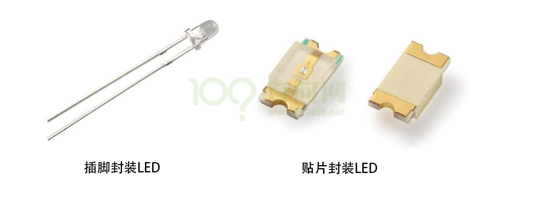
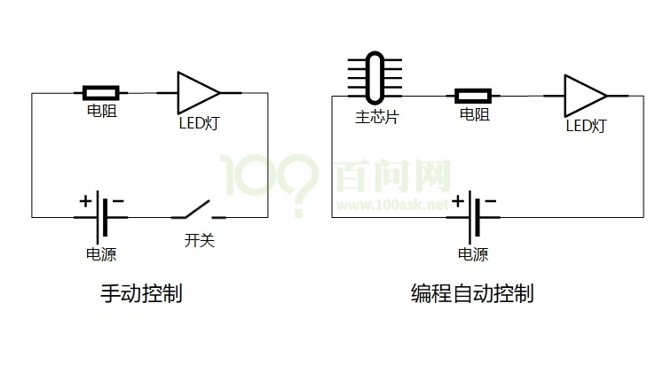
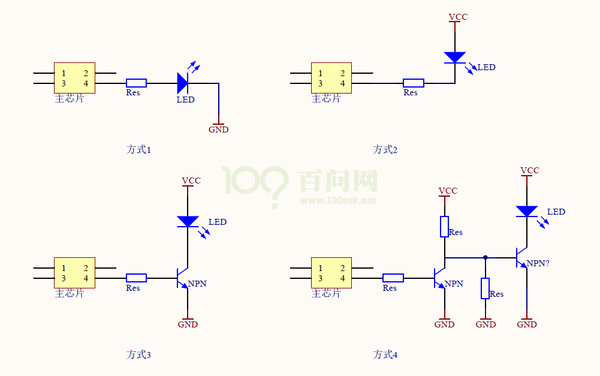

当我们学习C语言的时候，我们会写个Hello程序。

那当我们写ARM程序，也该有一个简单的程序引领我们入门，这个程序就是点亮LED。

我们怎样去点亮一个LED呢？分为三步：

1.  看原理图，确定控制LED的引脚;
2.  看主芯片的芯片手册，确定如何设置控制这个引脚;
3.  写程序;

## 2.1 先来讲讲怎么看原理图

LED样子有很多种，像插脚的，贴片的。

图 2.1 市面LED产品

它们长得完全不一样，因此我们在原理图中将它抽象出来。

点亮LED需要通电源，同时为了保护LED，加个电阻减小电流。

控制LED灯的亮灭，可以手动开关LED，但在电子系统中，不可能让人来控制开关，通过编程，利用芯片的引脚去控制开关。

图 2.2 LED控制电路示意图

LED的驱动方式，常见的有四种。

1.  使用引脚输出3.3V点亮LED，输出0V熄灭LED。
2.  使用引脚拉低到0V点亮LED，输出3.3V熄灭LED。

有的芯片为了省电等原因，其引脚驱动能力不足，这时可以使用三极管驱动。

1.  使用引脚输出1.2V点亮LED，输出0V熄灭LED。
2.  使用引脚输出0V点亮LED，输出1.2V熄灭LED。

图 2.3 LED的4中驱动方式

由此，主芯片引脚输出高电平/低电平，即可改变LED状态，而无需关注GPIO引脚输出的是3.3V还是1.2V。所以简称输出1或0：

-   逻辑1--&gt;高电平
-   逻辑0--&gt;低电平
