

请使用GIT下载文档后，看图 4.1红框所示目录中各板子对应的文档及图片。

网盘中相同名字的目录下也有对应的视频。

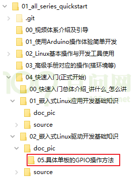

图 4.1 GPIO操作文档在git仓库所在位置

为方便学习，在本文档中也把上述GIT目录中的文档添加进来了。

## 4.1 IMX6ULL的GPIO操作方法

表 4‑1 GPIO操作相关名词解释

| 名词 | 解释 |
| --- | --- |
| CCM | Clock Controller Module (时钟控制模块) |
| IOMUXC | IOMUX Controller，IO复用控制器 |
| GPIO | General-purpose input/output，通用的输入输出口 |

### 4.1.1 IMX6ULL的GPIO模块结构

参考资料：芯片手册《Chapter 28: General Purpose Input/Output (GPIO)》

有5组GPIO（GPIO1～GPIO5），每组引脚最多有32个，但是可能实际上并没有那么多。

-   GPIO1有32个引脚：GPIO1\_IO0~GPIO1\_IO31；
-   GPIO2有22个引脚：GPIO2\_IO0~GPIO2\_IO21；
-   GPIO3有29个引脚：GPIO3\_IO0~GPIO3\_IO28；
-   GPIO4有29个引脚：GPIO4\_IO0~GPIO4\_IO28；
-   GPIO5有12个引脚：GPIO5\_IO0~GPIO5\_IO11；
-   GPIO的控制涉及4大模块：CCM、IOMUXC、GPIO模块本身，框图如图 4.2

CCM

图 4.2 CCM/IOMUXC/GPIO模块图

### 4.1.2 CCM用于设置是否向GPIO模块提供时钟

参考资料：芯片手册《Chapter 18: Clock Controller Module (CCM)》

GPIOx要用CCM\_CCGRy寄存器中的2位来决定该组GPIO是否使能。哪组GPIO用哪个CCM\_CCGR寄存器来设置，请看上图红框部分。

CCM\_CCGR寄存器中某2位的取值含义如下：

图 4.3 CCM\_CCGR

1.  00：该GPIO模块全程被关闭
2.  01：该GPIO模块在CPU run mode情况下是使能的；在WAIT或STOP模式下，关闭
3.  10：保留
4.  11：该GPIO模块全程使能

-   GPIO2时钟控制：

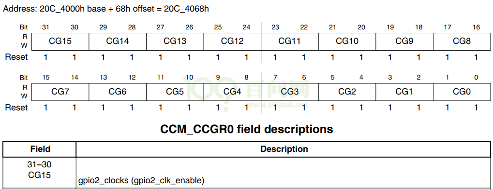

图 4.4 GPIO2的时钟控制寄存器

-   GPIO1、GPIO5时钟控制：

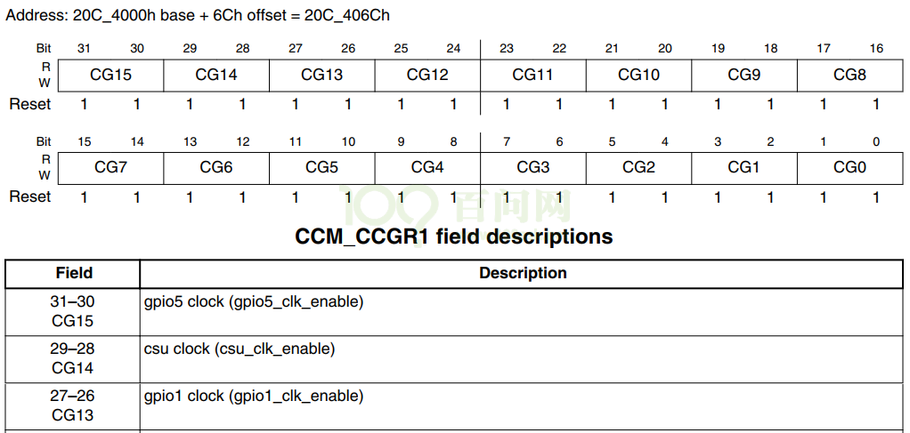

图 4.5 GPIO1/5的时钟控制寄存器

-   GPIO3时钟控制：

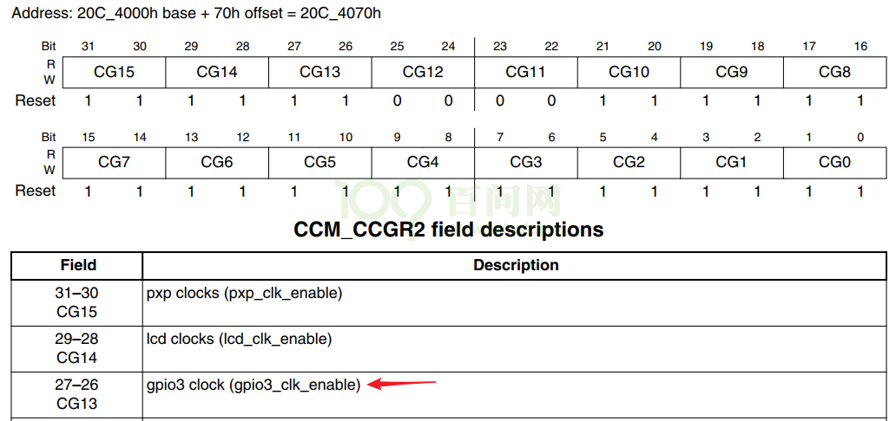

图 4.6 GPIO3的时钟控制寄存器

-   GPIO4时钟控制：

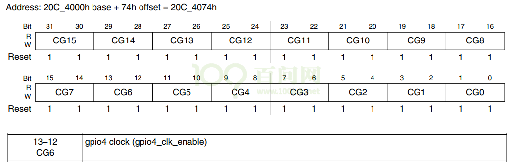

图 4.7 GPIO4的时钟控制寄存器

### 4.1.3 IOMUXC：引脚的模式(Mode、功能)

参考资料：芯片手册《Chapter 32: IOMUX Controller (IOMUXC)》。

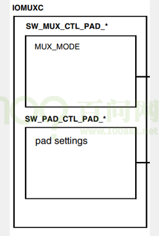

图 4.8 IOMUXC

对于某个/某组引脚，IOMUXC中有2个寄存器用来设置它：

1.  选择功能：
    1.  IOMUXC\_SW\_MUX\_CTL\_PAD\_&lt;PADNAME&gt; ：Mux pad xxx，选择某个pad的功能
    2.  IOMUXC\_SW\_MUX\_CTL\_GRP\_&lt;GROUP NAME&gt;：Mux grp xxx，选择某组引脚的功能

某个引脚，或是某组预设的引脚，都有8个可选的模式(alternate (ALT) MUX\_MODE)。

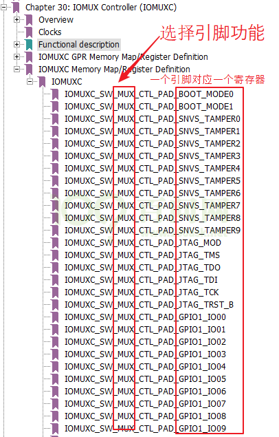

图 4.9 选择引脚功能

比如：

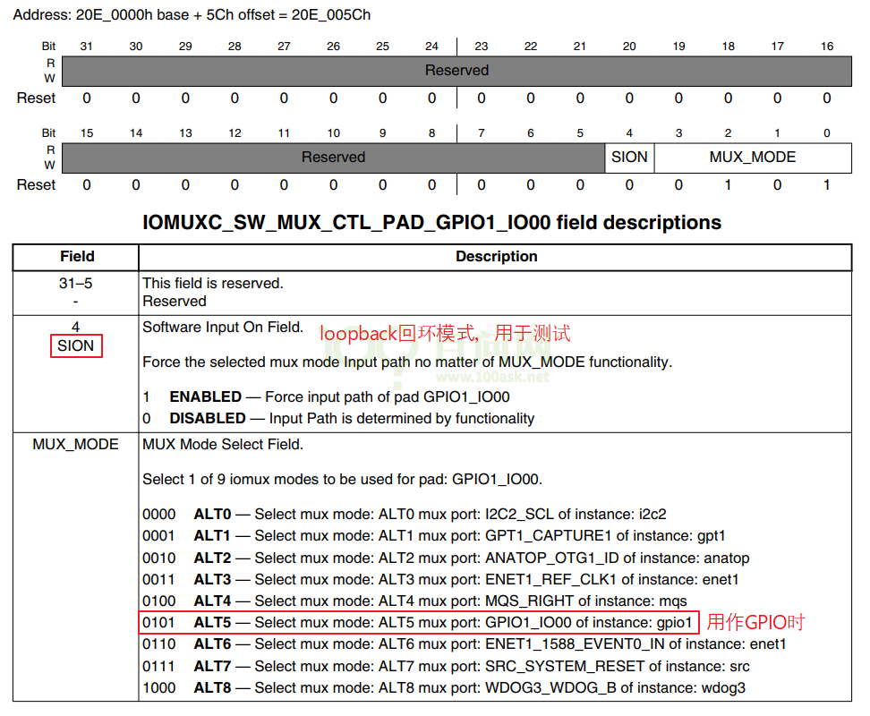

图 4.10 SCON的回环模式

1.  设置上下拉电阻等参数：
    1.  IOMUXC\_SW\_PAD\_CTL\_PAD\_&lt;PAD\_NAME&gt;：pad pad xxx，设置某个pad的参数
    2.  IOMUXC\_SW\_PAD\_CTL\_GRP\_&lt;GROUP NAME&gt;：pad grp xxx，设置某组引脚的参数

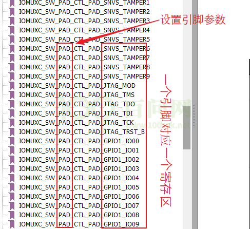

图 4.11 设置引脚参数

比如：

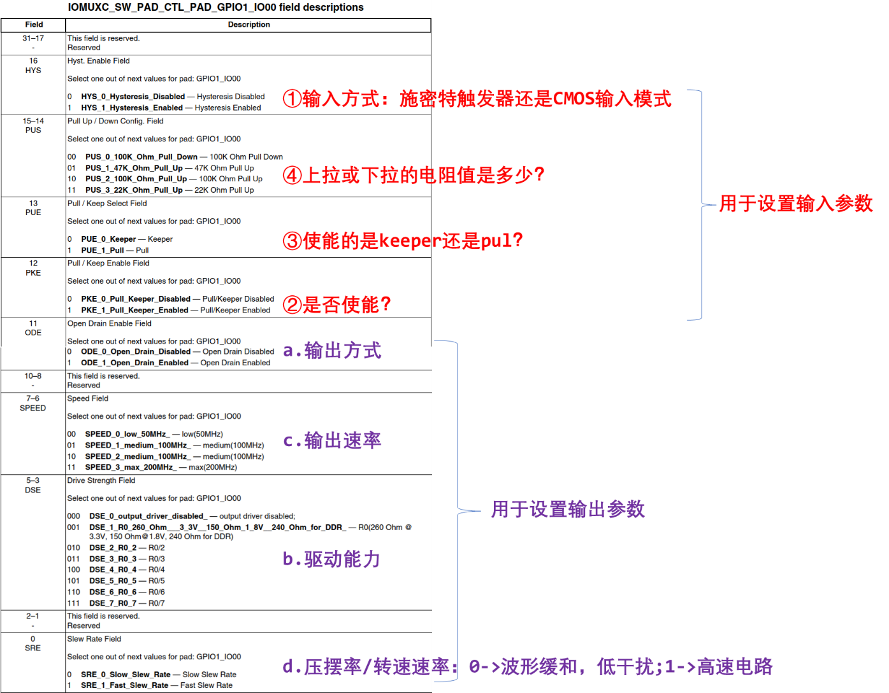

图 4.12 参数解释

### 4.1.4 GPIO模块内部

框图如下：

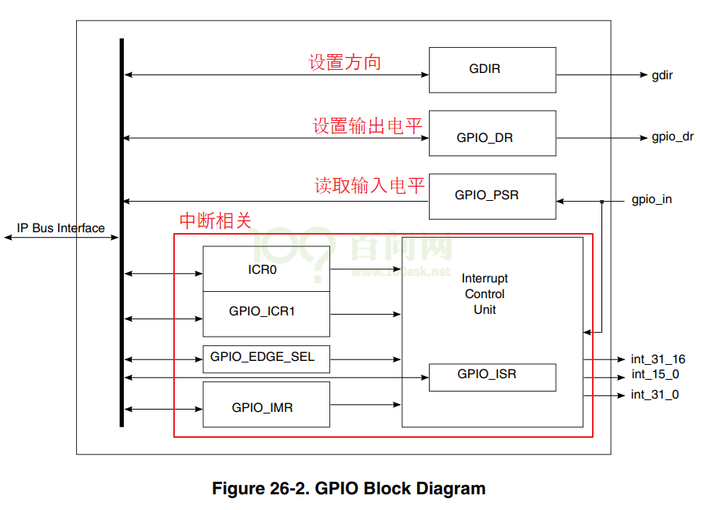

图 4.13 GPIO内部模块图

我们暂时只需要关心3个寄存器：

1.  GPIOx\_GDIR：设置引脚方向，每位对应一个引脚，1-output，0-input

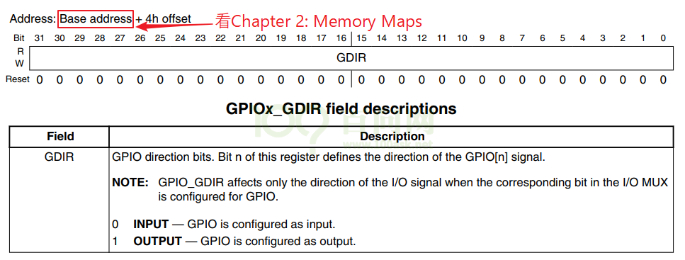

图 4.14 GPIOx\_GDIR

1.  GPIOx\_DR：设置输出引脚的电平，每位对应一个引脚，1-高电平，0-低电平

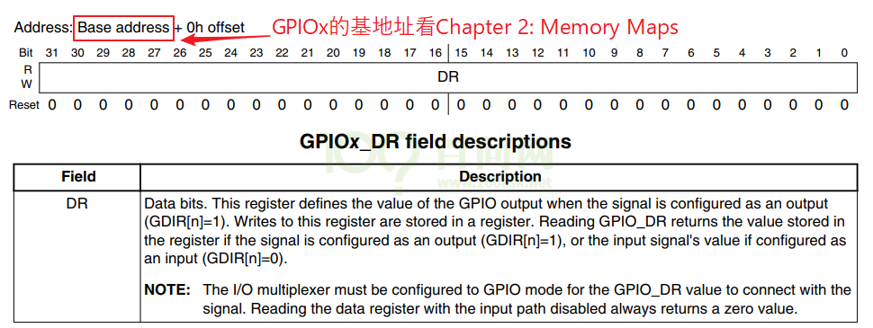

图 4.15 GPIOx\_DR

1.  GPIOx\_PSR：读取引脚的电平，每位对应一个引脚，1-高电平，0-低电平

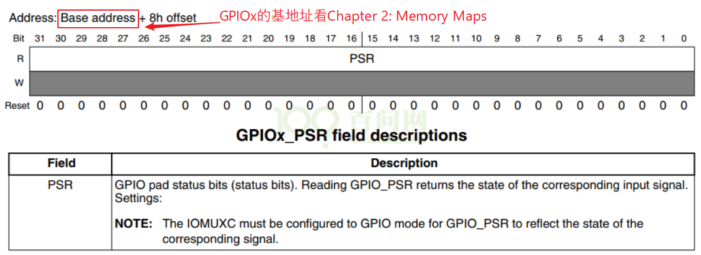

图 4.16 GPIOx\_PSR

### 4.1.5 读GPIO

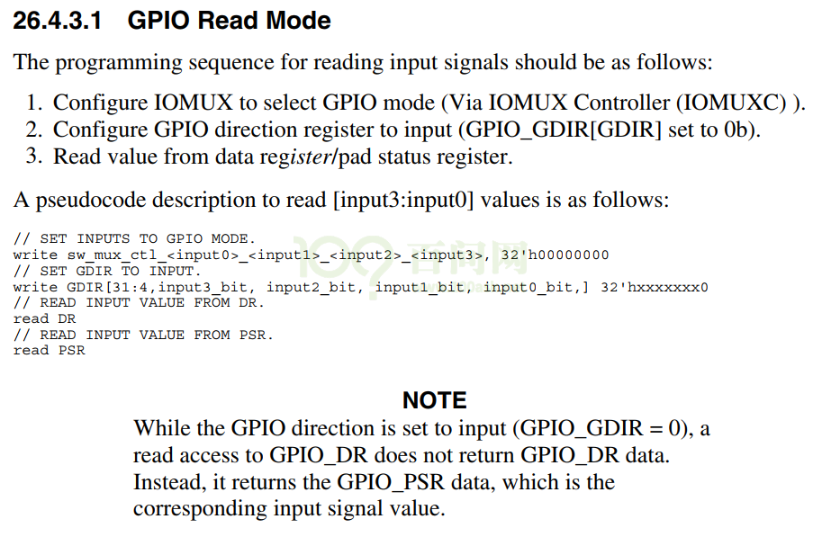+

图 4.17 如何读取GPIO

翻译一下：

1.  设置CCM\_CCGRx寄存器中某位使能对应的GPIO模块 // 默认是使能的，上图省略了
2.  设置IOMUX来选择引脚用于GPIO
3.  设置GPIOx\_GDIR中某位为0，把该引脚设置为输入功能
4.  读GPIOx\_DR或GPIOx\_PSR得到某位的值（读GPIOx\_DR返回的是GPIOx\_PSR的值）

### 4.1.6 写GPIO

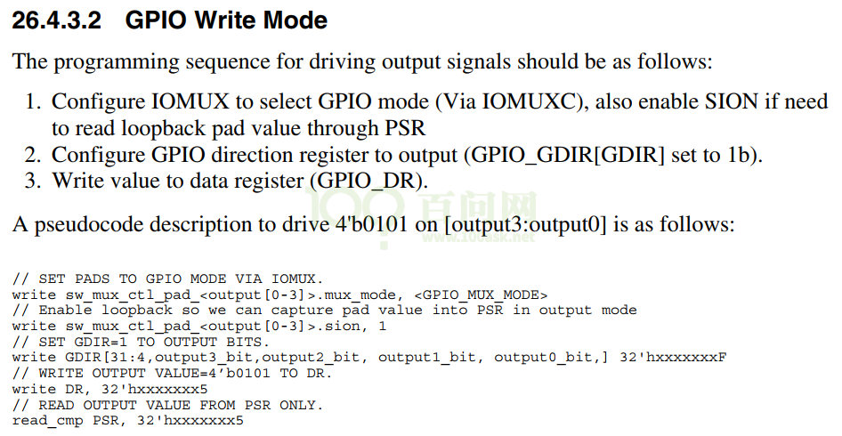

图 4.18 如何写GPIO

翻译一下：

1.  设置CCM\_CCGRx寄存器中某位使能对应的GPIO模块 // 默认是使能的，上图省略了
2.  设置IOMUX来选择引脚用于GPIO
3.  设置GPIOx\_GDIR中某位为1，把该引脚设置为输出功能
4.  写GPIOx\_DR某位的值

需要注意的是，你可以设置该引脚的loopback功能，这样就可以从GPIOx\_PSR中读到引脚的有实电平；你从GPIOx\_DR中读回的只是上次设置的值，它并不能反应引脚的真实电平，比如可能因为硬件故障导致该引脚跟地短路了，你通过设置GPIOx\_DR让它输出高电平并不会起效果。
