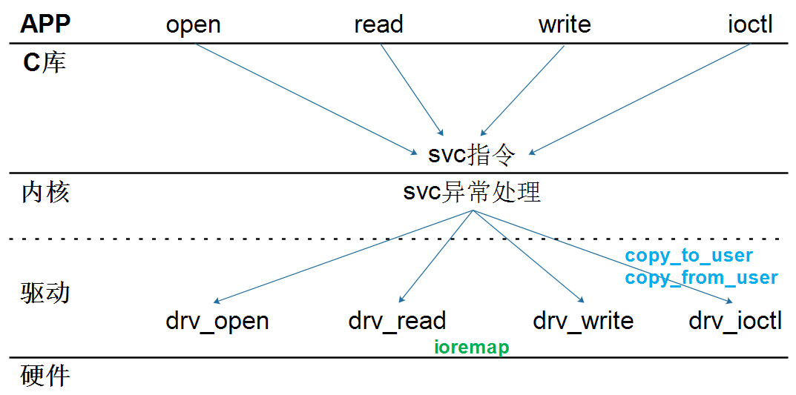

<a id="_Toc197788681"></a>

这是补录的视频，它的章节序号是6A，表示看下面的第六章之前先看第6A章。后面的LED驱动程序为了容易扩展，引入了很多数据结构。对C语言的要求有点高，所以我们基于Hello驱动程序先写出最简单的LED驱动程序。

<a id="_Toc197788682"></a>
## 5.1 LED操作方法_基于IMX6ULL

视频中的文档，放在GIT仓库中：

01\_all\_series\_quickstart\\

05\_嵌入式Linux驱动开发基础知识\\

doc\_pic\\pic\\6A.最简单的LED驱动程序\\03\_IMX6ULL的LED操作方法.pptx

<a id="_Toc197788683"></a>
## 5.2 最简单的LED驱动程序编程_基于IMX6ULL

视频中的源码文档，放在GIT仓库中：

01\_all\_series\_quickstart\\

05\_嵌入式Linux驱动开发基础知识\\source\\02\_led\_drv\\00\_led\_simple\\imx6ull

### 5.2.1 字符设备驱动程序框架

字符设备驱动程序的框架：



图 5.1 字符设备驱动框架

编写驱动程序的套路：

1.  确定主设备号，也可以让内核分配
2.  定义自己的file\_operations结构体
3.  实现对应的drv\_open/drv\_read/drv\_write等函数，填入file\_operations结构体
4.  把file\_operations结构体告诉内核：register\_chrdev
5.  谁来注册驱动程序啊？得有一个入口函数：安装驱动程序时，就会去调用这个入口函数
6.  有入口函数就应该有出口函数：卸载驱动程序时，出口函数调用unregister\_chrdev
7.  其他完善：提供设备信息，自动创建设备节点：class\_create, device\_create

-   驱动怎么操作硬件？
    -   通过ioremap映射寄存器的物理地址得到虚拟地址，读写虚拟地址。
-   驱动怎么和APP传输数据？
    -   通过copy\_to\_user、copy\_from\_user这2个函数。

### 5.2.2 实现什么功能

先编写驱动程序：

-   实现led\_open函数，在里面初始化LED引脚。
-   实现led\_write函数，在里面根据APP传来的值控制LED。
-   再编写测试程序。

### 5.2.3 上机实验

先编译程序，把代码上传代服务器后执行make命令。

接着把Ubuntu上的驱动程序、测试程序下载到开发板/root目录。

最后在开发板上加载驱动程序，执行测试程序，如下：

```bash
[root@100ask:~]# echo "7 4 1 7" > /proc/sys/kernel/printk  // 打开内核的打印信息，有些板子默认打开了
[root@100ask:~]# insmod /root/led_drv.ko
/root/ledtest /dev/myled on                      // 点灯
/root/ledtest /dev/myled off                     // 关灯
```
