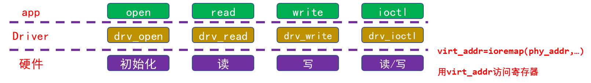
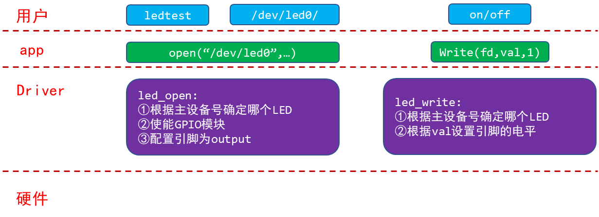
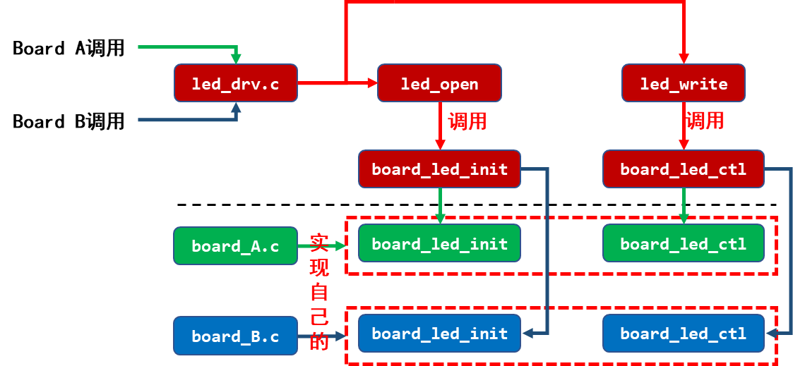
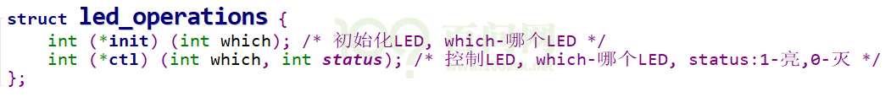
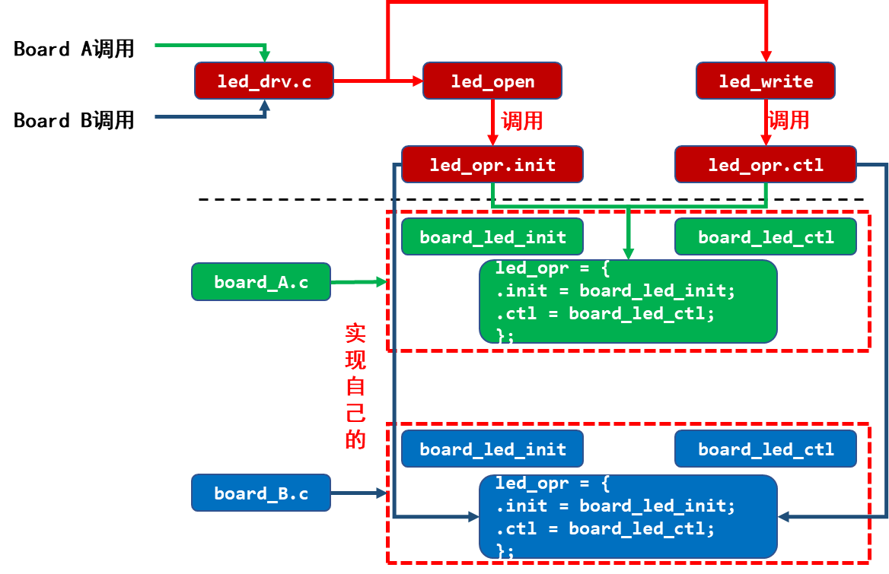

<a id="_Toc197788684"></a>

注意：如果做实验安装驱动时提示version magic不匹配，请看本文档最后的“常见问题”。

<a id="_Toc197788685"></a>
## 6.1 回顾字符设备驱动程序框架



<a id="_Ref108777168"></a>图 6.1 字符设备驱动程序框架

图 6.1中驱动层访问硬件外设寄存器依靠的是ioremap函数去映射到寄存器地址，然后开始控制寄存器。

那么该如何编写驱动程序？

1.  确定主设备号，也可以让内核分配；
2.  定义自己的file\_operations结构体，**这是核心；**
3.  实现对应的drv\_open/drv\_read/drv\_write等函数，填入file\_operations结构体；
4.  把file\_operations结构体告诉内核：通过register\_chrdev函数；
5.  谁来注册驱动程序？需要一个入口函数：安装驱动程序时，就会去调用这个入口函数；
6.  有入口函数就应该有出口函数：卸载驱动程序是，出口函数调用unregister\_chrdev;
7.  其它完善：提供设备信息，自动创建设备节点：class\_create,device\_create;

<a id="_Toc197788686"></a>
## 6.2 对于LED驱动，我们想要什么样的接口？



图 6.2 LED驱动程序接口定义构思

<a id="_Toc197788687"></a>
## 6.3 LED驱动能支持多个板子的基础：分层思想

1.  把驱动拆分为通用的框架(leddrv.c)、具体的硬件操作(board\_X.c)：



图 6.3 拆分驱动构成通用框架

1.  以面向对象的思想，改进代码，抽象出一个结构体：



图 6.4 面向对象的思想抽象出结构体

每个单板相关的board\_X.c实现自己的led\_operations结构体，供上层的leddrv.c调用：



图 6.5 构建实现自己的结构体

<a id="_Toc197788688"></a>
## 6.4 写代码

使用GIT下载所有源码后，本节源码位于如下目录：

01\_all\_series\_quickstart\\

05\_嵌入式Linux驱动开发基础知识\\source\\02\_led\_drv\\01\_led\_drv\_template

### 6.4.1 驱动程序

驱动程序分为上下两层：leddrv.c、board\_demo.c。leddrv.c负责注册file\_operations结构体，它的open/write成员会调用board\_demo.c中提供的硬件led\_opr中的对应函数。

-   -   -   -   1.  把LED的操作抽象出一个led\_operations结构体

首先看看led\_opr.h，它定义了一个led\_operations结构体，把LED的操作抽象为这个结构体：

```
01 #ifndef _LED_OPR_H
02 #define _LED_OPR_H
03
04 struct led_operations {
05      int (*init) (int which); /* 初始化LED, which-哪个LED */
06      int (*ctl) (int which, char status); /* 控制LED, which-哪个LED, status:1-亮,0-灭 */
07 };
08
09 struct led_operations *get_board_led_opr(void);
10
11
12 #endif
```

-   -   -   -   1.  驱动程序的上层：file\_operations结构体

上层是leddrv.c，它的核心是file\_operations结构体，首先看看入口函数：

```
80 /* 4. 把file_operations结构体告诉内核：注册驱动程序 */
81 /* 5. 谁来注册驱动程序啊？得有一个入口函数：安装驱动程序时，就会去调用这个入口函数 */
82 static int __init led_init(void)
83 {
84      int err;
85      int i;
86
87      printk(“%s %s line %d\n”, __FILE__, __FUNCTION__, __LINE__);
88      major = register_chrdev(0, “100ask_led”, &led_drv);  /* /dev/led */
89
90
91      led_class = class_create(THIS_MODULE, “100ask_led_class”);
92      err = PTR_ERR(led_class);
93      if (IS_ERR(led_class)) {
94              printk(“%s %s line %d\n”, __FILE__, __FUNCTION__, __LINE__);
95              unregister_chrdev(major, “100ask_led”);
96              return -1;
97      }
98
99      for (i = 0; i < LED_NUM; i++)
100             device_create(led_class, NULL, MKDEV(major, i), NULL, “100ask_led%d”, i); /* /dev/100ask_led0,1,… */
101
102     p_led_opr = get_board_led_opr();
103
104     return 0;
105 }
```

第88行向内核注册一个file\_operations结构体。

第102行从底层硬件相关的代码board\_demo.c中获得led\_operaions结构体。

再来看看leddrv.c中file\_operations结构体的成员函数：

```
37 /* write(fd, &val, 1); */
38 static ssize_t led_drv_write (struct file *file, const char __user *buf, size_t size, loff_t *offset)
39 {
40      int err;
41      char status;
42      struct inode *inode = file_inode(file);
43      int minor = iminor(inode);
44
45      printk("%s %s line %d\n", __FILE__, __FUNCTION__, __LINE__);
46      err = copy_from_user(&status, buf, 1);
47
48      /* 根据次设备号和status控制LED */
49      p_led_opr->ctl(minor, status);
50
51      return 1;
52 }
53
54 static int led_drv_open (struct inode *node, struct file *file)
55 {
56      int minor = iminor(node);
57
58      printk("%s %s line %d\n", __FILE__, __FUNCTION__, __LINE__);
59      /* 根据次设备号初始化LED */
60      p_led_opr->init(minor);
61
62      return 0;
63 }
64
65 static int led_drv_close (struct inode *node, struct file *file)
66 {
67      printk("%s %s line %d\n", __FILE__, __FUNCTION__, __LINE__);
68      return 0;
69 }
70
71 /* 2. 定义自己的file_operations结构体 */
72 static struct file_operations led_drv = {
73      .owner   = THIS_MODULE,
74      .open    = led_drv_open,
75      .read    = led_drv_read,
76      .write   = led_drv_write,
77      .release = led_drv_close,
78 };
```

第49行、第60行，会调用led\_operations结构体中对应的函数。

### 6.4.2 测试程序

测试程序为ledtest.c：

```
01
02 #include <sys/types.h>
03 #include <sys/stat.h>
04 #include <fcntl.h>
05 #include <unistd.h>
06 #include <stdio.h>
07 #include <string.h>
08
09 /*
10  * ./ledtest /dev/100ask_led0 on
11  * ./ledtest /dev/100ask_led0 off
12  */
13 int main(int argc, char **argv)
14 {
15      int fd;
16      char status;
17
18      /* 1. 判断参数 */
19      if (argc != 3)
20      {
21              printf("Usage: %s <dev> <on | off>\n", argv[0]);
22              return -1;
23      }
24
25      /* 2. 打开文件 */
26      fd = open(argv[1], O_RDWR);
27      if (fd == -1)
28      {
29              printf("can not open file %s\n", argv[1]);
30              return -1;
31      }
32
33      /* 3. 写文件 */
34      if (0 == strcmp(argv[2], "on"))
35      {
36              status = 1;
37              write(fd, &status, 1);
38      }
39      else
40      {
41              status = 0;
42              write(fd, &status, 1);
43      }
44
45      close(fd);
46
47      return 0;
48 }
49
```

第26行打开设备节点。

如果用户想点亮LED，第37行会把值“1”通过write函数写入驱动程序。

如果用户想熄灭LED，第42行会把值“0”通过write函数写入驱动程序。

### 6.4.3 上机测试

这只是一个示例程序，还没有真正操作硬件。测试程序操作驱动程序时，只会导致驱动程序中打印信息。

首先设置交叉工具链，修改驱动Makefile中内核的源码路径，编译驱动和测试程序。

启动开发板后，把Ubuntu上的驱动程序、测试程序下载到开发板/root目录，就可以在开发板上如下操作了：

```bash
[root@100ask:~]# cd  /root
[root@100ask:~]# insmod 100ask_led.ko   // 装载驱动程序
[13449.134044] /home/book/source/02_led_drv/01_led_drv_template/leddrv.c led_init line 87
[root@100ask:~]# ls /dev/100ask_led* -l   // 可以得到2个设备节点
crw-------    1 root     root      235,   0 Jan 18 12:34 /dev/100ask_led0
crw-------    1 root     root      235,   1 Jan 18 12:34 /dev/100ask_led1
[root@100ask:~]#./ledtest /dev/100ask_led0 on    // 点亮LED
[13463.176987] /home/book/source/02_led_drv/01_led_drv_template/leddrv.c led_drv_open line 58
[13463.197877] /home/book/source/02_led_drv/01_led_drv_template/board_demo.c board_demo_led_init line 22, led 0
[13463.216232] /home/book/source/02_led_drv/01_led_drv_template/leddrv.c led_drv_write line 45
[13463.232889] /home/book/source/02_led_drv/01_led_drv_template/board_demo.c board_demo_led_ctl line 28, led 0, on   // 可以看到这句“on”打印
[13463.247977] /home/book/source/02_led_drv/01_led_drv_template/leddrv.c led_drv_close line 67
[root@100ask:~]#./ledtest /dev/100ask_led0 off     // 熄灭LED
[13464.540637] /home/book/source/02_led_drv/01_led_drv_template/leddrv.c led_drv_open line 58
[13464.554380] /home/book/source/02_led_drv/01_led_drv_template/board_demo.c board_demo_led_init line 22, led 0
[13464.569671] /home/book/source/02_led_drv/01_led_drv_template/leddrv.c led_drv_write line 45
[13464.580615] /home/book/source/02_led_drv/01_led_drv_template/board_demo.c board_demo_led_ctl line 28, led 0, off    // 可以看到这句“off”打印
[13464.593397] /home/book/source/02_led_drv/01_led_drv_template/leddrv.c led_drv_close line 67
```

<a id="_Toc197788689"></a>
## 6.5 课后作业

实现读LED状态的功能：涉及APP和驱动。
