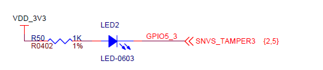
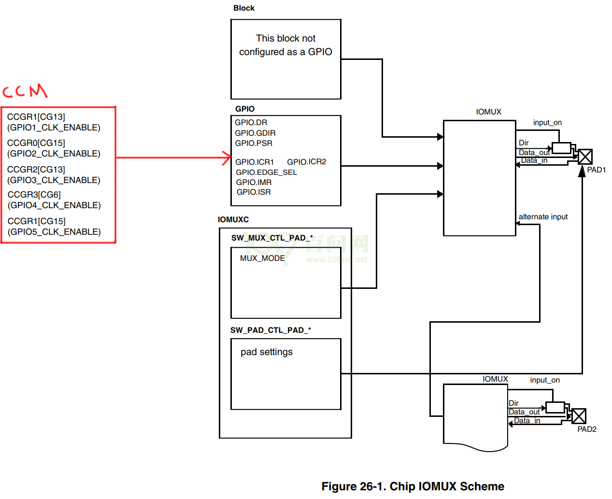
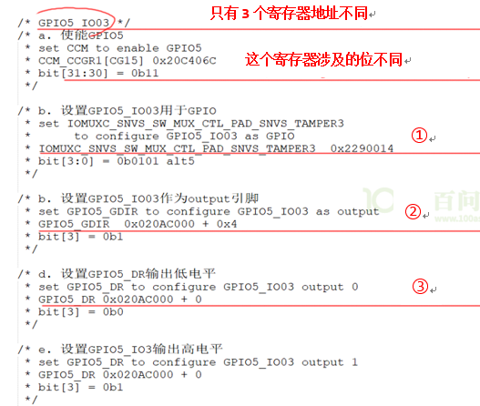
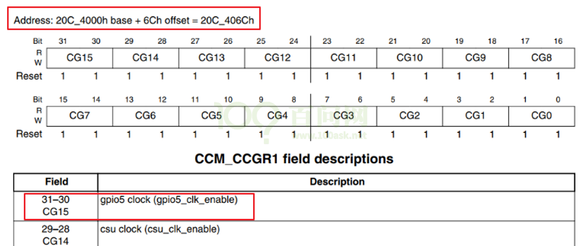
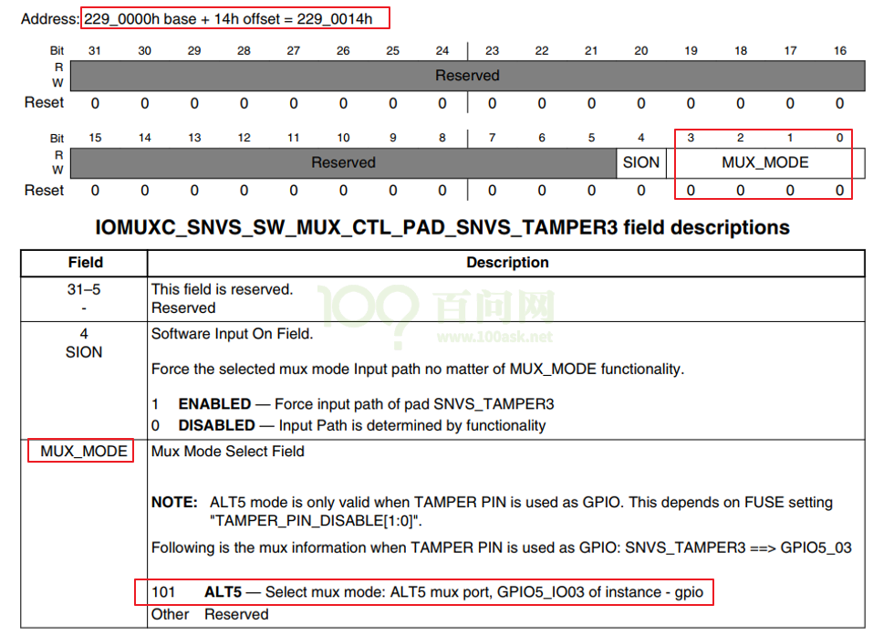
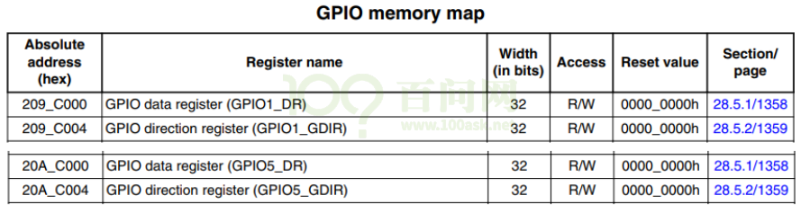
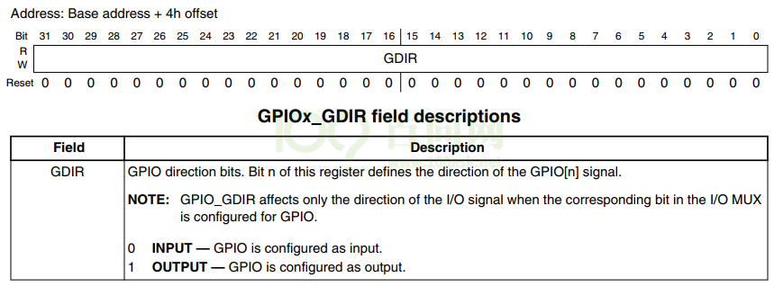
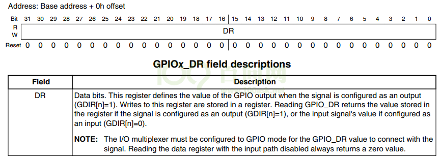

<a id="_Toc197788690"></a>

我们选用的内核都是4.x版本，操作都是类似的：

-   rk3399 linux 4.4.154
-   rk3288 linux 4.4.154
-   imx6ul linux 4.9.88
-   am3358 linux 4.9.168

录制视频时，我的source insight里总是使用某个版本的内核。这没有关系，驱动程序中调用的内核函数，在这些4.x版本的内核里都是一样的。

<a id="_Toc197788691"></a>
## 7.1 怎么写LED驱动程序？

详细步骤如下：

1.  看原理图确定引脚，确定引脚输出什么电平才能点亮/熄灭LED
2.  看主芯片手册，确定寄存器操作方法：哪些寄存器？哪些位？地址是？
3.  编写驱动：先写框架，再写硬件操作的代码

注意：在芯片手册中确定的寄存器地址被称为物理地址，在Linux内核中无法直接使用。

需要使用内核提供的ioremap把物理地址映射为虚拟地址，使用虚拟地址。

### 7.1.1 ioremap函数的使用：

1.  函数原型：

```
void __iomem *ioremap(resource_size_t res_cookie, size_t size)
```

使用时，要包含头文件：

```
#include <asm/io.h>
```

1.  作用：

把物理地址phys\_addr开始的一段空间(大小为size)，映射为虚拟地址；返回值是该段虚拟地址的首地址。

```
virt_addr  = ioremap(phys_addr, size);
```

实际上，它是按页(4096字节)进行映射的，是整页整页地映射的。

假设phys\_addr = 0x10002，size=4，ioremap的内部实现是：

-   1.  phys\_addr按页取整，得到地址0x10000
    2.  size按页取整，得到4096
    3.  把起始地址0x10000，大小为4096的这一块物理地址空间，映射到虚拟地址空间，

假设得到的虚拟空间起始地址为0xf0010000

-   1.  那么phys\_addr = 0x10002对应的virt\_addr = 0xf0010002

1.  不再使用该段虚拟地址时，要iounmap(virt\_addr)：

```
void iounmap(volatile void __iomem *cookie)
```

### 7.1.2 volatile的使用：

1.  编译器很聪明，会帮我们做些优化，比如：

```
int   a;
a = 0;   // 这句话可以优化掉，不影响a的结果
a = 1;
```

1.  有时候编译器会自作聪明，比如：

```
int *p = ioremap(xxxx, 4);  // GPIO寄存器的地址
*p = 0;   // 点灯，但是这句话被优化掉了
*p = 1;   // 灭灯
```

1.  对于上面的情况，为了避免编译器自动优化，需要加上volatile，告诉它“这是容易出错的，别乱优化”：

```
volatile  int *p = ioremap(xxxx, 4);  // GPIO寄存器的地址
*p = 0;   // 点灯，这句话不会被优化掉
*p = 1;   // 灭灯
```

<a id="_Toc197788692"></a>
## 7.2 百问网IMX6ULL的LED驱动程序

### 7.2.1 led原理图

LED原理图如图 7.1，它使用GPIO5\_IO03，引脚输出低电平时LED被点亮，输出高电平时LED被熄灭：



<a id="_Ref108781541"></a>图 7.1 百问网IMX6ULL开发板LED原理图

### 7.2.2 所涉及的寄存器操作

GPIO模块如图 7.2：



**CCM**

<a id="_Ref108781729"></a>图 7.2 GPIO模块内部示意图

代码中对硬件的操作截图如图 7.3，截图便于对比，后面有文字便于复制：



<a id="_Ref108782245"></a>图 7.3 代码操作硬件截图

1.  使能GPIO5



图 7.4 寄存器中GPIO5的使能位

设置b\[31:30\]就可以使能GPIO5，设置为什么值呢？

**注意**：在imx6ullrm.pdf中，CCM\_CCGR1的b\[31:30\]是保留位；我以前写程序时错用了imx6ul(不是imx6ull)的手册，导致程序中额外操作了这些保留位。不去设置b\[31:30\]，GPIO5也是默认使能的。

看下图，设置为0b11：


图 7.5 CCM\_CCGR1的值及其描述

1.  00：该GPIO模块全程被关闭
2.  01：该GPIO模块在CPU run mode情况下是使能的；在WAIT或STOP模式下，关闭
3.  10：保留
4.  11：该GPIO模块全程使能

```
/* GPIO5_IO03 */
/* a. 使能GPIO5
 * set CCM to enable GPIO5
 * CCM_CCGR1[CG15] 0x20C406C
 * bit[31:30] = 0b11
 */
```

1.  设置GPIO5\_IO03为GPIO模式

设置如下寄存器：



图 7.6 GPIO5\_IO03的GPIO模式

```
/* b. 设置GPIO5_IO03用于GPIO
 * set IOMUXC_SNVS_SW_MUX_CTL_PAD_SNVS_TAMPER3
 *		to configure GPIO5_IO03 as GPIO
 * IOMUXC_SNVS_SW_MUX_CTL_PAD_SNVS_TAMPER3	0x2290014
 * bit[3:0] = 0b0101 alt5
 */
```

1.  设置GPIO5\_IO03为输出引脚，设置其输出电平

寄存器地址为：



图 7.7 设置GPIO5\_IO03为输出引脚

设置方向寄存器，把引脚设置为输出引脚：



图 7.8 方向寄存器

设置数据寄存器，设置引脚的输出电平：



图 7.9 数据寄存器

```
/* c. 设置GPIO5_IO03作为output引脚
 * set GPIO5_GDIR to configure GPIO5_IO03 as output
 * GPIO5_GDIR  0x020AC000 + 0x4
 * bit[3] = 0b1
 */
/* d. 设置GPIO5_DR输出低电平
 * set GPIO5_DR to configure GPIO5_IO03 output 0
 * GPIO5_DR 0x020AC000 + 0
 * bit[3] = 0b0
 */
/* e. 设置GPIO5_IO3输出高电平
 * set GPIO5_DR to configure GPIO5_IO03 output 1
 * GPIO5_DR 0x020AC000 + 0
 * bit[3] = 0b1
 */
```

### 7.2.3 写程序

使用GIT下载所有源码后，本节源码位于如下目录：

01\_all\_series\_quickstart\\

05\_嵌入式Linux驱动开发基础知识\\

source\\02\_led\_drv\\02\_led\_drv\_for\_boards\\100ask\_imx6ull\_src\_bin

硬件相关的文件是board\_fire\_imx6ull-pro.c，其他文件跟LED框架驱动程序完全一样。

它首先构造了一个led\_operations结构体，用来表示LED的硬件操作：

```
100 static struct led_operations board_demo_led_opr = {
101     .num  = 1,
102     .init = board_demo_led_init,
103     .ctl  = board_demo_led_ctl,
104 };
```

led\_operations结构体中有init函数指针，它指向board\_demo\_led\_init函数，在里面将会初始化LED引脚：使能、设置为GPIO模式、设置为输出引脚。

值得关注的是第35～38行，对于寄存器要先使用ioremap得到它的虚拟地址，以后使用虚拟地址访问寄存器：

```
21 static volatile unsigned int *CCM_CCGR1                              ;
22 static volatile unsigned int *IOMUXC_SNVS_SW_MUX_CTL_PAD_SNVS_TAMPER3;
23 static volatile unsigned int *GPIO5_GDIR                             ;
24 static volatile unsigned int *GPIO5_DR                               ;
25
26 static int board_demo_led_init (int which) /* 初始化LED, which-哪个LED */
27 {
28     unsigned int val;
29
30     //printk("%s %s line %d, led %d\n", __FILE__, __FUNCTION__, __LINE__, which);
31     if (which == 0)
32     {
33         if (!CCM_CCGR1)
34         {
35             CCM_CCGR1  = ioremap(0x20C406C, 4);
36         IOMUXC_SNVS_SW_MUX_CTL_PAD_SNVS_TAMPER3 = ioremap(0x2290014, 4);
37             GPIO5_GDIR  = ioremap(0x020AC000 + 0x4, 4);
38             GPIO5_DR    = ioremap(0x020AC000 + 0, 4);
39         }
40
41         /* GPIO5_IO03 */
42         /* a. 使能GPIO5
43          * set CCM to enable GPIO5
44          * CCM_CCGR1[CG15] 0x20C406C
45          * bit[31:30] = 0b11
46          */
47         *CCM_CCGR1 |= (3<<30);
48
49         /* b. 设置GPIO5_IO03用于GPIO
50          * set IOMUXC_SNVS_SW_MUX_CTL_PAD_SNVS_TAMPER3
51          *      to configure GPIO5_IO03 as GPIO
52          * IOMUXC_SNVS_SW_MUX_CTL_PAD_SNVS_TAMPER3  0x2290014
53          * bit[3:0] = 0b0101 alt5
54          */
55         val = *IOMUXC_SNVS_SW_MUX_CTL_PAD_SNVS_TAMPER3;
56         val &= ~(0xf);
57         val |= (5);
58         *IOMUXC_SNVS_SW_MUX_CTL_PAD_SNVS_TAMPER3 = val;
59
60
61         /* b. 设置GPIO5_IO03作为output引脚
62          * set GPIO5_GDIR to configure GPIO5_IO03 as output
63          * GPIO5_GDIR  0x020AC000 + 0x4
64          * bit[3] = 0b1
65          */
66         *GPIO5_GDIR |= (1<<3);
67     }
68
69     return 0;
70 }
```

led\_operations结构体中有ctl函数指针，它指向board\_demo\_led\_ctl函数，在里面将会根据参数设置LED引脚的输出电平：

```
72 static int board_demo_led_ctl (int which, char status) /* 控制LED, which-哪个LED, status:1-亮,0-灭 */
73 {
74     //printk("%s %s line %d, led %d, %s\n", __FILE__, __FUNCTION__, __LINE__, which, status ? "on" : "off");
75     if (which == 0)
76     {
77         if (status) /* on: output 0*/
78         {
79             /* d. 设置GPIO5_DR输出低电平
80              * set GPIO5_DR to configure GPIO5_IO03 output 0
81              * GPIO5_DR 0x020AC000 + 0
82              * bit[3] = 0b0
83              */
84             *GPIO5_DR &= ~(1<<3);
85         }
86         else  /* off: output 1*/
87         {
88             /* e. 设置GPIO5_IO3输出高电平
89              * set GPIO5_DR to configure GPIO5_IO03 output 1
90              * GPIO5_DR 0x020AC000 + 0
91              * bit[3] = 0b1
92              */
93             *GPIO5_DR |= (1<<3);
94         }
95
96     }
97     return 0;
98 }
```

下面的get\_board\_led\_opr函数供上层调用，给上层提供led\_operations结构体：

```
106 struct led_operations *get_board_led_opr(void)
107 {
108     return &board_demo_led_opr;
109 }
```

### 7.2.4 上机实验

修改驱动程序Makefile指定内核源码路径，就可以编译驱动程序和测试程序了。

然后启动开发板，把Ubuntu上的驱动程序、测试程序下载到开发板/root目录。

最后，就可以在开发板上进行下列测试。

注意：如果要使用板子自带的系统，关闭原有LED驱动的方法是类似的，也是进入开发板/sys/class/leds/目录，对于每一个LED在该目录下都有一个子目录，假设某个子目录名为XXX，则执行如下命令：

```bash
[root@100ask:~]# echo none  >  /sys/class/leds/XXX/trigger
```

使用我们的系统时，要先禁止内核中原来的LED驱动，把“heatbeat”功能关闭，执行以下命令即可：

```bash
[root@100ask:~]#echo none > /sys/class/leds/cpu/trigger
```

这样就可以使用我们的驱动程序做实验了：

```bash
[root@100ask:~]#cd  /root
[root@100ask:~]#insmod  100ask_led.ko
[root@100ask:~]#/ledtest  /dev/100ask_led0  on
[root@100ask:~]#/ledtest  /dev/100ask_led0  off
```

如果想恢复原来的心跳功能，可以执行：

```bash
[root@100ask:~]#echo heartbeat > /sys/class/leds/cpu/trigger
```

### 7.2.5 课后作业

-   <a id="_Hlk75365984"></a>在驱动里有ioremap，什么时候执行iounmap？请完善程序
-   视频里我们只实现了点一个LED，修改代码支持两个LED。
