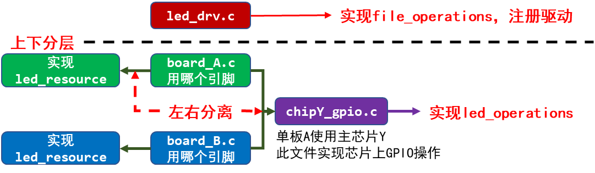

<a id="_Toc197788693"></a>

<a id="_Toc197788694"></a>
## 8.1 面向对象

-   字符设备驱动程序抽象出一个file\_operations结构体；
-   我们写的程序针对硬件部分抽象出led\_operations结构体。

<a id="_Toc197788695"></a>
## 8.2 分层

上下分层，比如我们前面写的LED驱动程序就分为2层：

1.  上层实现硬件无关的操作，比如注册字符设备驱动：leddrv.c
2.  下层实现硬件相关的操作，比如board\_A.c实现单板A的LED操作


图 8.1 led的分层

<a id="_Toc197788696"></a>
## 8.3 分离

还能不能改进？**分离**。

在board\_A.c中，实现了一个led\_operations，为LED引脚实现了初始化函数、控制函数：

```
static struct led_operations board_demo_led_opr = {
	.num  = 1,
	.init = board_demo_led_init,
	.ctl  = board_demo_led_ctl,
};
```

如果硬件上更换一个引脚来控制LED怎么办？你要去修改上面结构体中的init、ctl函数。

实际情况是，每一款芯片它的GPIO操作都是类似的。比如：GPIO1\_3、GPIO5\_4这2个引脚接到LED：

1.  GPIO1\_3属于第1组，即GPIO1。
    1.  有方向寄存器DIR、数据寄存器DR等，基础地址是addr\_base\_addr\_gpio1。
    2.  设置为output引脚：修改GPIO1的DIR寄存器的bit3。
    3.  设置输出电平：修改GPIO1的DR寄存器的bit3。
2.  GPIO5\_4属于第5组，即GPIO5。
    1.  有方向寄存器DIR、数据寄存器DR等，基础地址是addr\_base\_addr\_gpio5。
    2.  设置为output引脚：修改GPIO5的DIR寄存器的bit4。
    3.  设置输出电平：修改GPIO5的DR寄存器的bit4。

既然引脚操作那么有规律，并且这是跟主芯片相关的，那可以针对该芯片写出比较通用的硬件操作代码。

比如board\_A.c使用芯片chipY，那就可以写出：chipY\_gpio.c，它实现芯片Y的GPIO操作，适用于芯片Y的所有GPIO引脚。

使用时，我们只需要在board\_A\_led.c中指定使用哪一个引脚即可。程序结构如下：



图 8.2 程序结构

以面向对象的思想，在board\_A\_led.c中实现led\_resouce结构体，它定义“资源”──要用哪一个引脚。

在chipY\_gpio.c中仍是实现led\_operations结构体，它要写得更完善，支持所有GPIO。

<a id="_Toc197788697"></a>
## 8.4 写示例代码

使用GIT下载所有源码后，本节源码位于如下目录：

01\_all\_series\_quickstart\\

05\_嵌入式Linux驱动开发基础知识\\

source\\02\_led\_drv\\03\_led\_drv\_template\_seperate

程序仍分为上下结构：上层leddrv.c向内核注册file\_operations结构体；下层chip\_demo\_gpio.c提供led\_operations结构体来操作硬件。

下层的代码分为2个：chip\_demo\_gpio.c实现通用的GPIO操作，board\_A\_led.c指定使用哪个GPIO，即“资源”。

led\_resource.h中定义了led\_resource结构体，用来描述GPIO：

```
04 /* GPIO3_0 */
05 /* bit[31:16] = group */
06 /* bit[15:0]  = which pin */
07 #define GROUP(x) (x>>16)
08 #define PIN(x)   (x&0xFFFF)
09 #define GROUP_PIN(g,p) ((g<<16) | (p))
10
11 struct led_resource {
12      int pin;
13 };
15 struct led_resource *get_led_resouce(void);
```

board\_A\_led.c指定使用哪个GPIO，它实现一个led\_resource结构体，并提供访问函数：

```
02 #include "led_resource.h"
03
04 static struct led_resource board_A_led = {
05      .pin = GROUP_PIN(3,1),
06 };
07
08 struct led_resource *get_led_resouce(void)
09 {
10      return &board_A_led;
11 }
```

chip\_demo\_gpio.c中，首先获得board\_A\_led.c实现的led\_resource结构体，然后再进行其他操作，请看下面第26行：

```
20 static struct led_resource *led_rsc;
21 static int board_demo_led_init (int which) /* 初始化LED, which-哪个LED */
22 {
23      //printk("%s %s line %d, led %d\n", __FILE__, __FUNCTION__, __LINE__, which);
24      if (!led_rsc)
25      {
26              led_rsc = get_led_resouce();
27      }
```

<a id="_Toc197788698"></a>
## 8.5 课后作业

使用“分离”的思想，去改造前面写的LED驱动程序：实现led\_resouce，在里面可以指定要使用哪一个LED；改造led\_operations，让它能支持更多GPIO。

**注意：**作为练习，led\_operations结构体不需要写得很完善，不需要支持所有GPIO，你可以只支持若干个GPIO即可。
