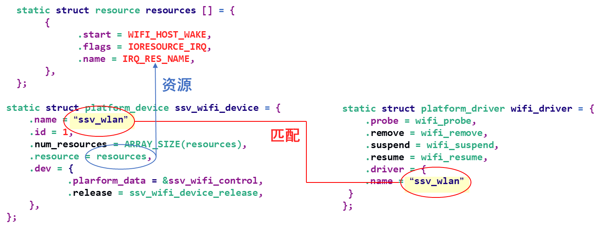
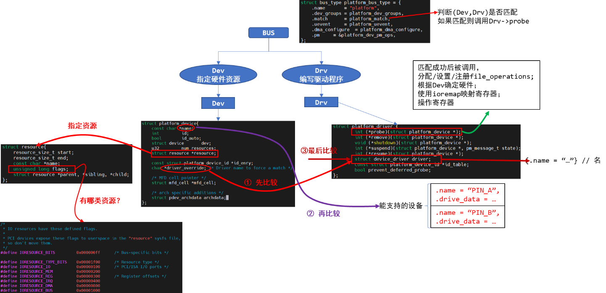

<a id="_Toc197788699"></a>

示例：



图 9.1 驱动模型示例

<a id="_Toc197788700"></a>
## 9.1 驱动编写的3种方法

以LED驱动为例。

### 9.1.1 传统写法


图 9.2 传统写法架构

使用哪个引脚，怎么操作引脚，都写死在代码中。

最简单，不考虑扩展性，可以快速实现功能。

修改引脚时，需要重新编译。

### 9.1.2 总线设备驱动模型


<a id="_Ref109146234"></a>图 9.3 总线设备驱动模型

引入platform\_device/platform\_driver，将“资源”与“驱动”分离开来。

代码稍微复杂，但是易于扩展。

冗余代码太多，修改引脚时设备端的代码需要重新编译。

更换引脚时，图 9.3中的led\_drv.c基本不用改，但是需要修改led\_dev.c。

### 9.1.3 设备树


图 9.4 设备树驱动模型

通过配置文件──设备树来定义“资源”。

代码稍微复杂，但是易于扩展。

无冗余代码，修改引脚时只需要修改dts文件并编译得到dtb文件，把它传给内核。

无需重新编译内核/驱动。

<a id="_Toc197788701"></a>
## 9.2 在Linux中实现“分离”：Bus/Dev/Drv模型



图 9.5 BUS/Dev/Drv模型

<a id="_Toc197788702"></a>
## 9.3 匹配规则

### 9.3.1 最先比较

-   platform\_device.driver\_override和platform\_driver.driver.name

可以设置platform\_device的driver\_override，强制选择某个platform\_driver。

### 9.3.2 然后比较

-   platform\_device. name和platform\_driver.id\_table\[i\].name

Platform\_driver.id\_table是“platform\_device\_id”指针，表示该drv支持若干个device，它里面列出了各个device的\{.name, .driver\_data\}，其中的“name”表示该drv支持的设备的名字，driver\_data是些提供给该device的私有数据。

### 9.3.3 最后比较

-   platform\_device.name和platform\_driver.driver.name

platform\_driver.id\_table可能为空，

这时可以根据platform\_driver.driver.name来寻找同名的platform\_device。

### 9.3.4 函数调用关系

```
platform_device_register
platform_device_add
    device_add
        bus_add_device // 放入链表
        bus_probe_device  // probe枚举设备，即找到匹配的(dev, drv)
            device_initial_probe
                __device_attach
                    bus_for_each_drv(...,__device_attach_driver,...)
                        __device_attach_driver
                            driver_match_device(drv, dev) // 是否匹配
                            driver_probe_device         // 调用drv的probe
platform_driver_register
__platform_driver_register
    driver_register
        bus_add_driver // 放入链表
            driver_attach(drv)
                    bus_for_each_dev(drv->bus, NULL, drv, __driver_attach);
                        __driver_attach
                            driver_match_device(drv, dev) // 是否匹配
                            driver_probe_device         // 调用drv的probe
```

<a id="_Toc197788703"></a>
## 9.4 常用函数

这些函数可查看内核源码：drivers/base/platform.c，根据函数名即可知道其含义。

下面摘取常用的几个函数。

### 9.4.1 注册/反注册

```
platform_device_register/ platform_device_unregister
platform_driver_register/ platform_driver_unregister
platform_add_devices // 注册多个device
```

### 9.4.2 获得资源

-   返回该dev中某类型(type)资源中的第几个(num)：

```
struct resource *platform_get_resource(struct platform_device *dev, unsigned int type,
unsigned int num)
```

-   返回该dev所用的第几个(num)中断：

```
int platform_get_irq(struct platform_device *dev, unsigned int num)
```

-   通过名字(name)返回该dev的某类型(type)资源：

```
struct resource *platform_get_resource_byname(struct platform_device *dev,
unsigned int type,
const char *name)
```

-   通过名字(name)返回该dev的中断号：

```
int platform_get_irq_byname(struct platform_device *dev， const char *name)
```

<a id="_Toc197788704"></a>
## 9.5 怎么写程序

### 9.5.1 分配/设置/注册platform_device结构体

在里面定义所用资源，指定设备名字。

### 9.5.2 分配/设置/注册platform_driver结构体

在其中的probe函数里，分配/设置/注册file\_operations结构体，

并从platform\_device中确实所用硬件资源。

指定platform\_driver的名字。

<a id="_Toc197788705"></a>
## 9.6 课后作业

在内核源码中搜索platform\_device\_register可以得到很多驱动，选择一个作为例子：

1.  确定它的名字
2.  根据它的名字找到对应的platform\_driver
3.  进入platform\_device\_register/platform\_driver\_register内部，分析dev和drv的匹配过程
