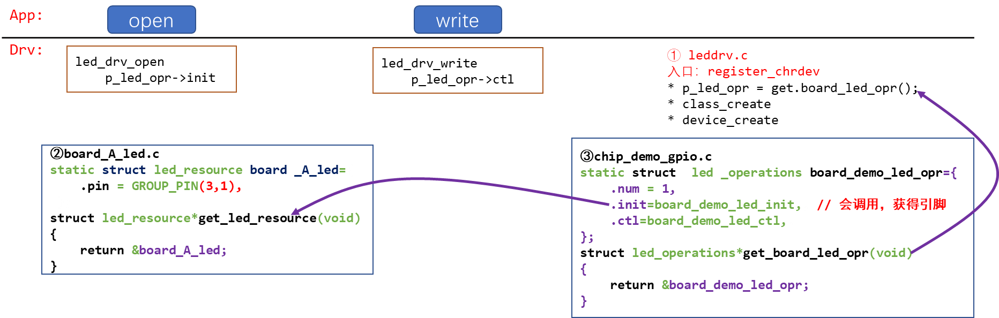
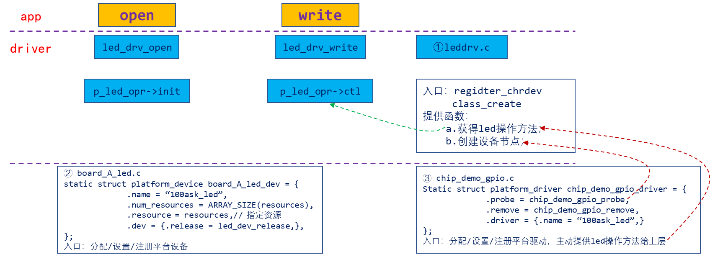
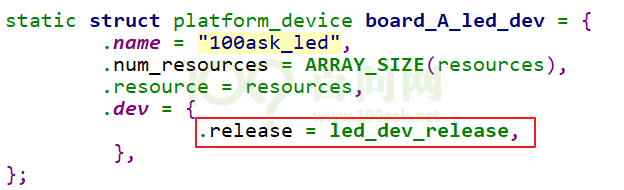
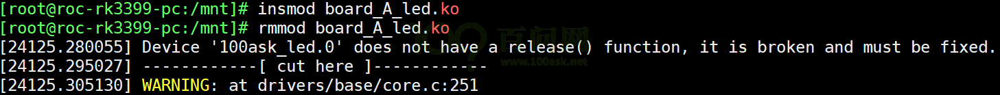
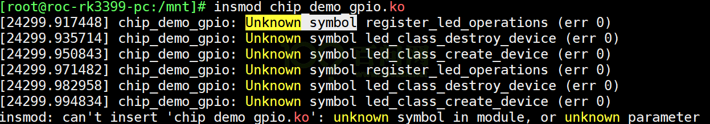

<a id="_Toc197788706"></a>

<a id="_Toc197788707"></a>
## 10.1 原来的框架



图 10.1 原本的驱动框架

<a id="_Toc197788708"></a>
## 10.2 要实现的框架



图 10.2 目标框架

<a id="_Toc197788709"></a>
## 10.3 写代码

使用GIT下载所有源码后，本节源码位于如下目录：

01\_all\_series\_quickstart\\

05\_嵌入式Linux驱动开发基础知识\\

source\\02\_led\_drv\\04\_led\_drv\_template\_bus\_dev\_drv

### 10.3.1 注意事项

1.  如果platform\_device中不提供release函数，如下图所示不提供红框部分的函数：



图 10.3 release device

则在调用platform\_device\_unregister时会出现警告，如下图所示：



图 10.4 不释放的警告

你可以提供一个release函数，如果实在无事可做，把这函数写为空。

1.  EXPORT\_SYMBOL

a.c编译为a.ko，里面定义了func\_a；如果它想让b.ko使用该函数，那么a.c里需要导出此函数(如果a.c, b.c都编进内核，则无需导出)：

```
EXPORT_SYMBOL(led_device_create);
```

并且，使用时要先加载a.ko。如果先加载b.ko，会有类似如下“Unknown symbol”的提示：



图 10.5 先加载b.ko

### 10.3.2 实现platform_device结构体

board\_A.c作为一个可加载模块，里面也有入口函数、出口函数。在入口函数中注册platform\_device结构体，在platform\_device结构体中指定使用哪个GPIO引脚。

首先看入口函数，它调用platform\_device\_register函数，向内核注册board\_A\_led\_dev结构体：

```
50 static int __init led_dev_init(void)
51 {
52     int err;
53
54     err = platform_device_register(&board_A_led_dev);
55
56     return 0;
57 }
```

board\_A\_led\_dev结构体定义如下。

```
23 static void led_dev_release(struct device *dev)
24 {
25 }
26
27 static struct resource resources[] = {
28    {
29        .start = GROUP_PIN(3,1),
30        .flags = IORESOURCE_IRQ,
31        .name = "100ask_led_pin",
32    },
33    {
34        .start = GROUP_PIN(5,8),
35        .flags = IORESOURCE_IRQ,
36        .name = "100ask_led_pin",
37    },
38 };
39
40
41 static struct platform_device board_A_led_dev = {
42         .name = "100ask_led",
43         .num_resources = ARRAY_SIZE(resources),
44         .resource = resources,
45         .dev = {
46                 .release = led_dev_release,
47          },
48 };
```

在resouces数组中指定了2个引脚(第27～38行)；

我们还提供了一个空函数led\_dev\_release(第23～25行)，它被赋给board\_A\_led\_dev结构体(第46行)，这个函数在卸载platform\_device时会被调用，如果不提供的话内核会打印警告信息。

### 10.3.3 实现platform_driver结构体

chip\_demo\_gpio.c中注册platform\_driver结构体，它使用Bus/Dev/Drv模型，当有匹配的platform\_device时，它的probe函数就会被调用。

在probe函数中所做的事情跟之前的代码没有差别。

先看入口函数：

```
138 static struct platform_driver chip_demo_gpio_driver = {
139     .probe      = chip_demo_gpio_probe,
140     .remove     = chip_demo_gpio_remove,
141     .driver     = {
142         .name   = "100ask_led",
143     },
144 };
145
146 static int __init chip_demo_gpio_drv_init(void)
147 {
148     int err;
149
150     err = platform_driver_register(&chip_demo_gpio_driver);
151     register_led_operations(&board_demo_led_opr);
152
153     return 0;
154 }
```

第150行向内核注册一个platform\_driver结构体，这个结构体的核心在于第140行的chip\_demo\_gpio\_probe函数。

chip\_demo\_gpio\_probe函数代码如下：。

```
100 static int chip_demo_gpio_probe(struct platform_device *pdev)
101 {
102     struct resource *res;
103     int i = 0;
104
105     while (1)
106     {
107         res = platform_get_resource(pdev, IORESOURCE_IRQ, i++);
108         if (!res)
109             break;
110
111         g_ledpins[g_ledcnt] = res->start;
112         led_class_create_device(g_ledcnt);
113         g_ledcnt++;
114     }
115     return 0;
116
117 }
```

-   第107行：从匹配的platform\_device中获取资源，确定GPIO引脚。
-   第111行：把引脚记录下来，在操作硬件时要用。
-   第112行：新发现了一个GPIO引脚，就调用上层驱动的代码创建设备节点

操作硬件的代码如下，第31、63行的代码里用到了数组g\_ledpins，里面的值来自platform\_device，在probe函数中根据platform\_device的资源确定了引脚：

```
23 static int g_ledpins[100];
24 static int g_ledcnt = 0;
25
26 static int board_demo_led_init (int which) /* 初始化LED, which-哪个LED */
27 {
28     //printk("%s %s line %d, led %d\n", __FILE__, __FUNCTION__, __LINE__, which);
29
30   printk("init gpio: group %d, pin %d\n", GROUP(g_ledpins[which]), PIN(g_ledpins[which]));
31     switch(GROUP(g_ledpins[which]))
32     {
33         case 0:
34         {
35             printk("init pin of group 0 ...\n");
36             break;
37         }
38         case 1:
39         {
40             printk("init pin of group 1 ...\n");
41             break;
42         }
43         case 2:
44         {
45             printk("init pin of group 2 ...\n");
46             break;
47         }
48         case 3:
49         {
50             printk("init pin of group 3 ...\n");
51             break;
52         }
53     }
54
55     return 0;
56 }
57
58 static int board_demo_led_ctl (int which, char status) /* 控制LED, which-哪个LED, status:1-亮,0-灭 */
59 {
60     //printk("%s %s line %d, led %d, %s\n", __FILE__, __FUNCTION__, __LINE__, which, status ? "on" : "off");
61    printk("set led %s: group %d, pin %d\n", status ? "on" : "off", GROUP(g_ledpins[which]), PIN(g_ledpins[which]));
62
63     switch(GROUP(g_ledpins[which]))
64     {
65         case 0:
66         {
67             printk("set pin of group 0 ...\n");
68             break;
69         }
70         case 1:
71         {
72             printk("set pin of group 1 ...\n");
73             break;
74         }
75         case 2:
76         {
77             printk("set pin of group 2 ...\n");
78             break;
79         }
80         case 3:
81         {
82             printk("set pin of group 3 ...\n");
83             break;
84         }
85     }
86
87     return 0;
88 }
89
90 static struct led_operations board_demo_led_opr = {
91     .init = board_demo_led_init,
92     .ctl  = board_demo_led_ctl,
93 };
94
95 struct led_operations *get_board_led_opr(void)
96 {
97     return &board_demo_led_opr;
98 }
```

<a id="_Toc197788710"></a>
## 10.4 课后作业

完善半成品程序：04\_led\_drv\_template\_bus\_dev\_drv\_unfinished。

请仿照本节提供的程序(位于04\_led\_drv\_template\_bus\_dev\_drv目录)，改造你所用的单板的LED驱动程序。
