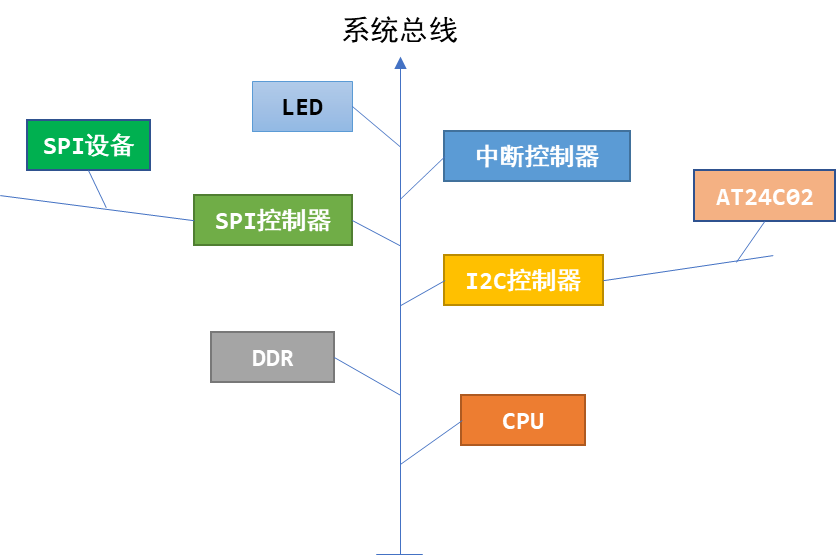
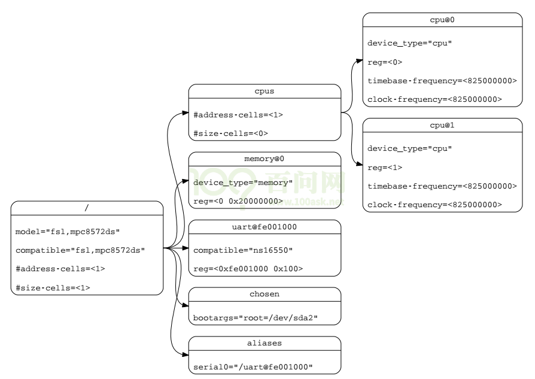
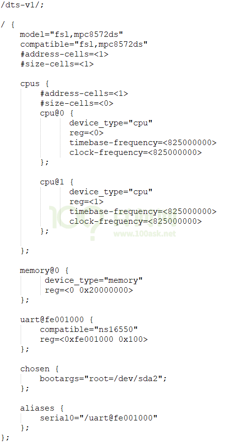
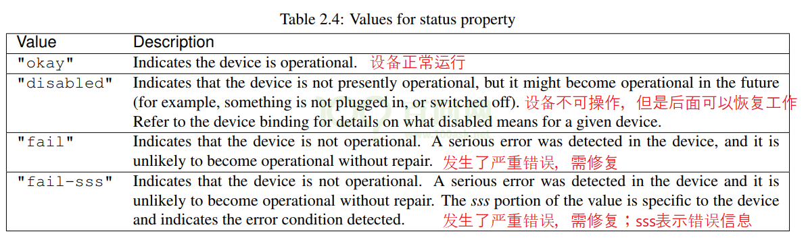
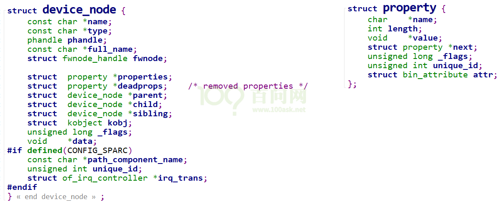
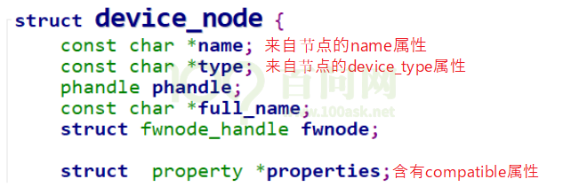
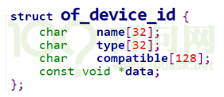
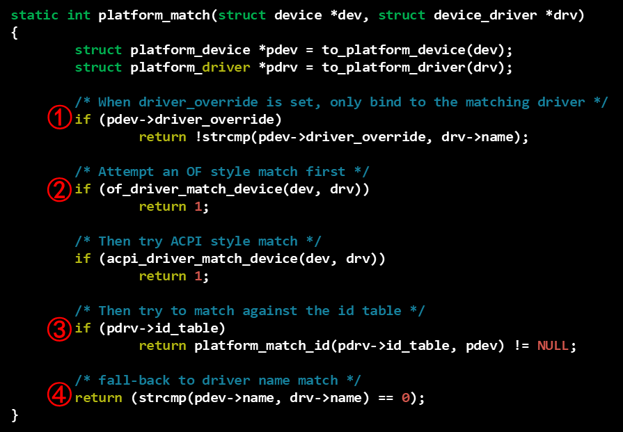
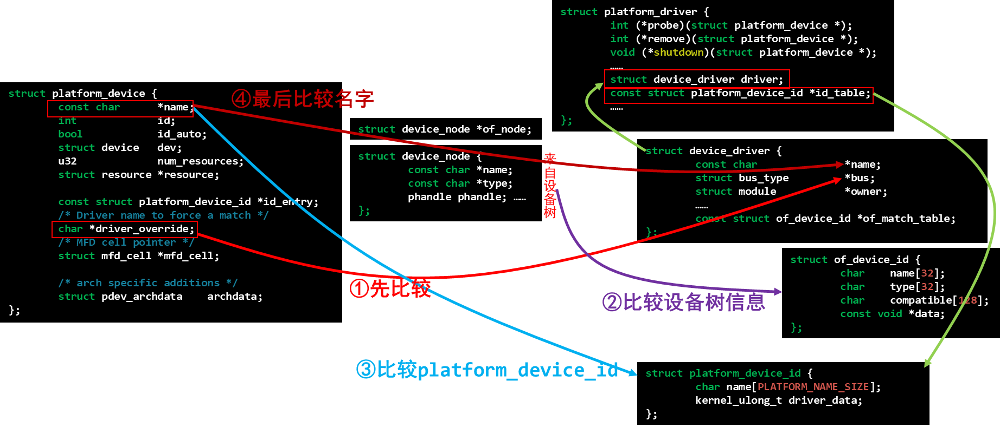

<a id="_Toc197788711"></a>

-   官方文档(可以下载到devicetree-specification-v0.2.pdf):

[https://www.devicetree.org/specifications/](https://www.devicetree.org/specifications/)

-   内核文档:

Documentation/devicetree/booting-without-of.txt

我录制的设备树视频，它是基于s3c2440的，用的是linux 4.19；需要深入研究的可以看该视频(收费)。

注意，如果只是想入门，看本文档及视频即可。

<a id="_Toc197788712"></a>
## 11.1 设备树的引入与作用

以LED驱动为例，如果你要更换LED所用的GPIO引脚，需要修改驱动程序源码、重新编译驱动、重新加载驱动。

在内核中，使用同一个芯片的板子，它们所用的外设资源不一样，比如A板用GPIO A，B板用GPIO B。而GPIO的驱动程序既支持GPIO A也支持GPIO B，你需要指定使用哪一个引脚，怎么指定？在c代码中指定。

随着ARM芯片的流行，内核中针对这些ARM板保存有大量的、没有技术含量的文件。

Linus大发雷霆："this whole ARM thing is a f\*cking pain in the ass"。

于是，Linux内核开始引入设备树。

设备树并不是重新发明出来的，在Linux内核中其他平台如PowerPC，早就使用设备树来描述硬件了。

Linus发火之后，内核开始全面使用设备树来改造，神人就神人。

有一种错误的观点，说“新驱动都是用设备树来写了”。设备树不可能用来写驱动。

请想想，要操作硬件就需要去操作复杂的寄存器，如果设备树可以操作寄存器，那么它就是“驱动”，它就一样很复杂。

设备树只是用来给内核里的驱动程序，指定硬件的信息。比如LED驱动，在内核的驱动程序里去操作寄存器，但是操作哪一个引脚？这由设备树指定。

你可以事先体验一下设备树，板子启动后执行下面的命令：

```bash
# ls /sys/firmware/
devicetree  fdt
```

/sys/firmware/devicetree目录下是以目录结构程现的dtb文件, 根节点对应base目录, 每一个节点对应一个目录, 每一个属性对应一个文件。

这些属性的值如果是字符串，可以使用cat命令把它打印出来；对于数值，可以用hexdump把它打印出来。

一个单板启动时，u-boot先运行，它的作用是启动内核。U-boot会把内核和设备树文件都读入内存，然后启动内核。在启动内核时会把设备树在内存中的地址告诉内核。

<a id="_Toc197788713"></a>
## 11.2 设备树的语法

为什么叫“树”？



图 11.1 总线“树”

怎么描述这棵树？

我们需要编写设备树文件(dts: device tree source)，它需要编译为dtb(device tree blob)文件，内核使用的是dtb文件。

dts文件是根本，它的语法很简单。

下面是一个设备树示例：



图 11.2 设备树示例

它对应的dts文件如下：



图 11.3 设备树dts文件

### 11.2.1 Devicetree格式

-   -   -   -   1.  DTS文件的格式

DTS文件布局(layout):

```
/dts-v1/;                // 表示版本
[memory reservations]    // 格式为: /memreserve/ <address> <length>;
/ {
    [property definitions]
    [child nodes]
};
```

-   -   -   -   1.  node的格式

设备树中的基本单元，被称为“node”，其格式为：

```
[label:] node-name[@unit-address] {
    [properties definitions]
    [child nodes]
};
```

label是标号，可以省略。label的作用是为了方便地引用node，比如：

```
/dts-v1/;
/ {
	uart0: uart@fe001000 {
        compatible="ns16550";
        reg=<0xfe001000 0x100>;
	};
};
```

可以使用下面2种方法来修改uart@fe001000这个node：

```
// 在根节点之外使用label引用node：
&uart0 {
    status = “disabled”;
};
或在根节点之外使用全路径：
&{/uart@fe001000}  {
    status = “disabled”;
};
```

-   -   -   -   1.  properties的格式

简单地说，properties就是“name=value”，value有多种取值方式。

-   Property格式1:

```
[label:] property-name = value;
```

-   Property格式2(没有值):

```
[label:] property-name;
```

-   Property取值只有3种:

```
arrays of cells(1个或多个32位数据, 64位数据使用2个32位数据表示),
string(字符串),
bytestring(1个或多个字节)
```

**示例:**

-   1.  Arrays of cells : cell就是一个32位的数据，用尖括号包围起来

```
interrupts = <17 0xc>;
```

-   -   64bit数据使用2个cell来表示，用尖括号包围起来:

```
clock-frequency = <0x00000001 0x00000000>;
```

-   1.  A null-terminated string (有结束符的字符串)，用双引号包围起来:

```
compatible = "simple-bus";
```

-   1.  A bytestring(字节序列) ，用中括号包围起来:

```
local-mac-address = [00 00 12 34 56 78];  // 每个byte使用2个16进制数来表示
local-mac-address = [000012345678];       // 每个byte使用2个16进制数来表示
```

-   可以是各种值的组合, 用逗号隔开:

```
compatible = "ns16550", "ns8250";
example = <0xf00f0000 19>, "a strange property format";
```

### 11.2.2 dts文件包含dtsi文件

设备树文件不需要我们从零写出来，内核支持了某款芯片比如imx6ull，在内核的arch/arm/boot/dts目录下就有了能用的设备树模板，一般命名为xxxx.dtsi。“i”表示“include”，被别的文件引用的。

我们使用某款芯片制作出了自己的单板，所用资源跟xxxx.dtsi是大部分相同，小部分不同，所以需要引脚xxxx.dtsi并修改。

dtsi文件跟dts文件的语法是完全一样的。

dts中可以包含.h头文件，也可以包含dtsi文件，在.h头文件中可以定义一些宏。

示例：

```
/dts-v1/;
#include <dt-bindings/input/input.h>
#include "imx6ull.dtsi"
/ {
……
};
```

### 11.2.3 常用的属性

-   -   -   -   1.  #address-cells、#size-cells
-   cell指一个32位的数值，
-   address-cells：address要用多少个32位数来表示；
-   size-cells：size要用多少个32位数来表示。

比如一段内存，怎么描述它的起始地址和大小？

下例中，address-cells为1，所以reg中用1个数来表示地址，即用0x80000000来表示地址；size-cells为1，所以reg中用1个数来表示大小，即用0x20000000表示大小：

```
/ {
#address-cells = <1>;
#size-cells = <1>;
memory {
reg = <0x80000000 0x20000000>;
    };
};
```

-   -   -   -   1.  compatible

“compatible”表示“兼容”，对于某个LED，内核中可能有A、B、C三个驱动都支持它，那可以这样写：

```
led {
compatible = “A”, “B”, “C”;
};
```

内核启动时，就会为这个LED按这样的优先顺序为它找到驱动程序：A、B、C。

根节点下也有compatible属性，用来选择哪一个“machine desc”：一个内核可以支持machine A，也支持machine B，内核启动后会根据根节点的compatible属性找到对应的machine desc结构体，执行其中的初始化函数。

compatible的值，建议取这样的形式："manufacturer,model"，即“厂家名，模块名”。

**注意**：machine desc的意思就是“机器描述”，学到内核启动流程时才涉及。

-   -   -   -   1.  model

model属性与compatible属性有些类似，但是有差别。

compatible属性是一个字符串列表，表示可以你的硬件兼容A、B、C等驱动；

model用来准确地定义这个硬件是什么。

比如根节点中可以这样写：

```
{
	compatible = "samsung,smdk2440", "samsung,mini2440";
	model = "jz2440_v3";
};
```

它表示这个单板，可以兼容内核中的“smdk2440”，也兼容“mini2440”。

从compatible属性中可以知道它兼容哪些板，但是它到底是什么板？用model属性来明确。

-   -   -   -   1.  status

dtsi文件中定义了很多设备，但是在你的板子上某些设备是没有的。这时你可以给这个设备节点添加一个status属性，设置为“disabled”：

```
&uart1 {
      status = "disabled";
};
```



图 11.4 设备属性

-   -   -   -   1.  reg

reg的本意是register，用来表示寄存器地址。

但是在设备树里，它可以用来描述一段空间。反正对于ARM系统，寄存器和内存是统一编址的，即访问寄存器时用某块地址，访问内存时用某块地址，在访问方法上没有区别。

reg属性的值，是一系列的“address size”，用多少个32位的数来表示address和size，由其父节点的#address-cells、#size-cells决定。

示例：

```
/dts-v1/;
/ {
#address-cells = <1>;
#size-cells = <1>;
memory {
reg = <0x80000000 0x20000000>;
};
};
```

-   -   -   -   1.  name(过时了，建议不用)

它的值是字符串，用来表示节点的名字。在跟platform\_driver匹配时，优先级最低。

compatible属性在匹配过程中，优先级最高。

11.2.3.7 1device\_type(过时了，建议不用)

它的值是字符串，用来表示节点的类型。在跟platform\_driver匹配时，优先级为中。

compatible属性在匹配过程中，优先级最高。

### 11.2.4 常用的节点(node)

-   -   -   -   1.  根节点

dts文件中必须有一个根节点：

```
/dts-v1/;
/ {
model = "SMDK24440";
compatible = "samsung,smdk2440";
#address-cells = <1>;
#size-cells = <1>;
};
```

根节点中必须有这些属性：

```
#address-cells // 在它的子节点的reg属性中, 使用多少个u32整数来描述地址(address)
#size-cells   // 在它的子节点的reg属性中, 使用多少个u32整数来描述大小(size)
compatible   // 定义一系列的字符串, 用来指定内核中哪个machine_desc可以支持本设备
             // 即这个板子兼容哪些平台
             // uImage : smdk2410 smdk2440 mini2440     ==> machine_desc

model       // 咱这个板子是什么
            // 比如有2款板子配置基本一致, 它们的compatible是一样的
            // 那么就通过model来分辨这2款板子
```

-   -   -   -   1.  CPU节点

一般不需要我们设置，在dtsi文件中都定义好了：

```
cpus {
		#address-cells = <1>;
		#size-cells = <0>;
		cpu0: cpu@0 {
		    .......
        }
};
```

-   -   -   -   1.  memory节点

芯片厂家不可能事先确定你的板子使用多大的内存，所以memory节点需要板厂设置，比如：

```
memory {
reg = <0x80000000 0x20000000>;
};
```

-   -   -   -   1.  chosen节点

我们可以通过设备树文件给内核传入一些参数，这要在chosen节点中设置bootargs属性：

```
chosen {
bootargs = "noinitrd root=/dev/mtdblock4 rw init=/linuxrc console=ttySAC0,115200";
};
```

<a id="_Toc197788714"></a>
## 11.3 编译、更换设备树

我们一般不会从零写dts文件，而是修改。程序员水平有高有低，改得对不对？需要编译一下。并且内核直接使用dts文件的话，就太低效了，它也需要使用二进制格式的dtb文件。

### 11.3.1 在内核中直接make

设置ARCH、CROSS\_COMPILE、PATH这三个环境变量后，进入ubuntu上板子内核源码的目录，执行如下命令即可编译dtb文件：

```
make  dtbs  V=1
```

### 11.3.2 手工编译

除非你对设备树比较了解，否则不建议手工使用dtc工具直接编译。

内核目录下scripts/dtc/dtc是设备树的编译工具，直接使用它的话，包含其他文件时不能使用“#include”，而必须使用“/incldue”。

编译、反编译的示例命令如下，“-I”指定输入格式，“-O”指定输出格式，“-o”指定输出文件：

```
./scripts/dtc/dtc -I dts -O dtb -o tmp.dtb arch/arm/boot/dts/xxx.dts  // 编译dts为dtb
./scripts/dtc/dtc -I dtb -O dts -o tmp.dts arch/arm/boot/dts/xxx.dtb  // 反编译dtb为dts
```

### 11.3.3 给开发板更换设备树文件

怎么给各个单板编译出设备树文件，它们的设备树文件是哪一个？

基本方法都是：设置ARCH、CROSS\_COMPILE、PATH这三个环境变量后，在内核源码目录中执行：

```
make  dtbs
```

### 11.3.4 板子启动后查看设备树

板子启动后执行下面的命令：

```
# ls /sys/firmware/
devicetree  fdt
```

/sys/firmware/devicetree目录下是以目录结构程现的dtb文件, 根节点对应base目录, 每一个节点对应一个目录, 每一个属性对应一个文件。

这些属性的值如果是字符串，可以使用cat命令把它打印出来；对于数值，可以用hexdump把它打印出来。

还可以看到/sys/firmware/fdt文件，它就是dtb格式的设备树文件，可以把它复制出来放到ubuntu上，执行下面的命令反编译出来(-I dtb：输入格式是dtb，-O dts：输出格式是dts)：

```
cd  板子所用的内核源码目录
./scripts/dtc/dtc  -I  dtb  -O  dts   /从板子上/复制出来的/fdt  -o   tmp.dts
```

<a id="_Toc197788715"></a>
## 11.4 内核对设备树的处理

从源代码文件dts文件开始，设备树的处理过程为：


图 11.5 设备树的处理过程

1.  dts在PC机上被编译为dtb文件；
2.  u-boot把dtb文件传给内核；
3.  内核解析dtb文件，把每一个节点都转换为device\_node结构体；
4.  对于某些device\_node结构体，会被转换为platform\_device结构体。

### 11.4.1 dtb中每一个节点都被转换为device_node结构体



图 11.6 dtb节点

根节点被保存在全局变量of\_root中，从of\_root开始可以访问到任意节点。

### 11.4.2 哪些设备树节点会被转换为platform_device

1.  根节点下含有compatile属性的子节点
2.  含有特定compatile属性的节点的子节点

如果一个节点的compatile属性，它的值是这4者之一："simple-bus","simple-mfd","isa","arm,amba-bus", 那么它的子结点(需含compatile属性)也可以转换为platform\_device。

1.  总线I2C、SPI节点下的子节点：不转换为platform\_device

某个总线下到子节点，应该交给对应的总线驱动程序来处理, 它们不应该被转换为platform\_device。

比如以下的节点中：

-   /mytest会被转换为platform\_device, 因为它兼容"simple-bus";

它的子节点/mytest/mytest@0 也会被转换为platform\_device

-   /i2c节点一般表示i2c控制器, 它会被转换为platform\_device, 在内核中有对应的platform\_driver;
-   /i2c/at24c02节点不会被转换为platform\_device, 它被如何处理完全由父节点的platform\_driver决定, 一般是被创建为一个i2c\_client。
-   类似的也有/spi节点, 它一般也是用来表示SPI控制器, 它会被转换为platform\_device, 在内核中有对应的platform\_driver;
-   /spi/flash@0节点不会被转换为platform\_device, 它被如何处理完全由父节点的platform\_driver决定, 一般是被创建为一个spi\_device。

```
{
	  mytest {
		  compatile = "mytest", "simple-bus";
		  mytest@0 {
				compatile = "mytest_0";
		  };
	  };

	  i2c {
		  compatile = "samsung,i2c";
		  at24c02 {
				compatile = "at24c02";
		  };
	  };
	  spi {
		  compatile = "samsung,spi";
		  flash@0 {
				compatible = "winbond,w25q32dw";
				spi-max-frequency = <25000000>;
				reg = <0>;
			  };
	  };
  };
```

### 11.4.3 怎么转换为platform_device

内核处理设备树的函数调用过程，这里不去分析；我们只需要得到如下结论：

-   platform\_device中含有resource数组, 它来自device\_node的reg, interrupts属性;
-   platform\_device.dev.of\_node指向device\_node, 可以通过它获得其他属性

<a id="_Toc197788716"></a>
## 11.5 platform_device如何与platform_driver配对

从设备树转换得来的platform\_device会被注册进内核里，以后当我们每注册一个platform\_driver时，它们就会两两确定能否配对，如果能配对成功就调用platform\_driver的probe函数。

套路是一样的。我们需要将前面讲过的“匹配规则”再完善一下，先贴源码：


图 11.7 platform\_match源码

### 11.5.1 最先比较：是否强制选择某个driver

-   比较:

```
platform_device.driver_override和platform_driver.driver.name
```

可以设置platform\_device的driver\_override，强制选择某个platform\_driver。

### 11.5.2 然后比较：设备树信息

-   比较：

platform\_device.dev.of\_node和platform\_driver.driver.of\_match\_table。

由设备树节点转换得来的platform\_device中，含有一个结构体：of\_node。它的类型如下：



如果一个platform\_driver支持设备树，它的platform\_driver.driver.of\_match\_table是一个数组，类型如下：



使用设备树信息来判断dev和drv是否配对时:

1.  首先，如果of\_match\_table中含有compatible值，就跟dev的compatile属性比较，若一致则成功，否则返回失败；
2.  其次，如果of\_match\_table中含有type值，就跟dev的device\_type属性比较，若一致则成功，否则返回失败；
3.  最后，如果of\_match\_table中含有name值，就跟dev的name属性比较，若一致则成功，否则返回失败。

而设备树中建议不再使用devcie\_type和name属性，所以基本上只使用设备节点的compatible属性来寻找匹配的platform\_driver。

### 11.5.3 接下来比较：platform_device_id

比较platform\_device. name和platform\_driver.id\_table\[i\].name，id\_table中可能有多项。

platform\_driver.id\_table是“platform\_device\_id”指针，表示该drv支持若干个device，它里面列出了各个device的\{.name, .driver\_data\}，其中的“name”表示该drv支持的设备的名字，driver\_data是些提供给该device的私有数据。

### 11.5.4 最后比较

-   platform\_device.name和platform\_driver.driver.name

platform\_driver.id\_table可能为空，

这时可以根据platform\_driver.driver.name来寻找同名的platform\_device。

### 11.5.5 一个图概括所有的配对过程

概括出了这个图：





图 11.8 配对过程

<a id="_Toc197788717"></a>
## 11.6 没有转换为platform_device的节点，如何使用

任意驱动程序里，都可以直接访问设备树。


<a id="_Ref108793111"></a><a id="_Toc197788718"></a>
## 11.7 内核里操作设备树的常用函数

内核源码中include/linux/目录下有很多of开头的头文件，of表示“open firmware”即开放固件。

### 11.7.1 内核中设备树相关的头文件介绍

设备树的处理过程是：dtb -&gt; device\_node -&gt; platform\_device。

-   -   -   -   1.  处理DTB

```
of_fdt.h           // dtb文件的相关操作函数, 我们一般用不到,
// 因为dtb文件在内核中已经被转换为device_node树(它更易于使用)
```

-   -   -   -   1.  处理device\_node

```
of.h               // 提供设备树的一般处理函数,
// 比如 of_property_read_u32(读取某个属性的u32值),
// of_get_child_count(获取某个device_node的子节点数)
of_address.h       // 地址相关的函数,
// 比如 of_get_address(获得reg属性中的addr, size值)
// of_match_device (从matches数组中取出与当前设备最匹配的一项)
of_dma.h           // 设备树中DMA相关属性的函数
of_gpio.h          // GPIO相关的函数
of_graph.h         // GPU相关驱动中用到的函数, 从设备树中获得GPU信息
of_iommu.h         // 很少用到
of_irq.h           // 中断相关的函数
of_mdio.h          // MDIO (Ethernet PHY) API
of_net.h           // OF helpers for network devices.
of_pci.h           // PCI相关函数
of_pdt.h           // 很少用到
of_reserved_mem.h  // reserved_mem的相关函数
```

-   -   -   -   1.  处理 platform\_device

```
of_platform.h      // 把device_node转换为platform_device时用到的函数,
                   // 比如of_device_alloc(根据device_node分配设置platform_device),
                   // of_find_device_by_node (根据device_node查找到platform_device),
                   //   of_platform_bus_probe (处理device_node及它的子节点)
of_device.h        // 设备相关的函数, 比如 of_match_device
```

### 11.7.2 platform_device相关的函数

of\_platform.h中声明了很多函数，但是作为驱动开发者，我们只使用其中的1、2个。其他的都是给内核自己使用的，内核使用它们来处理设备树，转换得到platform\_device。

-   -   -   -   1.  of\_find\_device\_by\_node

函数原型为：

```
extern struct platform_device *of_find_device_by_node(struct device_node *np);
```

设备树中的每一个节点，在内核里都有一个device\_node；你可以使用device\_node去找到对应的platform\_device。

-   -   -   -   1.  platform\_get\_resource

这个函数跟设备树没什么关系，但是设备树中的节点被转换为platform\_device后，设备树中的reg属性、interrupts属性也会被转换为“resource”。

这时，你可以使用这个函数取出这些资源。

函数原型为：

```
/**
 * platform_get_resource - get a resource for a device
 * @dev: platform device
 * @type: resource type   // 取哪类资源？IORESOURCE_MEM、IORESOURCE_REG
*                      // IORESOURCE_IRQ等
 * @num: resource index  // 这类资源中的哪一个？
 */
struct resource *platform_get_resource(struct platform_device *dev,
				       unsigned int type, unsigned int num);
```

对于设备树节点中的reg属性，它对应IORESOURCE\_MEM类型的资源；

对于设备树节点中的interrupts属性，它对应IORESOURCE\_IRQ类型的资源。

### 11.7.3 有些节点不会生成platform_device，怎么访问它们

内核会把dtb文件解析出一系列的device\_node结构体，我们可以直接访问这些device\_node。

内核源码incldue/linux/of.h中声明了device\_node和属性property的操作函数，device\_node和property的结构体定义如下：


图 11.9 device\_node和property

-   -   -   -   1.  找到节点

1.  of\_find\_node\_by\_path

根据路径找到节点，比如“/”就对应根节点，“/memory”对应memory节点。

函数原型：

```
static inline struct device_node *of_find_node_by_path(const char *path);
```

1.  of\_find\_node\_by\_name

根据名字找到节点，节点如果定义了name属性，那我们可以根据名字找到它。

函数原型：

```
extern struct device_node *of_find_node_by_name(struct device_node *from,const char *name);
```

参数from表示从哪一个节点开始寻找，传入NULL表示从根节点开始寻找。

但是在设备树的官方规范中不建议使用“name”属性，所以这函数也不建议使用。

1.  of\_find\_node\_by\_type

根据类型找到节点，节点如果定义了device\_type属性，那我们可以根据类型找到它。

函数原型：

```
extern struct device_node *of_find_node_by_type(struct device_node *from, const char *type);
```

参数from表示从哪一个节点开始寻找，传入NULL表示从根节点开始寻找。

但是在设备树的官方规范中不建议使用“device\_type”属性，所以这函数也不建议使用。

1.  of\_find\_compatible\_node

根据compatible找到节点，节点如果定义了compatible属性，那我们可以根据compatible属性找到它。

函数原型：

```
extern struct device_node *of_find_compatible_node(struct device_node *from, const char *type,
const char *compat);
```

-   参数from表示从哪一个节点开始寻找，传入NULL表示从根节点开始寻找。
-   参数compat是一个字符串，用来指定compatible属性的值；
-   参数type是一个字符串，用来指定device\_type属性的值，可以传入NULL。

1.  of\_find\_node\_by\_phandle

根据phandle找到节点。dts文件被编译为dtb文件时，每一个节点都有一个数字ID，这些数字ID彼此不同。可以使用数字ID来找到device\_node。这些数字ID就是phandle。

函数原型：

```
extern struct device_node *of_find_node_by_phandle(phandle handle);
```

-   参数from表示从哪一个节点开始寻找，传入NULL表示从根节点开始寻找。

1.  of\_get\_parent

找到device\_node的父节点。

函数原型：

```
extern struct device_node *of_get_parent(const struct device_node *node);
```

-   参数from表示从哪一个节点开始寻找，传入NULL表示从根节点开始寻找。

1.  of\_get\_next\_parent

这个函数名比较奇怪，怎么可能有“next parent”？

它实际上也是找到device\_node的父节点，跟of\_get\_parent的返回结果是一样的。

差别在于它多调用下列函数，把node节点的引用计数减少了1。这意味着调用of\_get\_next\_parent之后，你不再需要调用of\_node\_put释放node节点。

```
of_node_put(node);
```

函数原型：

```
extern struct device_node *of_get_next_parent(struct device_node *node);
```

-   参数from表示从哪一个节点开始寻找，传入NULL表示从根节点开始寻找。

1.  of\_get\_next\_child

取出下一个子节点。

函数原型：

```
extern struct device_node *of_get_next_child(const struct device_node *node,
struct device_node *prev);
```

-   参数node表示父节点；
-   prev表示上一个子节点，设为NULL时表示想找到第1个子节点。

不断调用of\_get\_next\_child时，不断更新pre参数，就可以得到所有的子节点。

1.  of\_get\_next\_available\_child

取出下一个“可用”的子节点，有些节点的status是“disabled”，那就会跳过这些节点。

函数原型：

```
struct device_node *of_get_next_available_child( const struct device_node *node,
struct device_node *prev);
```

-   参数node表示父节点；
-   prev表示上一个子节点，设为NULL时表示想找到第1个子节点。

1.  of\_get\_child\_by\_name

根据名字取出子节点。

函数原型：

```
extern struct device_node *of_get_child_by_name(const struct device_node *node,
const char *name);
```

-   参数node表示父节点；
-   name表示子节点的名字。
    -   -   -   1.  找到属性——of\_find\_property

内核源码incldue/linux/of.h中声明了device\_node的操作函数，当然也包括属性的操作函数：of\_find\_property

找到节点中的属性。

函数原型：

```
extern struct property *of_find_property(const struct device_node *np,
const char *name,
int *lenp);
```

-   参数np表示节点，我们要在这个节点中找到名为name的属性。
-   lenp用来保存这个属性的长度，即它的值的长度。

在设备树中，节点大概是这样：

```
xxx_node {
    xxx_pp_name = “hello”;
};
```

上述节点中，“xxx\_pp\_name”就是属性的名字，值的长度是6。

-   -   -   -   1.  获取属性的值

1.  of\_get\_property

根据名字找到节点的属性，并且返回它的值。

函数原型：

```
/*
 * Find a property with a given name for a given node
 * and return the value.
 */
const void *of_get_property(const struct device_node *np,
const char *name,
int *lenp)
```

-   参数np表示节点，我们要在这个节点中找到名为name的属性，然后返回它的值。
-   lenp用来保存这个属性的长度，即它的值的长度。

1.  of\_property\_count\_elems\_of\_size

根据名字找到节点的属性，确定它的值有多少个元素(elem)。

函数原型：

```
* of_property_count_elems_of_size - Count the number of elements in a property
 *
 * @np:		device node from which the property value is to be read.
 * @propname:	name of the property to be searched.
 * @elem_size:	size of the individual element
 *
 * Search for a property in a device node and count the number of elements of
 * size elem_size in it. Returns number of elements on sucess, -EINVAL if the
 * property does not exist or its length does not match a multiple of elem_size
 * and -ENODATA if the property does not have a value.
 */
int of_property_count_elems_of_size(const struct device_node *np,
const char *propname,
int elem_size)
```

1.  参数np表示节点，我们要在这个节点中找到名为propname的属性，然后返回下列结果：

```
return prop->length / elem_size;
```

在设备树中，节点大概是这样：

```
xxx_node {
    xxx_pp_name = <0x50000000 1024>  <0x60000000  2048>;
};
```

-   调用of\_property\_count\_elems\_of\_size(np, “xxx\_pp\_name”, 8)时，返回值是2；
-   调用of\_property\_count\_elems\_of\_size(np, “xxx\_pp\_name”, 4)时，返回值是4。

1.  读整数u32/u64

函数原型为：

```
static inline int of_property_read_u32(const struct device_node *np,
				       const char *propname,
				       u32 *out_value);
extern int of_property_read_u64(const struct device_node *np,
const char *propname,
u64 *out_value);
```

在设备树中，节点大概是这样：

```
xxx_node {
    name1 = <0x50000000>;
    name2 = <0x50000000  0x60000000>;
};
```

-   调用of\_property\_read\_u32 (np, “name1”, &val)时，val将得到值0x50000000；
-   调用of\_property\_read\_u64 (np, “name2”, &val)时，val将得到值0x6000000050000000。

1.  读某个整数u32/u64

函数原型为：

```
extern int of_property_read_u32_index(const struct device_node *np,
const char *propname,
u32 index, u32 *out_value);
```

在设备树中，节点大概是这样：

```
xxx_node {
    name2 = <0x50000000  0x60000000>;
};
```

-   调用of\_property\_read\_u32 (np, “name2”, 1, &val)时，val将得到值0x60000000。

1.  读数组

函数原型为：

```
int of_property_read_variable_u8_array(const struct device_node *np,
const char *propname,
u8 *out_values,
size_t sz_min, size_t sz_max);
int of_property_read_variable_u16_array(const struct device_node *np,
const char *propname,
u16 *out_values,
size_t sz_min, size_t sz_max);
int of_property_read_variable_u32_array(const struct device_node *np,
const char *propname,
u32 *out_values,
size_t sz_min, size_t sz_max);
int of_property_read_variable_u64_array(const struct device_node *np,
const char *propname,
u64 *out_values,
size_t sz_min, size_t sz_max);
```

在设备树中，节点大概是这样：

```
xxx_node {
    name2 = <0x50000012  0x60000034>;
};
```

上述例子中属性name2的值，长度为8。

-   调用of\_property\_read\_variable\_u8\_array (np, “name2”, out\_values, 1, 10)时，out\_values中将会保存这8个字节： 0x12,0x00,0x00,0x50,0x34,0x00,0x00,0x60。
-   调用of\_property\_read\_variable\_u16\_array (np, “name2”, out\_values, 1, 10)时，out\_values中将会保存这4个16位数值： 0x0012, 0x5000,0x0034,0x6000。

总之，这些函数要么能取到全部的数值，要么一个数值都取不到；

-   如果值的长度在sz\_min和sz\_max之间，就返回全部的数值；
-   否则一个数值都不返回。

1.  读字符串

函数原型为：

```
int of_property_read_string(const struct device_node *np,
const char *propname,
const char **out_string);
```

-   返回节点np的属性(名为propname)的值;
-   (\*out\_string)指向这个值，把它当作字符串。

<a id="_Toc197788719"></a>
## 11.8 怎么修改设备树文件

一个写得好的驱动程序, 它会尽量确定所用资源。只把不能确定的资源留给设备树, 让设备树来指定。根据原理图确定"驱动程序无法确定的硬件资源", 再在设备树文件中填写对应内容。

那么, 所填写内容的格式是什么?

### 11.8.1 使用芯片厂家提供的工具

有些芯片，厂家提供了对应的设备树生成工具，可以选择某个引脚用于某些功能，就可以自动生成设备树节点。

你再把这些节点复制到内核的设备树文件里即可。

### 11.8.2 看绑定文档

内核文档 Documentation/devicetree/bindings/

做得好的厂家也会提供设备树的说明文档

### 11.8.3 参考同类型单板的设备树文件

### 11.8.4 网上搜索

### 11.8.5 实在没办法时, 只能去研究驱动源码
