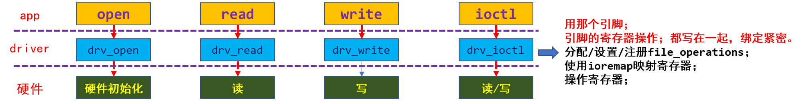
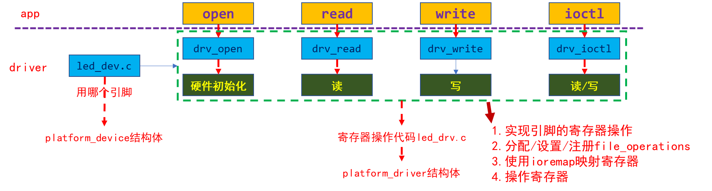
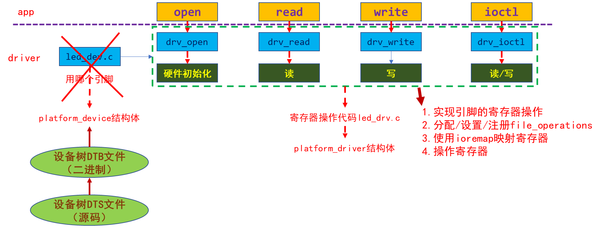
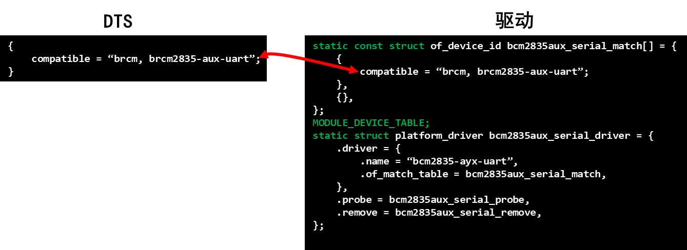
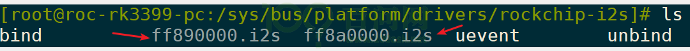

<a id="_Toc197788720"></a>

<a id="_Toc197788721"></a>
## 12.1 总结3种写驱动程序的方法

### 12.1.1 资源和驱动在同一个文件里



图 12.1 方法1 传统写法

### 12.1.2 资源用platform_device指定、驱动在platform_driver实现



图 12.2 方法2 分层分离

### 12.1.3 资源用设备树指定驱动在platform_driver实现



<a id="_Ref109223047"></a>图 12.3 方法3 使用设备树

核心永远是file\_operations结构体。

上述三种方法，只是指定“硬件资源”的方式不一样。

从图 12.3可以知道，platform\_device/platform\_driver只是编程的技巧，不涉及驱动的核心。

<a id="_Toc197788722"></a>
## 12.2 怎么使用设备树写驱动程序

### 12.2.1 设备树节点要与platform_driver能匹配

在我们的工作中，驱动要求设备树节点提供什么，我们就得按这要求去编写设备树。

但是，匹配过程所要求的东西是固定的：

1.  设备树要有compatible属性，它的值是一个字符串
2.  platform\_driver中要有of\_match\_table，其中一项的.compatible成员设置为一个字符串
3.  上述2个字符串要一致。

示例如下：



图 12.4 设备树驱动示例

### 12.2.2 设备树节点指定资源，platform_driver获得资源

如果在设备树节点里使用reg属性，那么内核生成对应的platform\_device时会用reg属性来设置IORESOURCE\_MEM类型的资源。

如果在设备树节点里使用interrupts属性，那么内核生成对应的platform\_device时会用reg属性来设置IORESOURCE\_IRQ类型的资源。对于interrupts属性，内核会检查它的有效性，所以不建议在设备树里使用该属性来表示其他资源。

在我们的工作中，驱动要求设备树节点提供什么，我们就得按这要求去编写设备树。驱动程序中根据pin属性来确定引脚，那么我们就在设备树节点中添加pin属性。

设备树节点中：

```
#define GROUP_PIN(g,p) ((g<<16) | (p))
100ask_led0 {
   compatible = “100ask,led”;
   pin = <GROUP_PIN(5, 3)>;
};
```

驱动程序中，可以从platform\_device中得到device\_node，再用of\_property\_read\_u32得到属性的值：

```
struct  device_node* np = pdev->dev. of_node;
int led_pin;
int err = of_property_read_u32(np, “pin”, &led_pin);
```

<a id="_Toc197788723"></a>
## 12.3 开始编程

### 12.3.1 修改设备树添加led设备节点

在本实验中，需要添加的设备节点代码是一样的，你需要找到你的单板所用的设备树文件，在它的根节点下添加如下内容：

```
#define GROUP_PIN(g,p) ((g<<16) | (p))
100ask_led@0 {
	compatible = "100ask,leddrv";
	pin = <GROUP_PIN(3, 1)>;
};
100ask_led@1 {
	compatible = "100ask,leddrv";
	pin = <GROUP_PIN(5, 8)>;
};
```

-   对百问网imx6ull Pro板

设备树文件是：内核源码目录中arch/arm/boot/dts/100ask\_imx6ull-14x14.dts

修改、编译后得到arch/arm/boot/dts/100ask\_imx6ull-14x14.dtb文件。

对于这款板子，本教程中我们使用SD卡上的系统。

要更换板上的设备树文件，你可以使用SD卡启动开发板后，更换这个文件：/boot/100ask\_imx6ull-14x14.dtb

### 12.3.2 修改platform_driver的源码

使用GIT下载所有源码后，本节源码位于如下目录：

01\_all\_series\_quickstart\\

05\_嵌入式Linux驱动开发基础知识\\

source\\02\_led\_drv\\05\_led\_drv\_template\_device\_tree

关键代码在chip\_demo\_gpio.c，主要看里面的platform\_driver，代码如下。

第166行指定了of\_match\_table，它是用来跟设备树节点匹配的，如果设备树节点中有compatile属性，并且其值等于第157行的“100ask,leddrv”，就会导致第162行的probe函数被调用。

```
156 static const struct of_device_id ask100_leds[] = {
157     { .compatible = "100ask,leddrv" },
158     { },
159 };
160
161 static struct platform_driver chip_demo_gpio_driver = {
162     .probe      = chip_demo_gpio_probe,
163     .remove     = chip_demo_gpio_remove,
164     .driver     = {
165         .name   = "100ask_led",
166         .of_match_table = ask100_leds,
167     },
168 };
169
170 static int __init chip_demo_gpio_drv_init(void)
171 {
172     int err;
173
174     err = platform_driver_register(&chip_demo_gpio_driver);
175     register_led_operations(&board_demo_led_opr);
176
177     return 0;
178 }
```

<a id="_Toc197788724"></a>
## 12.4 上机实验

1.  使用新的设备树dtb文件启动单板，查看/sys/firmware/devicetree/base下有无节点
2.  查看/sys/devices/platform目录下有无对应的platform\_device
3.  加载驱动：

```bash
[root@100ask:~]# insmod  leddrv.ko
[root@100ask:~]# insmod  chip_demo_gpio.ko
```

1.  测试驱动：

```bash
[root@100ask:~]# ./ledtest   /dev/100ask_led0  on
[root@100ask:~]# ./ledtest   /dev/100ask_led0  off
```

<a id="_Toc197788725"></a>
## 12.5 调试技巧

/sys目录下有很多内核、驱动的信息。

### 12.5.1 设备树的信息

以下目录对应设备树的根节点，可以从此进去找到自己定义的节点。

```bash
cd /sys/firmware/devicetree/base/
```

节点是目录，属性是文件。

属性值是字符串时，用cat命令可以打印出来；属性值是数值时，用hexdump命令可以打印出来。

### 12.5.2 platform_device的信息

以下目录含有注册进内核的所有platform\_device：

```bash
/sys/devices/platform
```

一个设备对应一个目录，进入某个目录后，如果它有“driver”子目录，就表示这个platform\_device跟某个platform\_driver配对了。

比如下面的结果中，平台设备“ff8a0000.i2s”已经跟平台驱动“rockchip-i2s”配对了：

```bash
/sys/devices/platform/ff8a0000.i2s]# ls driver -ld
lrwxrwxrwx    1 root     root             0 Jan 18 16:28 driver -> ../../../bus/platform/drivers/rockchip-i2s
```

### 12.5.3 platform_driver的信息

以下目录含有注册进内核的所有platform\_driver：

```bash
/sys/bus/platform/drivers
```

一个driver对应一个目录，进入某个目录后，如果它有配对的设备，可以直接看到。

比如下面的结果中，平台驱动“rockchip-i2s”跟2个平台设备“平台设备“ff890000.i2s”、“ff8a0000.i2s”配对了：



**注意：**一个平台设备只能配对一个平台驱动，一个平台驱动可以配对多个平台设备。

<a id="_Toc197788726"></a>
## 12.6 课后作业

请仿照本节提供的程序(位于05\_led\_drv\_template\_device\_tree目录)，改造你所用的单板的LED驱动程序。
