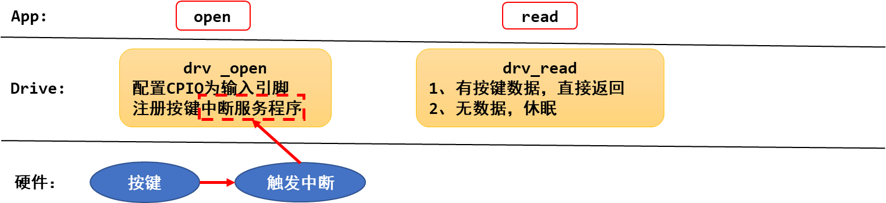
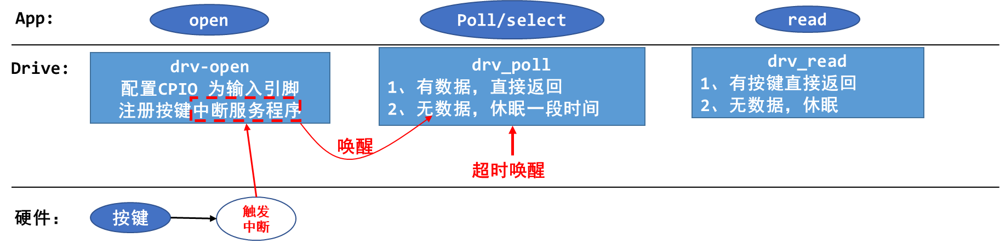
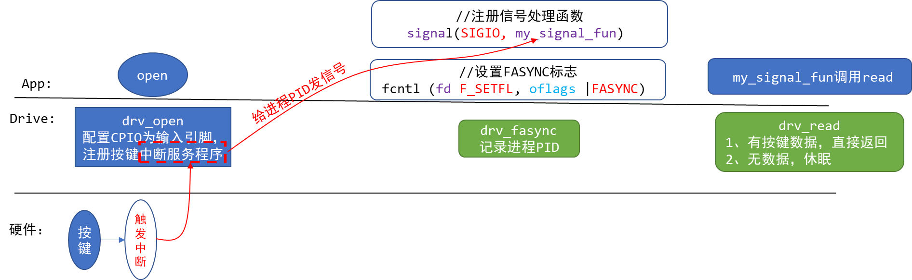

<a id="_Toc197788727"></a>

在做单片机开发时，要读取GPIO按键，我们通常是执行一个循环，不断地检测GPIO引脚电平有没有发生变化。但是在Linux系统中，读取GPIO按键要考虑到效率，引入了很多种方法：查询方式(非阻塞)、休眠-唤醒(阻塞方式)、poll方式、异步通知方式。这4种方法并不仅仅用于GPIO按键，在所有的APP调用驱动程序过程中，都是使用这些方法。通过这4种方式的学习，我们可以掌握如下知识：

1.  驱动的基本技能：中断、休眠、唤醒、poll等机制。

这些基本技能是驱动开发的基础，其他大型驱动复杂的地方是它的框架及设计思想，但是基本技术就这些。

1.  APP开发的基本技能：阻塞 、非阻塞、休眠、poll、异步通知。

<a id="_Toc197788728"></a>
## 13.1 妈妈怎么知道孩子醒了


图 13.1 示例

妈妈怎么知道卧室里小孩醒了？

1.  时不时进房间看一下：查询方式
    -   简单，但是累
2.  进去房间陪小孩一起睡觉，小孩醒了会吵醒她：休眠-唤醒
    -   不累，但是妈妈干不了活了
3.  妈妈要干很多活，但是可以陪小孩睡一会，定个闹钟：poll方式
    -   要浪费点时间，但是可以继续干活。
    -   妈妈要么是被小孩吵醒，要么是被闹钟吵醒。
4.  妈妈在客厅干活，小孩醒了他会自己走出房门告诉妈妈：异步通知
    -   妈妈、小孩互不耽误。

这4种方法没有优劣之分，在不同的场合使用不同的方法。

<a id="_Toc197788729"></a>
## 13.2 APP读取按键的4种方法

APP去读取按键和举例的场景很相似，也有4种方法：

1.  查询方式
2.  休眠-唤醒方式
3.  poll方式
4.  异步通知方式

第2、3、4种方法，都涉及中断服务程序。中断，就像小孩醒了会哭闹一样，中断不经意间到来，它会做某些事情：唤醒APP、向APP发信号。

所以，在按键驱动程序中，中断是核心。

实际上，中断无论是在单片机还是在Linux中都很重要。在Linux中，中断的知识还涉及进程、线程等。

### 13.2.1 查询方式

这种方法最简单：


图 13.2 查询方式

驱动程序中构造、注册一个file\_operations结构体，里面提供有对应的open,read函数。APP调用open时，导致驱动中对应的open函数被调用，在里面配置GPIO为输入引脚。APP调用read时，导致驱动中对应的read函数被调用，它读取寄存器，把引脚状态直接返回给APP。

### 13.2.2 休眠-唤醒方式



图 13.3 休眠唤醒方式

驱动程序中构造、注册一个file\_operations结构体，里面提供有对应的open,read函数。

-   -   APP调用open时，导致驱动中对应的open函数被调用，在里面配置GPIO为输入引脚；并且注册GPIO的中断处理函数。
    -   APP调用read时，导致驱动中对应的read函数被调用，如果有按键数据则直接返回给APP；否则APP在内核态休眠。

当用户按下按键时，GPIO中断被触发，导致驱动程序之前注册的中断服务程序被执行。它会记录按键数据，并唤醒休眠中的APP。

APP被唤醒后继续在内核态运行，即继续执行驱动代码，把按键数据返回给APP(的用户空间)。

### 13.2.3 poll方式

上面的休眠-唤醒方式有个缺点：如果用户一直没操作按键，那么APP就会永远休眠。

我们可以给APP定个闹钟，这就是poll方式。



图 13.4 poll方式

驱动程序中构造、注册一个file\_operations结构体，里面提供有对应的open,read,poll函数。

-   -   APP调用open时，导致驱动中对应的open函数被调用，在里面配置GPIO为输入引脚；并且注册GPIO的中断处理函数。
    -   APP调用poll或select函数，意图是“查询”是否有数据，这2个函数都可以指定一个超时时间，即在这段时间内没有数据的话就返回错误。这会导致驱动中对应的poll函数被调用，如果有按键数据则直接返回给APP；否则APP在内核态休眠一段时间。

当用户按下按键时，GPIO中断被触发，导致驱动程序之前注册的中断服务程序被执行。它会记录按键数据，并唤醒休眠中的APP。

如果用户没按下按键，但是超时时间到了，内核也会唤醒APP。

所以APP被唤醒有2种原因：用户操作了按键，超时。被唤醒的APP在内核态继续运行，即继续执行驱动代码，把“状态”返回给APP(的用户空间)。

APP得到poll/select函数的返回结果后，如果确认是有数据的，则再调用read函数，这会导致驱动中的read函数被调用，这时驱动程序中含有数据，会直接返回数据。

### 13.2.4 异步通知方式

-   -   -   -   1.  异步通知的原理：发信号



图 13.5 异步通知的原理

异步通知的实现原理是：内核给APP发信号。信号有很多种，这里发的是SIGIO。

驱动程序中构造、注册一个file\_operations结构体，里面提供有对应的open,read,fasync函数。

-   -   APP调用open时，导致驱动中对应的open函数被调用，在里面配置GPIO为输入引脚；并且注册GPIO的中断处理函数。
    -   APP给信号SIGIO注册自己的处理函数：my\_signal\_fun。
    -   APP调用fcntl函数，把驱动程序的flag改为FASYNC，这会导致驱动程序的fasync函数被调用，它只是简单记录进程PID。
    -   当用户按下按键时，GPIO中断被触发，导致驱动程序之前注册的中断服务程序被执行。它会记录按键数据，然后给进程PID发送SIGIO信号。
    -   APP收到信号后会被打断，先执行信号处理函数：在信号处理函数中可以去调用read函数读取按键值。
    -   信号处理函数返回后，APP会继续执行原先被打断的代码。
        -   -   1.  应用程序之间发信号示例代码

使用GIT下载所有源码后，本节源码位于如下目录：

01\_all\_series\_quickstart\\

05\_嵌入式Linux驱动开发基础知识\\source\\03\_signal\_example

代码并不复杂，如下。

```
01 #include <stdio.h>
02 #include <unistd.h>
03 #include <signal.h>
04 void my_sig_func(int signo)
05 {
06     printf("get a signal : %d\n", signo);
07 }
08
09 int main(int argc, char **argv)
10 {
11     int i = 0;
12
13     signal(SIGIO, my_sig_func);
14
15     while (1)
16     {
17         printf("Hello, world %d!\n", i++);
18         sleep(2);
19     }
20
21     return 0;
22 }
```

第13行注册信号处理函数，第15行就是一个无限循环。在它运行期间，你可以用另一个APP发信号给它。

在Ubuntu上的测试方法：

```bash
$ gcc   -o   signal  signal.c   // 编译程序
$ ./signal &                   // 后台运行
$ ps  -A | grep signal          // 查看进程ID，假设是9527
$ kill  -SIGIO  9527           // 给这个进程发信号
```

### 13.2.5 驱动程序提供能力，不提供策略

我们的驱动程序可以实现上述4种提供按键的方法，但是驱动程序不应该限制APP使用哪种方法。

这就是驱动设计的一个原理：提供能力，不提供策略。就是说，你想用哪种方法都行，驱动程序都可以提供；但是驱动程序不能限制你使用哪种方法。
