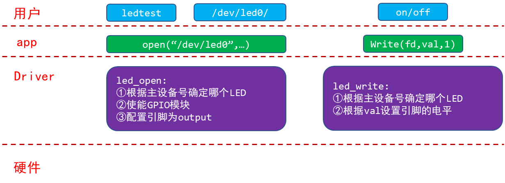
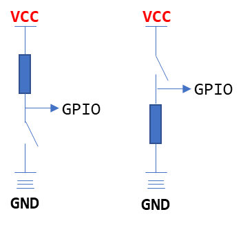
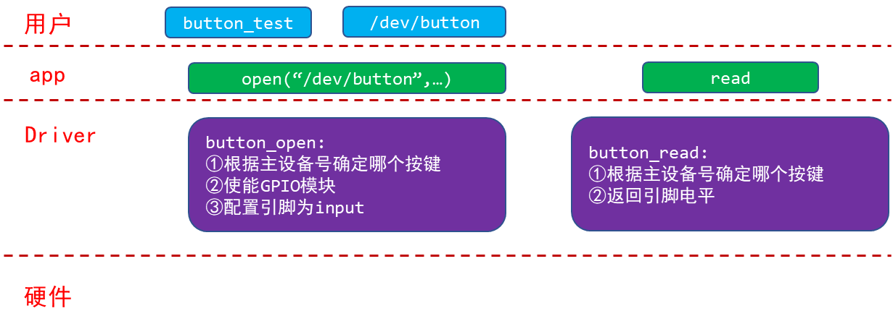
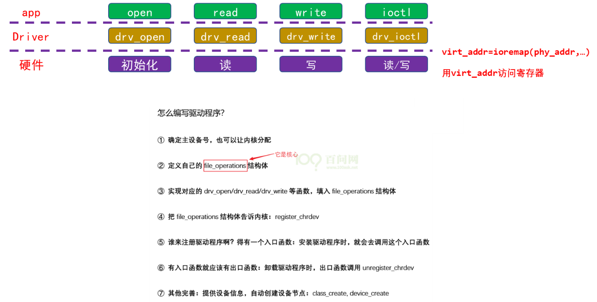
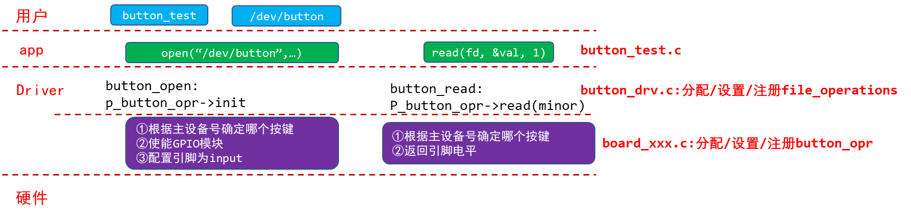

<a id="_Toc197788730"></a>

<a id="_Toc197788731"></a>
## 14.1 LED驱动回顾

对于LED，APP调用open函数导致驱动程序的led\_open函数被调用。在里面，把GPIO配置为输出引脚。安装驱动程序后并不意味着会使用对应的硬件，而APP要使用对应的硬件，必须先调用open函数。所以建议在驱动程序的open函数中去设置引脚。

APP继续调用write函数传入数值，在驱动程序的led\_write函数根据该数值去设置GPIO的数据寄存器，从而控制GPIO的输出电平。

怎么操作寄存器？从芯片手册得到对应寄存器的物理地址，在驱动程序中使用ioremap函数映射得到虚拟地址。驱动程序中使用虚拟地址去访问寄存器。



图 14.1 回顾LED驱动

<a id="_Toc197788732"></a>
## 14.2 按键驱动编写思路

GPIO按键的原理图一般有如下2种：



图 14.2 按键原理图示意

-   按键没被按下时，上图中左边的GPIO电平为高，右边的GPIO电平为低。
-   按键被按下后，上图中左边的GPIO电平为低，右边的GPIO电平为高。

编写按键驱动程序最简单的方法如图 14.3所示：



<a id="_Ref109224995"></a>图 14.3 按键驱动编写

回顾一下编写驱动程序的套路：



图 14.4 驱动程序编写套路

对于使用查询方式的按键驱动程序，我们只需要实现button\_open、button\_read。

<a id="_Toc197788733"></a>
## 14.3 编程：先写框架

我们的目的写出一个容易扩展到各种芯片、各种板子的按键驱动程序，所以驱动程序分为上下两层：

1.  button\_drv.c分配/设置/注册file\_operations结构体

起承上启下的作用，向上提供button\_open,button\_read供APP调用。

而这2个函数又会调用底层硬件提供的p\_button\_opr中的init、read函数操作硬件。

1.  board\_xxx.c分配/设置/注册button\_operations结构体

这个结构体是我们自己抽象出来的，里面定义单板xxx的按键操作函数。

这样的结构易于扩展，对于不同的单板，只需要替换board\_xxx.c提供自己的button\_operations结构体即可。



图 14.5 按键驱动框架

使用GIT下载所有源码后，本节源码位于如下目录：

01\_all\_series\_quickstart\\

05\_嵌入式Linux驱动开发基础知识\\

source\\04\_button\_drv\\01\_button\_drv\_template

### 14.3.1 把按键的操作抽象出一个button_operations结构体

首先看看button\_drv.h，它定义了一个button\_operations结构体，把按键的操作抽象为这个结构体：

```
04 struct button_operations {
05     int count;
06     void (*init) (int which);
07     int (*read) (int which);
08 };
09
10 void register_button_operations(struct button_operations *opr);
11 void unregister_button_operations(void);2
```

再看看board\_xxx.c，它实现了一个button\_operations结构体，代码如下。

第45行调用register\_button\_operations函数，把这个结构体注册到上层驱动中。

```
37 static struct button_operations my_buttons_ops ={
38     .count = 2,
39     .init  = board_xxx_button_init_gpio,
40     .read  = board_xxx_button_read_gpio,
41 };
42
43 int board_xxx_button_init(void)
44 {
45     register_button_operations(&my_buttons_ops);
46     return 0;
47 }
```

### 14.3.2 驱动程序的上层：file_operations结构体

上层是button\_drv.c，它的核心是file\_operations结构体，首先看看入口函数，代码如下。

第83行向内核注册一个file\_operations结构体。

第85行创建一个class，但是该class下还没有device，在后面获得底层硬件的信息时再在class下创建device：这只是用来创建设备节点，它不是驱动程序的核心。

```
81 int button_init(void)
82 {
83     major = register_chrdev(0, "100ask_button", &button_fops);
84
85     button_class = class_create(THIS_MODULE, "100ask_button");
86     if (IS_ERR(button_class))
87         return -1;
88
89     return 0;
90 }
```

再来看看button\_drv.c中file\_operations结构体的成员函数，代码如下。

第34、44行都用到一个button\_operations指针，它是从何而来？

```
28 static struct button_operations *p_button_opr;
29 static struct class *button_class;
30
31 static int button_open (struct inode *inode, struct file *file)
32 {
33     int minor = iminor(inode);
34     p_button_opr->init(minor);
35     return 0;
36 }
37
38 static ssize_t button_read (struct file *file, char __user *buf, size_t size, loff_t *off)
39 {
40     unsigned int minor = iminor(file_inode(file));
41     char level;
42     int err;
43
44     level = p_button_opr->read(minor);
45     err = copy_to_user(buf, &level, 1);
46     return 1;
47 }
48
49
50 static struct file_operations button_fops = {
51     .open = button_open,
52     .read = button_read,
53 };
```

上面第34、44行都用到一个button\_operations指针，来自于底层硬件相关的代码。

底层代码调用register\_button\_operations函数，向上提供这个结构体指针。

register\_button\_operations函数代码如下，它还根据底层提供的button\_operations调用device\_create，这是创建设备节点(第62行)。

```
55 void register_button_operations(struct button_operations *opr)
56 {
57     int i;
58
59     p_button_opr = opr;
60     for (i = 0; i < opr->count; i++)
61     {
62         device_create(button_class, NULL, MKDEV(major, i), NULL, "100ask_button%d", i);
63     }
64 }
```

<a id="_Toc197788734"></a>
## 14.4 测试

这只是一个示例程序，还没有真正操作硬件。测试程序操作驱动程序时，只会导致驱动程序中打印信息。

首先设置交叉工具链，修改驱动Makefile中内核的源码路径，编译驱动和测试程序。

启动开发板后，把Ubuntu上的驱动程序、测试程序下载到开发板/root目录，就可以在开发板上如下操作了：

```bash
[root@100ask:~]# cd  /root
[root@100ask:~]# insmod button_drv.ko   // 装载驱动程序
[  435.276713] button_drv: loading out-of-tree module taints kernel.
[root@100ask:~]# insmod board_xxx.ko
[root@100ask:~]# ls /dev/100ask_button* -l     // 查看设备节点
crw-------    1 root     root      236,   0 Jan 18 08:57 /dev/100ask_button0
crw-------    1 root     root      236,   1 Jan 18 08:57 /dev/100ask_button1
[root@100ask:~]#./button_test /dev/100ask_button0    // 读按键
[  450.886180] /home/book/source/04_button_drv/01_button_drv_template/board_xxx.c board_xxx_button_init_gpio 28, init gpio for button 0
[  450.910915] /home/book/source/04_button_drv/01_button_drv_template/board_xxx.c board_xxx_button_read_gpio 33, read gpio for button 0
get button : 1    // 得到数据
```

<a id="_Toc197788735"></a>
## 14.5 课后怎业

合并LED、BUTTON框架驱动程序：01\_led\_drv\_template、01\_button\_drv\_template，合并为：gpio\_drv\_template
