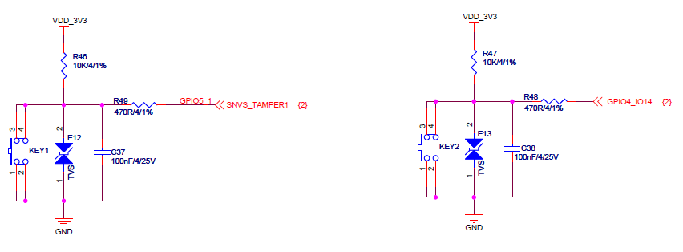
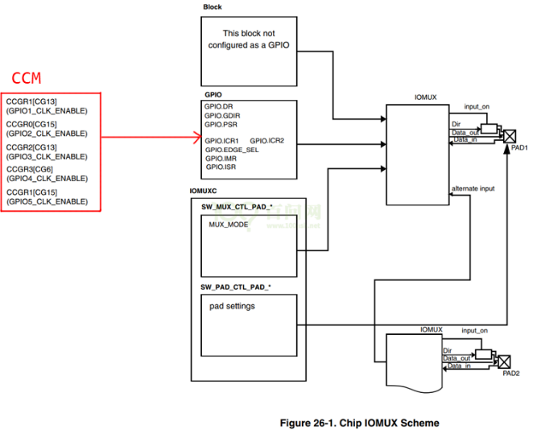
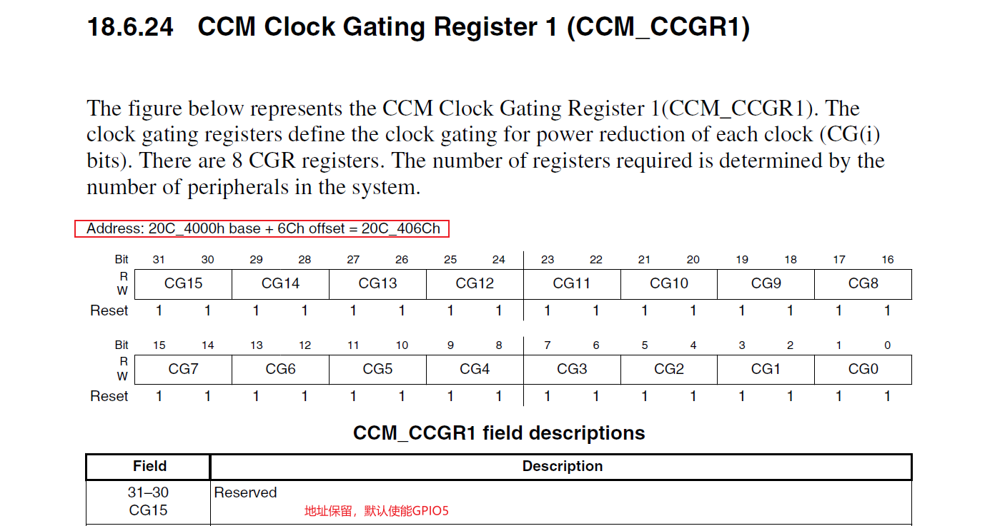
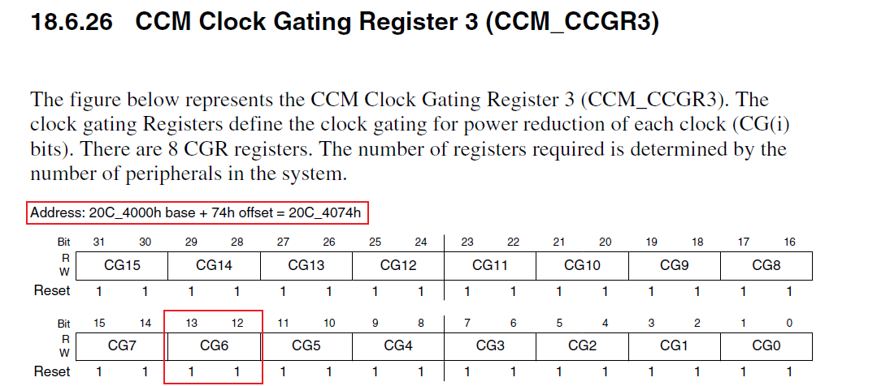
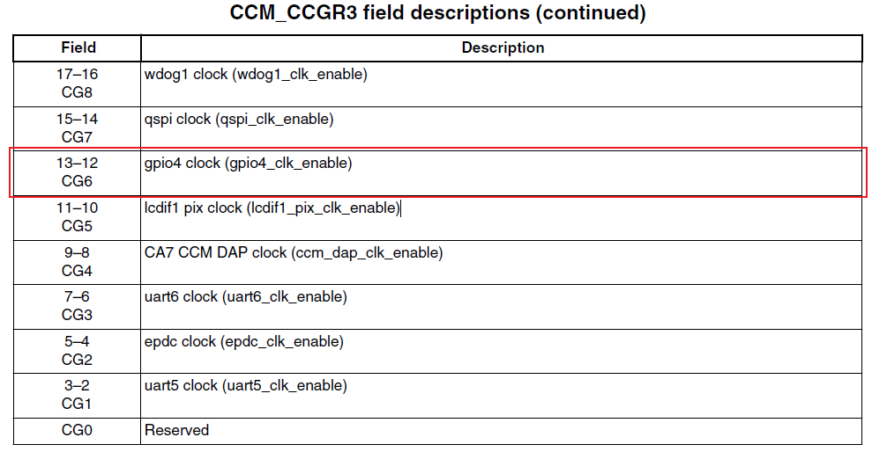
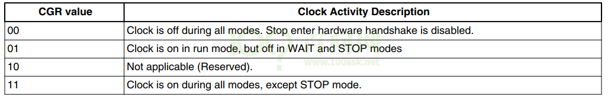
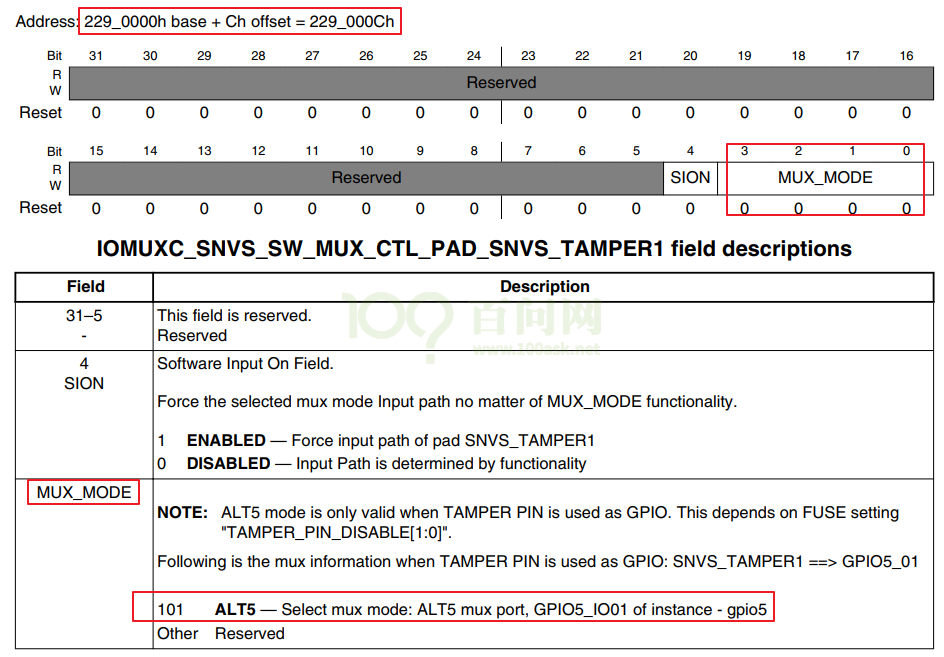
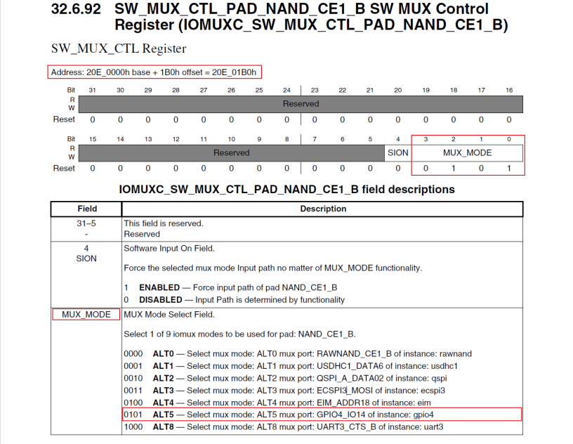
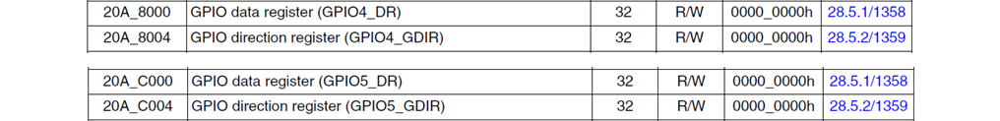
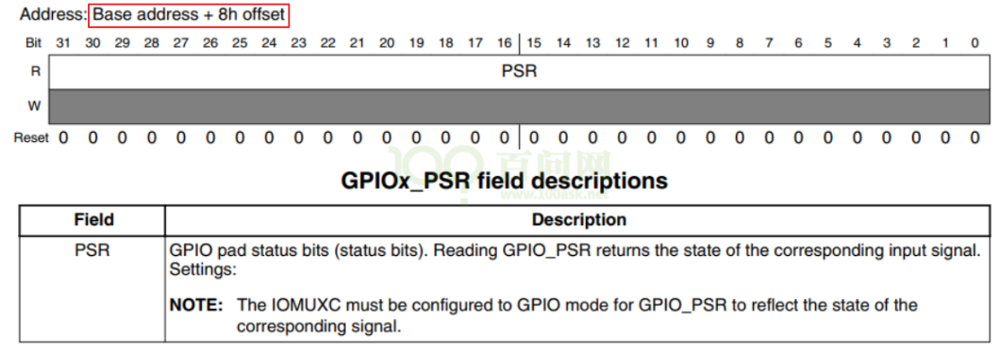

<a id="_Toc197788736"></a>

<a id="_Toc197788737"></a>
## 15.1 GPIO操作回顾


1.  使能电源/时钟控制器；
2.  配置引脚模式；
3.  配置引脚方向——输入/输出；
4.  输出电平/读取电平；

<a id="_Toc197788738"></a>
## 15.2 百问网IMX6ULL的按键驱动程序(查询方式)

### 15.2.1 先看原理图确定引脚及操作方法



图 15.1 按键原理图

-   -   平时按键电平为高，按下按键后电平为低。
    -   按键引脚为GPIO5\_IO01、GPIO4\_IO14。

**注意**：视频里使用QEMU来做实验，QEMU里的按键平时为低电平，按下后为高电平，跟实际开发板刚好相反。

### 15.2.2 再看芯片手册确定寄存器及操作方法



图 15.2 GPIO寄存器控制示意图

1.  使能GPIO5



图 15.3 使能GPIO5

1.  使能GPIO4





图 15.4 使能GPIO4

设置CCM\_CCGR1 b\[31:30\]、CCM\_CCGR3 b\[13:12\]就可以使能GPIO5、GPIO4，设置为什么值呢？

**注意**：在imx6ullrm.pdf中，CCM\_CCGR1的b\[31:30\]是保留位；我以前写程序时错用了imx6ul(不是imx6ull)的手册，导致程序中额外操作了这些保留位。不去设置b\[31:30\]，GPIO5也是默认使能的。

看下图，设置为0b11：



1.  00：该GPIO模块全程被关闭
2.  01：该GPIO模块在CPU run mode情况下是使能的；在WAIT或STOP模式下，关闭
3.  10：保留
4.  11：该GPIO模块全程使能
5.  设置GPIO5\_IO01、GPIO4\_IO18为GPIO模式
6.  对于GPIO5\_IO01，设置如下寄存器：



图 15.5 设置GPIO5\_IO1

1.  对于GPIO4\_IO14，设置如下寄存器：



图 15.6 设置GPIO4\_IO14

1.  设置GPIO5\_IO01、GPIO4\_IO14为输入引脚，读取引脚电平

寄存器地址为：



图 15.7 GPIO\_DR寄存器

设置方向寄存器，把引脚设置为输出引脚：


图 15.8 设置方向寄存器

读取引脚状态寄存器，得到引脚电平：



图 15.9 GPIO状态寄存器

### 15.2.3 编程

-   -   -   -   1.  程序框架

使用GIT下载所有源码后，本节源码位于如下目录：

01\_all\_series\_quickstart\\

05\_嵌入式Linux驱动开发基础知识\\

source\\04\_button\_drv\\02\_button\_drv\_for\_boards\\05\_button\_drv\_for\_100ask\_imx6ull

-   -   -   -   1.  硬件相关的代码

主要看board\_100ask\_imx6ull.c。涉及的寄存器挺多，一个一个去执行ioremap效率太低。先定义结构体，然后对结构体指针进行ioremap。

对于IOMUXC，可以如下定义：

```
struct iomux {
	volatile unsigned int unnames[23];
	volatile unsigned int IOMUXC_SW_MUX_CTL_PAD_GPIO1_IO00;
	volatile unsigned int IOMUXC_SW_MUX_CTL_PAD_GPIO1_IO01;
	volatile unsigned int IOMUXC_SW_MUX_CTL_PAD_GPIO1_IO02;
	volatile unsigned int IOMUXC_SW_MUX_CTL_PAD_GPIO1_IO03;
	volatile unsigned int IOMUXC_SW_MUX_CTL_PAD_GPIO1_IO04;
	volatile unsigned int IOMUXC_SW_MUX_CTL_PAD_GPIO1_IO05;
	volatile unsigned int IOMUXC_SW_MUX_CTL_PAD_GPIO1_IO06;
	volatile unsigned int IOMUXC_SW_MUX_CTL_PAD_GPIO1_IO07;
	volatile unsigned int IOMUXC_SW_MUX_CTL_PAD_GPIO1_IO08;
	volatile unsigned int IOMUXC_SW_MUX_CTL_PAD_GPIO1_IO09;
	volatile unsigned int IOMUXC_SW_MUX_CTL_PAD_UART1_TX_DATA;
	volatile unsigned int IOMUXC_SW_MUX_CTL_PAD_UART1_RX_DATA;
	volatile unsigned int IOMUXC_SW_MUX_CTL_PAD_UART1_CTS_B;
};
```

对于GPIO，可以如下定义：

```
struct imx6ull_gpio {
	volatile unsigned int dr;
	volatile unsigned int gdir;
	volatile unsigned int psr;
	volatile unsigned int icr1;
	volatile unsigned int icr2;
	volatile unsigned int imr;
	volatile unsigned int isr;
	volatile unsigned int edge_sel;
};
struct imx6ull_gpio gpio4 = ioremap(0x020A8000, sizeof(struct imx6ull_gpio));
struct imx6ull_gpio gpio5 = ioremap(0x20AC000, sizeof(struct imx6ull_gpio));
```

看一个驱动程序，先看它的入口函数，代码如下。

```
119 static struct button_operations my_buttons_ops = {
120     .count = 2,
121     .init = board_imx6ull_button_init,
122     .read = board_imx6ull_button_read,
123 };
124
125 int board_imx6ull_button_drv_init(void)
126 {
127     register_button_operations(&my_buttons_ops);
128     return 0;
129 }
```

第127行向上层驱动注册一个button\_operations结构体，该结构体在第119～123行定义。

button\_operations结构体中有init函数指针，它指向board\_imx6ull\_button\_init函数，在里面将会初始化LED引脚：使能、设置为GPIO模式、设置为输出引脚。代码如下。

值得关注的是第71～78行，对于寄存器要先使用ioremap得到它的虚拟地址，以后使用虚拟地址访问寄存器。

```
50 /* enable GPIO4 */
 51 static volatile unsigned int *CCM_CCGR3;
 52
 53 /* enable GPIO5 */
 54 static volatile unsigned int *CCM_CCGR1;
 55
 56 /* set GPIO5_IO03 as GPIO */
 57 static volatile unsigned int *IOMUXC_SNVS_SW_MUX_CTL_PAD_SNVS_TAMPER1;
 58
 59 /* set GPIO4_IO14 as GPIO */
 60 static volatile unsigned int *IOMUXC_SW_MUX_CTL_PAD_NAND_CE1_B;
 61
 62 static struct iomux *iomux;
 63
 64 static struct imx6ull_gpio *gpio4;
 65 static struct imx6ull_gpio *gpio5;
 66
 67 static void board_imx6ull_button_init (int which) /* 初始化button, which-哪个button */
 68 {
 69     if (!CCM_CCGR1)
 70     {
 71         CCM_CCGR1 = ioremap(0x20C406C, 4);
 72         CCM_CCGR3 = ioremap(0x20C4074, 4);
 73         IOMUXC_SNVS_SW_MUX_CTL_PAD_SNVS_TAMPER1 = ioremap(0x229000C, 4);
 74                 IOMUXC_SW_MUX_CTL_PAD_NAND_CE1_B        = ioremap(0x20E01B0, 4);
 75
 76         iomux = ioremap(0x20e0000, sizeof(struct iomux));
 77         gpio4 = ioremap(0x020A8000, sizeof(struct imx6ull_gpio));
 78         gpio5 = ioremap(0x20AC000, sizeof(struct imx6ull_gpio));
 79     }
 80
 81     if (which == 0)
 82     {
 83         /* 1. enable GPIO5
 84          * CG15, b[31:30] = 0b11
 85          */
 86         *CCM_CCGR1 |= (3<<30);
 87
 88         /* 2. set GPIO5_IO01 as GPIO
 89          * MUX_MODE, b[3:0] = 0b101
 90          */
 91         *IOMUXC_SNVS_SW_MUX_CTL_PAD_SNVS_TAMPER1 = 5;
 92
 93         /* 3. set GPIO5_IO01 as input
 94          * GPIO5 GDIR, b[1] = 0b0
 95          */
 96         gpio5->gdir &= ~(1<<1);
 97     }
98     else if(which == 1)
 99     {
100         /* 1. enable GPIO4
101          * CG6, b[13:12] = 0b11
102          */
103         *CCM_CCGR3 |= (3<<12);
104
105         /* 2. set GPIO4_IO14 as GPIO
106          * MUX_MODE, b[3:0] = 0b101
107          */
108         IOMUXC_SW_MUX_CTL_PAD_NAND_CE1_B = 5;
109
110         /* 3. set GPIO4_IO14 as input
111          * GPIO4 GDIR, b[14] = 0b0
112          */
113         gpio4->gdir &= ~(1<<14);
114     }
115
116 }
```

button\_operations结构体中还有有read函数指针，它指向board\_imx6ull\_button\_read函数，在里面将会读取并返回按键引脚的电平。代码如下。

```
118 static int board_imx6ull_button_read (int which) /* 读button, which-哪个 */
119 {
120     //printk("%s %s line %d, button %d, 0x%x\n", __FILE__, __FUNCTION__, __LINE__, which, *GPIO1_DATAIN);
121     if (which == 0)
122         return (gpio5->psr & (1<<1)) ? 1 : 0;
123     else
124         return (gpio4->psr & (1<<14)) ? 1 : 0;
125 }
```

### 15.2.4 测试

把驱动程序、测试程序放到开发板上。

在开发板安装驱动程序之后执行测试程序，观察它的返回值(执行测试程序的同时操作按键)：

```bash
[root@100ask:~]# insmod button_drv.ko
[root@100ask:~]# insmod board_drv.ko
[root@100ask:~]# insmod board_100ask_imx6ull.ko
[root@100ask:~]#./button_test  /dev/100ask_button0
[root@100ask:~]#./button_test  /dev/100ask_button1
```

### 15.2.5 课后作业

修改button\_test.c，使用按键来点灯
