<a id="_Toc197788739"></a>

参考文档：

-   内核 Documentation\\devicetree\\bindings\\Pinctrl\\ 目录下：

Pinctrl-bindings.txt

-   内核 Documentation\\gpio 目录下：

Pinctrl-bindings.txt

-   内核 Documentation\\devicetree\\bindings\\gpio 目录下：

gpio.txt

**注意**：本章的重点在于“使用”，深入讲解放在“驱动大全”的视频里。

前面的视频，我们使用直接操作寄存器的方法编写驱动。这只是为了让大家掌握驱动程序的本质，在实际开发过程中我们可不这样做，太低效了！如果驱动开发都是这样去查找寄存器，那我们就变成“寄存器工程师”了，即使是做单片机的都不执着于裸写寄存器了。

Linux下针对引脚有2个重要的子系统：GPIO、Pinctrl。

<a id="_Toc197788740"></a>
## 16.1 Pinctrl子系统重要概念

### 16.1.1 引入

无论是哪种芯片，都有类似图 16.1的结构：

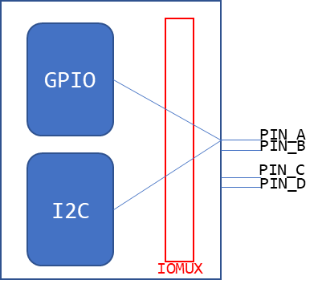

<a id="_Ref109226796"></a>图 16.1 GPIO与外设连接示意图

-   要想让pinA、B用于GPIO，需要设置IOMUX让它们连接到GPIO模块；
-   要想让pinA、B用于I2C，需要设置IOMUX让它们连接到I2C模块。

所以GPIO、I2C应该是并列的关系，它们能够使用之前，需要设置IOMUX。有时候并不仅仅是设置IOMUX，还要配置引脚，比如上拉、下拉、开漏等等。

现在的芯片动辄几百个引脚，在使用到GPIO功能时，让你一个引脚一个引脚去找对应的寄存器，这要疯掉。术业有专攻，这些累活就让芯片厂家做吧──他们是BSP工程师。我们在他们的基础上开发，我们是驱动工程师。开玩笑的，BSP工程师是更懂他自家的芯片，但是如果驱动工程师看不懂他们的代码，那你的进步也有限啊。

所以，要把引脚的复用、配置抽出来，做成Pinctrl子系统，给GPIO、I2C等模块使用。

BSP工程师要做什么？看图 16.2：

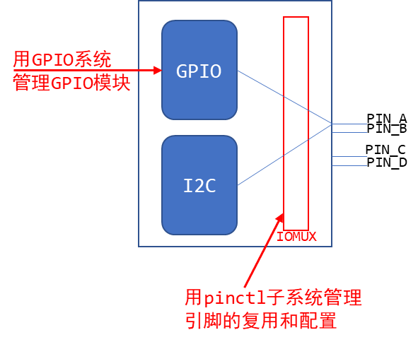

<a id="_Ref109227236"></a>图 16.2 工程师的任务

等BSP工程师在GPIO子系统、Pinctrl子系统中把自家芯片的支持加进去后，我们就可以非常方便地使用这些引脚了：点灯简直太简单了。

等等，GPIO模块在图中跟I2C不是并列的吗？干嘛在讲Pinctrl时还把GPIO子系统拉进来？

大多数的芯片，没有单独的IOMUX模块，引脚的复用、配置等等，就是在GPIO模块内部实现的。

在硬件上GPIO和Pinctrl是如此密切相关，在软件上它们的关系也非常密切。

所以这2个子系统我们一起讲解。

### 16.1.2 重要概念

从设备树开始学习Pintrl会比较容易。

主要参考文档是：内核

Documentation\\devicetree\\bindings\\pinctrl\\pinctrl-bindings.txt

这会涉及2个对象：pin controller、client device。

前者提供服务：可以用它来复用引脚、配置引脚。

后者使用服务：声明自己要使用哪些引脚的哪些功能，怎么配置它们。

1.  pin controller：

在芯片手册里你找不到pin controller，它是一个软件上的概念，你可以认为它对应IOMUX──用来复用引脚，还可以配置引脚(比如上下拉电阻等)。

注意，pin controller和GPIO Controller不是一回事，前者控制的引脚可用于GPIO功能、I2C功能；后者只是把引脚配置为输入、输出等简单的功能。即先用pin controller把引脚配置为GPIO，再用GPIO Controler把引脚配置为输入或输出。

1.  client device

“客户设备”，谁的客户？Pinctrl系统的客户，那就是使用Pinctrl系统的设备，使用引脚的设备。它在设备树里会被定义为一个节点，在节点里声明要用哪些引脚。

图 16.3就可以把几个重要概念理清楚：

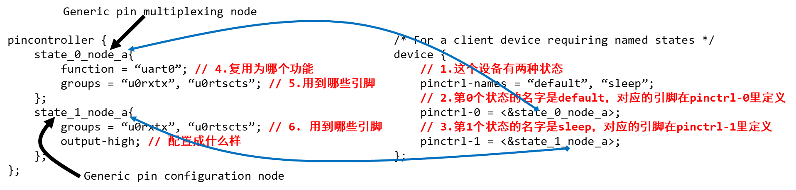

<a id="_Ref109228847"></a>图 16.3 复用节点与配置节点

上图中，左边是pin controller节点，右边是client device节点：

-   1.  pin state：

对于一个“client device”来说，比如对于一个UART设备，它有多个“状态”：default、sleep等，那对应的引脚也有这些状态。

怎么理解？

比如默认状态下，UART设备是工作的，那么所用的引脚就要复用为UART功能。

在休眠状态下，为了省电，可以把这些引脚复用为GPIO功能；或者直接把它们配置输出高电平。

上图中，pinctrl-names里定义了2种状态：default、sleep。

-   -   第0种状态用到的引脚在pinctrl-0中定义，它是state\_0\_node\_a，位于pincontroller节点中。
    -   第1种状态用到的引脚在pinctrl-1中定义，它是state\_1\_node\_a，位于pincontroller节点中。

当这个设备处于default状态时，pinctrl子系统会自动根据上述信息把所用引脚复用为uart0功能。

当这这个设备处于sleep状态时，pinctrl子系统会自动根据上述信息把所用引脚配置为高电平。

-   1.  groups和function：

一个设备会用到一个或多个引脚，这些引脚就可以归为一组(group)；

这些引脚可以复用为某个功能：function。

当然：一个设备可以用到多组引脚，比如A1、A2两组引脚，A1组复用为F1功能，A2组复用为F2功能。

-   1.  Generic pin multiplexing node和Generic pin configuration node

在上图左边的pin controller节点中，有子节点或孙节点，它们是给client device使用的。

-   -   可以用来描述复用信息：哪组(group)引脚复用为哪个功能(function)；
    -   可以用来描述配置信息：哪组(group)引脚配置为哪个设置功能(setting)，比如上拉、下拉等。

**注意**：pin controller节点的格式，没有统一的标准！！！！每家芯片都不一样。

甚至上面的group、function关键字也不一定有，但是概念是有的。

### 16.1.3 示例

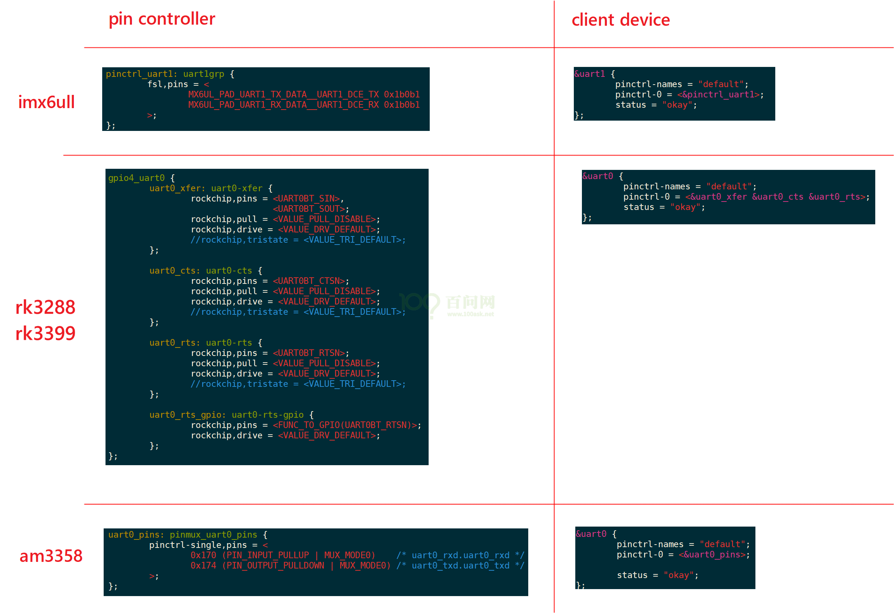

### 16.1.4 代码中怎么引用pinctrl

这是透明的，我们的驱动基本不用管。当设备切换状态时，对应的pinctrl就会被调用。

比如在platform\_device和platform\_driver的枚举过程中，流程如下：

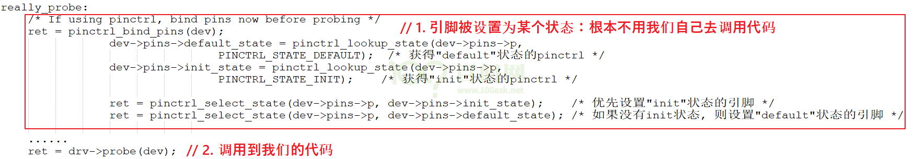

当系统休眠时，也会去设置该设备sleep状态对应的引脚，不需要我们自己去调用代码。非要自己调用，也有函数：

```
devm_pinctrl_get_select_default(struct device *dev);      // 使用"default"状态的引脚
pinctrl_get_select(struct device *dev, const char *name); // 根据name选择某种状态的引脚
pinctrl_put(struct pinctrl *p);   // 不再使用, 退出时调用
```

<a id="_Toc197788741"></a>
## 16.2 GPIO子系统重要概念

### 16.2.1 引入

要操作GPIO引脚，先把所用引脚配置为GPIO功能，这通过Pinctrl子系统来实现。

然后就可以根据设置引脚方向(输入还是输出)、读值──获得电平状态，写值──输出高低电平。

以前我们通过寄存器来操作GPIO引脚，即使LED驱动程序，对于不同的板子它的代码也完全不同。

当BSP工程师实现了GPIO子系统后，我们就可以：

-   在设备树里指定GPIO引脚
-   在驱动代码中：使用GPIO子系统的标准函数获得GPIO、设置GPIO方向、读取/设置GPIO值。

这样的驱动代码，将是单板无关的。

### 16.2.2 在设备树中指定引脚

在几乎所有ARM芯片中，GPIO都分为几组，每组中有若干个引脚。所以在使用GPIO子系统之前，就要先确定：它是哪组的？组里的哪一个？

在设备树中，“GPIO组”就是一个GPIO Controller，这通常都由芯片厂家设置好。我们要做的是找到它名字，比如“gpio1”，然后指定要用它里面的哪个引脚，比如&lt;&gpio1 0&gt;。

有代码更直观，下图是一些芯片的GPIO控制器节点，它们一般都是厂家定义好，在xxx.dtsi文件中：

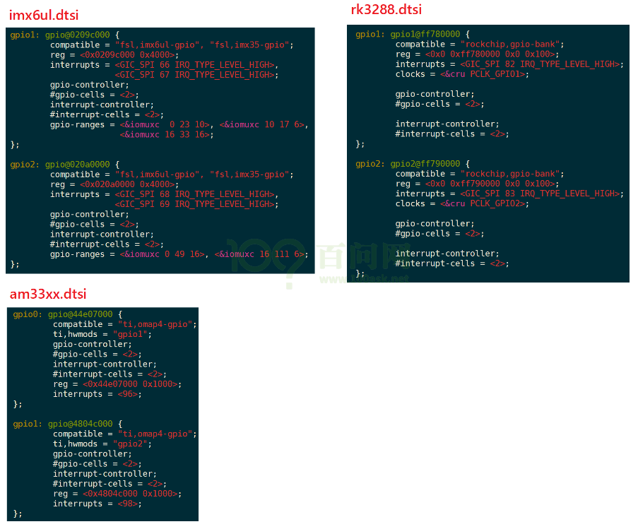

我们暂时只需要关心里面的这2个属性：

```
gpio-controller;
#gpio-cells = <2>;
```

-   “gpio-controller”表示这个节点是一个GPIO Controller，它下面有很多引脚。
-   “#gpio-cells = &lt;2&gt;”表示这个控制器下每一个引脚要用2个32位的数(cell)来描述。

为什么要用2个数？其实使用多个cell来描述一个引脚，这是GPIO Controller自己决定的。比如可以用其中一个cell来表示那是哪一个引脚，用另一个cell来表示它是高电平有效还是低电平有效，甚至还可以用更多的cell来示其他特性。

普遍的用法是，用第1个cell来表示哪一个引脚，用第2个cell来表示有效电平：

```
GPIO_ACTIVE_HIGH ： 高电平有效
GPIO_ACTIVE_LOW  :  低电平有效
```

定义GPIO Controller是芯片厂家的事，我们怎么引用某个引脚呢？在自己的设备节点中使用属性"\[&lt;name&gt;-\]gpios"，示例如下：

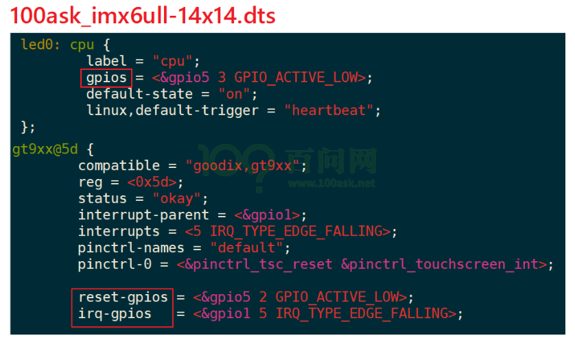

上图中，可以使用gpios属性，也可以使用name-gpios属性。

### 16.2.3 在驱动代码中调用GPIO子系统

在设备树中指定了GPIO引脚，在驱动代码中如何使用？

也就是GPIO子系统的接口函数是什么？

GPIO子系统有两套接口：基于描述符的(descriptor-based)、老的(legacy)。前者的函数都有前缀“gpiod\_”，它使用gpio\_desc结构体来表示一个引脚；后者的函数都有前缀“gpio\_”，它使用一个整数来表示一个引脚。

要操作一个引脚，首先要get引脚，然后设置方向，读值、写值。

驱动程序中要包含头文件，

```
#include <linux/gpio/consumer.h>   // descriptor-based
```

或

```
#include <linux/gpio.h>            // legacy
```

下表列出常用的函数：

表 16‑1 常用函数


| descriptor-based |  | legacy |
| --- | --- | --- |
| 获得GPIO |  |  |
| gpiod_get |  | gpio_request |
| gpiod_get_index |  |  |
| gpiod_get_array |  | gpio_request_array |
| devm_gpiod_get |  |  |
| devm_gpiod_get_index |  |  |
| devm_gpiod_get_array |  |  |
| 设置方向 |  |  |
| gpiod_direction_input |  | gpio_direction_input |
| gpiod_direction_output |  | gpio_direction_output |
| 读值、写值 |  |  |
| gpiod_get_value |  | gpio_get_value |
| gpiod_set_value |  | gpio_set_value |
| 释放GPIO |  |  |
| gpio_free |  | gpio_free |
| gpiod_put |  | gpio_free_array |
| gpiod_put_array |  |  |
| devm_gpiod_put |  |  |
| devm_gpiod_put_array |  |  |


有前缀“devm\_”的含义是“设备资源管理”(Managed Device Resource)，这是一种自动释放资源的机制。它的思想是“资源是属于设备的，设备不存在时资源就可以自动释放”。

比如在Linux开发过程中，先申请了GPIO，再申请内存；如果内存申请失败，那么在返回之前就需要先释放GPIO资源。如果使用devm的相关函数，在内存申请失败时可以直接返回：设备的销毁函数会自动地释放已经申请了的GPIO资源。

建议使用“devm\_”版本的相关函数。

假设备在设备树中有如下节点：

```
	foo_device {
		compatible = "acme,foo";
		...
		led-gpios = <&gpio 15 GPIO_ACTIVE_HIGH>, /* red */
			    <&gpio 16 GPIO_ACTIVE_HIGH>, /* green */
			    <&gpio 17 GPIO_ACTIVE_HIGH>; /* blue */
		power-gpios = <&gpio 1 GPIO_ACTIVE_LOW>;
	};
```

那么可以使用下面的函数获得引脚：

```
struct gpio_desc *red, *green, *blue, *power;
red = gpiod_get_index(dev, "led", 0, GPIOD_OUT_HIGH);
green = gpiod_get_index(dev, "led", 1, GPIOD_OUT_HIGH);
blue = gpiod_get_index(dev, "led", 2, GPIOD_OUT_HIGH);
power = gpiod_get(dev, "power", GPIOD_OUT_HIGH);
```

**注意：**gpiod\_set\_value设置的值是“逻辑值”，不一定等于物理值。

什么意思？

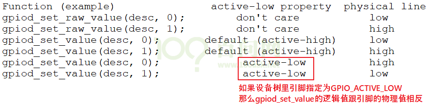

旧的“gpio\_”函数没办法根据设备树信息获得引脚，它需要先知道引脚号。

引脚号怎么确定？

在GPIO子系统中，每注册一个GPIO Controller时会确定它的“base number”，那么这个控制器里的第n号引脚的号码就是：base number + n。

但是如果硬件有变化、设备树有变化，这个base number并不能保证是固定的，应该查看sysfs来确定base number。

### 16.2.4 sysfs中的访问方法

在sysfs中访问GPIO，实际上用的就是引脚号，老的方法。

-   先确定某个GPIO Controller的基准引脚号(base number)，再计算出某个引脚的号码。

方法如下：

1.  先在开发板的/sys/class/gpio目录下，找到各个gpiochipXXX目录：

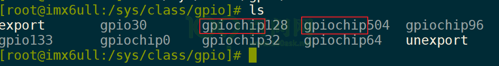

1.  然后进入某个gpiochip目录，查看文件label的内容
2.  根据label的内容对比设备树

label内容来自设备树，比如它的寄存器基地址。用来跟设备树(dtsi文件)比较，就可以知道这对应哪一个GPIO Controller。

下图是在100asK\_imx6ull上运行的结果，通过对比设备树可知gpiochip96对应gpio4：

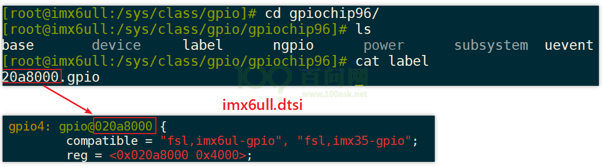

所以gpio4这组引脚的基准引脚号就是96，这也可以“cat base”来再次确认。

-   基于sysfs操作引脚：

以100ask\_imx6ull为例，它有一个按键，原理图如下：

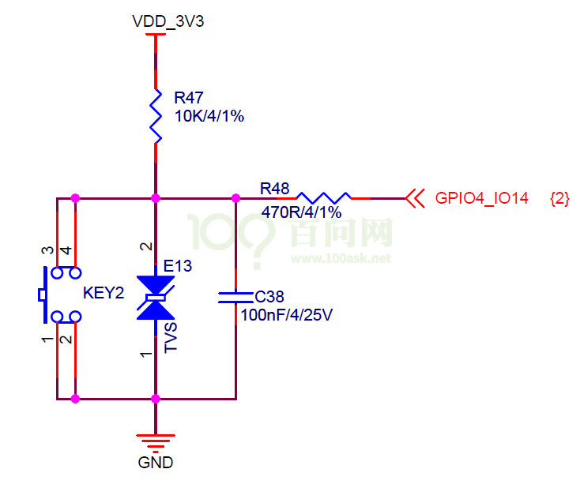

那么GPIO4\_14的号码是96+14=110，可以如下操作读取按键值：

```bash
[root@100ask:~]# echo  110 > /sys/class/gpio/export
[root@100ask:~]# echo in > /sys/class/gpio/gpio110/direction
[root@100ask:~]# cat /sys/class/gpio/gpio110/value
[root@100ask:~]# echo  110 > /sys/class/gpio/unexport
```

**注意**：如果驱动程序已经使用了该引脚，那么将会export失败，会提示下面的错误：


对于输出引脚，假设引脚号为N，可以用下面的方法设置它的值为1：

```bash
[root@100ask:~]# echo  N > /sys/class/gpio/export
[root@100ask:~]# echo out > /sys/class/gpio/gpioN/direction
[root@100ask:~]# echo 1 > /sys/class/gpio/gpioN/value
[root@100ask:~]# echo  N > /sys/class/gpio/unexport
```

<a id="_Toc197788742"></a>
## 16.3 基于GPIO子系统的LED驱动程序

### 16.3.1 编写思路

GPIO的地位跟其他模块，比如I2C、UART的地方是一样的，要使用某个引脚，需要先把引脚配置为GPIO功能，这要使用Pinctrl子系统，只需要在设备树里指定就可以。在驱动代码上不需要我们做任何事情。

GPIO本身需要确定引脚，这也需要在设备树里指定。

设备树节点会被内核转换为platform\_device。

对应的，驱动代码中要注册一个platform\_driver，在probe函数中：获得引脚、注册file\_operations。

在file\_operations中：设置方向、读值/写值。图 16.4就是一个设备树的例子：

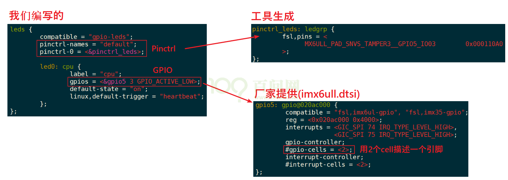

<a id="_Ref109229238"></a>图 16.4 设备树示意

### 16.3.2 在设备树中添加Pinctrl信息

有些芯片提供了设备树生成工具，在GUI界面中选择引脚功能和配置信息，就可以自动生成Pinctrl子结点。把它复制到你的设备树文件中，再在client device结点中引用就可以。

有些芯片只提供文档，那就去阅读文档，一般在内核源码目录Documentation\\devicetree\\bindings\\pinctrl下面，保存有该厂家的文档。

如果连文档都没有，那只能参考内核源码中的设备树文件，在内核源码目录arch/arm/boot/dts目录下。

最后一步，网络搜索。

Pinctrl子节点的样式如下：


### 16.3.3 在设备树中添加GPIO信息

先查看电路原理图确定所用引脚，再在设备树中指定：添加”\[name\]-gpios”属性，指定使用的是哪一个GPIO Controller里的哪一个引脚，还有其他Flag信息，比如GPIO\_ACTIVE\_LOW等。具体需要多少个cell来描述一个引脚，需要查看设备树中这个GPIO Controller节点里的“#gpio-cells”属性值，也可以查看内核文档。

示例如下：


### 16.3.4 编程示例

在实际操作过程中也许会碰到意外的问题，现场演示如何解决。

1.  定义、注册一个platform\_driver
2.  在它的probe函数里：
    1.  根据platform\_device的设备树信息确定GPIO：gpiod\_get
    2.  定义、注册一个file\_operations结构体
    3.  在file\_operarions中使用GPIO子系统的函数操作GPIO：

```
gpiod_direction_output、gpiod_set_value
```

**好处**：这些代码对所有的板子都是完全一样的！

使用GIT命令载后，源码leddrv.c位于这个目录下：

01\_all\_series\_quickstart\\

05\_嵌入式Linux驱动开发基础知识\\source\\05\_gpio\_and\_pinctrl\\01\_led

摘录重点内容：

-   注册platform\_driver

注意下面第122行的"100ask,leddrv"，它会跟设备树中节点的compatible对应：

```
121 static const struct of_device_id ask100_leds[] = {
122     { .compatible = "100ask,leddrv" },
123     { },
124 };
125
126 /* 1. 定义platform_driver */
127 static struct platform_driver chip_demo_gpio_driver = {
128     .probe      = chip_demo_gpio_probe,
129     .remove     = chip_demo_gpio_remove,
130     .driver     = {
131         .name   = "100ask_led",
132         .of_match_table = ask100_leds,
133     },
134 };
135
136 /* 2. 在入口函数注册platform_driver */
137 static int __init led_init(void)
138 {
139     int err;
140
141     printk("%s %s line %d\n", __FILE__, __FUNCTION__, __LINE__);
142
143     err = platform_driver_register(&chip_demo_gpio_driver);
144
145     return err;
146 }
```

-   在probe函数中获得GPIO

核心代码是第87行，它从该设备(对应设备树中的设备节点)获取名为“led”的引脚。在设备树中，必定有一属性名为“led-gpios”或“led-gpio”。

```
77 /* 4. 从platform_device获得GPIO
78  *    把file_operations结构体告诉内核：注册驱动程序
79  */
80 static int chip_demo_gpio_probe(struct platform_device *pdev)
81 {
82      //int err;
83
84      printk("%s %s line %d\n", __FILE__, __FUNCTION__, __LINE__);
85
86      /* 4.1 设备树中定义有: led-gpios=<...>; */
87     led_gpio = gpiod_get(&pdev->dev, "led", 0);
88      if (IS_ERR(led_gpio)) {
89              dev_err(&pdev->dev, "Failed to get GPIO for led\n");
90              return PTR_ERR(led_gpio);
91      }
```

-   注册file\_operations结构体：这是老套路了：

```
93      /* 4.2 注册file_operations      */
94      major = register_chrdev(0, "100ask_led", &led_drv);  /* /dev/led */
95
96      led_class = class_create(THIS_MODULE, "100ask_led_class");
97      if (IS_ERR(led_class)) {
98              printk("%s %s line %d\n", __FILE__, __FUNCTION__, __LINE__);
99              unregister_chrdev(major, "led");
100             gpiod_put(led_gpio);
101             return PTR_ERR(led_class);
102     }
103
104     device_create(led_class, NULL, MKDEV(major, 0), NULL, "100ask_led%d", 0); /* /dev/100ask_led0 */
```

-   在open函数中调用GPIO函数设置引脚方向：

```
51 static int led_drv_open (struct inode *node, struct file *file)
52 {
53      //int minor = iminor(node);
54
55      printk("%s %s line %d\n", __FILE__, __FUNCTION__, __LINE__);
56      /* 根据次设备号初始化LED */
57      gpiod_direction_output(led_gpio, 0);
58
59      return 0;
60 }
```

-   在write函数中调用GPIO函数设置引脚值：

```
34 /* write(fd, &val, 1); */
35 static ssize_t led_drv_write (struct file *file, const char __user *buf, size_t size, loff_t *offset)
36 {
37      int err;
38      char status;
39      //struct inode *inode = file_inode(file);
40      //int minor = iminor(inode);
41
42      printk("%s %s line %d\n", __FILE__, __FUNCTION__, __LINE__);
43      err = copy_from_user(&status, buf, 1);
44
45      /* 根据次设备号和status控制LED */
46      gpiod_set_value(led_gpio, status);
47
48      return 1;
49 }
```

-   释放GPIO：

```
gpiod_put(led_gpio);
```

<a id="_Toc197788743"></a>
## 16.4 在100ASK_IMX6ULL上机实验

### 16.4.1 确定引脚并生成设备树节点

NXP公司对于IMX6ULL芯片，有设备树生成工具。我们也把它上传到GIT去了，使用GIT命令载后，在这个目录下：

01\_all\_series\_quickstart\\

05\_嵌入式Linux驱动开发基础知识\\source\\05\_gpio\_and\_pinctrl\\tools\\imx\\

安装“Pins\_Tool\_for\_i.MX\_Processors\_v6\_x64.exe”后运行，打开IMX6ULL的配置文件“MCIMX6Y2xxx08.mex”，就可以在GUI界面中选择引脚，配置它的功能，这就可以自动生成Pinctrl的子节点信息。

100ASK\_IMX6ULL使用的LED原理图如下，可知引脚是GPIO5\_3：

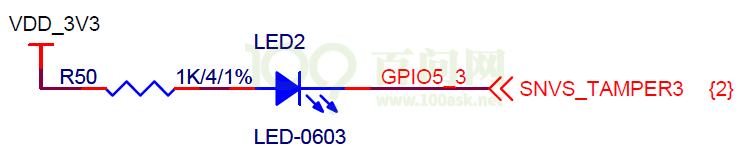

在设备树工具中，如下图操作：

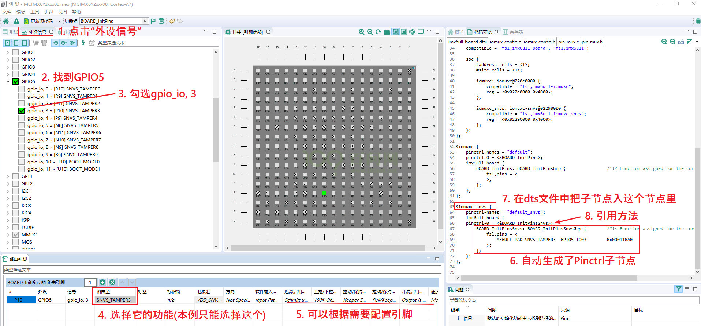

把自动生成的设备树信息，放到内核源码

```
arch/arm/boot/dts/100ask_imx6ull-14x14.dts中，代码如下：
```

-   -   -   -   1.  Pinctrl信息：

```
&iomuxc_snvs {
……
        myled_for_gpio_subsys: myled_for_gpio_subsys{
            fsl,pins = <
                MX6ULL_PAD_SNVS_TAMPER3__GPIO5_IO03        0x000110A0
            >;
        };
```

-   -   -   -   1.  设备节点信息(放在根节点下)：

```
        myled {
            compatible = "100ask,leddrv";
            pinctrl-names = "default";
            pinctrl-0 = <&myled_for_gpio_subsys>;
            led-gpios = <&gpio5 3 GPIO_ACTIVE_LOW>;
        };
```

### 16.4.2 编译程序

编译设备树后，要更新设备树。

编译驱动程序时，“leddrv\_未测试的原始版本.c”是有错误信息的，“leddrv.c”是修改过的。

测试方法，在板子上执行命令：

```bash
[root@100ask:~]# insmod  leddrv.ko
[root@100ask:~]# ls /dev/100ask_led0
[root@100ask:~]# ./ledtest /dev/100ask_led0 on
[root@100ask:~]# ./ledtest /dev/100ask_led0 off
```

注意：这个实验并没有点灯效果，仅仅是打印。
