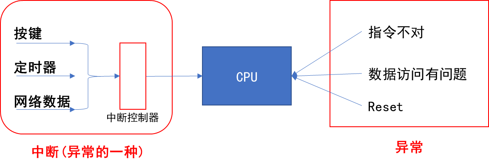

<a id="_Toc197788744"></a>

<a id="_Toc197788745"></a>
## 17.1 中断的引入

### 17.1.1 妈妈怎么知道孩子醒了


图 17.1 妈妈和孩子

妈妈怎么知道卧室里小孩醒了？

1.  查询方式：时不时进房间看一下

简单，但是累

1.  休眠-唤醒：进去房间陪小孩一起睡觉，小孩醒了会吵醒她

不累，但是妈妈干不了活了

1.  poll方式：妈妈要干很多活，但是可以陪小孩睡一会，定个闹钟

要浪费点时间，但是可以继续干活。

妈妈要么是被小孩吵醒，要么是被闹钟吵醒。

1.  异步通知：妈妈在客厅干活，小孩醒了他会自己走出房门告诉妈妈

妈妈、小孩互不耽误。

后面的3种方式，都需要“小孩来中断妈妈”：中断她的睡眠、中断她的工作。实际上，能“中断”妈妈的事情可多了：

1.  发生了各种声音
2.  可忽略的远处猫叫
3.  快递员按门铃
4.  卧室中小孩哭了

妈妈当前正在看书，被这些事件“中断”后她会怎么做？流程如下：

1.  先在书中放入书签，合上书
2.  去处理，对于不同的情况，处理方法不同：
    -   -   对于门铃：开门取快递
        -   对于哭声：照顾小孩
3.  回来继续看书

### 17.1.2 嵌入系统中也有类似的情况



图 17.2 中断与异常

CPU在运行的过程中，也会被各种“异常”打断。这些“异常”有：

1.  指令未定义
2.  指令、数据访问有问题
3.  SWI(软中断)
4.  快中断
5.  中断

中断也属于一种“异常”，导致中断发生的情况有很多，比如：

-   按键
-   定时器
-   ADC转换完成
-   UART发送完数据、收到数据
-   等等

这些众多的“中断源”，汇集到“中断控制器”，由“中断控制器”选择优先级最高的中断并通知CPU。

<a id="_Toc197788746"></a>
## 17.2 中断的处理流程

arm对异常(中断)处理过程：

1.  初始化：
    1.  设置中断源，让它可以产生中断
    2.  设置中断控制器(可以屏蔽某个中断，优先级)
    3.  设置CPU总开关(使能中断)
2.  执行其他程序：正常程序
3.  产生中断：比如按下按键---&gt;中断控制器---&gt;CPU
4.  CPU 每执行完一条指令都会检查有无中断/异常产生
5.  CPU发现有中断/异常产生，开始处理。

对于不同的异常，跳去不同的地址执行程序。

这地址上，只是一条跳转指令，跳去执行某个函数(地址)，这个就是异常向量。③④⑤都是硬件做的。

1.  这些函数做什么事情？

软件做的:

-   1.  保存现场(各种寄存器)
    2.  处理异常(中断):分辨中断源，再调用不同的处理函数
    3.  恢复现场

<a id="_Toc197788747"></a>
## 17.3 异常向量表

u-boot或是Linux内核，都有类似如下的代码：

```
_start: b	reset
	ldr	pc, _undefined_instruction
	ldr	pc, _software_interrupt
	ldr	pc, _prefetch_abort
	ldr	pc, _data_abort
	ldr	pc, _not_used
	ldr	pc, _irq //发生中断时，CPU跳到这个地址执行该指令 **假设地址为0x18**
	ldr	pc, _fiq
```

这就是异常向量表，每一条指令对应一种异常。

发生复位时，CPU就去 执行第1条指令：b reset。

发生中断时，CPU就去执行“ldr pc, \_irq”这条指令。

这些指令存放的位置是固定的，比如对于ARM9芯片中断向量的地址是0x18。

当发生中断时，CPU就强制跳去执行0x18处的代码。

在向量表里，一般都是放置一条跳转指令，发生该异常时，CPU就会执行向量表中的跳转指令，去调用更复杂的函数。

当然，向量表的位置并不总是从0地址开始，很多芯片可以设置某个vector base寄存器，指定向量表在其他位置，比如设置vector base为0x80000000，指定为DDR的某个地址。但是表中的各个异常向量的偏移地址，是固定的：复位向量偏移地址是0，中断是0x18。

<a id="_Toc197788748"></a>
## 17.4 参考资料

对于ARM的中断控制器，述语上称之为GIC (Generic Interrupt Controller)，到目前已经更新到v4版本了。

各个版本的差别可以看这里：

[https://developer.arm.com/ip-products/system-ip/system-controllers/interrupt-controllers](https://developer.arm.com/ip-products/system-ip/system-controllers/interrupt-controllers)

简单地说，GIC v3/v4用于 ARMv8 架构，即64位ARM芯片。

而GIC v2用于ARMv7和其他更低的架构。

以后在驱动大全里讲解中断时，我们再深入分析，到时会涉及单核、多核等知识。
