<a id="_Toc197788749"></a>

<a id="_Toc197788750"></a>
## 18.1 进程、线程、中断的核心：栈

中断中断，中断谁？

中断当前正在运行的进程、线程。

进程、线程是什么？内核如何切换进程、线程、中断？

要理解这些概念，必须理解栈的作用。

### 18.1.1 18.1.1 ARM处理器程序运行的过程

ARM芯片属于精简指令集计算机(RISC：Reduced Instruction Set Computing)，它所用的指令比较简单，有如下特点：

1.  对内存只有读、写指令
2.  对于数据的运算是在CPU内部实现
3.  使用RISC指令的CPU复杂度小一点，易于设计

比如对于a=a+b这样的算式，需要经过下面4个步骤才可以实现：

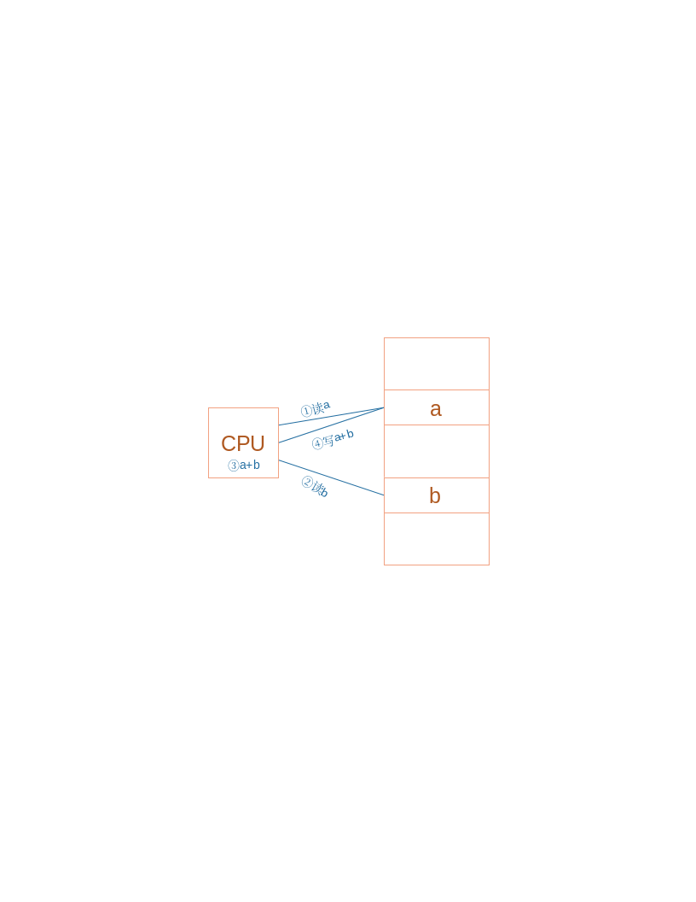

细看这几个步骤，有些疑问：

1.  读a，那么a的值读出来后保存在CPU里面哪里？
2.  读b，那么b的值读出来后保存在CPU里面哪里？
3.  a+b的结果又保存在哪里？

我们需要深入ARM处理器的内部。简单概括如下，我们先忽略各种CPU模式(系统模式、用户模式等等)。

**注意**：如果想入理解ARM处理器架构，应该从裸机开始学习。我们即将写好近30个裸机程序的文档，估计还3月底发布。

**注意**：为了加快学习速度，建议先不看裸机。

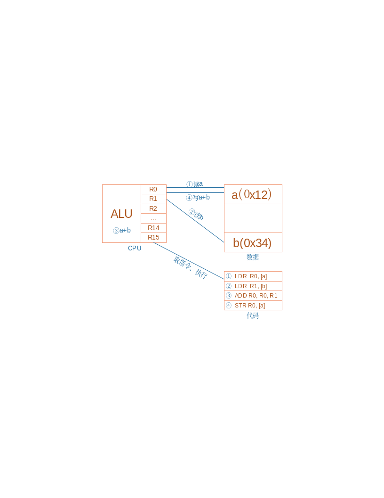

CPU运行时，先去取得指令，再执行指令：

1.  把内存a的值读入CPU寄存器R0
2.  把内存b的值读入CPU寄存器R1
3.  把R0、R1累加，存入R0
4.  把R0的值写入内存a

### 18.1.2 程序被中断时，怎么保存现场

从上图可知，CPU内部的寄存器很重要，如果要暂停一个程序，中断一个程序，就需要把这些寄存器的值保存下来：这就称为保存现场。

保存在哪里？内存，这块内存就称之为栈。

程序要继续执行，就先从栈中恢复那些CPU内部寄存器的值。

这个场景并不局限于中断，下图可以概括程序A、B的切换过程，其他情况是类似的：

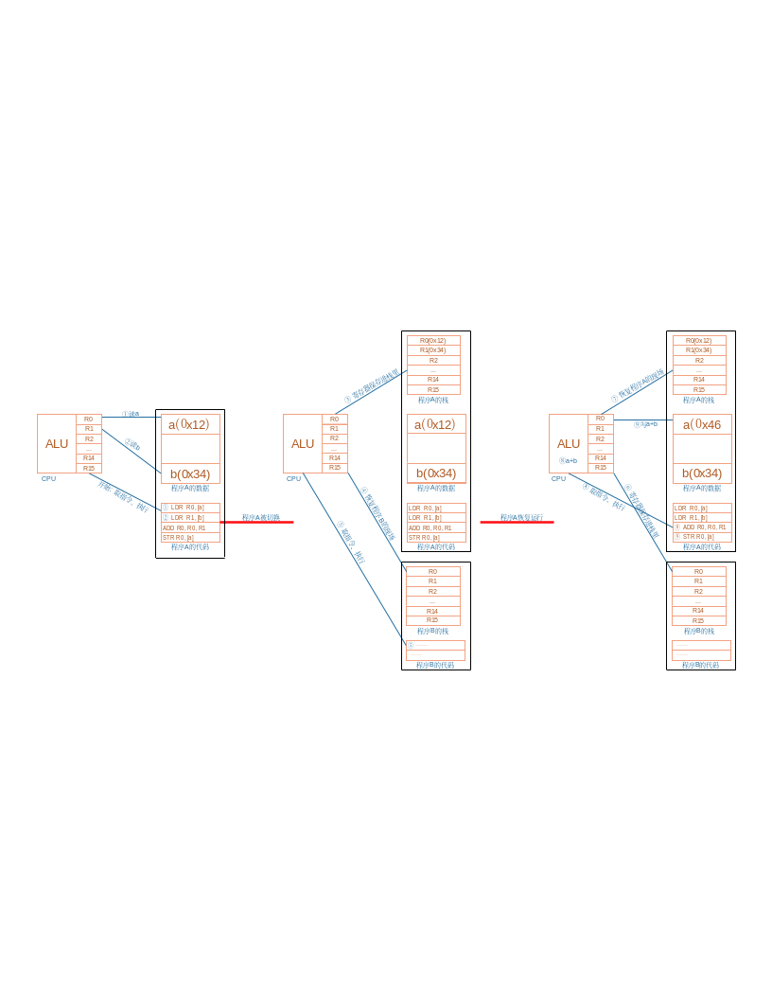

1.  函数调用：
    1.  在函数A里调用函数B，实际就是中断函数A的执行。
    2.  那么需要把函数A调用B之前瞬间的CPU寄存器的值，保存到栈里；
    3.  再去执行函数B；
    4.  函数B返回之后，就从栈中恢复函数A对应的CPU寄存器值，继续执行。
2.  中断处理
    1.  进程A正在执行，这时候发生了中断。
    2.  CPU强制跳到中断异常向量地址去执行，
    3.  这时就需要保存进程A被中断瞬间的CPU寄存器值，
    4.  可以保存在进程A的内核态栈，也可以保存在进程A的内核结构体中。
    5.  中断处理完毕，要继续运行进程A之前，恢复这些值。
3.  进程切换
    1.  在所谓的多任务操作系统中，我们以为多个程序是同时运行的。
    2.  如果我们能感知微秒、纳秒级的事件，可以发现操作系统时让这些程序依次执行一小段时间，进程A的时间用完了，就切换到进程B。
    3.  怎么切换？
    4.  切换过程是发生在内核态里的，跟中断的处理类似。
    5.  进程A的被切换瞬间的CPU寄存器值保存在某个地方；
    6.  恢复进程B之前保存的CPU寄存器值，这样就可以运行进程B了。

所以，在中断处理的过程中，伴存着进程的保存现场、恢复现场。进程的调度也是使用栈来保存、恢复现场：

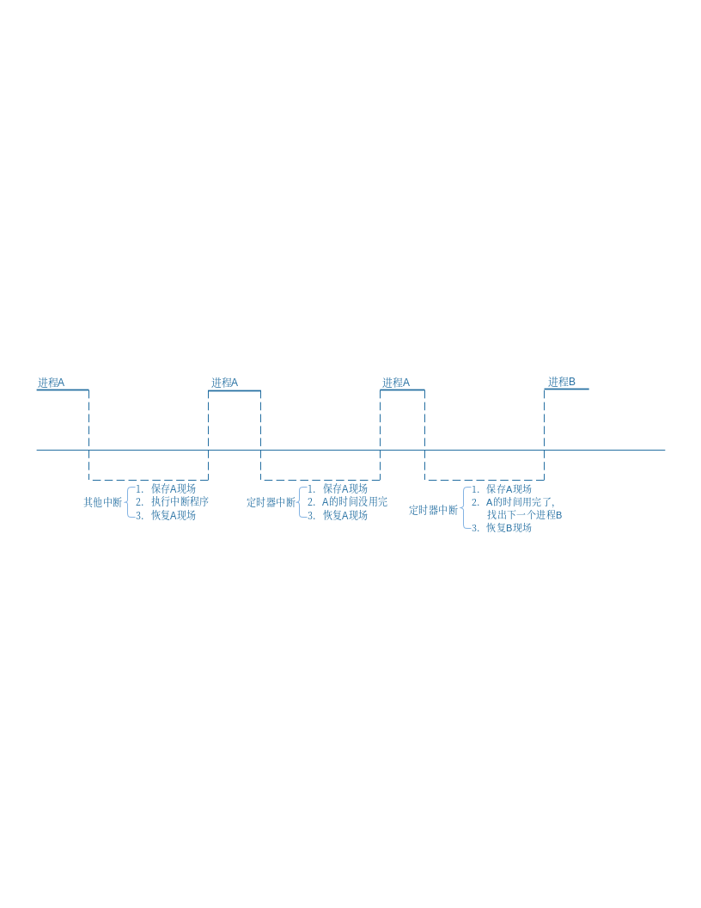

### 18.1.3 进程、线程的概念

假设我们写一个音乐播放器，在播放音乐的同时会根据按键选择下一首歌。把事情简化为2件事：发送音频数据、读取按键。那可以这样写程序：

```
int main(int argc, char **argv)
{
	int key;

	while (1)
	{
		key = read_key();

		if (key != -1)
		{
			switch (key)
			{
				case NEXT:
					select_next_music(); // 在GUI选中下一首歌
					break;
			}
		}
		else
		{
			send_music();
		}
	}

	return 0;
}
```

这个程序只有一条主线，读按键、播放音乐都是顺序执行。

无论按键是否被按下，read\_key函数必须马上返回，否则会使得后续的send\_music受到阻滞导致音乐播放不流畅。

读取按键、播放音乐能否分为两个程序进行？可以，但是开销太大：读按键的程序，要把按键通知播放音乐的程序，进程间通信的效率没那么高。

这时可以用多线程之编程，读取按键是一个线程，播放音乐是另一个线程，它们之间可以通过全局变量传递数据，示意代码如下：

```
int g_key;
void key_thread_fn()
{
	while (1)
	{
		g_key = read_key();
		if (g_key != -1)
		{
			switch (g_key)
			{
				case NEXT:
					select_next_music(); // 在GUI选中下一首歌
					break;
			}
		}
	}
}
void music_fn()
{
	while (1)
	{
		if (g_key == STOP)
			stop_music();
		else
		{
	       send_music();
		}
	}
}
int main(int argc, char **argv)
{
	int key;

	create_thread(key_thread_fn);
	create_thread(music_fn);
	while (1)
	{
		sleep(10);
	}
	return 0;
}
```

这样，按键的读取及GUI显示、音乐的播放，可以分开来，不必混杂在一起。

按键线程可以使用阻塞方式读取按键，无按键时是休眠的，这可以节省CPU资源。

音乐线程专注于音乐的播放和控制，不用理会按键的具体读取工作。并且这2个线程通过全局变量g\_key传递数据，高效而简单。

在Linux中：资源分配的单位是进程，调度的单位是线程。

也就是说，在一个进程里，可能有多个线程，这些线程共用打开的文件句柄、全局变量等等。

而这些线程，之间是互相独立的，“同时运行”，也就是说：每一个线程，都有自己的栈。如下图示：

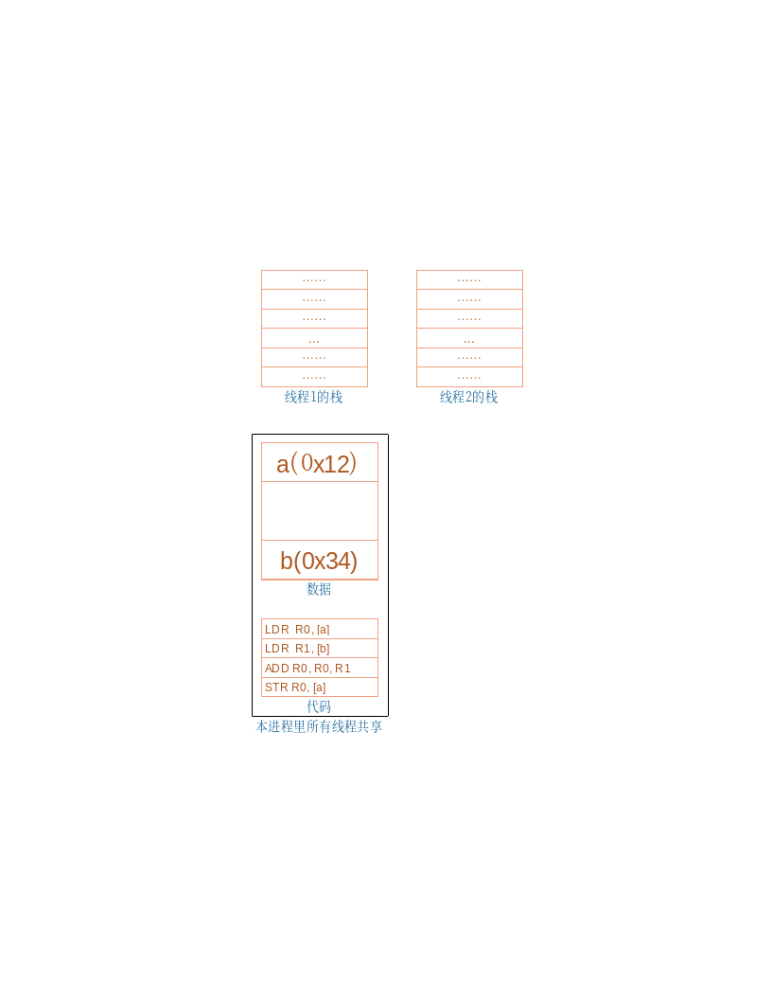

<a id="_Toc197788751"></a>
## 18.2 18.2 Linux系统对中断处理的演进

从2005年我接触Linux到现在15年了，Linux中断系统的变化并不大。比较重要的就是引入了threaded irq：使用内核线程来处理中断。

Linux系统中有硬件中断，也有软件中断。对硬件中断的处理有2个原则：不能嵌套，越快越好。

参考资料：

[https://blog.csdn.net/myarrow/article/details/9287169](https://blog.csdn.net/myarrow/article/details/9287169)

### 18.2.1 Linux对中断的扩展：硬件中断、软件中断

Linux系统把中断的意义扩展了，对于按键中断等硬件产生的中断，称之为“硬件中断”(hard irq)。每个硬件中断都有对应的处理函数，比如按键中断、网卡中断的处理函数肯定不一样。

为方便理解，你可以先认为对硬件中断的处理是用数组来实现的，数组里存放的是函数指针：

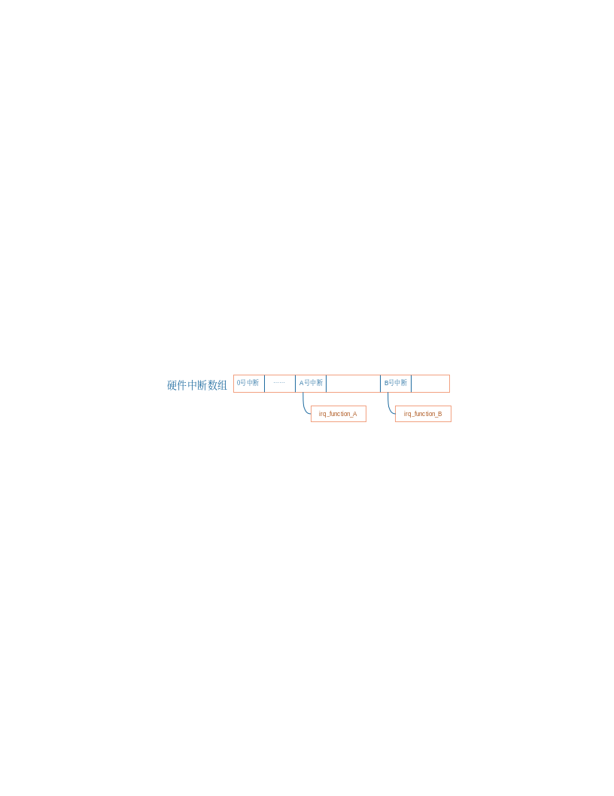

**注意**：上图是简化的，Linux中这个数组复杂多了。

当发生A中断时，对应的irq\_function\_A函数被调用。硬件导致该函数被调用。

相对的，还可以人为地制造中断：软件中断(soft irq)，如下图所示：

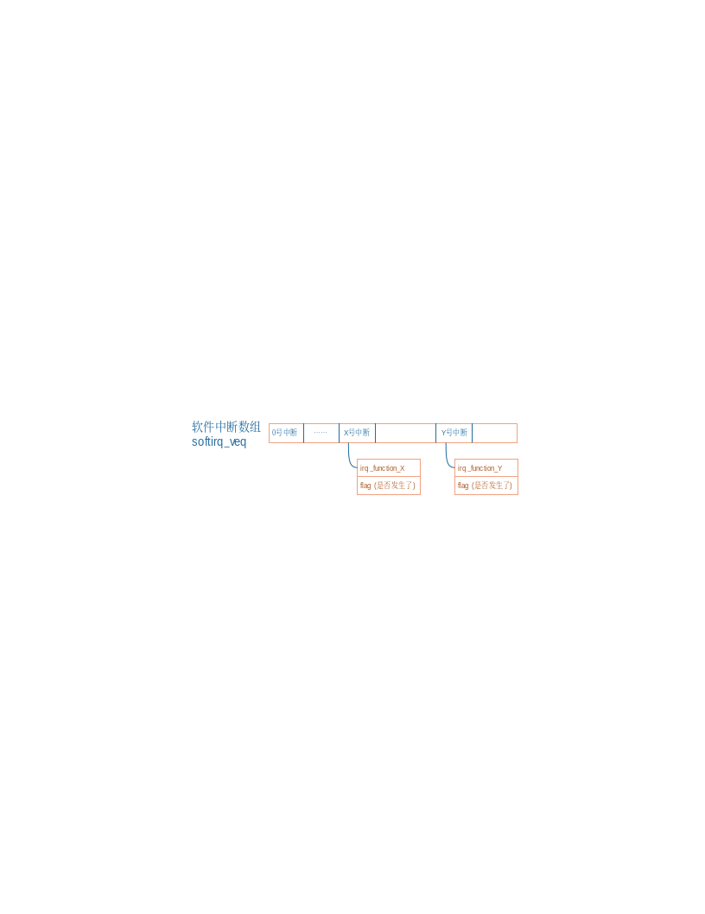

**注意**：上图是简化的，Linux中这个数组复杂多了。

问题来了：

1.  软件中断何时生产？

由软件决定，对于X号软件中断，只需要把它的flag设置为1就表示发生了该中断。

1.  软件中断何时处理？

软件中断嘛，并不是那么十万火急，有空再处理它好了。

什么时候有空？不能让它一直等吧？

Linux系统中，各种硬件中断频繁发生，至少定时器中断每10ms发生一次，那取个巧？

在处理完硬件中断后，再去处理软件中断？就这么办！

1.  有哪些软件中断？

查内核源码include/linux/interrupt.h

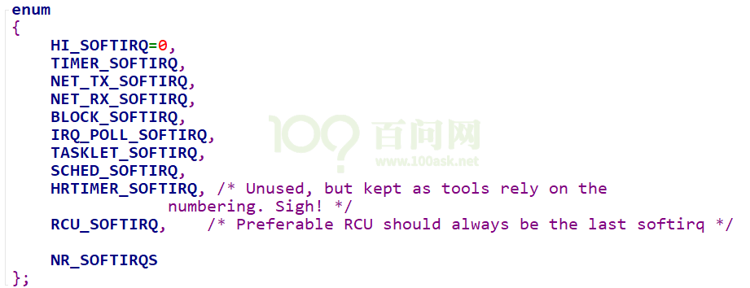

怎么触发软件中断？最核心的函数是raise\_softirq，简单地理解就是设置softirq\_veq\[nr\]的标记位：

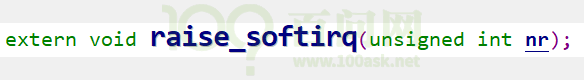

怎么设置软件中断的处理函数：

extern void open\_softirq(int nr, void (\*action) (struct soft\_action\*));

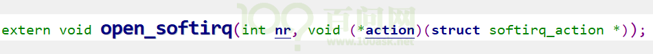

后面讲到的中断下半部tasklet就是使用软件中断实现的。

### 18.2.2 中断处理原则1：不能嵌套

官方资料：中断处理不能嵌套

[https://git.kernel.org/pub/scm/linux/kernel/git/torvalds/linux.git/commit/?id=e58aa3d2d0cc](https://git.kernel.org/pub/scm/linux/kernel/git/torvalds/linux.git/commit/?id=e58aa3d2d0cc)

中断处理函数需要调用C函数，这就需要用到栈。

-   中断A正在处理的过程中，假设又发生了中断B，那么在栈里要保存A的现场，然后处理B。
-   在处理B的过程中又发生了中断C，那么在栈里要保存B的现场，然后处理C。

如果中断嵌套突然暴发，那么栈将越来越大，栈终将耗尽。

所以，为了防止这种情况发生，也是为了简单化中断的处理，在Linux系统上中断无法嵌套：即当前中断A没处理完之前，不会响应另一个中断B(即使它的优先级更高)。

### 18.2.3 中断处理原则2：越快越好

妈妈在家中照顾小孩时，门铃响起，她开门取快递：这就是中断的处理。她取个快递敢花上半天吗？不怕小孩出意外吗？

同理，在Linux系统中，中断的处理也是越快越好。

在单芯片系统中，假设中断处理很慢，那应用程序在这段时间内就无法执行：系统显得很迟顿。

在SMP系统中，假设中断处理很慢，那么正在处理这个中断的CPU上的其他线程也无法执行。

在中断的处理过程中，该CPU是不能进行进程调度的，所以中断的处理要越快越好，尽早让其他中断能被处理──进程调度靠定时器中断来实现。

在Linux系统中使用中断是挺简单的，为某个中断irq注册中断处理函数handler，可以使用request\_irq函数：

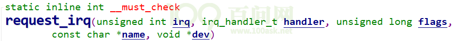

在handler函数中，代码尽可能高效。

但是，处理某个中断要做的事情就是很多，没办法加快。比如对于按键中断，我们需要等待几十毫秒消除机械抖动。难道要在handler中等待吗？对于计算机来说，这可是一个段很长的时间。

怎么办？

### 18.2.4 要处理的事情实在太多，拆分为：上半部、下半部

当一个中断要耗费很多时间来处理时，它的坏处是：在这段时间内，其他中断无法被处理。换句话说，在这段时间内，系统是关中断的。

如果某个中断就是要做那么多事，我们能不能把它拆分成两部分：紧急的、不紧急的？

在handler函数里只做紧急的事，然后就重新开中断，让系统得以正常运行；那些不紧急的事，以后再处理，处理时是开中断的。

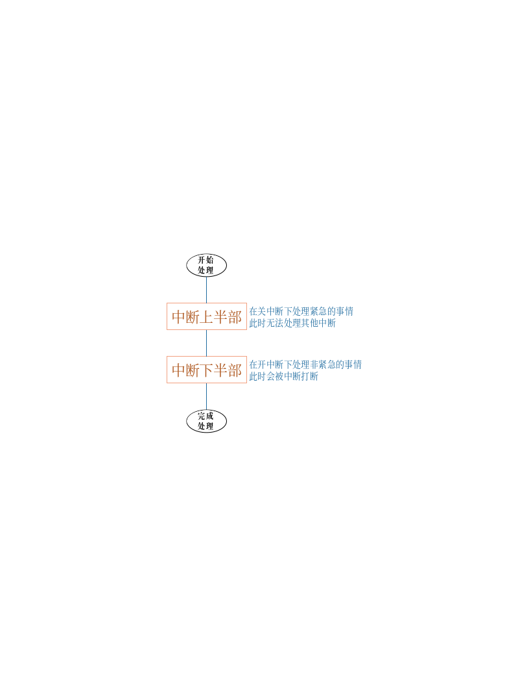

中断下半部的实现有很多种方法，讲2种主要的：tasklet(小任务)、work queue(工作队列)。

<a id="_Ref109028920"></a>
### 18.2.5 下半部要做的事情耗时不是太长：tasklet

假设我们把中断分为上半部、下半部。发生中断时，上半部下半部的代码何时、如何被调用？

当下半部比较耗时但是能忍受，并且它的处理比较简单时，可以用tasklet来处理下半部。tasklet是使用软件中断来实现。

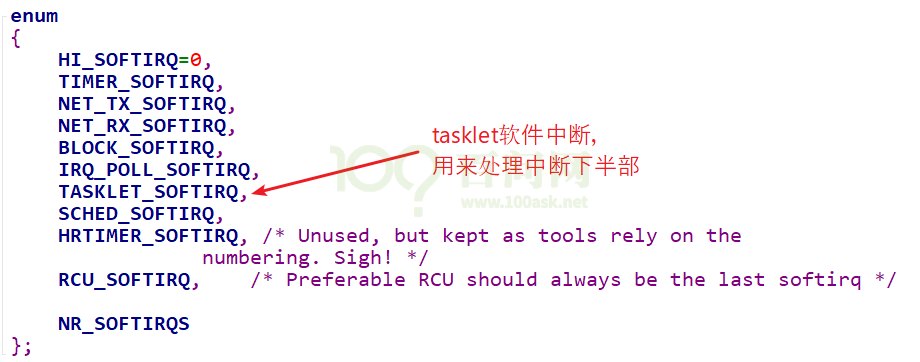

写字太多，不如贴代码，代码一目了然：

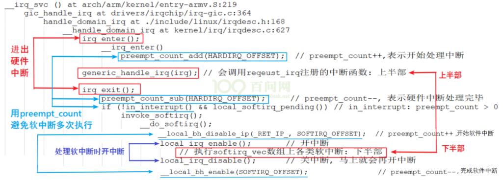

使用流程图简化一下：

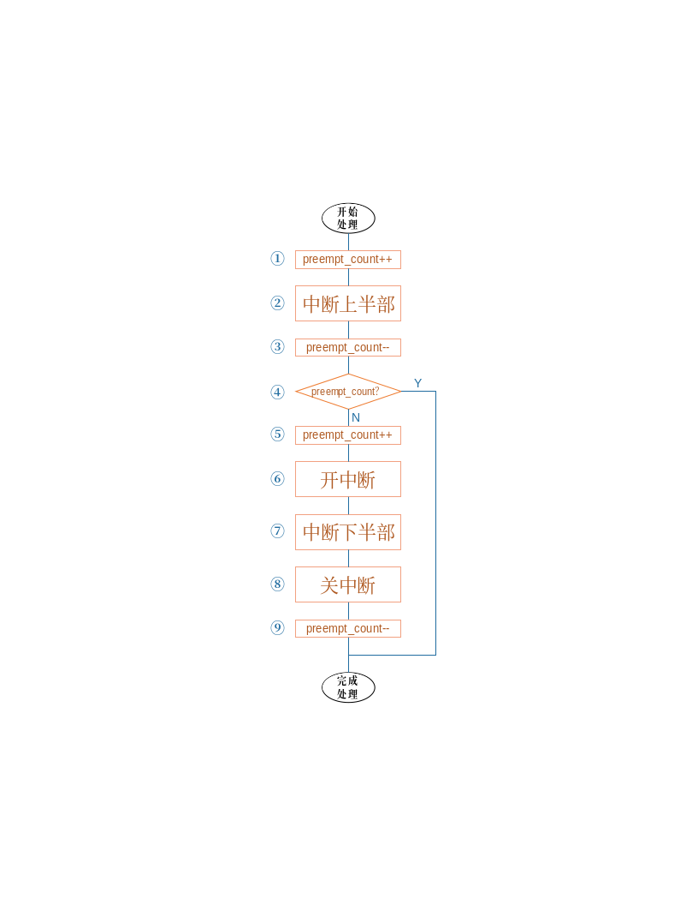

假设硬件中断A的上半部函数为irq\_top\_half\_A，下半部为irq\_bottom\_half\_A。

使用情景化的分析，才能理解上述代码的精华。

-   硬件中断A处理过程中，没有其他中断发生：

一开始，preempt\_count = 0；

上述流程图①～⑨依次执行，上半部、下半部的代码各执行一次。

-   硬件中断A处理过程中，又再次发生了中断A：

一开始，preempt\_count = 0；

执行到第⑥时，一开中断后，中断A又再次使得CPU跳到中断向量表。

**注意**：这时preempt\_count等于1，并且中断下半部的代码并未执行。

CPU又从①开始再次执行中断A的上半部代码：

在第①步preempt\_count等于2；

在第③步preempt\_count等于1；

在第④步发现preempt\_count等于1，所以直接结束当前第2次中断的处理；

**注意**：重点来了，第2次中断发生后，打断了第一次中断的第⑦步处理。当第2次中断处理完毕，CPU会继续去执行第⑦步。

可以看到，发生2次硬件中断A时，它的上半部代码执行了2次，但是下半部代码只执行了一次。

所以，同一个中断的上半部、下半部，在执行时是多对一的关系。

-   硬件中断A处理过程中，又再次发生了中断B：

一开始，preempt\_count = 0；

执行到第⑥时，一开中断后，中断B又再次使得CPU跳到中断向量表。

**注意**：这时preempt\_count等于1，并且中断A下半部的代码并未执行。

CPU又从①开始再次执行中断B的上半部代码：

在第①步preempt\_count等于2；

在第③步preempt\_count等于1；

在第④步发现preempt\_count等于1，所以直接结束当前第2次中断的处理；

**注意**：重点来了，第2次中断发生后，打断了第一次中断A的第⑦步处理。当第2次中断B处理完毕，CPU会继续去执行第⑦步。

在第⑦步里，它会去执行中断A的下半部，也会去执行中断B的下半部。

所以，多个中断的下半部，是汇集在一起处理的。

**总结**：

1.  中断的处理可以分为上半部，下半部
2.  中断上半部，用来处理紧急的事，它是在关中断的状态下执行的
3.  中断下半部，用来处理耗时的、不那么紧急的事，它是在开中断的状态下执行的
4.  中断下半部执行时，有可能会被多次打断，有可能会再次发生同一个中断
5.  中断上半部执行完后，触发中断下半部的处理
6.  中断上半部、下半部的执行过程中，不能休眠：中断休眠的话，以后谁来调度进程啊？

### 18.2.6 下半部要做的事情太多并且很复杂：工作队列

在中断下半部的执行过程中，虽然是开中断的，期间可以处理各类中断。但是毕竟整个中断的处理还没走完，这期间APP是无法执行的。

假设下半部要执行1、2分钟，在这1、2分钟里APP都是无法响应的。

这谁受得了？所以，如果中断要做的事情实在太耗时，那就不能用软件中断来做，而应该用内核线程来做：在中断上半部唤醒内核线程。内核线程和APP都一样竞争执行，APP有机会执行，系统不会卡顿。

这个内核线程是系统帮我们创建的，一般是kworker线程，内核中有很多这样的线程：

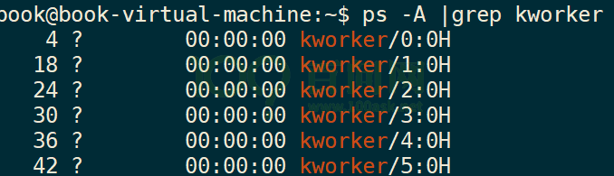

kworker线程要去“工作队列”(work queue)上取出一个一个“工作”(work)，来执行它里面的函数。

那我们怎么使用work、work queue呢？

1.  创建work：

你得先写出一个函数，然后用这个函数填充一个work结构体。比如：

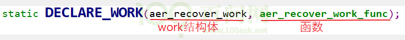

1.  要执行这个函数时，把work提交给work queue就可以了：

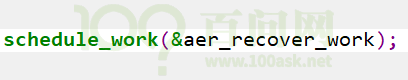

上述函数会把work提供给系统默认的work queue：system\_wq，它是一个队列。

1.  谁来执行work中的函数？

不用我们管，schedule\_work函数不仅仅是把work放入队列，还会把kworker线程唤醒。此线程抢到时间运行时，它就会从队列中取出work，执行里面的函数。

1.  谁把work提交给work queue？

在中断场景中，可以在中断上半部调用schedule\_work函数。

**总结**：

-   很耗时的中断处理，应该放到线程里去
-   可以使用work、work queue
-   在中断上半部调用schedule\_work函数，触发work的处理
-   既然是在线程中运行，那对应的函数可以休眠。

<a id="_Ref109028884"></a>
### 18.2.7 新技术：threaded irq

使用线程来处理中断，并不是什么新鲜事。使用work就可以实现，但是需要定义work、调用schedule\_work，好麻烦啊。

太懒了太懒了，就这2步你们都不愿意做。

好，内核是为懒人服务的，再杀出一个函数：

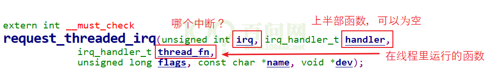

你可以只提供thread\_fn，系统会为这个函数创建一个内核线程。发生中断时，内核线程就会执行这个函数。

说你懒是开玩笑，内核开发者也不会那么在乎懒人。

以前用work来线程化地处理中断，一个worker线程只能由一个CPU执行，多个中断的work都由同一个worker线程来处理，在单CPU系统中也只能忍着了。但是在SMP系统中，明明有那么多CPU空着，你偏偏让多个中断挤在这个CPU上？

新技术threaded irq，为每一个中断都创建一个内核线程；多个中断的内核线程可以分配到多个CPU上执行，这提高了效率。

<a id="_Toc197788752"></a>
## 18.3 Linux中断系统中的重要数据结构

本节内容，可以从request\_irq(include/linux/interrupt.h)函数一路分析得到。

能弄清楚下面这个图，对Linux中断系统的掌握也基本到位了。

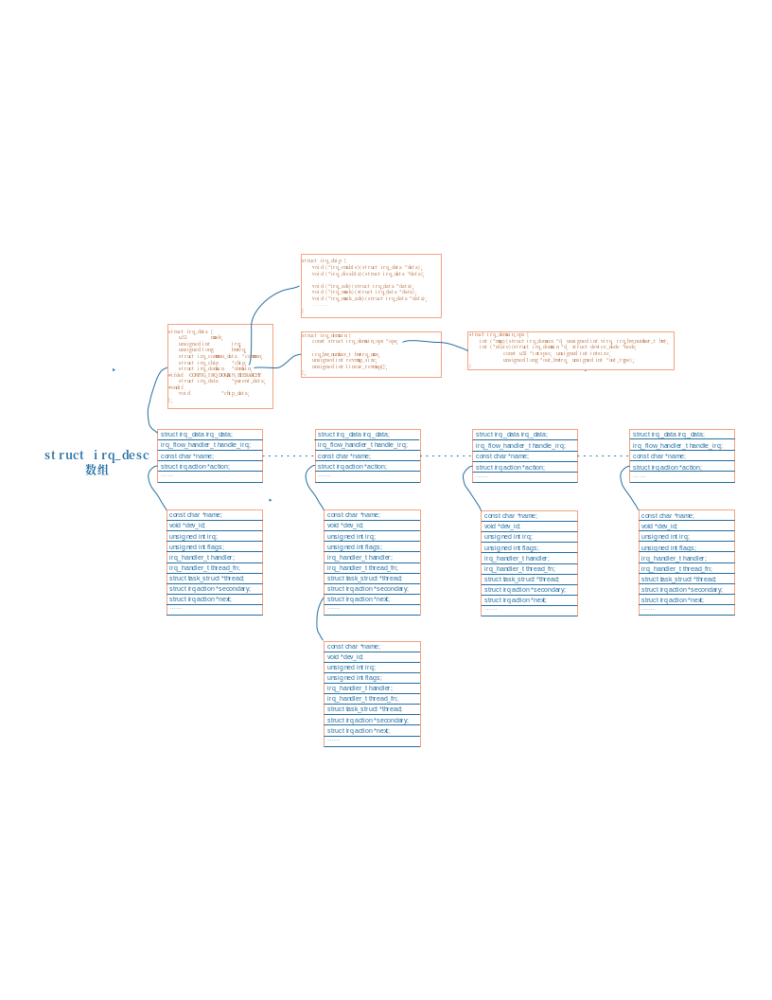

最核心的结构体是irq\_desc，之前为了易于理解，我们说在Linux内核中有一个中断数组，对于每一个硬件中断，都有一个数组项，这个数组就是irq\_desc数组。

**注意**：如果内核配置了CONFIG\_SPARSE\_IRQ，那么它就会用基数树(radix tree)来代替irq\_desc数组。SPARSE的意思是“稀疏”，假设大小为1000的数组中只用到2个数组项，那不是浪费嘛？所以在中断比较“稀疏”的情况下可以用基数树来代替数组。

### 18.3.1 irq_desc数组

irq\_desc结构体在include/linux/irqdesc.h中定义，主要内容如下图：


每一个irq\_desc数组项中都有一个函数：handle\_irq，还有一个action链表。要理解它们，需要先看中断结构图：

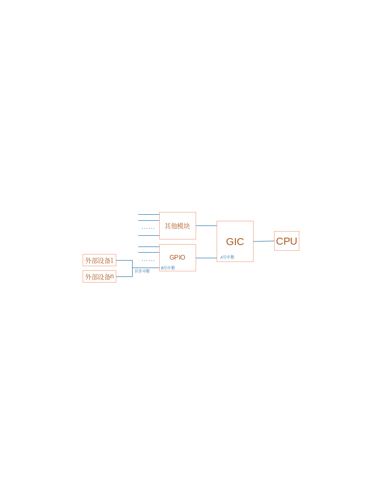

外部设备1、外部设备n共享一个GPIO中断B，多个GPIO中断汇聚到GIC(通用中断控制器)的A号中断，GIC再去中断CPU。那么软件处理时就是反过来，先读取GIC获得中断号A，再细分出GPIO中断B，最后判断是哪一个外部芯片发生了中断。

所以，中断的处理函数来源有三：

1.  GIC的处理函数：

假设irq\_desc\[A\].handle\_irq是XXX\_gpio\_irq\_handler(XXX指厂家)，这个函数需要读取芯片的GPIO控制器，细分发生的是哪一个GPIO中断(假设是B)，再去调用irq\_desc\[B\]. handle\_irq。

**注意**：irq\_desc\[A\].handle\_irq细分出中断后B，调用对应的irq\_desc\[B\].handle\_irq。

显然中断A是CPU感受到的顶层的中断，GIC中断CPU时，CPU读取GIC状态得到中断A。

1.  模块的中断处理函数：

比如对于GPIO模块向GIC发出的中断B，它的处理函数是irq\_desc\[B\].handle\_irq。

BSP开发人员会设置对应的处理函数，一般是handle\_level\_irq或handle\_edge\_irq，从名字上看是用来处理电平触发的中断、边沿触发的中断。

**注意**：导致GPIO中断B发生的原因很多，可能是外部设备1，可能是外部设备n，可能只是某一个设备，也可能是多个设备。所以irq\_desc\[B\].handle\_irq会调用某个链表里的函数，这些函数由外部设备提供。这些函数自行判断该中断是否自己产生，若是则处理。

1.  外部设备提供的处理函数：

这里说的“外部设备”可能是芯片，也可能总是简单的按键。它们的处理函数由自己驱动程序提供，这是最熟悉这个设备的“人”：它知道如何判断设备是否发生了中断，如何处理中断。

对于共享中断，比如GPIO中断B，它的中断来源可能有多个，每个中断源对应一个中断处理函数。所以irq\_desc\[B\]中应该有一个链表，存放着多个中断源的处理函数。

一旦程序确定发生了GPIO中断B，那么就会从链表里把那些函数取出来，一一执行。这个链表就是action链表。

对于我们举的这个例子来说，irq\_desc数组如下：

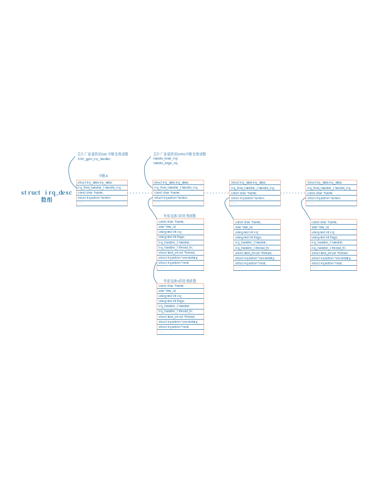

### 18.3.2 irqaction结构体

irqaction结构体在include/linux/interrupt.h中定义，主要内容如下图：


当调用request\_irq、request\_threaded\_irq注册中断处理函数时，内核就会构造一个irqaction结构体。在里面保存name、dev\_id等，最重要的是handler、thread\_fn、thread。

handler是中断处理的上半部函数，用来处理紧急的事情。

thread\_fn对应一个内核线程thread，当handler执行完毕，Linux内核会唤醒对应的内核线程。在内核线程里，会调用thread\_fn函数。

-   可以提供handler而不提供thread\_fn，就退化为一般的request\_irq函数。
-   可以不提供handler只提供thread\_fn，完全由内核线程来处理中断。
-   也可以既提供handler也提供thread\_fn，这就是中断上半部、下半部。

里面还有一个名为sedondary的irqaction结构体，它的作用以后再分析。

在reqeust\_irq时可以传入dev\_id，为何需要dev\_id？作用有2：

1.  中断处理函数执行时，可以使用dev\_id
2.  卸载中断时要传入dev\_id，这样才能在action链表中根据dev\_id找到对应项

所以在共享中断中必须提供dev\_id，非共享中断可以不提供。

### 18.3.3 irq_data结构体

irq\_data结构体在include/linux/irq.h中定义，主要内容如下图：

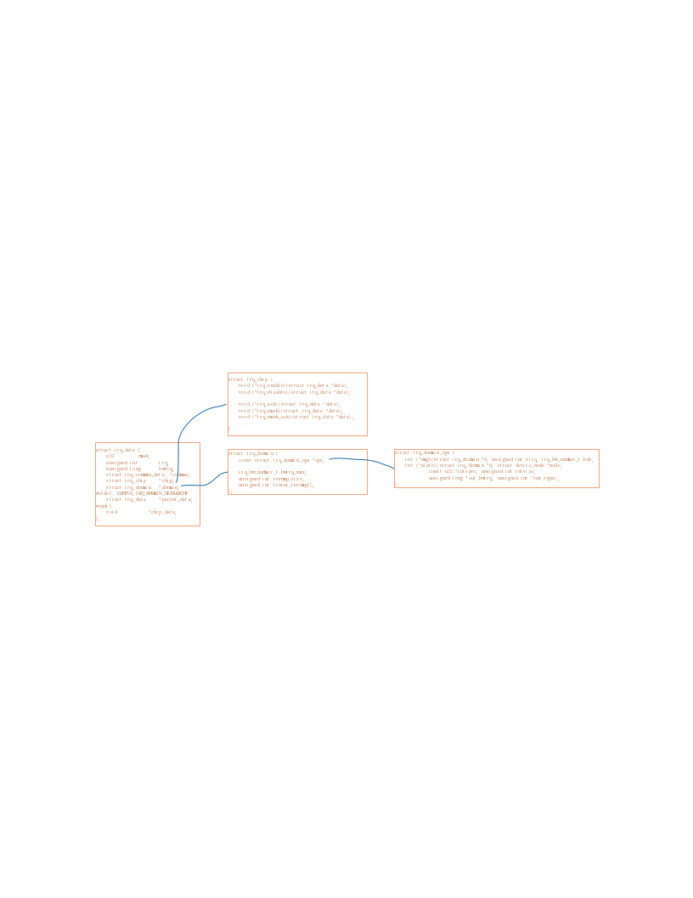

它就是个中转站，里面有irq\_chip指针 irq\_domain指针，都是指向别的结构体。

比较有意思的是irq、hwirq，irq是软件中断号，hwirq是硬件中断号。比如上面我们举的例子，在GPIO中断B是软件中断号，可以找到irq\_desc\[B\]这个数组项；GPIO里的第x号中断，这就是hwirq。

谁来建立irq、hwirq之间的联系呢？由irq\_domain来建立。irq\_domain会把本地的hwirq映射为全局的irq，什么意思？比如GPIO控制器里有第1号中断，UART模块里也有第1号中断，这两个“第1号中断”是不一样的，它们属于不同的“域”──irq\_domain。

### 18.3.4 irq_domain结构体

irq\_domain结构体在include/linux/irqdomain.h中定义，主要内容如下图：

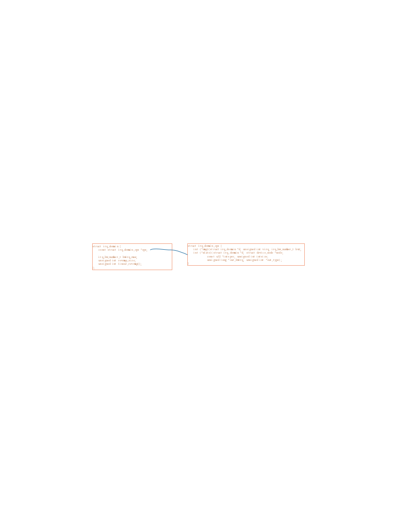

当我们后面从设备树讲起，如何在设备树中指定中断，设备树的中断如何被转换为irq时，irq\_domain将会起到极大的作为。

这里基于入门的解度简单讲讲，在设备树中你会看到这样的属性：

```
interrupt-parent = <&gpio1>;
interrupts = <5 IRQ_TYPE_EDGE_RISING>;
```

它表示要使用gpio1里的第5号中断，hwirq就是5。

但是我们在驱动中会使用request\_irq(irq, handler)这样的函数来注册中断，irq是什么？它是软件中断号，它应该从“gpio1的第5号中断”转换得来。

谁把hwirq转换为irq？由gpio1的相关数据结构，就是gpio1对应的irq\_domain结构体。

irq\_domain结构体中有一个irq\_domain\_ops结构体，里面有各种操作函数，主要是：

-   xlate

用来解析设备树的中断属性，提取出hwirq、type等信息。

-   map

把hwirq转换为irq。

### 18.3.5 irq_chip结构体

irq\_chip结构体在include/linux/irq.h中定义，主要内容如下图：


这个结构体跟“chip”即芯片相关，里面各成员的作用在头文件中也列得很清楚，摘录部分如下：

```
* @irq_startup:	start up the interrupt (defaults to ->enable if NULL)
* @irq_shutdown:	shut down the interrupt (defaults to ->disable if NULL)
* @irq_enable:		enable the interrupt (defaults to chip->unmask if NULL)
* @irq_disable:	disable the interrupt
* @irq_ack:		start of a new interrupt
* @irq_mask:		mask an interrupt source
* @irq_mask_ack:	ack and mask an interrupt source
* @irq_unmask:		unmask an interrupt source
* @irq_eoi:		end of interrupt
```

我们在request\_irq后，并不需要手工去使能中断，原因就是系统调用对应的irq\_chip里的函数帮我们使能了中断。

我们提供的中断处理函数中，也不需要执行主芯片相关的清中断操作，也是系统帮我们调用irq\_chip中的相关函数。

但是对于外部设备相关的清中断操作，还是需要我们自己做的。

就像上面图里的“外部设备1“、“外部设备n”，外设备千变万化，内核里可没有对应的清除中断操作。

<a id="_Toc197788753"></a>
## 18.4 在设备树中指定中断_在代码中获得中断

### 18.4.1 设备树里中断节点的语法

参考文档：

内核Documentation\\devicetree\\bindings\\interrupt-controller\\interrupts.txt

-   -   -   -   1.  设备树里的中断控制器

中断的硬件框图如下：


在硬件上，“中断控制器”只有GIC这一个，但是我们在软件上也可以把上图中的“GPIO”称为“中断控制器”。很多芯片有多个GPIO模块，比如GPIO1、GPIO2等等。所以软件上的“中断控制器”就有很多个：GIC、GPIO1、GPIO2等等。

GPIO1连接到GIC，GPIO2连接到GIC，所以GPIO1的父亲是GIC，GPIO2的父亲是GIC。

假设GPIO1有32个中断源，但是它把其中的16个汇聚起来向GIC发出一个中断，把另外16个汇聚起来向GIC发出另一个中断。这就意味着GPIO1会用到GIC的两个中断，会涉及GIC里的2个hwirq。

这些层级关系、中断号(hwirq)，都会在设备树中有所体现。

在设备树中，中断控制器节点中必须有一个属性：interrupt-controller，表明它是“中断控制器”。

还必须有一个属性：#interrupt-cells，表明引用这个中断控制器的话需要多少个cell。

#interrupt-cells的值一般有如下取值：

-   #interrupt-cells=&lt;1&gt;

别的节点要使用这个中断控制器时，只需要一个cell来表明使用“哪一个中断”。

-   #interrupt-cells=&lt;2&gt;

别的节点要使用这个中断控制器时，需要一个cell来表明使用“哪一个中断”；

还需要另一个cell来描述中断，一般是表明触发类型：

```
第2个cell的bits[3:0] 用来表示中断触发类型(trigger type and level flags)：
1 = low-to-high edge triggered，上升沿触发
2 = high-to-low edge triggered，下降沿触发
4 = active high level-sensitive，高电平触发
8 = active low level-sensitive，低电平触发
```

示例如下：

```
vic: intc@10140000 {
	compatible = "arm,versatile-vic";
	interrupt-controller;
	#interrupt-cells = <1>;
	reg = <0x10140000 0x1000>;
};
```

如果中断控制器有级联关系，下级的中断控制器还需要表明它的“interrupt-parent”是谁，用了interrupt-parent”中的哪一个“interrupts”，请看下一小节。

-   -   -   -   1.  设备树里使用中断

一个外设，它的中断信号接到哪个“中断控制器”的哪个“中断引脚”，这个中断的触发方式是怎样的？

这3个问题，在设备树里使用中断时，都要有所体现。

-   interrupt-parent=&lt;&XXXX&gt;

你要用哪一个中断控制器里的中断？

-   interrupts

你要用哪一个中断？

Interrupts里要用几个cell，由interrupt-parent对应的中断控制器决定。在中断控制器里有“#interrupt-cells”属性，它指明了要用几个cell来描述中断。

比如：

```
i2c@7000c000 {
	gpioext: gpio-adnp@41 {
		compatible = "ad,gpio-adnp";
		interrupt-parent = <&gpio>;
		interrupts = <160 1>;
		gpio-controller;
		#gpio-cells = <1>;
		interrupt-controller;
		#interrupt-cells = <2>;
	};
......
};
```

-   新写法：interrupts-extended

一个“interrupts-extended”属性就可以既指定“interrupt-parent”，也指定“interrupts”，比如：

```
interrupts-extended = <&intc1 5 1>, <&intc2 1 0>;
```

### 18.4.2 设备树里中断节点的示例

以100ASK\_IMX6ULL开发板为例，在arch/arm/boot/dts目录下可以看到2个文件：imx6ull.dtsi、100ask\_imx6ull-14x14.dts，把里面有关中断的部分内容抽取出来。

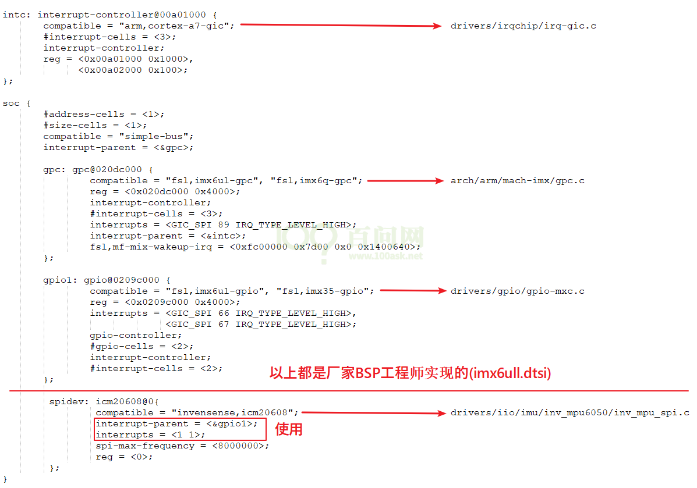

从设备树反推IMX6ULL的中断体系，如下，比之前的框图多了一个“GPC INTC”：

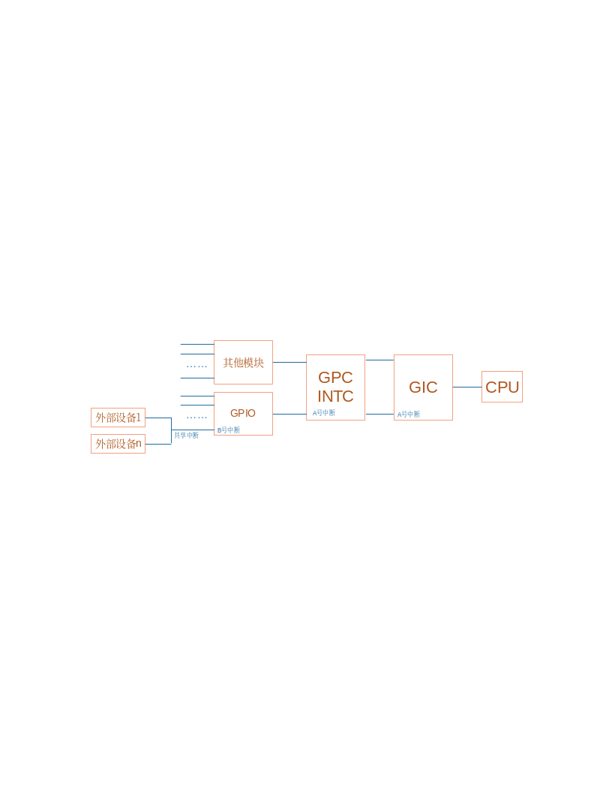

GPC INTC的英文是：General Power Controller, Interrupt Controller。它提供中断屏蔽、中断状态查询功能，实际上这些功能在GIC里也实现了，个人觉得有点多余。除此之外，它还提供唤醒功能，这才是保留它的原因。

<a id="_在代码中获得中断"></a>
### 18.4.3 在代码中获得中断

之前我们提到过，设备树中的节点有些能被转换为内核里的platform\_device，有些不能，回顾如下：

1.  根节点下含有compatile属性的子节点，会转换为platform\_device
2.  含有特定compatile属性的节点的子节点，会转换为platform\_device

如果一个节点的compatile属性，它的值是这4者之一："simple-bus","simple-mfd","isa","arm,amba-bus",

那么它的子结点(需含compatile属性)也可以转换为platform\_device。

1.  总线I2C、SPI节点下的子节点：不转换为platform\_device

某个总线下到子节点，应该交给对应的总线驱动程序来处理, 它们不应该被转换为platform\_device。

-   -   -   -   1.  对于platform\_device

一个节点能被转换为platform\_device，如果它的设备树里指定了中断属性，那么可以从platform\_device中获得“中断资源”，函数如下，可以使用下列函数获得IORESOURCE\_IRQ资源，即中断号：

```
/**
 * platform_get_resource - get a resource for a device
 * @dev: platform device
 * @type: resource type   // 取哪类资源？IORESOURCE_MEM、IORESOURCE_REG
*                      // IORESOURCE_IRQ等
 * @num: resource index  // 这类资源中的哪一个？
 */
struct resource *platform_get_resource(struct platform_device *dev,
unsigned int type,
unsigned int num);
```

-   -   -   -   1.  对于I2C设备、SPI设备

对于I2C设备节点，I2C总线驱动在处理设备树里的I2C子节点时，也会处理其中的中断信息。一个I2C设备会被转换为一个i2c\_client结构体，中断号会保存在i2c\_client的irq成员里，代码如下(drivers/i2c/i2c-core.c)：

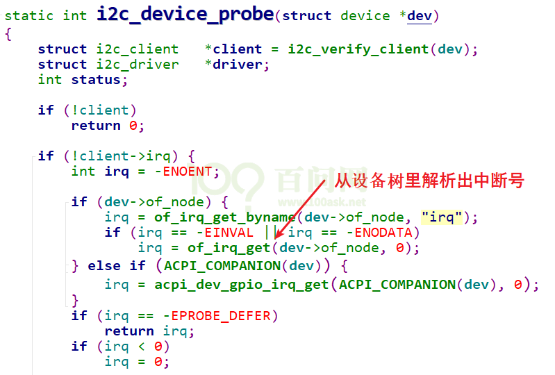

对于SPI设备节点，SPI总线驱动在处理设备树里的SPI子节点时，也会处理其中的中断信息。一个SPI设备会被转换为一个spi\_device结构体，中断号会保存在spi\_device的irq成员里，代码如下(drivers/spi/spi.c)：

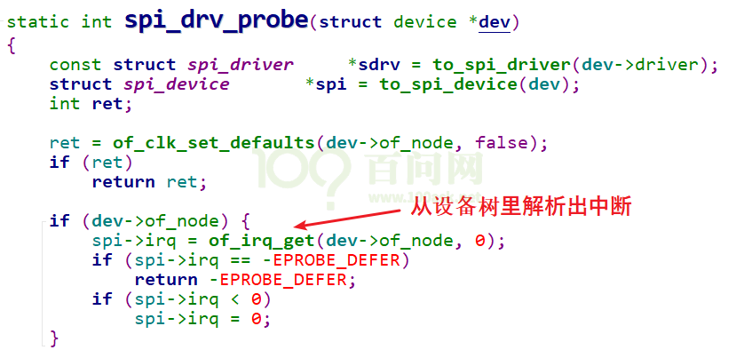

-   -   -   -   1.  调用of\_irq\_get获得中断号

如果你的设备节点既不能转换为platform\_device，它也不是I2C设备，不是SPI设备，那么在驱动程序中可以自行调用of\_irq\_get函数去解析设备树，得到中断号。

-   -   -   -   1.  对于GPIO

参考：drivers/input/keyboard/gpio\_keys.c

可以使用gpio\_to\_irq或gpiod\_to\_irq获得中断号。

举例，假设在设备树中有如下节点：

```
gpio-keys {
		compatible = "gpio-keys";
		pinctrl-names = "default";
		user {
				label = "User Button";
				gpios = <&gpio5 1 GPIO_ACTIVE_HIGH>;
				gpio-key,wakeup;
				linux,code = <KEY_1>;
		};
};
```

那么可以使用下面的函数获得引脚和flag：

```
button->gpio = of_get_gpio_flags(pp, 0, &flags);
bdata->gpiod = gpio_to_desc(button->gpio);
```

再去使用gpiod\_to\_irq获得中断号：

```
irq = gpiod_to_irq(bdata->gpiod);
```

<a id="_Toc197788754"></a>
## 18.5 编写使用中断的按键驱动程序

写在前面的话：对于GPIO按键，我们并不需要去写驱动程序，使用内核自带的驱动程序drivers/input/keyboard/gpio\_keys.c就可以，然后你需要做的只是修改设备树指定引脚及键值。

但是我还是要教你怎么从头写按键驱动，特别是如何使用中断。因为中断是引入其他基础知识的前提，后面要讲的这些内容都离不开中断：休眠-唤醒、POLL机制、异步通知、定时器、中断的线程化处理。

这些基础知识是更复杂的驱动程序的基础要素，以后的复杂驱动也就是对硬件操作的封装彼此不同，但是用到的基础编程知识是一样的。

### 18.5.1 编程思路

-   -   -   -   1.  设备树相关

查看原理图确定按键使用的引脚，再在设备树中添加节点，在节点里指定中断信息。

例子：

```
gpio_keys_100ask {
	compatible = "100ask,gpio_key";
	gpios = <&gpio5 1 GPIO_ACTIVE_HIGH
			 &gpio4 14 GPIO_ACTIVE_HIGH>;
	pinctrl-names = "default";
	pinctrl-0 = <&key1_pinctrl
				 &key2_pinctrl>;
};
```

-   -   -   -   1.  驱动代码相关
-   首先要获得中断号，参考上面[《18.4.3 在代码中获得中断》](/docs/Linux-Application-Development-Manual/part-5/chapter-40#_在代码中获得中断)；
-   然后编写中断处理函数；
-   最后request\_irq。

### 18.5.2 先编写驱动程序

参考：内核源码drivers/input/keyboard/gpio\_keys.c

使用GIT命令载后，源码gpio\_key\_drv.c位于这个目录下：

01\_all\_series\_quickstart\\

05\_嵌入式Linux驱动开发基础知识\\source\\06\_gpio\_irq\\01\_simple

-   -   -   -   1.  从设备树获得GPIO

```
count = of_gpio_count(node);
for (i = 0; i < count; i++)
    gpio_keys_100ask[i].gpio = of_get_gpio_flags(node, i, &flag);
```

-   -   -   -   1.  从GPIO获得中断号

```
gpio_keys_100ask[i].irq = gpio_to_irq(gpio_keys_100ask[i].gpio);
```

-   -   -   -   1.  申请中断

```
err = request_irq(gpio_keys_100ask[i].irq, gpio_key_isr, \
IRQF_TRIGGER_RISING | IRQF_TRIGGER_FALLING, "100ask_gpio_key", &gpio_keys_100ask[i]);
```

-   -   -   -   1.  中断函数

```
static irqreturn_t gpio_key_isr(int irq, void *dev_id)
{
	struct gpio_key *gpio_key = dev_id;
	int val;
	val = gpiod_get_value(gpio_key->gpiod);

	printk("key %d %d\n", gpio_key->gpio, val);

	return IRQ_HANDLED;
}
```

<a id="_Toc197788755"></a>
## 18.6 IMX6ULL设备树修改及上机实验

本实验的内核版本：

[https://e.coding.net/weidongshan/imx-linux4.9.88 commit 6020a20c1277c6b511e5673eecd8523e376031c8](https://e.coding.net/weidongshan/imx-linux4.9.88%20commit%206020a20c1277c6b511e5673eecd8523e376031c8)

### 18.6.1 查看原理图确定按键引脚

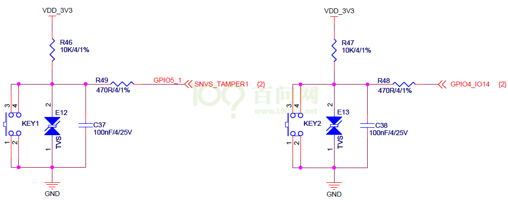

### 18.6.2 修改设备树

对于一个引脚要用作中断时：

-   1.  要通过PinCtrl把它设置为GPIO功能；
    2.  表明自身：是哪一个GPIO模块里的哪一个引脚

运行NXP提供的图形化设备树配置工具“i.MX Pins Tool v6”，点击左侧选中GPIO5\_IO01、GPIO4\_IO14，如下图所示：

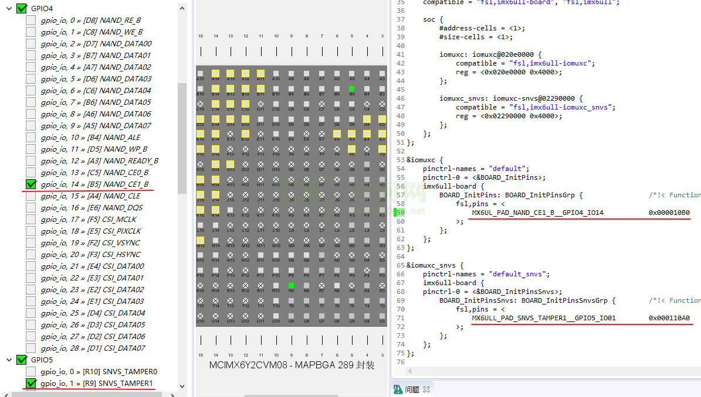

按上图右侧去修改设备树arch/arm/boot/dts/100ask\_imx6ull-14x14.dts，修改结果放GIT中。

使用GIT命令载后，源码“修改后100ask\_imx6ull-14x14.dts” 位于这个目录下(使用之前要改名为“100ask\_imx6ull-14x14.dts”并上传到内核的arch/arm/boot/dts目录)：

01\_all\_series\_quickstart\\

05\_嵌入式Linux驱动开发基础知识\\source\\06\_gpio\_irq\\01\_simple\\device\_tree\\

主要内容摘录如下：

-   GPIO5\_IO01的pinctrl定义：

```
&iomuxc_snvs {
    pinctrl-names = "default_snvs";
    pinctrl-0 = <&pinctrl_hog_2>;
    imx6ul-evk {
        key1_100ask: key1_100ask{    /*!< Function assigned for the core: Cortex-A7[ca7] */
            fsl,pins = <
                MX6ULL_PAD_SNVS_TAMPER1__GPIO5_IO01        0x000110A0
            >;
        };
```

-   GPIO4\_IO14的pinctrl定义：

```
&iomuxc {
    pinctrl-names = "default";
    pinctrl-0 = <&pinctrl_hog_1>;
    imx6ul-evk {
        key2_100ask: key2_100ask{  /*!< Function assigned for the core: Cortex-A7[ca7] */
            fsl,pins = <
                MX6UL_PAD_NAND_CE1_B__GPIO4_IO14           0x000010B0
            >;
        };
```

定义这2个按键的节点：

```
gpio_keys_100ask {
    compatible = "100ask,gpio_key";
    gpios = <&gpio5 1 GPIO_ACTIVE_HIGH
             &gpio4 14 GPIO_ACTIVE_LOW>;
    pinctrl-names = "default";
    pinctrl-0 = <&key1_100ask &key2_100ask>;
};
```

把原来的GPIO按键节点禁止掉：

```
gpio-keys {
	compatible = "gpio-keys";
	pinctrl-names = "default";
	status = "disabled";    // 这句是新加的
```

### 18.6.3 上机实验

实验步骤如下：

1.  编译设备树，把100ask\_imx6ull-14x14.dtb放到板子的/boot目录，重启开发板。
2.  编译驱动程序，安装驱动程序，操作按键。

大概命令列出如下：

-   1\. 在电脑上设置工具链

```bash
export ARCH=arm
export CROSS_COMPILE=arm-buildroot-linux-gnueabihf-
export PATH=$PATH:/home/book/100ask_imx6ull-sdk/ToolChain/arm-buildroot-linux-gnueabihf_sdk-buildroot/bin
```

-   2\. 进入内核目录后执行：

```bash
make dtbs   // 生成 arch/arm/boot/dts/100ask_imx6ull-14x14.dtb，请把它放到板子的/boot目录
```

-   3\. 编译驱动: 先进入驱动程序目录，执行make即可，把生成的gpio\_key\_drv.ko放到开发板上
-   4\. 重启开发板后，在板子上执行：

```bash
[root@100ask:~]# echo "7 4 1 7" > /proc/sys/kernel/printk
[root@100ask:~]# insmod gpio_key_drv.ko
```

-   5\. 按下、松开按键，可以看到输出信息：

```bash
[   48.396584] key 110 0
[   48.569403] key 110 1
[   49.321805] key 129 0
[   49.498734] key 129 1
```

参考资料

-   中断处理不能嵌套：

[https://git.kernel.org/pub/scm/linux/kernel/git/torvalds/linux.git/commit/?id=e58aa3d2d0cc](https://git.kernel.org/pub/scm/linux/kernel/git/torvalds/linux.git/commit/?id=e58aa3d2d0cc)

-   genirq: add threaded interrupt handler support

```
https://git.kernel.org/pub/scm/linux/kernel/git/torvalds/linux.git/commit/?id=3aa551c9b4c40018f0e261a178e3d25478dc04a9
```

-   Linux RT(2)－硬实时Linux(RT-Preempt Patch)的中断线程化

[https://www.veryarm.com/110619.html](https://www.veryarm.com/110619.html)

-   Linux中断管理 (1)Linux中断管理机制

[https://www.cnblogs.com/arnoldlu/p/8659981.html](https://www.cnblogs.com/arnoldlu/p/8659981.html)

```bash
Breakpoint 1, gpio_keys_gpio_isr (irq=200, dev_id=0x863e6930) at drivers/input/keyboard/gpio_keys.c:393
393	{
(gdb) bt
#0  gpio_keys_gpio_isr (irq=200, dev_id=0x863e6930) at drivers/input/keyboard/gpio_keys.c:393
#1  0x80270528 in __handle_irq_event_percpu (desc=0x8616e300, flags=0x86517edc) at kernel/irq/handle.c:145
#2  0x802705cc in handle_irq_event_percpu (desc=0x8616e300) at kernel/irq/handle.c:185
#3  0x80270640 in handle_irq_event (desc=0x8616e300) at kernel/irq/handle.c:202
#4  0x802738e8 in handle_level_irq (desc=0x8616e300) at kernel/irq/chip.c:518
#5  0x8026f7f8 in generic_handle_irq_desc (desc=<optimized out>) at ./include/linux/irqdesc.h:150
#6  generic_handle_irq (irq=<optimized out>) at kernel/irq/irqdesc.c:590
#7  0x805005e0 in mxc_gpio_irq_handler (port=0xc8, irq_stat=2252237104) at drivers/gpio/gpio-mxc.c:274
#8  0x805006fc in mx3_gpio_irq_handler (desc=<optimized out>) at drivers/gpio/gpio-mxc.c:291
#9  0x8026f7f8 in generic_handle_irq_desc (desc=<optimized out>) at ./include/linux/irqdesc.h:150
#10 generic_handle_irq (irq=<optimized out>) at kernel/irq/irqdesc.c:590
#11 0x8026fd0c in __handle_domain_irq (domain=0x86006000, hwirq=32, lookup=true, regs=0x86517fb0) at kernel/irq/irqdesc.c:627
#12 0x80201484 in handle_domain_irq (regs=<optimized out>, hwirq=<optimized out>, domain=<optimized out>) at ./include/linux/irqdesc.h:168
#13 gic_handle_irq (regs=0xc8) at drivers/irqchip/irq-gic.c:364
#14 0x8020b704 in __irq_usr () at arch/arm/kernel/entry-armv.S:464
```
