<a id="_第十九章_驱动程序基石"></a>
<a id="_Ref109378779"></a>
<a id="_Ref109378777"></a>
<a id="_Toc197788756"></a>

<a id="_Toc197788757"></a>
## 19.1 休眠与唤醒

### 19.1.1 适用场景

在前面引入中断时，我们曾经举过一个例子：


妈妈怎么知道卧室里小孩醒了？

-   休眠-唤醒：进去房间陪小孩一起睡觉，小孩醒了会吵醒她

不累，但是妈妈干不了活了

当应用程序必须等待某个事件发生，比如必须等待按键被按下时，可以使用“休眠-唤醒”机制：

1.  APP调用read等函数试图读取数据，比如读取按键；
2.  APP进入内核态，也就是调用驱动中的对应函数，发现有数据则复制到用户空间并马上返回；
3.  如果APP在内核态，也就是在驱动程序中发现没有数据，则APP休眠；
4.  当有数据时，比如当按下按键时，驱动程序的中断服务程序被调用，它会记录数据、唤醒APP；
5.  APP继续运行它的内核态代码，也就是驱动程序中的函数，复制数据到用户空间并马上返回。

驱动中有数据时，图 19.1中红线就是APP1的执行过程，涉及用户态、内核态：


<a id="_Ref109231559"></a>图 19.1 app1执行过程

驱动中没有数据时，APP1在内核态执行到drv\_read时会休眠。所谓休眠就是把自己的状态改为非RUNNING，这样内核的调度器就不会让它运行。当按下按键，驱动程序中的中断服务程序被调用，它会记录数据，并唤醒APP1。所以唤醒就是把程序的状态改为RUNNING，这样内核的调度器有合适的时间就会让它运行。当APP1再次运行时，就会继续执行drv\_read中剩下的代码，把数据复制回用户空间，返回用户空间。APP1的执行过程如下图的红色实线所示，它被分成了2段：

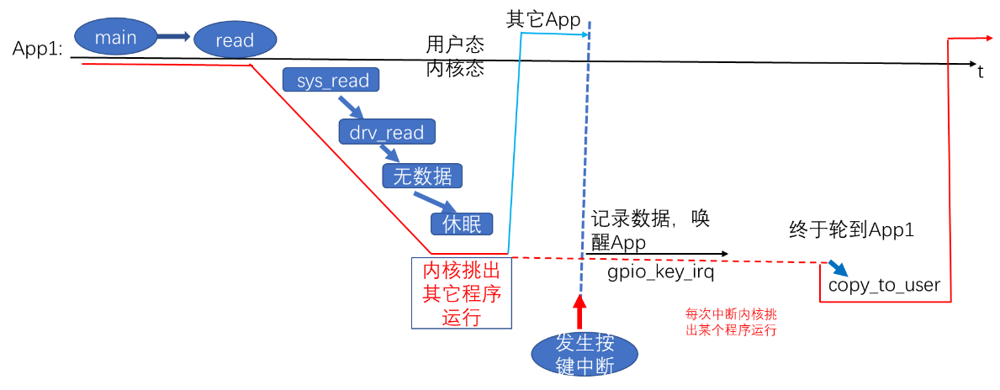

图 19.2 APP1的执行过程

值得注意的是，上面2个图中红线部分都属于APP1的“上下文”，或者这样说：红线所涉及的代码，都是APP1调用的。但是按键的中断服务程序，不属于APP1的“上下文”，这是突如其来的，当中断发生时，APP1正在休眠呢。

在APP1的“上下文”，也就是在APP1的执行过程中，它是可以休眠的。

在中断的处理过程中，也就是gpio\_key\_irq的执行过程中，它不能休眠：“中断”怎么能休眠？“中断”休眠了，谁来调度其他APP啊？

所以，请记住：**在中断处理函数中，不能休眠**，也就不能调用会导致休眠的函数。

### 19.1.2 内核函数

-   -   -   -   1.  休眠函数

参考内核源码：include\\linux\\wait.h。

表 19‑1 wait内核函数


| 函数 | 说明 |
| --- | --- |
| wait_event_interruptible(wq, condition) | 休眠，直到condition为真；<br />休眠期间是可被打断的，可以被信号打断 |
| wait_event(wq, condition) | 休眠，直到condition为真；<br />退出的唯一条件是condition为真，信号也不好使 |
| wait_event_interruptible_timeout(wq, condition, timeout) | 休眠，直到condition为真或超时；<br />休眠期间是可被打断的，可以被信号打断 |
| wait_event_timeout(wq, condition, timeout) | 休眠，直到condition为真；<br />退出的唯一条件是condition为真，信号也不好使 |


比较重要的参数就是：

1.  wq：waitqueue，等待队列
    1.  休眠时除了把程序状态改为非RUNNING之外，还要把进程/进程放入wq中，以后中断服务程序要从wq中把它取出来唤醒。
    2.  没有wq的话，茫茫人海中，中断服务程序去哪里找到你？
2.  condition

这可以是一个变量，也可以是任何表达式。表示“一直等待，直到condition为真”。

-   -   -   -   1.  唤醒函数

参考内核源码：include\\linux\\wait.h。


| 函数 | 说明 |
| --- | --- |
| wake_up_interruptible(x) | 唤醒x队列中状态为“TASK_INTERRUPTIBLE”的线程，只唤醒其中的一个线程 |
| wake_up_interruptible_nr(x, nr) | 唤醒x队列中状态为“TASK_INTERRUPTIBLE”的线程，只唤醒其中的nr个线程 |
| wake_up_interruptible_all(x) | 唤醒x队列中状态为“TASK_INTERRUPTIBLE”的线程，唤醒其中的所有线程 |
| wake_up(x) | 唤醒x队列中状态为“TASK_INTERRUPTIBLE”或“TASK_UNINTERRUPTIBLE”的线程，只唤醒其中的一个线程 |
| wake_up_nr(x, nr) | 唤醒x队列中状态为“TASK_INTERRUPTIBLE”或“TASK_UNINTERRUPTIBLE”的线程，只唤醒其中nr个线程 |
| wake_up_all(x) | 唤醒x队列中状态为“TASK_INTERRUPTIBLE”或“TASK_UNINTERRUPTIBLE”的线程，唤醒其中的所有线程 |


### 19.1.3 驱动框架

驱动框架如下：

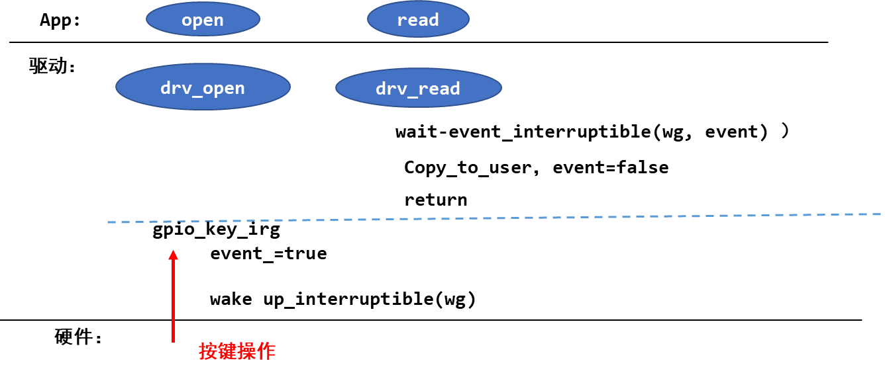

图 19.3 驱动框架

要休眠的线程，放在wq队列里，中断处理函数从wq队列里把它取出来唤醒。

所以，我们要做这几件事：

1.  初始化wq队列
2.  在驱动的read函数中，调用wait\_event\_interruptible：

它本身会判断event是否为FALSE，如果为FASLE表示无数据，则休眠。

当从wait\_event\_interruptible返回后，把数据复制回用户空间。

1.  在中断服务程序里：

设置event为TRUE，并调用wake\_up\_interruptible唤醒线程。

### 19.1.4 编程

使用GIT命令载后，源码位于这个目录下：

01\_all\_series\_quickstart\\

05\_嵌入式Linux驱动开发基础知识\\

source\\06\_gpio\_irq\\02\_read\_key\_irq\\ 和 03\_read\_key\_irq\_circle\_buffer

03\_read\_key\_irq\_circle\_buffer使用了环型缓冲区，可以避免按键丢失。

-   -   -   -   1.  驱动程序关键代码
-   02\_read\_key\_irq\\gpio\_key\_drv.c中，要先定义“wait queue”：

```
41 static DECLARE_WAIT_QUEUE_HEAD(gpio_key_wait);
```

-   在驱动的读函数里调用wait\_event\_interruptible：

```
44 static ssize_t gpio_key_drv_read (struct file *file, char __user *buf, size_t size, loff_t *offset)
45 {
46      //printk("%s %s line %d\n", __FILE__, __FUNCTION__, __LINE__);
47      int err;
48
49      wait_event_interruptible(gpio_key_wait, g_key);
50      err = copy_to_user(buf, &g_key, 4);
51      g_key = 0;
52
53      return 4;
54 }
```

第49行并不一定会进入休眠，它会先判断g\_key是否为TRUE。

执行到第50行时，表示要么有了数据(g\_key为TRUE)，要么有信号等待处理(本节课程不涉及信号)。

假设g\_key等于0，那么APP会执行到上述代码第49行时进入休眠状态。它被谁唤醒？被控制的中断服务程序：

```
64 static irqreturn_t gpio_key_isr(int irq, void *dev_id)
65 {
66      struct gpio_key *gpio_key = dev_id;
67      int val;
68      val = gpiod_get_value(gpio_key->gpiod);
69
70
71      printk("key %d %d\n", gpio_key->gpio, val);
72      g_key = (gpio_key->gpio << 8) | val;
73      wake_up_interruptible(&gpio_key_wait);
74
75      return IRQ_HANDLED;
76 }
```

上述代码中，第72行确定按键值g\_key，g\_key也就变为TRUE了。

然后在第73行唤醒gpio\_key\_wait中的第1个线程。

注意这2个函数，一个没有使用“&”，另一个使用了“&”：

```
wait_event_interruptible(gpio_key_wait, g_key);
wake_up_interruptible(&gpio_key_wait);
```

-   -   -   -   1.  应用程序

应用程序并不复杂，调用open、read即可，代码在button\_test.c中：

```
25      /* 2. 打开文件 */
26      fd = open(argv[1], O_RDWR);
27      if (fd == -1)
28      {
29              printf("can not open file %s\n", argv[1]);
30              return -1;
31      }
32
33      while (1)
34      {
35              /* 3. 读文件 */
36              read(fd, &val, 4);
37              printf("get button : 0x%x\n", val);
38      }
```

在33行～38行的循环中，APP基本上都是休眠状态。你可以执行top命令查看CPU占用率。

### 19.1.5 上机实验

跟上一节视频类似，**需要先修改设备树，请使用上一节视频的设备树文件**。然后安装驱动程序，运行测试程序。

```bash
[root@100ask:~]# insmod -f gpio_key_drv.ko
[root@100ask:~]# ls /dev/100ask_gpio_key
/dev/100ask_gpio_key
[root@100ask:~]# ./button_test /dev/100ask_gpio_key  &
[root@100ask:~]# top
```

### 19.1.6 使用环形缓冲区改进驱动程序

使用GIT命令载后，源码位于这个目录下：

01\_all\_series\_quickstart\\

05\_嵌入式Linux驱动开发基础知识\\

source\\06\_gpio\_irq\\03\_read\_key\_irq\_circle\_buffer

使用环形缓冲区，可以在一定程序上避免按键数据丢失，关键代码如下：

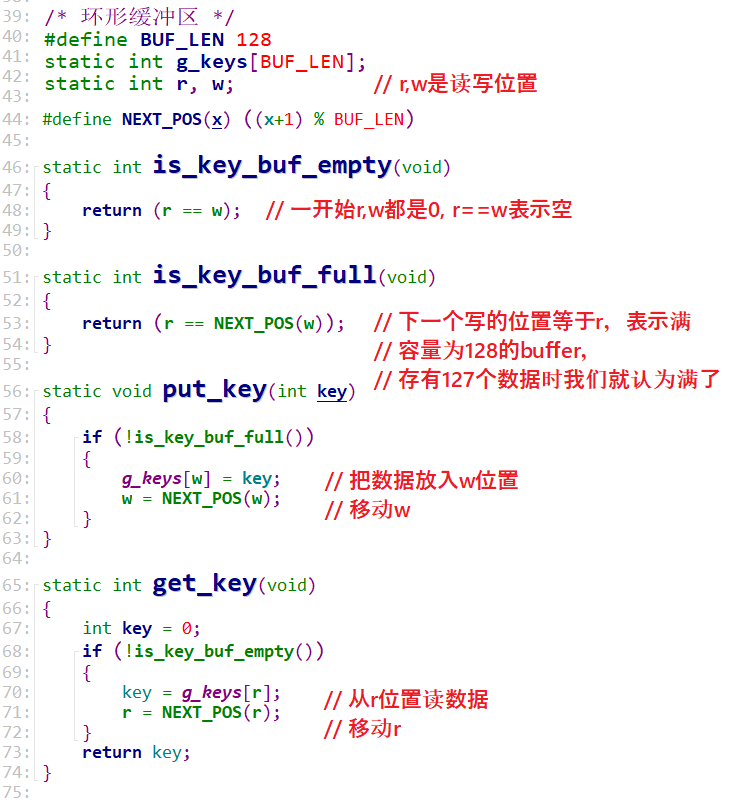

使用环形缓冲区之后，休眠函数可以这样写：

```
86      wait_event_interruptible(gpio_key_wait, !is_key_buf_empty());
87      key = get_key();
88      err = copy_to_user(buf, &key, 4);
```

唤醒函数可以这样写：

```
111     key = (gpio_key->gpio << 8) | val;
112     put_key(key);
113     wake_up_interruptible(&gpio_key_wait);
```

<a id="_Toc197788758"></a>
## 19.2 POLL机制

使用GIT命令载后，本节源码位于这个目录下：

01\_all\_series\_quickstart\\

05\_嵌入式Linux驱动开发基础知识\\source\\06\_gpio\_irq\\04\_read\_key\_irq\_poll

### 19.2.1 适用场景

在前面引入中断时，我们曾经举过一个例子：妈妈怎么知道卧室里小孩醒了？

-   poll方式：妈妈要干很多活，但是可以陪小孩睡一会，定个闹钟

要浪费点时间，但是可以继续干活。妈妈要么是被小孩吵醒，要么是被闹钟吵醒。

使用休眠-唤醒的方式等待某个事件发生时，有一个缺点：等待的时间可能很久。我们可以加上一个超时时间，这时就可以使用poll机制。

1.  APP不知道驱动程序中是否有数据，可以先调用poll函数查询一下，poll函数可以传入超时时间；
2.  APP进入内核态，调用到驱动程序的poll函数，如果有数据的话立刻返回；
3.  如果发现没有数据时就休眠一段时间；
4.  当有数据时，比如当按下按键时，驱动程序的中断服务程序被调用，它会记录数据、唤醒APP；
5.  当超时时间到了之后，内核也会唤醒APP；
6.  APP根据poll函数的返回值就可以知道是否有数据，如果有数据就调用read得到数据。

### 19.2.2 使用流程

妈妈进入房间时，会先看小孩醒没醒，闹钟响之后走出房间之前又会再看小孩醒没醒。

**注意**：看了2次小孩！

POLL机制也是类似的，流程如下：

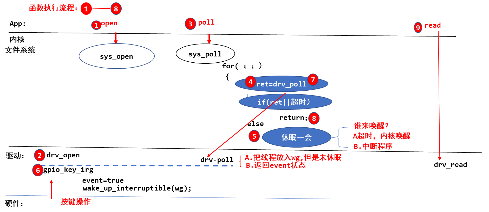

图 19.4 poll机制

函数执行流程如上图①～⑧所示，重点从③开始看。假设一开始无按键数据：

③PP调用poll之后，进入内核态；

④致驱动程序的drv\_poll被调用：

**注意**，drv\_poll要把自己这个线程挂入等待队列wq中；假设不放入队列里，那以后发生中断时，中断服务程序去哪里找到你嘛？

drv\_poll还会判断一下：有没有数据啊？返回这个状态。

⑤当前没有数据，则休眠一会；

⑥过程中，按下了按键，发生了中断：

-   -   在中断服务程序里记录了按键值，并且从wq中把线程唤醒了。

⑦从休眠中被唤醒，继续执行for循环，再次调用drv\_poll：

-   -   drv\_poll返回数据状态

⑧哦，你有数据，那从内核态返回到应用态吧

⑨APP调用read函数读数据

如果一直没有数据，调用流程也是类似的，重点从③开始看，如下：

③ APP调用poll之后，进入内核态；

④ 导致驱动程序的drv\_poll被调用：

**注意**，drv\_poll要把自己这个线程挂入等待队列wq中；假设不放入队列里，那以后发生中断时，中断服务程序去哪里找到你嘛？

drv\_poll还会判断一下：有没有数据啊？返回这个状态。

⑤ 假设当前没有数据，则休眠一会；

⑥ 在休眠过程中，一直没有按下了按键，超时时间到：内核把这个线程唤醒；

⑦ 线程从休眠中被唤醒，继续执行for循环，再次调用drv\_poll：drv\_poll返回数据状态

⑧ 哦，你还是没有数据，但是超时时间到了，那从内核态返回到应用态吧

⑨ APP不能调用read函数读数据

注意几点：

-   drv\_poll要把线程挂入队列wq，但是并不是在drv\_poll中进入休眠，而是在调用drv\_poll之后休眠
-   drv\_poll要返回数据状态
-   APP调用一次poll，有可能会导致drv\_poll被调用2次
-   线程被唤醒的原因有2：中断发生了去队列wq中把它唤醒，超时时间到了内核把它唤醒
-   APP要判断poll返回的原因：有数据，还是超时。有数据时再去调用read函数。

### 19.2.3 驱动编程

使用poll机制时，驱动程序的核心就是提供对应的drv\_poll函数。在drv\_poll函数中要做2件事：

1.  把当前线程挂入队列wq：poll\_wait
    1.  APP调用一次poll，可能导致drv\_poll被调用2次，但是我们并不需要把当前线程挂入队列2次。
    2.  可以使用内核的函数poll\_wait把线程挂入队列，如果线程已经在队列里了，它就不会再次挂入。
2.  返回设备状态：

APP调用poll函数时，有可能是查询“有没有数据可以读”：POLLIN，也有可能是查询“你有没有空间给我写数据”：POLLOUT。所以drv\_poll要返回自己的当前状态：(POLLIN | POLLRDNORM) 或 (POLLOUT | POLLWRNORM)。

-   1.  POLLRDNORM等同于POLLIN，为了兼容某些APP把它们一起返回。
    2.  POLLWRNORM等同于POLLOUT ，为了兼容某些APP把它们一起返回。

APP调用poll后，很有可能会休眠。对应的，在按键驱动的中断服务程序中，也要有唤醒操作。

驱动程序中poll的代码如下：

```
static unsigned int gpio_key_drv_poll(struct file *fp, poll_table * wait)
{
	printk("%s %s line %d\n", __FILE__, __FUNCTION__, __LINE__);
	poll_wait(fp, &gpio_key_wait, wait);
	return is_key_buf_empty() ? 0 : POLLIN | POLLRDNORM;
}
```

### 19.2.4 应用编程

**注意**：APP可以调用poll或select函数，这2个函数的作用是一样的。

poll/select函数可以监测多个文件，可以监测多种事件：


| 事件类型 | 说明 |
| --- | --- |
| POLLIN | 有数据可读 |
| POLLRDNORM | 等同于POLLIN |
| POLLRDBAND | Priority band data can be read，有优先级较较高的“band data”可读<br />Linux系统中很少使用这个事件 |
| POLLPRI | 高优先级数据可读 |
| POLLOUT | 可以写数据 |
| POLLWRNORM | 等同于POLLOUT |
| POLLWRBAND | Priority data may be written |
| POLLERR | 发生了错误 |
| POLLHUP | 挂起 |
| POLLNVAL | 无效的请求，一般是fd未open |


在调用poll函数时，要指明：

-   你要监测哪一个文件：哪一个fd
-   你想监测这个文件的哪种事件：是POLLIN、还是POLLOUT

最后，在poll函数返回时，要判断状态。

应用程序代码如下：

```
struct pollfd fds[1];
int timeout_ms = 5000;
int ret;
fds[0].fd = fd;
fds[0].events = POLLIN;
ret = poll(fds, 1, timeout_ms);
if ((ret == 1) && (fds[0].revents & POLLIN))
{
	read(fd, &val, 4);
	printf("get button : 0x%x\n", val);
}
```

### 19.2.5 现场编程

驱动程序、应用程序的核心都在上面的章节列了出来，怎么写程序？观看视频体验更佳，更能抓住重点。

### 19.2.6 上机实验

使用GIT命令载后，本节源码位于这个目录下：

01\_all\_series\_quickstart\\

05\_嵌入式Linux驱动开发基础知识\\source\\06\_gpio\_irq\\04\_read\_key\_irq\_poll

首先，把“04\_read\_key\_irq\_poll”整个目录上传单Ubuntu中，修改里面的Makefile指定内核路径，如下修改：

```
KERN_DIR =  /home/book/100ask_imx6ull-sdk/Linux-4.9.88
```

然后执行“make”命令，生成驱动程序“gpio\_key\_drv.ko”、应用程序“button\_test”。

接着，还需要修改设备树，参照下图修改Ubuntu中的设备树文件“Linux-4.9.88/arch/arm/boot/dts/100ask\_imx6ull-14x14.dts”：


图 19.5 POLL机制实验的设备树

修改完设备树后，在内核目录下载执行“make dtbs”生产新的设备树文件“arch/arm/boot/dts/100ask\_imx6ull-14x14.dtb”，把它放到开发板的“/boot”目录下，重启开发板。

最后，把Ubuntu上的驱动程序、测试程序下载到开发板/root目录，执行如下命令测试：

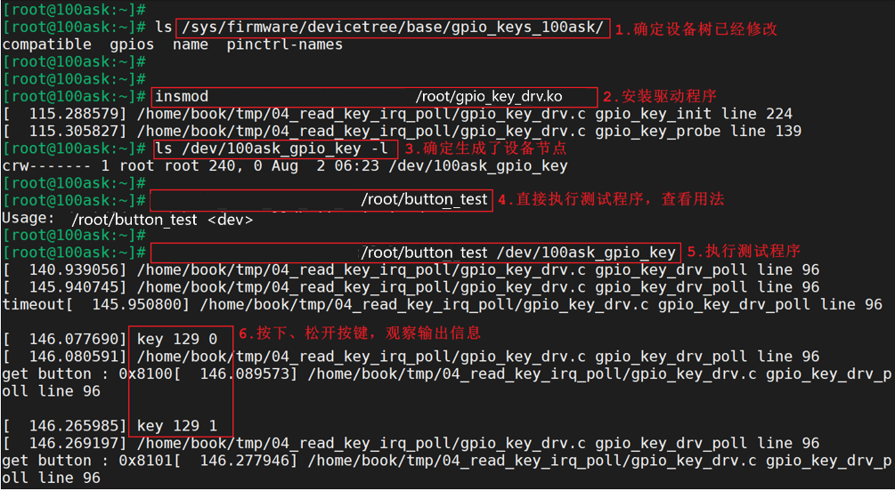

图 19.6 POLL机制上机实验

### 19.2.7 POLL机制的内核代码详解

Linux APP系统调用，基本都可以在它的名字前加上“sys\_”前缀，这就是它在内核中对应的函数。比如系统调用open、read、write、poll，与之对应的内核函数为：sys\_open、sys\_read、sys\_write、sys\_poll。

对于系统调用poll或select，它们对应的内核函数都是sys\_poll。分析sys\_poll，即可理解poll机制。

-   -   -   -   1.  sys\_poll函数

sys\_poll位于fs/select.c文件中，代码如下：

```
SYSCALL_DEFINE3(poll, struct pollfd __user *, ufds, unsigned int, nfds,
		int, timeout_msecs)
{
	struct timespec64 end_time, *to = NULL;
	int ret;
	if (timeout_msecs >= 0) {
		to = &end_time;
		poll_select_set_timeout(to, timeout_msecs / MSEC_PER_SEC,
			NSEC_PER_MSEC * (timeout_msecs % MSEC_PER_SEC));
	}
	ret = do_sys_poll(ufds, nfds, to);
……
```

-   SYSCALL\_DEFINE3是一个宏，它定义于include/linux/syscalls.h，展开后就有sys\_poll函数。
-   sys\_poll对超时参数稍作处理后，直接调用do\_sys\_poll。
    -   -   -   1.  do\_sys\_poll函数

do\_sys\_poll位于fs/select.c文件中，我们忽略其他代码，只看关键部分：

```
int do_sys_poll(struct pollfd __user *ufds, unsigned int nfds,
		struct timespec64 *end_time)
{
……
	poll_initwait(&table);
	fdcount = do_poll(head, &table, end_time);
	poll_freewait(&table);
……
}
```

poll\_initwait函数非常简单，它初始化一个poll\_wqueues变量table：

```
poll_initwait
init_poll_funcptr(&pwq->pt, __pollwait);
pt->qproc = qproc;
```

即table-&gt;pt-&gt;qproc = \_\_pollwait，\_\_pollwait将在驱动的poll函数里用到。do\_poll函数才是核心，继续看代码。

-   -   -   -   1.  do\_poll函数

do\_poll函数位于fs/select.c文件中，这是POLL机制中最核心的代码，贴图如下：

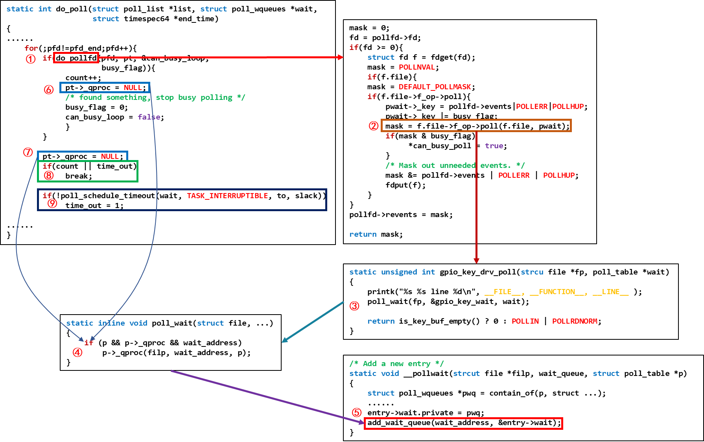

图 19.7 do\_poll机制

① 从这里开始，将会导致驱动程序的poll函数被第一次调用。

沿着②③④⑤，你可以看到：驱动程序里的poll\_wait会调用\_\_pollwait函数把线程放入某个队列。

当执行完①之后，在⑥或⑦处，pt-&gt;\_qproc被设置为NULL，所以第二次调用驱动程序的poll时，不会再次把线程放入某个队列里。

⑧ 如果驱动程序的poll返回有效值，则count非0，跳出循环；

⑨ 否则休眠一段时间；当休眠时间到，或是被中断唤醒时，会再次循环、再次调用驱动程序的poll。

回顾APP的代码，APP可以指定“想等待某些事件”，poll函数返回后，可以知道“发生了哪些事件”：

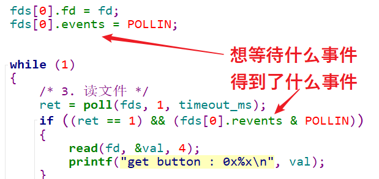

图 19.8 POLL机制的APP核心代码

驱动程序里怎么体现呢？在上上一个图中，看②位置处，细说如下：

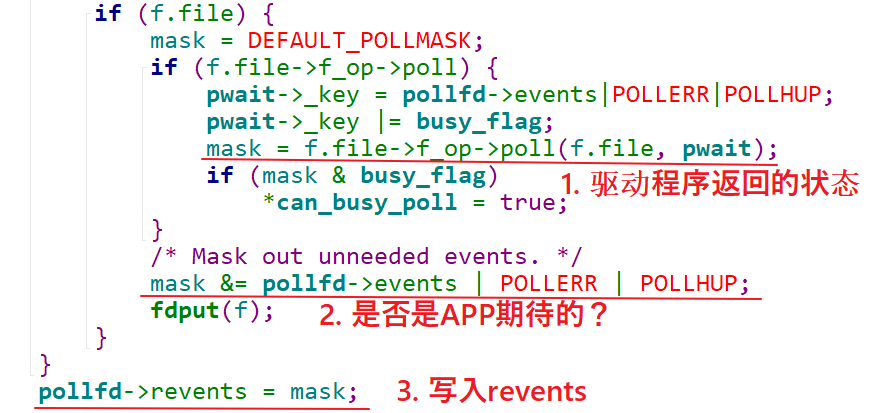

图 19.9 POLL机制的内核核心代码

<a id="_Toc197788759"></a>
## 19.3 异步通知

使用GIT命令载后，本节源码位于这个目录下：

01\_all\_series\_quickstart\\

05\_嵌入式Linux驱动开发基础知识\\

source\\06\_gpio\_irq\\05\_read\_key\_irq\_poll\_fasync

### 19.3.1 适用场景

在前面引入中断时，我们曾经举过一个例子：


妈妈怎么知道卧室里小孩醒了？

-   异步通知：妈妈在客厅干活，小孩醒了他会自己走出房门告诉妈妈
    -   妈妈、小孩互不耽误。

使用休眠-唤醒、POLL机制时，都需要休眠等待某个事件发生时，它们的差别在于后者可以指定休眠的时长。

在现实生活中：妈妈可以不陪小孩睡觉，小孩醒了之后可以主动通知妈妈。

如果APP不想休眠怎么办？也有类似的方法：驱动程序有数据时主动通知APP，APP收到信号后执行信息处理函数。

什么叫“异步通知”？

-   你去买奶茶：
    -   你在旁边等着，眼睛盯着店员，生怕别人插队，他一做好你就知道：你是主动等待他做好，这叫“同步”。
    -   你付钱后就去玩手机了，店员做好后他会打电话告诉你：你是被动获得结果，这叫“异步”。

### 19.3.2 使用流程

驱动程序怎么通知APP：发信号，这只有3个字，却可以引发很多问题：

1.  谁发：驱动程序发
2.  发什么：信号
3.  发什么信号：SIGIO
4.  怎么发：内核里提供有函数
5.  发给谁：APP，APP要把自己告诉驱动
6.  APP收到后做什么：执行信号处理函数
7.  信号处理函数和信号，之间怎么挂钩：APP注册信号处理函数

小孩通知妈妈的事情有很多：饿了、渴了、想找人玩。

Linux系统中也有很多信号，在Linux内核源文件include\\uapi\\asm-generic\\signal.h中，有很多信号的宏定义：

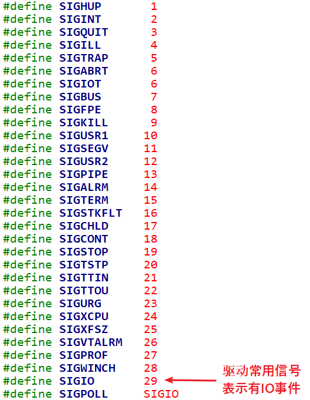

就APP而言，你想处理SIGIO信息，那么需要提供信号处理函数，并且要跟SIGIO挂钩。这可以通过一个signal函数来“给某个信号注册处理函数”，用法如下：


APP还要做什么事？想想这几个问题：

-   1.  内核里有那么多驱动，你想让哪一个驱动给你发SIGIO信号？

APP要打开驱动程序的设备节点。

-   1.  驱动程序怎么知道要发信号给你而不是别人？

APP要把自己的进程ID告诉驱动程序。

-   1.  APP有时候想收到信号，有时候又不想收到信号：

应该可以把APP的意愿告诉驱动。

驱动程序要做什么？发信号。

1.  APP设置进程ID时，驱动程序要记录下进程ID；
2.  APP还要使能驱动程序的异步通知功能，驱动中有对应的函数：

APP打开驱动程序时，内核会创建对应的file结构体，file中有f\_flags；

f\_flags中有一个FASYNC位，它被设置为1时表示使能异步通知功能。

当f\_flags中的FASYNC位发生变化时，驱动程序的fasync函数被调用。

-   1.  发生中断时，有数据时，驱动程序调用内核辅助函数发信号。

这个辅助函数名为kill\_fasync。完美！

APP收到信号后，是怎么执行信号处理函数的？这个，很难，有兴趣的话就看本节最后的文档。初学者没必要看。

综上所述，使用异步通知，也就是使用信号的流程如下图所示：

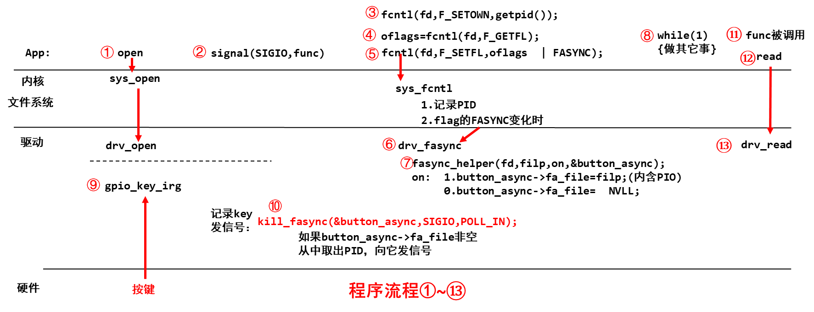

图 19.10 异步通知的信号流程

重点从②开始：

② APP给SIGIO这个信号注册信号处理函数func，以后APP收到SIGIO信号时，这个函数会被自动调用；

③ 把APP的PID(进程ID)告诉驱动程序，这个调用不涉及驱动程序，在内核的文件系统层次记录PID；

④ 读取驱动程序文件Flag；

⑤ 设置Flag里面的FASYNC位为1：当FASYNC位发生变化时，会导致驱动程序的fasync被调用；

⑥⑦ 调用faync\_helper，它会根据FAYSNC的值决定是否设置button\_async-&gt;fa\_file=驱动文件filp：

驱动文件filp结构体里面含有之前设置的PID。

⑧ APP可以做其他事；

⑨⑩ 按下按键，发生中断，驱动程序的中断服务程序被调用，里面调用kill\_fasync发信号；

⑪⑫⑬ APP收到信号后，它的信号处理函数被自动调用，可以在里面调用read函数读取按键。

### 19.3.3 驱动编程

使用异步通知时，驱动程序的核心有2：

① 提供对应的drv\_fasync函数；

② 并在合适的时机发信号。

drv\_fasync函数很简单，调用fasync\_helper函数就可以，如下：

```
static struct fasync_struct *button_async;
static int drv_fasync (int fd, struct file *filp, int on)
{
	return fasync_helper (fd, filp, on, &button_async);
}
```

fasync\_helper函数会分配、构造一个fasync\_struct结构体button\_async：

-   驱动文件的flag被设置为FAYNC时：

```
button_async->fa_file = filp;  // filp表示驱动程序文件，里面含有之前设置的PID
```

-   驱动文件被设置为非FASYNC时：

```
button_async->fa_file = NULL;
```

以后想发送信号时，使用button\_async作为参数就可以，它里面“可能”含有PID。

什么时候发信号呢？在本例中，在GPIO中断服务程序中发信号。

怎么发信号呢？代码如下：

```
kill_fasync (&button_async, SIGIO, POLL_IN);
```

1.  第1个参数：button\_async-&gt;fa\_file非空时，可以从中得到PID，表示发给哪一个APP；
2.  第2个参数表示发什么信号：SIGIO；
3.  第3个参数表示为什么发信号：POLL\_IN，有数据可以读了。(APP用不到这个参数)

### 19.3.4 应用编程

应用程序要做的事情有这几件：

1.  编写信号处理函数：

```
static void sig_func(int sig)
{
	int val;
	read(fd, &val, 4);
	printf("get button : 0x%x\n", val);
}
```

1.  注册信号处理函数：

```
signal(SIGIO, sig_func);
```

1.  打开驱动：

```
fd = open(argv[1], O_RDWR);
```

1.  把进程ID告诉驱动：

```
fcntl(fd, F_SETOWN, getpid());
```

1.  使能驱动的FASYNC功能：

```
flags = fcntl(fd, F_GETFL);
fcntl(fd, F_SETFL, flags | FASYNC);
```

### 19.3.5 现场编程

驱动程序、应用程序的核心都在上面的章节列了出来，怎么写程序？观看视频体验更佳，更能抓住重点。

### 19.3.6 上机实验

使用GIT命令载后，本节源码位于这个目录下：

01\_all\_series\_quickstart\\

05\_嵌入式Linux驱动开发基础知识\\

source\\06\_gpio\_irq\\05\_read\_key\_irq\_poll\_fasync

首先，把“05\_read\_key\_irq\_poll\_fasync”整个目录上传单Ubuntu中，修改里面的Makefile指定内核路径，如下修改：

```
KERN_DIR =  /home/book/100ask_imx6ull-sdk/Linux-4.9.88
```

然后执行“make”命令，生成驱动程序“gpio\_key\_drv.ko”、应用程序“button\_test”。

接着，还需要修改设备树，参照下图修改Ubuntu中的设备树文件“Linux-4.9.88/arch/arm/boot/dts/100ask\_imx6ull-14x14.dts”：

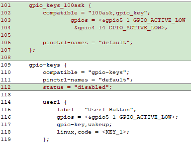

图 19.11 异步通知机制实验的设备树

修改完设备树后，在内核目录下载执行“make dtbs”生产新的设备树文件“arch/arm/boot/dts/100ask\_imx6ull-14x14.dtb”，把它放到开发板的“/boot”目录下，重启开发板。

最后，把Ubuntu上的驱动程序、测试程序下载到开发板/root目录，，执行如下命令测试：

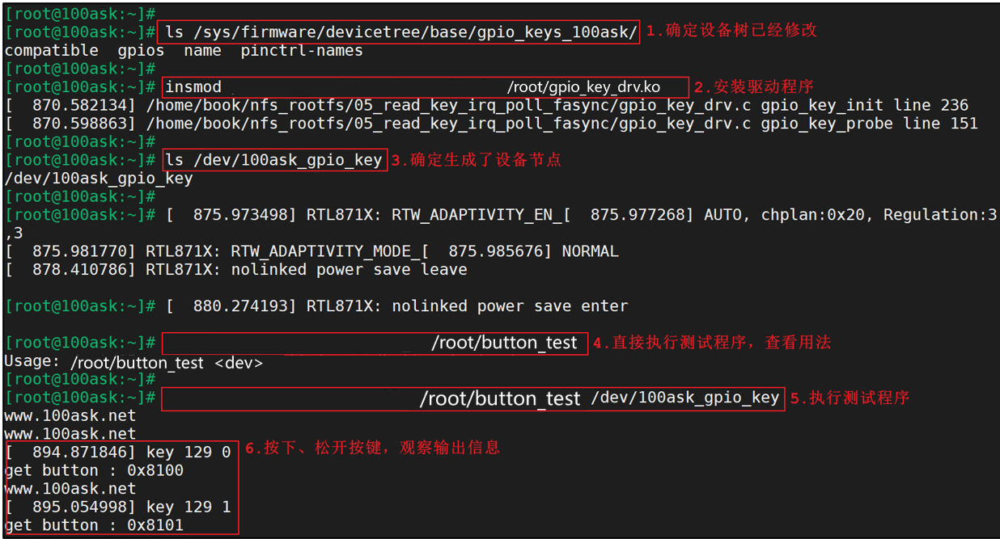

图 19.12 异步通知机制上机实验

### 19.3.7 异步通知机制内核代码详解

异步通知的本质是“发信号”，涉及2个对象：发送者、接收者。发送者可以是驱动程序，可以是进程；接收者必定是进程。驱动程序要想给进程发送信号，有2个问题需要解决：

① 使能驱动程序的“异步”功能，即：允许它发出信号

② 告诉驱动程序，发信号时，发给“谁”

应用编程时，需要执行如下操作：

-   打开驱动：

```
fd = open(“/dev/xxx”, O_RDWR);
```

-   把进程ID告诉驱动：

```
fcntl(fd, F_SETOWN, getpid());
```

-   使能驱动的FASYNC功能：

```
flags = fcntl(fd, F_GETFL);
fcntl(fd, F_SETFL, flags | FASYNC);
```

对于F\_SETOWN、F\_GETFL、F\_SETFL，内核或驱动程序如何处理？

APP执行fcntl系统调用时，会导致内核“fs/fcntl.c”的如下函数被调用：

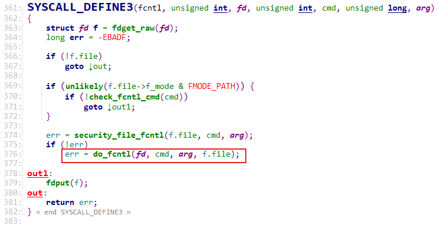

图 19.13 异步通知机制系统调用接口

在“do\_fcntl”函数中，对于“F\_SETOWN”，一路查看代码，发现最终如下设置：

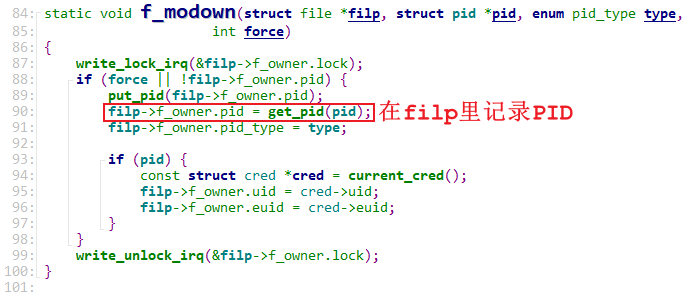

图 19.14 异步通知机制F\_SETOWN内部实现

在“do\_fcntl”函数中，对于“F\_GETFL”，仅仅是返回“filp-&gt;f\_flags”；对于“F\_SETFL”，会调用“setfl”函数进一步处理。代码如下：

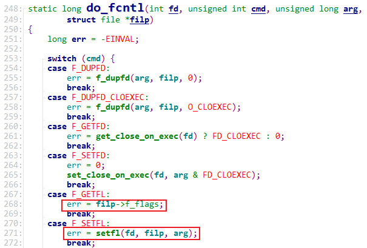

图 19.15 异步通知机制F\_GETFL/F\_SETFL内部实现

“setfl”函数会比较“filp-&gt;f\_flags”中的“FASYNC”位，发现它发生了变化时，就会调用驱动程序的faysnc函数：

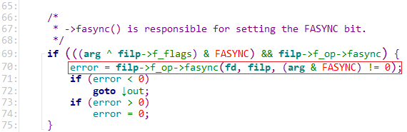

图 19.16 异步通知机制F\_SETFL内部实现

驱动程序的faysnc函数代码如下：

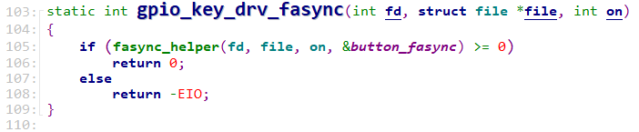

图 19.17 驱动程序中的异步通知代码

它使用fasync\_helper函数来设置指针button\_fasync，简化后的示例代码如下：

```
if (on)
{
    struct fasync_struct *new;
    new = fasync_alloc();
    new->magic = FASYNC_MAGIC;
    new->fa_file = filp;
    new->fa_fd = fd;
    button_fasync = new;
}
else
{
    kfree(button_fasync);
    button_fasync = NULL;
}
```

所以，启动了FASYNC功能的话，驱动程序的button\_fasync就被设置了，它指向的fasync\_struct结构体里含有filp，filp里含有PID(接收方的PID)。

在驱动程序的中断函数里，使用如下代码发出中断：

```
kill_fasync(&button_fasync, SIGIO, POLL_IN);
```

它的核心就是从button\_fasync指针中，取出fasync\_struct结构体，从这个结构体的fa\_file中得到接收方的PID，然后使用“send\_sigio”函数发送信号。

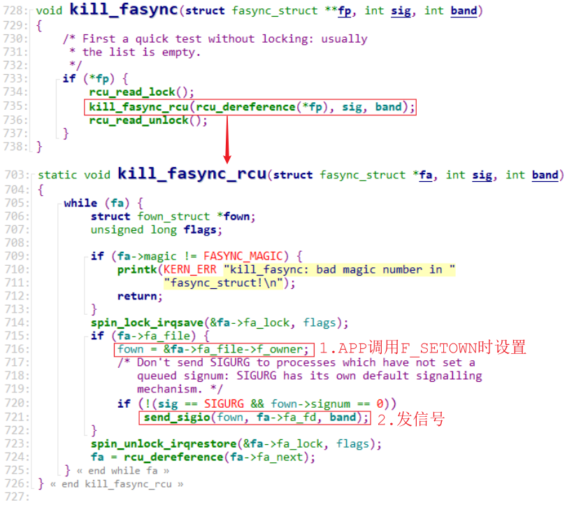

图 19.18 驱动程序中的发信号的过程

“send\_sigio”函数的实质是：根据PID找到进程在内核的task\_struct结构体，修改里面的某些成员表示收到了信号。

APP收到信号后，它的信号处理函数时如何被调用的呢？信号相当于APP的中断，处理过程也跟中断的处理过程类似：保存现场、处理信号，恢复现场。

APP进入内核态时，内核在APP的栈里保存“APP的运行环境”：APP在用户态进入内核态瞬间各个寄存器的值，包括“运行地址”(即恢复运行时从哪里继续运行)。

APP退出内核态时，内核会从APP的栈里恢复“APP的运行环境”，比如APP将从之前保存的“运行地址”继续运行。

APP收到信号瞬间，APP必定处于内核态，因为信号的发送函数“send\_sigio”要么由驱动程序调用，要么由APP通过系统调用来间接调用，函数“send\_sigio”处于内核态。APP从内核态返回到用户态前，内核发现APP有信号在等待处理时，会修改APP的栈，增加一个新的“运行环境”：新环境里“运行地址”是信号处理函数的地址。这样，APP从内核态返回用户态时，运行的是信号处理函数。信号处理函数执行完后，会再次返回到内核态，在内核态里再使用旧的“运行环境”恢复APP的运行。

<a id="_Toc197788760"></a>
## 19.4 阻塞与非阻塞

所谓阻塞，就是等待某件事情发生。比如调用read读取按键时，如果没有按键数据则read函数不会返回，它会让线程休眠等待。

使用poll时，如果传入的超时时间不为0，这种访问方法也是阻塞的。

使用poll时，可以设置超时时间为0，这样即使没有数据它也会立刻返回，这就是非阻塞方式。能不能让read函数既能工作于阻塞方式，也可以工作于非阻塞方式？**可以**！

APP调用open函数时，传入O\_NONBLOCK，就表示要使用非阻塞方式；默认是阻塞方式。

**注意**：对于普通文件、块设备文件，O\_NONBLOCK不起作用。

**注意**：对于字符设备文件，O\_NONBLOCK起作用的前提是驱动程序针对O\_NONBLOCK做了处理。

只能在open时表明O\_NONBLOCK吗？在open之后，也可以通过fcntl修改为阻塞或非阻塞。

使用GIT命令载后，本节源码位于这个目录下：

01\_all\_series\_quickstart\\

05\_嵌入式Linux驱动开发基础知识\\

source\\06\_gpio\_irq\\06\_read\_key\_irq\_poll\_fasync\_block

### 19.4.1 应用编程

-   open时设置：

```
int  fd = open(“/dev/xxx”, O_RDWR | O_NONBLOCK);  /* 非阻塞方式 */
int  fd = open(“/dev/xxx”, O_RDWR );  /* 阻塞方式 */
```

-   open之后设置：

```
int	flags = fcntl(fd, F_GETFL);
fcntl(fd, F_SETFL, flags | O_NONBLOCK);  /* 非阻塞方式 */
fcntl(fd, F_SETFL, flags & ~O_NONBLOCK);  /* 阻塞方式 */
```

### 19.4.2 驱动编程

-   以drv\_read为例：

```
static ssize_t drv_read(struct file *fp, char __user *buf, size_t count, loff_t *ppos)
｛
if (queue_empty(&as->queue) && fp->f_flags & O_NONBLOCK)
		return -EAGAIN;
	wait_event_interruptible(apm_waitqueue, !queue_empty(&as->queue));
    ……
｝
```

从驱动代码也可以看出来，当APP打开某个驱动时，在内核中会有一个struct file结构体对应这个驱动，这个结构体中有f\_flags，就是打开文件时的标记位；可以设置f\_flasgs的O\_NONBLOCK位，表示非阻塞；也可以清除这个位表示阻塞。

驱动程序要根据这个标记位决定事件未就绪时是休眠和还是立刻返回。

### 19.4.3 驱动开发原则

驱动程序程序“只提供功能，不提供策略”。就是说驱动程序可以提供休眠唤醒、查询等等各种方式，，驱动程序只提供这些能力，怎么用由APP决定。

<a id="_Toc197788761"></a>
## 19.5 定时器

使用GIT命令载后，本节源码位于这个目录下：

01\_all\_series\_quickstart\\

05\_嵌入式Linux驱动开发基础知识\\

source\\06\_gpio\_irq\\07\_read\_key\_irq\_poll\_fasync\_block\_timer

### 19.5.1 内核函数

所谓定时器，就是闹钟，时间到后你就要做某些事。有2个要素：时间、做事，换成程序员的话就是：超时时间、函数。

在内核中使用定时器很简单，涉及这些函数(参考内核源码include\\linux\\timer.h)：

-   setup\_timer(timer, fn, data)：
    -   设置定时器，主要是初始化timer\_list结构体，设置其中的函数、参数。
-   void add\_timer(struct timer\_list \*timer)：
    -   向内核添加定时器。timer-&gt;expires表示超时时间。
    -   当超时时间到达，内核就会调用这个函数：timer-&gt;function(timer-&gt;data)。
-   int mod\_timer(struct timer\_list \*timer, unsigned long expires):
    -   修改定时器的超时时间，
    -   它等同于：del\_timer(timer); timer-&gt;expires = expires; add\_timer(timer);
    -   但是更加高效。
-   int del\_timer(struct timer\_list \*timer)：
    -   删除定时器。

### 19.5.2 定时器时间单位

编译内核时，可以在内核源码根目录下用“ls -a”看到一个隐藏文件，它就是内核配置文件。打开后可以看到如下这项：

```
CONFIG_HZ=100
```

这表示内核每秒中会发生100次系统滴答中断(tick)，这就像人类的心跳一样，这是Linux系统的心跳。每发生一次tick中断，全局变量jiffies就会累加1。

CONFIG\_HZ=100表示每个滴答是10ms。

定时器的时间就是基于jiffies的，我们修改超时时间时，一般使用这2种方法：

1.  在add\_timer之前，直接修改：

```
timer.expires = jiffies + xxx;   // xxx表示多少个滴答后超时，也就是xxx*10ms
timer.expires = jiffies + 2*HZ;  // HZ等于CONFIG_HZ，2*HZ就相当于2秒
```

1.  在add\_timer之后，使用mod\_timer修改：

```
mod_timer(&timer, jiffies + xxx);   // xxx表示多少个滴答后超时，也就是xxx*10ms
mod_timer(&timer, jiffies + 2*HZ);  // HZ等于CONFIG_HZ，2*HZ就相当于2秒
```

### 19.5.3 使用定时器处理按键抖动

在实际的按键操作中，可能会有机械抖动：

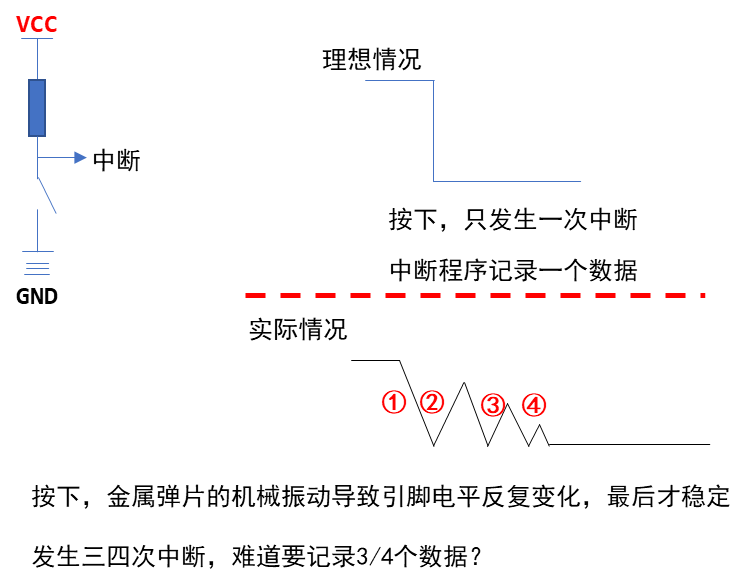

图 19.19 按键震动

按下或松开一个按键，它的GPIO电平会反复变化，最后才稳定。一般是几十毫秒才会稳定。

如果不处理抖动的话，用户只操作一次按键，中断程序可能会上报多个数据。怎么处理？

-   -   在按键中断程序中，可以循环判断几十亳秒，发现电平稳定之后再上报
    -   使用定时器

显然第1种方法太耗时，违背“中断要尽快处理”的原则，你的系统会很卡。怎么使用定时器？看下图：


图 19.20 震动触发定时器

核心在于：在GPIO中断中并不立刻记录按键值，而是修改定时器超时时间，10ms后再处理。

-   -   如果10ms内又发生了GPIO中断，那就认为是抖动，这时再次修改超时时间为10ms。
    -   只有10ms之内再无GPIO中断发生，那么定时器的函数才会被调用。在定时器函数中记录按键值。

### 19.5.4 现场编程

驱动程序、应用程序的核心都在上面的章节列了出来，怎么写程序？观看视频体验更佳，更能抓住重点。

### 19.5.5 深入研究：定时器的内部机制

初学者会用定时器就行，本节不用看。

怎么实现定时器，逻辑上很简单：每发生一次硬件中断时，硬件中断处理完后就会看看有没有软件中断要处理。

定时器就是通过软件中断来实现的，它属于TIMER\_SOFTIRQ软中断。

对于TIMER\_SOFTIRQ软中断，初始化代码如下：

```
void __init init_timers(void)
{
	init_timer_cpus();
	init_timer_stats();
	open_softirq(TIMER_SOFTIRQ, run_timer_softirq);
}
```

当发生硬件中断时，硬件中断处理完后，内核会调用软件中断的处理函数。对于TIMER\_SOFTIRQ，会调用run\_timer\_softirq，它的函数如下：

```
run_timer_softirq
__run_timers(base);
    while (time_after_eq(jiffies, base->clk)) {
        ……
expire_timers(base, heads + levels);
    fn = timer->function;
    data = timer->data;
    call_timer_fn(timer, fn, data);
        fn(data);
```

简单地说，add\_timer函数会把timer放入内核里某个链表；

在TIMER\_SOFTIRQ的处理函数中，会从链表中把这些超时的timer取出来，执行其中的函数。

怎么判断是否超时？jiffies大于或等于timer-&gt;expires时，timer就超时。

内核中有很多timer，如果高效地找到超时的timer？这是比较复杂的，可以看看这文章：

[https://blog.csdn.net/tianmohust/article/details/8707162](https://blog.csdn.net/tianmohust/article/details/8707162)

我们以后如果要深入讲解timer的话，会用视频来讲解。

### 19.5.6 深入研究：找到系统滴答

在开发板执行以下命令，可以看到CPU0下有一个数值变化特别快，它就是滴答中断：

```
# cat /proc/interrupts
           CPU0
 16:       2532       GPC  55 Level     i.MX Timer Tick
 19:         22       GPC  33 Level     2010000.ecspi
 20:        384       GPC  26 Level     2020000.serial
 21:          0       GPC  98 Level     sai
```

-   以100ASK\_IMX6ULL为做，滴答中断名字就是“i.MX Timer Tick”。在Linux内核源码目录下执行以下命令：

```
$ grep "i.MX Timer Tick" * -nr
drivers/clocksource/timer-imx-gpt.c:319:        act->name = "i.MX Timer Tick";
```

-   打开timer-imx-gpt.c 319行左右，可得如下源码：

```
act->name = "i.MX Timer Tick";
act->flags = IRQF_TIMER | IRQF_IRQPOLL;
act->handler = mxc_timer_interrupt;
act->dev_id = ced;
return setup_irq(imxtm->irq, act);
```

-   mxc\_timer\_interrupt应该就是滴答中断的处理函数，代码如下：

```
static irqreturn_t mxc_timer_interrupt(int irq, void *dev_id)
{
	struct clock_event_device *ced = dev_id;
	struct imx_timer *imxtm = to_imx_timer(ced);
	uint32_t tstat;
	tstat = readl_relaxed(imxtm->base + imxtm->gpt->reg_tstat);
	imxtm->gpt->gpt_irq_acknowledge(imxtm);
	ced->event_handler(ced);
	return IRQ_HANDLED;
}
```

在上述代码中没看到对jiffies的累加操作啊，应该是在ced-&gt;event\_handler(ced)中进行。

ced-&gt;event\_handler(ced)是哪一个函数？不太好找，我使用QEMU来调试内核，在mxc\_timer\_interrupt中打断点跟踪代码(以后的课程会讲怎么用QEMU调试内核)，发现它对应tick\_handle\_periodic。

tick\_handle\_periodic位于kernel\\time\\tick-common.c中，它里面的调用关系如下：

```
tick_handle_periodic
tick_periodic(cpu);
    do_timer(1);
        jiffies_64 += ticks;  // jiffies就是jiffies_64
```

你为何说jiffies就是jiffies\_64？在arch\\arm\\kernel\\vmlinux.lds.S有如下代码：

```
#ifndef __ARMEB__
jiffies = jiffies_64;
#else
jiffies = jiffies_64 + 4;
#endif
```

上述代码说明了，对于大字节序的CPU，jiffies指向jiffies\_64的高4字节；对于小字节序的CPU，jiffies指向jiffies\_64的低4字节。

对jiffies\_64的累加操作，就是对jiffies的累加操作。

<a id="_Toc197788762"></a>
## 19.6 中断下半部tasklet

使用GIT命令载后，本节源码位于这个目录下：

01\_all\_series\_quickstart\\

05\_嵌入式Linux驱动开发基础知识\\

source\\06\_gpio\_irq\\08\_read\_key\_irq\_poll\_fasync\_block\_timer\_tasklet

在前面我们介绍过中断上半部、下半部。中断的处理有几个原则：

-   不能嵌套；
-   越快越好。

在处理当前中断时，即使发生了其他中断，其他中断也不会得到处理，所以中断的处理要越快越好。但是某些中断要做的事情稍微耗时，这时可以把中断拆分为上半部、下半部。

在上半部处理紧急的事情，在上半部的处理过程中，中断是被禁止的；

在下半部处理耗时的事情，在下半部的处理过程中，中断是使能的。


### 19.6.1 内核函数

-   -   -   -   1.  定义tasklet

中断下半部使用结构体tasklet\_struct来表示，它在内核源码include\\linux\\interrupt.h中定义：

```
struct tasklet_struct
{
	struct tasklet_struct *next;
	unsigned long state;
	atomic_t count;
	void (*func)(unsigned long);
	unsigned long data;
};
```

-   其中的state有2位：
    -   bit0表示TASKLET\_STATE\_SCHED

等于1时表示已经执行了tasklet\_schedule把该tasklet放入队列了；tasklet\_schedule会判断该位，如果已经等于1那么它就不会再次把tasklet放入队列。

-   -   bit1表示TASKLET\_STATE\_RUN

等于1时，表示正在运行tasklet中的func函数；函数执行完后内核会把该位清0。

-   其中的count表示该tasklet是否使能：等于0表示使能了，非0表示被禁止了。对于count非0的tasklet，里面的func函数不会被执行。

使用中断下半部之前，要先实现一个tasklet\_struct结构体，这可以用这2个宏来定义结构体：

```
#define DECLARE_TASKLET(name, func, data) \
struct tasklet_struct name = { NULL, 0, ATOMIC_INIT(0), func, data }
#define DECLARE_TASKLET_DISABLED(name, func, data) \
struct tasklet_struct name = { NULL, 0, ATOMIC_INIT(1), func, data }
```

-   -   使用DECLARE\_TASKLET定义的tasklet结构体，它是使能的；
    -   使用DECLARE\_TASKLET\_DISABLED定义的tasklet结构体，它是禁止的；使用之前要先调用tasklet\_enable使能它。

也可以使用函数来初始化tasklet结构体：

```
extern void tasklet_init(struct tasklet_struct *t,
			 void (*func)(unsigned long), unsigned long data);
```

-   -   -   -   1.  使能/禁止tasklet

```
static inline void tasklet_enable(struct tasklet_struct *t);
static inline void tasklet_disable(struct tasklet_struct *t);
```

-   -   tasklet\_enable把count减1；
    -   tasklet\_disable把count增1。
        -   -   1.  调度tasklet

```
static inline void tasklet_schedule(struct tasklet_struct *t);
```

-   -   把tasklet放入链表，并且设置它的TASKLET\_STATE\_SCHED状态为1。
        -   -   1.  kill tasklet

```
extern void tasklet_kill(struct tasklet_struct *t);
```

-   -   如果一个tasklet未被调度，tasklet\_kill会把它的TASKLET\_STATE\_SCHED状态清0；
    -   如果一个tasklet已被调度，tasklet\_kill会等待它执行完华，再把它的TASKLET\_STATE\_SCHED状态清0。

通常在卸载驱动程序时调用tasklet\_kill。

### 19.6.2 tasklet使用方法

先定义tasklet，需要使用时调用tasklet\_schedule，驱动卸载前调用tasklet\_kill。

tasklet\_schedule只是把tasklet放入内核队列，它的func函数会在软件中断的执行过程中被调用。

### 19.6.3 tasklet内部机制

tasklet属于TASKLET\_SOFTIRQ软件中断，入口函数为tasklet\_action，这在内核kernel\\softirq.c中设置：

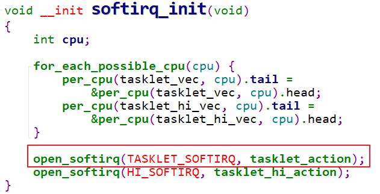

图 19.21 softirq.c

当驱动程序调用tasklet\_schedule时，会设置tasklet的state为TASKLET\_STATE\_SCHED，并把它放入某个链表：

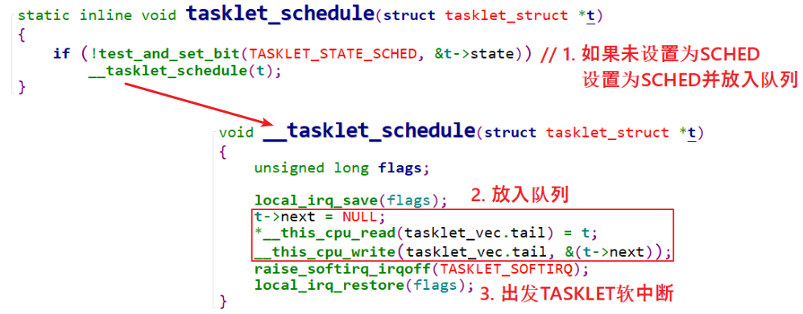

图 19.22 放入队列

当发生硬件中断时，内核处理完硬件中断后，会处理软件中断。对于TASKLET\_SOFTIRQ软件中断，会调用tasklet\_action函数。

执行过程还是挺简单的：从队列中找到tasklet，进行状态判断后执行func函数，从队列中删除tasklet。

从这里可以看出：

1.  tasklet\_schedule调度tasklet时，其中的函数并不会立刻执行，而只是把tasklet放入队列；
2.  调用一次tasklet\_schedule，只会导致tasklnet的函数被执行一次；
3.  如果tasklet的函数尚未执行，多次调用tasklet\_schedule也是无效的，只会放入队列一次。

tasklet\_action函数解析如下：

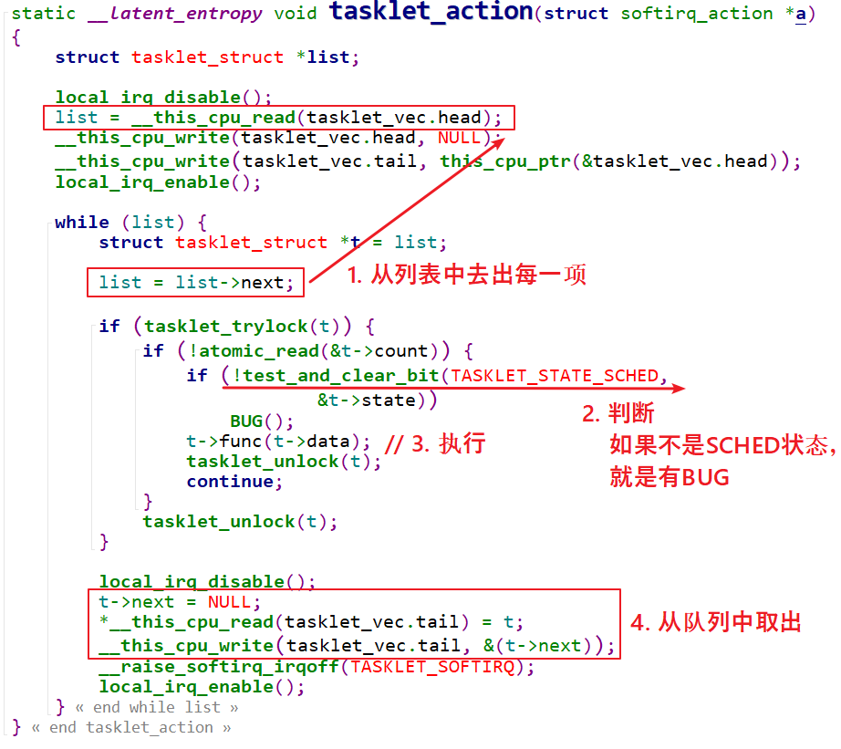

图 19.23 tasklet\_action

<a id="_Toc197788763"></a>
## 19.7 工作队列

使用GIT命令载后，本节源码位于这个目录下：

01\_all\_series\_quickstart\\

05\_嵌入式Linux驱动开发基础知识\\

source\\06\_gpio\_irq\\09\_read\_key\_irq\_poll\_fasync\_block\_timer\_tasklet\_workqueue

前面讲的定时器、下半部tasklet，它们都是在中断上下文中执行，它们无法休眠。当要处理更复杂的事情时，往往更耗时。这些更耗时的工作放在定时器或是下半部中，会使得系统很卡；并且循环等待某件事情完成也太浪费CPU资源了。

如果使用线程来处理这些耗时的工作，那就可以解决系统卡顿的问题：因为线程可以休眠。

在内核中，我们并不需要自己去创建线程，可以使用“工作队列”(workqueue)。内核初始化工作队列是，就为它创建了内核线程。以后我们要使用“工作队列”，只需要把“工作”放入“工作队列中”，对应的内核线程就会取出“工作”，执行里面的函数。

在2.xx的内核中，工作队列的内部机制比较简单；在现在4.x的内核中，工作队列的内部机制做得复杂无比，但是用法是一样的。

工作队列的应用场合：要做的事情比较耗时，甚至可能需要休眠，那么可以使用工作队列。

缺点：多个工作(函数)是在某个内核线程中依序执行的，前面函数执行很慢，就会影响到后面的函数。

在多CPU的系统下，一个工作队列可以有多个内核线程，可以在一定程度上缓解这个问题。

我们先使用看看怎么使用工作队列。

### 19.7.1 内核函数

内核线程、工作队列(workqueue)都由内核创建了，我们只是使用。使用的核心是一个work\_struct结构体，定义如下：

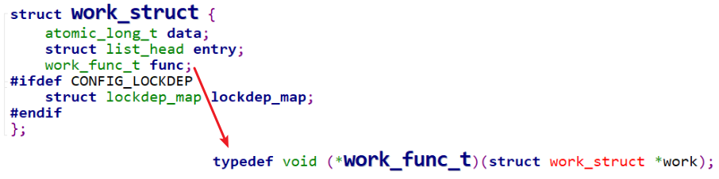

图 19.24 work\_struct

使用工作队列时，步骤如下：

1.  构造一个work\_struct结构体，里面有函数；
2.  把这个work\_struct结构体放入工作队列，内核线程就会运行work中的函数。
    -   -   -   1.  定义work

参考内核头文件：include\\linux\\workqueue.h

```
#define DECLARE_WORK(n, f)						\
	struct work_struct n = __WORK_INITIALIZER(n, f)
#define DECLARE_DELAYED_WORK(n, f)					\
	struct delayed_work n = __DELAYED_WORK_INITIALIZER(n, f, 0)
```

-   第1个宏是用来定义一个work\_struct结构体，要指定它的函数。
-   第2个宏用来定义一个delayed\_work结构体，也要指定它的函数。所以“delayed”，意思就是说要让它运行时，可以指定：某段时间之后你再执行。

如果要在代码中初始化work\_struct结构体，可以使用下面的宏：

```
#define INIT_WORK(_work, _func)
```

-   -   -   -   1.  使用work：schedule\_work

调用schedule\_work时，就会把work\_struct结构体放入队列中，并唤醒对应的内核线程。内核线程就会从队列里把work\_struct结构体取出来，执行里面的函数。

-   -   -   -   1.  其他函数

表 19‑2 workqueue其它函数


| 序号 | 函数 | 说明 |
| --- | --- | --- |
| 1 | create_workqueue | 在Linux系统中已经有了现成的system_wq等工作队列，<br />你当然也可以自己调用create_workqueue创建工作队列，<br />对于SMP系统，这个工作队列会有多个内核线程与它对应，<br />创建工作队列时，内核会帮这个工作队列创建多个内核线程 |
| 2 | create_singlethread_workqueue | 如果想只有一个内核线程与工作队列对应，<br />可以用本函数创建工作队列，<br />创建工作队列时，内核会帮这个工作队列创建一个内核线程 |
| 3 | destroy_workqueue | 销毁工作队列 |
| 4 | schedule_work | 调度执行一个具体的work，<br />执行的work将会被挂入Linux系统提供的工作队列 |
| 5 | schedule_delayed_work | 延迟一定时间去执行一个具体的任务，<br />功能与schedule_work类似，多了一个延迟时间 |
| 6 | queue_work | 跟schedule_work类似，<br />schedule_work是在系统默认的工作队列上执行一个work，<br />queue_work需要自己指定工作队列 |
| 7 | queue_delayed_work | 跟schedule_delayed_work类似，<br />schedule_delayed_work是在系统默认的工作队列上执行一个work，<br />queue_delayed_work需要自己指定工作队列 |
| 8 | flush_work | 等待一个work执行完毕，<br />如果这个work已经被放入队列，那么本函数等它执行完毕，并且返回true；<br />如果这个work已经执行完华才调用本函数，那么直接返回false |
| 9 | flush_delayed_work | 等待一个delayed_work执行完毕，<br />如果这个delayed_work已经被放入队列，那么本函数等它执行完毕，并且返回true；<br />如果这个delayed_work已经执行完华才调用本函数，那么直接返回false |


### 19.7.2 编程、上机

驱动程序、应用程序的核心都在上面的章节列了出来，怎么写程序？观看视频体验更佳，更能抓住重点。

### 19.7.3 内部机制

初学者知道work\_struct中的函数是运行于内核线程的上下文，这就足够了。

在2.xx版本的Linux内核中，创建workqueue时就会同时创建内核线程；

在4.xx版本的Linux内核中，内核线程和workqueue是分开创建的，比较复杂。

-   -   -   -   1.  Linux 2.x的工作队列创建过程

代码在kernel\\workqueue.c中：

```
init_workqueues
keventd_wq = create_workqueue("events");
    __create_workqueue((name), 0, 0)
        for_each_possible_cpu(cpu) {
            err = create_workqueue_thread(cwq, cpu);
                p = kthread_create(worker_thread, cwq, fmt, wq->name, cpu);
```

对于每一个CPU，都创建一个名为“events/X”的内核线程，X从0开始。在创建workqueue的同时创建内核线程。

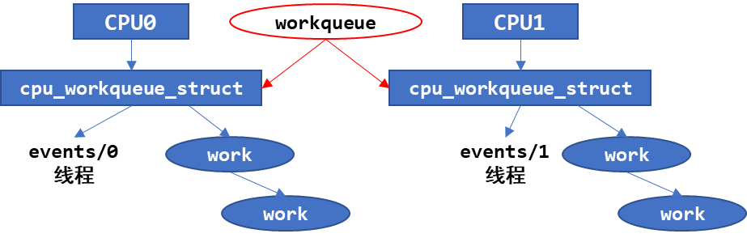

图 19.25 Linux 2.x的工作队列

-   -   -   -   1.  Linux 4.x的工作队列创建过程

Linux4.x中，内核线程和工作队列是分开创建的。先创建内核线程，代码在kernel\\workqueue.c中：

```
init_workqueues
/* initialize CPU pools */
for_each_possible_cpu(cpu) {
    for_each_cpu_worker_pool(pool, cpu) {
         /* 对每一个CPU都创建2个worker_pool结构体，它是含有ID的 */
         /*  一个worker_pool对应普通优先级的work，第2个对应高优先级的work */
}
/* create the initial worker */
for_each_online_cpu(cpu) {
    for_each_cpu_worker_pool(pool, cpu) {
        /* 对每一个CPU的每一个worker_pool，创建一个worker */
/* 每一个worker对应一个内核线程 */
        BUG_ON(!create_worker(pool));
    }
}
```

create\_worker函数代码如下：

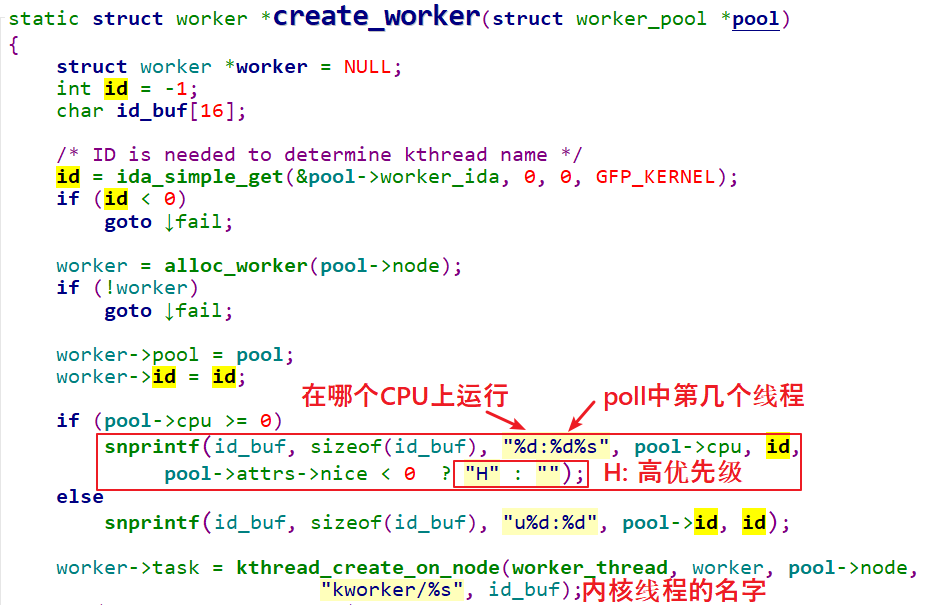

图 19.26 create\_worker函数

创建好内核线程后，再创建workqueue，代码在kernel\\workqueue.c中：

```
init_workqueues
system_wq = alloc_workqueue("events", 0, 0);
    __alloc_workqueue_key
        wq = kzalloc(sizeof(*wq) + tbl_size, GFP_KERNEL);  // 分配workqueue_struct
        alloc_and_link_pwqs(wq) // 跟worker_poll建立联系
```

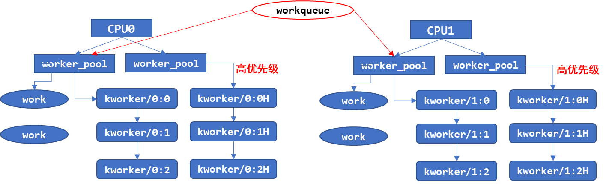

图 19.27 Linux 4.x的工作队列

一开始时，每一个worker\_poll下只有一个线程，但是系统会根据任务繁重程度动态创建、销毁内核线程。所以你可以在work中打印线程ID，发现它可能是变化的。

参考文章：

[https://zhuanlan.zhihu.com/p/91106844](https://zhuanlan.zhihu.com/p/91106844)

[https://www.cnblogs.com/vedic/p/11069249.html](https://www.cnblogs.com/vedic/p/11069249.html)

[https://www.cnblogs.com/zxc2man/p/4678075.html](https://www.cnblogs.com/zxc2man/p/4678075.html)

<a id="_Toc197788764"></a>
## 19.8 中断的线程化处理

使用GIT命令载后，本节源码位于这个目录下：

01\_all\_series\_quickstart\\

05\_嵌入式Linux驱动开发基础知识\\

source\\06\_gpio\_irq\\10\_read\_key\_irq\_poll\_fasync\_block\_timer\_tasklet\_workqueue\_threadedirq


复杂、耗时的事情，尽量使用内核线程来处理。上节视频介绍的工作队列用起来挺简单，但是它有一个缺点：工作队列中有多个work，前一个work没处理完会影响后面的work。解决方法有很多种，比如干脆自己创建一个内核线程，不跟别的work凑在一块了。在Linux系统中，对于存储设备比如SD/TF卡，它的驱动程序就是这样做的，它有自己的内核线程。

对于中断处理，还有另一种方法：threaded irq，线程化的中断处理。中断的处理仍然可以认为分为上半部、下半部。上半部用来处理紧急的事情，下半部用一个内核线程来处理，这个内核线程专用于这个中断。

内核提供了这个函数：


图 19.28 内核的中断线程

你可以只提供thread\_fn，系统会为这个函数创建一个内核线程。发生中断时，系统会立刻调用handler函数，然后唤醒某个内核线程，内核线程再来执行thread\_fn函数。

### 19.8.1 内核机制

-   -   -   -   1.  调用request\_threaded\_irq后内核的数据结构、

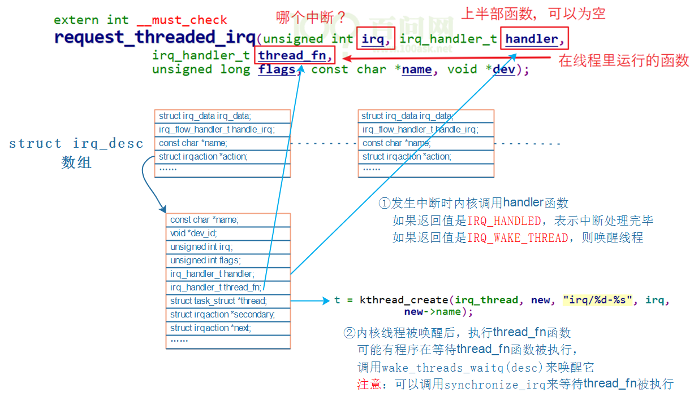

图 19.29 调用request\_threaded\_irq后

-   -   -   -   1.  request\_threaded\_irq

request\_threaded\_irq函数，肯定会创建一个内核线程。

源码在内核文件kernel\\irq\\manage.c中，

```
int request_threaded_irq(unsigned int irq, irq_handler_t handler,
			 irq_handler_t thread_fn, unsigned long irqflags,
			 const char *devname, void *dev_id)
{
    // 分配、设置一个irqaction结构体
	action = kzalloc(sizeof(struct irqaction), GFP_KERNEL);
	if (!action)
		return -ENOMEM;
	action->handler = handler;
	action->thread_fn = thread_fn;
	action->flags = irqflags;
	action->name = devname;
	action->dev_id = dev_id;
    retval = __setup_irq(irq, desc, action);  // 进一步处理
}
```

-   \_\_setup\_irq函数代码如下(只摘取重要部分)：

```
	if (new->thread_fn && !nested) {
		ret = setup_irq_thread(new, irq, false);
```

-   setup\_irq\_thread函数代码如下(只摘取重要部分)：

```
	if (!secondary) {
		t = kthread_create(irq_thread, new, "irq/%d-%s", irq,
				   new->name);
	} else {
		t = kthread_create(irq_thread, new, "irq/%d-s-%s", irq,
				   new->name);
		param.sched_priority -= 1;
	}
new->thread = t;
```

-   -   -   -   1.  中断的执行过程

对于GPIO中断，我使用QEMU的调试功能找出了所涉及的函数调用，其他板子可能稍有不同。

调用关系如下，反过来看：

```
Breakpoint 1, gpio_keys_gpio_isr (irq=200, dev_id=0x863e6930) at drivers/input/keyboard/gpio_keys.c:393
393	{
(gdb) bt
#0  gpio_keys_gpio_isr (irq=200, dev_id=0x863e6930) at drivers/input/keyboard/gpio_keys.c:393
#1  0x80270528 in __handle_irq_event_percpu (desc=0x8616e300, flags=0x86517edc) at kernel/irq/handle.c:145
#2  0x802705cc in handle_irq_event_percpu (desc=0x8616e300) at kernel/irq/handle.c:185
#3  0x80270640 in handle_irq_event (desc=0x8616e300) at kernel/irq/handle.c:202
#4  0x802738e8 in handle_level_irq (desc=0x8616e300) at kernel/irq/chip.c:518
#5  0x8026f7f8 in generic_handle_irq_desc (desc=<optimized out>) at ./include/linux/irqdesc.h:150
#6  generic_handle_irq (irq=<optimized out>) at kernel/irq/irqdesc.c:590
#7  0x805005e0 in mxc_gpio_irq_handler (port=0xc8, irq_stat=2252237104) at drivers/gpio/gpio-mxc.c:274
#8  0x805006fc in mx3_gpio_irq_handler (desc=<optimized out>) at drivers/gpio/gpio-mxc.c:291
#9  0x8026f7f8 in generic_handle_irq_desc (desc=<optimized out>) at ./include/linux/irqdesc.h:150
#10 generic_handle_irq (irq=<optimized out>) at kernel/irq/irqdesc.c:590
#11 0x8026fd0c in __handle_domain_irq (domain=0x86006000, hwirq=32, lookup=true, regs=0x86517fb0) at kernel/irq/irqdesc.c:627
#12 0x80201484 in handle_domain_irq (regs=<optimized out>, hwirq=<optimized out>, domain=<optimized out>) at ./include/linux/irqdesc.h:168
#13 gic_handle_irq (regs=0xc8) at drivers/irqchip/irq-gic.c:364
#14 0x8020b704 in __irq_usr () at arch/arm/kernel/entry-armv.S:464
```

我们只需要分析\_\_handle\_irq\_event\_percpu函数，它在kernel\\irq\\handle.c中：

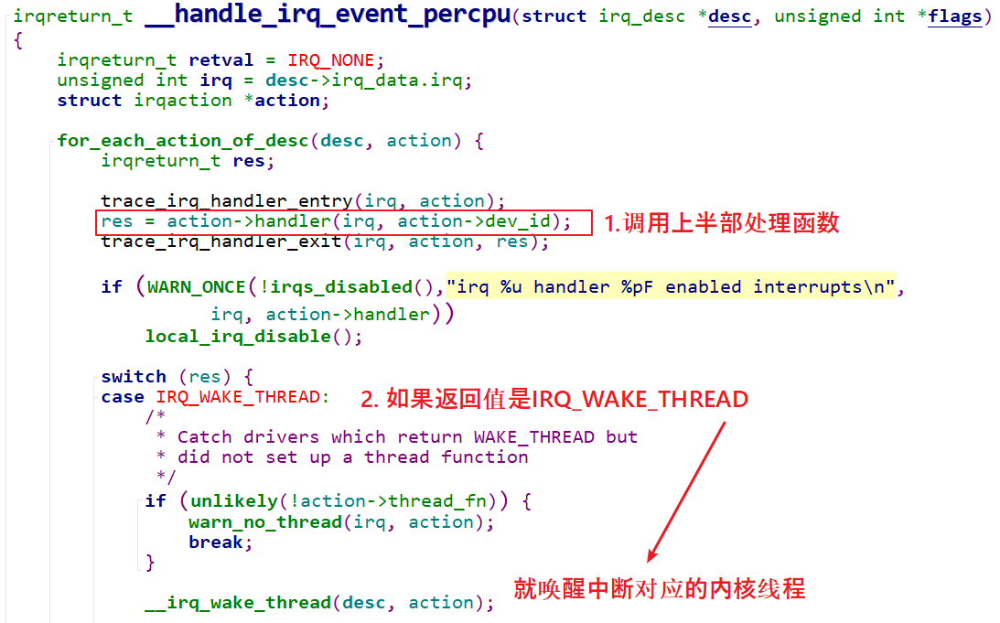

线程的处理函数为irq\_thread，代码在kernel\\irq\\handle.c中：

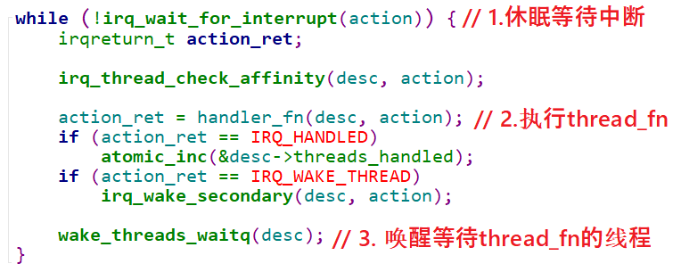

### 19.8.2 编程、上机

调用request\_threaded\_irq函数注册中断，调用free\_irq卸载中断。

从前面可知，我们可以提供上半部函数，也可以不提供：

-   如果不提供
    -   内核会提供默认的上半部处理函数：irq\_default\_primary\_handler，它是直接返回IRQ\_WAKE\_THREAD。
-   如果提供的话
    -   返回值必须是：IRQ\_WAKE\_THREAD。

在thread\_fn中，如果中断被正确处理了，应该返回IRQ\_HANDLED。

<a id="_Toc197788765"></a>
## 19.9 mmap

应用程序和驱动程序之间传递数据时，可以通过read、write函数进行。这涉及在用户态buffer和内核态buffer之间传数据，如下图所示：


图 19.30 mmap

应用程序不能直接读写驱动程序中的buffer，需要在用户态buffer和内核态buffer之间进行一次数据拷贝。这种方式在数据量比较小时没什么问题；但是数据量比较大时效率就太低了。比如更新LCD显示时，如果每次都让APP传递一帧数据给内核，假设LCD采用1024\*600\*32bpp的格式，一帧数据就有1024\*600\*32/8=2.3MB左右，这无法忍受。

改进的方法就是让程序可以直接读写驱动程序中的buffer，这可以通过mmap实现(memory map)，把内核的buffer映射到用户态，让APP在用户态直接读写。

### 19.9.1 内存映射现象与数据结构

假设有这样的程序，名为test.c：

```
#include <stdio.h>
#include <unistd.h>
#include <stdlib.h>

int a;
int main(int argc, char **argv)
{
	if (argc != 2)
	{
		printf("Usage: %s <number>\n", argv[0]);
		return -1;
	}
	a = strtol(argv[1], NULL, 0);
	printf("a's address = 0x%lx, a's value = %d\n", &a, a);
	while (1)
	{
		sleep(10);
	}
	return 0;
}
```

在PC上如下编译(必须静态编译)：

```bash
gcc  -o  test  test.c  -staitc
```

分别执行test程序2次，最后执行ps，可以看到这2个程序同时存在，这2个程序里a变量的地址相同，但是值不同。如下图：

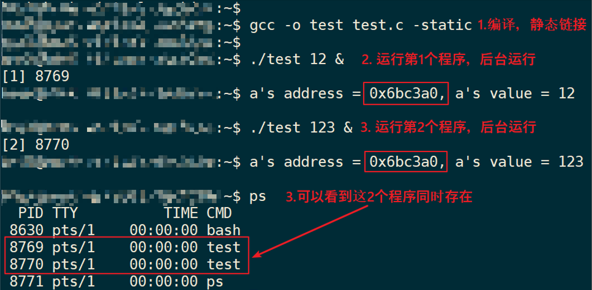

图 19.31 执行两次test

观察到这些现象：

-   -   2个程序同时运行，它们的变量a的地址都是一样的：0x6bc3a0；
    -   2个程序同时运行，它们的变量a的值是不一样的，一个是12，另一个是123。

疑问来了：

-   -   这2个程序同时在内存中运行，它们的值不一样，所以变量a的地址肯定不同；
    -   但是打印出来的变量a的地址却是一样的。

怎么回事？

这里要引入虚拟地址的概念：CPU发出的地址是虚拟地址，它经过MMU(Memory Manage Unit，内存管理单元)映射到物理地址上，对于不同进程的同一个虚拟地址，MMU会把它们映射到不同的物理地址。如下图：

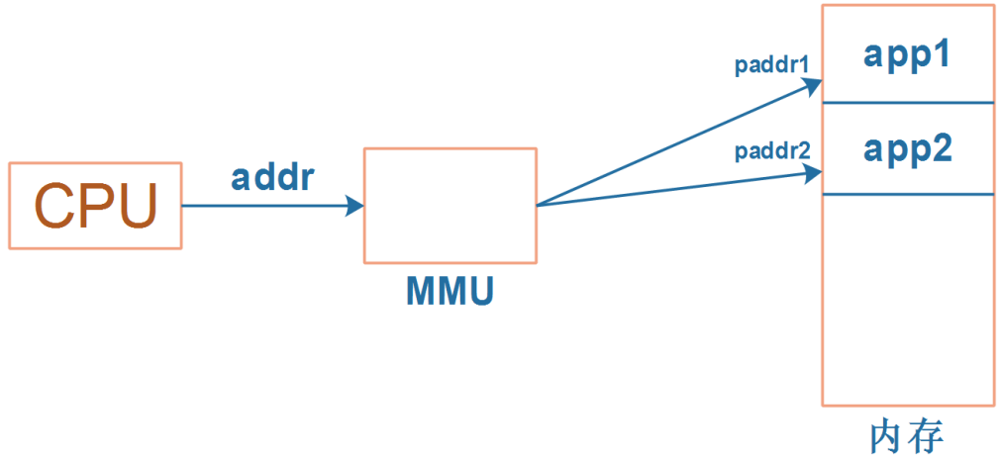

图 19.32 MMU

-   当前运行的是app1时，MMU会把CPU发出的虚拟地址addr映射为物理地址paddr1，用paddr1去访问内存。
-   当前运行的是app2时，MMU会把CPU发出的虚拟地址addr映射为物理地址paddr2，用paddr2去访问内存。
-   MMU负责把虚拟地址映射为物理地址，虚拟地址映射到哪个物理地址去？

可以执行ps命令查看进程ID，然后执行“cat /proc/325/maps”得到映射关系。

每一个APP在内核里都有一个tast\_struct，这个结构体中保存有内存信息：mm\_struct。而虚拟地址、物理地址的映射关系保存在页目录表中，如下图所示：

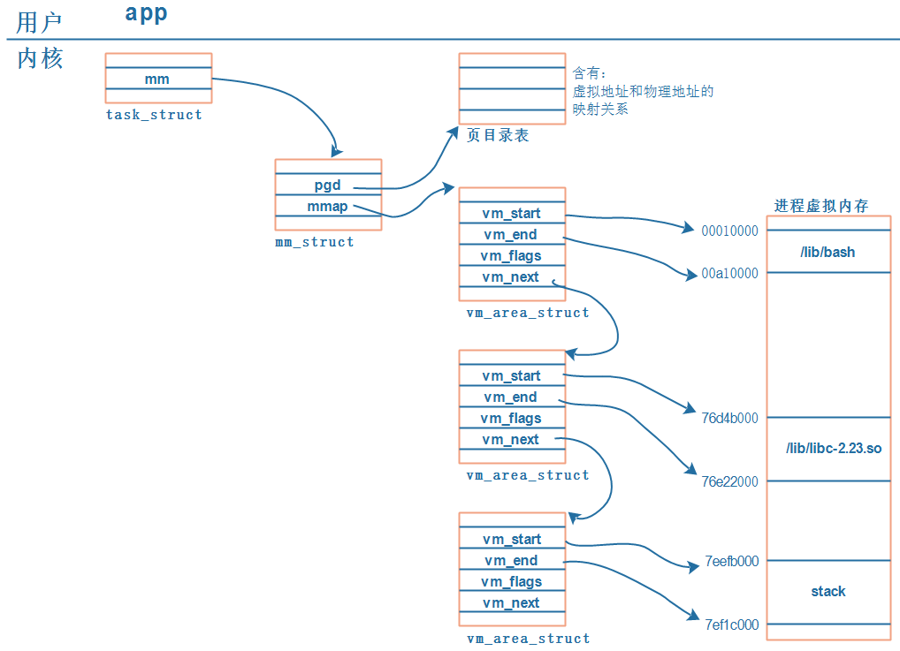

解析如下：

-   每个APP在内核中都有一个task\_struct结构体，它用来描述一个进程；
-   每个APP都要占据内存，在task\_struct中用mm\_struct来管理进程占用的内存；
    -   内存有虚拟地址、物理地址，mm\_struct中用mmap来描述虚拟地址，用pgd来描述对应的物理地址。
    -   **注意**：pgd，Page Global Directory，页目录。
-   每个APP都有一系列的VMA：virtual memory
    -   比如APP含有代码段、数据段、BSS段、栈等等，还有共享库。这些单元会保存在内存里，它们的地址空间不同，权限不同(代码段是只读的可运行的、数据段可读可写)，内核用一系列的vm\_area\_struct来描述它们。
    -   vm\_area\_struct中的vm\_start、vm\_end是虚拟地址。
-   vm\_area\_struct中虚拟地址如何映射到物理地址去？
    -   每一个APP的虚拟地址可能相同，物理地址不相同，这些对应关系保存在pgd中。

### 19.9.2 ARM架构内存映射简介

ARM架构支持一级页表映射，也就是说MMU根据CPU发来的虚拟地址可以找到第1个页表，从第1个页表里就可以知道这个虚拟地址对应的物理地址。一级页表里地址映射的最小单位是1M。

ARM架构还支持二级页表映射，也就是说MMU根据CPU发来的虚拟地址先找到第1个页表，从第1个页表里就可以知道第2级页表在哪里；再取出第2级页表，从第2个页表里才能确定这个虚拟地址对应的物理地址。二级页表地址映射的最小单位有4K、1K，Linux使用4K。

一级页表项里的内容，决定了它是指向一块物理内存，还是指问二级页表，如下图：

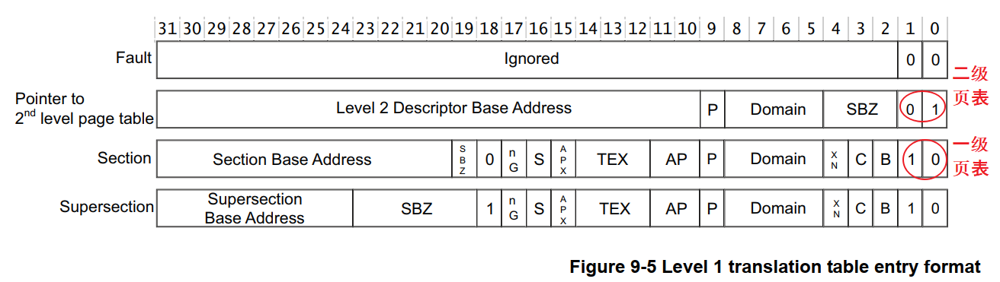

-   -   -   -   1.  一级页表映射过程

一线页表中每一个表项用来设置1M的空间，对于32位的系统，虚拟地址空间有4G，4G/1M=4096。所以一级页表要映射整个4G空间的话，需要4096个页表项。

第0个页表项用来表示虚拟地址第0个1M(虚拟地址为0～0xFFFFF)对应哪一块物理内存，并且有一些权限设置；

第1个页表项用来表示虚拟地址第1个1M(虚拟地址为0x100000～0x1FFFFF)对应哪一块物理内存，并且有一些权限设置；

依次类推。

使用一级页表时，先在内存里设置好各个页表项，然后把页表基地址告诉MMU，就可以启动MMU了。

以下图为例介绍地址映射过程：

-   1.  CPU发出虚拟地址vaddr，假设为0x12345678
    2.  MMU根据vaddr\[31:20\]找到一级页表项：
        -   虚拟地址0x12345678是虚拟地址空间里第0x123个1M，所以找到页表里第0x123项，根据此项内容知道它是一个段页表项。

段内偏移是0x45678。

-   1.  从这个表项里取出物理基地址：Section Base Address，假设是0x81000000
    2.  物理基地址加上段内偏移得到：0x81045678

所以CPU要访问虚拟地址0x12345678时，实际上访问的是0x81045678的物理地址。

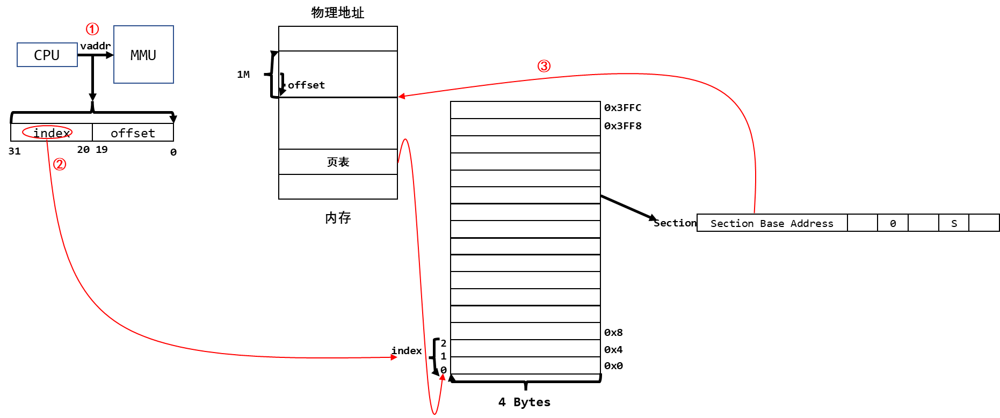

图 19.33内存映射

-   -   -   -   1.  二级页表映射过程

首先设置好一级页表、二级页表，并且把一级页表的首地址告诉MMU。

以下图为例介绍地址映射过程：

-   -   CPU发出虚拟地址vaddr，假设为0x12345678
    -   MMU根据vaddr\[31:20\]找到一级页表项：

虚拟地址0x12345678是虚拟地址空间里第0x123个1M，所以找到页表里第0x123项。根据此项内容知道它是一个二级页表项。

-   -   从这个表项里取出地址，假设是address，这表示的是二级页表项的物理地址；
    -   vaddr\[19:12\]表示的是二级页表项中的索引index即0x45，在二级页表项中找到第0x45项；
    -   二级页表项格式如下：

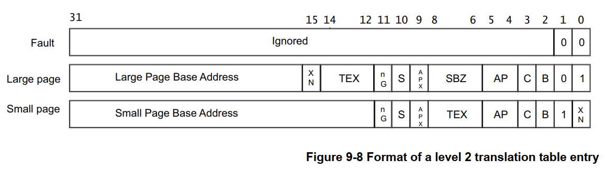

图 19.34二级页表

里面含有这4K或1K物理空间的基地址page base addr，假设是0x81889000：

它跟vaddr\[11:0\]组合得到物理地址：0x81889000 + 0x678 = 0x81889678。

所以CPU要访问虚拟地址0x12345678时，实际上访问的是0x81889678的物理地址

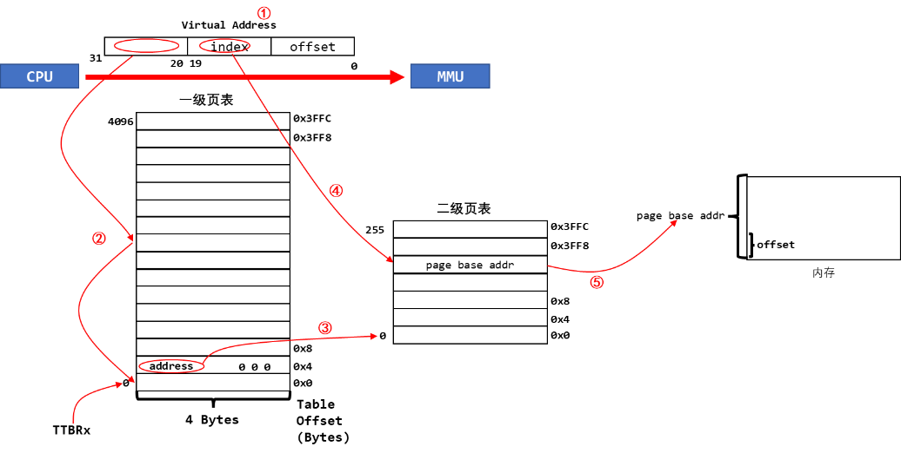

图 19.35二级页表

### 19.9.3 怎么给APP新建一块内存映射

-   -   -   -   1.  mmap调用过程

从上面内存映射的过程可以知道，要给APP新开劈一块虚拟内存，并且让它指向某块内核buffer，我们要做这些事：

1.  得到一个vm\_area\_struct，它表示APP的一块虚拟内存空间；

很幸运，APP调用mmap系统函数时，内核就帮我们构造了一个vm\_area\_stuct结构体。里面含有虚拟地址的地址范围、权限。

1.  确定物理地址：

你想映射某个内核buffer，你需要得到它的物理地址，这得由你提供。

1.  给vm\_area\_struct和物理地址建立映射关系：

也很幸运，内核提供有相关函数。

APP里调用mmap时，导致的内核相关函数调用过程如下：

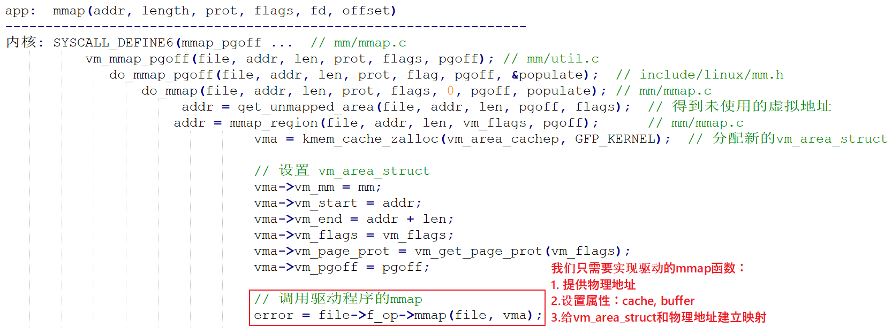

图 19.36 mmap调用过程

-   -   -   -   1.  cache和buffer

本小节参考ARM的cache和写缓冲器（write buffer）：

[https://blog.csdn.net/gameit/article/details/13169445](https://blog.csdn.net/gameit/article/details/13169445)

使用mmap时，需要有cache、buffer的知识。下图是CPU和内存之间的关系，有cache、buffer(写缓冲器)。Cache是一块高速内存；写缓冲器相当于一个FIFO，可以把多个写操作集合起来一次写入内存。

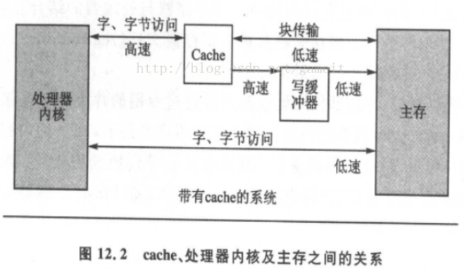

图 19.37 cache

程序运行时有“局部性原理”，这又分为时间局部性、空间局部性。

-   时间局部性：

在某个时间点访问了存储器的特定位置，很可能在一小段时间里，会反复地访问这个位置。

-   空间局部性：

访问了存储器的特定位置，很可能在不久的将来访问它附近的位置。

而CPU的速度非常快，内存的速度相对来说很慢。CPU要读写比较慢的内存时，怎样可以加快速度？根据“局部性原理”，可以引入cache。

1.  读取内存addr处的数据时：
    -   先看看cache中有没有addr的数据，如果有就直接从cache里返回数据：这被称为cache命中。
    -   如果cache中没有addr的数据，则从内存里把数据读入，注意：它不是仅仅读入一个数据，而是读入一行数据(cache line)。
    -   而CPU很可能会再次用到这个addr的数据，或是会用到它附近的数据，这时就可以快速地从cache中获得数据。
2.  写数据：

    -   CPU要写数据时，可以直接写内存，这很慢；也可以先把数据写入cache，这很快。
    -   但是cache中的数据终究是要写入内存的啊，这有2种写策略：

    1.  写通(write through)：
        -   数据要同时写入cache和内存，所以cache和内存中的数据保持一致，但是它的效率很低。能改进吗？可以！使用“写缓冲器”：cache大哥，你把数据给我就可以了，我来慢慢写，保证帮你写完。
        -   有些写缓冲器有“写合并”的功能，比如CPU执行了4条写指令：写第0、1、2、3个字节，每次写1字节；写缓冲器会把这4个写操作合并成一个写操作：写word。对于内存来说，这没什么差别，但是对于硬件寄存器，这就有可能导致问题。
        -   所以对于寄存器操作，不会启动buffer功能；对于内存操作，比如LCD的显存，可以启用buffer功能。
    2.  写回(write back)：
        -   新数据只是写入cache，不会立刻写入内存，cache和内存中的数据并不一致。
        -   新数据写入cache时，这一行cache被标为“脏”(dirty)；当cache不够用时，才需要把脏的数据写入内存。

使用写回功能，可以大幅提高效率。但是要注意cache和内存中的数据很可能不一致。这在很多时间要小心处理：比如CPU产生了新数据，DMA把数据从内存搬到网卡，这时候就要CPU执行命令先把新数据从cache刷到内存。反过来也是一样的，DMA从网卡得过了新数据存在内存里，CPU读数据之前先把cache中的数据丢弃。

是否使用cache、是否使用buffer，就有4种组合(Linux内核文件arch\\arm\\include\\asm\\pgtable-2level.h)：

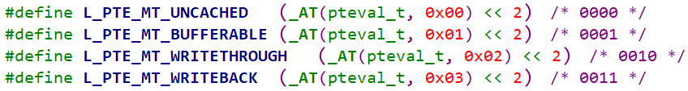

图 19.38 cache和buffer的组合

上面4种组合对应下表中的各项，一一对应(下表来自s3c2410芯片手册，高架构的cache、buffer更复杂，但是这些基础知识没变)：

表 19‑3 s3c2410的cache&buffer组合


| 是否启用cache | 是否启用buffer | 说明 |
| --- | --- | --- |
| 0 | 0 | Non-cached, non-buffered (NCNB)<br />读、写都直达外设硬件 |
| 0 | 1 | Non-cached buffered (NCB)<br />读、写都直达外设硬件；<br />写操作通过buffer实现，CPU不等待写操作完成，CPU会马上执行下一条指令 |
| 1 | 0 | Cached, write-through mode (WT)，写通<br />读：cache hit时从cahce读数据；cache miss时已入一行数据到cache；<br />写：通过buffer实现，CPU不等待写操作完成，CPU会马上执行下一条指令 |
| 1 | 1 | Cached, write-back mode (WB)，写回<br />读：cache hit时从cahce读数据；cache miss时已入一行数据到cache；<br />写：通过buffer实现，cache hit时新数据不会到达硬件，而是在cahce中被标为“脏”；cache miss时，通过buffer写入硬件，CPU不等待写操作完成，CPU会马上执行下一条指令 |


-   -   第1种是不使用cache也不使用buffer，读写时都直达硬件，这适合寄存器的读写。
    -   第2种是不使用cache但是使用buffer，写数据时会用buffer进行优化，可能会有“写合并”，这适合显存的操作。因为对显存很少有读操作，基本都是写操作，而写操作即使被“合并”也没有关系。
    -   第3种是使用cache不使用buffer，就是“write through”，适用于只读设备：在读数据时用cache加速，基本不需要写。
    -   第4种是既使用cache又使用buffer，适合一般的内存读写。
        -   -   1.  驱动程序要做的事

驱动程序要做的事情有3点：

1.  确定物理地址
2.  确定属性：是否使用cache、buffer
3.  建立映射关系

参考Linux源文件，示例代码如下：

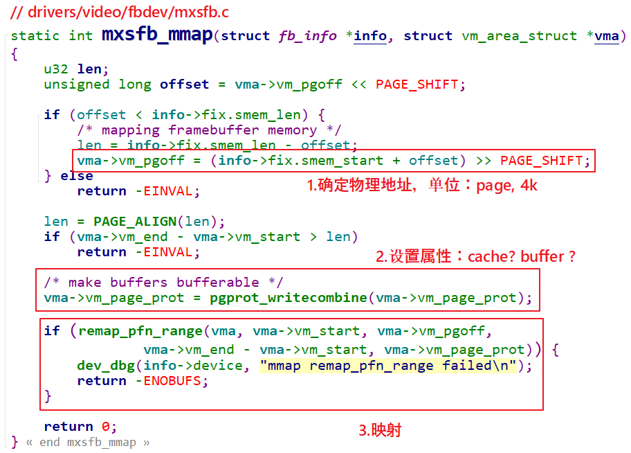

图 19.39 驱动程序要做的3件事

还有一个更简单的函数：

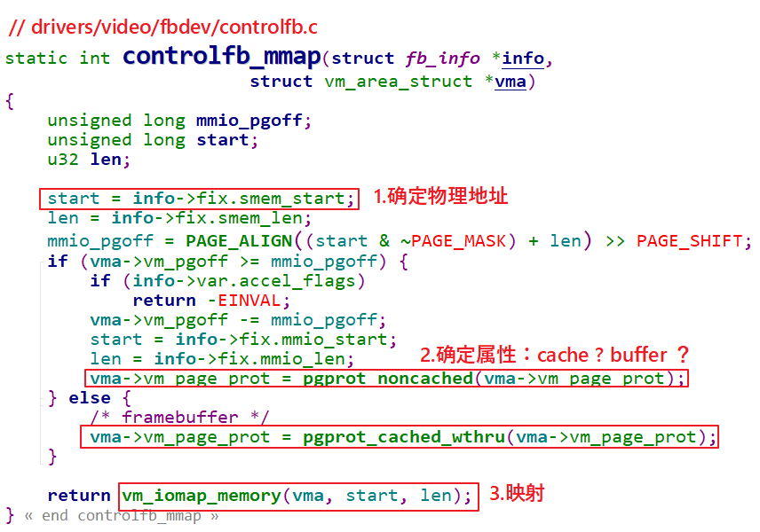

图 19.40 controlfb\_mmap函数

### 19.9.4 编程

使用GIT命令载后，本节源码位于这个目录下：

01\_all\_series\_quickstart\\

05\_嵌入式Linux驱动开发基础知识\\source\\07\_mmap

目的：我们在驱动程序中申请一个8K的buffer，让APP通过mmap能直接访问。

-   -   -   -   1.  APP编程

APP怎么写？open驱动、buf=mmap(……)映射内存，直接读写buf就可以了，代码如下：

```
22      /* 1. 打开文件 */
23      fd = open("/dev/hello", O_RDWR);
24      if (fd == -1)
25      {
26              printf("can not open file /dev/hello\n");
27              return -1;
28      }
29
30      /* 2. mmap
31       * MAP_SHARED  : 多个APP都调用mmap映射同一块内存时, 对内存的修改大家都可以看到。
32       *               就是说多个APP、驱动程序实际上访问的都是同一块内存
33       * MAP_PRIVATE : 创建一个copy on write的私有映射。
34       *               当APP对该内存进行修改时，其他程序是看不到这些修改的。
35       *               就是当APP写内存时, 内核会先创建一个拷贝给这个APP,
36       *               这个拷贝是这个APP私有的, 其他APP、驱动无法访问。
37       */
38      buf =  mmap(NULL, 1024*8, PROT_READ | PROT_WRITE, MAP_SHARED, fd, 0);
39      if (buf == MAP_FAILED)
40      {
41              printf("can not mmap file /dev/hello\n");
42              return -1;
43      }
```

最难理解的是mmap函数MAP\_SHARED、MAP\_PRIVATE参数。使用MAP\_PRIVATE映射时，在没有发生写操作时，APP、驱动访问的都是同一块内存；当APP发起写操作时，就会触发“copy on write”，即内核会先创建该内存块的拷贝，APP的写操作在这个新内存块上进行，这个新内存块是APP私有的，别的APP、驱动看不到。

仅用MAP\_SHARED参数时，多个APP、驱动读、写时，操作的都是同一个内存块，“共享”。

MAP\_PRIVATE映射是很有用的，Linux中多个APP都会使用同一个动态库，在没有写操作之前大家都使用内存中唯一一份代码。当APP1发起写操作时，内核会为它复制一份代码，再执行写操作，APP1就有了专享的、私有的动态库，在里面做的修改只会影响到APP1。其他程序仍然共享原先的、未修改的代码。

有了这些知识后，下面的代码就容易理解了，请看代码中的注释：

```
45      printf("mmap address = 0x%x\n", buf);
46      printf("buf origin data = %s\n", buf); /* old */
47
48      /* 3. write */
49      strcpy(buf, "new");
50
51      /* 4. read & compare */
52      /* 对于MAP_SHARED映射:  str = "new"
53       * 对于MAP_PRIVATE映射: str = "old"
54       */
55      read(fd, str, 1024);
56      if (strcmp(buf, str) == 0)
57      {
58              /* 对于MAP_SHARED映射，APP写的数据驱动可见
59               * APP和驱动访问的是同一个内存块
60               */
61              printf("compare ok!\n");
62      }
63      else
64      {
65              /* 对于MAP_PRIVATE映射，APP写数据时, 是写入另一个内存块(是原内存块的"拷贝")
66               */
67              printf("compare err!\n");
68              printf("str = %s!\n", str);  /* old */
69              printf("buf = %s!\n", buf);  /* new */
70      }
```

执行测试程序后，查看到它的进程号PID，执行这样的命令查看这个程序的内存使用情况：

```bash
[root@100ask:~]# cat  /proc/PIC/maps
```

-   -   -   -   1.  驱动编程

驱动程序要做什么？

1.  分配一块8K的内存

使用哪一个函数分配内存？

表 19‑4 分配内存函数


| 函数名 | 说明 |
| --- | --- |
| kmalloc | 分配到的内存物理地址是连续的 |
| kzalloc | 分配到的内存物理地址是连续的，内容清0 |
| vmalloc | 分配到的内存物理地址不保证是连续的 |
| vzalloc | 分配到的内存物理地址不保证是连续的，内容清0 |


我们应该使用kmalloc或kzalloc，这样得到的内存物理地址是连续的，在mmap时后APP才可以使用同一个基地址去访问这块内存。(如果物理地址不连续，就要执行多次mmap了)。

1.  提供mmap函数

关键在于mmap函数，代码如下：

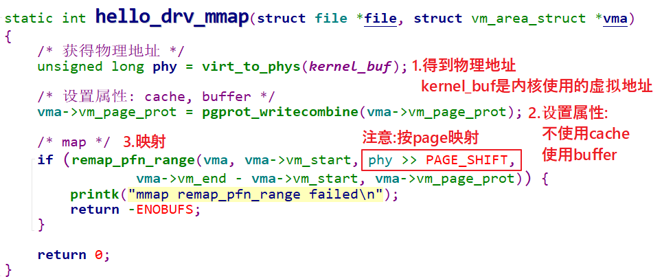

图 19.41 hello\_drv\_mmap

要注意的是，remap\_pfn\_range中，pfn的意思是“Page Frame Number”。在Linux中，整个物理地址空间可以分为第0页、第1页、第2页，诸如此类，这就是pfn。假设每页大小是4K，那么给定物理地址phy，它的pfn = phy / 4096 = phy &gt;&gt; 12。内核的page一般是4K，但是也可以配置内核修改page的大小。所以为了通用，pfn = phy &gt;&gt; PAGE\_SHIFT。

APP调用mmap后，会导致驱动程序的mmap函数被调用，最终APP的虚拟地址和驱动程序中的物理地址就建立了映射关系。APP可以直接访问驱动程序的buffer。

-   -   -   -   1.  上机测试

在Ubuntu中编译好驱动、测试程序，放到开发板。

在开发板上安装驱动、执行测试程序。


掌握了嵌入式Linux应用开发基础、驱动开发基础后，就可以做项目了。百问网的《第六篇 实战项目》是录播课程，对应的文档和源码放在GIT仓库里。

GIT仓库地址：

[https://e.coding.net/weidongshan/01\_all\_series\_quickstart.git](https://e.coding.net/weidongshan/01_all_series_quickstart.git)

目录的位置如下：


除了录播的项目之外，还有更多直播项目。直播的项目有3大类：调试Bug、毕业设计级别项目、产品级别项目。会不断更新这些项目。

直播的视频也都录制下来，放在官网：


从零编写带GUI的应用：https://www.bilibili.com/video/BV1it4y1Q75z


驱动大全是收费视频，适合想深入研究某个内核主题、深入研究Linux驱动的人。驱动大全的录制目标，是称为“驱动开发的字典”，并不需要从头学完，用到哪部分，再学习哪部分。

驱动大全的文档、源码等所有配套资料，放在另一个GIT仓库：

```
https://e.coding.net/weidongshan/linux/doc_and_source_for_drivers.git
```

视频放在官网：


驱动大全使用两个板子进行录制：IMX6ULL、STM32MP157，购买一套就可以得到另一套。可以购买整套驱动大全，也可以单独都买里面的某个专题。

驱动大全尚未录制完毕，正在持续更新。

驱动大全规划的大纲如下：

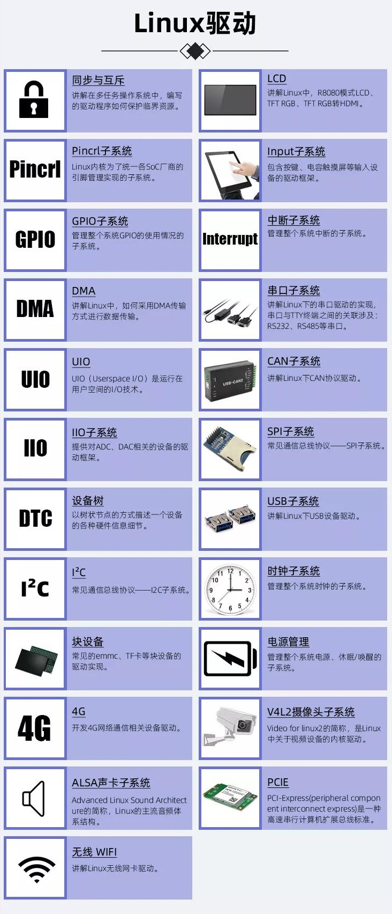
