<a id="_Toc197788770"></a>

**注意：**此章内容讲解开发板系统内应用/库工具等的使用介绍，仅在需要时参考学习 不需要逐一验证测试。

<a id="_Toc197788771"></a>
## 2.1 图形库和图形应用

### 2.1.1 Qt GUI

运行环境

-   支持的INIT服务: systemV
-   支持的开发板系统: Buildroot版本系统
    -   -   -   1.  开发板Qt GUI简述

QT是一种跨平台C++图形用户界面应用程序开发框架。它既可以开发GUI程序，也可用于开发非GUI程序，比如控制台工具和服务器。Qt是面向对象的框架，使用特殊的代码生成扩展以及一些宏，Qt很容易扩展，并且允许真正地组件编程。

开发板会在出厂的时候烧写带有Qt运行时库的系统，并且提供了一个丰富的HMI演示系统，具体内容可以查看《MEasy HMI2.0 开发手册》。

在嵌入式Linux系统上，可以使用多个平台插件：EGLFS，LinuxFB，DirectFB或Wayland。但是，这些插件的可用性取决于实际硬件平台的特性以及Qt的配置方式。EGLFS是许多主板上的默认插件。如果不合适，请使用QT\_QPA\_PLATFORM环境变量来请求另一个插件。另外，对于快速测试，请使用-platform具有相同语法的命令行参数。例如在用户控制台下，可以使用如下命令进行配置。

```bash
export QT_QPA_PLATFORM=linuxfb
/usr/bin/mxapp2 --plugin tslib:/dev/input/event1
```

或者使用-platform linuxfb 指令平台插件，如下：

```bash
export QT_QPA_PLATFORM=linuxfb
/usr/bin/mxapp2 --plugin tslib:/dev/input/event1 -platform linuxfb
```

对于包含GPU的现代嵌入式Linux设备，推荐使用EGLFS插件，使用GPU进行渲染。如果嵌入式Linux设备不包含GPU或者不支持OpenGL ES测试，则只能指定linuxfb平台插件通过CPU进行软件的渲染了。

**注意**：从Qt 5.0开始，Qt不再具有自己的窗口系统（QWS）实现，因此不再支持Qt早期版本上使用的 -qws参数。

-   -   -   -   1.  运行linuxfb platform qtgui

使用系统默认的qt脚本来启动gui应用，开机自启动脚本存放在 /etc/init.d/目录下文件名为S99myirhmi2 如下命令执行/etc/init.d/S99myirhmi2 start表示启动qt gui程序。

```bash
[root@100ask:~]# /etc/init.d/S99myirhmi2 start
```

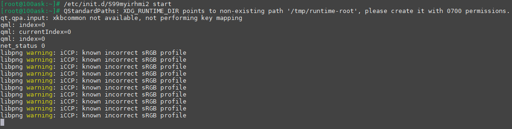

如需关闭qt gui可以执行/etc/init.d/S99myirhmi2 stop 命令，来关闭qt gui。

如果您不想使用系统自带的GUI，可以执行以下命令：

```
mv  /etc/init.d/S99myirhmi2  ~
mv  /etc/init.d/*lvgl*  ~
reboot
```

### 2.1.2 显示测试fb-test-app

fb-test-app是一套用来测试显示设备色彩性能的一套应用程序，使用此程序是之前需要先关闭默认系统自带的GUI程序，开发板终端上执行：

```
mv  /etc/init.d/S99myirhmi2  ~
mv  /etc/init.d/*lvgl*  ~
reboot
```

1.  使用fb-test来测试当前显示设备输出的RGB颜色，并获取到一些基本参数。

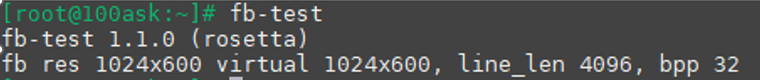

1.  使用fb-test-perf对lcd显示进行性能分析， fb-test-perf &lt;fbnum&gt; &lt;logfile&gt;使用其中&lt;fbnum&gt;表示 显示设备的设备节点&lt;logfile&gt;表示保存log文件的文件名，如下示例我们对 /dev/fb0设备节点进行性能分析并把log文件保存在 log.txt内。

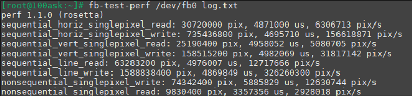


1.  使用 fb-test-rect 来对此显示屏做渲染测试。

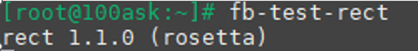

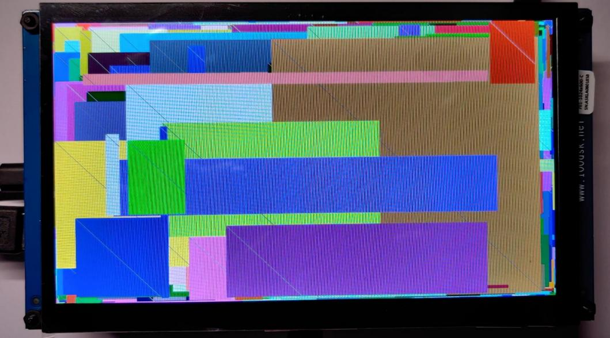

### 2.1.3 开机动画psplash

PSplash是一个用户空间图形开机启动屏幕的应用程序，主要用于支持16bpp或32bpp帧缓冲区的嵌入式Linux设备。它有很少的依赖项（只是libc），支持基本的图像和文本以及句柄回传。它的显示可以通过基本的源更改来配置。

还包括一个“终端”命令实用程序，用于将信息发送到psplash，例如显示启动进度信息，psplash包含 psplash-write psplash两个应用程序，其中psplash用来启动显示，psplash-write用来写入进度提示信息退出程序等。

1.  终端执行psplash -n& 命令来启动psplash 并将其在后台运行。

```bash
[root@100ask:~]# psplash -n &
```

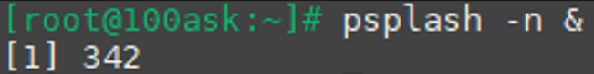


1.  使用psplash-write “ MSG &lt;文本消息&gt; “在系统进度条上方显示文本消息。

```bash
[root@100ask:~]# psplash-write "MSG 100ask Starting ......"
```


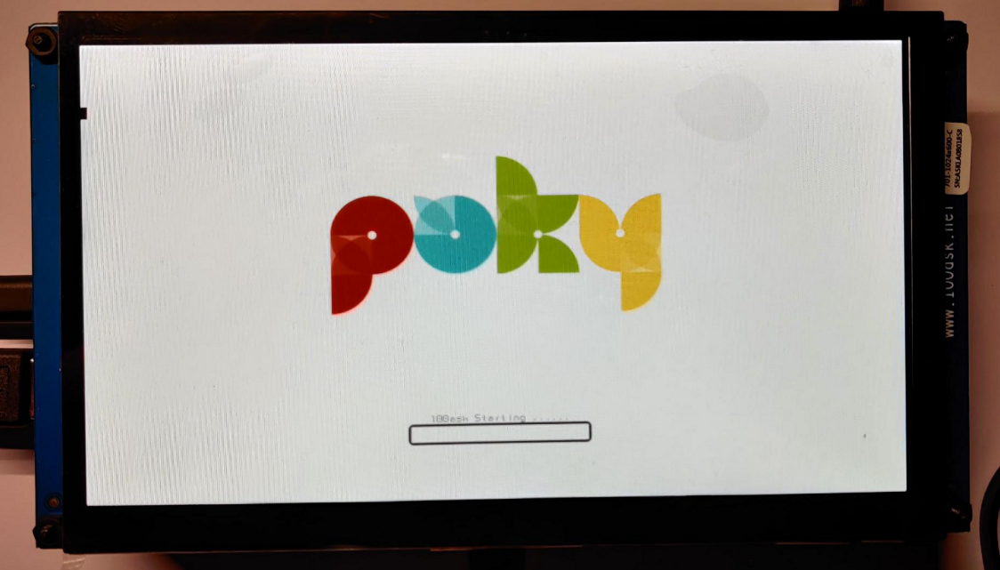

1.  使用psplash-write “ PROGRESS &lt;进度值&gt; “在进度条哪里显示当前的运行进度，如下所示，显示当前启动进度为 30%。

```bash
[root@100ask:~]# psplash-write "PROGRESS 30"
```


1.  使用psplash-write “ QUIT “来关闭psplash 如下所示终端执行psplash-write " QUIT " 命令即可关闭psplash程序，可以继续执行其它GUI应用，如qt.

```bash
[root@100ask:~]# psplash-write " QUIT "
```

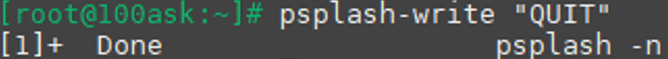

<a id="_Toc197788772"></a>
## 2.2 压缩与解压缩应用

本节主要测试系统的解压缩工具。压缩是可以把多个文件压缩成一个压缩包可以把多个文件压缩成一个压缩包，方便进行文件的传输。而解压可以把经过压缩的压缩文件还原成原始大小方便使用。本节将在文件系统以tar、gzip、gunzip等工具为例进行说明。

### 2.2.1 Tar压缩解压缩工具

-   -   -   -   1.  tar工具

现在我们在Linux中使用的 tar 工具，它不仅可以对文件打包，还可以对其进行压缩，查看，添加以及解压等一系列操作。这里是将打包操作。

 语法格式

输入以下命令查看tar语法格式：

```bash
[root@100ask:~]# tar --help
Usage: tar [OPTION...] [FILE]...
GNU 'tar' saves many files together into a single tape or disk archive, and can
restore individual files from the archive.
Examples:
  tar -cf archive.tar foo bar  # Create archive.tar from files foo and bar.
  tar -tvf archive.tar         # List all files in archive.tar verbosely.
  tar -xf archive.tar          # Extract all files from archive.tar.
```

详细参数说明如下：

-   c ：建立一个压缩文件的參数指令(create 的意思)；
-   x ：解开一个压缩文件的參数指令！
-   t ：查看 tarfile 里面的文件！特别注意，在參数的下达中， c/x/t 仅能存在一个！不可同一时候存在！由于不可能同一时候压缩与解压缩。
-   z ：是否同一时候具有 gzip 的属性？亦即是否须要用 gzip 压缩？
-   j ：是否同一时候具有 bzip2 的属性？亦即是否须要用 bzip2 压缩？
-   \-v ：压缩的过程中显示文件！这个经常使用，但不建议用在背景运行过程！
-   \-f ：使用档名，请留意，在 f 之后要马上接档名，不要再加參数！比如使用『tar -zcvfP tfile sfile』就是错误的写法，要写成『 tar -zcvPf tfile sfile』才对。
-   \-p ：使用原文件的原来属性（属性不会根据使用者而变）
-   \-P ：能够使用绝对路径来压缩！
-   \-N ：比后面接的日期(yyyy/mm/dd)还要新的才会被打包进新建的文件里！
-   \--exclude FILE：在压缩的过程中，不要将 FILE 打包！
    -   -   -   1.  使用tar压缩

新建test.txt文件，并输入以下命令将文件打包成.gz格式：

```bash
[root@100ask:~]# tar -czf test.tar.gz test.txt
[root@100ask:~]# ls
test.txt
```

所以上面加 z 參数，则以 .tar.gz 或 .tgz 来代表 gzip 压缩过的 tar file 。

-   -   -   -   1.  使用tar解压

把打包成tar.gz格式文件解压

```bash
[root@100ask:~]# tar -xvf test.tar.gz
test.txt
[root@100ask:~]# ls
test.c
```

### 2.2.2 压缩工具

gzip是在Linux系统中经常使用的一个对文件进行压缩和解压缩的命令，既方便又好用。

-   -   -   -   1.  语法格式

在开发板终端输入以下命令查看gzip语法：

```bash
[root@100ask:~]# gzip --help
BusyBox v1.31.1 () multi-call binary.
Usage: gzip [-cfkdt] [FILE]...
```

-   -   -   -   1.  gzip把文件压缩

```bash
[root@100ask:~]# gzip test.txt
[root@100ask:~]# ls
test.c
```

-   -   -   -   1.  用gunzip工具解压

用gunzip把文件解压，示例如下：

```bash
[root@100ask:~]# gunzip test.txt.gz
[root@100ask:~]# ls
test.c
```

<a id="_Toc197788773"></a>
## 2.3 调试、性能分析、基准测试应用

### 2.3.1 远程调试gdbserver

在板子上需满足有gcc编译器、gdb调试器等，但一般对于嵌入式系统来说，在资源有限情况下，gcc编译器及环境一般是在安装X86 Linux主机上。那么此时，编译环境与程序运行环境就分开了，如果此时要进行GDB调试时，就需要借助ARM Linux上的GDBServer实现了。即通过网络建立server与client，进而实现gdb调试。

GDB Client及GDBServer就构成了ARM Linux的调试环境，其框架如下图所示：

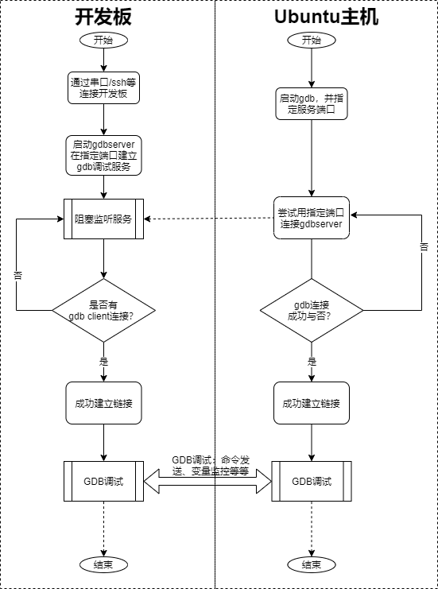

-   -   -   -   1.  准备程序

我们使用C语言程序来演示一下，其代码内容如下：

```
/*********************************测试程序**********************************/
#include <stdio.h>
//实现a+b
 int add(int a, int b)
 {
     return a + b;
 }
//实现a-b
 int sub(int a, int b)
 {
     return a - b;
 }

 int main()
 {
     printf(" 2 + 3 = %d\n", add(2, 3));
     printf(" 2 - 3 = %d\n", sub(2, 3));
     return 1;
 }
```

接下来，使用命令将其编译，-g表示可以调试，命令如下：

```bash
book@100ask:~$ arm-buildroot-linux-gnueabihf-gcc test.c -g -o test
```

-   -   -   -   1.  启动gdb

根据前面小节的准备，现需将编译生成的&lt;test&gt;程序拷贝到开发板上，拷贝的方法有很多种，100ASK提供的虚拟机已经配置了NFS、SSH等多种服务，这里以ssh为例，将&lt;test&gt;程序拷贝开发板上，已知开发板IP为192.168.0.8，使用命令：

```bash
book@100ask:~$ scp test root@192.168.0.8:/root
```

将&lt;test&gt;程序拷贝到开发板/root目录下，效果如下所示：

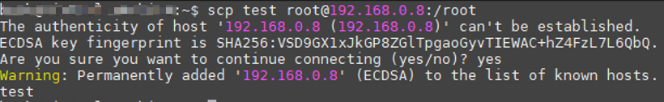

切换到开发板终端，并通过gdbserver在指定端口&lt;12345&gt;建立服务，同时阻塞进行监听，如下所示：

```bash
[root@100ask:~]# gdbserver :12345 test
```

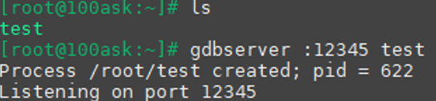

-   -   -   -   1.  主机连接gdbserver

根据前面第1、2小节的准备，并将编译生成的&lt;test&gt;程序拷贝到开发板/mnt目录下，并成功在开发板的12345端口建立了监听服务，此时，需启动主机的gdb程序以进行连接，命令如下所示：

```bash
book@100ask:~$ arm-buildroot-linux-gnueabihf-gdb  test
```

此时，当出现以下提示时：

```bash
Reading symbols from test...done.
```

输入命令：

```bash
target remote 192.168.0.8:12345
```

表示连接至远程GDB服务192.168.0.8，端口12345；回车之后，可以看到主机已经成功连接上了，如下图所示：

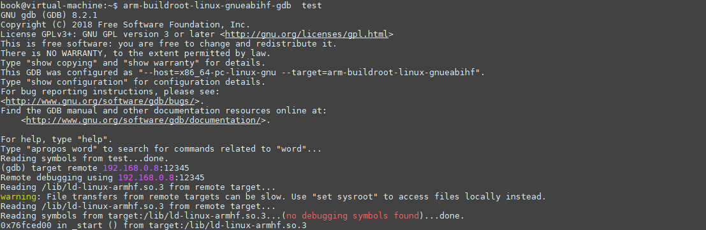

-   -   -   -   1.  开始调试

经过第3小节的操作，我们已经使得主机与开发板通过网络实现远程GDB连接，此时，可以在主机中输入gdb调试指令以实现远程调试，以一下的几个命令进行演示，如下所示分别b 设置断点 info breakpoint 查看设置断点 c 执行程序：

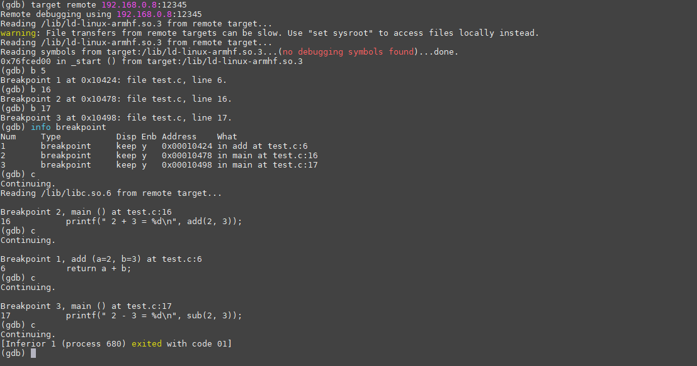

-   -   -   -   1.  附录 GDB常用命令参考

表 2‑1 GDB常用命令


| 命令 | 简写形式 | 说明 |
| --- | --- | --- |
| backtrace | bt、where | 显示 backtrace |
| break |  | 设置断点 |
| continue | c、cont | 继续运行 |
| delete | d | 删除断点 |
| finish |  | 运行到函数结束 |
| info breakpoints |  | 显示断点信息 |
| next | n | 执行下一行 |
| print | p | 显示表达式 |
| run | r | 运行程序 |
| step | s | 一次执行一行，包括函数内部 |
| x |  | 显示内存内容 |
| until | u | 执行到指定行 |
| directory | dir | 插入目录 |
| disable | dis | 禁用断点 |
| down | do | 在当前调用的栈帧中选择要显示的栈帧 |
| edit | e | 编辑文件或函数 |
| frame | f | 选择要显示的栈帧 |
| forward-search | fo | 向前搜索 |
| generate-core-file | gcore | 生成内核转储 |
| help | h | 显示帮助一览 |
| info | i | 显示信息 |
| list | l | 显示函数或行 |
| nexti | ni | 执行下一行（以汇编代码为单位） |
| print-object | po | 显示目标信息 |
| sharedlibrary | share | 加载共享库的符号 |
| setpi | si | 执行下一行 |


### 2.3.2 查看系统调用strace

Linux中的strace命令可以帮助您查看程序系统调用和信号。

-   -   -   -   1.  使用strace查看ls命令的系统调用过程。

```bash
[root@100ask:/]# strace ls
execve("/bin/ls", ["ls"], 0x7ea3fdc0 /* 16 vars */) = 0
brk(NULL)                               = 0x951000
uname({sysname="Linux", nodename="100ask", ...}) = 0
mmap2(NULL, 8192, PROT_READ|PROT_WRITE, MAP_PRIVATE|MAP_ANONYMOUS, -1, 0) = 0x76f47000
access("/etc/ld.so.preload", R_OK)      = -1 ENOENT (No such file or directory)
openat(AT_FDCWD, "/etc/ld.so.cache", O_RDONLY|O_LARGEFILE|O_CLOEXEC) = -1 ENOENT (No such file or directory)
openat(AT_FDCWD, "/lib/tls/v7l/neon/vfp/libresolv.so.2", O_RDONLY|O_LARGEFILE|O_CLOEXEC) = -1 ENOENT (No such file or directory)
stat64("/lib/tls/v7l/neon/vfp", 0x7e9a41f8) = -1 ENOENT (No such file or directory)
openat(AT_FDCWD, "/lib/tls/v7l/neon/libresolv.so.2", O_RDONLY|O_LARGEFILE|O_CLOEXEC) = -1 ENOENT (No such file or directory)
stat64("/lib/tls/v7l/neon", 0x7e9a41f8) = -1 ENOENT (No such file or directory)
openat(AT_FDCWD, "/lib/tls/v7l/vfp/libresolv.so.2", O_RDONLY|O_LARGEFILE|O_CLOEXEC) = -1 ENOENT (No such file or directory)
stat64("/lib/tls/v7l/vfp", 0x7e9a41f8)  = -1 ENOENT (No such file or directory)
openat(AT_FDCWD, "/lib/tls/v7l/libresolv.so.2", O_RDONLY|O_LARGEFILE|O_CLOEXEC) = -1 ENOENT (No such file or directory)
stat64("/lib/tls/v7l", 0x7e9a41f8)      = -1 ENOENT (No such file or directory)
openat(AT_FDCWD, "/lib/tls/neon/vfp/libresolv.so.2", O_RDONLY|O_LARGEFILE|O_CLOEXEC) = -1 ENOENT (No such file or directory)
stat64("/lib/tls/neon/vfp", 0x7e9a41f8) = -1 ENOENT (No such file or directory)
openat(AT_FDCWD, "/lib/tls/neon/libresolv.so.2", O_RDONLY|O_LARGEFILE|O_CLOEXEC) = -1 ENOENT (No such file or directory)
stat64("/lib/tls/neon", 0x7e9a41f8)     = -1 ENOENT (No such file or directory)
openat(AT_FDCWD, "/lib/tls/vfp/libresolv.so.2", O_RDONLY|O_LARGEFILE|O_CLOEXEC) = -1 ENOENT (No such file or directory)
stat64("/lib/tls/vfp", 0x7e9a41f8)      = -1 ENOENT (No such file or directory)
openat(AT_FDCWD, "/lib/tls/libresolv.so.2", O_RDONLY|O_LARGEFILE|O_CLOEXEC) = -1 ENOENT (No such file or directory)
stat64("/lib/tls", 0x7e9a41f8)          = -1 ENOENT (No such file or directory)
openat(AT_FDCWD, "/lib/v7l/neon/vfp/libresolv.so.2", O_RDONLY|O_LARGEFILE|O_CLOEXEC) = -1 ENOENT (No such file or directory)
stat64("/lib/v7l/neon/vfp", 0x7e9a41f8) = -1 ENOENT (No such file or directory)
openat(AT_FDCWD, "/lib/v7l/neon/libresolv.so.2", O_RDONLY|O_LARGEFILE|O_CLOEXEC) = -1 ENOENT (No such file or directory)
stat64("/lib/v7l/neon", 0x7e9a41f8)     = -1 ENOENT (No such file or directory)
openat(AT_FDCWD, "/lib/v7l/vfp/libresolv.so.2", O_RDONLY|O_LARGEFILE|O_CLOEXEC) = -1 ENOENT (No such file or directory)
stat64("/lib/v7l/vfp", 0x7e9a41f8)      = -1 ENOENT (No such file or directory)
openat(AT_FDCWD, "/lib/v7l/libresolv.so.2", O_RDONLY|O_LARGEFILE|O_CLOEXEC) = -1 ENOENT (No such file or directory)
stat64("/lib/v7l", 0x7e9a41f8)          = -1 ENOENT (No such file or directory)
openat(AT_FDCWD, "/lib/neon/vfp/libresolv.so.2", O_RDONLY|O_LARGEFILE|O_CLOEXEC) = -1 ENOENT (No such file or directory)
stat64("/lib/neon/vfp", 0x7e9a41f8)     = -1 ENOENT (No such file or directory)
openat(AT_FDCWD, "/lib/neon/libresolv.so.2", O_RDONLY|O_LARGEFILE|O_CLOEXEC) = -1 ENOENT (No such file or directory)
stat64("/lib/neon", 0x7e9a41f8)         = -1 ENOENT (No such file or directory)
openat(AT_FDCWD, "/lib/vfp/libresolv.so.2", O_RDONLY|O_LARGEFILE|O_CLOEXEC) = -1 ENOENT (No such file or directory)
stat64("/lib/vfp", 0x7e9a41f8)          = -1 ENOENT (No such file or directory)
openat(AT_FDCWD, "/lib/libresolv.so.2", O_RDONLY|O_LARGEFILE|O_CLOEXEC) = 3
read(3, "\177ELF\1\1\1\0\0\0\0\0\0\0\0\0\3\0(\0\1\0\0\0\260#\0\0004\0\0\0"..., 512) = 512
fstat64(3, {st_mode=S_IFREG|0755, st_size=67220, ...}) = 0
mmap2(NULL, 141216, PROT_READ|PROT_EXEC, MAP_PRIVATE|MAP_DENYWRITE, 3, 0) = 0x76ef6000
mprotect(0x76f06000, 61440, PROT_NONE)  = 0
mmap2(0x76f15000, 8192, PROT_READ|PROT_WRITE, MAP_PRIVATE|MAP_FIXED|MAP_DENYWRITE, 3, 0xf000) = 0x76f15000
mmap2(0x76f17000, 6048, PROT_READ|PROT_WRITE, MAP_PRIVATE|MAP_FIXED|MAP_ANONYMOUS, -1, 0) = 0x76f17000
close(3)                                = 0
openat(AT_FDCWD, "/lib/libc.so.6", O_RDONLY|O_LARGEFILE|O_CLOEXEC) = 3
read(3, "\177ELF\1\1\1\0\0\0\0\0\0\0\0\0\3\0(\0\1\0\0\0\234w\1\0004\0\0\0"..., 512) = 512
fstat64(3, {st_mode=S_IFREG|0755, st_size=1241860, ...}) = 0
mmap2(NULL, 1311420, PROT_READ|PROT_EXEC, MAP_PRIVATE|MAP_DENYWRITE, 3, 0) = 0x76db5000
mprotect(0x76ee0000, 65536, PROT_NONE)  = 0
mmap2(0x76ef0000, 12288, PROT_READ|PROT_WRITE, MAP_PRIVATE|MAP_FIXED|MAP_DENYWRITE, 3, 0x12b000) = 0x76ef0000
mmap2(0x76ef3000, 8892, PROT_READ|PROT_WRITE, MAP_PRIVATE|MAP_FIXED|MAP_ANONYMOUS, -1, 0) = 0x76ef3000
close(3)                                = 0
set_tls(0x76f48060)                     = 0
mprotect(0x76ef0000, 8192, PROT_READ)   = 0
mprotect(0x76f15000, 4096, PROT_READ)   = 0
mprotect(0xd4000, 4096, PROT_READ)      = 0
mprotect(0x76f49000, 4096, PROT_READ)   = 0
getuid32()                              = 0
gettimeofday({tv_sec=6434, tv_usec=363916}, NULL) = 0
ioctl(0, TIOCGWINSZ, {ws_row=84, ws_col=137, ws_xpixel=0, ws_ypixel=0}) = 0
ioctl(1, TCGETS, {B115200 opost isig icanon echo ...}) = 0
ioctl(1, TCGETS, {B115200 opost isig icanon echo ...}) = 0
brk(NULL)                               = 0x951000
brk(0x972000)                           = 0x972000
stat64(".", {st_mode=S_IFDIR|0755, st_size=4096, ...}) = 0
openat(AT_FDCWD, ".", O_RDONLY|O_NONBLOCK|O_LARGEFILE|O_CLOEXEC|O_DIRECTORY) = 3
fstat64(3, {st_mode=S_IFDIR|0755, st_size=4096, ...}) = 0
getdents64(3, /* 24 entries */, 32768)  = 632
lstat64("./mnt", {st_mode=S_IFDIR|0755, st_size=4096, ...}) = 0
lstat64("./media", {st_mode=S_IFDIR|0755, st_size=4096, ...}) = 0
lstat64("./boot", {st_mode=S_IFDIR|0755, st_size=4096, ...}) = 0
lstat64("./lib", {st_mode=S_IFDIR|0755, st_size=4096, ...}) = 0
lstat64("./run", {st_mode=S_IFDIR|0755, st_size=340, ...}) = 0
lstat64("./bin", {st_mode=S_IFDIR|0755, st_size=4096, ...}) = 0
lstat64("./lib32", {st_mode=S_IFLNK|0777, st_size=3, ...}) = 0
lstat64("./root", {st_mode=S_IFDIR|0700, st_size=4096, ...}) = 0
lstat64("./sys", {st_mode=S_IFDIR|0555, st_size=0, ...}) = 0
lstat64("./linuxrc", {st_mode=S_IFLNK|0777, st_size=11, ...}) = 0
lstat64("./etc", {st_mode=S_IFDIR|0755, st_size=4096, ...}) = 0
lstat64("./tmp", {st_mode=S_IFDIR|S_ISVTX|0777, st_size=260, ...}) = 0
lstat64("./lost+found", {st_mode=S_IFDIR|0700, st_size=16384, ...}) = 0
lstat64("./usr", {st_mode=S_IFDIR|0755, st_size=4096, ...}) = 0
lstat64("./proc", {st_mode=S_IFDIR|0555, st_size=0, ...}) = 0
lstat64("./var", {st_mode=S_IFDIR|0755, st_size=4096, ...}) = 0
lstat64("./sbin", {st_mode=S_IFDIR|0755, st_size=4096, ...}) = 0
lstat64("./opt", {st_mode=S_IFDIR|0755, st_size=4096, ...}) = 0
lstat64("./dev", {st_mode=S_IFDIR|0755, st_size=3440, ...}) = 0
getdents64(3, /* 0 entries */, 32768)   = 0
close(3)                                = 0
fstat64(1, {st_mode=S_IFCHR|0600, st_rdev=makedev(0xcf, 0x10), ...}) = 0
ioctl(1, TCGETS, {B115200 opost isig icanon echo ...}) = 0
write(1, "\33[1;34mbin\33[m         \33[1;34mdev"..., 212bin         dev         lib         linuxrc     media       opt         root        sbin        tmp         var
) = 212
write(1, "\33[1;34mboot\33[m        \33[1;34metc"..., 190boot        etc         lib32       lost+found  mnt         proc        run         sys         usr
) = 190
exit_group(0)                           = ?
+++ exited with 0 +++
```

-   -   -   -   1.  使用-i命令打印调用过程的栈指针地址。

```bash
[root@100ask:/]# strace -i ls
[76ee0b1c] execve("/bin/ls", ["ls"], 0x7eee0db4 /* 16 vars */) = 0
[76f3d788] brk(NULL)                    = 0x14c2000
[76f3ed2c] uname({sysname="Linux", nodename="100ask", ...}) = 0
[76f3ec44] mmap2(NULL, 8192, PROT_READ|PROT_WRITE, MAP_PRIVATE|MAP_ANONYMOUS, -1, 0) = 0x76f53000
[76f3e80c] access("/etc/ld.so.preload", R_OK) = -1 ENOENT (No such file or directory)
[76f3ea10] openat(AT_FDCWD, "/etc/ld.so.cache", O_RDONLY|O_LARGEFILE|O_CLOEXEC) = -1 ENOENT (No such file or directory)
[76f3ea10] openat(AT_FDCWD, "/lib/tls/v7l/neon/vfp/libresolv.so.2", O_RDONLY|O_LARGEFILE|O_CLOEXEC) = -1 ENOENT (No such file or directory)
[76f3e640] stat64("/lib/tls/v7l/neon/vfp", 0x7ebb41f8) = -1 ENOENT (No such file or directory)
[76f3ea10] openat(AT_FDCWD, "/lib/tls/v7l/neon/libresolv.so.2", O_RDONLY|O_LARGEFILE|O_CLOEXEC) = -1 ENOENT (No such file or directory)
[76f3e640] stat64("/lib/tls/v7l/neon", 0x7ebb41f8) = -1 ENOENT (No such file or directory)
[76f3ea10] openat(AT_FDCWD, "/lib/tls/v7l/vfp/libresolv.so.2", O_RDONLY|O_LARGEFILE|O_CLOEXEC) = -1 ENOENT (No such file or directory)
[76f3e640] stat64("/lib/tls/v7l/vfp", 0x7ebb41f8) = -1 ENOENT (No such file or directory)
[76f3ea10] openat(AT_FDCWD, "/lib/tls/v7l/libresolv.so.2", O_RDONLY|O_LARGEFILE|O_CLOEXEC) = -1 ENOENT (No such file or directory)
[76f3e640] stat64("/lib/tls/v7l", 0x7ebb41f8) = -1 ENOENT (No such file or directory)
[76f3ea10] openat(AT_FDCWD, "/lib/tls/neon/vfp/libresolv.so.2", O_RDONLY|O_LARGEFILE|O_CLOEXEC) = -1 ENOENT (No such file or directory)
[76f3e640] stat64("/lib/tls/neon/vfp", 0x7ebb41f8) = -1 ENOENT (No such file or directory)
[76f3ea10] openat(AT_FDCWD, "/lib/tls/neon/libresolv.so.2", O_RDONLY|O_LARGEFILE|O_CLOEXEC) = -1 ENOENT (No such file or directory)
[76f3e640] stat64("/lib/tls/neon", 0x7ebb41f8) = -1 ENOENT (No such file or directory)
[76f3ea10] openat(AT_FDCWD, "/lib/tls/vfp/libresolv.so.2", O_RDONLY|O_LARGEFILE|O_CLOEXEC) = -1 ENOENT (No such file or directory)
[76f3e640] stat64("/lib/tls/vfp", 0x7ebb41f8) = -1 ENOENT (No such file or directory)
[76f3ea10] openat(AT_FDCWD, "/lib/tls/libresolv.so.2", O_RDONLY|O_LARGEFILE|O_CLOEXEC) = -1 ENOENT (No such file or directory)
[76f3e640] stat64("/lib/tls", 0x7ebb41f8) = -1 ENOENT (No such file or directory)
[76f3ea10] openat(AT_FDCWD, "/lib/v7l/neon/vfp/libresolv.so.2", O_RDONLY|O_LARGEFILE|O_CLOEXEC) = -1 ENOENT (No such file or directory)
[76f3e640] stat64("/lib/v7l/neon/vfp", 0x7ebb41f8) = -1 ENOENT (No such file or directory)
[76f3ea10] openat(AT_FDCWD, "/lib/v7l/neon/libresolv.so.2", O_RDONLY|O_LARGEFILE|O_CLOEXEC) = -1 ENOENT (No such file or directory)
[76f3e640] stat64("/lib/v7l/neon", 0x7ebb41f8) = -1 ENOENT (No such file or directory)
[76f3ea10] openat(AT_FDCWD, "/lib/v7l/vfp/libresolv.so.2", O_RDONLY|O_LARGEFILE|O_CLOEXEC) = -1 ENOENT (No such file or directory)
[76f3e640] stat64("/lib/v7l/vfp", 0x7ebb41f8) = -1 ENOENT (No such file or directory)
[76f3ea10] openat(AT_FDCWD, "/lib/v7l/libresolv.so.2", O_RDONLY|O_LARGEFILE|O_CLOEXEC) = -1 ENOENT (No such file or directory)
[76f3e640] stat64("/lib/v7l", 0x7ebb41f8) = -1 ENOENT (No such file or directory)
[76f3ea10] openat(AT_FDCWD, "/lib/neon/vfp/libresolv.so.2", O_RDONLY|O_LARGEFILE|O_CLOEXEC) = -1 ENOENT (No such file or directory)
[76f3e640] stat64("/lib/neon/vfp", 0x7ebb41f8) = -1 ENOENT (No such file or directory)
[76f3ea10] openat(AT_FDCWD, "/lib/neon/libresolv.so.2", O_RDONLY|O_LARGEFILE|O_CLOEXEC) = -1 ENOENT (No such file or directory)
[76f3e640] stat64("/lib/neon", 0x7ebb41f8) = -1 ENOENT (No such file or directory)
[76f3ea10] openat(AT_FDCWD, "/lib/vfp/libresolv.so.2", O_RDONLY|O_LARGEFILE|O_CLOEXEC) = -1 ENOENT (No such file or directory)
[76f3e640] stat64("/lib/vfp", 0x7ebb41f8) = -1 ENOENT (No such file or directory)
[76f3ea10] openat(AT_FDCWD, "/lib/libresolv.so.2", O_RDONLY|O_LARGEFILE|O_CLOEXEC) = 3
[76f3eaf0] read(3, "\177ELF\1\1\1\0\0\0\0\0\0\0\0\0\3\0(\0\1\0\0\0\260#\0\0004\0\0\0"..., 512) = 512
[76f3e684] fstat64(3, {st_mode=S_IFREG|0755, st_size=67220, ...}) = 0
[76f3ec44] mmap2(NULL, 141216, PROT_READ|PROT_EXEC, MAP_PRIVATE|MAP_DENYWRITE, 3, 0) = 0x76f02000
[76f3ecec] mprotect(0x76f12000, 61440, PROT_NONE) = 0
[76f3ec44] mmap2(0x76f21000, 8192, PROT_READ|PROT_WRITE, MAP_PRIVATE|MAP_FIXED|MAP_DENYWRITE, 3, 0xf000) = 0x76f21000
[76f3ec44] mmap2(0x76f23000, 6048, PROT_READ|PROT_WRITE, MAP_PRIVATE|MAP_FIXED|MAP_ANONYMOUS, -1, 0) = 0x76f23000
[76f3e848] close(3)                     = 0
[76f3ea10] openat(AT_FDCWD, "/lib/libc.so.6", O_RDONLY|O_LARGEFILE|O_CLOEXEC) = 3
[76f3eaf0] read(3, "\177ELF\1\1\1\0\0\0\0\0\0\0\0\0\3\0(\0\1\0\0\0\234w\1\0004\0\0\0"..., 512) = 512
[76f3e684] fstat64(3, {st_mode=S_IFREG|0755, st_size=1241860, ...}) = 0
[76f3ec44] mmap2(NULL, 1311420, PROT_READ|PROT_EXEC, MAP_PRIVATE|MAP_DENYWRITE, 3, 0) = 0x76dc1000
[76f3ecec] mprotect(0x76eec000, 65536, PROT_NONE) = 0
[76f3ec44] mmap2(0x76efc000, 12288, PROT_READ|PROT_WRITE, MAP_PRIVATE|MAP_FIXED|MAP_DENYWRITE, 3, 0x12b000) = 0x76efc000
[76f3ec44] mmap2(0x76eff000, 8892, PROT_READ|PROT_WRITE, MAP_PRIVATE|MAP_FIXED|MAP_ANONYMOUS, -1, 0) = 0x76eff000
[76f3e848] close(3)                     = 0
[76f25b88] set_tls(0x76f54060)          = 0
[76f3ecec] mprotect(0x76efc000, 8192, PROT_READ) = 0
[76f3ecec] mprotect(0x76f21000, 4096, PROT_READ) = 0
[76f3ecec] mprotect(0xd4000, 4096, PROT_READ) = 0
[76f3ecec] mprotect(0x76f55000, 4096, PROT_READ) = 0
[76e5e29c] getuid32()                   = 0
[76e4c8e0] gettimeofday({tv_sec=6476, tv_usec=495220}, NULL) = 0
[76e8a46c] ioctl(0, TIOCGWINSZ, {ws_row=84, ws_col=137, ws_xpixel=0, ws_ypixel=0}) = 0
[76e89ab4] ioctl(1, TCGETS, {B115200 opost isig icanon echo ...}) = 0
[76e89ab4] ioctl(1, TCGETS, {B115200 opost isig icanon echo ...}) = 0
[76e8a2f4] brk(NULL)                    = 0x14c2000
[76e8a2f4] brk(0x14e3000)               = 0x14e3000
[76e80cb4] stat64(".", {st_mode=S_IFDIR|0755, st_size=4096, ...}) = 0
[76e893dc] openat(AT_FDCWD, ".", O_RDONLY|O_NONBLOCK|O_LARGEFILE|O_CLOEXEC|O_DIRECTORY) = 3
[76e80cfc] fstat64(3, {st_mode=S_IFDIR|0755, st_size=4096, ...}) = 0
[76e58c30] getdents64(3, /* 24 entries */, 32768) = 632
[76e80d44] lstat64("./mnt", {st_mode=S_IFDIR|0755, st_size=4096, ...}) = 0
[76e80d44] lstat64("./media", {st_mode=S_IFDIR|0755, st_size=4096, ...}) = 0
[76e80d44] lstat64("./boot", {st_mode=S_IFDIR|0755, st_size=4096, ...}) = 0
[76e80d44] lstat64("./lib", {st_mode=S_IFDIR|0755, st_size=4096, ...}) = 0
[76e80d44] lstat64("./run", {st_mode=S_IFDIR|0755, st_size=340, ...}) = 0
[76e80d44] lstat64("./bin", {st_mode=S_IFDIR|0755, st_size=4096, ...}) = 0
[76e80d44] lstat64("./lib32", {st_mode=S_IFLNK|0777, st_size=3, ...}) = 0
[76e80d44] lstat64("./root", {st_mode=S_IFDIR|0700, st_size=4096, ...}) = 0
[76e80d44] lstat64("./sys", {st_mode=S_IFDIR|0555, st_size=0, ...}) = 0
[76e80d44] lstat64("./linuxrc", {st_mode=S_IFLNK|0777, st_size=11, ...}) = 0
[76e80d44] lstat64("./etc", {st_mode=S_IFDIR|0755, st_size=4096, ...}) = 0
[76e80d44] lstat64("./tmp", {st_mode=S_IFDIR|S_ISVTX|0777, st_size=260, ...}) = 0
[76e80d44] lstat64("./lost+found", {st_mode=S_IFDIR|0700, st_size=16384, ...}) = 0
[76e80d44] lstat64("./usr", {st_mode=S_IFDIR|0755, st_size=4096, ...}) = 0
[76e80d44] lstat64("./proc", {st_mode=S_IFDIR|0555, st_size=0, ...}) = 0
[76e80d44] lstat64("./var", {st_mode=S_IFDIR|0755, st_size=4096, ...}) = 0
[76e80d44] lstat64("./sbin", {st_mode=S_IFDIR|0755, st_size=4096, ...}) = 0
[76e80d44] lstat64("./opt", {st_mode=S_IFDIR|0755, st_size=4096, ...}) = 0
[76e80d44] lstat64("./dev", {st_mode=S_IFDIR|0755, st_size=3440, ...}) = 0
[76e58c30] getdents64(3, /* 0 entries */, 32768) = 0
[76e89254] close(3)                     = 0
[76e80cfc] fstat64(1, {st_mode=S_IFCHR|0600, st_rdev=makedev(0xcf, 0x10), ...}) = 0
[76e89ab4] ioctl(1, TCGETS, {B115200 opost isig icanon echo ...}) = 0
[76e819b8] write(1, "\33[1;34mbin\33[m         \33[1;34mdev"..., 212bin         dev         lib         linuxrc     media       opt         root        sbin        tmp         var
) = 212
[76e819b8] write(1, "\33[1;34mboot\33[m        \33[1;34metc"..., 190boot        etc         lib32       lost+found  mnt         proc        run         sys         usr
) = 190
[76e5dac4] exit_group(0)                = ?
[????????] +++ exited with 0 +++
```

-   -   -   -   1.  使用 -t命令使每一行都以系统时间开始显示。

```bash
[root@100ask:/]# strace -t ls
01:48:35 execve("/bin/ls", ["ls"], 0x7e8f6db4 /* 16 vars */) = 0
01:48:35 brk(NULL)                      = 0x16de000
01:48:35 uname({sysname="Linux", nodename="100ask", ...}) = 0
01:48:35 mmap2(NULL, 8192, PROT_READ|PROT_WRITE, MAP_PRIVATE|MAP_ANONYMOUS, -1, 0) = 0x76f75000
01:48:35 access("/etc/ld.so.preload", R_OK) = -1 ENOENT (No such file or directory)
01:48:35 openat(AT_FDCWD, "/etc/ld.so.cache", O_RDONLY|O_LARGEFILE|O_CLOEXEC) = -1 ENOENT (No such file or directory)
01:48:35 openat(AT_FDCWD, "/lib/tls/v7l/neon/vfp/libresolv.so.2", O_RDONLY|O_LARGEFILE|O_CLOEXEC) = -1 ENOENT (No such file or directory)
01:48:35 stat64("/lib/tls/v7l/neon/vfp", 0x7eac31f8) = -1 ENOENT (No such file or directory)
01:48:35 openat(AT_FDCWD, "/lib/tls/v7l/neon/libresolv.so.2", O_RDONLY|O_LARGEFILE|O_CLOEXEC) = -1 ENOENT (No such file or directory)
01:48:35 stat64("/lib/tls/v7l/neon", 0x7eac31f8) = -1 ENOENT (No such file or directory)
01:48:35 openat(AT_FDCWD, "/lib/tls/v7l/vfp/libresolv.so.2", O_RDONLY|O_LARGEFILE|O_CLOEXEC) = -1 ENOENT (No such file or directory)
01:48:35 stat64("/lib/tls/v7l/vfp", 0x7eac31f8) = -1 ENOENT (No such file or directory)
01:48:35 openat(AT_FDCWD, "/lib/tls/v7l/libresolv.so.2", O_RDONLY|O_LARGEFILE|O_CLOEXEC) = -1 ENOENT (No such file or directory)
01:48:35 stat64("/lib/tls/v7l", 0x7eac31f8) = -1 ENOENT (No such file or directory)
01:48:35 openat(AT_FDCWD, "/lib/tls/neon/vfp/libresolv.so.2", O_RDONLY|O_LARGEFILE|O_CLOEXEC) = -1 ENOENT (No such file or directory)
01:48:35 stat64("/lib/tls/neon/vfp", 0x7eac31f8) = -1 ENOENT (No such file or directory)
01:48:35 openat(AT_FDCWD, "/lib/tls/neon/libresolv.so.2", O_RDONLY|O_LARGEFILE|O_CLOEXEC) = -1 ENOENT (No such file or directory)
01:48:35 stat64("/lib/tls/neon", 0x7eac31f8) = -1 ENOENT (No such file or directory)
01:48:35 openat(AT_FDCWD, "/lib/tls/vfp/libresolv.so.2", O_RDONLY|O_LARGEFILE|O_CLOEXEC) = -1 ENOENT (No such file or directory)
01:48:35 stat64("/lib/tls/vfp", 0x7eac31f8) = -1 ENOENT (No such file or directory)
01:48:35 openat(AT_FDCWD, "/lib/tls/libresolv.so.2", O_RDONLY|O_LARGEFILE|O_CLOEXEC) = -1 ENOENT (No such file or directory)
01:48:35 stat64("/lib/tls", 0x7eac31f8) = -1 ENOENT (No such file or directory)
01:48:35 openat(AT_FDCWD, "/lib/v7l/neon/vfp/libresolv.so.2", O_RDONLY|O_LARGEFILE|O_CLOEXEC) = -1 ENOENT (No such file or directory)
01:48:35 stat64("/lib/v7l/neon/vfp", 0x7eac31f8) = -1 ENOENT (No such file or directory)
01:48:35 openat(AT_FDCWD, "/lib/v7l/neon/libresolv.so.2", O_RDONLY|O_LARGEFILE|O_CLOEXEC) = -1 ENOENT (No such file or directory)
01:48:35 stat64("/lib/v7l/neon", 0x7eac31f8) = -1 ENOENT (No such file or directory)
01:48:35 openat(AT_FDCWD, "/lib/v7l/vfp/libresolv.so.2", O_RDONLY|O_LARGEFILE|O_CLOEXEC) = -1 ENOENT (No such file or directory)
01:48:35 stat64("/lib/v7l/vfp", 0x7eac31f8) = -1 ENOENT (No such file or directory)
01:48:35 openat(AT_FDCWD, "/lib/v7l/libresolv.so.2", O_RDONLY|O_LARGEFILE|O_CLOEXEC) = -1 ENOENT (No such file or directory)
01:48:35 stat64("/lib/v7l", 0x7eac31f8) = -1 ENOENT (No such file or directory)
01:48:35 openat(AT_FDCWD, "/lib/neon/vfp/libresolv.so.2", O_RDONLY|O_LARGEFILE|O_CLOEXEC) = -1 ENOENT (No such file or directory)
01:48:35 stat64("/lib/neon/vfp", 0x7eac31f8) = -1 ENOENT (No such file or directory)
01:48:35 openat(AT_FDCWD, "/lib/neon/libresolv.so.2", O_RDONLY|O_LARGEFILE|O_CLOEXEC) = -1 ENOENT (No such file or directory)
01:48:35 stat64("/lib/neon", 0x7eac31f8) = -1 ENOENT (No such file or directory)
01:48:35 openat(AT_FDCWD, "/lib/vfp/libresolv.so.2", O_RDONLY|O_LARGEFILE|O_CLOEXEC) = -1 ENOENT (No such file or directory)
01:48:35 stat64("/lib/vfp", 0x7eac31f8) = -1 ENOENT (No such file or directory)
01:48:35 openat(AT_FDCWD, "/lib/libresolv.so.2", O_RDONLY|O_LARGEFILE|O_CLOEXEC) = 3
01:48:35 read(3, "\177ELF\1\1\1\0\0\0\0\0\0\0\0\0\3\0(\0\1\0\0\0\260#\0\0004\0\0\0"..., 512) = 512
01:48:35 fstat64(3, {st_mode=S_IFREG|0755, st_size=67220, ...}) = 0
01:48:35 mmap2(NULL, 141216, PROT_READ|PROT_EXEC, MAP_PRIVATE|MAP_DENYWRITE, 3, 0) = 0x76f24000
01:48:35 mprotect(0x76f34000, 61440, PROT_NONE) = 0
01:48:35 mmap2(0x76f43000, 8192, PROT_READ|PROT_WRITE, MAP_PRIVATE|MAP_FIXED|MAP_DENYWRITE, 3, 0xf000) = 0x76f43000
01:48:35 mmap2(0x76f45000, 6048, PROT_READ|PROT_WRITE, MAP_PRIVATE|MAP_FIXED|MAP_ANONYMOUS, -1, 0) = 0x76f45000
01:48:35 close(3)                       = 0
01:48:35 openat(AT_FDCWD, "/lib/libc.so.6", O_RDONLY|O_LARGEFILE|O_CLOEXEC) = 3
01:48:35 read(3, "\177ELF\1\1\1\0\0\0\0\0\0\0\0\0\3\0(\0\1\0\0\0\234w\1\0004\0\0\0"..., 512) = 512
01:48:35 fstat64(3, {st_mode=S_IFREG|0755, st_size=1241860, ...}) = 0
01:48:35 mmap2(NULL, 1311420, PROT_READ|PROT_EXEC, MAP_PRIVATE|MAP_DENYWRITE, 3, 0) = 0x76de3000
01:48:35 mprotect(0x76f0e000, 65536, PROT_NONE) = 0
01:48:35 mmap2(0x76f1e000, 12288, PROT_READ|PROT_WRITE, MAP_PRIVATE|MAP_FIXED|MAP_DENYWRITE, 3, 0x12b000) = 0x76f1e000
01:48:35 mmap2(0x76f21000, 8892, PROT_READ|PROT_WRITE, MAP_PRIVATE|MAP_FIXED|MAP_ANONYMOUS, -1, 0) = 0x76f21000
01:48:35 close(3)                       = 0
01:48:35 set_tls(0x76f76060)            = 0
01:48:35 mprotect(0x76f1e000, 8192, PROT_READ) = 0
01:48:35 mprotect(0x76f43000, 4096, PROT_READ) = 0
01:48:35 mprotect(0xd4000, 4096, PROT_READ) = 0
01:48:35 mprotect(0x76f77000, 4096, PROT_READ) = 0
01:48:35 getuid32()                     = 0
01:48:35 gettimeofday({tv_sec=6515, tv_usec=490797}, NULL) = 0
01:48:35 ioctl(0, TIOCGWINSZ, {ws_row=84, ws_col=137, ws_xpixel=0, ws_ypixel=0}) = 0
01:48:35 ioctl(1, TCGETS, {B115200 opost isig icanon echo ...}) = 0
01:48:35 ioctl(1, TCGETS, {B115200 opost isig icanon echo ...}) = 0
01:48:35 brk(NULL)                      = 0x16de000
01:48:35 brk(0x16ff000)                 = 0x16ff000
01:48:35 stat64(".", {st_mode=S_IFDIR|0755, st_size=4096, ...}) = 0
01:48:35 openat(AT_FDCWD, ".", O_RDONLY|O_NONBLOCK|O_LARGEFILE|O_CLOEXEC|O_DIRECTORY) = 3
01:48:35 fstat64(3, {st_mode=S_IFDIR|0755, st_size=4096, ...}) = 0
01:48:35 getdents64(3, /* 24 entries */, 32768) = 632
01:48:35 lstat64("./mnt", {st_mode=S_IFDIR|0755, st_size=4096, ...}) = 0
01:48:35 lstat64("./media", {st_mode=S_IFDIR|0755, st_size=4096, ...}) = 0
01:48:35 lstat64("./boot", {st_mode=S_IFDIR|0755, st_size=4096, ...}) = 0
01:48:35 lstat64("./lib", {st_mode=S_IFDIR|0755, st_size=4096, ...}) = 0
01:48:35 lstat64("./run", {st_mode=S_IFDIR|0755, st_size=340, ...}) = 0
01:48:35 lstat64("./bin", {st_mode=S_IFDIR|0755, st_size=4096, ...}) = 0
01:48:35 lstat64("./lib32", {st_mode=S_IFLNK|0777, st_size=3, ...}) = 0
01:48:35 lstat64("./root", {st_mode=S_IFDIR|0700, st_size=4096, ...}) = 0
01:48:35 lstat64("./sys", {st_mode=S_IFDIR|0555, st_size=0, ...}) = 0
01:48:35 lstat64("./linuxrc", {st_mode=S_IFLNK|0777, st_size=11, ...}) = 0
01:48:35 lstat64("./etc", {st_mode=S_IFDIR|0755, st_size=4096, ...}) = 0
01:48:35 lstat64("./tmp", {st_mode=S_IFDIR|S_ISVTX|0777, st_size=260, ...}) = 0
01:48:35 lstat64("./lost+found", {st_mode=S_IFDIR|0700, st_size=16384, ...}) = 0
01:48:35 lstat64("./usr", {st_mode=S_IFDIR|0755, st_size=4096, ...}) = 0
01:48:35 lstat64("./proc", {st_mode=S_IFDIR|0555, st_size=0, ...}) = 0
01:48:35 lstat64("./var", {st_mode=S_IFDIR|0755, st_size=4096, ...}) = 0
01:48:35 lstat64("./sbin", {st_mode=S_IFDIR|0755, st_size=4096, ...}) = 0
01:48:35 lstat64("./opt", {st_mode=S_IFDIR|0755, st_size=4096, ...}) = 0
01:48:35 lstat64("./dev", {st_mode=S_IFDIR|0755, st_size=3440, ...}) = 0
01:48:35 getdents64(3, /* 0 entries */, 32768) = 0
01:48:35 close(3)                       = 0
01:48:35 fstat64(1, {st_mode=S_IFCHR|0600, st_rdev=makedev(0xcf, 0x10), ...}) = 0
01:48:35 ioctl(1, TCGETS, {B115200 opost isig icanon echo ...}) = 0
01:48:35 write(1, "\33[1;34mbin\33[m         \33[1;34mdev"..., 212bin         dev         lib         linuxrc     media       opt         root        sbin        tmp         var
) = 212
01:48:35 write(1, "\33[1;34mboot\33[m        \33[1;34metc"..., 190boot        etc         lib32       lost+found  mnt         proc        run         sys         usr
) = 190
01:48:35 exit_group(0)                  = ?
01:48:35 +++ exited with 0 +++
```

-   -   -   -   1.  使用-T参数来显示ls命令系统调用花费的时间，时间显示在每行最后的&lt;&gt;内。

```bash
[root@100ask:/]# strace -T ls
execve("/bin/ls", ["ls"], 0x7ee5edb4 /* 16 vars */) = 0 <0.003837>
brk(NULL)                               = 0x1e82000 <0.000196>
uname({sysname="Linux", nodename="100ask", ...}) = 0 <0.000207>
mmap2(NULL, 8192, PROT_READ|PROT_WRITE, MAP_PRIVATE|MAP_ANONYMOUS, -1, 0) = 0x76f18000 <0.000257>
access("/etc/ld.so.preload", R_OK)      = -1 ENOENT (No such file or directory) <0.000326>
openat(AT_FDCWD, "/etc/ld.so.cache", O_RDONLY|O_LARGEFILE|O_CLOEXEC) = -1 ENOENT (No such file or directory) <0.000321>
openat(AT_FDCWD, "/lib/tls/v7l/neon/vfp/libresolv.so.2", O_RDONLY|O_LARGEFILE|O_CLOEXEC) = -1 ENOENT (No such file or directory) <0.000289>
stat64("/lib/tls/v7l/neon/vfp", 0x7e8e31f8) = -1 ENOENT (No such file or directory) <0.000257>
openat(AT_FDCWD, "/lib/tls/v7l/neon/libresolv.so.2", O_RDONLY|O_LARGEFILE|O_CLOEXEC) = -1 ENOENT (No such file or directory) <0.000263>
stat64("/lib/tls/v7l/neon", 0x7e8e31f8) = -1 ENOENT (No such file or directory) <0.000313>
openat(AT_FDCWD, "/lib/tls/v7l/vfp/libresolv.so.2", O_RDONLY|O_LARGEFILE|O_CLOEXEC) = -1 ENOENT (No such file or directory) <0.000260>
stat64("/lib/tls/v7l/vfp", 0x7e8e31f8)  = -1 ENOENT (No such file or directory) <0.000220>
openat(AT_FDCWD, "/lib/tls/v7l/libresolv.so.2", O_RDONLY|O_LARGEFILE|O_CLOEXEC) = -1 ENOENT (No such file or directory) <0.000324>
stat64("/lib/tls/v7l", 0x7e8e31f8)      = -1 ENOENT (No such file or directory) <0.000216>
openat(AT_FDCWD, "/lib/tls/neon/vfp/libresolv.so.2", O_RDONLY|O_LARGEFILE|O_CLOEXEC) = -1 ENOENT (No such file or directory) <0.000256>
stat64("/lib/tls/neon/vfp", 0x7e8e31f8) = -1 ENOENT (No such file or directory) <0.000217>
openat(AT_FDCWD, "/lib/tls/neon/libresolv.so.2", O_RDONLY|O_LARGEFILE|O_CLOEXEC) = -1 ENOENT (No such file or directory) <0.000258>
stat64("/lib/tls/neon", 0x7e8e31f8)     = -1 ENOENT (No such file or directory) <0.000212>
openat(AT_FDCWD, "/lib/tls/vfp/libresolv.so.2", O_RDONLY|O_LARGEFILE|O_CLOEXEC) = -1 ENOENT (No such file or directory) <0.000249>
stat64("/lib/tls/vfp", 0x7e8e31f8)      = -1 ENOENT (No such file or directory) <0.000122>
openat(AT_FDCWD, "/lib/tls/libresolv.so.2", O_RDONLY|O_LARGEFILE|O_CLOEXEC) = -1 ENOENT (No such file or directory) <0.000135>
stat64("/lib/tls", 0x7e8e31f8)          = -1 ENOENT (No such file or directory) <0.000099>
openat(AT_FDCWD, "/lib/v7l/neon/vfp/libresolv.so.2", O_RDONLY|O_LARGEFILE|O_CLOEXEC) = -1 ENOENT (No such file or directory) <0.000118>
stat64("/lib/v7l/neon/vfp", 0x7e8e31f8) = -1 ENOENT (No such file or directory) <0.000091>
openat(AT_FDCWD, "/lib/v7l/neon/libresolv.so.2", O_RDONLY|O_LARGEFILE|O_CLOEXEC) = -1 ENOENT (No such file or directory) <0.000115>
stat64("/lib/v7l/neon", 0x7e8e31f8)     = -1 ENOENT (No such file or directory) <0.000088>
openat(AT_FDCWD, "/lib/v7l/vfp/libresolv.so.2", O_RDONLY|O_LARGEFILE|O_CLOEXEC) = -1 ENOENT (No such file or directory) <0.000103>
stat64("/lib/v7l/vfp", 0x7e8e31f8)      = -1 ENOENT (No such file or directory) <0.000094>
openat(AT_FDCWD, "/lib/v7l/libresolv.so.2", O_RDONLY|O_LARGEFILE|O_CLOEXEC) = -1 ENOENT (No such file or directory) <0.000104>
stat64("/lib/v7l", 0x7e8e31f8)          = -1 ENOENT (No such file or directory) <0.000086>
openat(AT_FDCWD, "/lib/neon/vfp/libresolv.so.2", O_RDONLY|O_LARGEFILE|O_CLOEXEC) = -1 ENOENT (No such file or directory) <0.000106>
stat64("/lib/neon/vfp", 0x7e8e31f8)     = -1 ENOENT (No such file or directory) <0.000133>
openat(AT_FDCWD, "/lib/neon/libresolv.so.2", O_RDONLY|O_LARGEFILE|O_CLOEXEC) = -1 ENOENT (No such file or directory) <0.000104>
stat64("/lib/neon", 0x7e8e31f8)         = -1 ENOENT (No such file or directory) <0.000093>
openat(AT_FDCWD, "/lib/vfp/libresolv.so.2", O_RDONLY|O_LARGEFILE|O_CLOEXEC) = -1 ENOENT (No such file or directory) <0.000101>
stat64("/lib/vfp", 0x7e8e31f8)          = -1 ENOENT (No such file or directory) <0.000083>
openat(AT_FDCWD, "/lib/libresolv.so.2", O_RDONLY|O_LARGEFILE|O_CLOEXEC) = 3 <0.000222>
read(3, "\177ELF\1\1\1\0\0\0\0\0\0\0\0\0\3\0(\0\1\0\0\0\260#\0\0004\0\0\0"..., 512) = 512 <0.000129>
fstat64(3, {st_mode=S_IFREG|0755, st_size=67220, ...}) = 0 <0.000071>
mmap2(NULL, 141216, PROT_READ|PROT_EXEC, MAP_PRIVATE|MAP_DENYWRITE, 3, 0) = 0x76ec7000 <0.000232>
mprotect(0x76ed7000, 61440, PROT_NONE)  = 0 <0.000117>
mmap2(0x76ee6000, 8192, PROT_READ|PROT_WRITE, MAP_PRIVATE|MAP_FIXED|MAP_DENYWRITE, 3, 0xf000) = 0x76ee6000 <0.000182>
mmap2(0x76ee8000, 6048, PROT_READ|PROT_WRITE, MAP_PRIVATE|MAP_FIXED|MAP_ANONYMOUS, -1, 0) = 0x76ee8000 <0.000403>
close(3)                                = 0 <0.000193>
openat(AT_FDCWD, "/lib/libc.so.6", O_RDONLY|O_LARGEFILE|O_CLOEXEC) = 3 <0.000550>
read(3, "\177ELF\1\1\1\0\0\0\0\0\0\0\0\0\3\0(\0\1\0\0\0\234w\1\0004\0\0\0"..., 512) = 512 <0.000292>
fstat64(3, {st_mode=S_IFREG|0755, st_size=1241860, ...}) = 0 <0.000188>
mmap2(NULL, 1311420, PROT_READ|PROT_EXEC, MAP_PRIVATE|MAP_DENYWRITE, 3, 0) = 0x76d86000 <0.000249>
mprotect(0x76eb1000, 65536, PROT_NONE)  = 0 <0.000264>
mmap2(0x76ec1000, 12288, PROT_READ|PROT_WRITE, MAP_PRIVATE|MAP_FIXED|MAP_DENYWRITE, 3, 0x12b000) = 0x76ec1000 <0.000369>
mmap2(0x76ec4000, 8892, PROT_READ|PROT_WRITE, MAP_PRIVATE|MAP_FIXED|MAP_ANONYMOUS, -1, 0) = 0x76ec4000 <0.000328>
close(3)                                = 0 <0.000187>
set_tls(0x76f19060)                     = 0 <0.000190>
mprotect(0x76ec1000, 8192, PROT_READ)   = 0 <0.000296>
mprotect(0x76ee6000, 4096, PROT_READ)   = 0 <0.000255>
mprotect(0xd4000, 4096, PROT_READ)      = 0 <0.000236>
mprotect(0x76f1a000, 4096, PROT_READ)   = 0 <0.000243>
getuid32()                              = 0 <0.000428>
gettimeofday({tv_sec=6556, tv_usec=889804}, NULL) = 0 <0.000211>
ioctl(0, TIOCGWINSZ, {ws_row=84, ws_col=137, ws_xpixel=0, ws_ypixel=0}) = 0 <0.000216>
ioctl(1, TCGETS, {B115200 opost isig icanon echo ...}) = 0 <0.000308>
ioctl(1, TCGETS, {B115200 opost isig icanon echo ...}) = 0 <0.000223>
brk(NULL)                               = 0x1e82000 <0.000171>
brk(0x1ea3000)                          = 0x1ea3000 <0.000212>
stat64(".", {st_mode=S_IFDIR|0755, st_size=4096, ...}) = 0 <0.000267>
openat(AT_FDCWD, ".", O_RDONLY|O_NONBLOCK|O_LARGEFILE|O_CLOEXEC|O_DIRECTORY) = 3 <0.000285>
fstat64(3, {st_mode=S_IFDIR|0755, st_size=4096, ...}) = 0 <0.000186>
getdents64(3, /* 24 entries */, 32768)  = 632 <0.000504>
lstat64("./mnt", {st_mode=S_IFDIR|0755, st_size=4096, ...}) = 0 <0.000283>
lstat64("./media", {st_mode=S_IFDIR|0755, st_size=4096, ...}) = 0 <0.000249>
lstat64("./boot", {st_mode=S_IFDIR|0755, st_size=4096, ...}) = 0 <0.000251>
lstat64("./lib", {st_mode=S_IFDIR|0755, st_size=4096, ...}) = 0 <0.000247>
lstat64("./run", {st_mode=S_IFDIR|0755, st_size=340, ...}) = 0 <0.000248>
lstat64("./bin", {st_mode=S_IFDIR|0755, st_size=4096, ...}) = 0 <0.000240>
lstat64("./lib32", {st_mode=S_IFLNK|0777, st_size=3, ...}) = 0 <0.000246>
lstat64("./root", {st_mode=S_IFDIR|0700, st_size=4096, ...}) = 0 <0.000232>
lstat64("./sys", {st_mode=S_IFDIR|0555, st_size=0, ...}) = 0 <0.000248>
lstat64("./linuxrc", {st_mode=S_IFLNK|0777, st_size=11, ...}) = 0 <0.000260>
lstat64("./etc", {st_mode=S_IFDIR|0755, st_size=4096, ...}) = 0 <0.000248>
lstat64("./tmp", {st_mode=S_IFDIR|S_ISVTX|0777, st_size=260, ...}) = 0 <0.000247>
lstat64("./lost+found", {st_mode=S_IFDIR|0700, st_size=16384, ...}) = 0 <0.000244>
lstat64("./usr", {st_mode=S_IFDIR|0755, st_size=4096, ...}) = 0 <0.000237>
lstat64("./proc", {st_mode=S_IFDIR|0555, st_size=0, ...}) = 0 <0.000244>
lstat64("./var", {st_mode=S_IFDIR|0755, st_size=4096, ...}) = 0 <0.000238>
lstat64("./sbin", {st_mode=S_IFDIR|0755, st_size=4096, ...}) = 0 <0.000295>
lstat64("./opt", {st_mode=S_IFDIR|0755, st_size=4096, ...}) = 0 <0.000228>
lstat64("./dev", {st_mode=S_IFDIR|0755, st_size=3440, ...}) = 0 <0.000232>
getdents64(3, /* 0 entries */, 32768)   = 0 <0.000259>
close(3)                                = 0 <0.000255>
fstat64(1, {st_mode=S_IFCHR|0600, st_rdev=makedev(0xcf, 0x10), ...}) = 0 <0.000184>
ioctl(1, TCGETS, {B115200 opost isig icanon echo ...}) = 0 <0.000267>
write(1, "\33[1;34mbin\33[m         \33[1;34mdev"..., 212bin         dev         lib         linuxrc     media       opt         root        sbin        tmp         var
) = 212 <0.000272>
write(1, "\33[1;34mboot\33[m        \33[1;34metc"..., 190boot        etc         lib32       lost+found  mnt         proc        run         sys         usr
) = 190 <0.000252>
exit_group(0)                           = ?
+++ exited with 0 +++
```

-   -   -   -   1.  使用-c参数可以使strace打印摘要而不是通常的输出。

```bash
[root@100ask:/]# strace -c ls
bin         dev         lib         linuxrc     media       opt         root        sbin        tmp         var
boot        etc         lib32       lost+found  mnt         proc        run         sys         usr
% time     seconds  usecs/call     calls    errors syscall
------ ----------- ----------- --------- --------- ----------------
  0.00    0.000000           0         2           read
  0.00    0.000000           0         2           write
  0.00    0.000000           0         3           close
  0.00    0.000000           0         1           execve
  0.00    0.000000           0         1         1 access
  0.00    0.000000           0         3           brk
  0.00    0.000000           0         4           ioctl
  0.00    0.000000           0         1           gettimeofday
  0.00    0.000000           0         1           uname
  0.00    0.000000           0         6           mprotect
  0.00    0.000000           0         7           mmap2
  0.00    0.000000           0        16        15 stat64
  0.00    0.000000           0        19           lstat64
  0.00    0.000000           0         4           fstat64
  0.00    0.000000           0         1           getuid32
  0.00    0.000000           0         2           getdents64
  0.00    0.000000           0        19        16 openat
  0.00    0.000000           0         1           set_tls
------ ----------- ----------- --------- --------- ----------------
100.00    0.000000                    93        32 total
```

-   -   -   -   1.  使用-o 文件名参数可以使strace打印信息输出到某个文件内。

```bash
[root@100ask:/]# strace  -o log.txt -t ls
```

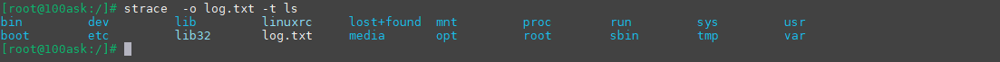

<a id="_Toc197788774"></a>
## 2.4 开发工具应用

### 2.4.1 Grep

Linux grep 命令用于查找文件里符合条件的字符串。

grep 指令用于查找内容包含指定的范本样式的文件，如果发现某文件的内容符合所指定的范本样式，预设 grep 指令会把含有范本样式的那一列显示出来。若不指定任何文件名称，或是所给予的文件名为 -，则 grep 指令会从标准输入设备读取数据。

-   -   -   -   1.  语法

```
grep [-abcEFGhHilLnqrsvVwxy][-A<显示列数>][-B<显示列数>][-C<显示列数>][-d<进行动作>][-e<范本样式>][-f<范本文件>][--help][范本样式][文件或目录...]
```

参数：

-   -   \-a 或 --text : 不要忽略二进制的数据。
    -   \-A&lt;显示行数&gt; 或 --after-context=&lt;显示行数&gt; : 除了显示符合范本样式的那一列之外，并显示该行之后的内容。
    -   \-b 或 --byte-offset : 在显示符合样式的那一行之前，标示出该行第一个字符的编号。
    -   \-B&lt;显示行数&gt; 或 --before-context=&lt;显示行数&gt; : 除了显示符合样式的那一行之外，并显示该行之前的内容。
    -   \-c 或 --count : 计算符合样式的列数。
    -   \-C&lt;显示行数&gt; 或 --context=&lt;显示行数&gt;或-&lt;显示行数&gt; : 除了显示符合样式的那一行之外，并显示该行之前后的内容。
    -   \-d &lt;动作&gt; 或 --directories=&lt;动作&gt; : 当指定要查找的是目录而非文件时，必须使用这项参数，否则grep指令将回报信息并停止动作。
    -   \-e&lt;范本样式&gt; 或 --regexp=&lt;范本样式&gt; : 指定字符串做为查找文件内容的样式。
    -   \-E 或 --extended-regexp : 将样式为延伸的正则表达式来使用。
    -   \-f&lt;规则文件&gt; 或 --file=&lt;规则文件&gt; : 指定规则文件，其内容含有一个或多个规则样式，让grep查找符合规则条件的文件内容，格式为每行一个规则样式。
    -   \-F 或 --fixed-regexp : 将样式视为固定字符串的列表。
    -   \-G 或 --basic-regexp : 将样式视为普通的表示法来使用。
    -   \-h 或 --no-filename : 在显示符合样式的那一行之前，不标示该行所属的文件名称。
    -   \-H 或 --with-filename : 在显示符合样式的那一行之前，表示该行所属的文件名称。
    -   \-i 或 --ignore-case : 忽略字符大小写的差别。
    -   \-l 或 --file-with-matches : 列出文件内容符合指定的样式的文件名称。
    -   \-L 或 --files-without-match : 列出文件内容不符合指定的样式的文件名称。
    -   \-n 或 --line-number : 在显示符合样式的那一行之前，标示出该行的列数编号。
    -   \-o 或 --only-matching : 只显示匹配PATTERN 部分。
    -   \-q 或 --quiet或--silent : 不显示任何信息。
    -   \-r 或 --recursive : 此参数的效果和指定"-d recurse"参数相同。
    -   \-s 或 --no-messages : 不显示错误信息。
    -   \-v 或 --invert-match : 显示不包含匹配文本的所有行。
    -   \-V 或 --version : 显示版本信息。
    -   \-w 或 --word-regexp : 只显示全字符合的列。
    -   \-x --line-regexp : 只显示全列符合的列。
    -   \-y : 此参数的效果和指定"-i"参数相同。
        -   -   1.  示例
-   查找log文件内某个时间的所有记录

```bash
grep -n '2020-10-24 00:01:11' *.log
```

grep "被查找的字符串" 文件名

例子：在当前目录里第一级文件夹中寻找包含指定字符串的 .in 文件

```bash
grep "thermcontact" /.in
```

-   从文件内容查找与正则表达式匹配的行：

```bash
grep –e "正则表达式" 文件名
```

-   查找时不区分大小写：

```bash
grep –i "被查找的字符串" 文件名
```

-   查找匹配的行数：

```bash
grep -c "被查找的字符串" 文件名
```

-   从文件内容查找不匹配指定字符串的行：

```bash
grep –v "被查找的字符串" 文件名
```

-   从根目录开始查找所有扩展名为 .log 的文本文件，并找出包含 "ERROR" 的行：

```bash
find / -type f -name "*.log" | xargs grep "ERROR"
```

-   从当前目录开始查找所有扩展名为 .in 的文本文件，并找出包含 "thermcontact" 的行：

```bash
find . -name "*.in" | xargs grep "thermcontact"
```

参考阅读

[https://www.gnu.org/software/grep/manual/grep.html](https://www.gnu.org/software/grep/manual/grep.html)

[https://www.runoob.com/linux/linux-comm-grep.html](https://www.runoob.com/linux/linux-comm-grep.html)

https://www.runoob.com/linux/linux-comm-grep.html

### 2.4.2 Gawk

awk 是一种编程语言，用于在linux/unix下对文本和数据进行处理。数据可以来自标准输入、一个或多个文件，或其它命令的输出（即管道）。它支持用户自定义函数和 动态正则表达式等先进功能，是linux/unix下的一个强大编程工具。它在命令行中使用，但更多是作为脚本来使用。

awk的处理文本和数据的方式是这 样的，它逐行扫描文件，从第一行到最后一行，寻找匹配的特定模式的行，并在这些行上进行你想要的操作。如果没有指定处理动作，则把匹配的行显示到标准输出 (屏幕),即默认处理动作是print；如果没有指定模式，则所有被操作所指定的行都被处理，即默认指定模式是全部。awk分别代表其作者姓氏的第一个字母。因为它的作者是三个人，分别是Alfred Aho、Brian Kernighan、Peter Weinberger。gawk是awk的GNU版本，它提供了Bell实验室和GNU的一些扩展。

像shell一样，awk也有好几种，常见的如awk、nawk、mawk、gawk，其中

-   gawk:是 GNU Project 的awk解释器的开放源代码实现。
-   尽管早期的 GAWK 发行版是旧的 AWK 的替代程序，但不断地对其进行了更新，以包含 NAWK 的特性;

目前，大家都比较倾向于使用awk和gawk,本文中要介绍的awk是以GUN的gawk为例。

gawk命令可用于：

-   -   逐行扫描文件。
    -   将每个输入行拆分为字段。
    -   比较输入行列/方向与样式。
    -   在匹配的行上执行操作。
    -   转换数据文件。
    -   生成格式化的报告。
    -   格式化输出行。
    -   算术和字符串运算。
    -   条件和循环。
        -   -   1.  语法格式

```
gawk [POSIX / GNU style options] -f progfile [--] file ...
gawk [POSIX / GNU style options] [--] 'program' file ...
```

一些重要的参数

-   \-f progfile, –file=progfile: 从文件program-file而不是从第一个命令行参数读取AWK程序源。可以使用多个-f（或–file）选项。
-   \-F fs, –field-separator=fs: 它将FS用作输入字段分隔符（FS为预定义变量的值）。
-   \-v var=val, –assign=var=val: 在程序开始执行之前，将值val分配给变量var。
    -   -   -   1.  示例
-   \-F：它将FS用作输入字段分隔符（FS预定义变量的值）。

```bash
gawk -F: '{print $1}' /etc/passwd
```

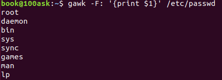

-   \-f：从文件program-file而不是从第一个命令行参数读取AWK程序源。可以使用多个-f（或–file）选项。

```bash
gawk -F: -f test.txt /etc/passwd
```

参考资料

https://www.gnu.org/software/gawk/manual/gawk.html

https://www.geeksforgeeks.org/gawk-command-in-linux-with-examples/

### 2.4.3 Sed

sed是流编辑器。它可以对文件执行很多功能，例如搜索，查找和替换，插入或删除。流编辑器用于对输入流（文件或来自管道的输入）执行基本的文本转换。尽管在某种程度上类似于允许脚本化编辑的编辑器（例如ed），但 sed仅对输入进行一次传递即可工作，因此效率更高。但这是sed在管道中过滤文本的能力，这使其与其他类型的编辑器特别有区别。

-   -   -   -   1.  语法

```
sed [-hnV][-e<script>][-f<script文件>][文本文件]
```

参数说明：

-   \-e&lt;script&gt;或--expression=&lt;script&gt; 以选项中指定的script来处理输入的文本文件。
-   \-f&lt;script文件&gt;或--file=&lt;script文件&gt; 以选项中指定的script文件来处理输入的文本文件。
-   \-h或--help 显示帮助。
-   \-n或--quiet或--silent 仅显示script处理后的结果。
-   \-V或--version 显示版本信息。

动作说明：

-   -   a ：新增， a 的后面可以接字串，而这些字串会在新的一行出现(目前的下一行)～
    -   c ：取代， c 的后面可以接字串，这些字串可以取代 n1,n2 之间的行！
    -   d ：删除，因为是删除啊，所以 d 后面通常不接任何咚咚；
    -   i ：插入， i 的后面可以接字串，而这些字串会在新的一行出现(目前的上一行)；
    -   p ：打印，亦即将某个选择的数据印出。通常 p 会与参数 sed -n 一起运行～
    -   s ：取代，可以直接进行取代的工作哩！通常这个 s 的动作可以搭配正规表示法！例如 1,20s/old/new/g 就是啦！
        -   -   1.  示例

通常这样使用sed命令：

```bash
sed SCRIPT INPUTFILE...
```

例如，在文件input.txt中替换所有出现的“hello”为“word” ，并重定向输出到output.txt文件内。

```bash
sed 's/hello/world/' input.txt > output.txt
```

-   如果未指定INPUTFILE，或者如果 INPUTFILE 为 - ，sed过滤标准输入的内容。以下命令是等效的：

```bash
sed 's/hello/world/' input.txt > output.txt
sed 's/hello/world/' < input.txt > output.txt
cat input.txt | sed 's/hello/world/' - > output.txt
```

-   sed将输出写入标准输出。用-可以就地编辑文件，而不是打印到标准输出。另请参见W和s///w命令，用于将输出写入其他文件。以下命令修改file.txt 并且不产生任何输出：

```bash
sed -i 's/hello/world/' file.txt
```

-   默认情况下，sed打印所有已处理的输入（诸如命令 修改/删除的输入除外）。用 -n 禁止输出，使用 p 显示特定的行。以下命令仅打印输入文件的第45行：

```bash
sed -n '45p' file.txt
```

-   sed将多个输入文件视为一个长流。以下示例显示第一个文件的第一行（one.txt）和最后一个文件的最后一行（three.txt）。

```bash
sed -n  '1p ; $p' one.txt two.txt three.txt
```

不管是-e 或 -f选项，sed使用第一个非选项参数作为脚本，然后使用以下非选项参数作为输入文件。

如果使用 -e命令或者 -f选项用于指定脚本，并非所有的非选项参数均作为输入文件。

选项 -e 和 -d可以组合，并且可以多次出现（在这种情况下，最终有效的脚本将是所有单个脚本的串联）。

以下示例是等效的：

```bash
sed 's/hello/world/' input.txt > output.txt
sed -e 's/hello/world/' input.txt > output.txt
sed --expression='s/hello/world/' input.txt > output.txt
echo 's/hello/world/' > myscript.sed
sed -f myscript.sed input.txt > output.txt
sed --file=myscript.sed input.txt > output.txt
```

扩展参考

GNU官方SED命令手册:

[https://www.gnu.org/software/sed/manual/html\_node/sed-commands-list.html](https://www.gnu.org/software/sed/manual/html_node/sed-commands-list.html)

[https://www.gnu.org/software/sed/manual/sed.html](https://www.gnu.org/software/sed/manual/sed.html)

### 2.4.4 GNU Binutils工具集

GNU Binutils是二进制工具的集合。主要的是：

-   -   ld -GNU链接器。
    -   as -GNU汇编器。

但它们还包括：

-   -   addr2line-将地址转换为文件名和行号。
    -   ar-用于创建，修改和提取档案的实用程序。
    -   c ++ filt-过滤以解编码编码的C ++符号。
    -   dlltool-创建用于构建和使用DLL的文件。
    -   gold-一个新的，更快的，仅ELF的链接器，仍处于beta测试中。
    -   gprof-显示分析信息。
    -   nlmconv-将目标代码转换为NLM。
    -   nm-列出目标文件中的符号。
    -   objcopy-复制并转换目标文件。
    -   objdump-显示目标文件中的信息。
    -   ranlib-生成指向档案内容的索引。
    -   readelf-显示来自任何ELF格式对象文件的信息。
    -   size-列出的对象或归档文件的部分的尺寸。
    -   strings-列出文件中的可打印字符串。
    -   strip-丢弃的符号。
    -   windmc -Windows兼容的消息编译器。
    -   windres -Windows资源文件的编译器。

这些程序大多数使用BFD（二进制文件描述符库）进行低级操作。他们中的许多人还使用操作码库来汇编和反汇编机器指令。

<a id="_Toc197788775"></a>
## 2.5 文件系统和闪存类应用

### 2.5.1 fdisk分区工具使用

运行环境

-   -   支持的INIT服务:　systemV systemD
    -   支持的开发板系统: Buildroot Yocto busybox
        -   -   1.  fdisk工具使用界面简介

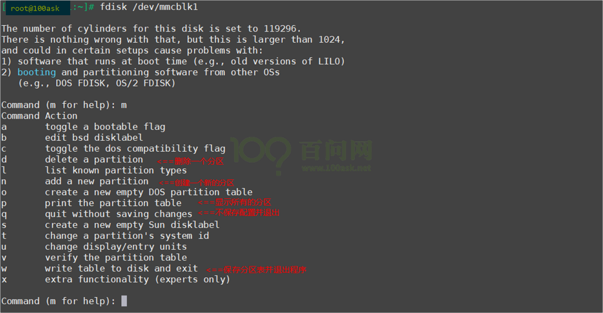

-   -   -   -   1.  查看当前系统内所有分区

使用 fdisk –l列出系统下的所有磁盘设备分区信息，每个磁盘设备的提示信息意义为:

-   -   Device：装置档名，依据不同的磁盘界面/分区位置而变。
    -   StartCHS,EndCHS：指的是MBR分区的开始和结束地址。
    -   Boot：是否为开机启动区块？通常 Windows 系统的 C 需要这块。
    -   Start, End：这个分区在哪个磁柱号码之间，可以决定分区的大小；
    -   Sectors：这里指的是此分区占用的扇区个数一共有多少个。
    -   Id，Type：分别代表文件系统代号，磁盘类型。

此时我们需要得知，不同的设备分区来自哪个磁盘设备，如下图所示,/dev/mmcblk0为我插入的8GB SD卡设备，此时可以从下图中得知　此sd卡有两个分区信息，容量大小为7560MB。

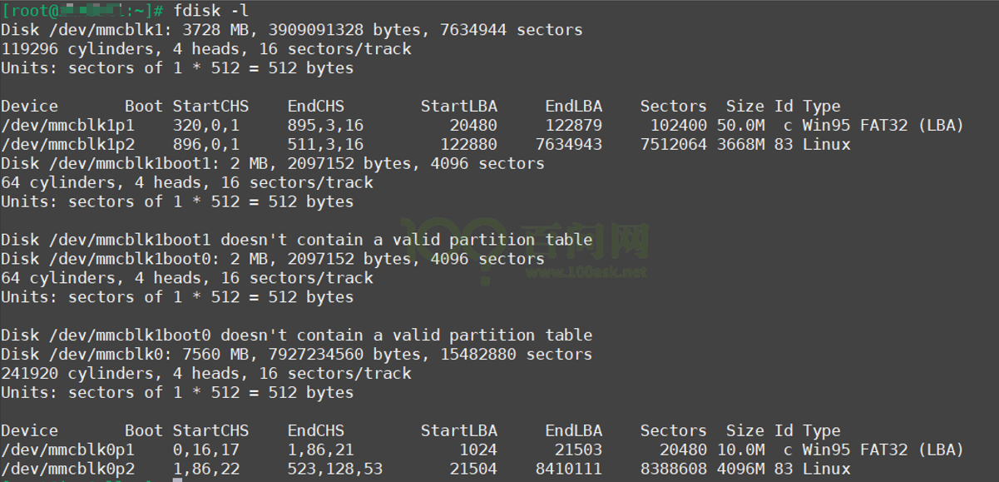

-   -   -   -   1.  新增一个分区

**注意:**如下示例演示的SD卡设备节点为/dev/mmcblk0 你的可能会是/dev/mmcblk1 或者其它，请根据卡插入后终端提示来修改为相应的。

fdisk /dev/mmcblk0 ：先进入 fdisk 画面；

-   p ：先看一下分区的信息，这里显示只有一个分区。
-   n ：这个时候让你选择primary partition(主分区) 还是extended(扩展分区)，我们这里输入p 选择主分区。
-   2 ：此时让你输入创建到第几个分区，这里直接输入2, 输入成功后再次打印显示分区信息，显示已经有两个分区。
-   w ：按 w 可将分区信息存储到分区表中，并离开 fdisk ；当然啰， 如果你反悔了，直接按下 q 就可以取消刚刚的删除动作,此时，我们需要格式化并挂载新的分区。

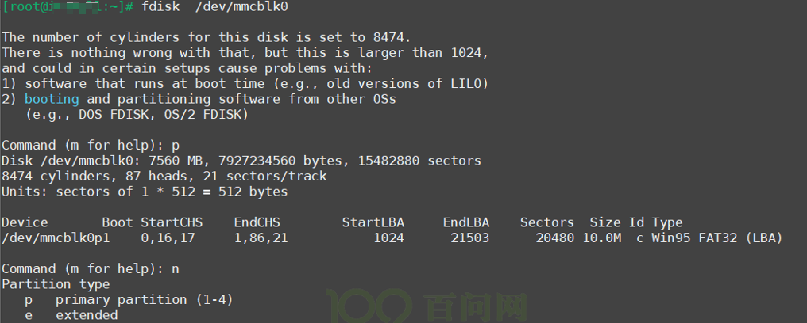

从上图可知，我们的第二个分区设备为 /dev/mmcblk0p2 ，分区类型为 Linux ,此时我们可以用如下命令对其进行格式化，并挂载。

```bash
// 格式化此分区设备为ext3格式，如果提示是否强制继续，输入y即可
[root@100ask:~]# mkfs.ext3 /dev/mmcblk0p2
```

格式化完成后，需要将其挂载到相应的目录，才可对其进行操作，此时我们挂载的目录为 /mnt

```bash
[root@100ask:~]# mount  -t ext3 /dev/mmcblk0p2 /mnt
```

此时可以使用 df –Th命令查看系统所有的挂载信息，来确认是否挂载成功 以及分区的详细信息。

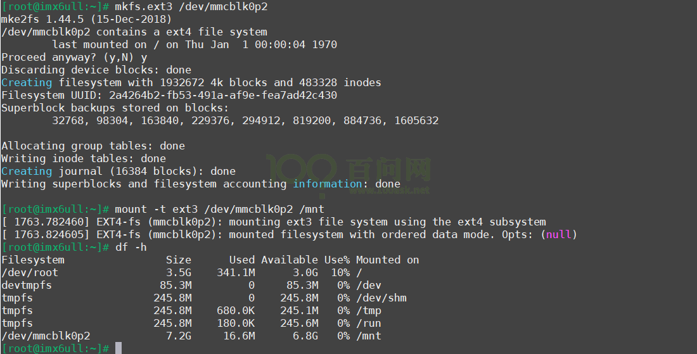

-   -   -   -   1.  删除一个分区

fdisk /dev/mmcblk0 ：先进入 fdisk 操作界面；

-   p ：先看一下分区的信息，这里显示只有一个分区。
-   d ：这时候让你选择删除那个分区，我们有两个分区就选择删除第 2 个分区好了，删除后，再次输入p来查看当前磁盘设备有几个分区。
-   w ：按 w 可将分区信息存储到分区表中，并离开 fdisk ；当然啰， 如果你反悔了，直接按下 q 就可以取消刚刚的删除动作。

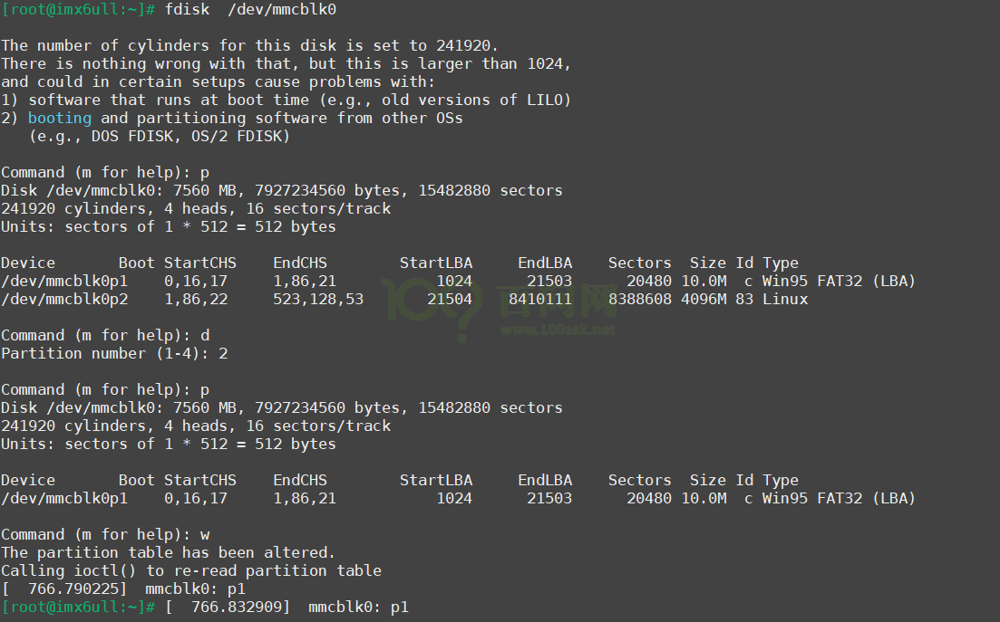

-   -   -   -   1.  修改某个分区的分区类型

fdisk /dev/mmcblk0 ：先进入 fdisk 操作界面；

-   p ：先看一下分区的信息，这里显示只有一个分区。
-   n ：这个时候让你选择primary partition(主分区) 还是extended(扩展分区)，我们这里输入p 选择主分区。
-   t ：输入t表示要修改分区类型，然后输入需要修改的分区，这里选择第二个分区，
-   L ：列出所有的分区类型，此时输入我们将要修改成的分区类型，这里是要修改成FAT32(LBA)分区类型，所以输入c 。
-   p ：再次显示所有的分区类型，看是否已经更改。
-   w ：按 w 可将分区信息存储到分区表中，并离开 fdisk ；当然啰， 如果你反悔了，直接按下 q 就可以取消刚刚的删除动作,此时，我们需要格式化并挂载新的分区。

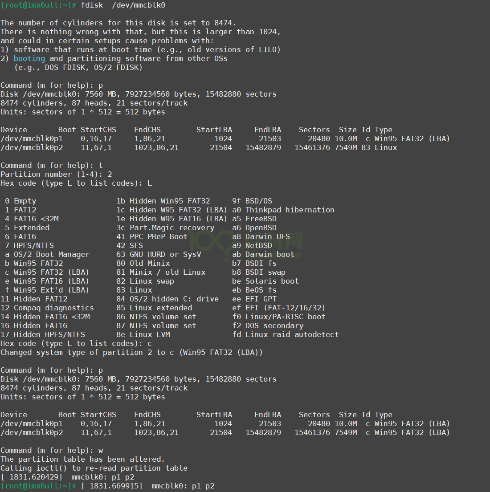

从上图可知，我们的第二个分区设备为 /dev/mmcblk0p2 ，分区类型为重新设置为FAT32,此时我们可以用如下命令对其进行格式化，并挂载。

```bash
// 格式化此分区设备为fat格式，如果提示是否强制继续，输入y即可
[root@100ask:~]# mkfs.fat  /dev/mmcblk0p2
```

格式化完成后，需要将其挂载到相应的目录，才可对其进行操作，此时我们挂载的目录为 /mnt

```bash
[root@100ask:~]# mount  -t vfat /dev/mmcblk0p2 /mnt
```

此时可以使用 df –Th命令查看系统所有的挂载信息，来确认是否挂载成功 以及分区的详细信息。

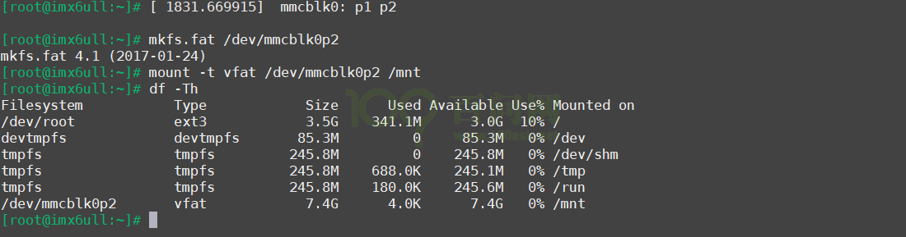

### 2.5.2 使用resize2fs命令调整rootfs分区大小

运行环境

-   支持的INIT服务: systemV systemD
-   支持的开发板系统: Buildroot Yocto busybox

在开发板执行如下命令来扩充 rootfs分区容量大小,调整完成后执行 sync同步缓存数据。

```bash
[root@100ask:~]# resize2fs  /dev/mmcblk2p3
[root@100ask:~]# sync
```

同步之后可以使用df -h命令来查看当前系统分区空间大小信息。

```bash
[root@100ask:~]# df -h
```

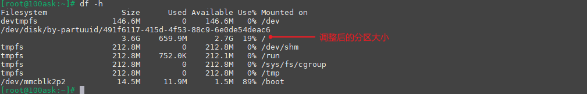

<a id="_Toc197788776"></a>
## 2.6 硬件处理类工具

### 2.6.1 设备调试工具i2c-tools

i2c-tools是一组I²C程序，无需编写任何代码即可轻松调试I²C设备，i2c-tools有如下几个测试命令i2cdetect, i2cdump, i2cget, i2cset。

-   -   -   -   1.  用i2cdetect检测有几组i2c总线在系统上，输入：i2cdetect -l

```bash
[root@100ask:~]# i2cdetect -l
```

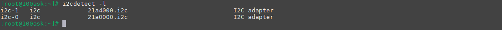

由上图可知，系统中存在两组总线分别i2c-1和i2c-0。

-   -   -   -   1.  用i2cdetect检测挂载在i2c总线上器件，输入 i2cdetect -r -y 0（检测i2c-0的挂载情况）。

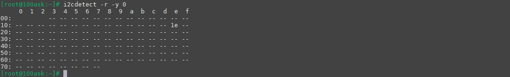

-   -   -   -   1.  用i2cdump查看挂载在i2c 0 总线上器件地址为0x1e的所有寄存器值，其中 0x1e为ap3216传感器模块的id。

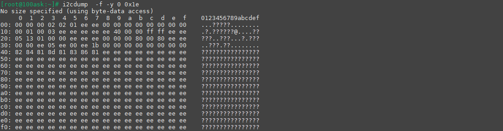

-   -   -   -   1.  使用i2cget -f -y 1 0x1e 0x0 （读取i2c-1上0x20器件的0x0存器值）。


-   -   -   -   1.  使用i2cset -f -y 1 0x1e 0x0 3 (设置i2c-0上0x1e器件的0x00寄存器值为0x3)

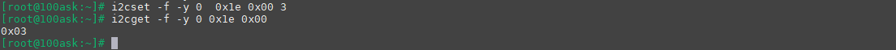

### 2.6.2 Irda设备调试irda-utils

### 2.6.3 内存测试mtester

您可以使用压力测试的memtester命令查找内存子系统故障。 memtester命令是有效的用户空间测试工具，用于对内存子系统进行压力测试。 在Linux下查找间歇性和不确定性故障非常有效。

可以按以下方式运行memtester：

```bash
[root@100ask:~]# memtester MEMORY ITERATIONS
```

其中 MEMORY：要分配和测试的内存量（以兆字节为单位）、ITERATIONS：要迭代的循环数。

如果一切正常，默认值为无限循环退出代码为0。否则会使如下退出值

-   x01 表示分配或锁定内存错误，或调用错误
-   x02 表示卡住地址测试期间出错
-   x04 其他测试之一中的错误

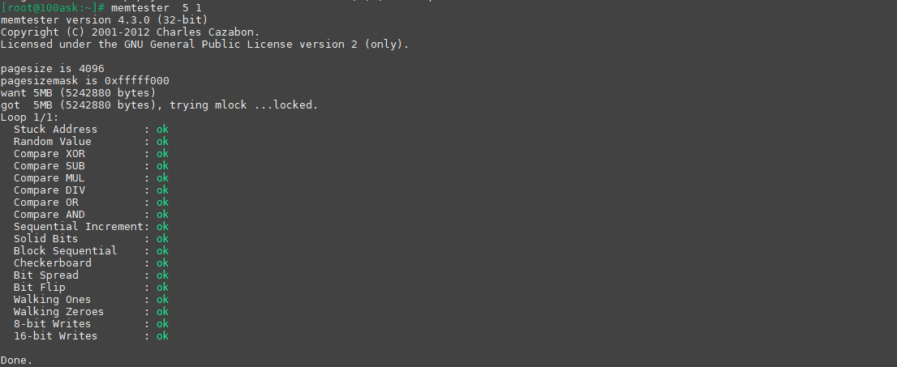

<a id="_Toc197788777"></a>
## 2.7 开发语言和脚本语言

### 2.7.1 python环境测试

运行环境

-   支持的INIT服务: systemV systemD
-   支持的开发板系统: Buildroot Yocto qt版本系统

开发板终端上输入python即可进入python编译器界面，我们在里面执行print ("hello word")让其输出hello word来验证python环境是否正常。

```bash
[root@100ask:~]# python
```

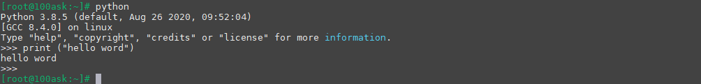

如上图所示成功打印hello word字符，表示python基本环境正常，可以使用 ctrl + d组合键来退出python环境。

### 2.7.2 Shell

<a id="_Toc197788778"></a>
## 2.8 网络通信类应用

### 2.8.1 开机自动设置IP

运行环境

-   支持的INIT服务: systemD
-   支持的开发板系统: Buildroot Yocto

设置eth0自动获取IP地址,如下操作在开发板/etc/network/目录下对interfaces文件进行修改。

```bash
[root@100ask:~]# vi /etc/network/interfaces
```

修改并为如下内容，保存并退出，执行/etc/init.d/S40network restart 重启网络服务。

```
auto lo
iface lo inet loopback
auto eth0
iface eth0 inet dhcp
```

设置eth0为静态IP地址, 开发板/etc/network/目录下对interfaces文件进行修改 。

```bash
[root@100ask:~]# vi /etc/network/interfaces
```

修改并为如下内容，保存并退出，执行/etc/init.d/S40network restart 重启网络服务。

```
auto lo
iface lo inet loopback
auto eth0
iface eth0 inet static
address 192.168.5.11
netmask 255.255.255.0
gateway 192.168.5.1
```

参考下图执行/etc/init.d/S40network restart 命令。

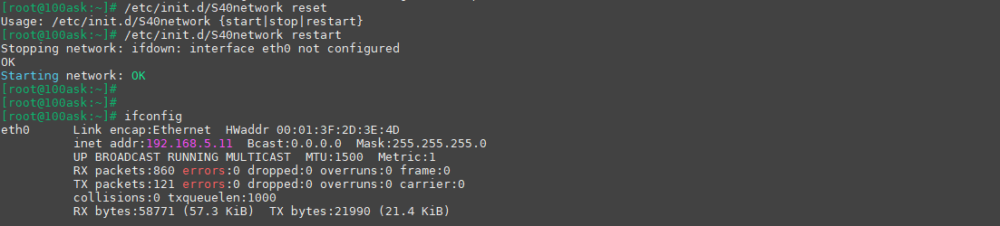

### 2.8.2 PING

PING主要用来测试网络的连通性，也可以测试网络延迟以及丢包率。

-   -   -   -   1.  接线与信息输出

通过CAT6网线将设备连接到交换机或路由器，控制台会显示内核输出的连接信息，如下：

```bash
[root@100ask:~]# [   11.495330] fec 20b4000.ethernet eth0: Link is Up - 100Mbps/Full - flow control off
[   11.503167] IPv6: ADDRCONF(NETDEV_CHANGE): eth0: link becomes ready
```

-   -   -   -   1.  测试外网网址

```bash
[root@100ask:~]# ping www.baidu.com -I eth0
PING www.baidu.com (112.80.248.75) 56(84) bytes of data.
64 bytes from 112.80.248.75 (112.80.248.75): icmp_seq=1 ttl=56 time=28.3 ms
64 bytes from 112.80.248.75 (112.80.248.75): icmp_seq=2 ttl=56 time=26.4 ms
64 bytes from 112.80.248.75 (112.80.248.75): icmp_seq=3 ttl=56 time=34.5 ms
64 bytes from 112.80.248.75 (112.80.248.75): icmp_seq=4 ttl=56 time=106 ms
```

**注意：**ping公网需要确保DNS正常工作。

上面结果显示www.baidu.com经过域名解析之后的IP地址为112.80.248.75, icmp\_seq代表icmp包的编号，如果编号连续说明没有丢包；time代表响应的延迟时间，当然这个时间越短越好。除了对以太网进行测试，ping命令也可以用于测试Wi-Fi。

### 2.8.3 ssh登陆工具使用

运行环境

-   支持的INIT服务: systemV systemD
-   支持的开发板系统: Buildroot Yocto busybox

开发板系统默认自带ssh服务，可以通过网络方式远程登录开发板，用以传输文件或者开发。

首先需要将开发板联网并可以ping通widnows或者ubuntu主机，保证局域网内网络连通。

如下图所示，我的开发板IP地址为192.168.1.12 ，则使用mobaxterm来建立一个ssh会话登录到开发板。

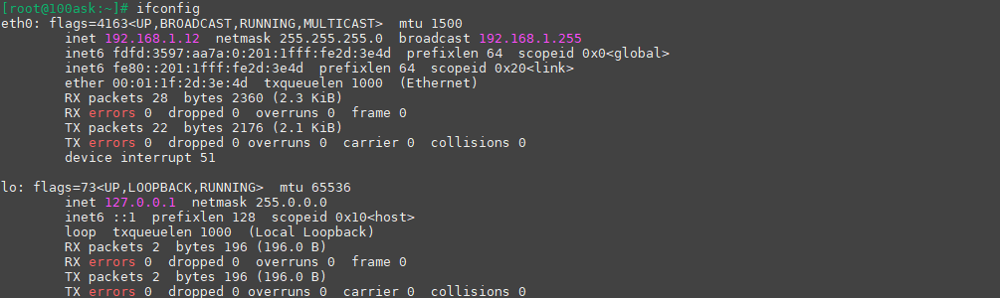

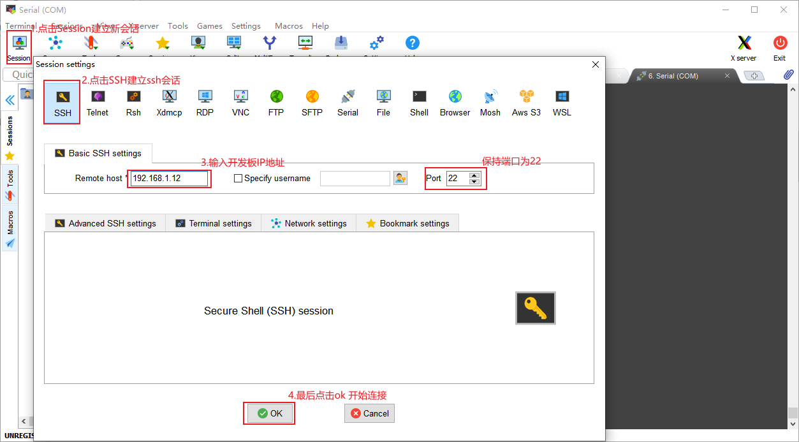

如果点击ok后输入root用户名提示需要输入密码表示ssh服务不支持root用户空密码登录，则需要参考参考如下配置来修改ssh配置文件增加对root用户空密码的支持。

在开发板终端上编辑ssh配置文件

```bash
[root@100ask:~]# vi  /etc/ssh/sshd_config
```

在/etc/ssh/sshd\_config最后中加入或者修改，如下图示例，添加完成后，输入 :wq 保存并退出，之后执行reboot命令重启开发板系统。

```
PermitRootLogin yes 			#允许root登录
PermitEmptyPasswords yes 		#允许空密码登录
```

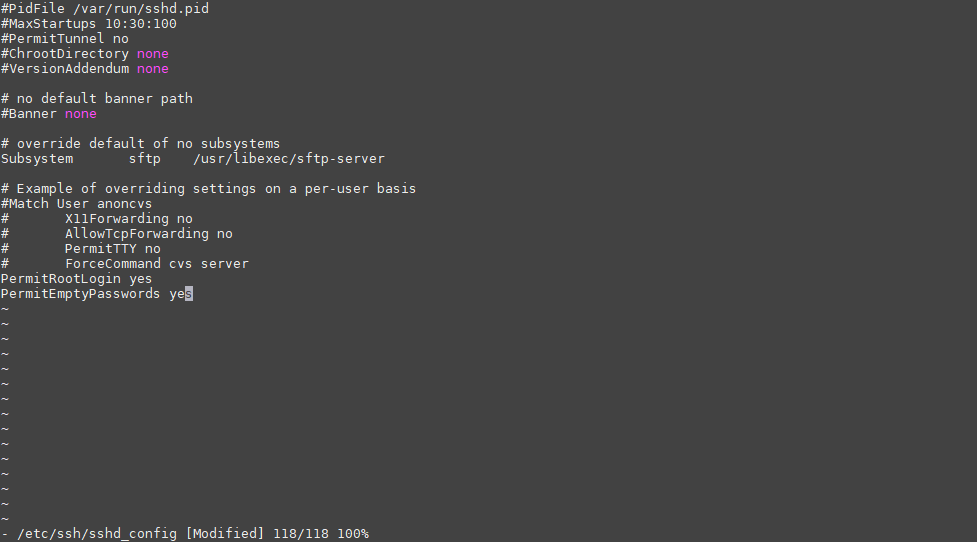

重启系统后，首先确保开发板已经获取到IP地址，之后重新打开ssh会话，输入root用户名按下回车确定即可登录开发板系统。

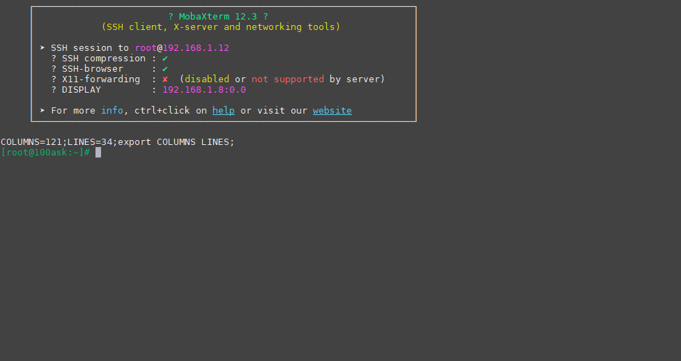

### 2.8.4 hci工具使用说明

运行环境

-   支持的INIT服务: systemV systemD
-   支持的开发板系统: Buildroot Yocto busybox

hci工具集是用来设置并查看蓝牙芯片特性的一套工具集，如下所示演示如何启用蓝牙设备，并扫描周边普通蓝牙设备和低功耗蓝牙设备，最后通过sdptool 命令来查看扫描到设备的详细参数。

如下所示，使用hciconfig -a命令查看板载目前都有蓝牙设备，以及获取所有蓝牙设备的详细信息。

```bash
[root@100ask:~]# hciconfig -a
```

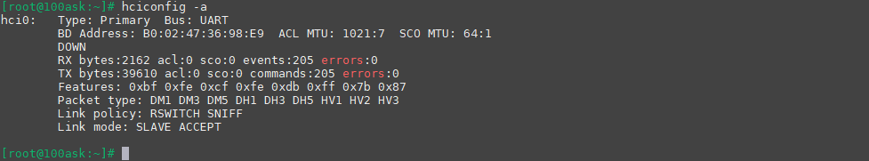

由上图我们可以知道有

```bash
[root@100ask:~]# hciconfig hci0 up
[root@100ask:~]# hciconfig hci0
```

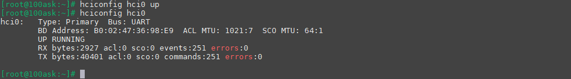

```bash
[root@100ask:~]# hcitool scan
```

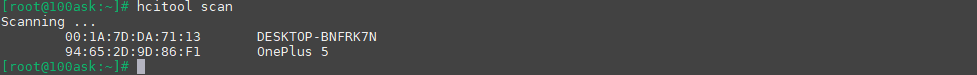

```bash
[root@100ask:~]# hcitool lescan
```

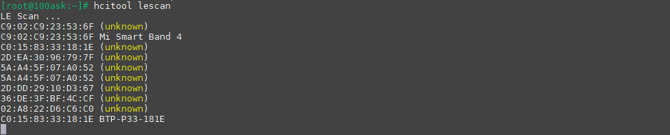

```bash
[root@100ask:~]# hcitool leinfo C9:02:C9:23:53:6F
```

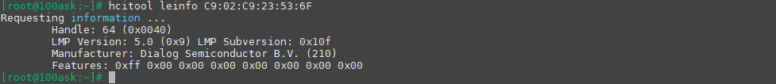

```bash
[root@100ask:~]# sdptool  browse
```

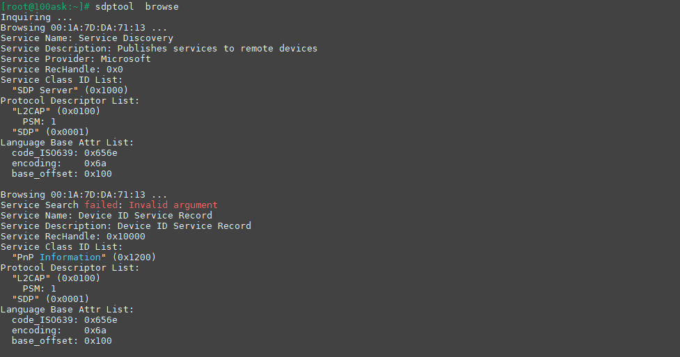

### 2.8.5 iw工具使用说明

运行环境

-   支持的INIT服务: systemV systemD
-   支持的开发板系统: Buildroot Yocto busybox

使用iw命令获取周围所有wifi网络的详细信息。

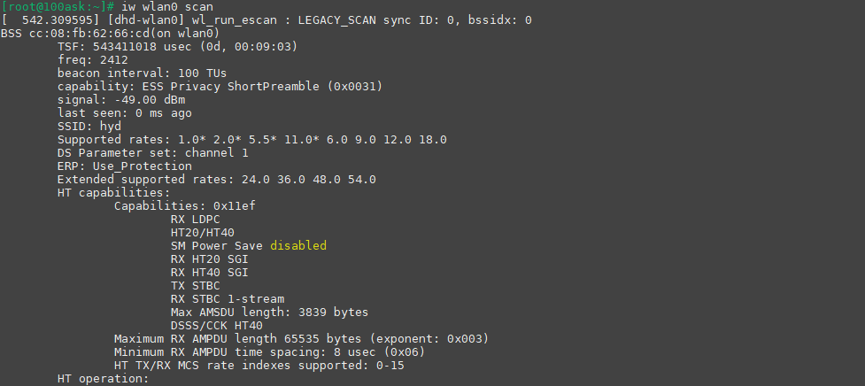

<a id="_Toc197788779"></a>
## 2.9 系统工具

进程也是操作系统中的一个重要概念，它是一个程序的一次执行过程，程序是进程的一种静态描述，系统中运行的每一个程序都是在它的进程中运行的。Linux系统中所有的进程是相互联系的，除了初始化进程外，所有进程都有一个父进程。新的进程不是被创建，而是被复制，或是从以前的进程复制而来。Linux中所有的进程都是由一个进程号为1的init进程衍生而来的。Linux系统包括3种不同类型的进程，每种进程都有自己的特点和属性：

1.  交互进程：由一个Shell启动的进程，既可以在前台运行，又可以在后台运行。
2.  批处理进程：这种进程和终端没有联系，是一个进程序列。这种进程被提交到等待队列顺序执行的进程。
3.  监控进程(守护进程)：守护进程总是活跃的，一般是在后台运行，守护进程一般是由系统在开始时通过脚本自动激活启动或root启动
4.  对于linux系统来说，进程的管理是重要的一环，对于进程的管理通常是通过进程管理工具实现的，Linux系统中比较常用的进程管理命令有以下几种： ps top vmstat kill 。

### 2.9.1 显示当前进程工具

显示当前系统进程的运行情况，一般语法如下：

```bash
[root@100ask:~]# ps --help
BusyBox v1.31.1 (2020-10-13 11:02:58 UTC) multi-call binary.
Usage: ps [-o COL1,COL2=HEADER]
Show list of processes
        -o COL1,COL2=HEADER     Select columns for display
```

部分参数组合说明：

-   \-u：以用户为中心组织进程状态信息显示；
-   \-a：与终端无关的进程；
-   \-x：与终端有关的进程； （线程，就是轻量级进程；）

通常上面命令组合使用：aux。

-   \--e：显示所有进程；相当于ax；
-   \-f：显示完整格式程序信息；

通常以上命令组合使用：ef

-   \-H：以进程层级显示进程数的
-   \-F：显示更多的程序信息

通常组合使用命令：eHF

显示所有进程的信息情况示例如下：

```bash
[root@100ask:~]#  ps aux
PID   USER     COMMAND
    1 root     init [3]
    2 root     [kthreadd]
    3 root     [ksoftirqd/0]
    5 root     [kworker/0:0H]
    6 root     [kworker/u2:0]
    7 root     [rcu_preempt]
    8 root     [rcu_sched]
    9 root     [rcu_bh]
   10 root     [migration/0]
   11 root     [lru-add-drain]
   12 root     [cpuhp/0]
   13 root     [kdevtmpfs]
   14 root     [oom_reaper]
   15 root     [writeback]
   16 root     [kcompactd0]
   17 root     [crypto]
   18 root     [bioset]
   19 root     [kblockd]
   21 root     [ata_sff]
   22 root     [cfg80211]
   23 root     [watchdogd]
   24 root     [rpciod]
   25 root     [xprtiod]
   26 root     [kswapd0]
   27 root     [vmstat]
   28 root     [nfsiod]
   74 root     [bioset]
```

其中PID为当前进程的ID号 USER表示表示程序所属用户 COMMAND 表示运行的应用程序

### 2.9.2 top显示linux进程

top命令将相当多的系统整体性能信息放在一个屏幕上。显示内容还能以交互的方式进行改变。动态的持续监控进程的运行状态，top语法一般如下：

```bash
[root@100ask:~]# top  --help
BusyBox v1.31.1 (2020-10-13 11:02:58 UTC) multi-call binary.
Usage: top [-b] [-n COUNT] [-d SECONDS]
Provide a view of process activity in real time.
Read the status of all processes from /proc each SECONDS
and display a screenful of them.
Keys:
        N/M/P/T: sort by pid/mem/cpu/time
        R: reverse sort
        Q,^C: exit
Options:
        -b      Batch mode
        -n N    Exit after N iterations
        -d SEC  Delay between updates
```

动态查看系统进程示例如下：

```bash
Mem: 165428K used, 335520K free, 820K shrd, 17492K buff, 37752K cached
CPU:   0% usr   1% sys   0% nic  98% idle   0% io   0% irq   0% sirq
Load average: 0.06 0.06 0.02 1/117 814
  PID  PPID USER     STAT   VSZ %VSZ %CPU COMMAND
  814   317 root     R     2708   1%   1% top
  113     2 root     SW       0   0%   0% [mmcqd/0]
  266     1 root     S    51280  10%   0% /usr/sbin/NetworkManager
  278     1 mosquitt S     5412   1%   0% /usr/sbin/mosquitto -c /etc/mosquitto/mosquitto.conf
    1     0 root     S     1748   0%   0% init [3]
  803     2 root     SW       0   0%   0% [kworker/0:2]
  284     1 root     S<    102m  21%   0% /usr/bin/pulseaudio --system --daemonize --disallow-module-loading --disallow-exit --exit-idle-
  315     1 root     S    43916   9%   0% /usr/bin/swupdate -f /etc/swupdate/swupdate.cfg -L -e rootfs,rootfs-2 -u
  258     1 root     S    40784   8%   0% /usr/sbin/ModemManager
  295   284 root     S    19192   4%   0% /usr/libexec/pulse/gsettings-helper
  319   315 root     S    17512   3%   0% /usr/bin/swupdate -f /etc/swupdate/swupdate.cfg -L -e rootfs,rootfs-2 -u
  197     1 root     S    11480   2%   0% /sbin/udevd -d
  273     1 root     S     7900   2%   0% /usr/sbin/ntpd -g
  292     1 root     S     7388   1%   0% /usr/sbin/wpa_supplicant -u
  303     1 root     S     5880   1%   0% /usr/sbin/sshd
  342   317 root     S     4164   1%   0% psplash -n
  317     1 root     S     3388   1%   0% -bash
```

对其上面一些任务栏进行简单解释说明：

-   VSZ：vittual memory size 虚拟内存集
-   RSS：resident size，常驻内存集
-   STAT：进程状态有以下几个
    -   R：runing
    -   S：interuptable sleeping 可中断睡眠
    -   D：uninteruptable sleeping 不可中断睡眠
    -   T：stopped
    -   Z: zombie僵尸进程
    -   +:前台进程
    -   N:低优先级进程
    -   l:多线程进程

### 2.9.3 vmstat虚拟内存的统计工具

这个命令可查看内存空间的使用状态，能获取整个系统的性能粗略信息，vmstat运行于两种模式：采样模式和平均模式。如果不指定参数，则vmstat统计运行于平均模式下，vmstat显示从系统启动以来所有统计数据的均值。常用语法以及参数如下：

```bash
[root@100ask:~]# vmstat -h
Usage:
 vmstat [options] [delay [count]]
Options:
 -a, --active           active/inactive memory
 -f, --forks            number of forks since boot
 -m, --slabs            slabinfo
 -n, --one-header       do not redisplay header
 -s, --stats            event counter statistics
 -d, --disk             disk statistics
 -D, --disk-sum         summarize disk statistics
 -p, --partition <dev>  partition specific statistics
 -S, --unit <char>      define display unit
 -w, --wide             wide output
 -t, --timestamp        show timestamp
 -h, --help     display this help and exit
 -V, --version  output version information and exit
```

vmstat运行于平均模式，显示从系统启动以来所有统计数据的均值：

```bash
[root@100ask:~]# vmstat
procs -----------memory---------- ---swap-- -----io---- -system-- ------cpu-----
 r  b  swpd  free buff  cache   si   so    bi    bo   in   cs us sy id wa st
 0  0  0 200640  13556 131852  0  0  39    11  148  227  6  3 90  0  0
```

对其上面一些任务栏进行简单解释说明

-   r：当前可运行的进程数。这些进程没有等待I/O,而是已经准备号运行。理想状态，可运行进程数与可用cpu数量相等
-   b：等待I/O完成的被阻塞进程数
-   forks：创建新进程的次数
-   in：系统发生中断的次数
-   cs：系统发生上下文切换的次数
-   us：用户进程消耗的总CPU时间百分比
-   sy：系统代码消耗的总CPU时间的百分比，其中包括消耗在system、irq和softirq状态的时间
-   wa：等待I/O消耗的总CPU的百分比
-   id：系统空闲消耗的总CPU时间的百分比

统计系统各种数据详细信息如下：

```bash
[root@100ask:~]# vmstat -s
       435992 K total memory
        90008 K used memory
        82380 K active memory
        88924 K inactive memory
       200528 K free memory
        13556 K buffer memory
       131900 K swap cache
            0 K total swap
            0 K used swap
            0 K free swap
        20273 non-nice user cpu ticks
         4412 nice user cpu ticks
        19691 system cpu ticks
       630164 idle cpu ticks
          241 IO-wait cpu ticks
            0 IRQ cpu ticks
           22 softirq cpu ticks
            0 stolen cpu ticks
       127150 pages paged in
        36195 pages paged out
            0 pages swapped in
            0 pages swapped out
       969112 interrupts
      1492562 CPU context switches
   1581090644 boot time
        10649 forks
```

对其上面一些任务栏进行简单解释说明：

-   total memory：系统总内存
-   used memory：已使用内存
-   CPU ticks：显示的是自系统启动的CPU时间，这里的“tick”是一个时间单位
-   forks：大体上表示的是从系统启动开始已经创建的新进程的数量
-   vmstat提供了关于linux系统性能的众多信息。在调查系统问题时，它是核心工具之一。

### 2.9.4 kill进程终止工具

发送指定的信号到相应进程。不指定型号将发送SIGTERM（15）终止指定进程。如果任无法终止该程序可用“-KILL” 参数，其发送的信号为SIGKILL(9) ，将强制结束进程，使用ps命令或者jobs 命令可以查看进程号。root用户将影响用户的进程，非root用户只能影响自己的进程。kill命令一般语法如下：

```
kill [ -s signal | -p ] [ -a ] pid ...
kill -l [ signal ]
```

部分参数组合说明：

-   \-s：指定发送的信号
-   \-p：模拟发送信号
-   \-l：指定信号的名称列表
-   pid：要中止进程的ID号
-   Signal：表示信号

1.  首先使用ps -ef与管道命令确定要杀死进程的PID。

```bash
[root@100ask:~]# ps -ef | grep mxapp2
  835 root     /usr/bin/mxapp2 --plugin tslib:/dev/input/event1
 3148 root     grep mxapp2
```

1.  然后输入以下命令终止进程：

```bash
[root@100ask:~]# kill -9 835
```

1.  killall命令终止同一进程组内的所有进程，允许指定要终止的进程的名称而非PID进程号。

```bash
[root@100ask:~]# killall mxapp2
```

### 2.9.5 du命令统计目录大小

运行环境

-   支持的INIT服务:systemV systemD
-   支持的开发板系统:Buildroot Yocto busybox

du命令支持参数简介

```bash
[root@100ask:~]# du [-aHLdclsxhmk] 文件或目录名称
```

选项与参数：

-   -   \-a：同时显示每个文件的文件大小
    -   \-d：N将输出限制为深度&lt;N的目录
    -   \-c：显示总计
    -   \-s：每个参数仅显示总计
    -   \-x：跳过不同文件系统上的目录
    -   \-h：可读格式的大小（例如1K 243M 2G）
    -   \-m：大小（以兆字节为单位）
    -   \-k：大小（以千字节为单位）（默认）
        -   -   1.  统计/etc目录下所有文件所占用的容量。

先执行“cd /etc”进入/etc目录，再执行du命令：

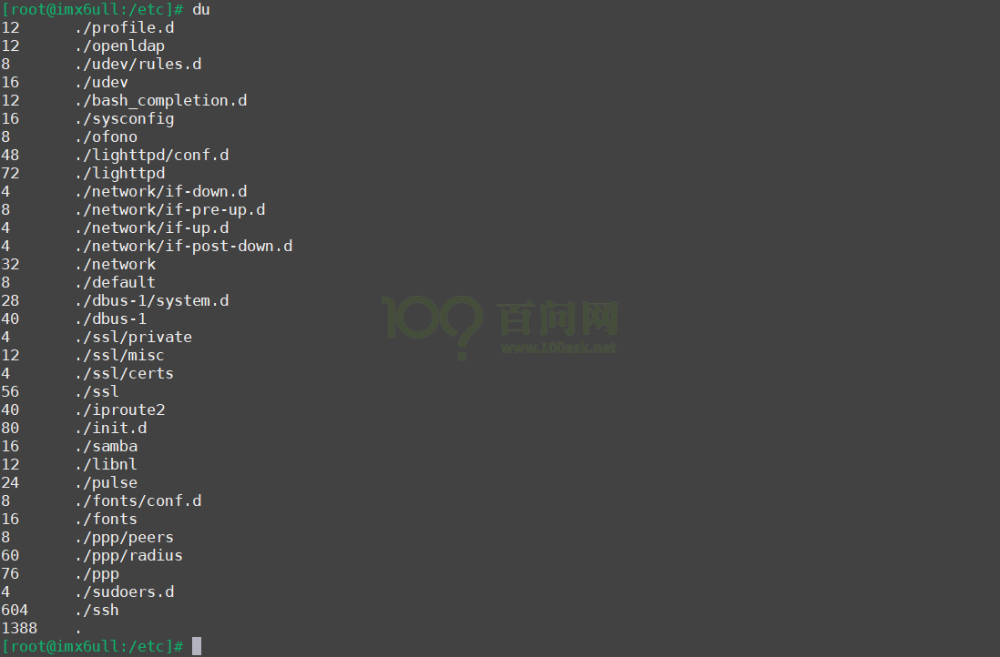

-   -   -   -   1.  统计每个文件和目录所占用的容量大小，并以易读的方式展示出来

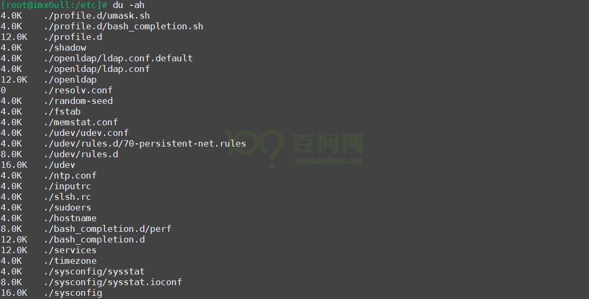

-   -   -   -   1.  统计根目录下每个目录所占用的容量

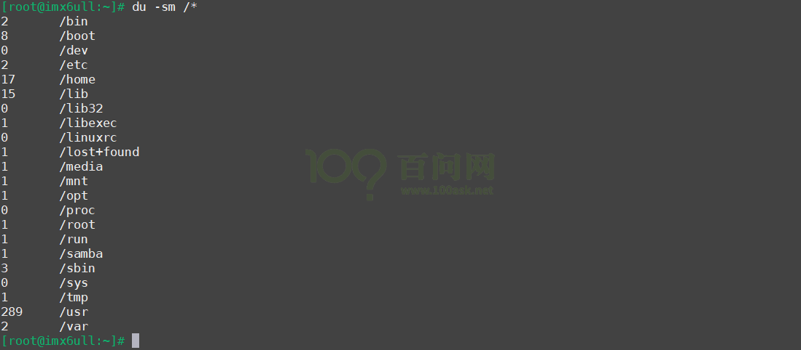

-   -   -   -   1.  示例四:统计 /etc目录下层级1的所有目录所占用的大小。

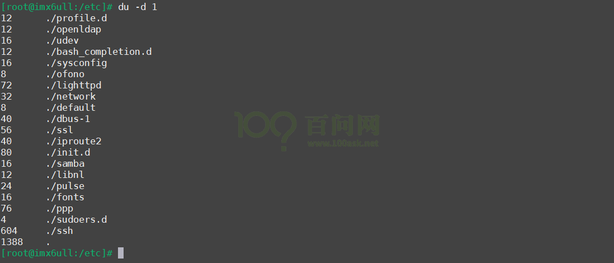

### 2.9.6 df：查看系统已用空间

运行环境

-   支持的INIT服务:systemV systemD
-   支持的开发板系统: Buildroot Yocto busybox

df支持的命令参数简介

```bash
[root@100ask:~]# df [-PkmhT] [目录或档名]
```

选项与参数：

-   -   \-k：以 KBytes 的容量显示各档案系统；
    -   \-m：以 MBytes 的容量显示各档案系统；
    -   \-h：以人们较易阅读的 GBytes, MBytes, KBytes 等格式自行显示；
    -   \-T：连同该 partition 的 filesystem 名称 (例如 ext3) 也列出；

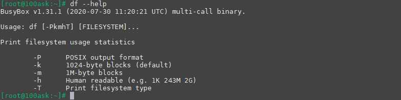

-   -   -   -   1.  将系统内所有的 Filesystem 列出来！

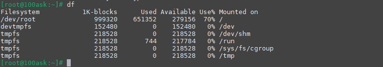

-   -   -   -   1.  将文件系统容量显示格式以易读的方式展示。

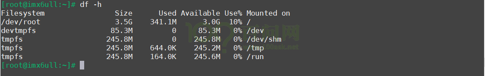

-   -   -   -   1.  将系统内的文件系统类型和容量大小以易读的方式展示出来。

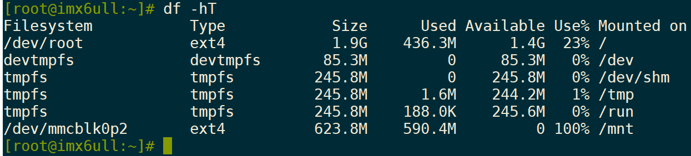

-   -   -   -   1.  输出结果提示信息含义简介。
    -   Filesystem：代表该系统是在哪个设备的哪个分区，有些是虚拟文件系统比如tmpfs。
    -   Type： 文件系统类型。
    -   1k-blocks：说明底下的数字单位是 1KB ，可利用 -h 或 -m 来改变单位；
    -   Used：顾名思义，就是使用掉的磁盘空间。
    -   Available：也就是剩下的磁盘空间大小。
    -   Use%：就是磁盘的使用率，如果使用率高达 90% 以上时， 最好需要注意一下了，免得容量不足造成系统问题。
    -   Mounted on：就是磁盘挂载所在目录。

df读取的资料整个文件系统的统计信息，在显示的结果中你需要特别留意的是那个根目录(/dev/root)的剩余容量。所有的资料都是由根目录衍生出来的，当根目录的剩余容量剩下 0 时，那你的 Linux 存储空间肯定不够了。

### 2.9.7 kmod内核模块管理工具使用

运行环境

-   支持的INIT服务: systemV systemD
-   支持的开发板系统: Buildroot Yocto busybox
    -   -   -   1.  lsmod：列出已经安装了哪些模块

```bash
[root@100ask:~]# lsmod
```

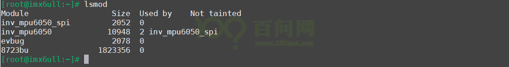

提示信息含义说明:

-   -   Module :表示模块的名称。
    -   Size ： 表示模块的大小
    -   Used： 使用者。
        -   -   1.  insmod：手工安装模块

后面讲到的modprobe命令，它是从/lib/modules下的目录里自动安装某个模块。但是在实验过程中，我们经常需要手工安装其他目录下的模块，可以使用以下命令安装(需要指定模块文件即ko文件的位置)。

```bash
[root@100ask:~]# insmod /path/to/module/xxx.ko
[root@100ask:~]# insmod  -f  /path/to/module/xxx.ko    // 强制安装
```

开发板出厂时运行的是我们编译好的内核，当你做实验时需要先编译出自己的内核，然后编译出自己的驱动程序。如果你不想替换内核，那么你的驱动程序跟板上的内核并不完全匹配。这时就要用insmod -f命令强制安装驱动程序。下面是一个例子：


-   -   -   -   1.  rmmod：卸载掉某个已安装的模块

```bash
[root@100ask:~]# rmmod <模块名称>
```

从上图lsmod 可知系统已经安装了哪些模块，这里我们以卸载 usb wifi模块驱动为例，具体操作如下图所示。


-   -   -   -   1.  modinfo：查看某个模块的详细信息

```bash
[root@100ask:~]# modinfo <模块>
```


-   -   -   -   1.  modinfo命令用于显示kernel模块的信息。

用法：

```bash
[root@100ask:~]# modinfo [-adlpn0Fkbvh]  <模块文件>
```

-   \-a或--author 　显示模块开发人员。
-   \-d或--description 　显示模块的说明。
-   \-l或—license 显示版本信息
-   \-p或--parameters 　显示模块所支持的参数。
-   \-0或--null 用 \\0 代替 \\n
-   \-F或--field=FIELD 仅打印提供的字段
-   \-k或--set-version=VERSION 用 VERSION 代替 \`uname -r\`
-   \-b或--basedir=DIR 使用DIR作为/lib/modules的文件系统根目录
-   \-V或--version 显示版本信息
-   \-h或--help 显示帮助信息

可以在开发板执行modinfo -h命令查看帮助信息，如下图：


下面是一个例子，用来显示evbug模块的信息：

```bash
[root@100ask:~]# modinfo  evbug
```


-   -   -   -   1.  modprobe：自动安装模块

modprobe可载入指定的个别模块，或是载入一组相依的模块。modprobe会根据depmod所产生的相依关系，决定要载入哪些模块。若在载入过程中发生错误，则modprobe会卸载整组的模块。

insmod与modprobe都是用于安装内核模块，差别是：modprobe能够处理模块的依赖问题。比方你要加载a 模块，但是a要求系统先载入 b 模块时，直接用insmod加载可能会出现错误讯息。modprobe会自动加载b，才加载 a，帮你处理这些依赖关系。

用法：

```bash
[root@100ask:~]# modprobe [options] [模块名]
```

开发板执行modprobe -h可以看到命令用法，如下图：


常用的命令解释如下：

-   \-r 卸载模块
-   \-f 名制安装或卸载
-   \-r 删除模块（堆栈）或自动清洁
-   \-D 显示依赖

操作示例，modprobe自动解析依赖并安装相应模块：


**注意**：使用modproe也会碰到insmod同样的内核版本不一致问题，可以使用 modprobe -f 强制安装。

<a id="_Toc197788780"></a>
## 2.10 库

目前我们提供开发板系统镜像配套的工具链含有如下库，库的路径在

```
/home/book/100ask_imx6ull-sdk/ToolChain/arm-buildroot-linux-gnueabihf_sdk-buildroot/arm-buildroot-linux-gnueabihf/sysroot/usr/include
```

### 2.10.1 opencv库使用

使用python语言环境的opencv库来做相关开发示例，如下图所示，使用python语言去调用opecv模块库来显示图片。

```
import cv2
imgviewx=cv2.imread("/usr/share/myir/Capture/image2.png")
cv2.namedWindow("Linux")
cv2.imshow("Linux",imgviewx)
cv2.waitKey(0)
cv2.destroyAllWindows()
```

新建文件保存后，添加可执行权限，并用python来运行此python文件。

```bash
[root@100ask:~]# chmod +x opencv.py
[root@100ask:~]# python opencv.py
```


<a id="_Toc35963403"></a><a id="_Toc197788781"></a><a id="_Toc533007400"></a>注意事项与售后维修

-   -   -   -   1.  注意事项
-   使用产品之前，请仔细阅读本手册，并妥善保管，以备将来参考；
-   请注意和遵循标注在产品上的所有警示和指引信息；
-   请使用配套电源适配器，以保证电压、电流的稳定；
-   请在凉爽、干燥、清洁的地方使用本产品；
-   请勿在冷热交替环境中使用本产品，避免结露损坏元器件；
-   请勿在湿气过重、温度过高或过低环境中使用本产品，使用时注意产品的通风；
-   请勿将任何液体泼溅在本产品上，禁止使用有机溶剂或腐蚀性液体清洗本产品；
-   请勿在多尘、脏乱的环境中使用本产品，如果长期不使用，请包装好本产品；
-   请勿在振动过大的环境中使用，任何跌落、敲打或剧烈晃动都可能损坏线路及元器件；
-   请勿在通电情况下，插拔核心板及外围模块(特别是串口模块)；
-   请勿自行维修、拆解本产品，如产品出现故障应及时联系本公司进行维修；
-   请勿自行修改或使用未经授权的配件，由此造成的损坏将不予保修；
    -   -   -   1.  售后维修
-   保修期限
    -   <a id="_Hlk15482988"></a>底板、核心板：三个月（非人为损坏）
    -   显示屏：七天（非人为损坏）
-   保修说明
    -   7天内：产品（底板、核心板、屏幕）非人为损坏，本公司免费更换/维修，并承担来回运费；
    -   7天至3个月内：底板、核心板非人为损坏，本公司免费维修，并承担来回运费（屏幕不提供维修）；
    -   3个月至1年：底板、核心板非人为损坏或人为轻微损坏，只收更换元器件费用，免费维修，买家承担来回运费；
    -   起始时间以快递签收日为准；
-   联系方式

官方网站：[www.100ask.net](http://www.100ask.net)

淘宝网站：[100ask.taobao.com](https://100ask.taobao.com/)

地 址：广东省深圳市龙岗区布吉南湾街道平吉大道建昇大厦B1505

联系人：售后维修部

电 话：0755-86200561

邮 编：518114

邮寄须知：保修期限内，寄回本产品请预先垫付邮费，公司不接收任何到付快递。

<a id="_Toc197788782"></a><a id="_Toc35963404"></a><a id="_Toc533007401"></a>技术支持与开发定制

-   -   -   -   1.  技术**支持**范围

1) 本公司提供的各类开发软件的安装，入门使用，环境搭建；

2) 本公司提供的所有裸机代码的烧写验证；

3) 本公司发布的操作系统的编译、烧写；

4) 本公司发布产品的工控板、模块的硬件原理；

5) 本公司发布的各种外设模块驱动及源码；

6) 本公司发布的配套手册在使用过程中遇到的问题；

7) 本公司产品的故障诊断及售后维修服务；

-   -   -   -   1.  技术讨论范围

由于嵌入式系统知识范围广泛，涉及知识纷繁复杂，我们无法保证对各种问题都能一一解答，以下内容无法供技术支持，只能提供建议。

1) 本公司发布的教程之外的知识；

2) 非本公司发布的U-Boot、Linux内核的编译和移植；

3) 非本公司发布的工控板的各类驱动支持；

4) 非本公司发布的外设模块的硬件原理和驱动设计；

-   -   -   -   1.  技术支持方式

1) 官方论坛发帖提问(推荐)：[bbs.100ask.net](http://bbs.100ask.org/)

2) 官方淘宝通过阿里旺旺咨询：[100ask.taobao.com](https://100ask.taobao.com/)

3) QQ群咨询（QQ群号咨询淘宝客服，需提供淘宝购买订单号验证加入）；

-   -   -   -   1.  <a id="_Toc531941732"></a>技术**支持**时间

<a id="_Toc531941733"></a>星期一到星期五;上午 9:00—12:00;下午 14:00—17:30;

<a id="_Toc531941734"></a>公司按照国家法定节假日安排休息，在此期间无法提供技术支持，请将问题发送在论坛对应板块发帖，我们将在工作日尽快给您回复。

<a id="_Toc533007402"></a><a id="_Toc35963405"></a><a id="_Toc197788783"></a>资料获取与后续更新

#### 2.10.1.1 资料的获取

-   百度网盘下载

百度网盘里面有本产品的所有配套资料，包括原理图、发布的U-Boot、内核镜像和源码、所需的开发软件、工具等等。

进入[http://download.100ask.net/](http://download.100ask.net/)，找到对应的开发板即可。

-   视频配套教程

后续会为该工控板录制一套裸机、Linux驱动、应用的配套付费教学视频，有需要的客户可以进入官方淘宝[100ask.taobao.com](https://100ask.taobao.com/)选购。

#### 2.10.1.2 后续更新

后续文档、视频等资料的更新，为了确保您的资料是最新状态，请密切关注我们的动态，我们将会通过微信公众号和QQ群公告推送，购买了本产品的客户请添加QQ群（QQ群号咨询淘宝客服，需提供淘宝购买订单号验证加入）或关注微信公众号。

<a id="_Toc533007403"></a><a id="_Toc197788784"></a><a id="_Toc35963406"></a>版权声明

**百问科技©2022**

深圳百问网科技有限公司版权所有，并保留对本手册及声明的一切权力。未得到本公司的书面许可，任何单位和个人不得以任何方式或形式对本手册内的任何部分进行复制、摘录、备份、修改、传播、翻译成其他语言、将其全部或部分用于商业用途。
